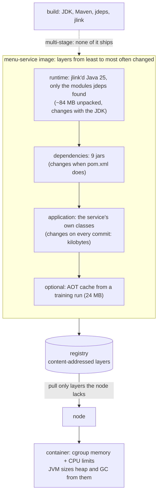

# 53. Containerization

<div class="badges" markdown><span class="badge badge-l1">L1 · Foundation</span><span class="badge badge-l2">L2 · Practitioner</span><span class="badge badge-l3">L3 · Senior/Lead</span><span class="badge badge-meta">Dockerfiles · layers · jlink · Jib · Buildpacks · distroless · JVM ergonomics · AOT cache · PID 1 · SBOMs</span></div>

<div class="grid two" markdown>

!!! info "Prerequisites"
    - [Chapter 41](../security/ch41-supply-chain-compliance.md): SBOMs, signing and provenance
    - [Chapter 52](../observability/ch52-health-checks-actuator.md): graceful shutdown on SIGTERM
    - [Chapter 4](../foundations/ch04-twelve-factor.md): build, release, run

!!! abstract "What you'll learn"
    - **Five ways to package menu-service**, pushed to a local registry:
        - The full JDK made a **469 MB** image; a jlink'd runtime with only the modules jdeps found made **88 MB**.
        - With the dependencies in their own layer, a one-class change re-uploaded **23–26 KB** instead of the whole 1.6 MB fat jar (the gap grows with the dependencies).
    - **JVM ergonomics in containers**:
        - With no flags, the JVM took **25% of the memory limit** as heap (48% at 256 MB) and chose **SerialGC** below 2 CPUs or about 1.8 GB.
        - `-Xmx1g` in a 512 MB container was **OOMKilled** by the kernel, with no Java error at all.
    - **Startup**: the JDK 25 AOT cache took first response from **1.2–1.3 s to about 0.5 s** at 1 CPU, for 24 MB of image.
    - **PID 1**: shell-form and wrapper-script entrypoints ignored SIGTERM. `docker stop` waited **10 s and killed** the service, so no graceful shutdown.

</div>

---

## 1 · Introduction & Context

### The image nobody wanted to pull

order-service's first container image was 470 MB: a full JDK base, a 90 MB fat jar, and a few things the build left behind. Every deploy pushed a new fat-jar layer to the registry, and every node pulled it. When the team moved to three regions and twenty deploys a day, pulls became the slowest step of a rollout, and a scaling event during a sale waited on image downloads.

Then two problems arrived in the same week. First, pods were OOMKilled every few hours with no `OutOfMemoryError` in any log; someone had set `-Xmx1g` in a 768 MB container. Second, rolling deploys always took exactly 30 seconds per pod. The entrypoint was `sh -c "java $JAVA_OPTS -jar app.jar"`, so SIGTERM went to the shell, the JVM never shut down gracefully, and Kubernetes waited out the grace period and killed it.

This chapter measures each of those decisions with Docker 29 and a local OCI registry:

- base runtimes and layering;
- what the JVM does with container limits;
- the JDK 25 AOT cache;
- entrypoint forms;
- non-root and read-only runtimes;
- what an SBOM of each image contains.

### Where it comes from

<ul class="mh-timeline">
<li><span class="when">2013–2017 · Docker, multi-stage builds</span><span class="what">Images as layered filesystems; multi-stage builds separate the build toolchain from what runs.</span></li>
<li><span class="when">2017–2018 · Distroless, Jib, JVM container support</span><span class="what">Google's distroless images drop shells and package managers. Jib builds layered Java images without a Dockerfile. JDK 10 (backported to 8u191) reads cgroup limits instead of the host's memory and CPUs.</span></li>
<li><span class="when">2018–2020 · Cloud Native Buildpacks, Boot layers</span><span class="what">Buildpacks detect and build images from source. Spring Boot 2.3 adds layered jars and <code>bootBuildImage</code>.</span></li>
<li><span class="when">2021–2024 · SBOMs, cgroup v2, jarmode tools</span><span class="what">Supply-chain rules call for SBOMs. Kubernetes and the JDK move to cgroup v2. Boot 3.3 adds <code>-Djarmode=tools extract</code> and CDS training runs.</span></li>
<li><span class="when">2025 · JDK 24–25 AOT cache</span><span class="what">JEP 483 caches loaded and linked classes; JEPs 514 and 515 add one-step training (<code>-XX:AOTCacheOutput</code>) and method profiles.</span></li>
</ul>

---

## 2 · Core Concepts & Terminology



Layer
:   A tar archive of filesystem changes, addressed by its digest. A registry stores each layer once, and a node pulls only the layers it lacks. Order layers from least to most often changed, and an ordinary commit changes only the last one.

jlink and jdeps
:   jdeps lists the JDK modules an application and its jars use. jlink builds a runtime containing only those modules: no compiler, no jmods, no tools you didn't ask for.

Fat jar vs layered
:   A fat (uber) jar is one file with every dependency inside, so any change makes a new multi-megabyte layer. A layered image puts dependencies and application classes in separate layers. Spring Boot's `-Djarmode=tools extract --layers` and Jib both do this.

Container ergonomics
:   The JVM reads the cgroup's memory and CPU limits. By default, the heap is 25% of the memory limit (`MaxRAMPercentage`), or 50% when memory is small. G1 is chosen only on a "server-class machine": at least 2 CPUs and about 1.8 GB.

PID 1
:   The first process in the container. `docker stop` and Kubernetes send SIGTERM to it. With an exec-form entrypoint it is the JVM. With a shell form or a script it is the shell, which doesn't pass the signal on.

---

## 3 · How It Works Internally

### What the JVM sees

menu-service logs its limits and the JVM's decisions at startup. That one line answers "why is the heap so small?" before anyone has to ask:

```java title="container/ContainerLimits.java"
--8<-- "code/chapters/ch53-containerization/src/main/java/dev/foodfleet/ch53/container/ContainerLimits.java:33:51"
```

```java title="container/ContainerLimits.java"
--8<-- "code/chapters/ch53-containerization/src/main/java/dev/foodfleet/ch53/container/ContainerLimits.java:89:97"
```

### A production Dockerfile for a Spring Boot service

A multi-stage build does the following:

- Builds with Maven.
- Extracts Boot's layers.
- Builds a runtime with jlink from the modules jdeps finds.
- Runs on distroless, which provides glibc and CA certificates with package metadata, and no shell.
- Records an AOT cache in a training run that starts the context and exits.
- Uses an exec-form entrypoint.

```dockerfile title="docker/Dockerfile"
--8<-- "code/chapters/ch53-containerization/src/main/resources/docker/Dockerfile"
```

!!! note "Why the lab builds differently"
    Docker Hub, gcr.io and Maven Central aren't reachable from the lab, so that Dockerfile can't run there. Each base image in the lab is built from scratch: a runtime from `$JAVA_HOME` (the whole JDK, jlink'd `java.se`, or jlink'd with jdeps' modules) plus the host's glibc. Spring Boot's layering is reproduced with plain layers. The comparisons don't depend on the base: they are about what is in each layer.

---

## 4 · Design Considerations & Trade-offs

### Test setup

All runs used:

- Docker 29.4.3 with the containerd image store.
- A local registry (distribution 3.1.2) and crane 0.22.1 to read manifests.
- Jib CLI 0.13.0 and syft 1.54.1.
- JDK 25.0.4.
- One 2-vCPU host.

menu-service is an HTTP service with SLF4J/Logback and Micrometer's Prometheus registry: 9 dependency jars, about 8 MB, built from their release tags. A typical Spring Boot service has 60–100 MB of dependencies, so the fat-jar re-uploads below are small compared with production.

There were two runs. Where they differed, both values are shown. `check_apis.sh` checks **9 defaults** in OpenJDK, Spring Boot and Spring Framework, and all were found.

### Measured: five ways to package the same service

Each variant was built and pushed. Then one class changed (a version constant), and the variant was rebuilt with the build cache and pushed again. "Re-pushed" is the compressed size of the layers the registry didn't already have.

| Variant | Image (unpacked) | Pushed (compressed) | Layers | Rebuild after a one-class change | Re-pushed |
|---|---|---|---|---|---|
| Full JDK, fat jar | **469 MB** | 139.2 MB | 2 | 3.0–3.6 s | 1.6 MB |
| jlink `java.se`, fat jar | 119 MB | 43.5 MB | 2 | 2.8–3.0 s | 1.6 MB |
| jlink (jdeps modules), fat jar | **88 MB** | 30.5 MB | 2 | 2.6–4.7 s | 1.6 MB |
| jlink (jdeps modules), dependency layer + app layer | 88 MB | 30.5 MB | 4 | **1.7 s** | **26 KB** |
| Jib CLI on the same runtime | 88 MB | 30.5 MB | 4 | 3.0–4.1 s | **23 KB** |

What the table shows:

- **The runtime is most of the image.** The JDK alone was 465 MB unpacked, with compilers, jmods and tools nobody runs in production. jlink with the 7 modules jdeps found (`java.base, java.net.http, java.sql, jdk.httpserver, jdk.management`, plus `jdk.crypto.ec` for TLS and `jdk.jcmd` for diagnostics) took the image to 88 MB.
- **Layering decides what a commit costs.** A fat jar re-uploads every dependency on every change: 1.6 MB here, 60–90 MB for a typical Boot service, on every deploy, to every node. With dependencies in their own layer, the same change re-uploaded 23–26 KB. Docker's build cache also skipped the dependency step, so the rebuild was the fastest of all.
- **Jib got the same layering without a Dockerfile.** Jib's dependency, resource and class layers re-uploaded 23 KB. It builds and pushes without a Docker daemon, which suits CI runners. Spring Boot's `extract --layers` (or `bootBuildImage` with Buildpacks) gets the same result from a Boot jar.

### Measured: what the JVM makes of container limits

The JVM was run with no heap flags, under a range of `docker run` limits.

| Limits | Processors | Max heap | GC |
|---|---|---|---|
| 256 MB, 2 CPUs | 2 | 121 MiB (**48%**) | Serial |
| 512 MB, 2 CPUs | 2 | 123 MiB (24%) | Serial |
| 1 GB, 2 CPUs | 2 | 247 MiB (24%) | **Serial** |
| 2 GB, 2 CPUs | 2 | 512 MiB (25%) | G1 |
| 4 GB, 2 CPUs | 2 | 1,024 MiB (25%) | G1 |
| 1 GB, 0.5 CPU | **1** | 247 MiB | Serial |
| 4 GB, 1 CPU | 1 | 989 MiB | **Serial** |
| 4 GB, 1.5 CPUs | **2** | 1,024 MiB | G1 |

What the table shows:

- **Three quarters of the memory limit goes unused by default.** The heap is 25% of the limit, so a 1 GB container ran with a 247 MiB heap. Below about 512 MB, `MinRAMPercentage` (50%) applies instead. Set `-XX:MaxRAMPercentage=75` and leave the rest for metaspace, threads, direct buffers and the code cache.
- **Small containers get SerialGC.** G1 needs a "server-class machine": 2 or more CPUs and about 1.8 GB (2 GB less 256 MB). A 1 GB, 2-CPU container, or a 4 GB, 1-CPU one, got Serial, with stop-the-world pauses that grow with the heap. Choose the collector explicitly when it matters.
- **Fractional CPU limits round up.** 1.5 CPUs showed as 2 processors, and 0.5 as 1. Thread pools sized from `availableProcessors()` follow that.

Then a 512 MB container, holding a given amount of live data on the heap:

| Live data | Flags | Exit | Killed by the kernel | What the logs say |
|---|---|---|---|---|
| 400 MiB | none (heap 123 MiB) | 1 | no | `OutOfMemoryError` stack trace |
| 400 MiB | `MaxRAMPercentage=75` (heap 384 MiB) | 1 | no | `OutOfMemoryError` stack trace |
| 400 MiB | `MaxRAMPercentage=75 -XX:+ExitOnOutOfMemoryError` | **3** | no | `Terminating due to java.lang.OutOfMemoryError` |
| 300 MiB | `MaxRAMPercentage=75` | 0 | no | fits |
| 600 MiB | **`-Xmx1g`** | **137** | **yes (OOMKilled)** | nothing: the startup line, then silence |

What the table shows:

- **A heap larger than the container is a kernel kill, not a Java error.** With `-Xmx1g` in 512 MB, the JVM grew past the limit and the kernel killed it, with exit 137, `OOMKilled: true`, no stack trace and no heap dump. That's the incident from the introduction.
- **A heap that fits fails as Java.** Too much live data then produced a Java `OutOfMemoryError`. With `ExitOnOutOfMemoryError` the process exits at once (code 3), so Kubernetes restarts it cleanly instead of leaving a half-broken JVM serving.

### Measured: the JDK 25 AOT cache

menu-service was started 7 times per configuration in each run. The table shows the range of the two runs' medians for the time from `docker start` to the first answered `GET /menu`, the fastest and slowest single start, and the medians of the service's own "started in" log line.

| Image | CPUs | First response | "Started in" |
|---|---|---|---|
| jlink runtime | 1 | **1,204–1,277 ms** (1,146–1,380) | 886–939 ms |
| jlink runtime | 2 | 1,006–1,048 ms (903–1,312) | 646–730 ms |
| jlink runtime + AOT cache | 1 | **485–514 ms** (417–559) | 195–265 ms |
| jlink runtime + AOT cache | 2 | 406–416 ms (383–610) | 152–161 ms |

The cache came from a training run in the Dockerfile (`RUN ["java", "-XX:AOTCacheOutput=...", "-jar", ..., "--train"]`). It added **24 MB** to the image (118 MB against 88 MB).

What the table shows:

- **Class loading and linking dominate a small service's startup.** With them done ahead of time, the JVM answered 2.5 times sooner at 1 CPU.
- **It matters most where CPU is scarce.** That is a pod with a low CPU limit, or a node busy with other startups during a scale-out. The gain at 1 CPU (719–763 ms) was larger than at 2 (590–642 ms).
- **For Spring Boot,** train with `-Dspring.context.exit=onRefresh`, which starts the context and exits. Chapter 60 measures an AOT cache on menu-service against AppCDS and a native image, and covers CRaC.

### Measured: who receives SIGTERM

`docker stop` sends SIGTERM, waits 10 seconds, then sends SIGKILL.

| Entrypoint | Processes | Stop took | Exit | Graceful shutdown logged |
|---|---|---|---|---|
| Exec form `["java", ...]` | java | 165–171 ms | 143 (SIGTERM) | yes |
| Shell form `java ...` (`/bin/sh -c`) | shell, java its child | **10,174–10,204 ms** | **137 (SIGKILL)** | **no** |
| Script: `echo; java ...; echo` | shell, java its child | 10,200–10,204 ms | 137 | no |
| Script: `echo; exec java ...` | java | 157–169 ms | 143 | yes |

What the table shows:

- **The shell doesn't pass SIGTERM on.** With a shell form or a wrapper script, PID 1 was the shell, and the JVM never heard the signal. Every stop took the full grace period and ended in SIGKILL, so in-flight requests were cut and shutdown hooks never ran. In Kubernetes, that's 30 seconds per pod on every deploy.
- **`exec` in the script fixes it,** because the shell replaces itself with the JVM. The exec form needs no shell at all, which also suits distroless images.

### Measured: hardening and SBOMs

| `docker run` | menu-service | User |
|---|---|---|
| defaults (the image's `USER 10001`) | answered 200 | app |
| `--read-only` | answered 200 | app |
| `--read-only --tmpfs /tmp` | answered 200 | app |
| `--cap-drop ALL --security-opt no-new-privileges` | answered 200 | app |
| `--user 0` | answered 200 | **root** |

What syft 1.54.1 found in each image:

| Image | Unpacked | Files | Packages found |
|---|---|---|---|
| Full JDK | 465 MB | 414 | 1 Java runtime (binary), 1 jar |
| jlink `java.se` | 116 MB | 199 | 1 Java runtime, 1 jar |
| jlink (jdeps modules) | 84 MB | 123 | 1 Java runtime, 1 jar |
| menu-service on it | 88 MB | 133 | 1 Java runtime, **11 jars** |

What the tables show:

- **A Java service needs none of the privileges it gets by default.** It ran as a non-root user, on a read-only root filesystem, with every Linux capability dropped. Run as root, it would have worked just as well, which is exactly why root needs to be refused rather than merely avoided.
- **An SBOM sees only what has package metadata.** syft listed the Java runtime and the jars. It didn't list glibc, because the lab copied glibc into the image without the Debian package database. A CVE scanner would then never flag a glibc vulnerability in these images. That's why distroless and Buildpacks base images ship package metadata, and why a hand-built base is a supply-chain liability. (The vulnerability database itself couldn't be downloaded in the lab, so no CVE scan was run.)

### Choosing

| Decision | Do | Why |
|---|---|---|
| Runtime | jlink with jdeps' modules (+ `jdk.crypto.ec`, `jdk.jcmd`), or a JRE base | 88 MB instead of 469 MB |
| OS layer | distroless (glibc, CA certificates, package metadata, no shell) | Scannable and minimal |
| Layering | Boot's `extract --layers`, Jib or Buildpacks | 23–26 KB per commit instead of the fat jar |
| Heap | `-XX:MaxRAMPercentage=75`, never an `-Xmx` above the limit | 25% wastes memory; above the limit is OOMKilled |
| GC | Set it explicitly on small containers | Below 2 CPUs and about 1.8 GB you get Serial |
| On OOM | `-XX:+ExitOnOutOfMemoryError` | Exit and restart cleanly |
| Startup | AOT cache from a training run | 2.5× faster first response at 1 CPU |
| Entrypoint | Exec form; `exec java` in scripts | Graceful shutdown on SIGTERM |
| Runtime security | Non-root user, read-only root FS, drop all capabilities | The service needs none of it |
| Supply chain | SBOM per image, scanned in CI (chapter 41) | Know what you ship |

---

## 5 · Hands-on Implementation

```text
ch53-containerization/
├── src/main/java/dev/foodfleet/ch53/container/   ContainerLimits
├── src/main/resources/docker/                   Dockerfile (multi-stage, Boot layers, jlink, distroless, AOT), dockerignore
├── src/test/java/…                              5 tests
└── verify/                                      build-libs.sh, run.sh, check_apis.sh, tools/ (MenuService, Alloc, Measure)
```

### 🟢 Level 1: an image that behaves

<div class="badges" markdown><span class="badge badge-l1">L1 · Foundation</span></div>

- Use a multi-stage build, an exec-form `ENTRYPOINT`, a non-root `USER`, and `.dockerignore` (no `.git`, no secrets).
- Set `-XX:MaxRAMPercentage=75 -XX:+ExitOnOutOfMemoryError`, and never set `-Xmx` from a different number than the limit.

### 🔵 Level 2: small and layered

<div class="badges" markdown><span class="badge badge-l2">L2 · Practitioner</span></div>

- Extract Boot's layers, or use Jib or Buildpacks. Use a jlink'd runtime on distroless.
- Log the container limits and the JVM's ergonomics at startup.
- Tag images with the commit SHA; deploy by digest.

```bash
verify/run.sh images jvm      # about 5 minutes
```

### 🟣 Level 3: fast, hardened, accounted for

<div class="badges" markdown><span class="badge badge-l3">L3 · Senior/Lead</span></div>

- Add an AOT cache from a training run (`-Dspring.context.exit=onRefresh` for Boot).
- Use a read-only root filesystem with a tmpfs for `/tmp`, drop all capabilities, and set `no-new-privileges` (in Kubernetes: `securityContext`).
- Generate an SBOM per image, scan it, sign the image (chapter 41), and rebuild on base-image updates.

### Run and verify

```text
$ verify/run.sh runtime
ENTRYPOINT                             processes              stop took   exit   graceful shutdown logged
exec form ["java", ...]                java                      165 ms    143   yes
shell form: java ... (/bin/sh -c)      shell, java as its child  10174 ms    137   no
script: echo; java ...; echo           shell, java as its child  10200 ms    137   no
script: echo; exec java ...            java                      157 ms    143   yes
```

!!! question "Try it"
    1. Move the `COPY app/lib/` line below the application jar in the layered Dockerfile. What does a one-class change re-push now?
    2. Run `Alloc 300` with `--memory=512m --cpus=1` and `-XX:+UseG1GC`. Does G1 work below "server class"?
    3. Train the AOT cache with a different workload (`/actuator/prometheus` only). Does startup change?
    4. Run menu-service with `--read-only` and without `/tmp`, and take a heap dump with `jcmd`. Where can it write?

---

## 6 · Production Readiness

- [x] **Multi-stage build**; no build tools, sources or secrets in the runtime image
- [x] **jlink'd runtime or JRE on distroless**; package metadata present for scanners
- [x] **Layered**: dependencies, loader, snapshots, application
- [x] **Exec-form entrypoint**; scripts end in `exec java`
- [x] **`MaxRAMPercentage=75`, `ExitOnOutOfMemoryError`**; GC chosen explicitly for small containers
- [x] **Non-root, read-only root FS, no capabilities**
- [x] **AOT cache** for services that scale out under load
- [x] **SBOM, scan, signature** per image; images tagged by commit and deployed by digest

---

## 7 · Anti-patterns & Pitfalls

!!! pitfall "Incident 1: OOMKilled with no OutOfMemoryError"
    **Context.** order-service ran with `JAVA_OPTS=-Xmx1g` in containers limited to 768 MB.

    **Symptoms.** Pods restarted every few hours with `OOMKilled`. There were no Java errors and no heap dumps.

    **Root cause.** The heap was allowed to grow past the container's limit, so the kernel killed the process. Measured: `-Xmx1g` in a 512 MB container holding 600 MB died with exit 137 and `OOMKilled: true`, silently.

    **Fix.** Use `MaxRAMPercentage=75` and `ExitOnOutOfMemoryError`. The same pressure then gives a Java OOM and a clean exit, with code 3.

!!! pitfall "Incident 2: every deploy took 30 seconds a pod"
    **Context.** The entrypoint was `sh -c "java $JAVA_OPTS -jar app.jar"`.

    **Symptoms.** Pods always took the full grace period to terminate. No shutdown logs appeared, and requests were cut mid-flight.

    **Root cause.** PID 1 was the shell, which doesn't forward SIGTERM. Measured: 10.2 seconds and SIGKILL with shell form or a wrapper script; 157–171 ms with exec form or `exec java`.

    **Fix.** Use exec form, or `exec` in the script. For `JAVA_OPTS`, use `JAVA_TOOL_OPTIONS`, which the JVM reads itself.

!!! pitfall "Incident 3: slow scale-out on sale day"
    **Context.** A fat-jar image on a JDK base, about 470 MB unpacked, deployed twenty times a day.

    **Symptoms.** New nodes took minutes to start pods during a scale-out. Registry egress costs grew.

    **Root cause.** Every deploy produced a new fat-jar layer, and every new node pulled a full JDK. Measured: 469 MB against 88 MB with a jlink'd runtime; 1.6 MB against 23–26 KB re-pushed per one-class change.

    **Fix.** Use a jlink'd runtime on distroless with layered dependencies, and pre-pull base layers on node images.

| Anti-pattern | Symptom | Fix |
|---|---|---|
| Full JDK as the runtime base | 469 MB images | jlink or JRE |
| Fat jar in one layer | Every commit re-uploads every dependency | Layers, Jib, Buildpacks |
| `-Xmx` larger than the limit | OOMKilled, no Java error | `MaxRAMPercentage` |
| No heap flags | 25% of the limit used, SerialGC | `MaxRAMPercentage=75`, explicit GC |
| Shell-form entrypoint | No graceful shutdown, slow deploys | Exec form, `exec java` |
| Running as root | Full container privileges for no reason | `USER`, `runAsNonRoot` |
| `COPY . .` without `.dockerignore` | Secrets and `.git` in the image | `.dockerignore` |
| `latest` tags | Can't tell what runs; rollbacks guess | Commit SHA tags, digests |
| Hand-built base without package metadata | Scanners can't see OS libraries | distroless or Buildpacks bases |

---

## 8 · Enterprise Case Study

### FoodFleet: one image recipe for every service

!!! decision "ADR-053: multi-stage builds to jlink'd runtimes on distroless, layered with Spring Boot's extract; exec-form entrypoints; MaxRAMPercentage 75 and ExitOnOutOfMemoryError; non-root, read-only; AOT caches for scale-out services; SBOM, scan and signature per image"
    **Status:** Accepted · **Date:** 2025-10-27

    **Context.** 470 MB images slowed rollouts and scale-outs. Pods were OOMKilled with no Java error. Deploys took the full grace period per pod. Measured in the lab:

    - 469 MB with the JDK against 88 MB with jlink.
    - 1.6 MB against 23–26 KB re-pushed per one-class change.
    - `-Xmx1g` in 512 MB OOMKilled silently.
    - SerialGC below about 1.8 GB or 2 CPUs.
    - Shell-form entrypoints killed after 10 s with no shutdown.
    - The AOT cache took first response from 1.2–1.3 s to about 0.5 s at 1 CPU.

    **Decision.** One shared Dockerfile template, owned by the platform team:

    - **Build:** Maven in a JDK 25 build stage; Boot's `extract --layers --launcher`; jlink with jdeps' modules plus `jdk.crypto.ec` and `jdk.jcmd`.
    - **Runtime image:** distroless base-debian12:nonroot, with layers ordered dependencies → loader → snapshots → application.
    - **JVM flags:** `-XX:MaxRAMPercentage=75 -XX:+ExitOnOutOfMemoryError`; G1 set explicitly for services under 2 GB.
    - **Entrypoint:** exec form.
    - **Security:** read-only root filesystem with a `/tmp` emptyDir, all capabilities dropped, non-root.
    - **AOT:** a cache trained with `spring.context.exit=onRefresh` for services that scale out under load.
    - **Supply chain:** images tagged with the commit and deployed by digest; SBOM (syft), scan and cosign signature in CI (chapter 41); weekly rebuilds to pick up base updates.

    **Consequences:**

    - ✅ Images 80–120 MB, kilobyte deploys, no silent OOM kills, sub-second shutdowns.
    - ⚠️ jlink'd runtimes must be rebuilt when a service starts using a new JDK module. A missing module fails at runtime, so the CI smoke test starts the image.
    - ⚠️ No shell in production images: debugging uses ephemeral debug containers (`kubectl debug`).

### Fintech analogue: images as audited artifacts

Banks treat images as release artifacts. They build them once, sign them, record SBOMs and provenance, and promote the same digest through environments (chapter 41). Base images come from an internal mirror, rebuilt on a schedule and scanned, so a glibc CVE is a pipeline run rather than an investigation.

### E-commerce analogue: pre-pulled base layers

Retailers that scale out sharply for sales bake the common runtime layers into their node images or pre-pull them with a DaemonSet. A new node then needs only each service's dependency and application layers. With layered images those are a few megabytes, and new pods start in seconds.

---

## 9 · Interview Q&A + Summary

#### Q1. Why multi-stage Docker builds? · <span class="badge badge-l1">L1</span> · TCS · Infosys

**Short answer:** The build needs a JDK, Maven and sources; the runtime needs none of them. A multi-stage build compiles in one stage and copies only the output into a small runtime image, so there are fewer bytes, fewer vulnerabilities and no secrets from the build.

#### Q2. How do you make Java images small? · <span class="badge badge-l2">L2</span> · Swiggy · Flipkart

**Short answer:** Use a runtime with only the modules you need (jdeps + jlink) or a JRE, on distroless instead of a full OS, with no build tools. Measured: 469 MB with the full JDK, 119 MB with jlink `java.se`, 88 MB with jdeps' 7 modules.

#### Q3. What are layered jars, and why use them? · <span class="badge badge-l2">L2</span> · Spring-heavy shops

**Short answer:** Separate image layers for dependencies, the Boot loader, snapshot dependencies and application classes. Each commit changes only the last one, and registries and nodes reuse the rest. Measured: a one-class change re-pushed 23–26 KB layered against the whole fat jar (1.6 MB here, tens of MB in real services).

#### Q4. Dockerfile, Jib or Buildpacks? · <span class="badge badge-l2">L2</span><span class="badge badge-l3">L3</span> · Atlassian · Zomato

**Short answer:**

- **Dockerfile:** most control, with jlink, AOT training and custom bases; you own its correctness.
- **Jib:** builds layered images from Maven or Gradle without a daemon or Dockerfile; measured, the same 23 KB re-push.
- **Buildpacks** (`spring-boot:build-image`): layering, a JRE, memory calculation and SBOMs by convention.

Pick one for the whole organization.

#### Q5. How does the JVM size its heap in a container? · <span class="badge badge-l2">L2</span> · Amazon · Walmart

**Short answer:** From the cgroup memory limit: 25% by default (`MaxRAMPercentage`), 50% when memory is small. Measured: 247 MiB in a 1 GB container and 121 MiB in 256 MB. Set `MaxRAMPercentage=75` to use the memory you pay for, and leave the rest for metaspace, threads, buffers and code cache.

#### Q6. Why was my pod OOMKilled with no OutOfMemoryError? · <span class="badge badge-l3">L3</span> · Uber · PhonePe

**Short answer:** The process exceeded the cgroup limit, usually because `-Xmx` (plus off-heap memory) was above it, and the kernel killed it. Measured: `-Xmx1g` in 512 MB gave exit 137, `OOMKilled: true` and no Java output. Size the heap as a percentage of the limit and use `ExitOnOutOfMemoryError`.

#### Q7. Which GC does the JVM choose in a container? · <span class="badge badge-l3">L3</span> · Goldman Sachs

**Short answer:** G1 only on a "server-class machine", meaning 2 or more CPUs and about 1.8 GB or more; otherwise Serial. Measured: Serial at 1 GB with 2 CPUs and at 4 GB with 1 CPU. Set the collector explicitly for small pods.

#### Q8. Why does docker stop take 10 seconds? · <span class="badge badge-l1">L1</span><span class="badge badge-l2">L2</span> · Wipro · Accenture

**Short answer:** PID 1 isn't the JVM. A shell-form entrypoint or wrapper script receives SIGTERM and doesn't forward it, so after the timeout comes SIGKILL. Measured: 10.2 s and exit 137 against 157–171 ms with exec form or `exec java`.

#### Q9. How do you speed up JVM startup in containers? · <span class="badge badge-l3">L3</span> · Swiggy · Meesho

**Short answer:** Use CDS or the JDK 24+ AOT cache from a training run, a smaller runtime, lazy initialization where safe, and enough CPU during startup. Measured: an AOT cache took first response from 1.2–1.3 s to 0.49–0.51 s at 1 CPU, for 24 MB of image. Native images and CRaC are chapter 60.

#### Q10. How do you harden a container? · <span class="badge badge-l2">L2</span><span class="badge badge-l3">L3</span> · banks

**Short answer:** Run as a non-root user with a read-only root filesystem (a tmpfs for `/tmp`), drop all capabilities, set `no-new-privileges`, and use no shell or package manager in the image. Measured: menu-service ran unchanged under all of these.

#### Q11. What does an SBOM miss? · <span class="badge badge-l3">L3</span> · Razorpay · security rounds

**Short answer:** Anything without package metadata. syft found the Java runtime and jars in the lab's images but not glibc, which was copied in without the package database. A scanner can't flag what the SBOM doesn't list. Use bases that ship metadata (distroless, Buildpacks), and check the SBOM's coverage.

#### Q12. Design FoodFleet's image pipeline. · <span class="badge badge-l4">L4</span> · system design rounds

**Short answer:**

- **Build:** one template: multi-stage build, Boot layers, a jlink'd runtime on distroless, exec form, non-root and read-only, `MaxRAMPercentage=75` and `ExitOnOutOfMemoryError`, and AOT caches where scale-out matters.
- **Supply chain:** CI builds once per commit, generates an SBOM, scans, signs and pushes by digest; environments promote digests; weekly rebuilds for base updates.
- **Nodes:** pre-pull the base layers.

### Key takeaways

- **The runtime is most of the image**: jlink with jdeps' modules, on distroless.
- **Layer for change**: dependencies apart from application classes, so a commit is kilobytes.
- **Size the JVM from the limit** (`MaxRAMPercentage`), and never above it.
- **Exec form** so the JVM receives SIGTERM.
- **Non-root, read-only, no capabilities**, and an SBOM that can see everything.

### Further reading

- Docker docs, [Multi-stage builds](https://docs.docker.com/build/building/multi-stage/) and [Dockerfile reference: ENTRYPOINT](https://docs.docker.com/reference/dockerfile/#entrypoint)
- Spring Boot reference, [Efficient container images](https://docs.spring.io/spring-boot/reference/packaging/container-images/efficient-images.html)
- OpenJDK, [JEP 483: Ahead-of-Time Class Loading & Linking](https://openjdk.org/jeps/483) and [JEP 514: AOT Command-Line Ergonomics](https://openjdk.org/jeps/514)
- Google, [Jib](https://github.com/GoogleContainerTools/jib) and [Distroless images](https://github.com/GoogleContainerTools/distroless)
- Cloud Native Buildpacks, [Paketo Java buildpack](https://paketo.io/docs/howto/java/)

---

**Previous:** [← 52. Health Checks & Actuator Hardening](../observability/ch52-health-checks-actuator.md) · **Next:** [54. Kubernetes for Spring Developers →](ch54-kubernetes-for-spring.md)
