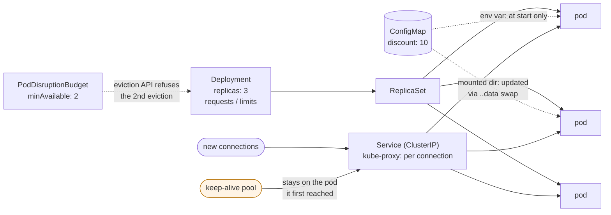

# 54. Kubernetes for Spring Developers

<div class="badges" markdown><span class="badge badge-l2">L2 · Practitioner</span><span class="badge badge-l3">L3 · Senior/Lead</span><span class="badge badge-meta">Deployments · Services · requests and limits · CFS throttling · ConfigMaps · Downward API · PodDisruptionBudgets · Gateway API</span></div>

<div class="grid two" markdown>

!!! info "Prerequisites"
    - [Chapter 52](../observability/ch52-health-checks-actuator.md): probes and graceful shutdown
    - [Chapter 53](ch53-containerization.md): images and JVM container ergonomics
    - [Chapter 4](../foundations/ch04-twelve-factor.md): configuration in the environment

!!! abstract "What you'll learn"
    - **CPU limits throttle the JVM**: at a 250m limit, menu-service took **3.9–4.0 s** to start against 0.7–0.8 s without a limit. Its p99 for 5 ms of work was **93–97 ms** against 10–16 ms, with up to 2.2 s of throttling in 30 s.
    - **ConfigMap updates**:
        - A watched mounted directory saw the new value after **1.4 to 76 s**.
        - An environment variable, a value read once at startup (Spring's `configtree:`) and a `subPath` mount **never did**, until a restart.
    - **Scaling out doesn't rebalance keep-alive clients**: after 1 → 3 replicas, new connections spread across all three within 10 seconds. A pooled keep-alive client sent **every request to the first pod** for the next 50 seconds.
    - **Node drains**: without a PodDisruptionBudget, all three pods were evicted at once and **295–331 requests failed**. With `minAvailable: 2`, the drain evicted one and waited, and 0–1 failed.

</div>

---

## 1 · Introduction & Context

### Three surprises in the first month

FoodFleet's services moved from VMs to Kubernetes, and the first month brought three surprises.

The first was latency. menu-service's p99 doubled although its CPU graphs showed 30% use. The deployment template set `limits.cpu: 500m` for every service. The JVM's JIT and GC threads spent the 50 ms per 100 ms quota in bursts, and requests waited for the next period. Average use was low; the throttling was invisible on a per-minute graph.

The second was a discount. Product changed the sale discount in a ConfigMap, and half the pods applied it while the rest didn't. Some services read the value from an environment variable, some from a `subPath` mount, and one from a mounted directory it re-read; only that one updated.

The third came on sale day. The autoscaler added pods, and the new pods sat nearly idle while the old ones stayed saturated: the gateway's connection pool kept every existing connection to the pods it already knew. A week later, a node upgrade drained a node holding all of order-service's replicas at once.

This chapter measures each of those on a real Kubernetes 1.37 cluster (k3s), with menu-service, a JVM service with Logback and Micrometer like a Spring Boot one. It also covers the parts of Kubernetes a Spring developer touches daily.

### Where it comes from

<ul class="mh-timeline">
<li><span class="when">2014–2015 · Kubernetes 1.0</span><span class="what">Pods, ReplicationControllers, Services with kube-proxy, ConfigMaps and Secrets soon after. Borg's ideas made public.</span></li>
<li><span class="when">2016–2017 · Deployments, PodDisruptionBudgets</span><span class="what">Rolling updates as a resource; budgets that limit voluntary disruptions such as drains.</span></li>
<li><span class="when">2018–2020 · JVM container awareness, Spring on Kubernetes</span><span class="what">JDK 10/8u191 reads cgroup limits. Spring Cloud Kubernetes and Boot's <code>configtree:</code> read ConfigMaps. Boot 2.3 adds probe support.</span></li>
<li><span class="when">2021–2023 · cgroup v2, Gateway API</span><span class="what">cgroup v2 becomes the default. The Gateway API reaches GA as Ingress's successor, with HTTPRoutes, traffic splitting and role separation.</span></li>
<li><span class="when">2024–2026 · In-place resize, sidecars</span><span class="what">In-place pod resource resize and native sidecar containers mature. Kubernetes 1.37 is the release used here.</span></li>
</ul>

---

## 2 · Core Concepts & Terminology



Requests and limits
:   A request is what the scheduler reserves on a node, and the CPU share the pod gets under contention. A CPU limit is a CFS quota: at most that much CPU time per 100 ms period. When the quota is spent, the container waits for the next period: that wait is throttling. A memory limit is a hard ceiling; past it the container is OOMKilled.

Service and kube-proxy
:   A Service gives a stable virtual IP and DNS name. kube-proxy picks a ready pod for each new **connection**, not each request, so a connection reused for thousands of requests stays on one pod.

ConfigMap and Secret delivery
:   They can be delivered as environment variables (read at container start), mounted files (updated by the kubelet through an atomic `..data` symlink swap), or `subPath` mounts (a single file bound at start, never updated). Spring Boot's `configtree:` reads mounted files at startup only.

Downward API
:   Pod metadata (name, namespace, node, labels) and its own requests and limits, as environment variables or files. Use them for log fields, metrics tags and sizing thread pools.

PodDisruptionBudget (PDB)
:   It limits how many pods of a set voluntary disruptions may take down at once: drains, upgrades, the cluster autoscaler. The eviction API refuses evictions that would break it. It doesn't protect against node crashes.

---

## 3 · How It Works Internally

### Configuration that survives the kubelet's symlink swap

The kubelet never rewrites a mounted ConfigMap's files. It writes a new timestamped directory and atomically repoints `..data` at it. Watching a file's inode therefore misses updates, and a `subPath` mount points at the old file for ever. `MountedConfig` reads the keys through the symlinks and compares content:

```java title="config/MountedConfig.java"
--8<-- "code/chapters/ch54-kubernetes-for-spring/src/main/java/dev/foodfleet/ch54/config/MountedConfig.java:35:76"
```

In Spring Boot, `spring.config.import=optional:configtree:/etc/menu-config/` reads the same directory at startup. To apply changes without a restart, a component like this one can publish an event, or a rolling restart can be triggered when the ConfigMap changes; tools such as Reloader do that.

### The pod's own limits

The JVM sees the CPU limit as its processor count, rounded up, and sees all of the node's CPUs when there is no limit. Thread pools for CPU-bound work should follow what the pod may actually use:

```java title="runtime/PodInfo.java"
--8<-- "code/chapters/ch54-kubernetes-for-spring/src/main/java/dev/foodfleet/ch54/runtime/PodInfo.java:26:31"
```

### A Deployment for a Spring service

```yaml title="k8s/deployment.yaml"
--8<-- "code/chapters/ch54-kubernetes-for-spring/src/main/resources/k8s/deployment.yaml"
```

Ingress and the Gateway API route external traffic to the Service. FoodFleet's edge uses Gateway API `HTTPRoute`s, and chapter 58 uses their weighted backends for canaries. Inside the cluster, services call each other by Service name.

---

## 4 · Design Considerations & Trade-offs

### Test setup

All runs used:

- k3s v1.37.1+k3s1 on one 2-vCPU node, with real kubelet, CFS quotas (cgroup v1), kube-proxy (iptables) and the eviction API.
- menu-service (`KubeLab`) on a jlink'd Java 25 runtime, with Logback and Micrometer's Prometheus registry.
- Load from the node.

There were two runs. Where they differed, both values are shown. `check_apis.sh` checks **8 behaviours** in Kubernetes' source, and all were found.

### Measured: CPU limits against startup and latency

One replica. The table shows the time from `kubectl apply` to Ready (median of 3 starts) and the JVM's own "started in". After that came 20 requests a second, each needing 5 ms of CPU, for 30 seconds. The cgroup's throttling counters were read before and after.

| Resources | Ready after | JVM sees | JVM "started in" | Latency p50 / p99 / max | Throttled periods / time |
|---|---|---|---|---|---|
| limit 250m | **6.2–6.5 s** | 1 CPU | **3,900–4,007 ms** | 7–8 / **93–97** / 98–188 ms | 25–27 / **927–2,239 ms** |
| limit 500m | 3.5–4.2 s | 1 CPU | 1,802–1,838 ms | 7 / 16–39 / 35–47 ms | 3–7 / 33–156 ms |
| limit 1000m | 2.9–3.1 s | 1 CPU | 939–950 ms | 6 / 11 / 16–17 ms | 0 / 0 ms |
| request 250m, **no CPU limit** | **2.2–2.7 s** | **2 CPUs** | **723–797 ms** | 6–7 / 10–16 / 16–21 ms | 0 / 0 ms |

What the table shows:

- **A low CPU limit makes JVM startup five times slower.** Class loading, JIT compilation and GC all want CPU at startup, and the quota held them to a quarter of a CPU. At 250m the JVM took about 4 s to start against 0.7–0.8 s with no limit. Slower starts mean slower rollouts and slower scale-outs, exactly when capacity is needed.
- **Throttling shows up as tail latency, not utilisation.** At 250m the service used under 10% of a CPU on average (20 × 5 ms a second), yet p99 was 93–97 ms for 5 ms of work. JIT and GC bursts spent the 25 ms quota, and requests waited out the rest of the 100 ms period.
- **Without a limit, the request still guarantees the share.** A pod with `requests.cpu: 250m` and no limit is guaranteed its share under contention, and can use idle CPU otherwise. It started fastest and had the best tail.
- **No limit means the JVM sees every node CPU.** Here that was 2, but on a 64-core node the JVM would size GC and fork/join pools for 64. Set `-XX:ActiveProcessorCount` to match the request.

### Measured: how a ConfigMap change reaches the application

menu-service read the discount four ways at once. The ConfigMap was then patched three times in each run. Each cell is the seconds until the service saw the new value (run 1 / run 2).

| Change | Environment variable | Read once at startup (`configtree:`) | Mounted directory, watched | `subPath` file |
|---|---|---|---|---|
| 10 → 15 | never | never | 1.4 / 76.2 s | never |
| 15 → 20 | never | never | 11.3 / 68.0 s | never |
| 20 → 25 | never | never | 24.4 / 67.1 s | never |

After `kubectl rollout restart`, all four showed the latest value.

What the table shows:

- **Only a mounted directory updates, and not quickly.** The kubelet watches the ConfigMap, but rewrites the volume only on its next sync of the pod. That took 1.4–24 seconds in one run and 67–76 seconds in the other, consistent with the kubelet's one-minute sync period plus its cache. Plan for a minute or more.
- **Environment variables and `subPath` mounts are fixed at container start.** So is anything read once, which includes Spring Boot's `configtree:`. A ConfigMap change then does nothing until pods restart, and a partial restart leaves pods disagreeing, as in the discount story.
- **Choose one model per value.** Values that must change together and safely should be rolled out with a restart: hash the ConfigMap into a pod annotation so a change triggers a rollout. Values meant to change live, such as feature flags and discounts, belong in a watched mount or a dedicated config service, and the code must expect them to change.

### Measured: scaling out under load

One replica took 50 requests a second through the Service's ClusterIP: half on a new connection each, half on a pooled keep-alive client (`java.net.http.HttpClient`). At 10 seconds it was scaled to 3, and the new pods were Ready at about 14 seconds. The table shows requests per pod in each 10-second window.

| Window | New connections: pod 1 / 2 / 3 | Keep-alive pool: pod 1 / 2 / 3 |
|---|---|---|
| 0–10 s | 250 / 0 / 0 | 250 / 0 / 0 |
| 10–20 s | 147 / 62 / 41 | 250 / 0 / 0 |
| 20–30 s | 82 / 96 / 72 | 250 / 0 / 0 |
| 30–60 s | 73–101 / 81–96 / 67–89 | **250 / 0 / 0** |

The first run is shown; the second gave the same pattern (pods 2 and 3 ready at 14.2 s, 0 errors).

What the table shows:

- **kube-proxy balances connections, not requests.** New connections spread across all three pods within seconds of them becoming Ready.
- **A keep-alive pool never noticed the new pods.** Its connections were opened to pod 1 before the scale-out, and every request kept going there for 50 seconds, which would continue until the connections closed. That's the sale-day story: an autoscaler can add pods that existing clients never use.
- **The fixes are on the client or the mesh.** Cap connection lifetime in the client pool (in Reactor Netty, `maxLifeTime`; in Apache HttpClient, `connectionTimeToLive`), or balance per request with a service mesh or a client-side load balancer (chapter 57). gRPC needs the same, since one HTTP/2 connection carries everything.

### Measured: draining the node

Three replicas, 50 requests a second over new connections through the Service, then `kubectl drain` of the only node (as in a node upgrade), with a 60-second timeout, then `uncordon`.

| | Drain | Pods evicted | Ready during the drain | Requests failed | Ready again after uncordon |
|---|---|---|---|---|---|
| No PodDisruptionBudget | done in 2 s | **3** | **0 of 3** | **295–331** (of 771–823) | 5–6 s |
| PDB `minAvailable: 2` | gave up after 60 s; evictions refused | 1 | 2 of 3 | **0–1** (of 3,559–3,580) | 2 s |

What the table shows:

- **Without a budget, a drain evicts everything at once.** All three replicas were evicted within 2 seconds and the replacements had nowhere to go, so the service was down until the node came back. On a multi-node cluster the replacements would schedule elsewhere, but all at the same time, with cold JVMs.
- **The budget made the drain wait.** The eviction API refused the second eviction ("would violate the pod's disruption budget"), so two pods kept serving, and the drain kept retrying. The one failed request in one run was on the evicted pod, which had no `preStop` drain (chapter 52). With other nodes available, it would have continued pod by pod as replacements became Ready.
- **A budget needs room to be satisfied.** `minAvailable` equal to the replica count, or a single replica, blocks drains for ever. Use `maxUnavailable: 1`, and spread replicas across nodes and zones (topology spread constraints) so a node drain never holds them all.

### Choosing

| Question | Do | Why |
|---|---|---|
| CPU | Requests sized from measured use; no CPU limit for latency-sensitive JVMs, or a limit of at least 1–2 CPUs; `ActiveProcessorCount` set | 250m limit: 4 s starts, 93–97 ms p99 |
| Memory | Limit = request; heap `MaxRAMPercentage=75` | No overcommit, no OOMKill surprises (chapter 53) |
| Configuration that changes live | Mounted directory, watched; code that expects changes; up to a minute or more to arrive | Env vars, `configtree:` and `subPath` never update |
| Configuration that must change atomically | Restart on change (ConfigMap hash annotation) | Pods agree on one version |
| Secrets | Mounted Secrets or an external secrets operator, not env vars | Env vars leak into dumps and child processes (chapter 39) |
| Load balancing | Connection lifetime caps or per-request balancing (mesh) | Keep-alive pools ignored new pods |
| Voluntary disruptions | PDB `maxUnavailable: 1` and topology spread | Unprotected drains took all pods; 295–331 requests failed |
| Identity in telemetry | Downward API: pod, namespace, node | Correlate logs and metrics to pods |
| External traffic | Gateway API `HTTPRoute`s | Role separation, weighted routing |

---

## 5 · Hands-on Implementation

```text
ch54-kubernetes-for-spring/
├── src/main/java/dev/foodfleet/ch54/
│   ├── config/    MountedConfig
│   └── runtime/   PodInfo
├── src/main/resources/   k8s/deployment.yaml (Deployment, Service, PodDisruptionBudget, ConfigMap), logback.xml
├── src/test/java/…       7 tests
└── verify/               build-libs.sh, run.sh, check_apis.sh, tools/ (KubeLab, Measure)
```

### 🔵 Level 2: a well-behaved workload

<div class="badges" markdown><span class="badge badge-l2">L2 · Practitioner</span></div>

- Size requests from measured use. Set the memory limit equal to the request. Leave out CPU limits, or keep them generous.
- Pass the pod's identity with the Downward API. Mount configuration as a directory, never with `subPath` for values that change.
- Add a PodDisruptionBudget (`maxUnavailable: 1`) for every multi-replica service.

```bash
../../ch52-health-checks-actuator/verify/k3s-lab.sh      # a cluster, if needed
verify/run.sh cpu config                                 # about 10 minutes
```

### 🟣 Level 3: the platform template

<div class="badges" markdown><span class="badge badge-l3">L3 · Senior/Lead</span></div>

- Keep one Deployment template per service type (Helm or Kustomize, chapter 55). Include probes, the security context, topology spread, a PDB and a ConfigMap-hash annotation.
- Write a policy for HTTP clients: a maximum connection lifetime in every pool, and per-request balancing through the mesh for gRPC.
- Put admission policies in place that reject `subPath` config mounts, missing requests and missing PDBs.

### Run and verify

```text
$ verify/run.sh config
change          env var    configtree (read at start)   mounted directory, watched   subPath file
10   -> 15      never      never                        1.4 s                        never
15   -> 20      never      never                        11.3 s                       never
20   -> 25      never      never                        24.4 s                       never
   after a rollout restart: env=25 once=25 watched=25 subpath=25
```

!!! question "Try it"
    1. Run the `cpu` experiment with `limits.cpu: 2000m`. Does throttling appear at 20 requests a second?
    2. Give the keep-alive client a 10-second connection lifetime. How soon do pods 2 and 3 get traffic?
    3. Change the PDB to `minAvailable: 3`. What does `kubectl drain` do?
    4. Mount the ConfigMap's `discount` key as a projected volume item instead of `subPath`. Does it update?

---

## 6 · Production Readiness

- [x] **Requests from measured use**; memory limit = request; CPU limits absent or generous; `ActiveProcessorCount` set
- [x] **Probes, preStop drain, security context** from chapter 52 and 53 in the template
- [x] **Configuration**: mounted directories for live values, a hash-triggered restart for atomic ones, no `subPath` for changing values
- [x] **Secrets** mounted, not in environment variables
- [x] **PDB** `maxUnavailable: 1` and topology spread across zones
- [x] **HTTP client pools** with a maximum connection lifetime; mesh balancing for gRPC
- [x] **Downward API** identity in logs and metrics
- [x] **Images by digest**; one template per service type

---

## 7 · Anti-patterns & Pitfalls

!!! pitfall "Incident 1: the latency CPU graphs couldn't explain"
    **Context.** Every service had `limits.cpu: 500m` from a shared template.

    **Symptoms.** p99 doubled while average CPU sat at 30%. Deploys got slower too.

    **Root cause.** CFS quotas throttle bursts: the JIT, GC and startup spend the period's quota, and requests wait. Measured at 250m: startup in 3.9–4.0 s instead of 0.7–0.8 s, p99 93–97 ms instead of 10–16 ms for 5 ms of work, and up to 2.2 s throttled in 30 s.

    **Fix.** Remove CPU limits for latency-sensitive JVM services and keep requests. Set `ActiveProcessorCount`. Alert on `container_cpu_cfs_throttled_periods_total`.

!!! pitfall "Incident 2: half the pods ran the old discount"
    **Context.** The discount lived in a ConfigMap, read by different services as an env var, a `subPath` file and a mounted directory.

    **Symptoms.** After an update, some pods applied it and most didn't, until a deploy days later.

    **Root cause.** Only mounted directories are updated. Measured: a watched directory saw changes after 1.4–76 s; the env var, `configtree:` and `subPath` never did.

    **Fix.** Live values go in a watched mount or a config service. Everything else restarts on change, through a ConfigMap hash annotation.

!!! pitfall "Incident 3: the autoscaler added pods nobody used"
    **Context.** The gateway called order-service through a pooled keep-alive HTTP client.

    **Symptoms.** During a spike, the autoscaler added pods and they stayed idle while the original pods were saturated.

    **Root cause.** kube-proxy balances connections, and the pool's connections were all on the original pods. Measured: after 1 → 3 replicas, 250 of 250 keep-alive requests per window stayed on pod 1 for 50 seconds, while new connections spread within 10 seconds.

    **Fix.** Cap connection lifetime in client pools, or balance per request with a mesh (chapter 57).

| Anti-pattern | Symptom | Fix |
|---|---|---|
| Low CPU limits on JVMs | Slow starts, throttled tails | Requests; no or generous limits |
| No `ActiveProcessorCount` without limits | Thread pools sized for the whole node | Set it from the request |
| Memory limit above request | Pods OOMKilled under node pressure | Limit = request |
| Config in env vars, expected to change | Old values until a restart | Watched mount, or restart on change |
| `subPath` mounts for config | Never updates | Mount the directory |
| Secrets in env vars | Leak via dumps, `/proc`, child processes | Mounted Secrets |
| No PDB | Drains take every replica | `maxUnavailable: 1` |
| `minAvailable` = replicas | Drains blocked for ever | Leave room |
| Unbounded keep-alive pools | New pods idle | Connection lifetime caps, mesh |

---

## 8 · Enterprise Case Study

### FoodFleet: one workload template

!!! decision "ADR-054: CPU requests without CPU limits for JVM services, ActiveProcessorCount from the request, memory limit equal to request; configuration as watched mounts or restart-on-change; PDB maxUnavailable 1 with zone spread; connection lifetime caps in every HTTP client"
    **Status:** Accepted · **Date:** 2025-11-03

    **Context.** A template-wide 500m CPU limit doubled tail latency, configuration changes reached some pods and not others, scale-outs left new pods idle, and a node drain took a service down. Measured on the lab cluster:

    - At 250m, startup took 3.9–4.0 s instead of 0.7–0.8 s, and p99 was 93–97 ms instead of 10–16 ms.
    - Only watched mounts updated (in 1.4–76 s).
    - Keep-alive clients stayed on the old pod for 50 s.
    - Without a PDB, a drain failed 295–331 requests; with one, 0–1.

    **Decision.**

    - **Resources:** CPU requests from the last 30 days' p95 use, with no CPU limits. `-XX:ActiveProcessorCount` equals the request, rounded up. Memory limit equals the request, with the heap at 75%.
    - **Configuration:** values that change live (discounts, feature flags) go in a watched mounted directory. Everything else triggers a rollout through a ConfigMap hash annotation. `subPath` is forbidden for configuration by admission policy.
    - **Secrets:** mounted from the external secrets operator (chapter 39).
    - **Disruption:** every multi-replica service has a PDB with `maxUnavailable: 1` and zone topology spread.
    - **Clients:** HTTP client pools cap connection lifetime at 30 s; gRPC goes through the mesh.
    - **Edge:** external traffic through Gateway API `HTTPRoute`s.

    **Consequences:**

    - ✅ Tail latency and startup no longer depend on quota periods.
    - ✅ A config change reaches every pod, either live or by rollout.
    - ⚠️ Without CPU limits, a misbehaving pod can use idle CPU on its node. Requests still guarantee everyone's share, and namespace quotas cap totals.
    - ⚠️ Connection lifetime caps add a TLS handshake every 30 s per connection.

### Fintech analogue: guaranteed QoS for payment pods

Payment platforms often run critical services in the Guaranteed QoS class, with requests equal to limits for CPU and memory. They pin them to dedicated node pools with static CPU manager policies, so they get whole cores and no throttling. They pay for idle capacity to remove variance, and keep burstable settings for everything else.

### E-commerce analogue: pre-scaling for sales

Retailers know when the sale starts. They scale out minutes before, so new pods are warm and have connections before traffic arrives, rather than relying on autoscaling and keep-alive pools to notice in time. Load tests rehearse exactly that scale-out (chapter 65).

---

## 9 · Interview Q&A + Summary

#### Q1. What's the difference between CPU requests and limits? · <span class="badge badge-l2">L2</span> · TCS · Infosys

**Short answer:** A request is what the scheduler reserves and the share you get under contention. A limit is a CFS quota per 100 ms period; past it, the container is throttled until the next period. Measured: a 250m limit gave 3.9–4.0 s JVM starts and a 93–97 ms p99 for 5 ms of work, with almost no CPU used on average.

#### Q2. Should JVM services have CPU limits? · <span class="badge badge-l3">L3</span> · Swiggy · Atlassian

**Short answer:** Often not for latency-sensitive ones. Requests guarantee the share, and limits throttle bursts from startup, JIT and GC. If a limit is policy, keep it at 1–2 CPUs or more, and alert on throttling. Without a limit, set `-XX:ActiveProcessorCount`, or the JVM sizes itself for the whole node.

#### Q3. How do ConfigMap changes reach a Spring Boot app? · <span class="badge badge-l2">L2</span> · Spring-heavy shops

**Short answer:** Mounted directories are updated by the kubelet through a `..data` symlink swap; env vars, `subPath` mounts and values read at startup (including `configtree:`) are not. Measured: a watched mount saw changes after 1.4–76 s, and the other three never did. Either watch and reload, or restart on change.

#### Q4. Why don't new pods get traffic after scaling out? · <span class="badge badge-l3">L3</span> · Flipkart · Uber

**Short answer:** kube-proxy balances connections, and existing keep-alive connections stay on the pods they were opened to. Measured: all pooled requests stayed on the original pod for 50 s, while new connections spread at once. Cap connection lifetime, or balance per request with a mesh or a client-side balancer.

#### Q5. What does a PodDisruptionBudget do? · <span class="badge badge-l2">L2</span> · Zomato · Walmart

**Short answer:** It limits voluntary disruptions (drains, upgrades, autoscaler removals): the eviction API refuses evictions that break it. Measured: without one, a drain evicted all three pods in 2 s and 295–331 requests failed; with `minAvailable: 2`, one pod was evicted, the rest refused, and 0–1 requests failed. It doesn't protect against crashes.

#### Q6. Env vars or mounted files for secrets? · <span class="badge badge-l3">L3</span> · banks

**Short answer:** Mounted files. Env vars are visible in `/proc`, inherited by child processes, printed by debug endpoints and captured in heap dumps (chapter 52), and they never rotate. Mounted Secrets update and can be read on demand.

#### Q7. What is the Downward API for? · <span class="badge badge-l2">L2</span> · Accenture

**Short answer:** Giving the pod its own metadata (name, namespace, node, labels) and resources (requests and limits) as env vars or files. Use them for log and metric fields and to size thread pools. An unset limit reads as the node's allocatable.

#### Q8. Deployment, StatefulSet, DaemonSet, Job: when? · <span class="badge badge-l1">L1</span><span class="badge badge-l2">L2</span> · Wipro · Cognizant

**Short answer:**

- **Deployment:** stateless services, interchangeable pods, rolling updates.
- **StatefulSet:** stable identities and per-pod volumes (databases, brokers).
- **DaemonSet:** one pod per node (log shippers, node agents).
- **Job and CronJob:** run-to-completion work, such as batch jobs and migrations.

#### Q9. Ingress or Gateway API? · <span class="badge badge-l3">L3</span> · platform rounds

**Short answer:** The Gateway API for new work. It separates the platform team's Gateways from application teams' routes, supports weighted backends, header matching and gRPC routes natively, and is portable across implementations. Ingress remains supported but limited, with annotations for anything beyond host and path.

#### Q10. How should a Spring Boot service find other services? · <span class="badge badge-l2">L2</span> · Swiggy-style rounds

**Short answer:** By Service DNS name (`http://order-service.orders.svc.cluster.local` or just `order-service`), with Kubernetes doing discovery. No Eureka, no client-side registry, unless you need per-request balancing, which a mesh provides.

#### Q11. What makes a JVM pod OOMKilled on Kubernetes? · <span class="badge badge-l3">L3</span> · PhonePe

**Short answer:** Total process memory above the memory limit: heap plus metaspace, threads, direct buffers and code cache. Use `MaxRAMPercentage=75` with limit = request, and `ExitOnOutOfMemoryError`. Chapter 53 measured `-Xmx` above the limit as a silent kernel kill.

#### Q12. Design the Kubernetes template for FoodFleet's services. · <span class="badge badge-l4">L4</span> · system design rounds

**Short answer:**

- **Workload:** a Deployment with requests from measured use, no CPU limits, `ActiveProcessorCount`, memory limit = request and heap at 75%.
- **From chapters 52–53:** probes, a preStop drain, and a non-root, read-only security context.
- **Configuration:** watched mounts for live config, hash-triggered rollouts for the rest, and mounted Secrets.
- **Disruption:** a PDB with `maxUnavailable: 1` and zone spread.
- **Traffic and identity:** Downward API identity, client connection caps or a mesh, and Gateway API at the edge.
- **Enforcement:** admission policies for all of it.

### Key takeaways

- **CPU limits throttle the JVM**: slower starts and worse tails, while averages look fine.
- **Only mounted directories update**: env vars, `configtree:` and `subPath` need a restart.
- **kube-proxy balances connections**: keep-alive pools ignore new pods without lifetime caps.
- **PodDisruptionBudgets turn drains into one-at-a-time**; leave them room.
- **Templates and policies** make all of it the default, not a review comment.

### Further reading

- Kubernetes, [Resource management for pods and containers](https://kubernetes.io/docs/concepts/configuration/manage-resources-containers/) and [ConfigMaps: mounted ConfigMaps are updated automatically](https://kubernetes.io/docs/concepts/configuration/configmap/#mounted-configmaps-are-updated-automatically)
- Kubernetes, [Disruptions and PodDisruptionBudgets](https://kubernetes.io/docs/concepts/workloads/pods/disruptions/) and [Downward API](https://kubernetes.io/docs/concepts/workloads/pods/downward-api/)
- Kubernetes, [Gateway API](https://gateway-api.sigs.k8s.io/)
- Spring Boot reference, [Configuration trees](https://docs.spring.io/spring-boot/reference/features/external-config.html#features.external-config.files.configtree) and [Deploying to Kubernetes](https://docs.spring.io/spring-boot/how-to/deployment/cloud.html#howto.deployment.cloud.kubernetes)
- Linux kernel, [CFS bandwidth control](https://docs.kernel.org/scheduler/sched-bwc.html)

---

**Previous:** [← 53. Containerization](ch53-containerization.md) · **Next:** [55. Helm, Kustomize & Environment Promotion →](ch55-helm-kustomize.md)
