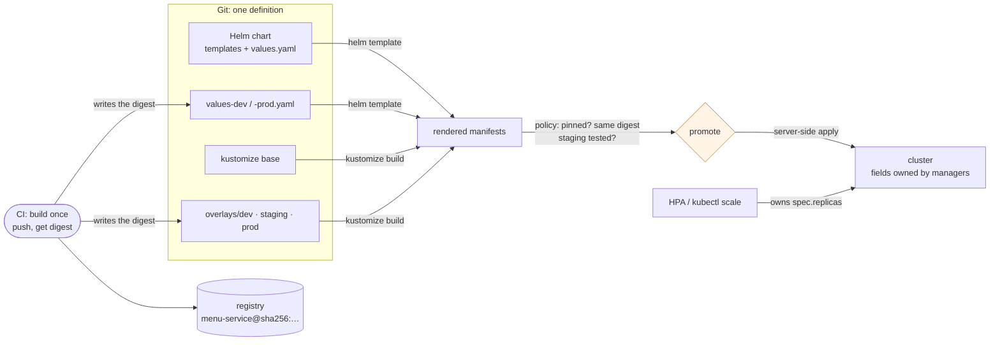

# 55. Helm, Kustomize & Environment Promotion

<div class="badges" markdown><span class="badge badge-l2">L2 · Practitioner</span><span class="badge badge-l3">L3 · Senior/Lead</span><span class="badge badge-meta">Helm 4 · kustomize · server-side apply · field managers · configMapGenerator · rollback-on-failure · image digests · promotion policy</span></div>

<div class="grid two" markdown>

!!! info "Prerequisites"
    - [Chapter 54](ch54-kubernetes-for-spring.md): Deployments, ConfigMaps and rollouts
    - [Chapter 53](ch53-containerization.md): images, registries and digests
    - [Chapter 41](../security/ch41-supply-chain-compliance.md): signing and provenance by digest

!!! abstract "What you'll learn"
    - **Helm 4 applies server-side**: after something else scaled a Deployment to 5, re-applying the chart **failed with a field conflict** and marked the release failed. Helm 3's client-side merge, and `kubectl apply`, **silently reset it to 2**. Leaving `replicas` out of the manifest kept 5 with no conflict.
    - **Config changes roll pods only if the pod template changes**: with a checksum annotation or kustomize's hashed ConfigMap name, both pods were replaced and saw the new value in **5–9 s**. Without either, **no pod restarted**, the environment variable stayed old, and the mounted file caught up after **2–88 s**.
    - **A failed release**: `helm upgrade --rollback-on-failure` returned after its full **60 s** timeout and restored the previous revision, with **0 failed requests**. The default rolling update had kept every old pod serving; with `maxUnavailable: 1` a plain apply left **one pod short** for good.
    - **Tags move; digests don't**: after the tag `stable` was moved, a scale-out ran **two versions behind one Service** whenever a node pulled (`Always`, or a node without the image). Pinned by digest, all four pods ran the same build.

</div>

---

## 1 · Introduction & Context

### "It worked in staging"

FoodFleet's first Kubernetes deployments were a directory of YAML per environment, copied and edited by hand. Within a quarter, the three copies of menu-service had drifted: prod had a memory limit staging didn't, staging had a probe prod didn't, and dev used a different port. Every incident review included the sentence "it worked in staging".

The fix was templating: one definition, per-environment differences kept small and explicit. The platform team tried both common tools. **Helm** packages templates and default values as a chart and records each install as a release with history. **kustomize**, built into `kubectl`, patches plain YAML: a base plus an overlay per environment, with no templating language.

Then the tools brought surprises of their own. A sale-day scale-out was undone by the next deploy. A discount change shipped without any pod noticing. A broken release left a deployment half-rolled for an afternoon. And on one Saturday, prod ran two builds of payment-service behind one Service, because someone had re-pushed the tag `1.8.2`.

This chapter deploys menu-service with both tools to a real cluster pulling from a registry, and measures each of those.

### Where it comes from

<ul class="mh-timeline">
<li><span class="when">2016 · Helm 2</span><span class="what">Charts, values and releases, installed by Tiller, a cluster-side component with broad permissions.</span></li>
<li><span class="when">2018–2019 · kustomize; kubectl -k</span><span class="what">Template-free bases and overlays. Merged into <code>kubectl</code> in 1.14. Config generators append a content hash to names.</span></li>
<li><span class="when">2019 · Helm 3</span><span class="what">Tiller removed. Releases stored as Secrets in the namespace. Upgrades use a three-way merge of the old manifest, the new one and the live object.</span></li>
<li><span class="when">2021 · Server-side apply GA</span><span class="what">Kubernetes 1.22 tracks which manager owns each field and reports conflicts instead of overwriting silently.</span></li>
<li><span class="when">2025–2026 · Helm 4</span><span class="what">Server-side apply by default, <code>--rollback-on-failure</code> replacing <code>--atomic</code>, a status watcher for <code>--wait</code>. Helm 4.1.4 and kustomize 5.8.3 are the releases used here.</span></li>
</ul>

---

## 2 · Core Concepts & Terminology



Helm chart, values and release
:   A chart is a directory of Go templates with defaults in `values.yaml`. `helm upgrade --install` renders it with per-environment values and applies the result as a numbered **release revision**. Releases have history, `helm rollback`, and hooks.

kustomize base and overlay
:   A base is plain, valid YAML. An overlay lists the base and applies patches, a namespace, name prefixes, image overrides and generators. `kustomize build` (or `kubectl apply -k`) prints the result. There's no template language and no release record.

Server-side apply (SSA)
:   The API server merges what you send into the live object and records a **field manager** for every field. Changing a field another manager owns is a **conflict**, unless you force it. Client-side apply (kubectl's default) and Helm 3 compute a patch locally from the last applied state instead, and overwrite.

Promotion by digest
:   An image is built once, and every environment refers to it by its content digest (`@sha256:…`). Promotion is a change to the next environment's values or overlay that copies the digest staging tested. Tags are mutable pointers; digests aren't.

---

## 3 · How It Works Internally

### One chart, environments as values

The chart's templates are shared by every service. Each environment's file overrides only what differs: dev runs one replica from a tag; prod is pinned by digest, larger, and autoscaled. The image helper refuses to render without a digest or a tag:

```go-template title="helm/foodfleet-service/templates/_helpers.tpl"
--8<-- "code/chapters/ch55-helm-kustomize/src/main/resources/helm/foodfleet-service/templates/_helpers.tpl:9:17"
```

Two lines in the Deployment template matter more than the rest. `replicas` is left out when an HPA owns it, so an upgrade never fights the autoscaler. The `checksum/config` annotation puts a hash of the rendered ConfigMap into the pod template, so a config change becomes a template change, which rolls the pods:

```yaml title="helm/foodfleet-service/templates/deployment.yaml"
--8<-- "code/chapters/ch55-helm-kustomize/src/main/resources/helm/foodfleet-service/templates/deployment.yaml:1:24"
```

### The same thing with kustomize

The base is valid YAML on its own. Its `configMapGenerator` names the ConfigMap with a hash of its content, and rewrites the Deployment's reference to match, with the same effect as the checksum annotation:

```yaml title="kustomize/base/kustomization.yaml"
--8<-- "code/chapters/ch55-helm-kustomize/src/main/resources/kustomize/base/kustomization.yaml"
```

The prod overlay adds an HPA, drops `replicas`, sizes the pod, and names the image by digest. The pipeline writes that digest line, and nothing else does:

```yaml title="kustomize/overlays/prod/kustomization.yaml"
--8<-- "code/chapters/ch55-helm-kustomize/src/main/resources/kustomize/overlays/prod/kustomization.yaml"
```

### Checking what will be applied

Both tools render to plain manifests, so one check covers both. Outside dev, every image must be pinned, and prod must run exactly the digests staging tested:

```java title="promotion/PromotionPolicy.java"
--8<-- "code/chapters/ch55-helm-kustomize/src/main/java/dev/foodfleet/ch55/promotion/PromotionPolicy.java:32:59"
```

Parsing image references takes care, because a registry port looks like a tag: in `registry:5000/menu-service`, the colon comes before the last slash.

```java title="promotion/ImageRef.java"
--8<-- "code/chapters/ch55-helm-kustomize/src/main/java/dev/foodfleet/ch55/promotion/ImageRef.java:14:38"
```

In a pipeline this runs on the output of `helm template` or `kustomize build`, next to an admission policy in the cluster (Kyverno or Gatekeeper) that rejects unpinned images, as chapter 41 does for signatures.

---

## 4 · Design Considerations & Trade-offs

### Test setup

All runs used:

- k3s v1.37.1+k3s1 on one 2-vCPU node, pulling from a local OCI registry (distribution 3.1.2) through a registry mirror.
- Helm 4.1.4 and kustomize 5.8.3 against the same cluster.
- menu-service (`VersionedService`) on a jlink'd Java 25 runtime, built twice: 1.4.0 and 1.4.1, pushed and referred to by digest.
- Load from the node, 20 requests a second, each on a new connection through the Service.

There were two runs. Where they differed, both values are shown. `check_apis.sh` checks **12 behaviours** in Helm's and kustomize's sources, and all were found.

### Measured: rendering and validating each environment

Each environment rendered both ways (median of 5), sent to the API server with `--dry-run=server`, and checked by `PromotionPolicy`:

| Environment | Objects | Helm render | kustomize build | API server | Policy |
|---|---|---|---|---|---|
| dev (tag) | 3 | 48–62 ms | 58–62 ms | valid | ok |
| staging (digest) | 4 | 45–48 ms | 33–34 ms | valid | ok |
| prod (digest, HPA) | 5 | 51–57 ms | 30–31 ms | valid | ok |

The same checks on releases that shouldn't reach prod:

| Prod release | Render | API server dry-run | Policy |
|---|---|---|---|
| kustomize overlay as checked in (digest placeholder) | ok | **valid** | rejected: not a sha256 digest |
| Helm with `--set image.tag=1.4.0` | ok | **valid** | rejected: not pinned by digest |
| Helm, default values (no tag, no digest) | **fails**: "image.digest (or image.tag in dev) is required" | – | – |
| Overlay naming 1.4.1 while staging tested 1.4.0 | ok | valid | rejected: prod runs a digest staging didn't test |

What the tables show:

- **Rendering is cheap.** Both tools took tens of milliseconds, so render and validate every environment on every commit.
- **The API server validates shape, not intent.** It accepted an image named `@sha256:REPLACE_WITH_PROMOTED_DIGEST`, and a mutable tag in prod. Neither is a schema error; pods would have failed to pull, or pulled whatever the tag pointed at that day.
- **Guards have to be written.** The chart's `fail` caught a missing image at render time. Unpinned images and untested digests were caught only by the policy check. Run it in CI and again at admission.

### Measured: who owns `replicas`

menu-service deployed with `replicas: 2`. Then two other actors changed it: an autoscaler-like `kubectl scale --replicas=5`, and a hand edit (`kubectl set env FEATURE_X=on`). Then the same manifests were applied again:

| Deployed and re-applied with | Re-apply | Replicas after | FEATURE_X after | Owner of `spec.replicas` |
|---|---|---|---|---|
| `kubectl apply` (client-side) | ok | **2** | on | kubectl-client-side-apply |
| `kubectl apply --server-side` | **conflict** | 5 | on | kubectl (`/scale`) |
| ...re-applied with `--force-conflicts` | ok | **2** | on | kubectl (Apply) |
| ...manifest without `spec.replicas` | ok | **5** | on | none recorded |
| `helm upgrade` (Helm 4: server-side by default) | **conflict, release failed** | 5 | on | kubectl (`/scale`) |
| ...re-applied with `--force-conflicts` | ok, release deployed | **2** | on | helm (Apply) |
| `helm upgrade --server-side=false` (Helm 3's merge) | ok | **2** | on | helm |

Both runs gave identical results. The conflict read: `Apply failed with 1 conflict: conflict with "kubectl" with subresource "scale" using apps/v1: .spec.replicas`.

What the table shows:

- **Client-side tools silently undo other actors.** `kubectl apply` and Helm 3-style upgrades set `replicas` back to 2, because it was in the manifest and had changed. Under an HPA, every deploy would cut capacity back to the chart's number until the HPA scaled up again. That was the sale-day story.
- **Server-side apply refuses instead.** The scale took ownership of `spec.replicas`, so the next apply that also set it was a conflict. Helm 4 marked the release **failed**, which blocks the pipeline but changes nothing. `--force-conflicts` takes ownership back and resets the value: the same outcome as client-side, but explicit.
- **The real fix is to not own the field.** Without `replicas` in the manifest, the apply succeeded and 5 stayed. That's why the chart omits `replicas` when autoscaling is on.
- **Fields nobody declares survive every method.** `FEATURE_X` stayed in all seven cases, because no applied manifest mentioned it. Templating doesn't remove hand edits; only a tool that prunes or reconciles the whole object does (chapter 58's GitOps).
- **Helm 4's upgrade default is `auto`.** It keeps the method the release was installed with, so releases installed by Helm 3 keep client-side semantics until upgraded with `--server-side=true`.

### Measured: shipping a config change

menu-service (2 replicas) read the discount from an environment variable and from the mounted ConfigMap. The discount was changed from 10 to 20 and redeployed, then the pods were polled every 2 seconds for 150 seconds:

| Deployed with | Pods replaced | Mounted file showed 20 on every pod | Env var at the end |
|---|---|---|---|
| Helm, chart with the `checksum/config` annotation | **2 of 2** | after 5–7 s | **20** |
| Helm, same chart without the annotation | **0 of 2** | after 3–88 s | **10** |
| kustomize `configMapGenerator` (hashed name) | **2 of 2** | after 7–9 s | **20** |
| kustomize, `disableNameSuffixHash: true` | **0 of 2** | after 2–88 s | **10** |

What the table shows:

- **Neither tool restarts pods for a ConfigMap change by itself.** Without a template change, the Deployment was unchanged, so nothing rolled. The environment variable kept the old value; the mounted file caught up on the kubelet's schedule: 2–3 seconds in one run, 76–88 in the other, as chapter 54 found.
- **Both idioms work, and both make the change a normal rollout.** The checksum annotation and the hashed name each changed the pod template, so pods were replaced within seconds, with the rolling-update, readiness and rollback behaviour of any release.
- **The hashed name also keeps old ConfigMaps.** Each change creates a new ConfigMap and leaves the old one, which is what lets `rollout undo` restore the previous config. It also means they accumulate until pruned.

### Measured: a release that fails

menu-service 1.4.0 ran 3 replicas under load. Release 1.4.1 came with a configuration that made it exit at startup ("missing required property spring.datasource.url"):

| Deployed with | Command returned | Ready pods afterwards | Crash-looping pods | Failed requests |
|---|---|---|---|---|
| `helm upgrade --rollback-on-failure --timeout 60s` | exit 1 after **61 s** | 3 × 1.4.0 | 0 | 0 of 1,375–1,376 |
| `kubectl apply`, `rollout status --timeout 60s`, then `rollout undo` | status exit 1 after 61 s | 3 × 1.4.0 | 0 | 0–13 of 1,381–1,383 |
| `kubectl apply` only | exit 0 at once | 3 × 1.4.0 | **1** | 0 of 1,371–1,374 |
| ...with `maxUnavailable: 1, maxSurge: 0` | exit 0 at once | **2** × 1.4.0 | 1 | 0–1 of 1,372–1,373 |

Helm's history afterwards: revision 1 superseded, revision 2 **failed**, revision 3 deployed (a copy of 1). The 13 failures in one run of the `rollout undo` case didn't recur in a third run that logged each failure's cause; the other runs had none.

What the table shows:

- **The rolling update, not the rollback, protected users.** With 3 replicas, the default 25% `maxUnavailable` rounds down to 0. Kubernetes added one new pod and waited for it to be ready, which never happened, so all three old pods kept serving. Almost every request succeeded in all four cases: at most one failure per case, apart from the unexplained 13 in one run.
- **Detection takes the whole timeout.** Helm and `rollout status` both waited the full 60 s, although the pod crashed within a second. A crash-looping pod is "not ready yet", not "failed"; set the timeout from how long a healthy rollout takes, not "generously".
- **Without anything watching, a failed release stays half-applied.** Plain `kubectl apply` returned success at once and left a crash-looping pod indefinitely. With `maxUnavailable: 1`, it also took one old pod away, leaving the service at two-thirds capacity. Nothing would have alerted, except the restart counter.
- **Rollback restores the previous revision, including config.** Both Helm's automatic rollback and `rollout undo` brought back the old pod template. With hashed ConfigMaps, the old ConfigMap still exists to be referenced.

### Measured: a tag moved under running pods

Two replicas ran from the tag `stable`, which pointed at 1.4.0. Then someone moved `stable` to 1.4.1 in the registry, and the Deployment was scaled to 4. "Fresh node" means the node's cached copy was removed first, as on a node the cluster autoscaler has just added:

| Image reference | `imagePullPolicy` | New pods land on | Versions across the 4 pods |
|---|---|---|---|
| `menu-service:stable` | IfNotPresent | a node that has it | 4 × 1.4.0 |
| `menu-service:stable` | IfNotPresent | a fresh node | **2 × 1.4.0, 2 × 1.4.1** |
| `menu-service:stable` | Always | a node that has it | **2 × 1.4.0, 2 × 1.4.1** |
| `menu-service@sha256:…` | IfNotPresent | a fresh node | 4 × 1.4.0 |

Both runs gave identical results.

What the table shows:

- **A tag gives you whatever the registry says at pull time.** Nothing in the cluster changed, yet two pods ran a build that no environment had tested. That was the Saturday story.
- **Which pods get the new build depends on node state.** With `IfNotPresent`, it depended on whether the node already had the image, so the same Deployment would behave differently on old and new nodes. `Always` made it depend only on timing.
- **A digest names exact content.** Pinned, every pod ran 1.4.0 regardless of the tag, the node, or the pull policy. Digests are also what chapter 41's signatures and provenance attach to.

### Choosing

| Question | Helm | kustomize |
|---|---|---|
| Shape | Templates and values; a package with versions | Plain YAML, patches, overlays |
| Logic (loops, conditionals, defaults) | Yes, Go templates | Deliberately none |
| Release history, rollback, hooks | Yes | No; Git history, `rollout undo`, or a GitOps tool |
| Third-party software | Usually shipped as charts | Can inflate charts (`helmCharts:`) |
| Config change rollout | `checksum/config` annotation | Hashed generator names, by default |
| Learning curve | Templates get hard to read | Patches get hard to follow at depth |
| FoodFleet's choice | One shared chart for all services | Per-environment overlays for platform components |

Whichever you choose:

| Practice | Why (measured) |
|---|---|
| Render and policy-check every environment in CI | The API server accepted a placeholder digest and a tag in prod |
| Leave `replicas` out when an HPA exists | Client-side applies reset 5 → 2; server-side ones conflicted |
| Use server-side apply, and treat conflicts as a signal | Helm 4 failed the release instead of silently undoing a scale |
| Tie config to the pod template | 0 of 2 pods restarted without it; the env var stayed old |
| Wait for rollouts, with a timeout sized to a real rollout | Plain apply reported success and left a crash-looping pod |
| Promote by digest | A moved tag put two builds behind one Service |

---

## 5 · Hands-on Implementation

```text
ch55-helm-kustomize/
├── src/main/java/dev/foodfleet/ch55/promotion/   ImageRef, PromotionPolicy
├── src/main/resources/
│   ├── helm/foodfleet-service/   Chart.yaml, values.yaml, values-dev.yaml, values-prod.yaml, templates/
│   └── kustomize/                base/, overlays/{dev,staging,prod}
├── src/test/java/…               5 tests
└── verify/                       build-libs.sh, registry-lab.sh, run.sh, check_apis.sh, tools/ (VersionedService, Measure)
```

### 🔵 Level 2: one definition, three environments

<div class="badges" markdown><span class="badge badge-l2">L2 · Practitioner</span></div>

- Write one chart or one base. Keep each environment's file to the differences: replicas, resources, image, config.
- Add the `checksum/config` annotation, or use a `configMapGenerator`.
- Deploy with `helm upgrade --install --rollback-on-failure --timeout <your rollout time>`, or `kubectl apply -k` followed by `kubectl rollout status`.

```bash
helm template menu-service src/main/resources/helm/foodfleet-service -f src/main/resources/helm/foodfleet-service/values-dev.yaml
kustomize build src/main/resources/kustomize/overlays/prod
verify/run.sh render ownership       # needs a cluster and a registry: see the script header
```

### 🟣 Level 3: promotion as a pipeline

<div class="badges" markdown><span class="badge badge-l3">L3 · Senior/Lead</span></div>

- CI builds once and pushes. The only thing it writes into the environment repository is the digest (`kustomize edit set image`, or a values file).
- Every change renders every environment and runs the promotion policy: pinned, and identical to what the previous environment ran.
- Admission rejects unpinned or unsigned images in staging and prod.
- Server-side apply everywhere. Fields owned by controllers (HPA replicas, injected sidecars) are never in your manifests.

### Run and verify

```text
$ verify/run.sh tags
image reference         imagePullPolicy   new pods land on   versions across the 4 pods
menu-service:stable     IfNotPresent      cached node        {1.4.0=4}
menu-service:stable     IfNotPresent      fresh node         {1.4.0=2, 1.4.1=2}
menu-service:stable     Always            cached node        {1.4.0=2, 1.4.1=2}
menu-service@sha256:cfb44170... IfNotPresent      fresh node         {1.4.0=4}
```

!!! question "Try it"
    1. Enable `autoscaling` in the chart and repeat the ownership experiment. What happens to `replicas` on upgrade?
    2. Add a second container image (a log shipper) to the prod overlay without a digest. Which check catches it?
    3. Set the rollback timeout to 10 seconds. Does a healthy release still pass?
    4. Install a release with `--server-side=false`, then upgrade it with Helm 4's defaults. Which apply method does the upgrade use?

---

## 6 · Production Readiness

- [x] **One chart or base** per service type; environment files contain only differences
- [x] **Rendered and policy-checked** for every environment on every change
- [x] **Images by digest** outside dev, enforced at admission; prod runs staging's digests
- [x] **No controller-owned fields** in manifests (`replicas` under an HPA)
- [x] **Server-side apply**; conflicts fail the pipeline rather than being forced by default
- [x] **Config changes roll pods** (checksum annotation or hashed names); old ConfigMaps pruned after a retention period
- [x] **Rollouts awaited** with a sized timeout, automatic rollback, and an alert on restarts
- [x] **Rolling update settings** that keep capacity: `maxUnavailable: 0`, `maxSurge: 1` or more

---

## 7 · Anti-patterns & Pitfalls

!!! pitfall "Incident 1: every deploy cut capacity on sale day"
    **Context.** menu-service had an HPA, and its chart still set `replicas: 3`. Upgrades used Helm 3.

    **Symptoms.** During the sale, every deploy dropped menu-service to 3 pods, and latency spiked until the HPA scaled back up a minute later.

    **Root cause.** A client-side three-way merge resets fields that differ from the manifest. Measured: after a scale to 5, client-side kubectl and Helm 3-style upgrades both set `replicas` back to 2. Helm 4's server-side apply refused with a conflict instead.

    **Fix.** Omit `replicas` when autoscaling is enabled; with that, the measured apply kept 5. Move to server-side apply so the next field like this is a conflict, not a surprise.

!!! pitfall "Incident 2: the discount nobody received"
    **Context.** Product changed the discount in the chart's values and deployed. The release succeeded.

    **Symptoms.** No pod applied the new discount until a code release the next week restarted them.

    **Root cause.** A ConfigMap change doesn't change the pod template, so nothing rolls. Measured: 0 of 2 pods replaced, and the environment variable kept the old value.

    **Fix.** The `checksum/config` annotation, or kustomize's hashed generator names: both replaced the pods within 5–9 s.

!!! pitfall "Incident 3: two builds of one version"
    **Context.** payment-service ran `payment-service:1.8.2` with `imagePullPolicy: Always`. A developer rebuilt and re-pushed `1.8.2` to fix a typo in a log line.

    **Symptoms.** On Saturday, the cluster autoscaler added a node, and some payments followed slightly different code paths. Dashboards by version showed nothing, since every pod reported 1.8.2.

    **Root cause.** A tag is a mutable pointer. Measured: after moving a tag, a scale-out ran 2 × 1.4.0 and 2 × 1.4.1 behind one Service whenever a node pulled.

    **Fix.** Digests in every environment but dev, enforced by policy at CI and admission; registries configured with immutable tags as well.

| Anti-pattern | Symptom | Fix |
|---|---|---|
| A copy of the YAML per environment | Drift; "worked in staging" | One chart or base; differences only |
| `replicas` in manifests under an HPA | Deploys reset scale | Omit the field |
| `--force-conflicts` by default | Overwrites other managers silently | Force only with a reason |
| Config without a template change | Pods never pick it up | Checksum annotation, hashed names |
| `kubectl apply` without waiting | "Success", then a crash loop | `rollout status` or `--rollback-on-failure` |
| Timeouts picked generously | Slow detection | Sized to a real rollout |
| Mutable tags outside dev | Mixed versions, untested code | Digests, immutable tags |
| Logic-heavy templates | Nobody can review the output | Review rendered manifests in the PR |

---

## 8 · Enterprise Case Study

### FoodFleet: build once, promote the digest

!!! decision "ADR-055: one shared Helm chart for services, kustomize overlays for platform components; promotion by digest through an environment repository; server-side apply, no controller-owned fields; config tied to the pod template; rollouts awaited with automatic rollback"
    **Status:** Accepted · **Date:** 2025-11-10

    **Context.** Per-environment YAML copies drifted. Deploys reset autoscaled replicas, config changes didn't reach pods, a failed release sat half-applied, and a re-pushed tag put two builds into prod. Measured on the lab cluster:

    - Client-side applies reset an autoscaled 5 replicas to 2; Helm 4's server-side apply refused with a conflict.
    - Config changes rolled pods only with a checksum annotation or a hashed name (5–9 s); otherwise none did.
    - A plain apply of a crashing release reported success and left a crash-looping pod.
    - A moved tag ran two versions behind one Service.

    **Decision.**

    - **Templates:** every service deploys with the shared `foodfleet-service` chart. Teams own only a values file per environment. Platform components (ingress, operators) use kustomize overlays over upstream manifests.
    - **Promotion:** CI builds and signs once, then writes the digest into the dev values. Promotion to staging and prod is a pull request that copies the digest, and the promotion policy requires it to match what the previous environment ran.
    - **Apply:** Helm 4 with server-side apply. `replicas` is omitted when autoscaling. Conflicts fail the pipeline and are resolved by a human.
    - **Config:** the checksum annotation in the chart; hashed generator names in overlays; old ConfigMaps pruned after 7 days.
    - **Rollout:** `--rollback-on-failure`, with a timeout of twice the service's normal rollout time; `maxUnavailable: 0`.

    **Consequences:**

    - ✅ Environments differ only where a values file says so, and reviews read the rendered diff.
    - ✅ What runs in prod is byte-for-byte what staging tested.
    - ⚠️ A shared chart is a platform product: changes need versioning and a migration path for every team.
    - ⚠️ Helm's release record and Git can disagree after a manual rollback. Chapter 58 moves applies to a GitOps controller.

### Fintech analogue: an environment repository with four eyes

Banks often keep environment configuration in a separate repository from code, where every promotion to production is a pull request approved by someone other than its author. That's a segregation-of-duties control auditors ask for. The pull request contains only a digest change and the rendered diff, which makes the review possible, and the merge commit is the change record.

### E-commerce analogue: one chart, hundreds of services

Large retailers run hundreds of services on one internal chart, versioned like a library. A chart release goes to a few services first, then everywhere, and services pin the chart version like a dependency. Renders of every service are compared before and after each chart change, so a template edit can't silently change prod.

---

## 9 · Interview Q&A + Summary

#### Q1. Helm or kustomize? · <span class="badge badge-l2">L2</span> · TCS · Infosys

**Short answer:** Helm when you need packaging, defaults and logic, a release history and hooks, or are consuming third-party software. kustomize when plain YAML with small per-environment patches is enough, and no templating language is wanted. Many teams use both: a shared chart for their services, kustomize overlays over upstream manifests. Either way, render and review the output.

#### Q2. How do you promote a build from staging to production? · <span class="badge badge-l3">L3</span> · Razorpay · Atlassian

**Short answer:** Build once, push, and refer to the image by digest. Promotion is a change to prod's values or overlay that copies the digest staging ran, checked by policy. Never rebuild for prod and never promote a tag. Measured: after a tag moved, a scale-out ran two versions behind one Service; pinned by digest, every pod ran the same build.

#### Q3. Why did our deploy reset the HPA's replica count? · <span class="badge badge-l3">L3</span> · Swiggy · Flipkart

**Short answer:** The manifest sets `replicas`, and a client-side apply (kubectl or Helm 3) resets fields that differ. Measured: 5 → 2. Server-side apply refuses with a conflict instead, and Helm 4 fails the release. The fix is to omit `replicas` when an HPA owns it; then the apply kept 5.

#### Q4. What is server-side apply? · <span class="badge badge-l3">L3</span> · platform rounds

**Short answer:** The API server merges your intent into the live object and records which manager owns each field. Setting a field someone else owns is a conflict unless forced. It makes shared ownership (you, the HPA, a mesh injector) explicit. Helm 4 uses it by default, and its `upgrade` keeps whatever method the release was installed with.

#### Q5. How do you make pods pick up a ConfigMap change? · <span class="badge badge-l2">L2</span> · Zomato · Paytm

**Short answer:** Change the pod template when the config changes: a `checksum/config` annotation in Helm, or kustomize's hashed generator names. Measured: both replaced the pods in 5–9 s; without them, no pod restarted and the env var stayed old. Alternatively, a watched mount with code that reloads (chapter 54).

#### Q6. What does `--rollback-on-failure` do? · <span class="badge badge-l2">L2</span> · Wipro · Cognizant

**Short answer:** It waits for the release's resources to be ready and, if they aren't by the timeout, rolls back to the last successful revision. It replaced `--atomic` in Helm 4. Measured: a crashing release was rolled back after the full 60 s timeout, with history showing the failed revision. The rolling update had already kept the old pods serving.

#### Q7. Why did nothing fail while the bad release was crash-looping? · <span class="badge badge-l3">L3</span> · Uber

**Short answer:** With 3 replicas, the default 25% `maxUnavailable` rounds down to 0, so the Deployment adds a new pod and waits for it before removing an old one. The new pod never became ready, so all three old pods kept serving. With `maxUnavailable: 1`, one old pod went away and capacity stayed at two-thirds.

#### Q8. How do you keep a Helm chart reviewable? · <span class="badge badge-l3">L3</span> · Thoughtworks

**Short answer:** Keep logic in helpers and out of templates, fail loudly on invalid values (`fail`, a values schema), and review the rendered output, not the template diff: CI posts `helm template` diffs for every environment on each PR. Version the chart like a library.

#### Q9. Where do secrets go in Helm or kustomize? · <span class="badge badge-l2">L2</span> · banks

**Short answer:** Not in values files or Git in plain text. Reference secrets managed by an external secrets operator, or keep them encrypted (SOPS, sealed secrets) and decrypted in the cluster. Templates then mount a Secret by name (chapter 39).

#### Q10. What does kustomize's hash suffix on ConfigMaps buy you? · <span class="badge badge-l2">L2</span> · Accenture

**Short answer:** A new name for every content change, and every reference rewritten to match. The pod template changes, so the change rolls out like a release, and the old ConfigMap stays for a rollback. The cost is accumulation, so prune old ones.

#### Q11. How do you detect drift between Git and the cluster? · <span class="badge badge-l3">L3</span> · PhonePe

**Short answer:** Diff rendered manifests against live objects (`kubectl diff`, `helm diff`), or run a GitOps controller that reconciles continuously and reports drift. Note what applying doesn't fix: measured, a hand-added environment variable survived every apply method, because no manifest mentioned it.

#### Q12. Design FoodFleet's deployment pipeline from commit to prod. · <span class="badge badge-l4">L4</span> · system design rounds

**Short answer:**

- **Build:** CI builds once, scans, signs and pushes; writes the digest into dev's values.
- **Environments:** one chart, values per environment, in an environment repository.
- **Promotion:** a PR copying the digest to staging, then prod; the policy requires it to match the previous environment, and prod needs a second approver.
- **Checks:** every environment rendered and policy-checked on every PR; admission rejects unpinned or unsigned images.
- **Apply:** server-side, no controller-owned fields, `--rollback-on-failure` with a sized timeout, `maxUnavailable: 0`.
- **Next:** a GitOps controller applies and reconciles drift; canaries gate prod (chapter 58).

### Key takeaways

- **Template once, vary by environment**: Helm values or kustomize overlays, with the differences small and explicit.
- **Don't own fields controllers own**: client-side applies undo scaling, server-side ones conflict.
- **Tie config to the pod template**, or config changes never reach running pods.
- **A rollout guards users; a rollback cleans up**: wait for rollouts, with a timeout sized to reality.
- **Promote digests, not tags**, and check it in CI and at admission.

### Further reading

- Helm, [Helm 4 overview](https://helm.sh/docs/overview/) and [Chart template guide: automatically roll deployments](https://helm.sh/docs/howto/charts_tips_and_tricks/#automatically-roll-deployments)
- Kubernetes, [Server-side apply](https://kubernetes.io/docs/reference/using-api/server-side-apply/) and [Declarative management with kustomize](https://kubernetes.io/docs/tasks/manage-kubernetes-objects/kustomization/)
- kustomize, [configMapGenerator and generatorOptions](https://kubectl.docs.kubernetes.io/references/kustomize/kustomization/configmapgenerator/)
- Kubernetes, [Deployments: rolling update strategy](https://kubernetes.io/docs/concepts/workloads/controllers/deployment/#rolling-update-deployment)
- OCI, [Image specification: content addressing by digest](https://github.com/opencontainers/image-spec/blob/main/descriptor.md#digests)

---

**Previous:** [← 54. Kubernetes for Spring Developers](ch54-kubernetes-for-spring.md) · **Next:** [56. Autoscaling →](ch56-autoscaling.md)
