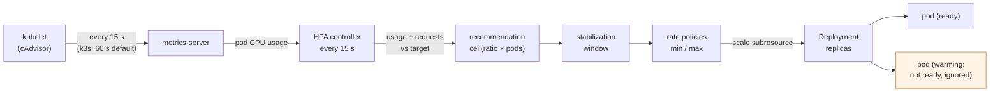

# 56. Autoscaling

<div class="badges" markdown><span class="badge badge-l2">L2 · Practitioner</span><span class="badge badge-l3">L3 · Senior/Lead</span><span class="badge badge-meta">HorizontalPodAutoscaler · metrics-server · utilization of requests · stabilization windows · scaling policies · JVM warm-up · KEDA · VPA · cluster autoscaler</span></div>

<div class="grid two" markdown>

!!! info "Prerequisites"
    - [Chapter 54](ch54-kubernetes-for-spring.md): requests, limits and readiness
    - [Chapter 55](ch55-helm-kustomize.md): why `replicas` leaves the manifest under an HPA
    - [Chapter 48](../observability/ch48-metrics-micrometer.md): metrics worth scaling on

!!! abstract "What you'll learn"
    - **Scaling up takes half a minute, scaling down five**: the HPA added pods **29–34 s** after load arrived and reached its peak after 77–94 s. After the load stopped, it was back to one pod only after **331–333 s**.
    - **JVM startup CPU over-scales a service**: when new pods were ready at once, their warm-up CPU counted as load and the HPA went to its maximum of **8** pods for 4 pods' worth of work. With readiness held until warm, it stopped at **5**.
    - **Every scale-up costs something on a busy node**: on the lab's one node, starting four JVMs at once starved the pod already serving, and **150–181** requests failed in the next 20 seconds.
    - **Flapping multiplies that cost**: with no scale-down window, load that came and went every minute caused **10–11 scaling changes and 325–432 failed requests** in eight minutes. With the default five-minute window, it was 2 changes and 97–192 failures.

</div>

---

## 1 · Introduction & Context

### The sale that scaled too late, and then too much

FoodFleet's lunchtime peak arrives in minutes: orders triple between 11:50 and 12:05. The first HPA the platform team set up on menu-service targeted 80% CPU, with a minimum of two pods. On the first busy day it scaled late, then kept scaling while the new pods were still warming up, reached its maximum, and sat there for the rest of lunch. In the afternoon, a batch job's load came and went every few minutes, and menu-service's pod count rose and fell with it, each rise bringing a wave of slow requests.

Nothing was broken. The HPA was doing exactly what its algorithm says, with inputs nobody had thought about: what "utilization" is relative to, what a JVM's CPU looks like in its first minute, and how the controller smooths its own decisions.

This chapter runs a real HPA, fed by metrics-server, against menu-service under controlled load, and measures each of those.

### Where it comes from

<ul class="mh-timeline">
<li><span class="when">2015–2016 · HPA v1</span><span class="what">Kubernetes 1.1 scales Deployments on average CPU, read from Heapster. One metric, one target.</span></li>
<li><span class="when">2017–2018 · metrics-server, custom metrics</span><span class="what">The resource metrics API replaces Heapster. Custom and external metrics APIs let adapters feed Prometheus metrics to the HPA.</span></li>
<li><span class="when">2019–2020 · KEDA, configurable behavior</span><span class="what">KEDA scales on queues and events, including to zero. Kubernetes 1.18 adds <code>behavior</code>: stabilization windows and rate policies per direction.</span></li>
<li><span class="when">2021–2023 · autoscaling/v2 GA</span><span class="what">Multiple metrics, container-level resource metrics, and behavior become stable. The cluster autoscaler and Karpenter add nodes.</span></li>
<li><span class="when">2024–2026 · Tolerances, in-place resize</span><span class="what">Configurable per-HPA tolerances and in-place pod resize (which VPA can use) arrive. Kubernetes 1.37 and metrics-server 0.9 are used here.</span></li>
</ul>

---

## 2 · Core Concepts & Terminology



Utilization
:   For a resource metric, the HPA divides pod CPU usage by the pods' CPU **requests**, not limits or node capacity. A target of 50% means "each pod should use about half of what it requested". Change the request and you change what the same load looks like.

The replica calculation
:   desired = ceil(current ratio × pods counted), where ratio = utilization ÷ target. Ratios within ±10% of 1 change nothing (the tolerance). Pods that aren't ready, or whose sample may include their startup, are left out of a scale-up; pods without metrics count against the direction of the change.

Stabilization window
:   The HPA remembers its recommendations. To scale down, it uses the **highest** recommendation in the window (300 s by default); to scale up, the lowest (0 s by default). A quick dip doesn't remove pods; a quick spike adds them.

Scaling policies
:   Limits on the rate of change per period: by default, up by 4 pods or 100% every 15 s, whichever is more, and down by up to 100% every 15 s.

Other autoscalers
:   **KEDA** scales on event sources (queue length, Kafka lag, cron) and can scale to zero. **VPA** recommends or sets requests. The **cluster autoscaler** and **Karpenter** add nodes when pods can't be scheduled.

---

## 3 · How It Works Internally

### The replica calculation

`ReplicaCalculator` follows Kubernetes 1.37's `replica_calculator.go`. The first branch is the common case; the rest is how the HPA stays conservative when some pods have no usable sample:

```java title="hpa/ReplicaCalculator.java"
--8<-- "code/chapters/ch56-autoscaling/src/main/java/dev/foodfleet/ch56/hpa/ReplicaCalculator.java:35:87"
```

A pod's sample is "unready" for CPU if the pod isn't ready, or if it's in its first five minutes (the CPU initialization period) and the sample was taken before one full metrics window had passed since it became ready. That rule is the one that matters for JVMs: a pod that becomes ready only after warm-up never contributes its warm-up CPU.

### Stabilization and rate limits

`ScalingBehavior` follows `horizontal.go`. The window turns a list of recent recommendations into a bound, and the policies cap how far one step may go:

```java title="hpa/ScalingBehavior.java"
--8<-- "code/chapters/ch56-autoscaling/src/main/java/dev/foodfleet/ch56/hpa/ScalingBehavior.java:54:84"
```

The unit tests replay the cases the lab measured, such as a scale-down held for exactly 300 s.

### The HPA and the Deployment

```yaml title="k8s/hpa.yaml"
--8<-- "code/chapters/ch56-autoscaling/src/main/resources/k8s/hpa.yaml"
```

The Deployment has no `replicas` (chapter 55) and no CPU limit (chapter 54). Its readiness probe does double duty: it keeps traffic away from cold pods and, through the rule above, keeps their warm-up out of the HPA's arithmetic.

---

## 4 · Design Considerations & Trade-offs

### Test setup

All runs used:

- k3s v1.37.1+k3s1 on one 2-vCPU node, metrics-server 0.9.0 at a 15 s resolution (k3s's setting; the upstream default is 60 s), and the HPA controller's defaults (15 s sync, 10% tolerance).
- menu-service (`ScaleLab`) on a jlink'd Java 25 runtime: requests 200m CPU, no CPU limit; each request is 20 ms of CPU.
- Open-loop load from the node, each request on a new connection through the Service.
- The HPA from section 3: 50% of the request, so one pod per 100m of load.

There were two runs. Where they differed, both values are shown. `check_apis.sh` checks **12 behaviours** in Kubernetes' and metrics-server's sources, and all were found.

!!! warning "One node"
    Every pod in these runs shares two CPUs. CPU shares follow requests, so starting pods compete with serving pods for the same cores. On a real cluster new pods usually land on other nodes, and the scale-up costs below are smaller. The timing results don't depend on that.

### Measured: a step up and down

One pod, then 30 requests a second (600m of CPU) from 30 s to 270 s, then nothing. Pods were ready 5 s after starting.

| Time | Load | Replicas (desired / ready) | CPU of request | p50 / p99 | Failed |
|---|---|---|---|---|---|
| 0–30 s | none | 1 / 1 | 1% | – | 0 |
| 30–60 s | 30/s | 1 / 1 | 1% → 262% | 23 / 69 ms | 0 |
| 60–90 s | 30/s | **5** / 1 | 262% | 42 / **6,321** ms | **181** |
| 90–120 s | 30/s | 5 / 5 | – (no usable samples yet) | 23 / 45 ms | 0 |
| 120–150 s | 30/s | **7** / 5 | 68% | 25 / 183 ms | 0 |
| 150–270 s | 30/s | 7 / 7 | 46–59% | 22–24 / 44–119 ms | 0 |
| 270–570 s | none | 7 / 7 | 46% → 0% | – | 0 |
| 570–600 s | none | 6 → **1** | 0% | – | 0 |

The first run is shown. The second differed in the peak: the HPA added three more pods at once and settled on 8, and it removed the first pod 167 s after the load stopped (once the peak's recommendation had left the window), reaching one pod at 331 s.

| | Run 1 | Run 2 |
|---|---|---|
| First scale-up after the load started | 29 s | 34 s |
| Peak, reached after | 7 pods, 94 s | 8 pods, 77 s |
| Back to 1 pod after the load stopped | 333 s | 331 s |
| Failed requests (all within 20 s of the first scale-up) | 181 | 150 |
| p99, first minute / minutes 2–4 | 6,241 / 80 ms | 5,375 / 39 ms |

What the table shows:

- **Scaling up took half a minute to notice.** metrics-server's 15 s resolution plus the HPA's 15 s sync: the first new pods came 29–34 s after the load started. With the upstream 60 s resolution it would take up to a minute and a quarter.
- **It took two steps to settle.** The first step went from 1 to 5, the default policy's limit of 4 more pods per 15 s. Once those pods reported real usage, it added two or three more. Steady state was 7–8 pods for 6 pods' worth of work, because the JVMs' own idle CPU counts too.
- **Scaling down waited for the window.** The highest recommendation of the last five minutes sets the floor. Back to one pod took 331–333 s after the load stopped: five minutes of seven or eight pods doing nothing is the price of not flapping, and the default.
- **The scale-up itself hurt.** 150–181 requests failed and p99 reached 5–6 s, all within 20 s of the first scale-up, as four JVMs started next to the one pod doing all the work. CPU shares follow requests, so the serving pod got a fifth of the node while it needed a third.

### Measured: JVM warm-up and the HPA

Two pods, 20 requests a second from the start (400m: four pods' worth). Each new pod burned a full CPU for its first 30 s, the way a cold JVM compiles. The only difference: whether the readiness probe failed during warm-up.

| Readiness | Peak replicas | Replicas at 1 / 2 / 4 min | p99, minutes 0–2 / 2–4 | Failed |
|---|---|---|---|---|
| Fails until warm (HPA ignores warm-up) | **5** | 5 / 5 / 5 | 219–281 / 33–37 ms | 0 |
| Ready at once (warm-up CPU counted) | **8** (the maximum) | 8 / 8 / 8 | 365–421 / 35–55 ms | 0 |

Both runs gave the same replica counts.

What the table shows:

- **Ready-at-once pods over-scaled the service.** Their warm-up CPU counted as load: the HPA saw new pods using five times their request, added more, whose warm-up counted too, and reached its maximum of 8 within a minute. It stayed there for the rest of the run, because scale-down waits five minutes.
- **Readiness held until warm stopped at the right size.** The HPA ignored samples from before each pod became ready, so it saw only the real load and stopped at 5 pods (4 for the load, plus the JVMs' idle CPU).
- **Over-scaling isn't free either.** Six pods warming on two CPUs slowed the serving pods: p99 in the first two minutes was 365–421 ms, against 219–281 ms with gated readiness. A trial run before these two reached 1,065 ms.

### Measured: load that comes and goes

One pod, then 24 requests a second (480m) for 60 s and nothing for 60 s, four times. Pods became ready after 10 s of warm-up.

| Scale-down window | Scaling changes | Pods started | Replicas, on / off phases | Failed requests |
|---|---|---|---|---|
| 300 s (default) | **2** | 5 | 1→5 / 5, then 5–6 throughout | 97–192, all in the first on-phase |
| 0 s | **10–11** | **17–18** | 1→5 or 6 / back to 1, every cycle | **325–432**, almost all in the second to fourth on-phases |

What the table shows:

- **With no window, the HPA followed every swing.** It scaled up and back down each cycle: 10–11 changes in eight minutes, and 17–18 pods started to do the work of five.
- **Each swing paid the scale-up cost again.** Every on-phase began on one pod, scaled after half a minute, and the new JVMs starved that pod: 325–432 failed requests, each burst in the second half of an on-phase.
- **The default window held the pods through the gaps.** Five minutes is longer than the one-minute gaps, so after the first scale-up the size barely changed, and only the first on-phase had failures.

### Choosing

| Question | Do | Why (measured) |
|---|---|---|
| Target | 50–70% of requests, with requests set from real use | Utilization is relative to requests; headroom absorbs the half-minute lag |
| Minimum | Enough for normal traffic at the target, never 1 for a service that matters | Each scale-up on a busy node cost failed requests |
| Readiness | Fails until the JVM is warm (or a startup probe) | Ready-at-once pods drove the HPA to its maximum |
| Scale-down | Keep a window longer than your load's gaps | No window: 10–11 changes and 325–432 failures; default: 2 and 97–192 |
| Scale-up | Default policy (4 pods or 100% per 15 s); faster only with headroom | Fast scale-ups cluster JVM starts |
| Predictable peaks | Raise the minimum on a schedule before them | The HPA reacts after load arrives |
| Queue consumers | KEDA on lag or queue length | CPU lags the backlog; scale to zero when idle |
| Request sizes | VPA in recommendation mode | Requests define what the HPA measures |
| Nodes | Cluster autoscaler or Karpenter, with headroom | Pending pods add minutes to a scale-up |

---

## 5 · Hands-on Implementation

```text
ch56-autoscaling/
├── src/main/java/dev/foodfleet/ch56/hpa/   ReplicaCalculator, ScalingBehavior
├── src/main/resources/k8s/                 deployment.yaml, hpa.yaml
├── src/test/java/…                         6 tests
└── verify/                                 build-libs.sh, run.sh, check_apis.sh, tools/ (ScaleLab, Measure)
```

### 🔵 Level 2: an HPA that behaves

<div class="badges" markdown><span class="badge badge-l2">L2 · Practitioner</span></div>

- Set CPU requests from measured use; the HPA's target is a share of them.
- Target 50–70%, with a minimum that carries normal traffic.
- Make readiness (or a startup probe) fail until the service is warm.
- Leave `replicas` out of the Deployment once the HPA exists.

```bash
K3S_DISABLE=traefik ../../ch52-health-checks-actuator/verify/k3s-lab.sh   # a cluster with metrics-server
verify/run.sh warmup                                                      # about 11 minutes
```

### 🟣 Level 3: autoscaling as a system

<div class="badges" markdown><span class="badge badge-l3">L3 · Senior/Lead</span></div>

- Choose the signal per workload: CPU for request/response services, queue lag for consumers (KEDA), requests per second through the mesh for I/O-bound services.
- Tune `behavior` deliberately: the scale-down window from your traffic's shape, scale-up policies from the headroom you keep.
- Keep node headroom (over-provisioning pods at negative priority, or Karpenter's consolidation settings), so scale-ups don't wait for nodes.
- Schedule the minimum ahead of known peaks; load-test the scale-up itself (chapter 65).

### Run and verify

```text
$ verify/run.sh warmup
HPA: 50% of a 200m request, min 2, max 8. Load: 20 requests/s x 20 ms (400m of CPU: 4 pods' worth) from t = 0 for 4 minutes.
Each new pod burns a full CPU for its first 30 s, like a cold JVM compiling.
variant                                            peak replicas  replicas at 1 / 2 / 4 min   p99 (0-2 min / 2-4 min)  failed
readiness fails until warm (HPA ignores warm-up)   5              5 / 5 / 5                     219 /    33 ms          0
    slow (over 1 s) or failed, by 5 s window: none
ready at once (warm-up CPU counted)                8              8 / 8 / 8                     365 /    35 ms          0
    slow (over 1 s) or failed, by 5 s window: none
```

!!! question "Try it"
    1. Change the request from 200m to 400m and rerun `step`. How many pods does the HPA settle on?
    2. Set `scaleUp.stabilizationWindowSeconds: 60`. What happens to the first minute of a step?
    3. Rerun `flap` with a 90 s scale-down window. Is that enough for one-minute gaps?
    4. Use `ReplicaCalculator` to predict the `warmup` results before running them.

---

## 6 · Production Readiness

- [x] **Requests from measured use**; the HPA's target as a share of them (50–70%)
- [x] **Minimum replicas** that carry normal traffic; scheduled increases before known peaks
- [x] **Readiness or startup probes** that fail until warm, so warm-up CPU is ignored
- [x] **`behavior` set explicitly**: a scale-down window longer than load gaps; scale-up policies matched to headroom
- [x] **No `replicas` in manifests** under an HPA (chapter 55)
- [x] **The right signal**: KEDA for queues, custom metrics where CPU lags
- [x] **Node headroom** and a cluster autoscaler, so new pods don't wait for nodes
- [x] **Alerts** on HPA at max replicas, and on `ScalingLimited`

---

## 7 · Anti-patterns & Pitfalls

!!! pitfall "Incident 1: lunchtime at the maximum"
    **Context.** menu-service's HPA targeted CPU with a 2–8 range. The JVM spent its first 30 s compiling, and the readiness probe passed as soon as the port was open.

    **Symptoms.** Every lunchtime, the HPA went to 8 pods and stayed there for the rest of the peak, while dashboards showed most pods nearly idle.

    **Root cause.** Ready pods' warm-up CPU counted as load, so each scale-up justified another. Measured: ready-at-once pods drove the HPA to its maximum of 8; with readiness failing until warm it stopped at 5.

    **Fix.** Readiness fails until warm-up (or a startup probe), and the warm-up itself is shortened (class data sharing, chapter 60).

!!! pitfall "Incident 2: the batch job that made the API slow"
    **Context.** A batch job called menu-service for a minute every two minutes. The HPA had `scaleDown.stabilizationWindowSeconds: 0`, copied from a blog post about saving money.

    **Symptoms.** Every two minutes, a burst of slow and failed requests for all of menu-service's callers.

    **Root cause.** With no window, the HPA scaled down in every gap and back up in every burst, and each scale-up started JVMs next to the pods serving. Measured: 10–11 scaling changes and 325–432 failed requests in eight minutes, against 2 changes and 97–192 failures with the default window.

    **Fix.** The default window, and a minimum that carries the batch job's load.

!!! pitfall "Incident 3: the request that halved the fleet"
    **Context.** A cost review doubled menu-service's CPU request "to give it room", leaving the HPA's 60% target unchanged.

    **Symptoms.** Next peak, menu-service ran half as many pods as before, with higher latency.

    **Root cause.** Utilization is usage divided by request: doubling the request halved the measured utilization, so the HPA kept half the pods.

    **Fix.** Change requests and targets together, and review both from measured use (VPA recommendations).

| Anti-pattern | Symptom | Fix |
|---|---|---|
| Ready before warm | HPA over-scales on startup CPU | Readiness or startup probe fails until warm |
| No scale-down window | Flapping, repeated cold starts | Window longer than load gaps |
| Minimum of 1 for a real service | Every peak starts with a scale-up | Minimum that carries normal traffic |
| Target near 100% | No room while new pods start | 50–70% |
| Requests changed alone | Pod counts change unexpectedly | Requests and target together |
| CPU for queue consumers | Backlog grows before CPU does | KEDA on lag |
| `replicas` in the manifest | Deploys reset the scale | Omit it (chapter 55) |
| No node headroom | Pods pending during scale-up | Over-provisioning, cluster autoscaler |

---

## 8 · Enterprise Case Study

### FoodFleet: autoscaling that waits for warm pods

!!! decision "ADR-056: CPU-based HPAs at 60% of measured requests with readiness gated on warm-up; explicit behavior with the default five-minute scale-down window; minimums sized for normal traffic and raised on a schedule before lunch and dinner; KEDA for queue consumers"
    **Status:** Accepted · **Date:** 2025-11-17

    **Context.** HPAs over-scaled on JVM warm-up, flapped under bursty callers, and changed size when requests were edited. Measured on the lab cluster:

    - Ready-at-once pods drove the HPA to its maximum of 8 for four pods' worth of load; readiness gated on warm-up stopped it at 5.
    - Without a scale-down window, one-minute bursts caused 10–11 scaling changes and 325–432 failed requests in eight minutes; with the default window, 2 and 97–192.
    - Scale-up took 29–34 s to start; getting back to one pod took 331–333 s.

    **Decision.**

    - **Signal:** CPU utilization for request/response services, at 60% of requests set from VPA recommendations and reviewed quarterly. KEDA on consumer lag for Kafka consumers (chapter 25).
    - **Readiness:** every service's readiness fails until warm-up completes, with a startup probe for slow starters.
    - **Behavior:** written out in the shared chart (chapter 55): default scale-up policies, a 300 s scale-down window, down by at most 50% per minute.
    - **Capacity:** minimums carry normal traffic at the target. A scheduled job raises them 15 minutes before lunch and dinner peaks. Node over-provisioning keeps two pods' worth of room per zone.

    **Consequences:**

    - ✅ Pod counts track load without warm-up spikes or flapping.
    - ✅ Peaks start on warm pods, not on a scale-up.
    - ⚠️ After a peak, pods stay for five minutes: paid for in idle capacity.
    - ⚠️ Scheduled minimums need updating when traffic patterns change.

### Fintech analogue: no autoscaling on the payment path

Many payment teams don't autoscale their authorization services at all. They run a fixed, over-provisioned fleet sized for the year's peak plus a margin, because a scale-up's cold starts and lag aren't acceptable during a payment spike. Autoscaling is kept for reporting and back-office services.

### E-commerce analogue: pre-scaling for flash sales

Retailers with flash sales scale out before the announcement, not after: minimums are raised by a schedule or a feature-flag hook minutes in advance, warm pods are verified, and the HPA only handles what the forecast missed. After the sale, they let the stabilization window bring the fleet back down.

---

## 9 · Interview Q&A + Summary

#### Q1. How does the HPA decide how many pods to run? · <span class="badge badge-l2">L2</span> · TCS · Infosys

**Short answer:** Every 15 s it reads pod CPU from metrics-server, divides by the pods' requests, and computes desired = ceil(utilization ÷ target × pods). Ratios within 10% of 1 change nothing. Then a stabilization window and rate policies smooth the result, within min and max.

#### Q2. Why did the HPA take so long to scale up? · <span class="badge badge-l2">L2</span> · Swiggy · Zomato

**Short answer:** The metric is a window average from metrics-server (15 s resolution here, 60 s upstream), and the HPA syncs every 15 s. Measured: 29–34 s from load to the first new pods, and 77–94 s to the final size. Then the pods have to start. Keep headroom (a target of 50–70%) and raise minimums before known peaks.

#### Q3. Why doesn't the HPA scale down right away? · <span class="badge badge-l2">L2</span> · Flipkart

**Short answer:** The default scale-down stabilization window is 300 s: it scales down only to the highest recommendation of the last five minutes. Measured: back to one pod 331–333 s after the load stopped. It's there to prevent flapping; measured without it, one-minute bursts caused 325–432 failed requests in eight minutes, against 97–192 with it.

#### Q4. How do JVMs fool the HPA? · <span class="badge badge-l3">L3</span> · Atlassian · Uber

**Short answer:** Warm-up CPU (class loading, JIT) looks like load. If pods are ready at once, the HPA counts it and scales further. Measured: 8 pods (the maximum) instead of 5. The HPA ignores samples from unready pods and from before a pod became ready within its first five minutes, so fail readiness until warm.

#### Q5. What is utilization relative to? · <span class="badge badge-l2">L2</span> · Wipro

**Short answer:** The pods' requests. 50% means each pod uses half its request. Doubling the request with the same target halves the pod count for the same load.

#### Q6. HPA, VPA and cluster autoscaler: how do they fit? · <span class="badge badge-l3">L3</span> · Walmart · platform rounds

**Short answer:** The HPA changes the number of pods; VPA changes their requests; the cluster autoscaler (or Karpenter) changes the number of nodes. Don't let HPA and VPA both act on CPU for the same workload; use VPA in recommendation mode to set requests, and the HPA to scale.

#### Q7. When would you use KEDA? · <span class="badge badge-l3">L3</span> · PhonePe

**Short answer:** For event-driven work: Kafka lag, queue depth, cron windows, or anything that should scale to zero. It feeds external metrics to an HPA it manages. CPU lags a backlog; lag doesn't.

#### Q8. What does `behavior` let you tune? · <span class="badge badge-l3">L3</span> · Razorpay

**Short answer:** Per direction: a stabilization window, and policies limiting change per period (pods or percent), with `selectPolicy` choosing the most or least permissive. Defaults: up by 4 pods or 100% per 15 s with no window; down by up to 100% per 15 s after a 300 s window.

#### Q9. Should scale-up be as fast as possible? · <span class="badge badge-l3">L3</span> · Thoughtworks

**Short answer:** Only with somewhere for the pods to go. Measured on one busy node, starting four JVMs at once starved the pod already serving and 150–181 requests failed. Fast scale-ups need node headroom, and a minimum that doesn't make every peak start from one pod.

#### Q10. How do you scale on requests per second instead of CPU? · <span class="badge badge-l3">L3</span> · Uber

**Short answer:** Expose the metric (Micrometer to Prometheus, chapter 48), serve it through a custom metrics adapter (Prometheus Adapter, or KEDA's Prometheus scaler), and use a `Pods` or `Object` metric with an `AverageValue` target. Useful for I/O-bound services whose CPU stays low.

#### Q11. What should you alert on? · <span class="badge badge-l2">L2</span> · Accenture

**Short answer:** The HPA at its maximum for longer than a few minutes (capacity is capped), `ScalingLimited` conditions, pods pending for lack of nodes, and flapping (scaling events per hour).

#### Q12. Design autoscaling for FoodFleet's lunch peak. · <span class="badge badge-l4">L4</span> · system design rounds

**Short answer:**

- **Before the peak:** minimums raised 15 minutes ahead on a schedule; node headroom for two pods per zone.
- **During:** CPU HPAs at 60% of measured requests; readiness gated on warm-up; default scale-up policies.
- **Consumers:** KEDA on Kafka lag for order and notification consumers.
- **After:** the default 300 s window brings the fleet down without flapping.
- **Sizes and checks:** VPA recommendations for requests; alerts on HPAs at max and pending pods; the scale-up rehearsed in load tests.

### Key takeaways

- **Utilization is relative to requests**: set them from real use, and change them together with targets.
- **The HPA lags by design**: half a minute to scale up, five minutes to scale down. Keep headroom, and pre-scale known peaks.
- **Keep warm-up out of the metric**: fail readiness until warm.
- **Scale-ups have a cost**, paid on every swing: a scale-down window prevents paying it repeatedly.
- **Pick the signal per workload**: CPU, queue lag, or request rate.

### Further reading

- Kubernetes, [Horizontal Pod Autoscaling](https://kubernetes.io/docs/tasks/run-application/horizontal-pod-autoscale/) (algorithm details and configurable scaling behavior)
- Kubernetes, [Resource metrics pipeline](https://kubernetes.io/docs/tasks/debug/debug-cluster/resource-metrics-pipeline/) and [metrics-server](https://github.com/kubernetes-sigs/metrics-server)
- KEDA, [Scaling deployments](https://keda.sh/docs/latest/concepts/scaling-deployments/)
- Kubernetes autoscaler, [Vertical Pod Autoscaler](https://github.com/kubernetes/autoscaler/tree/master/vertical-pod-autoscaler) and [Cluster Autoscaler FAQ](https://github.com/kubernetes/autoscaler/blob/master/cluster-autoscaler/FAQ.md)
- Karpenter, [Concepts](https://karpenter.sh/docs/concepts/)

---

**Previous:** [← 55. Helm, Kustomize & Environment Promotion](ch55-helm-kustomize.md) · **Next:** [57. Service Mesh →](ch57-service-mesh.md)
