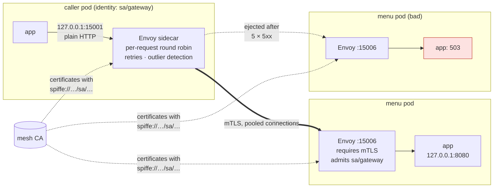

# 57. Service Mesh

<div class="badges" markdown><span class="badge badge-l2">L2 · Practitioner</span><span class="badge badge-l3">L3 · Senior/Lead</span><span class="badge badge-meta">Envoy · sidecars · native sidecar containers · mTLS · SPIFFE identities · retries · outlier detection · Istio · Linkerd · ambient mode</span></div>

<div class="grid two" markdown>

!!! info "Prerequisites"
    - [Chapter 54](ch54-kubernetes-for-spring.md): Services, kube-proxy and the keep-alive imbalance
    - [Chapter 44](../resilience/ch44-timeouts-retries-backpressure.md): timeouts and retries in the client
    - [Chapter 38](../security/ch38-service-to-service-security.md): service-to-service authentication

!!! abstract "What you'll learn"
    - **A sidecar balances requests, not connections**: after a scale-out from 1 to 3 pods, a keep-alive client through kube-proxy sent **every request to the first pod for 50 s**. Through Envoy it was split **333 / 333 / 334** within 10 s of the new pods being ready.
    - **mTLS admits identities, not addresses**: menu-service's sidecar refused plaintext, TLS without a certificate, a valid certificate for the wrong service account, and the right name signed by another CA. It accepted only the gateway's identity. The app's own port stayed open unless the app listened on localhost only.
    - **Retries and outlier detection against one bad pod in three**: no mesh features, 1,000 of 3,000 requests failed. Retries alone: 0 failed, but **1,495–1,497 retries**. Outlier detection alone: 26 failed. Both: **0 failed with 35 retries**. With Envoy's default `max_ejection_percent` of 10%, the bad pod was **never ejected**.
    - **A sidecar costs latency and CPU**: p50 went from 0.50–0.58 ms with no proxy to 1.52–1.53 ms through two sidecars with mTLS, and p99 from 4–6 ms to 21 ms. At 500 requests a second, each Envoy used **208–217m of CPU, twice what the app it served used**.

</div>

---

## 1 · Introduction & Context

### Three problems, one proxy

By the end of chapter 56, FoodFleet had three problems that lived between services rather than inside them.

The gateway's keep-alive connection pool never noticed new menu-service pods (chapter 54). Every team had written its own retry logic, some with backoff, some without, and one service retried its way into an outage. And the security review asked a question no one could answer: which services are allowed to call payment-service? NetworkPolicies said which *pods* could connect, by label and address, not which *service* was calling.

A service mesh answers all three with one mechanism: a proxy next to every pod, through which all traffic flows. The proxy balances each request, retries and ejects bad endpoints, and speaks mutual TLS with certificates that name the workload. A control plane (Istio's istiod, Linkerd's controller) configures every proxy from a few high-level resources.

This chapter does without the control plane. It runs Envoy, the proxy inside Istio and most other meshes, as a sidecar with configuration generated by a small Java class, so each feature can be switched on and off and measured on its own.

### Where it comes from

<ul class="mh-timeline">
<li><span class="when">2013–2016 · Smart clients, then proxies</span><span class="what">Netflix's Ribbon and Hystrix put balancing and retries in each JVM. Linkerd 1 and Envoy move them into a proxy any language can use.</span></li>
<li><span class="when">2017 · Istio, SPIFFE</span><span class="what">Istio pairs Envoy sidecars with a control plane. SPIFFE defines workload identities as URIs in certificates.</span></li>
<li><span class="when">2018–2020 · Linkerd 2, SMI</span><span class="what">Linkerd 2 rewrites its proxy in Rust for a small footprint; meshes become CNCF projects; mTLS by default spreads.</span></li>
<li><span class="when">2022–2024 · Ambient mode, native sidecars</span><span class="what">Istio's ambient mode moves L4 to a per-node proxy and L7 to optional waypoints. Kubernetes 1.28–1.33 adds sidecar containers that start first and stop last.</span></li>
<li><span class="when">2025–2026 · GAMMA, sidecarless by default</span><span class="what">Gateway API routes for east-west traffic; ambient mode GA. Envoy 1.39 and native sidecars on Kubernetes 1.37 are used here.</span></li>
</ul>

---

## 2 · Core Concepts & Terminology



Data plane and control plane
:   The **data plane** is the proxies: Envoy in Istio, linkerd2-proxy in Linkerd, ztunnel and waypoints in ambient mode. The **control plane** discovers endpoints, issues certificates and pushes configuration (xDS) to them. This chapter writes the configuration a control plane would push.

Sidecar
:   A proxy container in the application's pod. Traffic is redirected through it, by iptables rules in Istio and Linkerd, or explicitly (the app calls localhost) as here. Since Kubernetes 1.29, a **native sidecar** is an init container with `restartPolicy: Always`: it starts before the app and stops after it, which fixes the old startup and Job-completion races.

Workload identity and mTLS
:   Each workload gets a short-lived certificate whose URI SAN names it, such as `spiffe://foodfleet.local/ns/mesh/sa/gateway`. Both sides verify the other's certificate: encryption, and authentication of the caller. Authorization policies then refer to identities, not IPs.

Outlier detection
:   Passive health checking: a proxy that sees an endpoint fail N times in a row ejects it from its balancing for a while, without asking the endpoint. Combined with retries on another endpoint, one bad pod stops costing anything.

---

## 3 · How It Works Internally

### The configuration a control plane would generate

`Sidecar` renders Envoy bootstrap configuration from a few records: the upstream, its retry and outlier policy, and the TLS identities on both sides. This is the caller's sidecar from the resilience experiment, as generated:

```yaml title="envoy/caller-outbound.yaml"
--8<-- "code/chapters/ch57-service-mesh/src/main/resources/envoy/caller-outbound.yaml"
```

Three choices in it carry the chapter's results:

- **`STRICT_DNS` on a headless Service.** The cluster resolves to every pod's IP and re-resolves every 2 s, so Envoy balances across pods itself, per request, over pooled connections. kube-proxy is bypassed.
- **`previous_hosts`.** A retry goes to a different pod than the attempt that failed.
- **`match_typed_subject_alt_names`.** The caller checks that the server is menu-service, by identity. The server's side, below, checks that the caller is the gateway.

```yaml title="envoy/menu-inbound.yaml"
--8<-- "code/chapters/ch57-service-mesh/src/main/resources/envoy/menu-inbound.yaml"
```

### The code that writes it

```java title="mesh/Sidecar.java"
--8<-- "code/chapters/ch57-service-mesh/src/main/java/dev/foodfleet/ch57/mesh/Sidecar.java:14:29"
```

`verify/run.sh` renders every variant the experiments use and runs `envoy --mode validate` on each before anything touches the cluster. Certificates come from `gen-certs.sh`, which plays the mesh CA: an EC P-256 root and one-day leaf certificates with SPIFFE URIs, as istiod issues with 24-hour lifetimes.

### Native sidecars

In the pod spec, Envoy is an init container that keeps running:

```yaml
initContainers:
  - name: envoy
    image: foodfleet/mesh:ch57
    restartPolicy: Always          # a sidecar: started first, stopped last, restarted if it dies
    command: [envoy, -c, /etc/envoy/envoy.yaml, --concurrency, "1"]
    readinessProbe: {httpGet: {path: /ready, port: 15000}}
```

---

## 4 · Design Considerations & Trade-offs

### Test setup

All runs used:

- k3s v1.37.1+k3s1 on one 2-vCPU node; Envoy 1.39.4 (the release binary) as native sidecars with `--concurrency 1`.
- menu-service and its caller (`MeshLab`) on a jlink'd Java 25 runtime. The caller runs the load from inside its own pod, through its sidecar on localhost.
- Certificates from a lab CA made by `gen-certs.sh`; no control plane.

There were two runs. Where they differed, both values are shown. `check_apis.sh` checks **9 behaviours** in Envoy's and Kubernetes' sources, and all were found.

### Measured: balancing after a scale-out

A pooled keep-alive client (`java.net.http`) sent 100 requests a second to menu-service for 60 s. At 10 s, menu-service was scaled from 1 to 3 pods; the new pods were ready at 14 s. Requests per pod in each 10-second window:

| Window | Through kube-proxy (Service ClusterIP) | Through the caller's sidecar |
|---|---|---|
| 0–10 s | 1,000 | 1,000 / 0 / 0 |
| 10–20 s | 1,000 | 851–878 / 61–75 / 61–74 |
| 20–30 s | 1,000 | 333 / 333 / 334 |
| 30–60 s | **1,000 (no other pod ever answered)** | **333 / 333 / 334** |

Neither path failed a request. p50 / p99: 1.19–1.28 / 9.7–10.1 ms through kube-proxy, 2.57–2.60 / 8.9–12.1 ms through the sidecar.

What the table shows:

- **kube-proxy balances connections.** The client's pooled connections were opened to the only pod before the scale-out, and every request kept going there for the remaining 50 seconds. That's chapter 54's finding again.
- **The sidecar balances requests.** Envoy found the new pods through DNS within its 2-second refresh, and from the next window on split requests evenly, over its own pooled connections. The client didn't change.
- **The price is an extra hop.** The median rose by about 1.3 ms: the request now passes through two proxies, with mTLS between them.

### Measured: who can reach menu-service

menu-service's sidecar required mTLS from the mesh CA and admitted only `spiffe://foodfleet.local/ns/mesh/sa/gateway`. Probes from the caller's pod, identical in both runs:

| Request | Result |
|---|---|
| Plain HTTP to the sidecar's port | refused: the connection closed with no response |
| TLS without a client certificate | refused: the sidecar closed the connection after the handshake |
| TLS, mesh CA, identity `sa/reporting` | refused: `certificate_unknown` alert |
| TLS, identity `sa/gateway`, signed by another CA | refused: `certificate_required` (the client found no certificate the server's CA list accepts) |
| TLS, mesh CA, identity `sa/gateway` | **200** |
| Through the caller's own sidecar | **200** |
| Plain HTTP to the app's port, app listening on 127.0.0.1 | refused: connection refused |
| Plain HTTP to the app's port, app listening on 0.0.0.0 | **200: the mesh was bypassed** |

A request on a new connection took 1.1–1.3 ms (p50) in plaintext and 6.9–7.9 ms with a full mTLS handshake. An earlier version of the probe measured 50 ms for the handshake: with Nagle's algorithm on, the HTTP request after the handshake waited for a delayed ACK. Setting `TCP_NODELAY` removed the 40 ms.

What the table shows:

- **Authorization by identity works without IPs.** A valid certificate from the right CA wasn't enough: it had to name an allowed service account. A certificate naming the right account but from another CA was rejected too.
- **The sidecar protects only the traffic that goes through it.** An app listening on all interfaces was reachable directly, in plaintext, by anyone who could reach the pod. Istio and Linkerd redirect inbound traffic with iptables so this can't happen; with explicit sidecars, the app must listen on localhost, and a NetworkPolicy should admit only the sidecar's port.
- **Handshakes are worth avoiding, not fearing.** A full mTLS handshake cost about 6 ms here, once per connection. Sidecars pool connections between them, so steady traffic pays it rarely.

### Measured: one bad pod in three

menu-service ran two good pods and one that answered every request with 503. The caller sent 50 requests a second for 60 s:

| Caller | Failed | Retries | Ejections | p50 / p99 | Failures per 10 s window |
|---|---|---|---|---|---|
| kube-proxy, new connection per request (no mesh) | 988–1,027 of 3,000 | – | – | 2.0–2.1 / 7–18 ms | 139–180 each |
| Sidecar, no retries or outlier detection | 1,000 of 3,000 | 0 | – | 3.8–4.1 / 10–25 ms | 166–167 each |
| Sidecar, 2 retries on another pod | **0** | **1,496–1,497** | – | 7.5–8.3 / 35–36 ms | 0 |
| Sidecar, outlier detection (5 × 5xx: eject 30 s) | **26** | 0 | 2 | 3.4 / 9–11 ms | 5, 0, 0, 21, 0, 0 |
| ...with Envoy's default `max_ejection_percent` (10%) | **1,000** | 0 | **0** | 3.4 / 9–11 ms | 166–167 each |
| Sidecar, both | **0** | **35** | 2 | 3.3 / 20–25 ms | 0 |

What the table shows:

- **Retries hid the bad pod, at a cost of half the traffic again.** Each first attempt that hit the bad pod was retried on another, so nothing failed. But there were about 1,500 retries for 3,000 requests, not 1,000: each retry advanced the round robin, and the bad pod ended up receiving every other first attempt. Retries without ejection keep feeding a broken endpoint, and add load exactly when something is wrong.
- **Outlier detection stopped sending traffic to it.** Five consecutive 503s ejected the pod for 30 s; when it came back and failed again, it was ejected for 60 s. 26 requests failed in a minute instead of 1,000.
- **The default ejection limit protects nothing in a small service.** Envoy ejects at most `max_ejection_percent` of a cluster, 10% by default. Ten percent of three pods rounds down to zero, so the bad pod was never ejected and a third of requests kept failing. Set it explicitly, or `always_eject_one_host`.
- **Together they're better than either.** Retries covered the few requests outlier detection needed to notice, and ejection cut retries from 1,500 to 35.

### Measured: what a sidecar costs

One menu-service pod; a keep-alive client sent 500 requests a second for 50 s, after a 10-second warm-up:

| Path | p50 | p99 | p99.9 |
|---|---|---|---|
| No proxy (caller to the app's port) | 0.50–0.58 ms | 3.8–5.6 ms | 17–30 ms |
| 1 proxy: caller's sidecar to the app | 0.98–1.03 ms | 4.9–9.4 ms | 14–58 ms |
| 2 proxies, plaintext between them | 1.46–1.49 ms | 11.4–13.3 ms | 70–109 ms |
| 2 proxies, mTLS between them | 1.52–1.53 ms | 21.0–21.1 ms | 51–71 ms |

At 500 requests a second with mTLS, as `kubectl top` saw it:

| Container | CPU | Memory |
|---|---|---|
| menu-service app | 97–100m | 65–68 MiB |
| menu-service's Envoy | 217m | 32–41 MiB |
| caller's Envoy | 208–215m | 37–44 MiB |

What the tables show:

- **Each proxy hop added about half a millisecond at the median.** Two sidecars tripled a sub-millisecond call. For calls that take tens of milliseconds, that's noise; for chatty, fine-grained calls, it adds up per hop (chapter 20).
- **Tails grew more than medians.** p99 went from 4–6 ms to 11–13 ms with two plaintext proxies and 21 ms with mTLS, on a busy two-CPU node where each proxy is one more thing waiting for CPU. p99.9 varied too much between runs to say more.
- **The proxies used more CPU than the service.** For a trivial endpoint, each Envoy spent about twice the app's CPU. Memory was modest. Across hundreds of pods, sidecar requests are a real line in the cluster's budget, which is the main argument for sidecarless designs.

### Choosing

| Option | Gives you | Costs | FoodFleet uses it for |
|---|---|---|---|
| No mesh: client libraries + NetworkPolicies | Retries and balancing per language; L3/L4 isolation | Per-team logic; no identity; keep-alive imbalance | Batch jobs |
| Linkerd | mTLS by default, per-request balancing, retries, small Rust proxy | Fewer L7 features than Envoy | – |
| Istio, sidecar mode | Everything here plus traffic shifting, rich policy, Envoy's extension points | A proxy per pod; the most moving parts | – |
| Istio, ambient mode | mTLS and L4 policy per node (ztunnel); L7 only where a waypoint is deployed | Newer; L7 features need waypoints | **All services** |
| Client-side only (gRPC xDS, Spring Cloud LoadBalancer) | Per-request balancing without a proxy | Language-specific; no mTLS identity by itself | – |

---

## 5 · Hands-on Implementation

```text
ch57-service-mesh/
├── src/main/java/dev/foodfleet/ch57/mesh/   SpiffeId, Sidecar
├── src/main/resources/envoy/                caller-outbound.yaml, menu-inbound.yaml (generated examples)
├── src/test/java/…                          4 tests
└── verify/                                  gen-certs.sh, build-libs.sh, run.sh, check_apis.sh, tools/ (MeshLab, Measure)
```

### 🔵 Level 2: the features, one at a time

<div class="badges" markdown><span class="badge badge-l2">L2 · Practitioner</span></div>

- Run `verify/run.sh balance` and compare kube-proxy with the sidecar.
- Turn on retries, then outlier detection, in `Sidecar.Upstream`, and watch failures and retries in `resilience`.
- Read Envoy's stats (`:15000/stats?filter=outlier`) while a pod fails.

```bash
K3S_DISABLE=traefik ../../ch52-health-checks-actuator/verify/k3s-lab.sh   # a cluster with metrics-server
verify/run.sh resilience                                                  # about 6 minutes
```

### 🟣 Level 3: adopting a mesh

<div class="badges" markdown><span class="badge badge-l3">L3 · Senior/Lead</span></div>

- Start with mTLS in permissive mode, then strict, namespace by namespace; watch for plaintext callers.
- Move retry policy out of services into the mesh, with budgets; remove it from clients so retries don't multiply.
- Set outlier detection explicitly per service, with an ejection limit that can eject at least one pod.
- Budget sidecar CPU and memory, or choose ambient mode; measure p99 per hop before and after.

### Run and verify

```text
$ verify/run.sh resilience
menu-service: 2 good pods and 1 that answers every request with 503. 50 requests/s for 60 s.
caller                                              failed     retries  ejections  p50 / p99 (ms)   failures by 10 s window
kube-proxy, a new connection per request (no mesh)   988/3000  -        -           2.03 / 7.26     169 170 175 172 163 139
sidecar, no retries, no outlier detection           1000/3000  0        -           3.83 / 10.47    166 167 167 166 167 167
sidecar, 2 retries on another pod                      0/3000  1497     -           7.54 / 35.24    0 0 0 0 0 0
sidecar, outlier detection (5 x 5xx: eject 30 s)      26/3000  0        2           3.40 / 9.35     5 0 0 21 0 0
  ... with Envoy's default max_ejection_percent (10%) 1000/3000  0        0           3.36 / 9.02     167 166 167 167 166 167
sidecar, both                                          0/3000  35       2           3.33 / 19.84    0 0 0 0 0 0
```

!!! question "Try it"
    1. Change the bad pod to answer 503 for only 20% of requests. Does outlier detection still eject it?
    2. Remove `previous_hosts` from the retry policy. How many requests fail with two retries?
    3. Raise Envoy's `--concurrency` to 2. What happens to its CPU and the p99?
    4. Make the caller's certificate expire (`-days 0` in `gen-certs.sh`). What does the caller see?

---

## 6 · Production Readiness

- [x] **mTLS strict** for every namespace, after a permissive phase; plaintext callers found and fixed
- [x] **Authorization by identity**: which service accounts may call each service
- [x] **No bypass**: traffic redirected (iptables, ambient), or apps on localhost plus NetworkPolicies
- [x] **Retries in one layer**, with budgets, on idempotent requests only
- [x] **Outlier detection** set explicitly, able to eject at least one pod
- [x] **Sidecar resources** requested and budgeted; native sidecars for startup and shutdown order
- [x] **Certificate rotation** automatic and short-lived; CA rotation rehearsed
- [x] **Per-hop latency** measured before and after adoption

---

## 7 · Anti-patterns & Pitfalls

!!! pitfall "Incident 1: the mesh that retried a pod to death"
    **Context.** order-service had a client retry (3 attempts), and the mesh added its own (2 retries). One pod's database connection pool was exhausted.

    **Symptoms.** Error rates on that pod climbed, and traffic to it climbed too, until its liveness probe failed.

    **Root cause.** Retries in two layers multiply, and without ejection they keep going back to the bad endpoint. Measured: retries alone produced ~1,500 extra attempts for 3,000 requests, half of them to the bad pod.

    **Fix.** Retries in the mesh only, with a budget; outlier detection on. Measured with both: 0 failures and 35 retries.

!!! pitfall "Incident 2: outlier detection that never ejected"
    **Context.** The platform enabled outlier detection with `consecutive_5xx: 5` for every service, leaving the other fields at their defaults.

    **Symptoms.** A three-pod service with one broken pod kept failing a third of requests, and the mesh dashboards showed no ejections.

    **Root cause.** `max_ejection_percent` defaults to 10%, which rounds down to zero pods for a three-pod service. Measured: 1,000 of 3,000 failed and 0 ejections, against 26 failed with 50%.

    **Fix.** Set `max_ejection_percent` (or `always_eject_one_host`) explicitly in the platform's defaults.

!!! pitfall "Incident 3: strict mTLS, and a port nobody covered"
    **Context.** A team ran Envoy as an explicit sidecar on a VM-style service. mTLS was strict on the sidecar's port.

    **Symptoms.** A penetration test reached the service's admin endpoints in plaintext.

    **Root cause.** The app listened on all interfaces; only traffic sent to the sidecar was checked. Measured: plaintext to the app's port returned 200 when it listened on 0.0.0.0, and was refused when it listened on 127.0.0.1.

    **Fix.** Traffic redirection (the mesh's iptables or ambient mode), apps on localhost, and NetworkPolicies admitting only the sidecar port.

| Anti-pattern | Symptom | Fix |
|---|---|---|
| Retries in client and mesh | Multiplied load on failing pods | One layer, with budgets |
| Retries without ejection | Bad pod keeps getting traffic | Outlier detection |
| Default ejection limits on small services | Never ejects | Explicit `max_ejection_percent` |
| Sidecar on a port the app doesn't hide | Plaintext bypass | Redirection, localhost, NetworkPolicy |
| Permissive mTLS forever | Plaintext keeps working | Strict after a migration window |
| Long-lived certificates | Painful rotation, larger blast radius | Hours, rotated automatically |
| Unbudgeted sidecars | CPU requests double | Size them, or ambient mode |
| Mesh for everything at once | Big-bang outages | Namespace by namespace |

---

## 8 · Enterprise Case Study

### FoodFleet: ambient mode, with waypoints where L7 matters

!!! decision "ADR-057: Istio in ambient mode for all namespaces with strict mTLS and identity-based authorization; waypoint proxies (L7) for services that need per-request balancing, retries and outlier detection; client libraries keep timeouts but drop retries"
    **Status:** Accepted · **Date:** 2025-11-24

    **Context.** Keep-alive clients ignored new pods, retry logic differed per team, and nothing authenticated callers. Measured in the lab with Envoy sidecars:

    - Per-request balancing split traffic evenly within 10 s of a scale-out; kube-proxy left it all on one pod.
    - mTLS admitted only the allowed identity; an app listening on all interfaces was reachable around it.
    - Retries alone added ~1,500 attempts per 3,000 requests; with outlier detection, 35 and no failures. The default ejection limit never ejected in a three-pod service.
    - Each sidecar used 208–217m of CPU at 500 requests/s, twice what the app used.

    **Decision.**

    - **Mesh:** Istio in ambient mode. ztunnel on every node gives mTLS and L4 authorization without a proxy per pod.
    - **Identity:** strict mTLS in every namespace after a two-week permissive phase. AuthorizationPolicies name allowed service accounts per service.
    - **L7:** waypoint proxies for the gateway's upstreams, order-service and payment-service, with per-request balancing, two retries on 5xx with a budget, and outlier detection (5 consecutive 5xx, 50% maximum ejection).
    - **Clients:** keep timeouts and circuit breakers (chapter 43); remove retries.

    **Consequences:**

    - ✅ Identity-based access control, and encryption, everywhere.
    - ✅ No per-pod proxy CPU for services that don't need L7 features.
    - ⚠️ Waypoints are a shared hop: sized and scaled like any other service.
    - ⚠️ Ambient mode is newer than sidecars; upgrades are rehearsed in staging first.

### Fintech analogue: mTLS for the auditor

Banks often adopt a mesh for one reason: to prove that every internal call is encrypted and authenticated, and to produce the list of which services may call which. The mesh's authorization policies become an audited artifact, and the certificate authority is backed by an HSM-held root with intermediate CAs per cluster.

### E-commerce analogue: shifting traffic by header

Retailers use the mesh's L7 routing for testing in production: requests with a header from internal testers go to a new version of a service while everyone else stays on the old one. Chapter 58 does the same at the edge with Gateway API weights.

---

## 9 · Interview Q&A + Summary

#### Q1. What does a service mesh give you? · <span class="badge badge-l2">L2</span> · TCS · Infosys

**Short answer:** Per-request load balancing, retries, timeouts and outlier detection; mTLS with workload identities and authorization; and uniform telemetry, all outside the application, in any language. Measured: per-request balancing fixed the keep-alive imbalance within 10 s of a scale-out.

#### Q2. Data plane versus control plane? · <span class="badge badge-l2">L2</span> · Accenture

**Short answer:** The data plane is the proxies that carry traffic (Envoy, linkerd2-proxy, ztunnel). The control plane discovers endpoints, issues certificates and pushes configuration to them over xDS (istiod, Linkerd's controller). This chapter wrote the data plane's configuration by hand.

#### Q3. How does mTLS in a mesh authenticate a service? · <span class="badge badge-l3">L3</span> · Razorpay · banks

**Short answer:** Each workload's certificate carries its identity as a SPIFFE URI SAN, issued by the mesh CA and rotated within hours. Both sides verify the chain and the peer's identity. Measured: the right CA with the wrong service account was refused, as was the right name from another CA.

#### Q4. Why would requests still reach a pod around the mesh? · <span class="badge badge-l3">L3</span> · security rounds

**Short answer:** If traffic isn't redirected and the app listens on all interfaces. Measured: plaintext to the app's port returned 200. Meshes redirect with iptables or ambient mode; with explicit sidecars, the app must listen on localhost, plus NetworkPolicies.

#### Q5. Where should retries live? · <span class="badge badge-l3">L3</span> · Uber · Swiggy

**Short answer:** In one layer, with a budget, for idempotent requests only, and on a different endpoint. Measured: mesh retries alone hid a bad pod but cost ~1,500 retries per 3,000 requests; with outlier detection, 35. Two layers multiply.

#### Q6. What is outlier detection? · <span class="badge badge-l2">L2</span> · Flipkart

**Short answer:** Passive health checking: an endpoint that fails N times in a row is ejected from balancing for a growing period. Measured: 26 failures in a minute instead of 1,000. Watch `max_ejection_percent`: its 10% default ejected nothing in a three-pod service.

#### Q7. What does a sidecar cost? · <span class="badge badge-l3">L3</span> · platform rounds

**Short answer:** Latency per hop and resources per pod. Measured: about half a millisecond at the median per proxy, larger tails, and 208–217m of CPU per Envoy at 500 requests/s, twice the app's. Hence ambient mode and Linkerd's lighter proxy.

#### Q8. What is Istio's ambient mode? · <span class="badge badge-l3">L3</span> · Atlassian

**Short answer:** A sidecarless data plane: a per-node ztunnel does mTLS and L4 policy for every pod, and optional per-namespace or per-service waypoint proxies (Envoy) do L7 features only where needed. It cuts per-pod overhead and removes sidecar injection and restarts.

#### Q9. Why native sidecars? · <span class="badge badge-l2">L2</span> · Kubernetes rounds

**Short answer:** As an init container with `restartPolicy: Always`, the proxy starts before the app (so its first calls work) and stops after it (so its last ones do), and Jobs can complete. Before, apps raced their sidecars at both ends.

#### Q10. Mesh or client library? · <span class="badge badge-l3">L3</span> · Thoughtworks

**Short answer:** Client libraries are lighter and see application context; a mesh is uniform across languages and adds identity and mTLS. Many shops do both: timeouts and circuit breakers in the client, balancing, retries and mTLS in the mesh.

#### Q11. How do you roll out strict mTLS without an outage? · <span class="badge badge-l3">L3</span> · PhonePe

**Short answer:** Enable the mesh in permissive mode (accepting both), watch telemetry for plaintext callers, fix them, then switch namespaces to strict one at a time, with an exception list that has an expiry date.

#### Q12. Design FoodFleet's service-to-service traffic layer. · <span class="badge badge-l4">L4</span> · system design rounds

**Short answer:**

- **Identity:** a mesh CA issuing SPIFFE certificates per service account, rotated daily; strict mTLS; authorization by identity.
- **Data plane:** ambient mode for L4 everywhere; waypoints for services needing L7.
- **Traffic policy:** per-request balancing, one retry layer with budgets, outlier detection with explicit limits, timeouts per route.
- **Edge:** Gateway API at the edge (chapter 58), the same routes for canaries.
- **Checks:** per-hop latency budgets, sidecar or waypoint resources sized, and telemetry for plaintext and denied calls.

### Key takeaways

- **Proxies balance requests; kube-proxy balances connections**: a mesh fixes the keep-alive imbalance.
- **Identity, not addresses**: mTLS with SPIFFE identities lets policies name services, but only for traffic that passes through the proxy.
- **Retries need ejection**: alone they feed a bad pod; with outlier detection they hide it cheaply. Check the ejection limit.
- **Sidecars cost CPU and latency per hop**: measure them, or go sidecarless.

### Further reading

- Envoy, [Outlier detection](https://www.envoyproxy.io/docs/envoy/latest/intro/arch_overview/upstream/outlier) and [Automatic retries](https://www.envoyproxy.io/docs/envoy/latest/intro/arch_overview/http/http_routing#retry-semantics)
- SPIFFE, [SPIFFE concepts](https://spiffe.io/docs/latest/spiffe-about/spiffe-concepts/)
- Istio, [Ambient mode overview](https://istio.io/latest/docs/ambient/overview/) and [Mutual TLS migration](https://istio.io/latest/docs/tasks/security/authentication/mtls-migration/)
- Linkerd, [Automatic mTLS](https://linkerd.io/2/features/automatic-mtls/)
- Kubernetes, [Sidecar containers](https://kubernetes.io/docs/concepts/workloads/pods/sidecar-containers/)

---

**Previous:** [← 56. Autoscaling](ch56-autoscaling.md) · **Next:** [58. CI/CD, GitOps & Progressive Delivery →](ch58-cicd-gitops.md)
