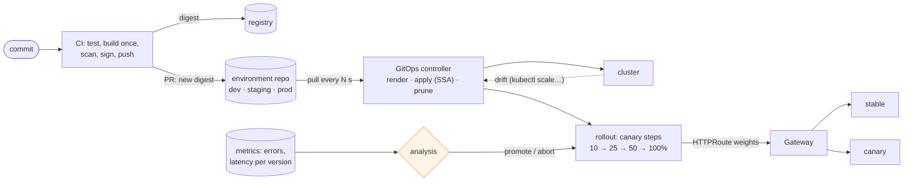

# 58. CI/CD, GitOps & Progressive Delivery

<div class="badges" markdown><span class="badge badge-l2">L2 · Practitioner</span><span class="badge badge-l3">L3 · Senior/Lead</span><span class="badge badge-meta">pipelines · build once · GitOps · reconciliation · drift · pruning · canary analysis · Gateway API weights · blue/green · Argo CD · Flux · Argo Rollouts</span></div>

<div class="grid two" markdown>

!!! info "Prerequisites"
    - [Chapter 55](ch55-helm-kustomize.md): environments, promotion by digest, server-side apply
    - [Chapter 41](../security/ch41-supply-chain-compliance.md): signing and provenance in the pipeline
    - [Chapter 51](../observability/ch51-slo-alerting.md): error rates and budgets to judge a release by

!!! abstract "What you'll learn"
    - **GitOps applies commits and undoes hand edits**: a reconciler polling every 10 s applied each commit **1.0–9.8 s** after the push, put a scaled Deployment back to Git's replica count, recreated a deleted Deployment in 11–12 s, and pruned a ConfigMap deleted from Git. A hand-added environment variable **stayed**, because no manifest mentioned it.
    - **A canary limits who sees a bad release**: with 5% of its requests failing, the canary was aborted at its first 10% step after **19–22 s**, with **7–10 failed requests**. The same release as a rolling update, undone after two minutes, failed **944–953**.
    - **Analysis can be wrong too**: in one run a healthy canary was **aborted at 50%** with no errors, on latency, when its single pod took half the traffic.
    - **Blue/green switches in a fraction of a second, for new connections**: a Service selector switch moved new connections and the Gateway in **0.2–0.8 s**. A keep-alive client **stayed on the old slot for the whole test**.

</div>

---

## 1 · Introduction & Context

### The Friday deploy

FoodFleet's early pipeline was a Jenkins job per service: build, test, then `kubectl apply` against production with a cluster-admin token stored in Jenkins. It worked, until three weeks in a row taught the platform team what it didn't do.

The first week, someone scaled order-service by hand during an incident, forgot, and the cluster ran an unrecorded configuration for a month. The second week, a ConfigMap deleted from the repository kept existing in the cluster, and a feature flag nobody could find in Git stayed on. The third week, a release that failed 5% of checkouts went to every pod in a rolling update, because readiness probes passed; it took eleven minutes to notice and roll back.

The fixes are the subject of this chapter. **CI** builds once and records what it built. **GitOps** makes a Git repository the only description of each environment, with a controller in the cluster that applies it and keeps applying it. **Progressive delivery** releases to a slice of traffic first and lets measurements decide whether to continue.

### Where it comes from

<ul class="mh-timeline">
<li><span class="when">2010 · Continuous Delivery</span><span class="what">Humble and Farley: every commit a release candidate, built once, promoted through a deployment pipeline.</span></li>
<li><span class="when">2014–2016 · Canaries and blue/green at scale</span><span class="what">Netflix's Spinnaker and automated canary analysis (Kayenta); blue/green as a router switch.</span></li>
<li><span class="when">2017–2019 · GitOps</span><span class="what">Weaveworks names it: declarative state in Git, pulled by an agent in the cluster. Flux and Argo CD follow.</span></li>
<li><span class="when">2019–2022 · Argo Rollouts, Flagger</span><span class="what">Canary and blue/green as Kubernetes resources, with metric analysis steps and traffic shifting through meshes and ingresses.</span></li>
<li><span class="when">2023–2026 · Gateway API, OpenGitOps</span><span class="what">HTTPRoute weights become the portable way to split traffic. Argo CD 3.5, Flux 2.9 and Gateway API 1.6 are current; Traefik 3.7 implements the Gateway here.</span></li>
</ul>

---

## 2 · Core Concepts & Terminology



Continuous integration and delivery
:   CI merges, tests and builds every change, producing one artifact (an image digest) with its SBOM, signature and provenance (chapter 41). Delivery promotes that same artifact through environments (chapter 55). Nothing is rebuilt for production.

GitOps
:   The desired state of each environment lives in Git, declaratively. An agent in the cluster pulls it and reconciles continuously: it applies changes, and puts back anything that drifted. Deploys are commits; rollbacks are reverts; the Git log is the audit trail. CI never holds cluster credentials.

Drift and pruning
:   Drift is a difference between Git and the cluster. Self-healing reapplies Git's state. Pruning deletes objects the controller created that are no longer in Git, from an inventory of what it owns.

Canary
:   The new version gets a small share of traffic. At each step, an analysis compares its error rate and latency with the stable version's and decides: continue, wait, or abort and send all traffic back.

Blue/green
:   Two complete environments; a router or Service selector switches all traffic at once. Fast to switch and to switch back, at twice the capacity.

---

## 3 · How It Works Internally

### A reconciler in 20 lines

The loop Argo CD and Flux run, reduced to its decisions. `Ops` is Git, kustomize and the API server; the tests use a fake:

```java title="gitops/Reconciler.java"
--8<-- "code/chapters/ch58-cicd-gitops/src/main/java/dev/foodfleet/ch58/gitops/Reconciler.java:54:71"
```

Three details matter more than the loop:

- **Drift is detected by the API server.** `kubectl diff --server-side` asks what a server-side apply would change. That covers only the fields the manifests declare, which is why a hand-added environment variable is invisible to it.
- **The controller forces ownership.** It applies as its own field manager with `--force-conflicts`, so a field someone else changed (a `kubectl scale`) goes back to Git's value. That's self-healing; Argo CD only does it with `selfHeal: true`.
- **Pruning needs an inventory.** The set of objects applied last is stored in the cluster (a ConfigMap here; Argo CD uses labels and its application state), so a file deleted from Git becomes a delete.

### Canary analysis

At each step, the analysis looks at the canary's last window and the stable version's:

```java title="delivery/CanaryAnalysis.java"
--8<-- "code/chapters/ch58-cicd-gitops/src/main/java/dev/foodfleet/ch58/delivery/CanaryAnalysis.java:32:45"
```

It waits for enough requests before promoting, but aborts early on a burst of errors: waiting for a full sample only exposes more users. Argo Rollouts' `AnalysisTemplate` and Flagger's metric checks express the same rules as queries against Prometheus.

### Traffic split with the Gateway API

The rollout controller changes two weights on an `HTTPRoute`, and nothing else:

```yaml title="delivery/httproute-canary.yaml"
--8<-- "code/chapters/ch58-cicd-gitops/src/main/resources/delivery/httproute-canary.yaml"
```

### The pipeline

CI stops at the environment repository. Its last step opens a pull request with the new digest; the controller does the rest:

```yaml title="ci/pipeline.yaml"
--8<-- "code/chapters/ch58-cicd-gitops/src/main/resources/ci/pipeline.yaml:16:35"
```

---

## 4 · Design Considerations & Trade-offs

### Test setup

All runs used:

- k3s v1.37.1+k3s1 on one 2-vCPU node, with its bundled Traefik 3.7.13 as the Gateway API implementation (`traefik-gateway`).
- menu-service (`DeliveryLab`) on a jlink'd Java 25 runtime; versions and failure rates set per Deployment.
- `Reconciler` running in the measurement process against a local Git repository, with kustomize 5.8.3 and kubectl.
- Load from the node, 100 requests a second, each on a new connection unless stated.

There were two runs. Where they differed, both values are shown. `check_apis.sh` checks **8 behaviours** in kubectl's, the Gateway API's and Argo CD's sources, and all were found.

### Measured: what a GitOps controller does

The reconciler polled every 10 s. Each change was made, then timed until the cluster showed the result:

| Change | Applied after | Rolled out after | What the controller did |
|---|---|---|---|
| First sync of an empty namespace | – | 2.7–3.2 s | applied the commit |
| 5 commits changing the version | **1.0–9.8 s** | 4.2–13.5 s | applied the commit |
| `kubectl scale --replicas=5` (Git says 2) | 1.2–6.9 s | – | reverted drift |
| `kubectl set env VERSION=hotfix` (Git says 1.4.5) | 9.0–9.3 s | – | reverted drift |
| `kubectl set env DEBUG=true` (not in Git) | **kept, 30 s later** | – | **nothing: no change detected** |
| `kubectl delete deployment menu-service` | – | 11.3–12.0 s | recreated it (drift) |
| `git rm flags.yaml` (a ConfigMap) | 7.1–7.9 s | – | applied the commit, pruned `configmap/menu-flags` |

What the table shows:

- **Commit to applied is the polling interval.** Applies landed 1–10 s after the push, uniformly across a 10 s interval, plus the rollout's few seconds. Argo CD polls every 120 s by default, so use webhooks from the Git host when minutes matter.
- **Self-healing undid both kinds of drift Git could see.** A scale and an edited environment variable went back to Git's values within one interval; a deleted Deployment was recreated. The person who scaled during an incident would have needed to commit it.
- **What Git doesn't declare, GitOps doesn't see.** The added `DEBUG` variable survived three intervals: the server-side diff compares only fields the manifests own. Chapter 55 measured the same for plain applies. Admission policies (or a manifest that declares the full env list with a replace strategy) close that gap.
- **Pruning made deletion a commit.** Removing the file removed the ConfigMap within one interval. Without an inventory, it would have lived on, as in the feature-flag story. Argo CD doesn't prune by default.

### Measured: a canary against a rolling update

menu-service 1.4.0 ran 3 pods behind the Gateway. Release 1.4.1 ran 1 pod, at weight 10, 25, 50 and 100, with 30 s of analysis per step: abort above 1% errors, 0.5 points worse than stable, or a p99 above 250 ms.

| Release | Outcome | Took | Requests served by 1.4.1 | Failed requests |
|---|---|---|---|---|
| 1.4.1, healthy, as a canary | promoted to 100% (run 2); **aborted at 50% after 14 s** (run 1) | 121 s; 75 s | 6,065 of 12,607; 1,766 of 7,988 | 0 |
| 1.4.1 failing 5%, as a canary | **aborted at 10%** after 19–22 s | 19–23 s | 192–223 of 2,444–2,755 | **7–10** |
| 1.4.1 failing 5%, rolling update, undone after 2 min | rolled out, then undone | 126–127 s | 11,854–11,879 of 13,128–13,155 | **944–953** |

When run 2's bad canary was aborted, its window held 202 requests with 6 errors.

What the table shows:

- **The canary limited exposure by two orders of magnitude.** About 200 requests reached the bad version before it was stopped, and 7–10 failed. As a rolling update, 1.4.1 served almost everything for two minutes and 944–953 requests failed, and two minutes is a fast human reaction.
- **The burst rule mattered.** Six to ten errors in the first 200 requests were enough to stop, without waiting for the 30 s window to finish.
- **A canary's capacity must follow its weight.** In run 1 the healthy release was aborted at 50% with no errors, which leaves only latency: its single pod suddenly took as much traffic as the three stable pods together, on a busy node, and its p99 crossed 250 ms. Scale the canary with its weight (Argo Rollouts' `setCanaryScale`), and compare latency to the stable version rather than to a fixed number.
- **Readiness didn't catch either bad release.** Its probe passed; only the error rate, measured per version, told the versions apart.

### Measured: a blue/green switch

Blue (1.4.0) and green (1.4.1), 3 pods each. The Service's selector was switched from blue to green and back, under 100 requests a second on each path:

| Switch | Path | Every answer from the new slot after | Answers from the old slot after the switch | Failed |
|---|---|---|---|---|
| blue → green | Service, new connections | 0.3–0.8 s | 29–76 | 0 |
| | Service, keep-alive pool | **never: still old after 15 s** | **1,527–1,528** | 0 |
| | Gateway (Traefik) | 0.3 s | 31–34 | 0 |
| green → blue | Service, new connections | 0.2 s | 20–22 | 0 |
| | Service, keep-alive pool | **never** | 922–1,520 | 0 |
| | Gateway (Traefik) | 0.2–0.3 s | 22–29 | 0 |

What the table shows:

- **Switching is fast and free of errors for new connections.** kube-proxy and Traefik both followed the endpoint change within a second, and no request failed, because both slots were running.
- **Keep-alive clients ignored the switch.** Their pooled connections stayed with the pods they were opened to, and the old slot kept serving every one of their requests. A blue/green release isn't done until old connections are closed: drain the old slot, or switch at a proxy that balances per request (the Gateway, or a mesh, chapter 57).
- **Rollback is the same fast switch**, for as long as the old slot keeps running. That's what the doubled capacity buys.

### Choosing

| Strategy | Exposure if it's bad | Rollback | Cost | FoodFleet uses it for |
|---|---|---|---|---|
| Rolling update | Everyone, until noticed | Another rollout | None extra | Internal tools, dev |
| Blue/green | Everyone, at once, but instant to switch back | Instant switch | Double capacity during the release | Database-coupled releases with a cut-over |
| Canary with analysis | A small slice, for seconds | Weight to 0 | Analysis, metrics per version | Every customer-facing service |
| Feature flags | Chosen users | Flag off | Flag hygiene | Behaviour changes inside a release |

And for applying changes:

| Question | Push (CI applies) | Pull (GitOps) |
|---|---|---|
| Cluster credentials | In CI | Only in the cluster |
| Drift | Persists until the next deploy | Reverted every interval (with self-heal) |
| Deletions | Manual | Pruned from an inventory |
| Audit trail | CI logs | Git history |
| Deploy latency | Immediate | Polling interval or webhook |

---

## 5 · Hands-on Implementation

```text
ch58-cicd-gitops/
├── src/main/java/dev/foodfleet/ch58/
│   ├── gitops/     Inventory, Reconciler
│   └── delivery/   CanaryAnalysis
├── src/main/resources/
│   ├── gitops/menu-prod/   kustomization, Deployment, Service, ConfigMap
│   ├── delivery/           traefik-gateway.yaml (HelmChartConfig), httproute-canary.yaml
│   └── ci/pipeline.yaml    the build-once pipeline, as a GitHub Actions workflow
├── src/test/java/…         5 tests
└── verify/                 build-libs.sh, run.sh, check_apis.sh, tools/ (DeliveryLab, Measure)
```

### 🔵 Level 2: Git as the source of truth

<div class="badges" markdown><span class="badge badge-l2">L2 · Practitioner</span></div>

- Put each environment's manifests in an environment repository; let CI open pull requests to it, not apply to clusters.
- Install Argo CD or Flux with automated sync, `prune: true` and `selfHeal: true`, and a webhook from Git.
- Remove cluster-admin credentials from CI.

```bash
K3S_DISABLE= ../../ch52-health-checks-actuator/verify/k3s-lab.sh   # a cluster with Traefik
verify/run.sh gitops                                               # about 4 minutes
```

### 🟣 Level 3: releases that judge themselves

<div class="badges" markdown><span class="badge badge-l3">L3 · Senior/Lead</span></div>

- Argo Rollouts or Flagger with Gateway API traffic routing; analysis from per-version error rates and latency in Prometheus.
- Canary capacity scaled with weight; latency compared with stable.
- Abort automatically, page a human only when an abort repeats.
- Keep-alive-heavy callers: drain old pods at the end of every rollout.

### Run and verify

```text
$ verify/run.sh canary
menu-service 1.4.0 (3 pods) behind Traefik's Gateway; 100 requests/s. Canary steps [10, 25, 50, 100]% of traffic, 30 s of analysis each:
abort above 1% errors, 0.5 points over stable, or p99 over 250 ms; at least 200 canary requests to promote a step
release                                      outcome                          took     served by 1.4.1   failed requests
1.4.1, healthy, as a canary                  promoted to 100%                  121 s     6065 of 12607       0
    abort: canary 202 requests, 6 errors, p99 132 ms
1.4.1, 5% of requests fail, as a canary      aborted at 10% after 22 s          23 s      223 of 2755        7
1.4.1, 5% fail, rolling update; undone after 2 min rolled out, then undone           126 s    11879 of 13128     944
```

!!! question "Try it"
    1. Lower `ERROR_RATE` to 0.5%. Does the analysis catch it, and how many canary requests does it need?
    2. Start the canary with 3 pods and rerun the healthy case. Does the 50% step still risk a latency abort?
    3. Set the reconciler's interval to 60 s. How does commit-to-applied change?
    4. Make the reconciler declare the full env list (replace, not merge). What happens to `DEBUG=true`?

---

## 6 · Production Readiness

- [x] **Build once**: one digest per commit, signed, with SBOM and provenance; never rebuilt per environment
- [x] **Environment repository** as the only path to production; changes by reviewed pull request
- [x] **GitOps controller** with automated sync, self-heal and prune, triggered by webhook
- [x] **No cluster credentials in CI**
- [x] **Canary analysis** on per-version error rate and latency, with early abort and a minimum sample
- [x] **Canary capacity** scaled with its weight
- [x] **Connection draining** at the end of rollouts and switches
- [x] **Rollback rehearsed**: revert commit, weight to 0, selector switch

---

## 7 · Anti-patterns & Pitfalls

!!! pitfall "Incident 1: the scale nobody committed"
    **Context.** During an incident, an engineer ran `kubectl scale --replicas=8` on order-service. CI applied manifests only on deploys.

    **Symptoms.** A month later, a capacity review couldn't explain why order-service ran 8 pods while Git said 3.

    **Root cause.** Push-based deploys don't look at the cluster between deploys. Measured with a pull-based reconciler: the scale was reverted to Git's value within one 10 s interval.

    **Fix.** GitOps with self-heal; incident changes go through a pull request, or are explicitly paused in the controller and committed afterwards.

!!! pitfall "Incident 2: the flag that wouldn't die"
    **Context.** A feature flag lived in a ConfigMap. The team deleted the file from the repository when the feature launched.

    **Symptoms.** Months later, a new service read the old flag's value and enabled dead code.

    **Root cause.** Applying manifests never deletes what they no longer contain. Measured: with an inventory, the deleted ConfigMap was pruned within 7–8 s of the commit.

    **Fix.** Pruning on, from the controller's inventory; Argo CD's `prune: true`.

!!! pitfall "Incident 3: the 5% bug in every pod"
    **Context.** A release broke checkout for one payment method, about 5% of requests. Readiness probes passed. The rollout was a plain rolling update.

    **Symptoms.** Error alerts fired after the error budget burn rate crossed its threshold; the rollback took eleven minutes from release.

    **Root cause.** Nothing between the probe and the users was judging the release. Measured: as a rolling update undone after two minutes, 944–953 requests failed; as a canary, 7–10.

    **Fix.** Canary steps with automated analysis on per-version error rates, aborting on early bursts.

| Anti-pattern | Symptom | Fix |
|---|---|---|
| CI applies to prod with admin credentials | Credentials everywhere, drift | Pull-based GitOps |
| Rebuilding per environment | Prod runs untested bits | Build once, promote digests |
| Auto-sync without prune | Deleted objects live on | Prune from an inventory |
| Auto-sync without self-heal | Hand edits persist | `selfHeal: true` |
| Canary with one pod at 50% | Latency false aborts | Scale with weight |
| Absolute latency thresholds only | Noise aborts healthy releases | Compare with stable |
| Readiness as the release gate | Partial failures ship | Per-version error analysis |
| Blue/green without draining | Keep-alive clients stay on the old slot | Drain, or switch at a per-request proxy |

---

## 8 · Enterprise Case Study

### FoodFleet: pull requests to production, canaries by default

!!! decision "ADR-058: CI builds and signs once and opens pull requests to an environment repository; Argo CD with automated sync, prune and self-heal applies it; customer-facing services release through Argo Rollouts canaries on Gateway API weights with per-version analysis; blue/green only for releases with a data cut-over"
    **Status:** Accepted · **Date:** 2025-12-01

    **Context.** Push deploys left drift and orphaned objects, CI held admin credentials, and a partial failure reached every pod before anyone noticed. Measured on the lab cluster:

    - A pull-based reconciler applied commits within one 10 s interval, reverted scale and env drift, and pruned deleted files; a hand-added variable not in Git survived.
    - A canary stopped a release failing 5% of requests after 7–10 failed requests; the same release as a rolling update failed 944–953 before its two-minute rollback.
    - A healthy one-pod canary was once aborted at 50% on latency.
    - A blue/green switch moved new connections in under a second; keep-alive clients never moved.

    **Decision.**

    - **CI:** build once with Jib, test, scan, sign and attest by digest (chapter 41); open a pull request to the environment repository. No cluster credentials.
    - **CD:** Argo CD per cluster, automated sync with `prune` and `selfHeal`, webhooks from Git. Promotion to staging and prod by approved pull request (chapter 55).
    - **Releases:** Argo Rollouts canaries at 10, 25, 50, 100% through the Gateway API, canary scaled with weight, five-minute analysis per step on per-version error rate (vs stable) and p99 (vs stable, +20%), early abort on 10 errors.
    - **Drift:** admission policies reject changes by humans to production namespaces outside break-glass; break-glass changes are committed within a day.

    **Consequences:**

    - ✅ Every production change is a reviewed commit; rollbacks are reverts.
    - ✅ Bad releases reach a slice of traffic for seconds.
    - ⚠️ A release takes 20+ minutes to reach 100%.
    - ⚠️ Per-version metrics are now a hard dependency of deploying.

### Fintech analogue: change approval as a merge

Regulated teams map change management onto GitOps: the pull request is the change request, its approvals are the change board, and the merge commit links to the ticket. Production clusters accept changes only from the controller, which makes "who changed what, when" a `git log`.

### E-commerce analogue: canaries by region and cohort

Large retailers canary by geography or customer cohort as well as by percentage: a release goes to one region's traffic, or to employees and a small customer cohort first, using header- or cookie-based routes on the same Gateway API resources, before percentage steps.

---

## 9 · Interview Q&A + Summary

#### Q1. What is GitOps? · <span class="badge badge-l2">L2</span> · TCS · Infosys

**Short answer:** Desired state for each environment in Git, declaratively, pulled and continuously reconciled by an agent in the cluster. Deploys are commits, rollbacks are reverts, and drift is corrected. Measured: commits applied within one 10 s interval, and a manual scale reverted within one.

#### Q2. Push-based or pull-based deployment? · <span class="badge badge-l3">L3</span> · Atlassian · banks

**Short answer:** Pull keeps credentials in the cluster, corrects drift and prunes deletions; push deploys immediately but forgets the cluster between deploys. Most teams combine CI (push to the registry and the environment repo) with GitOps (pull into clusters).

#### Q3. What can't GitOps drift detection see? · <span class="badge badge-l3">L3</span> · platform rounds

**Short answer:** Fields no manifest declares. Measured: a hand-added environment variable survived three reconcile intervals, because the server-side diff covers only fields the controller owns. Close it with admission policies, or manifests that replace whole lists.

#### Q4. How does a canary decide to continue? · <span class="badge badge-l2">L2</span> · Swiggy · Zomato

**Short answer:** After each traffic step, compare the canary's error rate and latency with the stable version's over a window, with a minimum sample, and abort early on a burst. Measured: a release failing 5% was aborted at 10% after 19–22 s, with 7–10 failed requests.

#### Q5. Canary or blue/green? · <span class="badge badge-l3">L3</span> · Flipkart · Walmart

**Short answer:** Canary limits exposure and needs per-version metrics; blue/green switches everything at once but switches back instantly, at double capacity. Measured: the blue/green switch took under a second for new connections, but keep-alive clients stayed on the old slot.

#### Q6. Why did a healthy canary get aborted? · <span class="badge badge-l3">L3</span> · Uber

**Short answer:** Measured: a one-pod canary at 50% weight took as much traffic as three stable pods, and its p99 crossed the absolute threshold. Scale the canary with its weight, warm it, and compare latency to stable rather than a fixed number.

#### Q7. What does "build once" mean, and why? · <span class="badge badge-l2">L2</span> · Wipro

**Short answer:** One image per commit, referred to by digest in every environment, with its SBOM and signature. Rebuilding per environment means production runs bits nobody tested (chapter 55).

#### Q8. How do you roll back with GitOps? · <span class="badge badge-l2">L2</span> · Accenture

**Short answer:** Revert the commit in the environment repository; the controller applies it. For a canary in progress, the rollout controller sets the canary weight to 0 immediately, faster than any commit.

#### Q9. Why prune, and why is it off by default in Argo CD? · <span class="badge badge-l3">L3</span> · PhonePe

**Short answer:** Without pruning, objects deleted from Git live on (measured: pruned in 7–8 s with it). It's off by default because a bad commit or a mis-rendered manifest could delete production objects; teams enable it with protection like sync windows and prune confirmation for critical kinds.

#### Q10. What signals belong in canary analysis? · <span class="badge badge-l3">L3</span> · Razorpay

**Short answer:** Per-version request error rate and latency from the edge or mesh, plus business signals where available (checkout conversion). Compare to stable over the same window, require a minimum sample, and keep thresholds tied to SLOs (chapter 51).

#### Q11. How do keep-alive connections affect releases? · <span class="badge badge-l3">L3</span> · Thoughtworks

**Short answer:** They stay on the pods they were opened to. Measured: after a blue/green switch, every keep-alive request kept going to the old slot. Drain old pods (graceful shutdown closes connections), cap connection lifetimes, or switch at a per-request proxy.

#### Q12. Design FoodFleet's path from commit to production. · <span class="badge badge-l4">L4</span> · system design rounds

**Short answer:**

- **CI:** test, build once with Jib, scan, sign and attest by digest, then open a PR to the environment repository.
- **Promotion:** dev auto-merges; staging and prod need approvals; the policy checks digests (chapter 55).
- **CD:** Argo CD with prune and self-heal, webhooks, no CI credentials in clusters.
- **Release:** Argo Rollouts canaries through Gateway API weights, analysis vs stable, early abort, canary scaled with weight, draining at the end.
- **Recovery:** revert commits; weight to 0; break-glass changes committed within a day.

### Key takeaways

- **Build once, promote digests**, and keep cluster credentials out of CI.
- **GitOps reconciles both ways**: commits apply, drift reverts, deletions prune, but only for what Git declares.
- **Canaries turn a bad release into a small number of failed requests**, if the analysis is per version, early, and sized fairly.
- **Switches move connections, not requests**: drain keep-alive clients.

### Further reading

- OpenGitOps, [GitOps principles](https://opengitops.dev/)
- Argo CD, [Automated sync policy](https://argo-cd.readthedocs.io/en/stable/user-guide/auto_sync/), and Flux, [Kustomization reconciliation](https://fluxcd.io/flux/components/kustomize/kustomizations/)
- Argo Rollouts, [Canary strategy](https://argoproj.github.io/argo-rollouts/features/canary/) and [Analysis](https://argoproj.github.io/argo-rollouts/features/analysis/)
- Kubernetes Gateway API, [Traffic splitting](https://gateway-api.sigs.k8s.io/guides/traffic-splitting/)
- Humble & Farley, *Continuous Delivery* (Addison-Wesley, 2010)

---

**Previous:** [← 57. Service Mesh](ch57-service-mesh.md) · **Next:** [59. Cloud-Native on AWS, Azure & GCP →](ch59-cloud-native-platforms.md)
