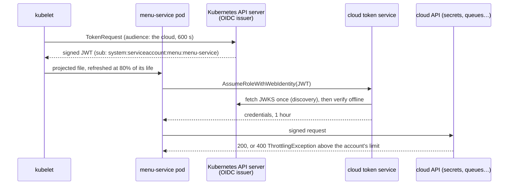

# 59. Cloud-Native on AWS, Azure & GCP

<div class="badges" markdown><span class="badge badge-l3">L3 · Senior/Lead</span><span class="badge badge-l4">L4 · Architect</span><span class="badge badge-meta">EKS · AKS · GKE · workload identity · OIDC federation · SDK retries and throttling · managed Kafka and databases · Lambda · Fargate · Cloud Run · cost</span></div>

<div class="grid two" markdown>

!!! info "Prerequisites"
    - [Chapter 54](ch54-kubernetes-for-spring.md): workloads, service accounts and limits
    - [Chapter 39](../security/ch39-secrets-management.md): why long-lived keys are the problem
    - [Chapter 44](../resilience/ch44-timeouts-retries-backpressure.md): retries, backoff and retry budgets

!!! abstract "What you'll learn"
    - **Workload identity replaces keys with short tokens**: a cloud's token service exchanged menu-service's projected token for one-hour credentials, and refused the default token (wrong audience), another service account and an edited token. Projected tokens lived **600 s** and were refreshed after 515–517 s; the default token was valid for **365 days**.
    - **A cloud checks tokens offline**: after the pod was deleted, the API server rejected its token within 30 s, but the offline check a cloud does **still accepted it** with 475 s to go. Keep token lifetimes short.
    - **Retries against a throttled API**: at twice an API's limit, retries cut failed calls from 5,911 to 766–914 (legacy and standard modes) and the adaptive mode to 141–161, with 2,258–2,259 throttled responses instead of 5,376–7,448. In an outage, the retry quota ran out and clients went back to one attempt per call.
    - **Functions win until they don't**: replaying a day of traffic, a function platform cost $0.01–0.10 a day where two always-on containers cost $2.37, and stayed cheaper than containers sized for the peak up to 1,000 requests a second. Only containers that scaled minute by minute with the load beat it, somewhere between 200 and 1,000 requests a second. Cold starts (1.4 s each, measured) hit 1.6% of requests for a quiet service.

</div>

---

## 1 · Introduction & Context

### The access key in the ConfigMap

FoodFleet moved its platform from a data centre to a cloud in a year. The first services took the obvious path: each got an access key for the cloud APIs it used, stored in a Kubernetes Secret, and in one case in a ConfigMap. Six months later a key leaked through a debug endpoint (chapter 52), and the security team discovered that nobody could say which keys existed, who had them, or how to rotate them without an outage.

Two more lessons followed. On a sale day, every pod of order-service fetched its secrets from the cloud's secrets service at startup; the autoscaler started forty pods at once, the service throttled them, and the SDKs' retries kept it throttled. And a finance review found that half of FoodFleet's small internal services ran two containers around the clock to serve a few hundred requests a day.

This chapter covers what a cloud adds to the platform of Part 8: identity without keys, cloud APIs that throttle, and the choice between containers and functions. It compares EKS, AKS and GKE where they differ, and measures the parts that can be measured without a cloud account: the identity mechanism on a real cluster, the AWS SDK's retry algorithms against a throttling API, and a JVM's cold start.

### Where it comes from

<ul class="mh-timeline">
<li><span class="when">2014–2015 · Lambda, ECS, GKE</span><span class="what">Functions billed per 100 ms; containers on managed schedulers; GKE as the first managed Kubernetes.</span></li>
<li><span class="when">2018 · EKS, AKS GA</span><span class="what">All three clouds run managed Kubernetes. Keys in Secrets are the usual way pods reach cloud APIs.</span></li>
<li><span class="when">2019 · IRSA, GKE Workload Identity</span><span class="what">Pods exchange projected service account tokens for cloud credentials through OIDC federation. Cloud Run and Fargate for EKS arrive.</span></li>
<li><span class="when">2020–2023 · Azure Workload Identity, adaptive retries</span><span class="what">Azure follows with federated credentials. SDKs add retry quotas and client-side rate limiting (AWS adaptive mode).</span></li>
<li><span class="when">2023–2026 · EKS Pod Identity, SnapStart, managed Kafka everywhere</span><span class="what">Simpler pod identity agents; SnapStart for Java functions; MSK, Event Hubs and Managed Service for Apache Kafka. AWS SDK for Java 2.56 is used here.</span></li>
</ul>

---

## 2 · Core Concepts & Terminology



Workload identity federation
:   The cluster is an OIDC issuer: it signs service account tokens and publishes its keys. The cloud trusts that issuer, and a role (AWS), managed identity (Azure) or service account (GCP) trusts one Kubernetes service account. Pods exchange a short projected token for short cloud credentials. EKS calls it IRSA (and, more simply, EKS Pod Identity), AKS and GKE call it Workload Identity.

Throttling and retry modes
:   Cloud APIs limit request rates per account and per API. SDKs retry throttling and server errors with exponential backoff and jitter. A retry quota (a token bucket per client) stops retries when most calls fail; AWS's adaptive mode also limits the client's own send rate after throttling.

Managed services
:   The cloud runs the Kafka cluster, database or Kubernetes control plane: patching, failover, backups. You keep the data model, capacity, client configuration and failure handling.

Functions versus containers
:   A function platform runs one request per instance (by default), starts instances on demand, bills by the millisecond, and reclaims idle instances, so idle costs nothing and a cold start costs latency. Containers run all the time, or follow load more slowly, and bill for the time they exist.

---

## 3 · How It Works Internally

### What the cloud checks

`TokenVerifier` does what AWS STS, Google's STS and Microsoft Entra ID do with a Kubernetes token: verify the RS256 signature against the cluster's published keys, then the issuer, the audience and the expiry. It never calls the cluster:

```java title="identity/TokenVerifier.java"
--8<-- "code/chapters/ch59-cloud-native-platforms/src/main/java/dev/foodfleet/ch59/identity/TokenVerifier.java:47:87"
```

The trust policy decides which service accounts may assume which role:

```java title="identity/TrustPolicy.java"
--8<-- "code/chapters/ch59-cloud-native-platforms/src/main/java/dev/foodfleet/ch59/identity/TrustPolicy.java:16:23"
```

On EKS, the same decision is an IAM trust policy with conditions on `oidc.eks...:sub` and `:aud`; on GKE, an IAM binding to `principal://iam.googleapis.com/.../subject/system:serviceaccount:menu:menu-service`; on AKS, a federated identity credential with the issuer, subject and audience. The pod side is a projected token volume:

```yaml title="k8s/workload-identity.yaml"
--8<-- "code/chapters/ch59-cloud-native-platforms/src/main/resources/k8s/workload-identity.yaml:23:30"
```

### How an SDK retries

`Strategies` reproduces the AWS SDK for Java v2's retry modes with the constants of 2.56 (`check_apis.sh` verifies them in the SDK's source):

```java title="retry/Strategies.java"
--8<-- "code/chapters/ch59-cloud-native-platforms/src/main/java/dev/foodfleet/ch59/retry/Strategies.java:72:89"
```

| Mode | Attempts | Backoff base (throttled) | Retry quota | Client-side rate limiting |
|---|---|---|---|---|
| legacy | 4 | 100 ms (500 ms) | 500 tokens; 5 per retry, throttling retries free | no |
| standard | 3 | 100 ms (1 s) | 500 tokens; 5 per retry | no |
| adaptive | 3 | 100 ms (1 s) | as standard | after the first throttle: 70% of the measured rate, then a cubic climb |

Backoff is "full jitter": a random delay between 0 and min(20 s, base × 2<sup>retry−1</sup>). The Azure and Google SDKs use the same ideas with different constants.

### Functions as a queue of instances

`FunctionPool` replays arrival times against a platform that runs one request per instance and reclaims instances idle for longer than a keep-warm period:

```java title="serverless/FunctionPool.java"
--8<-- "code/chapters/ch59-cloud-native-platforms/src/main/java/dev/foodfleet/ch59/serverless/FunctionPool.java:26:56"
```

---

## 4 · Design Considerations & Trade-offs

### Test setup

All runs used:

- k3s v1.37.1+k3s1 on one 2-vCPU node as the OIDC issuer; `TokenVerifier` and `TrustPolicy` as the cloud's token service, with the cluster's real discovery document and keys.
- A local HTTP "cloud API" limited to 100 requests a second per account, and in-process SDK clients using `Strategies`.
- Docker for the cold starts, with menu-service as chapter 54 built it (Java 25, Logback, Micrometer), limited to 1 CPU.
- List prices for AWS us-east-1 as published on 2026-10-15: Lambda $0.0000166667 per GB-second and $0.20 per million requests; Fargate $0.000011244 per vCPU-second and $0.000001235 per GB-second.

There were two runs. Where they differed, both values are shown. `check_apis.sh` checks **16 behaviours** in the AWS SDK's and Kubernetes' sources, and all were found.

### Measured: exchanging a pod's token for cloud credentials

The role `menu-reader` trusted the audience `sts.foodfleet.local` and the service account `identity:menu-service`:

| Token presented | Token service's answer |
|---|---|
| menu-service's projected token for the token service | **credentials for menu-reader, 60 minutes** |
| menu-service's default token (audience: the API server) | refused: wrong audience |
| reporting's projected token | refused: not authorized to assume menu-reader |
| menu-service's token with one claim edited | refused: bad signature |

| Token | Lifetime (exp − iat) | Refreshed |
|---|---|---|
| Projected, `expirationSeconds: 600` | 600 s | after 515–517 s (80% of its life, plus the kubelet's sync) |
| Default service account token | **31,536,000 s (365 days)** | hourly by the kubelet, but each copy valid a year |

Both runs gave the same results, except the refresh time.

What the tables show:

- **The audience is what makes a token single-purpose.** The default token was genuine and signed by the same key, but issued for the API server, so the cloud refused it. A token minted for the cloud is useless against the API server, and the reverse.
- **The trust policy names services, not pods or IPs.** Another service account's genuine token was refused. Scale, reschedule or recreate pods and nothing needs to change.
- **Projected tokens are short; default ones aren't.** The kubelet replaced the 600-second token with about 80 seconds to spare. The default token is extended to a year for compatibility (`--service-account-extend-token-expiration`), which is why it must never leave the cluster.

### Measured: a token after its pod is gone

The pod was deleted, and its projected token checked twice: offline, as a cloud does, and with a TokenReview against the API server:

| | Offline check (cloud) | TokenReview (API server) |
|---|---|---|
| While the pod runs | accepted (597 s left) | authenticated |
| 3 s after the pod was deleted | accepted | **authenticated** (cached) |
| 30 s after | **accepted** (565 s left) | rejected: token invalidated |
| 120 s after | **accepted** (475 s left) | rejected |

What the table shows:

- **Only the cluster knows the pod is gone.** Tokens are bound to their pod, and the API server rejects them once the pod is deleted, after its 10-second authentication cache. A cloud's token service never asks the cluster; it checks the signature and the expiry, so a token copied out of a pod works until it expires.
- **That makes the lifetime the control.** With 600-second tokens, a stolen token is useful for minutes and the credentials it buys for an hour; with a key in a Secret, until someone notices. Keep projected tokens short, cloud sessions short, and roles narrow.

### Measured: SDK clients against a throttled API

40 pods, each with one SDK client and 2 threads calling 2.5 times a second: 200 calls a second against an API limited to 100, for 60 s:

| Retry mode | Calls made | Failed | Attempts per call | Throttled responses | p50 / p99 call |
|---|---|---|---|---|---|
| none | 12,000 | **5,911** | 1.00 | 5,911 | 1 / 11–17 ms |
| legacy | 6,919–6,949 | 766–800 | 1.95–1.96 | **7,367–7,448** | 1 / 2,507–2,585 ms |
| standard | 7,011–7,060 | 866–914 | 1.64 | 5,376–5,423 | 1 / 2,416–2,436 ms |
| adaptive | 6,290–6,315 | **141–161** | 1.33–1.34 | **2,258–2,259** | 6–49 / 3,906–3,956 ms |

The API served 101–103 successful calls a second in every case.

What the table shows:

- **Retries don't add capacity.** Every mode got the same ~100 successful calls a second, because that's the limit. Retries changed who failed: callers waited in backoff instead, made fewer calls, and saw fewer errors.
- **Legacy mode throttled itself hardest.** Its retries on throttling cost nothing from the quota, so it made the most attempts per call and drew the most throttled responses.
- **Adaptive mode slowed down before sending.** After the first throttle, each client limited its own rate, so throttled responses fell by more than half and failed calls by more than 80% compared with standard mode. The cost is latency: calls waited in the client's limiter, and the median rose from 1 ms to 6–49 ms.

Then 4 pods calling 60 times a second in total, within the limit, while the API answered 503 to everything for 20 s:

| Retry mode | Attempts during the outage | Attempts/s: first 2 s, last 10 s |
|---|---|---|
| none | 1,200 | 60, then 60 |
| legacy | 1,570–1,583 | 182–201, then 60 |
| standard | 1,600 | 172–173, then 60 |
| adaptive | 1,600 | 174–175, then 60 |

What the table shows:

- **Retries tripled the load on a failing service, at first.** Each call became three attempts.
- **The retry quota then turned retries off.** Each client's 500 tokens paid for about 100 retries; once spent, every call made one attempt and failed fast, back to the callers' own 60 a second. Without the quota, an outage would face triple load for its whole length, and recovery would meet a retry storm.

### Measured and calculated: functions or containers

A fresh container of menu-service, started with `docker run` at 1 CPU, answered its first request after 1,388–1,452 ms (median of 10, in four runs; fastest 1,302, slowest 1,649); a warm one in 1.5–3.5 ms. That cold start was then applied to a synthetic day of FoodFleet traffic (night, lunch and dinner peaks), replayed against a function platform (one request per instance, 30 ms of work, 1,769 MB = 1 vCPU) and priced against Fargate tasks of 1 vCPU and 2 GB:

| Service (dinner peak) | Requests/day | Cold starts, 5-min / 15-min keep-warm | Peak instances | Functions $/day | Fargate $/day, sized for the peak | Fargate $/day, following load |
|---|---|---|---|---|---|---|
| 0.2 requests/s | 3,592 | **57 (1.6%)** / 6 (0.17%) | 2 | **0.01** | 2.37 (2 tasks) | 2.37 |
| 5 requests/s | 91,518 | 53 (0.06%) / 27 | 4 | **0.10** | 2.37 (2 tasks) | 2.37 |
| 50 requests/s | 914,007 | 74 (0.01%) / 31 | 10 | **0.99** | 3.55 (3 tasks) | 2.54 |
| 200 requests/s | 3,650,068 | 140 / 65 | 22 | **3.96** | 14.22 (12 tasks) | 4.30 |
| 1,000 requests/s | 18,259,612 | 261–263 / 148–150 | 61 | 19.81 | 71.09 (60 tasks) | **15.73** |

Fargate tasks were sized for 50% CPU at the peak (at least 2); "following load" assumes they scale minute by minute with the traffic, which no autoscaler quite does. The traffic and prices are deterministic, so only the cold-start counts differed between runs.

What the table shows:

- **For small and spiky services, functions cost almost nothing.** Two always-on tasks cost $2.37 a day whatever the traffic; the function platform billed for busy milliseconds only.
- **The crossover comes with sustained load, and depends on how well containers scale.** Functions bill for each busy millisecond at a premium; containers bill for every second they run. At 1,000 requests a second a container fleet that followed the load cost $15.73 against $19.81 for functions, but one sized for the peak cost $71.09. Most real fleets sit between the two: scale-in is slow, and minimum replicas run all night.
- **Cold starts are rare for busy services and common for quiet ones.** A service with a few hundred requests a day hit a cold start on 1.6% of requests with a 5-minute keep-warm, each adding about 1.4 s. For a service at 50 requests a second the share was 0.01%, and it fell further with longer keep-warm. JVM functions should use SnapStart, a native image or CRaC (chapter 60), or a provisioned minimum.

### Choosing

| Concern | AWS | Azure | Google Cloud |
|---|---|---|---|
| Kubernetes | EKS (control plane billed per hour; nodes: EC2, Karpenter, Fargate) | AKS (free or Standard tier control plane) | GKE Standard or Autopilot (billed per pod) |
| Pod identity | IRSA, EKS Pod Identity | Microsoft Entra Workload ID | GKE Workload Identity Federation |
| Kafka | MSK (provisioned or Serverless) | Event Hubs (Kafka protocol), Confluent Cloud | Managed Service for Apache Kafka |
| PostgreSQL | RDS, Aurora | Azure Database for PostgreSQL Flexible Server | Cloud SQL, AlloyDB |
| Functions and serverless containers | Lambda (SnapStart for Java), Fargate, App Runner | Functions, Container Apps | Cloud Run, Cloud Run functions |
| Secrets | Secrets Manager, Parameter Store | Key Vault | Secret Manager |

| Question | Do | Why (measured) |
|---|---|---|
| How do pods reach cloud APIs? | Workload identity, one role per service account, narrow permissions | Tokens are refused for the wrong audience or account; no keys exist to leak |
| Token lifetimes | Short projected tokens (10 min–1 h) and short sessions | A token outlived its pod by its full remaining life |
| Cloud API calls at scale | Standard or adaptive retry mode; cache what you read (secrets at startup) | Adaptive cut failed calls by over 80% at twice the limit |
| Outages | Keep the retry quota on | It cut retry load back to one attempt per call |
| Small, spiky services | Functions or scale-to-zero containers | $0.01–0.10 a day against $2.37 |
| Busy, steady services | Containers on Kubernetes | Cheaper above the crossover; no cold starts |
| Managed or self-run Kafka and databases | Managed, unless a feature or cost forces otherwise | Failover and patching are the hard part |

---

## 5 · Hands-on Implementation

```text
ch59-cloud-native-platforms/
├── src/main/java/dev/foodfleet/ch59/
│   ├── identity/     TokenVerifier, TrustPolicy (and a minimal JSON reader)
│   ├── retry/        RetryStrategy, Strategies (none, legacy, standard, adaptive), RetryQuota, ClientRateLimiter
│   └── serverless/   FunctionPool, Traffic, CostModel
├── src/main/resources/k8s/workload-identity.yaml
├── src/test/java/…   5 tests
└── verify/           build-libs.sh, run.sh, check_apis.sh, tools/ (IdentityLab, Measure)
```

### 🟣 Level 3: no keys, polite clients

<div class="badges" markdown><span class="badge badge-l3">L3 · Senior/Lead</span></div>

- Turn on workload identity in the cluster and delete every cloud access key from Secrets.
- One service account and one role per service, with only the permissions it uses.
- Use the standard or adaptive retry mode, and read secrets and configuration once at startup, with jittered refreshes.

```bash
../../ch52-health-checks-actuator/verify/k3s-lab.sh   # a cluster to act as the OIDC issuer
verify/run.sh identity throttling                     # about 20 minutes
```

### 🔴 Level 4: platform choices

<div class="badges" markdown><span class="badge badge-l4">L4 · Architect</span></div>

- Decide per workload between functions, serverless containers and Kubernetes, from its traffic shape and latency needs, with the cost model in this module.
- Budget cloud API quotas like any other dependency: request rates per account, and alarms on throttling.
- Keep the platform portable where it's cheap to (Kubernetes manifests, OpenTelemetry, Kafka protocol) and use managed services where they're clearly better.

### Run and verify

```text
$ verify/run.sh identity
== identity
issuer https://kubernetes.default.svc.cluster.local; JWKS from the API server; role menu-reader trusts audience sts.foodfleet.local and [system:serviceaccount:identity:menu-service]
token presented                                          token service's answer
menu-service, projected token for the token service      credentials for menu-reader, valid 60 min
menu-service, default token (audience: the API server)   REFUSED: wrong audience [https://kubernetes.default.svc.cluster.local, k3s]
reporting, projected token for the token service         REFUSED: not authorized to assume menu-reader: system:serviceaccount:identity:reporting
menu-service's token with one claim edited               REFUSED: bad signature

token lifetimes (exp - iat)
   projected, expirationSeconds 600:  600 s
   default service account token:      31536000 s (365 days)

after the pod is deleted                                  offline check (cloud STS)        TokenReview (API server)
while the pod runs                                       accepted (597 s left)            authenticated: true
3 s after the pod was deleted                            accepted (592 s left)            authenticated: true
30 s after the pod was deleted                           accepted (565 s left)            not authenticated ([invalid bearer token, service account token has been invalidated])
120 s after the pod was deleted                          accepted (475 s left)            not authenticated ([invalid bearer token, service account token has been invalidated])

kubelet refresh of a 600 s token: replaced 515 s after the pod started; the old token then had 83 s left and still verified: accepted (83 s left)
new token: valid for 600 s, and accepted (598 s left)
```

!!! question "Try it"
    1. Set `expirationSeconds: 3600`. When does the kubelet refresh the token?
    2. Lower the API's limit to 50 requests a second. How do the retry modes compare?
    3. Run the serverless model with 300 ms requests instead of 30 ms. Where does the crossover move?
    4. Add `provisioned = 1` to `FunctionPool.replay` for the quiet service. What do cold starts and cost do?

---

## 6 · Production Readiness

- [x] **Workload identity** everywhere; no cloud access keys in Secrets, ConfigMaps or CI
- [x] **One role per service account**, least privilege, reviewed with the service
- [x] **Short token and session lifetimes**; the default token never leaves the cluster
- [x] **SDK retry mode** set explicitly (standard or adaptive) with the quota on; timeouts on every call
- [x] **Cloud API quotas** known per account, alarmed on throttling, raised before launches
- [x] **Startup reads cached** (secrets, configuration), so scale-outs don't storm cloud APIs
- [x] **Functions or containers** chosen per workload from traffic and latency; cold starts handled for JVMs
- [x] **Managed services** with tested failover, backups and client configuration

---

## 7 · Anti-patterns & Pitfalls

!!! pitfall "Incident 1: the key that outlived its owner"
    **Context.** Services reached the cloud's APIs with access keys in Secrets. One leaked through a debug endpoint.

    **Symptoms.** Calls from an unknown address, months later, with a key nobody remembered creating.

    **Root cause.** Long-lived keys have no expiry and no binding to a workload. Measured, a projected token lasted 600 s, and a token for the wrong audience or service account was refused outright.

    **Fix.** Workload identity for every service; keys deleted; an organisation policy that forbids creating new ones.

!!! pitfall "Incident 2: forty pods, one secrets service"
    **Context.** order-service fetched its secrets from the secrets service at startup. A sale started forty pods at once. The SDK used legacy retries.

    **Symptoms.** Pods failed to start with throttling errors, restarted, and throttled again.

    **Root cause.** At twice the API's limit, legacy retries made the most attempts per call: measured, 7,367–7,448 throttled responses for the same ~100 successful calls a second.

    **Fix.** Adaptive retry mode (measured: 141–161 failed calls instead of 766–914), jittered startup, and secrets cached and refreshed in the background (chapter 39).

!!! pitfall "Incident 3: the token copied out of a pod"
    **Context.** An engineer copied a pod's projected token to debug a permission problem from a laptop, and deleted the pod afterwards.

    **Symptoms.** None, which was the problem: the token kept working.

    **Root cause.** The cloud verifies tokens offline. Measured: the API server rejected the deleted pod's token within 30 s; the offline check accepted it until it expired.

    **Fix.** Short token lifetimes, short cloud sessions, narrow roles, and an alarm on credential use from outside the cluster's network.

| Anti-pattern | Symptom | Fix |
|---|---|---|
| Access keys in Secrets | Leaks with no expiry | Workload identity |
| One role for many services | Blast radius of the largest | One role per service account |
| Default token sent outside | Valid for a year | Projected tokens with an audience |
| Legacy or no retry mode | Self-inflicted throttling | Standard or adaptive |
| Retry quota disabled | Triple load during outages | Keep it |
| Every pod reads secrets at start | Throttling on scale-out | Cache, jitter, refresh in background |
| Always-on containers for quiet services | Paying for idle | Functions or scale to zero |
| JVM functions without help | Second-long cold starts | SnapStart, native image, provisioned minimum |

---

## 8 · Enterprise Case Study

### FoodFleet: keyless and cost-aware

!!! decision "ADR-059: EKS with Karpenter as the main platform; EKS Pod Identity for every service with one role per service account; standard retry mode by default, adaptive for clients of shared AWS APIs; MSK and Aurora PostgreSQL as managed services; Lambda with SnapStart for small event-driven functions"
    **Status:** Accepted · **Date:** 2025-12-08

    **Context.** Access keys leaked, a scale-out throttled itself on the secrets service, and quiet services ran around the clock. Measured in the lab:

    - Federated tokens were refused for the wrong audience, account or signature; projected tokens lived 600 s, default ones a year; a deleted pod's token stayed valid for an offline check until it expired.
    - At twice an API's limit, adaptive retries had 141–161 failed calls against 766–914 for legacy and standard modes; the retry quota limited outage load to one attempt per call after the first seconds.
    - A JVM cold start took about 1.4 s; for quiet services, functions cost a few cents a day against $2.37 for two always-on containers.

    **Decision.**

    - **Platform:** EKS, with Karpenter for nodes and the shared chart (chapter 55) for workloads.
    - **Identity:** EKS Pod Identity for every service; no access keys; Service Control Policies block creating them. Sessions last one hour.
    - **SDKs:** standard retry mode, set explicitly; adaptive for clients of Secrets Manager, SQS and DynamoDB that run in many pods. Secrets read once and refreshed in the background.
    - **Managed services:** MSK for Kafka, Aurora PostgreSQL for databases, both multi-AZ.
    - **Functions:** Lambda with SnapStart for event-driven work under a few requests a second; containers for everything on the request path.

    **Consequences:**

    - ✅ No long-lived credentials; access is reviewed per service.
    - ✅ Quiet workloads cost cents.
    - ⚠️ EKS-specific identity and managed services make a move between clouds work; Kubernetes, Kafka and PostgreSQL keep it possible.
    - ⚠️ Adaptive retries add client-side latency under throttling.

### Fintech analogue: two clouds for the regulator

Some payment companies run active-passive across two clouds because a regulator asked for it. They keep the layers that must move (Kubernetes manifests, PostgreSQL, Kafka protocol, OpenTelemetry) portable and accept cloud-specific identity and networking on each side, with the failover rehearsed every quarter.

### E-commerce analogue: functions around the edges

Large retailers keep the checkout path on containers with warm capacity, and run image resizing, email, webhooks and nightly feeds as functions, where idle is common and a cold start doesn't matter.

---

## 9 · Interview Q&A + Summary

#### Q1. How should a pod on EKS, AKS or GKE call cloud APIs? · <span class="badge badge-l2">L2</span> · TCS · Infosys

**Short answer:** With workload identity: the pod's projected service account token, with the cloud as audience, is exchanged for short credentials of a role that trusts that one service account. No keys. Measured: the exchange refused the wrong audience, the wrong account and an edited token.

#### Q2. How does IRSA or Workload Identity actually work? · <span class="badge badge-l3">L3</span> · Atlassian · Razorpay

**Short answer:** The cluster is an OIDC issuer that signs tokens and publishes its keys. The cloud is configured to trust that issuer, and a role trusts a subject (`system:serviceaccount:ns:name`) and audience. The cloud verifies tokens offline with the published keys and issues credentials for an hour or so.

#### Q3. What happens to a token when its pod is deleted? · <span class="badge badge-l3">L3</span> · security rounds

**Short answer:** The API server rejects it (measured: within 30 s, after a 10-second cache), but a cloud verifying offline accepts it until it expires. Measured: still accepted with 475 s left. So keep lifetimes short.

#### Q4. Why is the default service account token dangerous outside the cluster? · <span class="badge badge-l3">L3</span> · banks

**Short answer:** Its audience is the API server, and for compatibility it's valid for a year (measured: 31,536,000 s), though the kubelet refreshes it hourly. Never send it anywhere; mint projected tokens with a specific audience instead.

#### Q5. A cloud API is throttling us. What do you do? · <span class="badge badge-l3">L3</span> · Swiggy · Flipkart

**Short answer:** Stop calling it as often: cache, batch, and spread startup calls. Then use adaptive or standard retries with jitter and keep the retry quota. Measured at twice the limit: adaptive mode cut failed calls by over 80% compared with standard, and throttled responses by more than half. Ask for a quota increase only after that.

#### Q6. What is a retry quota? · <span class="badge badge-l3">L3</span> · Uber

**Short answer:** A token bucket per client: each retry costs tokens (5 of 500 in the AWS SDK), each success returns some. When it's empty, failures return immediately. Measured in an outage: attempts tripled at first, then fell back to one per call once the quota ran out.

#### Q7. Functions or containers? · <span class="badge badge-l3">L3</span> · Zomato · PhonePe

**Short answer:** Functions for spiky, low-volume, event-driven work where cold starts don't matter; containers for steady, latency-sensitive, high-volume services. Measured and priced: in our model functions cost cents a day where two always-on containers cost $2.37, and stayed cheaper than containers sized for the peak even at 1,000 requests a second; only containers scaling minute by minute with the load beat them, between 200 and 1,000 requests a second. A JVM cold start was about 1.4 s.

#### Q8. How do you make Java functions start fast? · <span class="badge badge-l3">L3</span> · Accenture

**Short answer:** SnapStart (a CRaC-style snapshot) on Lambda, GraalVM native images, an AOT cache, smaller dependency graphs, and provisioned concurrency for latency-critical paths. Chapter 60 measures native images and AOT caches.

#### Q9. Managed Kafka or self-run? · <span class="badge badge-l3">L3</span> · Walmart

**Short answer:** Managed (MSK, Event Hubs' Kafka endpoint, Google's managed Kafka, Confluent Cloud) unless you need a feature or scale they don't offer, or the cost difference at your volume pays for a platform team. You still own topic design, partitions, client configuration and consumer lag (chapters 25 and 69).

#### Q10. EKS, AKS or GKE: what actually differs? · <span class="badge badge-l3">L3</span> · platform rounds

**Short answer:** Mostly the surroundings: identity integration, networking, node management (Karpenter, node auto-provisioning, Autopilot), control-plane pricing and upgrade cadence. Workloads written for Kubernetes move with little change; identity, load balancers and storage classes are what you rewrite.

#### Q11. How do you keep a multi-cloud option without paying for it every day? · <span class="badge badge-l4">L4</span> · architecture rounds

**Short answer:** Be portable where it's cheap: Kubernetes manifests, OpenTelemetry, Kafka and PostgreSQL protocols, Terraform modules per cloud. Accept cloud-specific identity and managed services, documented as the parts to rewrite. Rehearse a move once, small.

#### Q12. Design FoodFleet's cloud platform. · <span class="badge badge-l4">L4</span> · system design rounds

**Short answer:**

- **Compute:** EKS with Karpenter; the shared chart; functions for event-driven edges.
- **Identity:** pod identity per service account; no keys; short sessions.
- **Data:** MSK and Aurora PostgreSQL, multi-AZ; backups tested.
- **Clients:** standard or adaptive retries with quotas; caches for secrets and configuration.
- **Cost and limits:** per-service cost reports, quotas tracked like capacity, and the function-or-container choice made per workload.

### Key takeaways

- **No keys**: workload identity binds cloud access to a service account, with tokens minutes long.
- **Offline checks mean lifetimes matter**: a token outlives its pod until it expires.
- **Throttled APIs need polite clients**: adaptive retries and quotas, plus fewer calls.
- **Functions for quiet work, containers for steady work**: decide with the traffic and the cold start in hand.

### Further reading

- AWS, [IAM roles for service accounts](https://docs.aws.amazon.com/eks/latest/userguide/iam-roles-for-service-accounts.html) and [EKS Pod Identity](https://docs.aws.amazon.com/eks/latest/userguide/pod-identities.html)
- Google Cloud, [Workload Identity Federation for GKE](https://cloud.google.com/kubernetes-engine/docs/concepts/workload-identity); Microsoft, [Workload identity on AKS](https://learn.microsoft.com/azure/aks/workload-identity-overview)
- Kubernetes, [Service account token volume projection](https://kubernetes.io/docs/tasks/configure-pod-container/configure-service-account/#serviceaccount-token-volume-projection)
- AWS SDKs and Tools, [Retry behavior](https://docs.aws.amazon.com/sdkref/latest/guide/feature-retry-behavior.html); Marc Brooker, [Exponential backoff and jitter](https://aws.amazon.com/blogs/architecture/exponential-backoff-and-jitter/)
- AWS, [Lambda pricing](https://aws.amazon.com/lambda/pricing/) and [Fargate pricing](https://aws.amazon.com/fargate/pricing/)

---

**Previous:** [← 58. CI/CD, GitOps & Progressive Delivery](ch58-cicd-gitops.md) · **Next:** [60. Native Images, CRaC & Startup Optimization →](ch60-native-images-startup.md)
