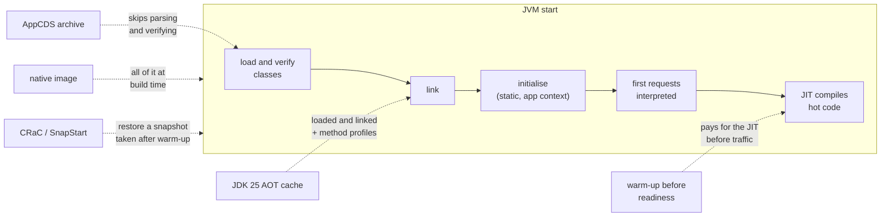

# 60. Native Images, CRaC & Startup Optimization

<div class="badges" markdown><span class="badge badge-l3">L3 · Senior/Lead</span><span class="badge badge-l4">L4 · Architect</span><span class="badge badge-meta">JVM startup · JIT warm-up · AppCDS · JDK 25 AOT cache (JEPs 483, 514, 515) · GraalVM native image · CRaC · SnapStart · training runs · build cost</span></div>

<div class="grid two" markdown>

!!! info "Prerequisites"
    - [Chapter 53](ch53-containerization.md): images, jlink'd runtimes and the AOT cache in brief
    - [Chapter 56](ch56-autoscaling.md): why startup CPU and readiness matter when scaling
    - [Chapter 59](ch59-cloud-native-platforms.md): cold starts on function platforms

!!! abstract "What you'll learn"
    - **Time to the first answer at 1 CPU**, from `docker run`: JVM **1,139–1,246 ms**; AppCDS 753–761 ms; JDK 25 AOT cache **611–732 ms**; native image **246–266 ms**, much of it Docker creating the container.
    - **At a quarter of a CPU the gaps widen**: JVM 4.3–4.4 s, AOT cache 2.0–2.1 s, native image **280–289 ms**. Warming up before opening the port took **17.5 s**.
    - **A cache knows only its training run**: trained without the HTTP server, the AOT cache saved about **half as much** (907–942 ms at 1 CPU, 3.1 s at 0.25 CPU).
    - **Native wins memory, the JVM wins throughput**: the native image idled at **7.5–7.8 MiB** against about 40 MiB, but served **994–1,026 requests a second** after a minute against 1,411–1,701 on the JVM. It took **205 s and 1.73 GB** to build, against 14 s for the AOT cache.
    - **CRaC** couldn't run in the lab's VM (CRIU failed); its flags, hooks and Spring's integration are verified against the sources.

</div>

---

## 1 · Introduction & Context

### The lunch-time scale-out

At 12:30 every weekday, FoodFleet's menu-service goes from 4 pods to 12. Chapter 56 measured what that costs: new JVMs starting on busy nodes, their startup CPU counted as load, and the first requests on each new pod served slowly while the JIT compiler caught up. Chapter 59 added the function platforms, where a JVM's second-long cold start lands on a user's request.

The Java platform has four answers to slow starts, from four eras: keep the JVM and warm it up before it takes traffic; keep the JVM and map pre-parsed classes from an archive (AppCDS); keep the JVM and replay a training run's loaded, linked and profiled classes (the JDK 25 AOT cache from Project Leyden); or leave the JVM behind and compile ahead of time into a native executable (GraalVM). A fifth, CRaC, snapshots a warmed-up JVM and restores it.

This chapter measures the first four on the same service, built from the same jars, in the same container limits, and covers the fifth from its sources, because the snapshot tool it relies on couldn't run in the lab's VM.

### Where it comes from

<ul class="mh-timeline">
<li><span class="when">2004–2017 · Class data sharing</span><span class="what">CDS for JDK classes (JDK 5); AppCDS for application classes opens up in JDK 10.</span></li>
<li><span class="when">2019 · Native images and dynamic archives</span><span class="what">GraalVM 19 makes native image production-ready; JDK 12 ships a default CDS archive and JDK 13 dynamic AppCDS archives.</span></li>
<li><span class="when">2021–2022 · CRaC and SnapStart</span><span class="what">OpenJDK's CRaC project checkpoints a running JVM with CRIU; AWS Lambda SnapStart snapshots Java functions; Spring Boot 3 supports native images.</span></li>
<li><span class="when">2022–2025 · Project Leyden</span><span class="what">JDK 24's AOT class loading and linking (JEP 483); JDK 25 adds one-step training (JEP 514) and method profiles (JEP 515).</span></li>
<li><span class="when">2026 · This chapter</span><span class="what">JDK 25.0.4, GraalVM CE 25.0.2, the CRaC JDK 24+20, Spring Framework 7.0.9.</span></li>
</ul>

---

## 2 · Core Concepts & Terminology



Warm-up
:   Running the request path before the service reports ready, so the JIT has compiled it when users arrive. It moves cost from the first requests to startup.

AppCDS (application class data sharing)
:   An archive of parsed, verified classes, written by a training run (`-XX:ArchiveClassesAtExit`) and mapped into memory at startup (`-XX:SharedArchiveFile`). Saves class loading, not JIT time.

AOT cache (JDK 24+)
:   Project Leyden's successor to CDS: a training run (`-XX:AOTCacheOutput` in JDK 25, one step) records loaded **and linked** classes and, from JDK 25, method profiles, so the JIT starts compiling sooner. Started with `-XX:AOTCache`.

Native image
:   GraalVM compiles the application and the parts of the JDK it reaches into one executable, with a heap snapshot taken at build time. No class loading or JIT at runtime. Reflection, resources and dynamic proxies must be declared, usually recorded by the native-image agent.

CRaC and SnapStart
:   Checkpoint a warmed-up JVM to disk (CRaC uses CRIU) and restore it later in milliseconds. Resources such as sockets and files are closed before the checkpoint and reopened after, through `jdk.crac.Resource`. AWS Lambda SnapStart applies the same idea to functions.

Training run
:   The run that records what the AOT cache, the CDS archive or the native-image agent knows about. **What it didn't do, they don't know.**

---

## 3 · How It Works Internally

### One service, five images

menu-service here is plain Java with Logback, Micrometer and the Prometheus registry, serving `/menu?r=N`: 150 items rendered with a discount per request. The same jars go into every image:

| Image | Base | How it's built | Started with |
|---|---|---|---|
| `ch60-jvm` | jlink'd Java 25 runtime with its default CDS archive | copy the jars | `java -cp /app/* StartupLab` |
| `ch60-cds` | the same | training run with `-XX:ArchiveClassesAtExit` | `-XX:SharedArchiveFile=/app/app.jsa` |
| `ch60-aot` | the same | training run with `-XX:AOTCacheOutput` | `-XX:AOTCache=/app/app.aot` |
| `ch60-aot-core` | the same | the same, from a training run that never starts the HTTP server | `-XX:AOTCache=/app/app.aot` |
| `ch60-native` | glibc only | agent recorded during the training run, then `native-image` | `/app/menu-service -Xmx384m` |

The training run starts the service on a free port and sends it 3,000 requests over HTTP. It's its own main class, so the native executable of `StartupLab` doesn't contain the HTTP client:

```java title="verify/tools/Trainer.java"
--8<-- "code/chapters/ch60-native-images-startup/verify/tools/Trainer.java:17:29"
```

The AOT cache is written by `docker build`, from the training run, and used by every container started from the image:

```dockerfile title="docker/Dockerfile.aot"
--8<-- "code/chapters/ch60-native-images-startup/src/main/resources/docker/Dockerfile.aot"
```

The native image holds the executable and glibc, nothing else:

```dockerfile title="docker/Dockerfile.native"
--8<-- "code/chapters/ch60-native-images-startup/src/main/resources/docker/Dockerfile.native"
```

Warming up on the JVM is a loop over the request path, before the port opens, with a time budget so a slow node doesn't hold the pod back forever:

```java title="startup/Warmup.java"
--8<-- "code/chapters/ch60-native-images-startup/src/main/java/dev/foodfleet/ch60/startup/Warmup.java:18:27"
```

### CRaC, from the sources

CRaC couldn't be measured here: CRIU, which takes the checkpoint, failed its kernel feature detection in the lab's VM (`vdso: Unexpected rt vDSO area bounds`). What `check_apis.sh` verifies in the CRaC JDK (24+20) and Spring Framework 7.0.9:

- `-XX:CRaCCheckpointTo=<dir>` arms checkpointing; `jcmd <pid> JDK.checkpoint` takes one; `-XX:CRaCRestoreFrom=<dir>` restores. The default engine is CRIU (`criuengine`).
- Classes implementing `jdk.crac.Resource` get `beforeCheckpoint` and `afterRestore`, to close and reopen sockets, files and pools.
- Spring's `-Dspring.context.checkpoint=onRefresh` takes the checkpoint right after the context starts, with lifecycle beans stopped and restarted around it; `-Dspring.context.exit=onRefresh` starts the context and exits, which is the usual training run for CDS and AOT caches with Spring Boot.

The trade-offs follow from the mechanism: restore is fast and the JIT's work survives, but the snapshot contains the heap, including anything secret in it, and everything that must differ per instance (random seeds, connections, host names) needs a `Resource` hook.

---

## 4 · Design Considerations & Trade-offs

### Test setup

All runs used:

- JDK 25.0.4 (jlink'd runtime: java.base, java.logging, java.management, java.net.http, java.sql, jdk.httpserver, jdk.management, jdk.crypto.ec, jdk.jcmd) and GraalVM CE 25.0.2 with Serial GC.
- Docker 29.4, each container limited with `--cpus` and `--memory=512m`, on one 2-vCPU VM.
- For each image and CPU limit: 10 starts, timed from `docker run` to the first 200 from `/menu`. On the first start: memory idle and after load, 1,000 sequential requests, then 4 clients for 60 s.

There were two runs. Where they differed, both values are shown. `check_apis.sh` checks **16 behaviours** in the JDK's, GraalVM's, CRaC's and Spring's sources, and all were found.

### Measured: time to the first answer

Time from `docker run` to the first 200 from `/menu`, median of 10 starts (each run's fastest and slowest in the notes below):

| Image | 1 CPU | 0.25 CPU |
|---|---|---|
| JVM | 1,139–1,246 ms | 4,275–4,394 ms |
| JVM, warmed up before opening its port | 4,276–4,302 ms | **17,534–17,569 ms** |
| JVM + AppCDS archive | 753–761 ms | 2,488–2,553 ms |
| JVM + AOT cache (trained through HTTP) | **611–732 ms** | **2,043–2,091 ms** |
| JVM + AOT cache, trained without HTTP | 907–942 ms | 3,066–3,121 ms |
| GraalVM native image | **246–266 ms** | **280–289 ms** |

The first start of an image after another had been under load was sometimes slow (up to 6.8 s for the plain JVM in run 1); the medians are unaffected.

What the table shows:

- **The JVM's start is CPU-bound.** Cutting the CPU to a quarter multiplied every JVM variant's start by about three and a half; the native image's barely moved, because it has almost nothing to do at startup.
- **AppCDS and the AOT cache each removed a step.** The archive saved class loading (33–39% at 1 CPU); the cache, which also stores linked classes and method profiles, saved more (36–51%). At 0.25 CPU both saved more in absolute terms: over two seconds.
- **The native image's quarter-second is mostly Docker.** Creating and starting a container and its port mapping takes a large part of that here; the executable itself has almost nothing to do before it answers.
- **Warming up moves the cost, it doesn't remove it.** Three thousand renders before opening the port made the JVM's first requests fast (below), but readiness took 4.3 s at 1 CPU and 17.5 s at a quarter of one. On a small CPU limit that's a scale-out that arrives too late; the warm-up needs a budget (the default here is 60 s).
- **A training run that skips the request path saves less.** The cache trained without the HTTP server cost 175–330 ms more at 1 CPU and a full second more at 0.25 CPU than the one trained through HTTP: about half the saving.

### Measured: the first thousand requests and the first minute

At 1 CPU, on a fresh container (memory from `docker stats`):

| Image | Memory idle / after a minute's load | Next request / p50 of the next 99 / p50 of 900 more | Requests/s, first 10 s / after 50 s |
|---|---|---|---|
| JVM | 40–42 / 71–79 MiB | 27–48 / 5.3–7.4 / 1.9–2.8 ms | 878–962 / 1,466–1,564 |
| JVM, warmed up | 60–65 / 79–81 MiB | **6–10** / 2.3–2.7 / 1.0–1.2 ms | 1,089–1,202 / **1,680–1,701** |
| JVM + AppCDS | 42–43 / 84–87 MiB | 16–31 / 3.4–3.5 / 1.4 ms | 1,048–1,162 / 1,449–1,502 |
| JVM + AOT cache | 42 / 79–84 MiB | 16–18 / 2.6–2.7 / 1.2–1.4 ms | 845–1,120 / 1,421–1,600 |
| JVM + AOT cache, no HTTP in training | 36–37 / 74–75 MiB | 13–17 / 1.9–2.6 / 1.3–1.5 ms | 1,008–1,040 / 1,411–1,562 |
| Native image | **7.5–7.7 / 18 MiB** | **2.7–3.8** / 1.8–2.0 / 1.2–1.4 ms | 987–1,187 / **994–1,026** |

At 0.25 CPU, after a minute: JVM 392–428 requests a second, AppCDS 408–424, AOT cache 318–334, native image **222–242**. In the first 10 s the AOT cache was the slowest JVM variant (134–141 requests a second, against 210–243 for the plain JVM).

What the table shows:

- **The JVM's first request is the expensive one.** 27–48 ms on a plain JVM against about 3 ms native; by the 100th request the JVM was within a few milliseconds, and over the next 900 the warmed-up and cached JVMs matched the native image's median (1.0–1.4 ms); the plain JVM was still at 1.9–2.8 ms.
- **After a minute the JVM served about 40–70% more.** The JIT compiles with profiles from the running service; GraalVM CE's ahead-of-time code (no profile-guided optimisation, Serial GC) can't. At a quarter of a CPU the gap was larger: 392–428 against 222–242 requests a second.
- **Native memory is a different scale.** 7.5–7.8 MiB idle and about 18 MiB after a minute of load, against 40 MiB idle and 71–87 MiB for every JVM variant: the native image has no class metadata, no JIT and a heap sized for what the service uses.
- **The AOT cache made early JIT work compete for a small CPU.** With method profiles from training, the JIT starts compiling hot methods sooner; at 0.25 CPU that showed as fewer requests in the first 10 s and after a minute. At 1 CPU it didn't. This is the likely cause, not one measured directly.

### Measured: what each costs to build and run

| Image | Image size | Built in (`docker build`, after the jars) | Extra build step |
|---|---|---|---|
| JVM | 125 MB | 0.8 s | none |
| JVM + AppCDS | 141 MB (+16 MB archive) | 11 s | training run in the build |
| JVM + AOT cache | 165 MB (+40 MB cache) | 14 s | training run in the build |
| JVM + AOT cache, no HTTP in training | 149 MB | 7 s | a shorter training run |
| Native image | **50.5 MB** (33.6 MB executable + glibc) | **205 s, 1.73 GB of memory** | agent run, then `native-image`: 6,989 types reachable, 2,346 registered for reflection |

The builds were made once; the native build's time and memory are GraalVM's own report.

### Choosing

| Situation | Do | Why (measured) |
|---|---|---|
| Long-running services on Kubernetes | JVM with an AOT cache, trained through the real request path | Start 611–732 ms instead of 1.1–1.2 s; full JIT throughput after a minute |
| Small CPU limits, frequent scale-outs | AOT cache, and a warm-up with a short budget, or more CPU at startup | At 0.25 CPU: 2.0–2.1 s with the cache against 4.3–4.4 s; a full warm-up took 17.5 s |
| Functions, CLIs, scale-to-zero | Native image, or SnapStart/CRaC where offered | 246–289 ms at any CPU limit, 7.5–7.8 MiB idle |
| Peak throughput over hours | The JVM (with or without a cache) | 1,411–1,701 requests a second after a minute against 994–1,026 native |
| Many libraries using reflection | JVM + AOT cache; native image only with tested metadata | the agent and metadata are a build step to maintain |

---

## 5 · Hands-on Implementation

```text
ch60-native-images-startup/
├── src/main/java/dev/foodfleet/ch60/
│   ├── menu/MenuCatalog.java      the work each request does
│   └── startup/Warmup.java        the request path before readiness, with a budget
├── src/main/resources/docker/     Dockerfile.jvm, .cds, .aot, .aot-core, .native
├── src/test/java/…                5 tests
└── verify/   build-libs.sh, run.sh, check_apis.sh, tools/ (StartupLab, Trainer, Measure)
```

### 🟣 Level 3: an AOT cache in every image

<div class="badges" markdown><span class="badge badge-l3">L3 · Senior/Lead</span></div>

- Add a training run to the image build: the real service on a free port, driven through its HTTP API. With Spring Boot, `-Dspring.context.exit=onRefresh` covers the context; add traffic for the request path.
- Start with `-XX:AOTCache`. By default (`-XX:AOTMode=auto`) the JVM skips a cache that doesn't match its JDK or class path and starts without it, so log it (`-Xlog:aot`), and start once with `-XX:AOTMode=on` in CI, which makes an unusable cache stop the JVM.
- Keep readiness honest: report ready after a short warm-up, not before.

### 🔴 Level 4: choose per workload

<div class="badges" markdown><span class="badge badge-l4">L4 · Architect</span></div>

- Native images where startup and memory dominate: functions, jobs, CLIs, sidecars, scale-to-zero services.
- The JVM where throughput over hours and library freedom matter, with an AOT cache to close most of the startup gap.
- Budget the build: the native build's minutes and gigabytes are paid on every commit.

```bash
JAVA_HOME=/path/to/jdk-25 GRAALVM_HOME=/path/to/graalvm-25 verify/run.sh   # about 6 minutes to build, 25 per run
```

### Run and verify

```text
$ SKIP_BUILD=1 verify/run.sh 1
openjdk version "25.0.4" 2026-07-21 LTS
image sizes: jvm 125MB, cds 141MB, aot 165MB, aot-core 149MB, native 50.5MB

== 1 CPU, 512 MB
variant                                   first 200 after (median of 10, min-max)  memory idle / after load  next request / p50 of the next 99 / p50 of 900 more  requests/s at 0-10 s / 50-60 s
JVM                                         1139 ms (1068-1221)  40.51MiB / 71.16MiB          48.1 /  7.42 /  2.78 ms                 878 / 1564
JVM, warmed up before opening its port      4302 ms (3896-4633)     65MiB / 80.66MiB           6.4 /  2.34 /  1.02 ms                1089 / 1701
JVM + AppCDS archive                         761 ms (684-844)   42.1MiB / 86.59MiB          16.2 /  3.38 /  1.44 ms                1162 / 1449
JVM + AOT cache (JDK 25)                     732 ms (637-780)  42.07MiB / 78.99MiB          18.3 /  2.65 /  1.40 ms                 845 / 1421
JVM + AOT cache, trained without HTTP        942 ms (892-1029)  36.39MiB / 74.7MiB           16.5 /  2.63 /  1.46 ms                1008 / 1411
GraalVM native image                         266 ms (243-304)  7.637MiB / 17.89MiB           2.7 /  2.01 /  1.43 ms                 987 / 1026
```

!!! question "Try it"
    1. Train the AOT cache with `StartupLab --train-core` (no HTTP) and compare its first requests with the HTTP-trained one.
    2. Start `ch60-aot` with a different `-cp` order. What does `-Xlog:aot` say, and how long does the start take?
    3. Give the native image `-Xmx64m`. What happens to memory and throughput under load?
    4. Set `WARMUP=500` instead of 3,000. Where is the balance between startup and the first requests?

---

## 6 · Production Readiness

- [x] **Startup measured** at the CPU limit production uses, to the first real answer
- [x] **AOT cache or CDS archive** built in the image from a training run through the real request path
- [x] **Cache use checked** in CI with `-XX:AOTMode=on` and logged in production (`-Xlog:aot`), since the default falls back silently
- [x] **Readiness after warm-up**, with a time budget
- [x] **Native images** only with reachability metadata tested in CI, and the build's time and memory budgeted
- [x] **Native heap sized explicitly** (`-Xmx`), since the default is 80% of the container's memory
- [x] **CRaC/SnapStart** only with `Resource` hooks for connections, secrets and per-instance state

---

## 7 · Anti-patterns & Pitfalls

!!! pitfall "Incident 1: the cache that wasn't used"
    **Context.** An image shipped an AOT cache. A later change added a jar to the class path in the entrypoint but not in the training run.

    **Symptoms.** Startup went back to its old time; nothing failed.

    **Root cause.** The JVM validates the cache against the class path, and with the default `AOTMode=auto` starts without one that doesn't match.

    **Fix.** Train and run with the same class path from the same Dockerfile; a CI smoke test with `-XX:AOTMode=on`, which fails instead; `-Xlog:aot` in startup logs.

!!! pitfall "Incident 2: the training run that skipped the hot path"
    **Context.** The team trained the cache with a script that called the service's logic directly, not through HTTP.

    **Symptoms.** Startup improved less than the blog posts promised, and the first requests were as slow as before.

    **Root cause.** A cache only knows what its training run did. Measured: a cache trained without the HTTP server started in 907–942 ms against 611–732 ms for one trained through HTTP, and in 3.1 s against 2.0–2.1 s at a quarter of a CPU.

    **Fix.** Train the real service through its real API.

!!! pitfall "Incident 3: the native image that ran out of reflection"
    **Context.** A service moved to a native image; tests ran on the JVM.

    **Symptoms.** In production, one endpoint failed with `ClassNotFoundException` for a class only reached by reflection from a JSON library.

    **Root cause.** The agent recorded only the paths the training run took.

    **Fix.** Run the test suite against the native executable (Spring Boot's `nativeTest`), and keep reachability metadata in the repository.

| Anti-pattern | Symptom | Fix |
|---|---|---|
| Measuring startup by the JVM's own log line | Misses container start, first request, JIT | Time `docker run` to the first 200 |
| Training without the request path | Cache helps less than it should | Train through HTTP |
| Cache built for another class path or JDK | Silently ignored | Same Dockerfile; `-XX:AOTMode=on` in CI |
| Ready before warm | Slow first requests, overscaling (chapter 56) | Warm-up within a budget |
| Native image with the default heap | 80% of the container's memory | `-Xmx` explicitly |
| Native image tested only on the JVM | Reflection failures in production | Test the executable |
| CRaC snapshot with secrets in the heap | Secrets in an image | Reload secrets after restore |

---

## 8 · Enterprise Case Study

### FoodFleet: AOT caches by default, native where it pays

!!! decision "ADR-060: every JVM service image carries a JDK 25 AOT cache from a training run through its HTTP API, checked in CI with AOTMode=on; readiness after a warm-up capped at 10 s; native images for functions, jobs and scale-to-zero services, tested as executables; CRaC not adopted until it runs on our nodes"
    **Status:** Accepted · **Date:** 2025-12-15

    **Context.** Lunch scale-outs and function cold starts made startup a cost. Measured on menu-service:

    - At 1 CPU the JVM answered after 1,139–1,246 ms, with an AOT cache after 611–732 ms, a native image after 246–266 ms; at 0.25 CPU 4.3–4.4 s, 2.0–2.1 s and 280–289 ms.
    - A cache trained without the HTTP path saved about half as much; a full warm-up before readiness took 17.5 s at 0.25 CPU.
    - After a minute of load the JVM served 1,411–1,701 requests a second and the native image 994–1,026; the native image used 7.5–7.8 MiB idle against about 40 MiB, and took 205 s and 1.73 GB to build.
    - CRIU couldn't checkpoint in our VMs.

    **Decision.**

    - **JVM services:** the shared Dockerfile runs a `Trainer` (or, for Spring Boot, `-Dspring.context.exit=onRefresh` plus recorded traffic) and writes an AOT cache; a CI smoke test starts the image with `-XX:AOTMode=on`.
    - **Readiness:** after up to 10 s of warm-up through the request path, then ready regardless.
    - **Native images:** for Lambda functions, batch jobs, CLIs and scale-to-zero services; the test suite runs against the executable; `-Xmx` set explicitly.
    - **CRaC and SnapStart:** SnapStart where AWS Lambda offers it, with `Resource` hooks for secrets and connections; CRaC on Kubernetes revisited when CRIU runs on our nodes.

    **Consequences:**

    - ✅ Scale-outs ready in about half the time, with no change to libraries or code.
    - ✅ Functions and jobs start in a quarter-second and fit in small memory.
    - ⚠️ Images grow by the cache (about 40 MB), and the training run adds seconds to builds.
    - ⚠️ Native builds take minutes and gigabytes per commit, and reachability metadata is code to maintain.

### Fintech analogue: restore, don't start

Payment platforms running Java on functions use SnapStart-style snapshots, with hooks that refresh secrets and random seeds after restore, because a cold JVM on the payment path is unacceptable and a native rewrite of a large library stack is too risky.

### E-commerce analogue: native for the edges

Retailers move small, stateless edge services (image resizing, feature-flag evaluation, webhooks) to native images that start in tens of milliseconds and fit in tiny containers, and keep the checkout and catalog services on the JVM.

---

## 9 · Interview Q&A + Summary

#### Q1. Why is a Java service slow to start? · <span class="badge badge-l2">L2</span> · TCS · Infosys

**Short answer:** At startup the JVM loads, verifies and links thousands of classes, runs static initialisers and the framework's wiring, and then interprets the first requests until the JIT compiles hot code. Measured at 1 CPU: 1.1–1.2 s to the first answer, and 27–48 ms for that first request against about 2 ms once warm.

#### Q2. What is class data sharing (CDS)? · <span class="badge badge-l2">L2</span> · Wipro

**Short answer:** An archive of parsed, verified classes that the JVM maps at startup instead of loading them from jars. The JDK ships one for its own classes; AppCDS adds the application's, from a training run. Measured: 753–761 ms instead of 1.1–1.2 s.

#### Q3. What does the JDK 25 AOT cache add over CDS? · <span class="badge badge-l3">L3</span> · Oracle · Atlassian

**Short answer:** Classes are stored loaded **and linked** (JEP 483), the training run is one step with `-XX:AOTCacheOutput` (JEP 514), and method profiles are recorded so the JIT starts compiling sooner (JEP 515). Measured: 611–732 ms at 1 CPU and 2.0–2.1 s at 0.25 CPU, the fastest JVM variant.

#### Q4. What makes a good training run? · <span class="badge badge-l3">L3</span> · Flipkart

**Short answer:** The real service doing its real work through its real entry points. Measured: a cache trained without the HTTP server saved about half as much, at 1 CPU and at 0.25 CPU. With Spring Boot, `-Dspring.context.exit=onRefresh` covers the context; add recorded traffic for the request path.

#### Q5. What happens if the cache doesn't match? · <span class="badge badge-l3">L3</span> · Red Hat

**Short answer:** With the default `-XX:AOTMode=auto`, the JVM starts without it, and the only sign is a slower start. With `-XX:AOTMode=on` an unusable cache stops the JVM, which is what a CI smoke test should use. Train and run with the same JDK and class path.

#### Q6. GraalVM native image: what do you gain and lose? · <span class="badge badge-l3">L3</span> · Swiggy · Zomato

**Short answer:** Gain: startup in tens of milliseconds (246–289 ms here, mostly Docker), memory in single-digit MiB (7.5–7.8 idle), small images (50.5 MB). Lose: peak throughput (994–1,026 against 1,411–1,701 requests a second on the JVM, with CE's Serial GC and no profile-guided optimisation), a 205 s, 1.73 GB build, and the closed-world assumption: reflection and resources must be declared.

#### Q7. How does a native image know about reflection? · <span class="badge badge-l3">L3</span> · Uber

**Short answer:** From reachability metadata: shipped by libraries (the GraalVM metadata repository), generated by frameworks (Spring AOT), or recorded by the native-image agent during a training run. Anything the agent didn't see fails at runtime, so tests should run against the executable.

#### Q8. What is CRaC, and how is it different? · <span class="badge badge-l3">L3</span> · Azul · AWS

**Short answer:** Coordinated Restore at Checkpoint snapshots a running, warmed-up JVM with CRIU and restores it later, so both startup and JIT warm-up are skipped. Code implements `jdk.crac.Resource` to close and reopen connections around the checkpoint; Spring does it for its lifecycle beans (`spring.context.checkpoint=onRefresh`). It needs CRIU and Linux privileges, which is why it didn't run in this lab's VM. SnapStart is the same idea managed by Lambda.

#### Q9. Should a pod warm up before reporting ready? · <span class="badge badge-l3">L3</span> · PhonePe

**Short answer:** Briefly, with a time budget. Measured: a 3,000-request warm-up gave 6–10 ms first requests instead of 27–48 ms, but took 4.3 s at 1 CPU and 17.5 s at 0.25 CPU. Chapter 56 showed the other side: pods that are ready before they're warm over-scale the service.

#### Q10. Why does the CPU limit matter so much for startup? · <span class="badge badge-l3">L3</span> · Amazon

**Short answer:** JVM startup and JIT compilation are CPU work. At a quarter of a CPU every JVM variant took about three and a half times longer to start; the native image didn't change. Give pods more CPU at startup (no CPU limit, or in-place resize) or cut the startup work.

#### Q11. Native image or JVM for a new service? · <span class="badge badge-l4">L4</span> · architecture rounds

**Short answer:** JVM with an AOT cache for long-running services, where throughput and library freedom matter and the cache closes half the startup gap. Native for functions, jobs, CLIs and scale-to-zero, where startup and memory dominate and the service is small enough to keep its metadata tested.

#### Q12. Design FoodFleet's startup strategy. · <span class="badge badge-l4">L4</span> · system design rounds

**Short answer:**

- **Images:** jlink'd runtime, AOT cache from a training run through HTTP, checked with `AOTMode=on` in CI.
- **Kubernetes:** CPU requests without limits (chapter 54), readiness after a capped warm-up, HPA aware of startup (chapter 56).
- **Functions and jobs:** native images, tested as executables, or SnapStart with restore hooks.
- **Measurement:** time to the first real answer at the production CPU limit, tracked per release.

### Key takeaways

- **Measure from `docker run` to the first answer**, at the CPU limit you run with: the JVM's start is CPU-bound.
- **An AOT cache is the cheap win**: about half the startup, no code changes, if the training run walks the real request path.
- **Native images trade throughput and build time for startup and memory**: right for functions and jobs, not automatically for services.
- **Warm-up and snapshots move costs around**: budget the warm-up; give CRaC and SnapStart hooks for what can't be snapshotted.

### Further reading

- OpenJDK, [JEP 483: Ahead-of-Time Class Loading & Linking](https://openjdk.org/jeps/483), [JEP 514: AOT Command-Line Ergonomics](https://openjdk.org/jeps/514), [JEP 515: AOT Method Profiling](https://openjdk.org/jeps/515)
- Oracle, [Class Data Sharing](https://docs.oracle.com/en/java/javase/25/vm/class-data-sharing.html)
- GraalVM, [Native Image](https://www.graalvm.org/latest/reference-manual/native-image/) and its [build output reference](https://www.graalvm.org/latest/reference-manual/native-image/overview/BuildOutput/)
- OpenJDK, [Project CRaC](https://openjdk.org/projects/crac/); AWS, [Lambda SnapStart](https://docs.aws.amazon.com/lambda/latest/dg/snapstart.html)
- Spring, [JVM checkpoint restore](https://docs.spring.io/spring-framework/reference/integration/checkpoint-restore.html) and [GraalVM native images in Spring Boot](https://docs.spring.io/spring-boot/reference/packaging/native-image/index.html)

---

**Previous:** [← 59. Cloud-Native on AWS, Azure & GCP](ch59-cloud-native-platforms.md) · **Next:** [61. Test Pyramid & Honeycomb →](../testing/ch61-test-strategy.md)
