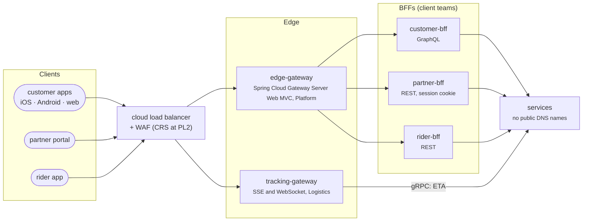

# API Gateway & BFF

L2 · PractitionerL3 · Senior/Lead

Before [ADR-010](../architecture-patterns/ch10-api-gateway-bff.md), FoodFleet had fourteen publicly exposed services with inconsistent authentication and CORS, and a tracking screen that made four calls in a row. Now every public request enters through one of two gateways, and each client experience has its own backend.

## Who does what

| Concern | `edge-gateway` | BFF | Domain service |
|---|---|---|---|
| TLS, routing, request ids | ✅ | | |
| Token validation, rate limits, body-size limits | ✅ | | |
| Coarse authorization ("must be signed in") | ✅ | ✅ | |
| Fine authorization ("this order is yours") | | | ✅ |
| Aggregating several services for one screen | | ✅ | |
| Formatting for display (times, currency, labels) | | ✅ | |
| Business rules (prices, refunds, availability) | | | ✅ |

The gateway holds **no business logic and no aggregation** ([ADR-010](../architecture-patterns/ch10-api-gateway-bff.md)): that would make the platform team a bottleneck for every product change. The BFFs are owned by the teams that own their apps, so a screen redesign doesn't wait for anyone else.

## The gateway's jobs

| Job | How | Decision |
|---|---|---|
| Routing | Path-based routes to the BFFs; services lose their public DNS names, so they can split and merge behind stable paths | [ADR-010](../architecture-patterns/ch10-api-gateway-bff.md) |
| Authentication | Validates the access token (issuer, audience, signature, lifetime) before routing | [ADR-036](../security/ch36-oauth2-oidc-jwt.md), [ADR-037](../security/ch37-spring-security-7.md) |
| Rate limits | GCRA in Redis, per client within a tenant and per tenant, after authentication | [ADR-040](../security/ch40-api-security.md) |
| Size limits | Request bodies capped at 256 KB | [ADR-040](../security/ch40-api-security.md) |
| Priority | Marks each route critical or sheddable; new routes are sheddable until classified | [ADR-044](../resilience/ch44-timeouts-retries-backpressure.md) |
| Deadlines | Sets the request's deadline, which every hop then budgets from | [ADR-042](../resilience/ch42-failure-modes.md) |
| Trace context | Strips incoming trace headers and starts the trace at the edge; makes the head sampling decision | [ADR-049](../observability/ch49-distributed-tracing-otel.md) |
| Tenant routing | Sends each tenant to its home region and cell | [ADR-046](../resilience/ch46-disaster-recovery.md), [ADR-075](../governance-org/ch75-multi-tenancy-multi-region-compliance.md) |
| Deprecation evidence | Logs callers of deprecated operations; an operation is removed only when the log shows none | [ADR-071](../governance-org/ch71-api-governance.md) |

## Security at the edge, as measured

[Chapter 40](../security/ch40-api-security.md) measured each control before FoodFleet adopted it:

| Control | Without it | With it |
|---|---|---|
| Per-tenant rate limits | One tenant's integration loop under a global limit left the others **0.2%** of their requests | Others kept **100%** |
| Limits shared in Redis | Per-pod limits let **four times** the budget through | The budget, at 0.1–0.4 ms per decision |
| Fetch Metadata and `csrf.spa()` on `/bff` | `SameSite` cookies didn't stop a forged request from a sibling subdomain | Refused before application code ran |
| WAF rules tuned for JSON APIs | The Core Rule Set as shipped blocked **15%** of legitimate requests at PL1 and **49%** at PL2 | **0%** and **10%** after tuning; the remaining four request types each need an exclusion with a reason |

`/api` and `/bff` are deliberately different: `/api` accepts only bearer tokens and allows CORS from an exact list of HTTPS origins, while `/bff`, used by the partner portal in a browser, uses a `SameSite=Lax` session cookie with Fetch Metadata and a CSRF token. User-uploaded content is served from a separate registrable domain, so it can't read either.

## The backends for frontends

| BFF | Clients | Style | Owner | What it does |
|---|---|---|---|---|
| `customer-bff` | iOS, Android and web customer apps | One GraphQL schema ([ADR-024](../communication/ch24-graphql.md)) | Checkout (assumed) | Per-screen queries with batch loading; persisted queries only; depth 8, complexity 2,000, pages of at most 50 |
| `partner-bff` | Restaurant partner portal | REST, per screen | Restaurant Partner | Menus, orders and the kitchen view; browser session security |
| `rider-bff` | Rider app | REST, per screen | Logistics | Deliveries and the rider's wallet |

Two measurements explain the customer BFF:

- **One call per screen.** The tracking screen needed four services. Called one after another from a phone, that's about 580 ms on a mobile network; through the BFF, one call of about 200 ms, with partial results if one part fails ([chapter 10](../architecture-patterns/ch10-api-gateway-bff.md)).
- **GraphQL only with batching.** On the orders screen GraphQL turned 12 requests into 1 and cut the bytes by 8×, but without batch loading it made 19 backend calls instead of REST's 3 and was slower ([chapter 24](../communication/ch24-graphql.md)). A test per screen query asserts its backend call count.

Chapter 10 calls this BFF `mobile-bff`; it serves the web app too since ADR-024, and the model calls it `customer-bff`.

## The tracking gateway

Live tracking has a different shape from everything else: tens of thousands of connections that stay open for the length of a delivery. So it has its own gateway ([ADR-026](../communication/ch26-websockets-sse.md)):

- **Customers** get server-sent events at `GET /orders/{id}/tracking`, with event ids, a 50-event replay buffer, a random reconnect delay of 1–10 s and a heartbeat every 15 s. An instance holds about 20,000 streams in about 1 GB and answers `503` beyond that.
- **Riders** keep one WebSocket for their shift, authenticated at the handshake, sending at most one position a second.
- **Deploys** drain streams in batches over 60 seconds, so a release doesn't reconnect everyone at once.

Tracking traffic fell from 60,000 requests a second (polling) to a few hundred connects a second.

## The edge must be the most available part

The edge gateway and the customer BFF are on every customer journey except tracking. The [overview](index.md#what-the-model-says-about-availability) computed that placing an order needs four services in a row, each at about 99.975%, to meet its 99.9% SLO. For the edge, that means:

- **Three replicas across zones** and strict change review ([ADR-010](../architecture-patterns/ch10-api-gateway-bff.md)).
- **No business logic**, so it changes rarely.
- **Redis is on the request path** for rate limits: highly available, with a short timeout. If Redis is unreachable, each instance enforces its share of the limit and an alert fires ([ADR-040](../security/ch40-api-security.md)).
- **Its own SLO**, tighter than any journey's. No chapter has set one yet.

## Where the chapters disagree

!!! warning "Two decisions about the gateway conflict"
    **Retries.** ADR-010 gives the gateway retries for idempotent reads. ADR-018, eight chapters later, says gateways and mobile apps don't retry server errors, and retries live only in the service closest to the dependency. Both can't hold. ADR-018's rule is the safer one: chapter 42 measured three layers of retries sending 27 calls per request to a dead dependency. **The model follows ADR-018**: the gateway doesn't retry.

    **Stack.** ADR-010 builds the gateway on Spring Cloud Gateway **Server Web MVC**, to match the MVC golden path. ADR-066 says WebFlux "stays for streaming and the gateway". Chapter 10's own comparison found Web MVC adequate for FoodFleet's gateway, and the streaming case it lists against Web MVC is exactly what the tracking gateway took over. **The model follows ADR-010** for `edge-gateway` and reads ADR-066 as allowing WebFlux where streaming needs it.

    Each conflict should be settled the way [ADR-073](../governance-org/ch73-adrs-fitness-functions.md) requires: a new ADR that supersedes the losing part, not an edit to either record.
