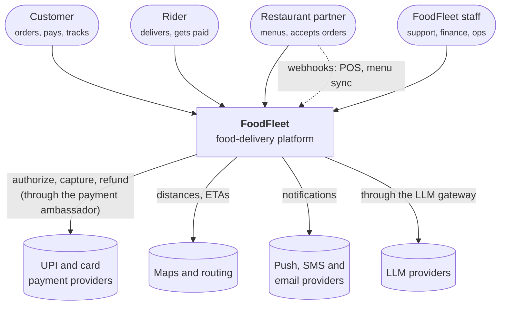
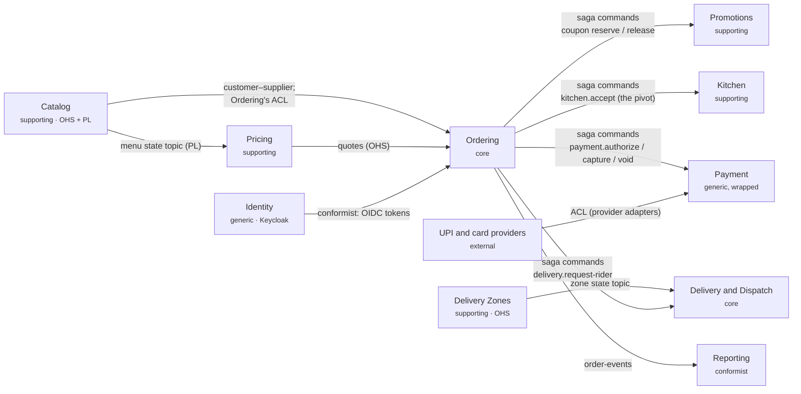
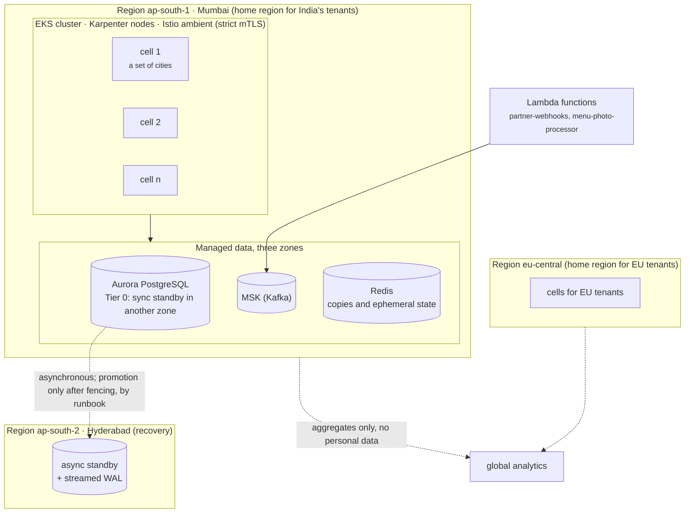

# Architecture (C4, Context Map, Deployment)

<div class="badges" markdown><span class="badge badge-l2">L2 · Practitioner</span><span class="badge badge-l3">L3 · Senior/Lead</span><span class="badge badge-l4">L4 · Architect</span></div>

This page draws FoodFleet four ways, from the outside in: the [C4 model](https://c4model.com/)'s context and container levels, the domain's context map, and the deployment. The container diagram and the tables are generated from `code/foodfleet/model/foodfleet.yaml` by `check.py` ([overview](index.md#how-these-pages-are-made)), so they can't drift from the model, and the model can't drift from the chapters without `check.py` saying so.

## 1. System context

Who uses FoodFleet, and what it depends on outside itself:



Two external dependencies have their own platform-owned gateway, because their failures are FoodFleet's biggest risks: the payment providers ([ADR-017](../architecture-patterns/ch17-sidecar-ambassador-adapter.md)) and the model providers ([ADR-077](../governance-org/ch77-ai-native-microservices.md)). The maps provider is assumed: no chapter decided it.

## 2. Containers

Every deployable, grouped by kind, with its owning team, and the synchronous calls between them. Thick arrows are gRPC, dotted ones are streams to and from the apps. The two functions are left out, because they're triggered by events. The services drawn without arrows (`customer-service`, `notification-service`, `reporting-service`, `llm-gateway`) are ones the model records no synchronous calls for: they work from events, or their callers aren't modelled yet.

```mermaid
--8<-- "code/foodfleet/model/generated/containers.mmd"
```

Reading it:

- **One way in.** Clients reach FoodFleet only through `edge-gateway` and, for live tracking, `tracking-gateway`, which holds tens of thousands of long-lived streams and so scales on its own ([ADR-026](../communication/ch26-websockets-sse.md)).
- **A BFF per experience.** Each app talks to its own backend for frontend: GraphQL for the customer apps, REST for the partner portal and the rider app ([ADR-010](../architecture-patterns/ch10-api-gateway-bff.md), [ADR-024](../communication/ch24-graphql.md)).
- **Few synchronous hops.** No journey goes deeper than three services. Behind the BFFs, most work happens through events: the saga's commands, and state topics that copy reference data instead of calling for it ([ADR-019](../architecture-patterns/ch19-event-driven-architecture.md)).
- **No cycles.** `check.py` fails on a cycle in the synchronous call graph; there is none.
- **gRPC inside, REST at the edge.** The latency-sensitive fan-out from `eta-service` uses gRPC; everything public stays REST or GraphQL ([ADR-023](../communication/ch23-grpc.md)).

The calls, with what each caller does if the call fails:

--8<-- "code/foodfleet/model/generated/calls.md"

A dash in "If it fails" means the model records no fallback for that call: the caller fails with it. [ADR-002](../foundations/ch02-characteristics-principles.md) requires every synchronous dependency to declare a degradation mode, so those dashes are the list of decisions still to make. [Resilience](resilience.md) works through them.

Most of FoodFleet's work between services goes through Kafka instead: events, compacted state topics that copy reference data, and the saga's command channels. Every producer writes through an outbox and every consumer reads through an inbox ([ADR-015](../architecture-patterns/ch15-outbox-inbox-cdc.md), [ADR-025](../communication/ch25-asynchronous-messaging.md)):

--8<-- "code/foodfleet/model/generated/topics.md"

[Kafka topic design](kafka-design.md) covers partitions, schemas and retention, and [order lifecycle & sagas](order-lifecycle.md) the command channels.

The platform components the services rely on, none of which holds business data:

--8<-- "code/foodfleet/model/generated/platform.md"

## 3. Context map

The bounded contexts from [chapter 5](../foundations/ch05-domain-driven-design.md), updated with what later chapters decided: payment became a saga participant ([ADR-014](../architecture-patterns/ch14-saga-pattern.md)), pricing left the monolith ([ADR-016](../architecture-patterns/ch16-strangler-fig-migration.md)), and reference data moved to compacted topics ([ADR-019](../architecture-patterns/ch19-event-driven-architecture.md)).



| Relationship | Why this kind | Decision |
|---|---|---|
| Ordering keeps an anti-corruption layer towards Catalog | Catalog's model (restaurants, menus, availability) changes for reasons that aren't Ordering's | [ADR-005](../foundations/ch05-domain-driven-design.md) |
| Payment wraps each provider in an adapter | Providers differ and change; Payment's model doesn't | [ADR-009](../architecture-patterns/ch09-hexagonal-clean-architecture.md) |
| Ordering orchestrates; the others are participants | One place to see an order's state and to compensate | [ADR-014](../architecture-patterns/ch14-saga-pattern.md) |
| Catalog, Zones and Delivery publish state on compacted topics | Many readers need current reference data without calling for it | [ADR-019](../architecture-patterns/ch19-event-driven-architecture.md) |
| Reporting conforms to the event schemas | It reads everyone's events and owns none of them | [ADR-034](../data/ch34-reporting-analytics.md) |

## 4. Deployment

FoodFleet runs on Kubernetes in AWS, with managed Kafka and PostgreSQL ([ADR-059](../deployment/ch59-cloud-native-platforms.md)), across zones, regions and cells:



| Concern | FoodFleet's choice | Decision |
|---|---|---|
| Compute | EKS with Karpenter; an on-demand base sized for peak, spot copies on top | [ADR-059](../deployment/ch59-cloud-native-platforms.md), [ADR-070](../performance-scalability/ch70-finops.md) |
| Pods | CPU requests without CPU limits; memory limit equal to request; PDB `maxUnavailable: 1` with zone spread | [ADR-054](../deployment/ch54-kubernetes-for-spring.md) |
| Images | jlink'd runtimes on distroless, non-root, read-only, with an AOT cache | [ADR-053](../deployment/ch53-containerization.md), [ADR-060](../deployment/ch60-native-images-startup.md) |
| Mesh | Istio ambient: mTLS and identity-based authorization everywhere, waypoints only where L7 is needed | [ADR-057](../deployment/ch57-service-mesh.md) |
| Zones | Tier 0 data (orders, payments) commits to a synchronous standby in another zone; zone failover is automatic | [ADR-046](../resilience/ch46-disaster-recovery.md) |
| Regions | A recovery region with an asynchronous standby; regional failover only by runbook, fence first | [ADR-046](../resilience/ch46-disaster-recovery.md) |
| Cells | Tenants placed in cells by city; shared fleets shuffle-sharded 2 of 8 | [ADR-046](../resilience/ch46-disaster-recovery.md) |
| Residency | Each tenant has a home region that holds all its personal data; only aggregates leave | [ADR-075](../governance-org/ch75-multi-tenancy-multi-region-compliance.md) |
| Functions | Lambda for event-driven, scheduled and bursty work; containers above the cost crossover | [ADR-076](../governance-org/ch76-serverless-microservices.md) |
| Delivery | Argo CD from an environment repository; canaries with Argo Rollouts | [ADR-058](../deployment/ch58-cicd-gitops.md) |

[Kubernetes & service mesh](kubernetes.md) has the manifests, and [CI/CD & GitOps](cicd.md) the path from a commit to production.

## 5. The rules that hold it together

Some decisions apply to every service, not one. These are the ones a new FoodFleet service inherits from its template ([ADR-072](../governance-org/ch72-platform-engineering.md)):

| Rule | Decision |
|---|---|
| One owner per table; no service reads another's schema | [ADR-012](../architecture-patterns/ch12-database-per-service.md) |
| Publish through a transactional outbox; consume through an inbox | [ADR-015](../architecture-patterns/ch15-outbox-inbox-cdc.md) |
| No distributed transactions; sagas with idempotent participants | [ADR-030](../data/ch30-distributed-transactions.md) |
| Money is never eventually consistent | [ADR-003](../foundations/ch03-distributed-systems-fundamentals.md) |
| Every remote call has a deadline, a bulkhead and a declared degradation | [ADR-002](../foundations/ch02-characteristics-principles.md), [ADR-018](../architecture-patterns/ch18-resilience-patterns.md), [ADR-042](../resilience/ch42-failure-modes.md) |
| Keys for side effects, versions for state, three ids on every message | [ADR-028](../communication/ch28-idempotency-correlation.md) |
| Every workload has a SPIFFE identity; every service is a resource server, deny by default | [ADR-037](../security/ch37-spring-security-7.md), [ADR-038](../security/ch38-service-to-service-security.md) |
| Traces, metrics and logs over OTLP; SLOs per journey | [ADR-047](../observability/ch47-observability-fundamentals.md), [ADR-051](../observability/ch51-slo-alerting.md) |
| An OpenAPI document and a catalog entry in every repository, linted | [ADR-071](../governance-org/ch71-api-governance.md) |
| Decisions as ADRs, checked by fitness functions | [ADR-073](../governance-org/ch73-adrs-fitness-functions.md) |

## Checking the model

```console
$ python3 code/foodfleet/model/check.py
model: 8 teams, 23 services, 10 platform components, 26 synchronous calls, 11 topics and command channels
ADRs referenced: 40 of 77 in the handbook; not referenced by the model: 1, 2, 4, 11, 18, …
journey place-order: SLO 99.9% over 4 required services needs 99.975% from each
…
assumed (no chapter decided it): 12 facts: customer-bff; pricing-service; eta-service; …
errors: 0
```

It checks that:

- every service's team exists;
- no two services claim the same name or alias;
- every call and topic connects services that exist;
- every call and topic names an ADR or a chapter;
- every ADR the model cites exists in the chapters, with that number;
- the synchronous call graph has no cycles.

The 37 ADRs the model doesn't cite are mostly ones that apply to every service, like the rules above, rather than to one part of the architecture.
