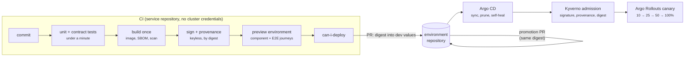

# CI/CD & GitOps

L2 · PractitionerL3 · Senior/Lead

FoodFleet's delivery rests on three ideas. **Build once**: the image tested in staging is byte-for-byte the one in production ([ADR-004](../foundations/ch04-twelve-factor.md)). **Git is the deploy**: CI never touches a cluster; it opens pull requests, and Argo CD applies what's merged ([ADR-058](../deployment/ch58-cicd-gitops.md)). **Small blast radius**: a bad release reaches a slice of traffic for seconds, not every pod for minutes.

## The stages

| Stage | What happens | Gate | Decision |
|---|---|---|---|
| **Every commit** | Unit and contract tests | Under a minute | [ADR-061](../testing/ch61-test-strategy.md) |
| **Build** | Maven, the shared Dockerfile template; a CycloneDX SBOM; a scan that blocks fixable critical and high findings, with expiring waivers | — | [ADR-041](../security/ch41-supply-chain-compliance.md), [ADR-053](../deployment/ch53-containerization.md) |
| **Sign** | Keyless signature and SLSA provenance by digest, in GitHub Actions with SHA-pinned actions and per-job tokens | — | [ADR-041](../security/ch41-supply-chain-compliance.md) |
| **Before merge** | Repository tests on PostgreSQL in a container, component tests, consumers' contracts verified; then a preview environment per pull request with a dozen E2E journeys at most | All green | [ADR-061](../testing/ch61-test-strategy.md), [ADR-062](../testing/ch62-unit-slice-integration-tests.md), [ADR-063](../testing/ch63-contract-testing.md), [ADR-064](../testing/ch64-component-e2e-testing.md) |
| **Platform checks** | Conformance checks and a server-side dry run; the OpenAPI lint; the series budget; ArchUnit fitness functions | All pass, or a recorded acceptance | [ADR-048](../observability/ch48-metrics-micrometer.md), [ADR-065](../testing/ch65-performance-chaos-arch-tests.md), [ADR-071](../governance-org/ch71-api-governance.md), [ADR-072](../governance-org/ch72-platform-engineering.md) |
| **Deploy to dev** | CI opens a pull request writing the digest into the dev values | `can-i-deploy` for dev | [ADR-055](../deployment/ch55-helm-kustomize.md), [ADR-063](../testing/ch63-contract-testing.md) |
| **Promote** | A pull request copies the digest to staging, then prod; policy requires it to match what the previous environment ran | Approval; `can-i-deploy`; the error budget policy | [ADR-051](../observability/ch51-slo-alerting.md), [ADR-055](../deployment/ch55-helm-kustomize.md) |
| **Admit** | Kyverno checks the signer identity, the provenance and that the image is a digest; OPA checks data-class rules | Fail closed, with a break-glass procedure | [ADR-041](../security/ch41-supply-chain-compliance.md) |
| **Release** | Argo Rollouts canary at 10, 25, 50 and 100% through the Gateway API; five minutes of analysis per step on the new version's error rate and p99 against the stable one | Abort on 10 errors or +20% p99 | [ADR-058](../deployment/ch58-cicd-gitops.md) |
| **Load test** | k6 at a constant arrival rate in the release pipeline, for critical services | p99 and capacity per release | [ADR-065](../testing/ch65-performance-chaos-arch-tests.md) |

A release of a customer-facing service takes **20 minutes or more** to reach 100%: four canary steps of five minutes' analysis each.

## What each gate is worth

The chapters measured each gate against the failure it exists for:

| Gate | Without it | With it | Chapter |
|---|---|---|---|
| Canary with per-version analysis | A release failing 5% of requests, as a rolling update: **944–953** failed requests before its two-minute rollback | Stopped after **7–10** failed requests | [58](../deployment/ch58-cicd-gitops.md) |
| Pull-based reconciler | Drift and orphaned objects from push deploys | Commits applied within one 10 s interval; scale and env drift reverted; deleted files pruned | [58](../deployment/ch58-cicd-gitops.md) |
| Promotion by digest | A re-pushed tag ran two versions behind one Service | What runs in prod is what staging tested | [55](../deployment/ch55-helm-kustomize.md) |
| Server-side apply | Client-side applies reset an autoscaled 5 replicas to 2 | Conflicts refused | [55](../deployment/ch55-helm-kustomize.md) |
| Consumer contracts | Three releases in a month broke consumers with green builds | 7 of 9 breaking changes caught, each naming the consumer | [63](../testing/ch63-contract-testing.md) |
| Preview environments | Four pipelines sharing staging passed 1–5 of 12 suite runs | Fresh environments: 12 of 12 | [64](../testing/ch64-component-e2e-testing.md) |
| Provenance at admission | With a leaked signing key, a laptop rebuild would have run | Stopped: only provenance caught it | [41](../security/ch41-supply-chain-compliance.md) |

One measurement cuts the other way: a healthy one-pod canary was once aborted at 50% on latency. Per-version analysis with one pod has little data; the analysis needs a minimum request count, like the SLO alerts' 100-request guard.

## Templates keep pipelines current

Every service's pipeline comes from the golden path's template ([ADR-072](../governance-org/ch72-platform-engineering.md)). When the platform changes a pipeline step, a template release opens a three-way-merge pull request in every generated service, and the conformance checks show who hasn't merged. Chapter 72 measured an old template's services passing 8% of current checks; merging the update took them from 4 to 40 of 48.

## Where the delivery decisions don't fit together yet

Assembling the pipeline from the chapters exposed three seams:

- **Jib or a Dockerfile?** ADR-058's CI "builds once with Jib". ADR-053 makes one shared Dockerfile template the way every image is built: jlink'd runtime, distroless base, layers in order, and since ADR-060, a training run that writes the AOT cache. Jib builds images without a Dockerfile and can't run that training step. ADR-053 and ADR-060 hold more of the platform's decisions, so the pipeline uses the Dockerfile template, and ADR-058's "Jib" should be superseded.
- **Who rolls back?** ADR-055 deploys with Helm 4's `--rollback-on-failure`. Under ADR-058, Argo CD renders the chart and applies it, so Helm's rollback flag never runs; Argo Rollouts' abort is what rolls back. The flag belongs to the period before GitOps.
- **Deployment or Rollout?** Canaries need an Argo Rollouts `Rollout`, but the shared chart ([Kubernetes](kubernetes.md)) renders a `Deployment`. A `Rollout` can reference a Deployment's pod template (`workloadRef`) and scale it down, which keeps one chart for services with and without canaries; the chart needs that option added.
