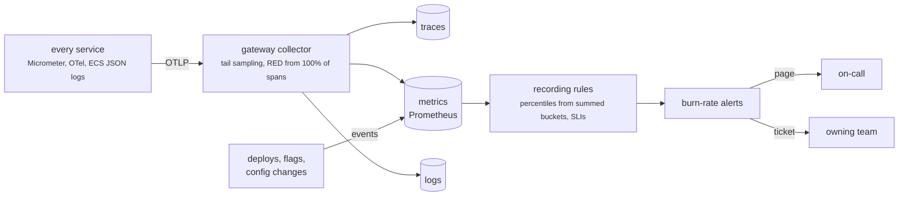

# Observability & SLOs

<div class="badges" markdown><span class="badge badge-l2">L2 · Practitioner</span><span class="badge badge-l3">L3 · Senior/Lead</span></div>

Observability is how FoodFleet answers questions about its running system that nobody thought to ask in advance: why this canary is slower, which tenant is failing, where an order's saga stopped. Part 7 ([chapters 47–52](../observability/index.md)) built it; this page collects the platform's choices and turns the SLOs into rules.



## The signals

| Signal | FoodFleet's choice | What the chapter measured | Decision |
|---|---|---|---|
| **Collection** | OTLP from every service to a gateway collector; the Java agent only where code can't change | The agent cost 38–56% CPU on thin services and carried a token from the command line into telemetry | [ADR-047](../observability/ch47-observability-fundamentals.md) |
| **Traces** | 100% sent, tail-sampled in the collector: every error, every trace over 300 ms, 1% of the rest | 1% head sampling kept 2–4 of 248–285 slow traces; tail sampling kept all of them for 18–19% of the bytes | [ADR-047](../observability/ch47-observability-fundamentals.md) |
| **Propagation** | W3C produced everywhere; the edge strips incoming context; outbox rows store `traceparent`; baggage limited to tenant, city tier, experiment and priority | Hand-rolled threads and queues lost the trace on 200 of 200 hand-offs; client baggage reached a payment partner on 50 of 50 calls | [ADR-049](../observability/ch49-distributed-tracing-otel.md) |
| **Wide events** | One event per request with its trace id and the fields that explain it | Fields on spans or wide events isolated a canary's regression exactly; 11,000 log lines didn't | [ADR-047](../observability/ch47-observability-fundamentals.md) |
| **Metrics** | Histograms with SLO buckets; percentiles only from summed buckets; labels limited to service, route, status and pod; a series budget per service checked in CI | Averaging per-pod p99s reported 137 ms for a true 322 ms; raw paths made up to 707,089 series | [ADR-048](../observability/ch48-metrics-micrometer.md) |
| **Logs** | ECS JSON on stdout, the trace id as the correlation field, a masking encoder on every appender, an async appender that never discards | Default async appenders delivered 29–30% of INFO lines under a burst; source-only masking leaked from messages, the MDC and exceptions | [ADR-050](../observability/ch50-structured-logging.md) |
| **Profiles** | JFR on every JVM with its default settings, and GC logs | — | [ADR-047](../observability/ch47-observability-fundamentals.md), [ADR-067](../performance-scalability/ch67-jvm-tuning-containers.md) |
| **Changes** | Deploys, flags and config changes sent as events beside the metrics | — | [ADR-047](../observability/ch47-observability-fundamentals.md) |

The rule behind the table: **any question about requests should be answerable from data already collected**. That's why traces aren't sampled at the source and every request leaves a wide event; the collector, not the service, decides what to keep.

**One order, one trace.** A synthetic order in staging must produce a single trace containing every service it touched, through Kafka and the saga ([ADR-049](../observability/ch49-distributed-tracing-otel.md)). It's the check that the asynchronous paths carry context.

## The SLOs

[ADR-051](../observability/ch51-slo-alerting.md) sets one SLO per user journey, each over 30 days:

| Journey | Objective | SLI (where it's measured) |
|---|---|---|
| Browse | 99.9% available | Server errors on menu-service's `GET /restaurants/{id}/menu` |
| Checkout | 99.9% available | Server errors on order-service's `POST /orders` |
| Checkout | 99% of successful requests within 300 ms | Successful `POST /orders` slower than the 0.3 s bucket |
| Tracking | 99.5% available | Server errors on tracking-gateway's `GET /orders/{id}/tracking` |

The checkout SLIs are chapter 51's own. Chapter 51 didn't define SLIs for browse and tracking, so this page chose them, measured on the same timer and in the same way. Measuring at a service rather than at the edge misses failures in front of it, the gateway and the BFF; measuring at the edge would cover them, and would need route-level labels on the gateway's metrics.

### Error budgets

--8<-- "code/foodfleet/slo/budgets.md"

A budget is the failure the objective allows. Checkout's 0.1% is 43 minutes of total outage in 30 days, or a long tail of small failures adding up to the same share of requests. ADR-051's policy spends it deliberately: at half the budget spent, releases need rollback plans and a second reviewer; at all of it, releases freeze except for fixes until the window recovers.

### What each service must achieve

A journey's availability is roughly the product of the availability of the services it can't do without. `check.py` derives each journey's required services from the [platform model](index.md#how-these-pages-are-made) and works back from the SLO:

--8<-- "code/foodfleet/model/generated/journeys.md"

So the four services in front of browsing and checkout each need about 99.975%, a quarter of the failures their journey is allowed. Their own SLOs, which no chapter has set yet, should be at least that, or the journeys' budgets are spent before anything else fails. Tracking's single required service needs only its journey's 99.5%.

### From objectives to alerts

FoodFleet doesn't write alert rules by hand. Chapter 51's `PrometheusSloRules` generates them from the SLO definitions, and `code/foodfleet/slo/` runs it over all four SLOs with only a JDK:

```console
$ code/foodfleet/slo/run.sh
wrote foodfleet-slo.rules.yml (8 alerts, 64 recording rules) and budgets.md
$ promtool check rules code/foodfleet/slo/foodfleet-slo.rules.yml
Checking code/foodfleet/slo/foodfleet-slo.rules.yml
  SUCCESS: 72 rules found
```

Each SLO gets two alerts, generated with ADR-051's windows:

| Alert | Fires when | Severity | Budget spent before it fires |
|---|---|---|---|
| Fast burn | Error ratio above 14.4× the budget over 1 h and 5 m, or 6× over 6 h and 30 m | Page | 2% in an hour, or 5% in six |
| Slow burn | 3× over 1 d and 2 h, or 1× over 3 d and 6 h | Ticket | 10% in a day, or 10% in three |

Every alert needs at least 100 requests in its long window, so a quiet service isn't paged for one failure, and every alert links a runbook ([runbooks](runbooks.md)). Chapter 51 measured the difference: a static 1% alert missed slow burns that spent up to 43% of the budget, and an alert at the SLO value fired three times a week on a healthy service. Pages fell from several a week to the incidents that threatened an SLO.

Two details make the latency SLI correct, and both are easy to miss:

- **A bucket at exactly 300 ms.** Without one, the SLI interpolates between 250 and 500 ms buckets; chapter 51 measured that reading 86% of the budget spent instead of 59%. Every service adds an `slo` bucket at each latency objective ([ADR-051](../observability/ch51-slo-alerting.md)).
- **Percentiles from summed buckets.** Dashboards and SLOs never average per-pod percentiles ([ADR-048](../observability/ch48-metrics-micrometer.md)).

## Health, probes and the Actuator

What Kubernetes asks each pod, and what it doesn't ([ADR-052](../observability/ch52-health-checks-actuator.md)):

| Probe | Endpoint | Includes | Measured |
|---|---|---|---|
| Liveness | `/actuator/health/liveness` (10 s period, 3 failures) | The JVM and the application's own state only | A database check in liveness restarted every pod 6 times during a 60-second database outage |
| Readiness | `/actuator/health/readiness` (5 s, 3 failures) | Warm-up; never shared dependencies | A database check in readiness left 0 ready pods and refused new connections |
| Startup | 2-minute budget | — | A 40 s start under a 10 s liveness delay never started |

With neither probe checking the database, the same outage caused no restarts, `/menu` stayed at 100%, and orders resumed the moment the database did. Shared dependencies appear in `/actuator/health` and in SLO alerts instead.

The Actuator listens on port 8081, reachable only from the monitoring namespace, with only `health`, `info` and `prometheus` exposed. A heap dump in chapter 52 contained the database password, so `heapdump` is never exposed.
