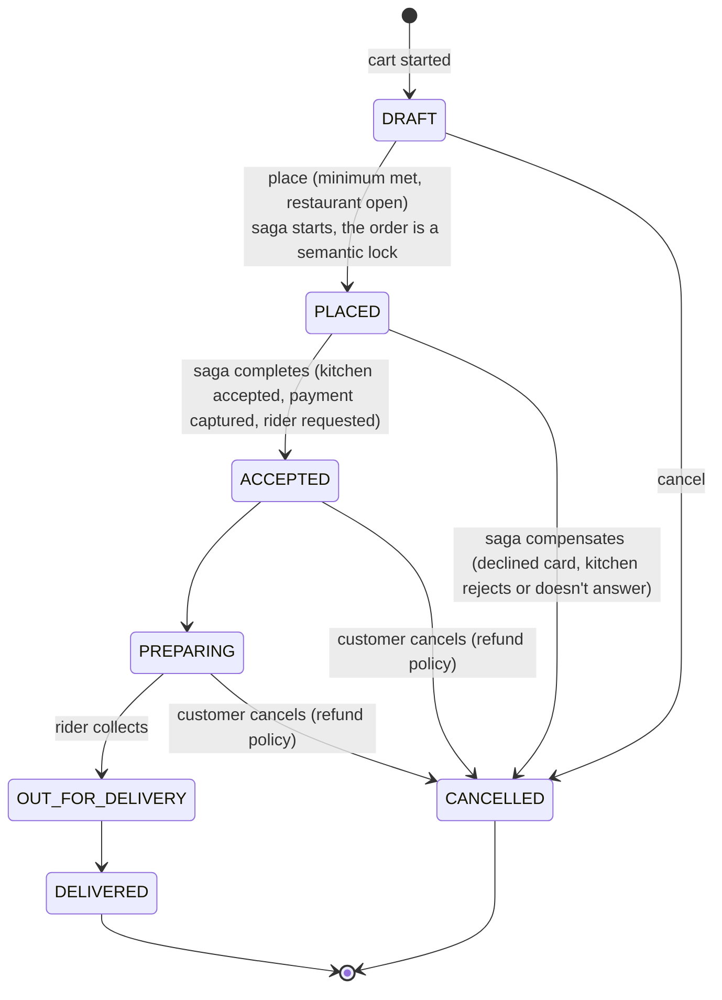
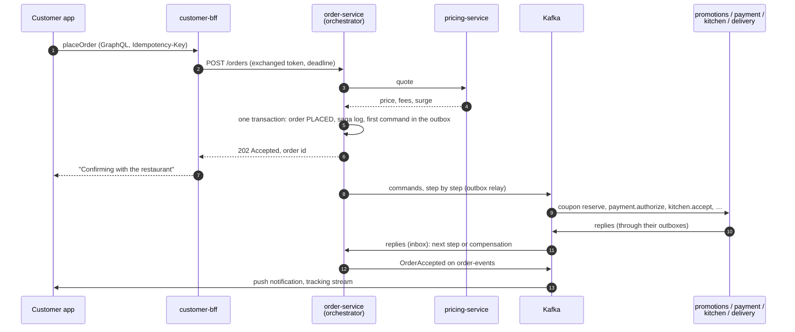

# Order Lifecycle & Sagas

<div class="badges" markdown><span class="badge badge-l2">L2 · Practitioner</span><span class="badge badge-l3">L3 · Senior/Lead</span><span class="badge badge-l4">L4 · Architect</span></div>

Placing an order touches five services, each with its own database: ordering, promotions, payment, kitchen and delivery ([ADR-012](../architecture-patterns/ch12-database-per-service.md)). There is no transaction across them ([ADR-030](../data/ch30-distributed-transactions.md)). Instead, order-service runs a **saga**: a sequence of local transactions, each with a way to undo it or to finish it, coordinated through messages ([ADR-014](../architecture-patterns/ch14-saga-pattern.md)). This page follows one order through it.

## The order's states

[Chapter 5](../foundations/ch05-domain-driven-design.md)'s `Order` aggregate owns these states and the rules for moving between them. The saga drives the first transitions; the kitchen, the rider and the customer drive the rest:



Chapter 14's saga calls the placed state `PENDING`; it's the same state. While an order is in it, other flows treat it as in progress: support sees "confirming with restaurant", and a cancellation is queued until the saga finishes rather than racing it.

## From tap to kitchen



The customer's request ends at step 7. Everything after it is asynchronous, which is why checkout's latency objective, 99% within 300 ms ([chapter 51](../observability/ch51-slo-alerting.md)), covers only steps 1–7, and why the payment provider's slowness never makes checkout slow.

## The saga, step by step

```java title="code/chapters/ch14-saga/src/main/java/dev/foodfleet/ch14/placeorder/PlaceOrderSaga.java"
--8<-- "code/chapters/ch14-saga/src/main/java/dev/foodfleet/ch14/placeorder/PlaceOrderSaga.java:34:56"
```

| # | Step | Participant | Kind | If a later step fails before the pivot |
|---|---|---|---|---|
| 1 | Create the order (`PLACED`) | order-service | compensatable | Reject the order |
| 2 | Reserve the coupon, if any | promotions-service | compensatable | Release the coupon |
| 3 | Authorize the payment | payment-service, through the payment ambassador | compensatable | Void the authorization |
| 4 | **Kitchen accepts** | kitchen-service | **pivot** | — |
| 5 | Capture the payment | payment-service | retriable | — |
| 6 | Request a rider | delivery-service | retriable | — |
| 7 | Approve the order (`ACCEPTED`) | order-service | retriable | — |

**Why the kitchen is the pivot.** Once a kitchen starts cooking, FoodFleet can't take that back, so every step that can fail for a business reason (a declined card, an exhausted coupon) comes before it, and nothing after it may fail for a business reason. Steps after the pivot are retried until they succeed. Authorizing before the pivot and capturing after it means no customer pays for food that was never cooked.

**What makes it safe to repeat.** Messages are delivered at least once, the orchestrator restarts, and replies get lost. So:

- The saga log and each outgoing command are written in one transaction, through the outbox ([ADR-015](../architecture-patterns/ch15-outbox-inbox-cdc.md)). After a crash, the orchestrator resumes from the log.
- Every participant is idempotent per (saga id, step): a repeated command returns the stored outcome, it isn't evaluated again ([ADR-028](../communication/ch28-idempotency-correlation.md)).
- Commands for one order are keyed by its saga id, so they stay in order ([Kafka topic design](kafka-design.md#keys-and-partitions)).

## When things go wrong

| What happens | Where | What the saga does | What the customer sees |
|---|---|---|---|
| Card declined | Step 3 | Release the coupon, reject the order | "Payment failed", try another method |
| Coupon exhausted | Step 2 | Reject the order, or place it without the coupon if the customer agrees | "Coupon no longer available" |
| Kitchen rejects | Step 4 | Void the authorization, release the coupon, reject the order | "The restaurant can't take your order" |
| Kitchen doesn't answer in 3 minutes | Step 4 | Treated as a rejection | Same as above |
| Payment reply lost | Step 3 | Retry with the same idempotency key; the stored outcome comes back | Nothing |
| A participant is down | Any | Retry with backoff; the saga waits | "Confirming…" for longer |
| Capture fails | Step 5, after the pivot | Retry until it succeeds; after N minutes, STUCK on the dashboard | Nothing; the food is cooking |
| No rider free | Step 6 | Retry until one is; delivery-service keeps asking dispatch | Nothing yet; the ETA may grow |
| Orchestrator crashes | Any | Another instance resumes from the saga log | Nothing |

Two of these come from chapter 14's text rather than its code: the three-minute kitchen deadline and the STUCK escalation after N minutes. The chapter's checklist asks for a timeout per saga without fixing N.

## Measured: 10,000 sagas

[Chapter 14](../architecture-patterns/ch14-saga-pattern.md#measured-10000-sagas-with-failures-and-crashes) ran 10,000 place-order sagas against participants with injected failures: declined cards (8%), kitchen rejections (5%), exhausted coupons (2%), transient failures from kitchen tablets (10%) and rider supply (15%), lost replies, and an orchestrator crash after 0.5% of calls. Then it ran them again with a payment-service that isn't idempotent:

| | Idempotent participants | payment-service not idempotent |
|---|---|---|
| Completed / compensated / stuck, first pass | 8,638 / 1,321 / 41 | 8,540 / 1,417 / 43 |
| After retrying stuck sagas | 8,679 / 1,321 / 0 | 8,583 / 1,417 / 0 |
| Orchestrator crashes resumed from the log | 351 | 348 |
| Money held beyond completed orders | **₹0** | **₹82,500 (165 double charges)** |
| Coupons leaked, or orders approved without the kitchen | 0 / 0 | 0 / 0 |

The orchestrator survived hundreds of crashes either way. What made the difference was one participant's idempotency: without it, retries after lost replies charged 165 customers twice.

## After the kitchen accepts

Once the order is `ACCEPTED`, the saga is done and the order moves on through events:

| Event | From | Who reacts |
|---|---|---|
| `OrderAccepted` | order-service, on `order-events` | notification-service (push), delivery-service, reporting |
| Kitchen status (preparing, ready) | kitchen-service | order-service moves the order to `PREPARING`; the ETA updates |
| Rider assigned, positions | delivery-service, tracking-gateway | The customer's tracking stream over SSE ([ADR-026](../communication/ch26-websockets-sse.md)) |
| `OrderDelivered` | order-service | notification-service (rating request), loyalty, reporting |
| `PayoutCompleted` | delivery-service, from the rider's event-sourced wallet | notification-service, reporting ([ADR-013](../architecture-patterns/ch13-cqrs-event-sourcing.md)) |

The chapters decide `order-events`, the tracking path and the wallet's events; which service publishes the kitchen's status changes, and how order-service learns of them, no chapter decided.

## Open questions

The chapters leave two questions about the lifecycle for product and engineering to settle together:

- **Cancelling after the pivot.** Chapter 5's state machine lets a customer cancel an `ACCEPTED` or `PREPARING` order with a full refund. That's a business policy, not a saga compensation: the kitchen has started cooking. A refund at that point is a new flow (a workflow-engine flow with review, as [chapter 14](../architecture-patterns/ch14-saga-pattern.md) suggests for refunds) and needs a rule for whether the restaurant is still paid.
- **How long is "retry until it succeeds"?** A capture that keeps failing after the food is cooked can't be compensated; it can only be escalated. The STUCK dashboard catches it. The threshold, and who is paged, belong in the [runbooks](runbooks.md).
