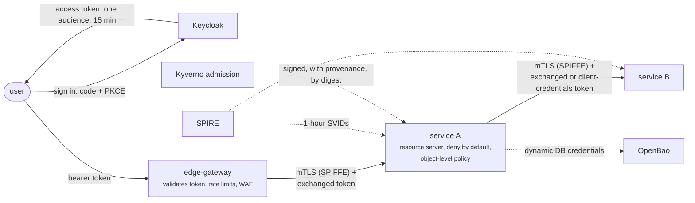

# Security

L2 · PractitionerL3 · Senior/LeadL4 · Architect

FoodFleet's security decisions come from Part 5 ([chapters 35–41](../security/index.md)), with pieces from the edge, the mesh and tenancy chapters. Each was made after an incident and checked by a measurement. This page puts them in the order a request meets them, then derives the platform's access rules from the [platform model](index.md#how-these-pages-are-made).

## Layer by layer

| Layer | FoodFleet's choice | What the chapter measured | Decision |
|---|---|---|---|
| **Users' identity** | Keycloak for customers, partners, riders and staff; the realm versioned and applied by the pipeline; passwords only in Keycloak | — | [ADR-037](../security/ch37-spring-security-7.md) |
| **Tokens** | Authorization code + PKCE for users, client credentials for services; JWTs with one audience per API and 15-minute lifetimes; staged key rotation | Local ES256 verification ~0.6 ms against ~1.4 ms for introspection; a sudden key rotation rejected 29 requests, a staged one 0 | [ADR-036](../security/ch36-oauth2-oidc-jwt.md) |
| **Calls for a user** | Token exchange: one audience, minimal scopes, 5 minutes | A 4-scope, 15-minute token narrowed to 1 scope and 5 minutes | [ADR-036](../security/ch36-oauth2-oidc-jwt.md) |
| **Workload identity** | SPIRE issues 1-hour X.509 SVIDs; every service requires mutual TLS and checks a deny-by-default peer policy per route | mTLS cost a 3.9–4.0 ms handshake and 56–57 µs per request on a kept connection; resumed sessions kept an expired certificate working until validity was checked per request | [ADR-038](../security/ch38-service-to-service-security.md) |
| **Mesh** | Istio ambient with strict mTLS and allow-nothing policies per namespace | — | [ADR-057](../deployment/ch57-service-mesh.md) |
| **Authorization** | Every service a resource server, URL rules ending in `denyAll()`; one policy component per aggregate for object-level decisions; objects the caller can't read answer 404 | The order policy agreed with an independently written rule table on all 18,600 decisions | [ADR-035](../security/ch35-security-fundamentals.md), [ADR-037](../security/ch37-spring-security-7.md) |
| **Request shapes** | Request and response types per use case; entities never bound or serialised; unknown fields rejected | — | [ADR-035](../security/ch35-security-fundamentals.md) |
| **The edge** | Per-tenant rate limits in Redis, 256 KB bodies, exact-origin CORS, Fetch Metadata and CSRF tokens for the browser portal, a tuned WAF | See [API gateway & BFF](api-gateway.md#security-at-the-edge-as-measured) | [ADR-040](../security/ch40-api-security.md) |
| **Secrets** | OpenBao; Kubernetes auth per service; dynamic database credentials per pod (1 h, at most 24 h); API keys in KV synced by External Secrets as read-only volumes | In-place password rotation failed 14–16% of logins; two alternating accounts, 0%; environment variables were readable through `/proc` | [ADR-039](../security/ch39-secrets-management.md) |
| **Tenants' data** | Pooled tables with forced row-level security; the tenant set per transaction | A per-session tenant leaked in 177 of 193 forgotten requests; per transaction, none | [ADR-040](../security/ch40-api-security.md), [ADR-075](../governance-org/ch75-multi-tenancy-multi-region-compliance.md) |
| **Personal data** | A home region per tenant; events carry ids, not personal data; personal fields encrypted with per-customer keys, erased by deleting the key | Crypto-shredding left 0 of 9,000 erased fields readable | [ADR-041](../security/ch41-supply-chain-compliance.md), [ADR-075](../governance-org/ch75-multi-tenancy-multi-region-compliance.md) |
| **Supply chain** | A CycloneDX SBOM per artifact, rescanned daily; keyless signatures and SLSA provenance enforced at admission by Kyverno; Actions pinned by SHA | A release with 0 known findings had 196 two and a half years later; with a leaked key, only provenance stopped a laptop rebuild | [ADR-041](../security/ch41-supply-chain-compliance.md) |
| **Threat models** | STRIDE per element, as code; the build fails on open threats and expired acceptances | — | [ADR-035](../security/ch35-security-fundamentals.md) |

## Payments are stricter

payment-service carries card and UPI flows, so it gets more than the defaults:

- **Its own database instance**, not a schema on the shared cluster ([ADR-012](../architecture-patterns/ch12-database-per-service.md)).
- **A PCI namespace**, enforced by OPA policies over declared data classes, along with RBI's rule that payment data is stored in India ([ADR-041](../security/ch41-supply-chain-compliance.md)).
- **Certificate-bound tokens** for payment and refund calls, so a stolen token is useless without the workload's key ([ADR-038](../security/ch38-service-to-service-security.md)).
- **Introspection** on payment APIs (with a 30-second cache), so a revoked token stops working within seconds rather than at its expiry ([ADR-036](../security/ch36-oauth2-oidc-jwt.md)). A revoked 15-minute JWT otherwise keeps working 450 seconds on average.
- **A platform-owned ambassador** for every call to a provider, holding the provider credentials ([ADR-017](../architecture-patterns/ch17-sidecar-ambassador-adapter.md)).

## Least privilege, generated from the model

[ADR-038](../security/ch38-service-to-service-security.md) notes a cost of peer policies: they must be kept in step with the call graph, so FoodFleet generates them from the service catalogue. The platform model has that call graph, so `check.py` generates both sets of rules.

### Who may call whom

An Istio `AuthorizationPolicy` per workload, allowing only the callers the model records. A workload whose policy has no rules accepts no calls at all: with any ALLOW policy present, Istio denies whatever no rule matches. The YAML is in `code/foodfleet/model/generated/policies/authorization-policies.yaml`; in summary:

--8<-- "code/foodfleet/model/generated/peer-policy.md"

The policies name callers only. Methods and paths, which chapter 38's example adds, come from each API's OpenAPI document, not from the model. The namespace is the service's name except where chapter 38 named one (`orders`, `payments`).

### Who may read and write which topic

Kafka ACLs from the same model, with everything else denied (`allow.everyone.if.no.acl.found=false`). The full list is in `generated/policies/kafka-acls.txt`:

--8<-- "code/foodfleet/model/generated/kafka-acls.md"

### What generating them exposed

Writing the rules down from the model found three things a human-written policy would have hidden:

- **The saga's replies have no channel.** Participants reply to the orchestrator ([order lifecycle](order-lifecycle.md)), but no chapter named the reply channel, so the model has none, and the generated ACLs would block every reply. The [proposed naming](kafka-design.md#a-proposal) gives it one: `foodfleet.ordering.saga-replies`, written by the four participants and read by order-service.
- **The saga's command channels aren't topic names yet.** Chapter 14 names operations (`payment.authorize`, `kitchen.accept`), not topics. The ACLs above use the model's descriptions as placeholders until the commands get topics.
- **Chapter 38's example has order-service calling payment-service directly** to capture and refund, over HTTP. The saga ([ADR-014](../architecture-patterns/ch14-saga-pattern.md)) sends those as commands through Kafka, so the model has no such call and the generated policy allows nobody to call payment-service synchronously. Refunds after delivery, which run in a workflow engine rather than the saga, may need that call; if so, it belongs in the model, and the policy follows.

## Incidents behind the decisions

Every row in the first table started with an incident in its chapter. A few that shaped the platform most:

- **An order-visibility incident** traced to missing object-level authorization and entities serialised straight to JSON → per-use-case types and a policy per aggregate ([chapter 35](../security/ch35-security-fundamentals.md)).
- **A test pod captured real payments** → workload identity and per-route peer policies ([chapter 38](../security/ch38-service-to-service-security.md)).
- **A three-year-old shared database password**, never rotated because rotation caused outages → dynamic credentials per pod ([chapter 39](../security/ch39-secrets-management.md)).
- **Log4Shell took nine days to scope** → SBOMs per artifact and a daily rescan of everything deployed ([chapter 41](../security/ch41-supply-chain-compliance.md)).
- **A query without a tenant predicate exposed fifty tenants** → forced row-level security ([chapter 40](../security/ch40-api-security.md)).
