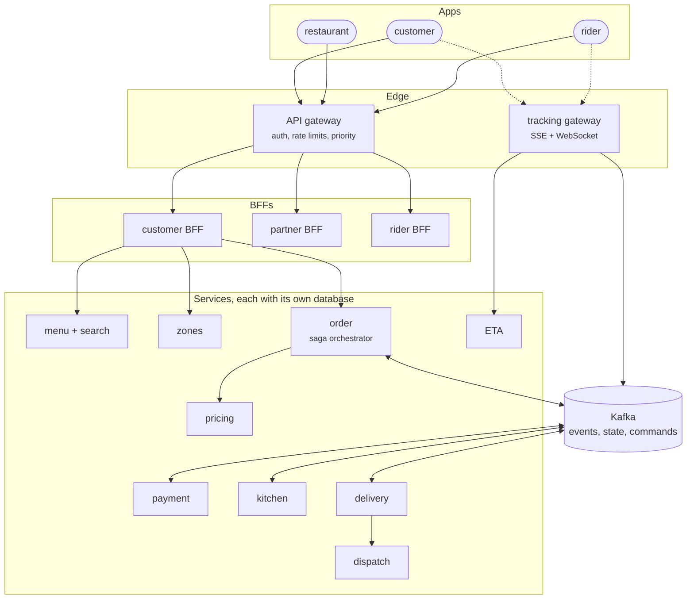

# Interview: Design Swiggy/Zomato

L3 · Senior/LeadL4 · Architect

"Design a food-delivery platform like Swiggy or Zomato" is one of the most common system design questions in India, and FoodFleet is a worked answer to it. This page runs the interview in the order a good answer takes, about 45 minutes, and links each part to the page or chapter where it was built and measured.

!!! tip "What the interviewer is listening for"
    Not a list of technologies. They want to hear you **find the hard parts** (a checkout that spans five systems, tens of thousands of live maps, a rider-matching problem, a dinner peak), **make trade-offs out loud**, and **know what breaks**. Every claim below has a number behind it; in an interview, one real number beats three adjectives.

## 1. Clarify (3–5 minutes)

Ask, then write down the answers:

| Question | Assume, if the interviewer leaves it to you |
|---|---|
| Who are the users? | Customers, restaurants, riders; support staff later |
| Which flows are in scope? | Browse menus near me, place and pay for an order, track it live; restaurants accept; riders deliver |
| How big? | One country, a few hundred cities, 2 million orders a day, 50,000 riders online at peak |
| Payments? | UPI and cards through providers; we never store card numbers |
| What matters most? | Checkout must work and be fast; browsing and tracking can degrade |
| Consistency? | Money and coupons exact; menus and ETAs may be seconds stale |

Stating priorities early pays off later: "checkout is critical, browsing is sheddable" will justify half your design.

## 2. Estimate (5 minutes)

Work it out loud, rounding freely:

| Quantity | Working | Result |
|---|---|---|
| Orders, daily average | 2,000,000 ÷ 86,400 s | ~23 a second |
| Orders, in the peaks | 60% of orders in two 2-hour peaks: 1.2 M ÷ 14,400 s | ~83 a second |
| Orders, peak minute | ×2 for the busiest minute of a peak | **~170 a second** |
| Menu reads, peak | ~20 menu views per order | **~3,300 a second** |
| Orders in flight | 170 a second × 35-minute delivery | ~350,000 |
| Live tracking streams | If a third of those have the map open | ~120,000; at 20,000 per instance, 6–7 instances (18 if all do) |
| Rider position writes | 50,000 riders, one ping every 4 s | **12,500 a second** |
| Order events | ~6 per order (placed, accepted, ready, picked up, delivered…) | 12 M a day, ~1,000 a second at peak |
| Order storage | 2 KB per order | ~4 GB a day, ~1.5 TB a year |

What the numbers tell you: orders are modest (one PostgreSQL primary handles 170 writes a second easily); **position writes and live streams are the scale problem**, and menu reads are a caching problem. Say that; it's the point of estimating.

## 3. API sketch (3 minutes)

| Client | Call | Notes |
|---|---|---|
| Customer app | `query restaurants(near)`, `query menu(restaurantId)` | GraphQL through a BFF: one request per screen ([ADR-024](../communication/ch24-graphql.md)) |
| Customer app | `mutation placeOrder(cart, paymentMethod)` with an `Idempotency-Key` | Returns at once with "confirming with restaurant" |
| Customer app | `GET /orders/{id}/tracking` | Server-sent events, resumable ([ADR-026](../communication/ch26-websockets-sse.md)) |
| Restaurant | `POST /tickets/{id}/accept` · `/reject` | Partner portal, REST |
| Rider | WebSocket `/ws/rider` for positions; `POST /deliveries/{id}/picked-up` | One socket per shift |

Mention idempotency keys on every write without being asked: mobile networks retry ([ADR-028](../communication/ch28-idempotency-correlation.md)).

## 4. High-level design (10 minutes)

Draw it in layers, and name owners:

Talk through why each box exists, in one sentence each:

- **One gateway, a BFF per app**: security in one place, screens shaped for each client ([ADR-010](../architecture-patterns/ch10-api-gateway-bff.md)).
- **A separate tracking gateway**: hundreds of thousands of long-lived connections scale differently from requests.
- **A database per service**: teams change schemas independently; nobody reads another's tables ([ADR-012](../architecture-patterns/ch12-database-per-service.md)).
- **Kafka between services wherever the caller doesn't need an answer**: the checkout path stays short ([communication map](communication-map.md)).

Then say the decision that saves you later: **only four services are on checkout's synchronous path** (gateway, BFF, order, pricing). Payment, kitchen and delivery are reached through the saga, so their outages don't fail checkout ([resilience](resilience.md#what-fails-when-a-service-is-down)).

## 5. Deep dives (15 minutes)

The interviewer will pick one or two. Have all five ready.

### Checkout: a transaction across five services

- No distributed transaction: two-phase commit across services locks everyone on one outage ([ADR-030](../data/ch30-distributed-transactions.md)).
- An **orchestrated saga** in order-service: create the order, reserve the coupon, authorize payment, **kitchen accepts (the pivot)**, capture, request a rider, confirm ([ADR-014](../architecture-patterns/ch14-saga-pattern.md)).
- Before the pivot every step has a compensation (release, void, reject); after it, steps are retried, never undone, because the food is cooking.
- Every participant idempotent per saga step; saga log and commands written through an **outbox**.
- **The number:** over 10,000 simulated sagas with crashes and lost replies, idempotent participants held ₹0 extra; one non-idempotent payment service double-charged 165 customers, ₹82,500 ([order lifecycle](order-lifecycle.md#measured-10000-sagas)).

### Live tracking: 12,500 writes a second and 120,000 open maps

- Riders send positions over one WebSocket per shift; customers receive them over **SSE**, which survives proxies and resumes with event ids.
- Positions go through Kafka keyed by order, then Redis pub/sub to whichever instance holds that customer's stream.
- **The number:** polling cost 60,000 requests a second; streams brought it to a few hundred connects a second, about 20,000 streams per instance in ~1 GB ([ADR-026](../communication/ch26-websockets-sse.md)).
- Watch for the reconnect storm: random retry delays and draining deploys in batches.

### Dispatch: matching riders to orders

- A separate service owned by a specialist team behind a versioned API ([ADR-007](../foundations/ch07-conways-law-team-topologies.md)): the algorithm changes often and needs different skills.
- Inputs: live positions (Redis, pruned after 30 s of silence), kitchen prep times, rider status from a compacted topic.
- Discuss the trade-off: assign at acceptance (rider waits at the restaurant) or near the end of preparation (food waits); batching two orders per rider.
- gRPC with deadlines from ETA and delivery ([ADR-023](../communication/ch23-grpc.md)).

### Menus and search: 3,300 reads a second

- PostgreSQL holds menus; a **JSONB menu card per restaurant** is rebuilt in the same transaction as each edit, so a menu is one primary-key read: 14× cheaper than the joins ([ADR-029](../data/ch29-polyglot-persistence.md)).
- Search in PostgreSQL full-text with a trigram fallback found misspelt dishes in 29 of 29 test queries. Say when you'd add Elasticsearch: relevance tuning, synonyms, facets.
- No shared cache for menu cards: Redis was slower than PostgreSQL's primary-key read; HTTP ETags instead ([ADR-032](../data/ch32-caching-strategies.md)).
- Other services get menu data from a compacted topic rather than calling ([ADR-019](../architecture-patterns/ch19-event-driven-architecture.md)).

### Pricing: surge without wrong prices

- Pricing owns rules and surge multipliers; a Redis copy is fed from its outbox, every write guarded by version so an old price can't overwrite a new one ([ADR-032](../data/ch32-caching-strategies.md)).
- **The number:** zero wrong prices through crashes and outages in chapter 29's sync experiment.
- On the browse path pricing fails open (show the last known price); on checkout it fails closed (no order without a price).

## 6. Failure and scale (5 minutes)

| What fails | What happens | Number |
|---|---|---|
| Dinner peak, twice the capacity | Admission control sheds browsing first; checkout keeps 90% of capacity | 79–81% of checkouts served vs 49–50% without |
| A slow dependency | Deadlines per hop, retries at one layer within a 10% budget, breakers | Three layers of retries sent 27 calls per request to a dead dependency |
| A zone | Synchronous standby in another zone, automatic failover | 0 commits lost |
| A region | Asynchronous standby; failover by runbook after fencing | 85–278 commits lost; never forked history |
| A poison tenant | Cells by city, shuffle sharding | 1.7–3.6% of tenants affected instead of 100% |

And the scaling story: services scale on CPU with minimums raised before each peak; consumers on lag; tracking on connections; the database with replicas and consistency tokens, sharding by customer only when writes need it ([scaling & cost](scaling-and-cost.md)).

## What separates the levels

| | 🟣 L3 answer | 🔴 L4 answer |
|---|---|---|
| Decomposition | Services per noun: user, restaurant, order | Services per capability and team, with a modular monolith first and extraction when it pays ([ADR-001](../foundations/ch01-architecture-styles.md), [ADR-074](../governance-org/ch74-maturity-migration-roadmap.md)) |
| Checkout | "A saga" | Where the pivot is and why; idempotency; what the customer sees while it runs |
| Availability | "Replicate everything" | The arithmetic: four required services at 99.9% each give 99.6%, so each needs 99.975%, so keep the path short |
| Data | A database per service | Which data needs which consistency, and what reads a replica can serve |
| Operations | Mentions monitoring | SLOs per journey, burn-rate alerts, an error budget policy ([observability](observability.md)) |
| Cost | Not mentioned | The fixed floor of a highly available platform, and cost per 1,000 orders |

## Follow-up questions

**"Why not one big database?"** · Start there: FoodFleet did, as a modular monolith. Split when teams block each other on schema changes; chapter 12's audit found 14 of 23 statements touching another team's tables.

**"How do you stop a customer from being charged twice?"** · An idempotency key from the app, stored with the payment in one transaction; the same key passed to the provider; participants that return the stored outcome on a repeat.

**"What if the restaurant never answers?"** · A three-minute deadline on the kitchen step; then the saga compensates: void the authorization, release the coupon, tell the customer.

**"How do you show an ETA?"** · eta-service fans out to kitchen and dispatch with deadlines; if it's slow, the app hides the ETA rather than failing the screen.

**"Kafka or a queue?"** · Kafka for events that several consumers need, replayable, ordered per key; chapter 25 keeps RabbitMQ for task queues that need per-message acknowledgement and priorities.

**"How would you test this?"** · Contracts between every consumer and provider, component tests per service, and only a handful of end-to-end journeys in fresh environments: shared staging passed 1–5 of 12 runs ([testing](testing.md)).

**"What would you build first?"** · Browse and checkout for one city, as a modular monolith with the outbox and the saga's seams already in place; tracking next, because its load shape is the first to outgrow the monolith.
