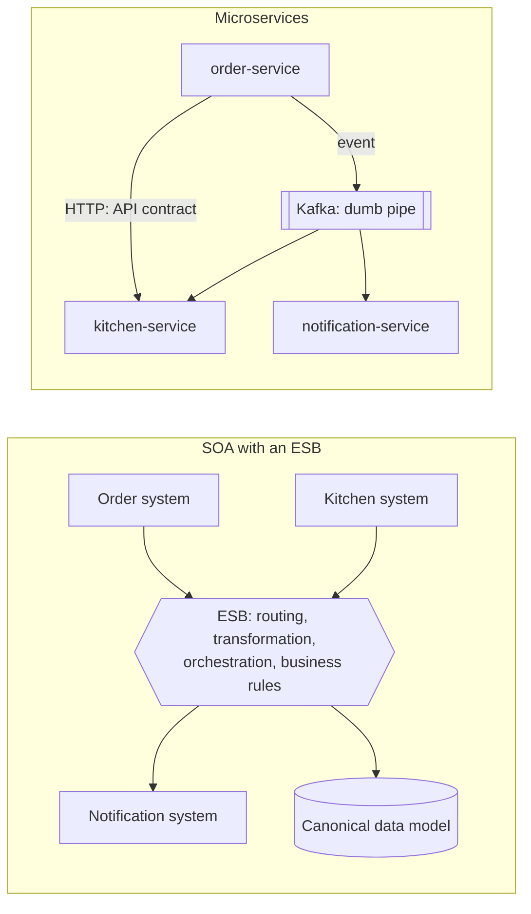
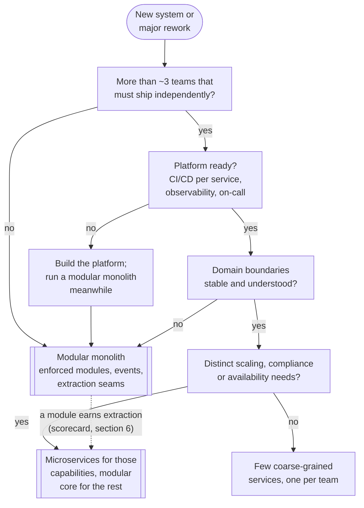
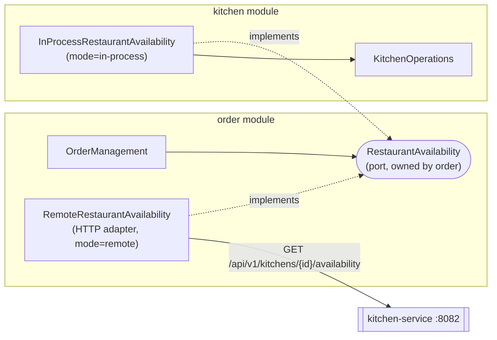

# 1. Monolith vs SOA vs Microservices vs Modular Monolith

<div class="badges" markdown><span class="badge badge-l1">L1 · Foundation</span><span class="badge badge-l2">L2 · Practitioner</span><span class="badge badge-l3">L3 · Senior/Lead</span><span class="badge badge-l4">L4 · Architect</span><span class="badge badge-meta">Java 25 · Spring Boot 4.1 · Spring Modulith 2.1</span></div>

<div class="grid two" markdown>

!!! info "Prerequisites"
    - Java records and basic Spring Boot (controller → service → repository)
    - HTTP and JSON basics
    - Optional: [Environment Setup](../getting-started/environment-setup.md) to run the code

!!! abstract "What you'll learn"
    - The five architecture styles and the **two axes** that separate them
    - What really changes when a method call becomes a network call
    - **When microservices are the wrong choice**, with numbers
    - How to build a **modular monolith** with Spring Modulith and keep an **extraction seam** open
    - How to extract a service without changing business code

</div>

---

## 1 · Introduction & Context

### The question most teams get wrong

"Should we use microservices?" is the wrong question. The useful question is:

> **What units of deployment, ownership and data should we use, given our teams, domain, scale and operational maturity?**

Microservices are one answer to that question. A single deployable with well-enforced internal modules is another answer, and for most systems in their first years it is the better one. This chapter gives you the vocabulary, mechanics and decision tools to choose deliberately, and code that keeps the choice reversible.

### A food-court analogy 🟢

FoodFleet, our running example, is a food delivery platform. Picture how restaurants themselves are organised:

| Restaurant setup | Architecture style | What it feels like |
|---|---|---|
| One small kitchen, every cook does everything, one shared fridge | **Layered (unstructured) monolith** | Fast to start. As staff grows, people collide, nobody knows who moved the paneer, and one fire closes everything. |
| One big kitchen with **stations** (tandoor, Chinese, desserts), tickets passed on a rail, each station owns its own fridge | **Modular monolith** | One building and one rent, but clear handoffs. The dessert station can be reorganised without touching the tandoor. |
| A mall where a **central management office** routes every order, translates every menu into a "standard menu format", and approves every change | **SOA with an ESB** | Lots of reuse in theory. In practice the management office becomes the bottleneck. |
| A **food court** of independent stalls, each with its own staff, stock, opening hours and cash counter, coordinating through order tokens | **Microservices** | Stalls open, close and scale independently. You now need a shared token system, shared seating rules, and someone to sort out a customer whose biryani and dessert came from two stalls that disagree. |
| A food court where every stall must open and close at the same time, shares one fridge, and uses one menu card | **Distributed monolith** (anti-pattern) | You pay the food-court overhead and get none of the independence. |

Keep this table in mind. Each later section adds rigour to one of these rows.

### A short history

<ul class="mh-timeline" markdown>
<li markdown><span class="when">1990s – 2000s</span><span class="what">Monolithic enterprise applications (J2EE EAR/WAR). Layered architecture becomes the default.</span></li>
<li markdown><span class="when">2000s</span><span class="what">SOA and Enterprise Service Buses: SOAP, WS-\*, canonical data models, central governance.</span></li>
<li markdown><span class="when">2011 – 2014</span><span class="what">"Microservices" is named at a 2011 architects' workshop. Lewis and Fowler's 2014 article defines its characteristics. Netflix and Amazon popularise the style.</span></li>
<li markdown><span class="when">2015 – 2018</span><span class="what">Fowler's *Monolith First* (2015). Segment's *Goodbye Microservices* (2018) consolidates 140+ services into one.</span></li>
<li markdown><span class="when">2019 – 2022</span><span class="what">Shopify's modular monolith and Packwerk. Moduliths becomes the Spring Modulith project (2022).</span></li>
<li markdown><span class="when">2023 – 2026</span><span class="what">Prime Video consolidates a distributed monitoring pipeline and cuts its cost by 90%. Spring Modulith 1.0 (2023), then 2.x on Spring Boot 4 (2025–2026).</span></li>
</ul>

The pattern is a pendulum. Teams over-centralised (ESB), then over-distributed (hundreds of nano-services), and the industry is settling on a **modularity-first** position: get the boundaries right, enforce them, and distribute only where a boundary earns it.

!!! note "Where this chapter fits"
    Every later chapter assumes you know which style you are in. Patterns such as Saga ([ch 14](../architecture-patterns/ch14-saga-pattern.md)), Outbox ([ch 15](../architecture-patterns/ch15-outbox-inbox-cdc.md)) and Strangler Fig ([ch 16](../architecture-patterns/ch16-strangler-fig-migration.md)) exist because of the costs this chapter identifies.

---

## 2 · Core Concepts & Terminology

### The five styles

| Style | Deployables | Data | Module boundaries | Typical communication |
|---|---|---|---|---|
| **Layered monolith** | 1 | 1 shared schema | By technical layer (`controller`, `service`, `repository`). Business boundaries are not enforced | In-process method calls |
| **Modular monolith** | 1 | 1 database, **schema or table ownership per module** | By business capability, **enforced** by build-time checks | In-process calls through public APIs + in-process events |
| **SOA (ESB era)** | Several, often large | Often shared, or synchronised through the bus | By enterprise service. A canonical model is imposed centrally | SOAP/XML via an **Enterprise Service Bus** that routes, transforms and orchestrates |
| **Microservices** | Many, small-to-medium | **Database per service** | By bounded context; one team owns each service | HTTP/gRPC + asynchronous events over **dumb pipes** (Kafka, RabbitMQ) |
| **Distributed monolith** ⚠️ | Many | Shared database or schema | Weak: services must change and deploy together | Chatty synchronous calls |

Two related terms you will hear: **macroservices/miniservices** (fewer, larger services, a pragmatic middle ground) and **serverless functions** (covered in [ch 76](../governance-org/ch76-serverless-microservices.md)).

### The two axes

The most useful mental model in this chapter separates two properties that people conflate:

- **Logical modularity:** how well the code is divided into cohesive, loosely coupled modules with explicit interfaces.
- **Physical distribution:** how many independently deployed processes the system runs as.

<div class="mh-axes" markdown>
<div class="mh-axes__y">Logical modularity →</div>
<div class="mh-axes__cell good"><strong>Modular monolith</strong>Strong boundaries, one deployable. Cheap to refactor, cheap to run.<br><span class="pin">FoodFleet today</span></div>
<div class="mh-axes__cell good"><strong>Microservices</strong>Strong boundaries, many deployables. Independent teams and scaling, at the price of distribution.<br><span class="pin">FoodFleet target (selectively)</span></div>
<div class="mh-axes__cell ok"><strong>Big ball of mud</strong>Weak boundaries, one deployable. Fast at first, then every change touches everything.</div>
<div class="mh-axes__cell bad"><strong>Distributed monolith</strong>Weak boundaries, many deployables. All the costs of distribution, none of the independence.<br><span class="pin">where rushed rewrites land</span></div>
<div class="mh-axes__x">Physical distribution (number of deployables) →</div>
</div>

!!! tip "The key insight"
    **Distribution does not create modularity; it only makes the lack of it more expensive.** A big ball of mud split into 30 services becomes a distributed monolith (bottom right). The safe path runs **up first** (modularise), then **right** (distribute selectively).

### Coupling, cohesion and blast radius

| Coupling type | Meaning | FoodFleet example | Reduced by |
|---|---|---|---|
| **Code / implementation** | A depends on B's internal classes | Order code reads `KitchenTicket` fields directly | Public APIs, `internal` packages, Spring Modulith verification |
| **Temporal** | A only works if B is up *right now* | Placing an order fails because the SMS gateway is slow | Asynchronous events, queues |
| **Deployment** | A and B must be released together | Kitchen and order ship in the same JAR, or two services need lock-step deploys | Separate deployables plus backward-compatible contracts |
| **Data** | A and B read or write the same tables | Kitchen joins `orders` to count active tickets | Schema ownership, database per service |
| **Domain / semantic** | A and B must agree on what a concept means | "Order total" includes delivery fee in one place but not the other | Bounded contexts, explicit contracts ([ch 5](ch05-domain-driven-design.md)) |

**Cohesion** is the flip side: things that change together should live together. **Blast radius** is how much of the system a single failure, bad deploy or slow dependency takes down.

### Key definitions

Deployable (deployment unit)
:   Something you build, version and release on its own: a JAR, a container image.

Module
:   A unit of code with a **public API** and **hidden internals**, inside one deployable.

Service
:   A deployable that owns a business capability **and its data**, reachable only through its API.

Bounded context
:   The boundary within which a domain model and its language are consistent ([ch 5](ch05-domain-driven-design.md)). Good modules and good services both follow bounded contexts.

Extraction seam
:   An interface, owned by the calling module, that can be implemented in-process today and over the network tomorrow without changing the caller.

---

## 3 · How It Works Internally

### Anatomy of "place an order" in each style

=== "Layered monolith"

    ```mermaid
    sequenceDiagram
        autonumber
        participant C as Customer app
        participant OC as OrderController
        participant OS as OrderService
        participant KS as KitchenService
        participant NS as NotificationService
        participant DB as Shared DB
        C->>OC: POST /api/orders
        OC->>OS: placeOrder()
        OS->>KS: createTicket(order)
        KS-->>OS: ok (or exception = order fails)
        OS->>DB: save(order)
        OS->>NS: orderConfirmed(order)
        NS-->>OS: ok (slow gateway = slow checkout)
        OS-->>OC: order
        OC-->>C: 201 Created
    ```

    Everything is synchronous, in one thread and one process. It is simple and fast, and every capability is on the customer's critical path.

=== "Modular monolith"

    ```mermaid
    sequenceDiagram
        autonumber
        participant C as Customer app
        participant O as order module
        participant DB as Database
        participant R as Event publication registry
        participant K as kitchen module
        participant N as notification module
        C->>O: POST /api/v1/orders
        O->>O: availability.canAccept() (before tx)
        rect rgba(242,113,28,0.12)
        note over O,R: one local ACID transaction
        O->>DB: insert order
        O->>R: store OrderPlaced publication
        end
        O-->>C: 201 Created (does not wait for kitchen)
        par after commit, async
            R->>K: OrderPlaced
            K->>DB: insert ticket (own tx, idempotent)
            K->>R: mark publication complete
        and
            R->>N: OrderPlaced
            N->>N: send notification
            N->>R: mark publication complete
        end
    ```

    Still one process, but the order module no longer knows who reacts to its events. Events are stored in the **same transaction** as the order, so a crash after commit loses nothing: incomplete publications are re-delivered on restart.

=== "Microservices"

    ```mermaid
    sequenceDiagram
        autonumber
        participant C as Customer app
        participant G as API Gateway
        participant O as order-service
        participant K as kitchen-service
        participant ODB as Order DB
        participant B as Kafka
        participant N as notification-service
        C->>G: POST /api/v1/orders (JWT)
        G->>O: route + token relay
        O->>K: GET /kitchens/{id}/availability (timeout 1s)
        alt kitchen unreachable
            K--xO: timeout or connection refused
            O-->>C: 503 + Retry-After
        else answered
            K-->>O: accepting=true
            O->>ODB: insert order + outbox row (one tx)
            O-->>C: 201 Created
            ODB-)B: outbox relay publishes OrderPlaced
            B-)K: consume, create ticket
            B-)N: consume, notify
        end
    ```

    Each arrow is now a **network hop** that can be slow, fail or be retried. The new `alt` branch did not exist in the monolith.

### What really changes when a call crosses a process boundary

| Boundary crossed | Typical latency | Can partially fail? | Serialization | Transaction scope |
|---|---|---|---|---|
| Method call (same module) | ~1–10 ns | No | None | Same |
| Call into another module's API | ~1–10 ns | No | None | Same (unless you open a new one) |
| In-process event to an async listener | ~µs + thread hand-off | Listener can fail independently | None | Separate (`REQUIRES_NEW`) |
| HTTP on the same host (loopback) | ~0.1–0.5 ms | **Yes** | JSON encode/decode | Separate |
| HTTP within one availability zone | ~0.5–2 ms | **Yes** | JSON | Separate |
| HTTP across availability zones | ~1–3 ms | **Yes** | JSON | Separate |
| Across regions (for example Mumbai ↔ Singapore) | ~30–80 ms | **Yes** | JSON | Separate |

*Orders of magnitude for orientation, not a benchmark. Measure your own (see [ch 66](../performance-scalability/ch66-latency-virtual-threads-reactive.md)).*

Going from a method call to an in-zone network call costs **about five orders of magnitude** in latency. It also adds failure modes the method call never had: timeouts, partial failure (did the request arrive? did the response get lost?), retries that duplicate work, version skew between caller and callee, and serialization bugs.

### The availability arithmetic 🔵

If a request must synchronously pass through *N* services, each 99.9% available, the chain's availability is roughly the product:

| Services in the synchronous chain | Availability | Expected downtime per 30-day month |
|---|---|---|
| 1 | 99.90% | ~43 min |
| 3 | 99.70% | ~2.2 h |
| 5 | 99.50% | ~3.6 h |
| 10 | 99.00% | ~7.2 h |

This is why microservice designs push work **off the synchronous path** (events, caches, graceful degradation) and why the order module above only makes **one** synchronous call.

### Transactions and consistency

| Style | "Create order and create kitchen ticket" |
|---|---|
| Layered monolith | One ACID transaction can cover both. Strong consistency comes for free. |
| Modular monolith | Order commits with its event; the kitchen writes in its own transaction moments later. **Eventual consistency within milliseconds**, with no lost events. |
| Microservices | Separate databases. Needs an **outbox** ([ch 15](../architecture-patterns/ch15-outbox-inbox-cdc.md)) and a **saga** for multi-step workflows with compensation ([ch 14](../architecture-patterns/ch14-saga-pattern.md)). 2PC/XA is avoided ([ch 30](../data/ch30-distributed-transactions.md)). |

### How SOA differed

SOA and microservices both decompose a system into services. They differ in **where the intelligence lives** and **who governs**:



- **Smart pipes vs smart endpoints.** In SOA, routing, transformation and often business rules lived in the ESB, owned by a central integration team. In microservices the pipe only moves bytes; logic stays in services owned by product teams.
- **Canonical model vs bounded contexts.** SOA aimed for one enterprise-wide "Customer". Microservices accept that "Customer" means different things in ordering, payments and support.
- **Central governance vs team autonomy.** SOA standardised everything centrally. Microservices standardise the *platform* (observability, deployment, security) and leave internals to teams.

SOA's goals (reuse, interoperability) were sound. Its central bottleneck is what microservices reacted against. Many large banks and SAP landscapes still run ESB-style integration, which matters for the interview questions in Part 9.

---

## 4 · Design Considerations & Trade-offs

### Comparison matrix

| Dimension | Layered monolith | Modular monolith | SOA (ESB) | Microservices |
|---|---|---|---|---|
| Time to first release | ⭐⭐⭐ fastest | ⭐⭐⭐ | ⭐ | ⭐ slowest |
| Independent deployment | ✗ | ✗ (one artifact) | Partial | ✓ per service |
| Independent scaling | ✗ (scale everything) | ✗ (scale everything) | Partial | ✓ per service |
| Fault isolation | ✗ | Partial (async listeners, bulkheads) | Partial | ✓ if designed for it |
| Team autonomy (many teams) | ✗ | Medium (shared release) | Low (central ESB team) | ✓ high |
| Consistency | Strong (ACID) | Strong within a module, near-real-time across | Mixed | Eventual; sagas needed |
| Latency per interaction | ns | ns–µs | ms + ESB hop | ms per hop |
| Debugging | Stack trace | Stack trace + module events | Bus logs | **Distributed tracing required** |
| Operational overhead | Low | Low | High | **High**: per-service pipelines, dashboards, on-call |
| Technology heterogeneity | ✗ | ✗ | ✓ | ✓ (use sparingly) |
| Refactoring boundaries | Easy (IDE) | Easy (IDE + verification) | Hard | **Hard** (API versioning, data migration) |
| Infrastructure cost | Lowest | Lowest | High | Highest at small scale, can be optimal at large scale |

### When microservices are the wrong choice

!!! pitfall "Choose a modular monolith first when…"
    1. **Few teams.** Microservices pay off when several teams would otherwise block each other in one codebase. With one or two teams (roughly fewer than 20–30 engineers) you mostly buy overhead. Treat this as a heuristic, not a law.
    2. **The domain is still being discovered.** Wrong boundaries in a monolith cost a refactor. Wrong boundaries between services cost API versioning, data migration and coordinated releases. Startups and new product lines change their domain model monthly.
    3. **The platform isn't there.** No automated per-service CI/CD, no centralised logs and traces, no on-call rotation, no container platform? Then each service multiplies the toil.
    4. **Most operations need strong cross-entity consistency.** A core ledger or inventory reservation engine fights eventual consistency at every turn. Keep such cores together.
    5. **Uniform load.** If every part of the system scales together, independent scaling buys nothing.
    6. **Latency-critical chatty workflows.** If a request naturally needs ten collaborators, putting each on the network makes p99 latency and availability worse (see the arithmetic above).

!!! success "Microservices earn their cost when…"
    - **Many teams** need to release independently, multiple times a day.
    - Parts of the system have **very different scaling profiles**. FoodFleet's rider-location ingestion handles tens of thousands of writes per second, while restaurant onboarding sees a few requests per minute.
    - Parts have **different compliance or security scopes**. Keeping card and UPI payment handling in a separate, small, audited service shrinks PCI-DSS scope.
    - Parts have **different availability or failure-isolation needs**. Live tracking can degrade without blocking checkout.
    - The organisation can invest in a **platform** ([ch 72](../governance-org/ch72-platform-engineering.md)).

### Microservice prerequisites

Fowler's [microservice prerequisites](https://martinfowler.com/bliki/MicroservicePrerequisites.html), updated for 2026:

- [x] **Rapid provisioning:** a new service gets a repo, pipeline, namespace, database and dashboards in under a day (golden path templates).
- [x] **Basic monitoring:** RED metrics, logs and traces for every service, with correlation IDs ([Part 7](../observability/index.md)).
- [x] **Rapid deployment:** automated, independent pipelines with canary or blue-green ([ch 58](../deployment/ch58-cicd-gitops.md)).
- [x] **DevOps culture:** the team that builds a service runs it, including on-call.
- [x] **Contract discipline:** backward-compatible APIs and events, contract tests ([ch 27](../communication/ch27-api-contracts.md), [ch 63](../testing/ch63-contract-testing.md)).

### Decision flow



### The cost nobody puts on the slide 🔴

Every service carries a **fixed cost** before it does any business work: a pipeline, an image, dashboards, alerts, runbooks, on-call knowledge, dependency upgrades, security patching, and a runtime baseline.

A rough runtime baseline for JVM services (measure your own; [ch 67](../performance-scalability/ch67-jvm-tuning-containers.md) covers tuning):

| | Monolith | 40 microservices |
|---|---|---|
| Instances (3 replicas × 3 environments) | 9 | 360 |
| Baseline memory at ~0.5 GB per Spring Boot instance | ~4.5 GB | ~180 GB |
| Pipelines to maintain | 1 | 40 |
| Dashboards and alert sets | 1 | 40 |
| Spring Boot upgrades (Boot 3 → 4) | 1 migration | 40 migrations (platform automation is a must) |

This is the **microservice premium** ([Fowler](https://martinfowler.com/bliki/MicroservicePremium.html)). It is worth paying when it buys team throughput and isolation you actually need.

### CAP and PACELC, briefly

Splitting data across services means a network partition can separate the order database from the kitchen database. You then choose, per interaction, between **availability** (accept the order, reconcile later) and **consistency** (refuse until both agree). PACELC adds that even without partitions you trade **latency against consistency**. A monolith with one database mostly sidesteps the choice. Microservices make it explicit at every boundary. [Chapter 3](ch03-distributed-systems-fundamentals.md) covers this in depth.

---

## 5 · Hands-on Implementation

All code lives in `code/chapters/ch01-architecture-styles/` and is built by the handbook's parent POM (Spring Boot **4.1.1**, Spring Modulith **2.1.1**).

```text
ch01-architecture-styles/
├── layered-monolith/      🟢 L1  classic monolith and its coupling
├── modular-monolith/      🔵 L2 · 🟣 L3 · 🔴 L4  Spring Modulith + extraction seam
│   └── src/main/java/dev/foodfleet/ch01/modulith/
│       ├── order/          public API: OrderManagement, PlaceOrder, OrderPlaced, RestaurantAvailability
│       │   └── internal/   Order, OrderRepository, OrderController, remote/ (HTTP adapter)
│       ├── kitchen/        public API: KitchenOperations, KitchenAvailability
│       │   └── internal/   TicketRepository, OrderPlacedListener, InProcessRestaurantAvailability
│       └── notification/   no public API, events only
└── kitchen-service/       🔴 L4  the kitchen extracted into its own deployable
```

```bash
cd code
mvn -B -pl chapters/ch01-architecture-styles -am verify   # compile + all tests (JDK 25)
```

### 🟢 Level 1: the layered monolith and its coupling

<div class="badges" markdown><span class="badge badge-l1">L1 · Foundation</span></div>

Packages are organised by technical layer. `OrderService` calls the kitchen and notification code directly:

```java title="layered-monolith/…/service/OrderService.java"
--8<-- "code/chapters/ch01-architecture-styles/layered-monolith/src/main/java/dev/foodfleet/ch01/layered/service/OrderService.java"
```

The test makes the **temporal coupling** visible. When the kitchen code rejects, the customer's whole order fails and nothing is saved:

```java title="layered-monolith/…/PlaceOrderFlowTest.java"
--8<-- "code/chapters/ch01-architecture-styles/layered-monolith/src/test/java/dev/foodfleet/ch01/layered/PlaceOrderFlowTest.java"
```

Two Spring Boot 4 details in that test:

- `spring-boot-starter-webmvc-test` is the new per-technology test starter. It brings `spring-boot-starter-test` with it.
- `@SpringBootTest` no longer configures MockMvc by itself. Add `@AutoConfigureMockMvc`, now in `org.springframework.boot.webmvc.test.autoconfigure`.

!!! question "Try it: break it"
    Add a `Thread.sleep(3000)` to `NotificationService.orderConfirmed` and time `POST /api/orders`. Checkout is now three seconds slower because of an SMS. That is the problem the next level removes.

### 🔵 Level 2: a modular monolith with Spring Modulith

<div class="badges" markdown><span class="badge badge-l2">L2 · Practitioner</span></div>

**Step 1: dependencies.**

=== "Maven"

    ```xml
    <dependency>
        <groupId>org.springframework.modulith</groupId>
        <artifactId>spring-modulith-starter-core</artifactId>
    </dependency>
    <dependency>
        <groupId>org.springframework.modulith</groupId>
        <artifactId>spring-modulith-events-api</artifactId>
    </dependency>
    <dependency>
        <groupId>org.springframework.modulith</groupId>
        <artifactId>spring-modulith-starter-jdbc</artifactId> <!-- event publication registry -->
    </dependency>
    <dependency>
        <groupId>org.springframework.modulith</groupId>
        <artifactId>spring-modulith-starter-test</artifactId>
        <scope>test</scope>
    </dependency>
    <!-- versions come from spring-modulith-bom 2.1.1, imported in the parent POM -->
    ```

=== "Gradle (Kotlin DSL)"

    ```kotlin
    dependencies {
        implementation(platform("org.springframework.modulith:spring-modulith-bom:2.1.1"))
        implementation("org.springframework.modulith:spring-modulith-starter-core")
        implementation("org.springframework.modulith:spring-modulith-events-api")
        implementation("org.springframework.modulith:spring-modulith-starter-jdbc")
        testImplementation("org.springframework.modulith:spring-modulith-starter-test")
    }
    ```

**Step 2: declare modules.** Every direct sub-package of the application's package is a module. Its top-level types are its public API, and anything under `internal` is hidden. `package-info.java` makes the allowed dependencies explicit:

```java title="kitchen/package-info.java"
--8<-- "code/chapters/ch01-architecture-styles/modular-monolith/src/main/java/dev/foodfleet/ch01/modulith/kitchen/package-info.java"
```

**Step 3: publish events instead of calling collaborators.** `OrderManagement` is the order module's public API. It knows nothing about the kitchen or notifications:

```java title="order/OrderManagement.java"
--8<-- "code/chapters/ch01-architecture-styles/modular-monolith/src/main/java/dev/foodfleet/ch01/modulith/order/OrderManagement.java"
```

```java title="order/OrderPlaced.java"
--8<-- "code/chapters/ch01-architecture-styles/modular-monolith/src/main/java/dev/foodfleet/ch01/modulith/order/OrderPlaced.java"
```

**Step 4: react in other modules.** Adding the notification module required **zero changes** to the order module:

```java title="notification/internal/OrderNotificationListener.java"
--8<-- "code/chapters/ch01-architecture-styles/modular-monolith/src/main/java/dev/foodfleet/ch01/modulith/notification/internal/OrderNotificationListener.java"
```

**Step 5: enforce the boundaries in the build.** This test is the difference between a modular monolith and a well-intentioned folder structure:

```java title="ModularityTests.java"
--8<-- "code/chapters/ch01-architecture-styles/modular-monolith/src/test/java/dev/foodfleet/ch01/modulith/ModularityTests.java"
```

If someone adds `import dev.foodfleet.ch01.modulith.order.internal.Order;` to a kitchen class, `verify()` fails and names the offending type and the module whose internals it touched. Cycles (kitchen → order → kitchen) fail the same way. `Documenter` writes C4 and PlantUML component diagrams to `target/spring-modulith-docs`, so architecture documentation is regenerated on every build instead of going stale on a wiki.

### 🟣 Level 3: reliable events, data ownership and module tests

<div class="badges" markdown><span class="badge badge-l3">L3 · Senior/Lead</span></div>

**The dual-write problem, solved in-process.** If the order commits and the process crashes before the kitchen hears about it, a plain `ApplicationEventPublisher` loses the event. Spring Modulith's **event publication registry** writes a publication row in the **same transaction** as the order. When a listener completes, the row is marked complete. Incomplete rows are re-delivered on restart (or on demand through `IncompleteEventPublications`). This is the transactional outbox ([ch 15](../architecture-patterns/ch15-outbox-inbox-cdc.md)) without a broker.

```yaml title="modular-monolith/src/main/resources/application.yml"
--8<-- "code/chapters/ch01-architecture-styles/modular-monolith/src/main/resources/application.yml"
```

**Data ownership.** One database, one schema per module, and **no foreign keys across modules**:

```sql title="schema.sql"
--8<-- "code/chapters/ch01-architecture-styles/modular-monolith/src/main/resources/schema.sql"
```

**At-least-once means idempotent consumers.** Re-delivery is a feature, so every listener must tolerate duplicates:

```java title="kitchen/internal/TicketRepository.java"
--8<-- "code/chapters/ch01-architecture-styles/modular-monolith/src/main/java/dev/foodfleet/ch01/modulith/kitchen/internal/TicketRepository.java"
```

```java title="kitchen/internal/OrderPlacedListener.java"
--8<-- "code/chapters/ch01-architecture-styles/modular-monolith/src/main/java/dev/foodfleet/ch01/modulith/kitchen/internal/OrderPlacedListener.java"
```

**Module tests.** `@ApplicationModuleTest` boots **only one module**, the way a service team tests its service. The `Scenario` API publishes events and waits for asynchronous outcomes without `Thread.sleep`:

```java title="kitchen/KitchenModuleTests.java"
--8<-- "code/chapters/ch01-architecture-styles/modular-monolith/src/test/java/dev/foodfleet/ch01/modulith/kitchen/KitchenModuleTests.java"
```

```java title="order/OrderModuleTests.java"
--8<-- "code/chapters/ch01-architecture-styles/modular-monolith/src/test/java/dev/foodfleet/ch01/modulith/order/OrderModuleTests.java"
```

### 🔴 Level 4: the extraction seam and an extracted service

<div class="badges" markdown><span class="badge badge-l4">L4 · Architect</span></div>

Order needs one **synchronous** answer from the kitchen ("can this restaurant take an order?"). A naive design would make order call `KitchenOperations` directly, creating an order → kitchen dependency. Combined with kitchen → order (events), that is a cycle, and extraction would be painful.

Instead, **order owns a port** and the kitchen implements it. Both dependency arrows point at order:



```java title="order/RestaurantAvailability.java"
--8<-- "code/chapters/ch01-architecture-styles/modular-monolith/src/main/java/dev/foodfleet/ch01/modulith/order/RestaurantAvailability.java"
```

**The HTTP adapter** uses Spring Framework 7's declarative HTTP Service Clients:

```java title="order/internal/remote/KitchenAvailabilityClient.java"
--8<-- "code/chapters/ch01-architecture-styles/modular-monolith/src/main/java/dev/foodfleet/ch01/modulith/order/internal/remote/KitchenAvailabilityClient.java"
```

```java title="order/internal/remote/RemoteRestaurantAvailability.java"
--8<-- "code/chapters/ch01-architecture-styles/modular-monolith/src/main/java/dev/foodfleet/ch01/modulith/order/internal/remote/RemoteRestaurantAvailability.java"
```

=== "Spring Boot 4 (after)"

    ```java title="RemoteKitchenConfiguration.java"
    --8<-- "code/chapters/ch01-architecture-styles/modular-monolith/src/main/java/dev/foodfleet/ch01/modulith/order/internal/remote/RemoteKitchenConfiguration.java"
    ```

    ```yaml title="application-kitchen-remote.yml"
    foodfleet:
      kitchen:
        mode: remote                     # (1)!
    spring:
      http:
        serviceclient:
          kitchen:                       # (2)!
            base-url: http://localhost:8082
            connect-timeout: 500ms       # (3)!
            read-timeout: 1s
    ```

    1. Switches both `@ConditionalOnProperty` beans: the in-process adapter and listener turn off, the HTTP adapter turns on.
    2. Group name from `@ImportHttpServices(group = "kitchen")`. Every client in the group shares this configuration.
    3. Always set timeouts on remote calls. With no read timeout, a hung kitchen-service would hold the customer's request until the gateway gives up.

=== "Spring Boot 3 (before)"

    ```java title="Boot 3: hand-wired proxy"
    @Configuration
    class RemoteKitchenConfiguration {

        @Bean
        KitchenAvailabilityClient kitchenAvailabilityClient(
                RestClient.Builder builder,
                @Value("${kitchen.base-url}") String baseUrl) {
            var factory = new SimpleClientHttpRequestFactory();
            factory.setConnectTimeout(Duration.ofMillis(500)); // (1)!
            factory.setReadTimeout(Duration.ofSeconds(1));
            RestClient client = builder.baseUrl(baseUrl).requestFactory(factory).build();
            return HttpServiceProxyFactory
                    .builderFor(RestClientAdapter.create(client))
                    .build()
                    .createClient(KitchenAvailabilityClient.class); // (2)!
        }
    }
    ```

    1. Timeouts were wired by hand per client, and easy to forget.
    2. One bean method per interface. Ten clients meant ten near-identical methods.

**The extracted service** serves the identical contract:

```java title="kitchen-service/…/KitchenController.java"
--8<-- "code/chapters/ch01-architecture-styles/kitchen-service/src/main/java/dev/foodfleet/ch01/kitchenservice/KitchenController.java"
```

**The new failure mode, tested.** With the kitchen "remote" and kitchen-service *not running*, the order API must answer `503` with `Retry-After`. That is an outcome the in-process version could never produce:

```java title="RemoteKitchenModeTest.java"
--8<-- "code/chapters/ch01-architecture-styles/modular-monolith/src/test/java/dev/foodfleet/ch01/modulith/RemoteKitchenModeTest.java"
```

=== "Java 25"

    ```java
    } catch (HttpClientErrorException.NotFound _) {   // unnamed variable (final since Java 22)
        return false;
    }
    ```

=== "Java 21"

    ```java
    } catch (HttpClientErrorException.NotFound unknownRestaurant) {
        return false;
    }
    ```

The chapter code uses the Java 21 form so it builds on both LTS releases.

### Run and verify

```bash
# 1) the extracted kitchen
mvn -pl chapters/ch01-architecture-styles/kitchen-service spring-boot:run

# 2) the modular monolith, asking kitchen-service over HTTP
mvn -pl chapters/ch01-architecture-styles/modular-monolith spring-boot:run \
    -Dspring-boot.run.profiles=kitchen-remote

# 3) place an order
curl -s -X POST localhost:8080/api/v1/orders -H 'Content-Type: application/json' -d '{
  "customerId": "cust-42", "restaurantId": "rest-biryani-house",
  "lines": [{"itemId": "dum-biryani", "name": "Hyderabadi Dum Biryani", "quantity": 2, "unitPricePaise": 34900}]
}'                                                                     # → 201, "status":"PLACED"

curl -s -X POST localhost:8082/api/v1/kitchens/rest-biryani-house/pause  # next order → 409 problem+json
# stop kitchen-service with Ctrl+C                                       # next order → 503 + Retry-After: 5

curl -s localhost:8080/actuator/modulith | jq '.[] | {name: .displayName, deps: .dependencies}'
```

!!! question "Stretch goals"
    1. Add `spring-modulith-events-kafka`, start Kafka with Docker Compose, and watch `OrderPlaced` appear on `foodfleet.order.placed.v1`. That is the asynchronous half of the extraction ([Lab 07](../code-lab/lab-07-kafka.md)).
    2. Add `spring-modulith-observability` and look at per-module spans in a trace ([ch 49](../observability/ch49-distributed-tracing-otel.md)).
    3. Make the kitchen module read the `ordering.orders` table directly and watch `ModularityTests` stay green. Schema access is a convention Modulith cannot see, so add an ArchUnit rule or separate database users per schema ([ch 65](../testing/ch65-performance-chaos-arch-tests.md)).

---

## 6 · Production Readiness

### Modular monolith checklist

- [x] `ApplicationModules.verify()` runs in CI on every build; `allowedDependencies` is declared per module
- [x] One schema (or table prefix) per module, with **separate database users per schema** so the database enforces ownership too
- [x] Event publication registry enabled. Its table is created by **Flyway** in production, not by `schema-initialization`
- [x] Every `@ApplicationModuleListener` is **idempotent** (unique keys, upserts or a processed-events table)
- [x] Alert on **incomplete event publications older than N minutes**: they mean a listener is failing repeatedly
- [x] No remote calls inside transactions (see `OrderManagement`: availability check first, then `TransactionTemplate`)
- [x] Per-module metrics and traces (`spring-modulith-observability`), so you can see *which module* is slow inside one process
- [x] Stateless instances: in-memory state (like the pause set in this chapter) moves to the database or Redis before you run more than one replica
- [x] Graceful shutdown (`server.shutdown=graceful`) so in-flight async listeners finish or are re-delivered

### Scaling a monolith (it scales further than people think)

A stateless Spring Boot monolith scales **horizontally** behind a load balancer like any service. Run N identical replicas and size the database for the total. Its limits are different, not lower:

| Limit | Symptom | Mitigation before splitting |
|---|---|---|
| Database write throughput | Lock waits, rising commit latency | Indexes, batching, read replicas for queries ([ch 33](../data/ch33-database-scaling.md)), partitioning |
| One hot capability starves others | Checkout slows when reporting runs | Separate thread pools or bulkheads per module; run reporting replicas with a profile that routes to a read replica |
| Different scaling profiles | You pay for 40 replicas of everything to scale one feature | **This is an extraction signal** (see the scorecard below) |
| Build and test time | 25-minute pipeline | Module-scoped tests (`@ApplicationModuleTest`), test slicing, build caching |
| Merge contention across many teams | Release trains, freeze windows | **Extraction signal** |

### Extraction readiness scorecard 🔴

Score each candidate module from 0 to 3 per criterion. Extract when the total is high **and** no blocker applies.

| Criterion | Weight | Question |
|---|---|---|
| Independent change cadence | ×3 | Does this module change far more often (or far less) than the rest? |
| Distinct scaling profile | ×3 | Is its load shape very different (for example 100× writes)? |
| Team ownership | ×3 | Is there a team that would own it end to end, including on-call? |
| Compliance or security isolation | ×2 | Would separating it shrink an audit scope (PCI-DSS, RBI data localisation)? |
| Failure isolation | ×2 | Should the rest keep working when this is down, or the other way round? |
| Low synchronous coupling | ×2 | Does it interact mostly through events rather than request/response? |
| Clean data ownership | ×2 | Are its tables already owned only by it (no cross-module joins)? |
| **Blockers** | — | Needs ACID transactions with another module · boundary still changing · no platform support |

### SLOs that make the trade-off concrete

For FoodFleet checkout (`POST /api/v1/orders`): **99.95% availability, p99 < 800 ms**. With an in-process availability check, the budget is spent almost entirely on the database. After extracting the kitchen, the remote call gets an explicit budget: connect 500 ms, read 1 s, and a 503 the client can retry, plus a circuit breaker and cached fallback in [ch 43](../resilience/ch43-resilience4j-deep-dive.md). Every extraction should come with that kind of budget.

### Runbook: "kitchen tickets are not being created"

1. **Check incomplete publications:** `select listener_id, count(*) from event_publication where completion_date is null group by listener_id;` (the column set varies slightly between Modulith versions).
2. **Find the failing listener** in logs by `listener_id`. Look for the exception (constraint violation, downstream timeout).
3. **Fix the cause**, then resubmit through `IncompleteEventPublications.resubmitIncompletePublicationsOlderThan(Duration)` (from an admin endpoint or a scheduled job), or restart with `republish-outstanding-events-on-restart=true`.
4. **Verify idempotency held:** there is no duplicate ticket per `order_id` (the unique constraint guarantees it).

---

## 7 · Anti-patterns & Pitfalls

!!! pitfall "Incident 1: the 40-service MVP"
    **Context.** A 12-engineer startup built its first product as 40 microservices "to be ready for scale".
    **Symptoms.** Feature lead time grew from days to weeks. Every feature touched 4–6 services, and local development needed 30 containers. Three engineers spent their time on infrastructure.
    **Root cause.** Boundaries were guessed before the domain was understood. Most services changed together.
    **Fix.** Consolidated into a modular monolith of 7 modules plus 2 genuinely independent services (payments for PCI scope, media processing for scaling). Lead time returned to days.

!!! pitfall "Incident 2: the distributed monolith release train"
    **Context.** 14 services shared one database schema and a common "domain model" JAR.
    **Symptoms.** Every change to a shared entity required rebuilding and redeploying all 14 services in a fixed order every two weeks. One bad deploy took down nine services.
    **Root cause.** Data coupling (shared tables) and code coupling (shared domain library). The services were physically split and logically one.
    **Fix.** Assigned table ownership, replaced shared reads with APIs and events, shrank the shared library to technical utilities only, and added contract tests so services could deploy independently.

!!! pitfall "Incident 3: the ESB that knew too much"
    **Context.** A bank's integration bus contained pricing rules, routing logic and data transformations for 60 applications.
    **Symptoms.** Any product change needed a ticket to the central integration team. Lead time was about six weeks.
    **Root cause.** Smart pipes: business logic lived in the middleware.
    **Fix.** Strangler-fig migration ([ch 16](../architecture-patterns/ch16-strangler-fig-migration.md)). New capabilities exposed APIs owned by product teams, and the bus was reduced to transport and protocol bridging.

!!! pitfall "Incident 4: a database connection held across a network call"
    **Context.** After extracting a service, the team kept `@Transactional` on the method that now made a remote call.
    **Symptoms.** At dinner peak the downstream service slowed to 2 s. The Hikari pool (20 connections) was exhausted, and *unrelated* endpoints that needed the database started failing.
    **Root cause.** Each request held a connection while waiting on the network.
    **Fix.** Make remote calls before or after the transaction (exactly what `OrderManagement` does), add timeouts, and size the pool deliberately ([ct: connection pooling](../components-tools/connection-pooling.md)).

| Anti-pattern | Symptom | Root cause | Fix |
|---|---|---|---|
| Distributed monolith | Lock-step deploys | Shared DB or schema, shared domain JAR | Data ownership, contracts, independent pipelines |
| Nano-services | Dozens of services per team; most requests fan out to 5+ | Splitting by entity ("CustomerService", "AddressService") | Split by business capability ([ch 6](ch06-service-decomposition.md)) |
| Chatty synchronous chains | p99 and availability degrade with each hop | Request/response everywhere | Events, local read models, API composition at the edge |
| Shared-library hell | Upgrading a common JAR needs 30 PRs | Business logic in shared libraries | Shared libs only for technical concerns; version them like APIs |
| "Microservices for the CV" | High cost, no team or scaling driver | Fashion-driven architecture | The decision flow in section 4; an ADR with explicit drivers |
| Unenforced modular monolith | "Modules" erode into a ball of mud within months | Folders without verification | `ApplicationModules.verify()` in CI from day one |
| Big-bang rewrite | Two systems for years, feature freeze | Trying to migrate everything at once | Strangler fig: extract one capability at a time behind seams |

---

## 8 · Enterprise Case Study

### FoodFleet's architecture roadmap

FoodFleet starts with one product team of eight engineers. The plan is **modular monolith first, with planned extraction points**:

| Phase | When (illustrative) | What | Driver |
|---|---|---|---|
| ✅ Modular monolith | Jan – Jun 2026 | Modules `order`, `restaurant`, `kitchen`, `delivery`, `payment`, `notification`; event publication registry; module verification in CI | One team, domain still changing |
| 🏗️ Platform | May – Sep 2026 | Kafka, OpenTelemetry tracing, per-service pipelines, Argo CD | Microservice prerequisites |
| 1️⃣ Extract `payment-service` | Jul – Sep 2026 | Card and UPI flows behind their own service and audit boundary | PCI-DSS scope, separate release governance |
| 2️⃣ Extract `tracking-service` | Sep – Nov 2026 | Rider GPS ingestion and live tracking | ~12,500 writes/s at peak, a different load shape |
| 3️⃣ Extract `kitchen-service` | Dec 2026 – Feb 2027 | Restaurant partner workflows | New restaurant-partner team owns it |

Why those three first, using the scorecard:

| Module | Cadence | Scaling | Team | Compliance | Isolation | Async | Data | Decision |
|---|---|---|---|---|---|---|---|---|
| **payment** | 2 | 1 | 3 | **3** | 3 | 2 | 3 | Extract first |
| **tracking** | 2 | **3** | 2 | 1 | **3** | 3 | 3 | Extract |
| **kitchen** | 3 | 2 | **3** | 0 | 2 | 2 | 3 | Extract when the team forms |
| **order** | 2 | 2 | 2 | 0 | 1 | 1 | 3 | Keep as the core |
| **restaurant** | 1 | 2 | 1 | 0 | 1 | 2 | 3 | Keep, add caching |

- **payment:** PCI-DSS scope reduction alone justifies the extraction.
- **tracking:** 50,000 riders × 1 ping every 4 s ≈ 12,500 writes/s, a load shape nothing else in the system has.
- **kitchen:** scores high only once a restaurant-partner team exists to own it.
- **restaurant/menu:** read-heavy, but caching ([ch 32](../data/ch32-caching-strategies.md)) solves that without a network boundary.

The full platform in the [Food Delivery Platform](../food-delivery-platform/index.md) tab shows the end state: 17 services, with each extraction following this scorecard.

!!! decision "ADR-001: Start FoodFleet as a modular monolith with extraction seams"
    **Status:** Accepted · **Date:** 2026-01-12 · **Deciders:** Principal engineer, engineering manager, product lead

    **Context.** One team of eight engineers. The domain (dispatch rules, kitchen workflow) is still changing weekly. No Kafka, tracing or per-service pipelines exist yet. Launch target is 4 months.

    **Decision.** Build one Spring Boot 4 application with Spring Modulith modules (`order`, `restaurant`, `kitchen`, `delivery`, `payment`, `notification`), schema-per-module ownership, the event publication registry, and module verification in CI. Synchronous cross-module needs go through **ports owned by the caller** so that any module can be extracted by switching adapters.

    **Consequences.**
    ✅ One pipeline, ACID where needed, refactoring boundaries stays cheap while the domain settles.
    ✅ Extraction is a planned, low-risk change (adapter swap plus event externalisation), not a rewrite.
    ⚠️ All modules share one release cadence and one scaling unit until extracted.
    ⚠️ Discipline required: idempotent listeners, no cross-schema queries, no remote calls in transactions.

    **Revisit when** a second team forms, payment integration starts (PCI scope), or any module's load profile diverges by 10× or more.

### Fintech analogue: core and satellites 🔴

A typical Indian bank or broker modernisation keeps the **core ledger** (accounts, postings, balances) as a modular monolith or a small number of coarse services, because double-entry postings need ACID guarantees and auditors want a single source of truth. **Satellites** become microservices: customer onboarding and KYC, notifications, fraud scoring, statements, UPI and channel gateways. They change often, scale differently and tolerate eventual consistency. The ledger publishes posting events (outbox plus Kafka) and the satellites build their own read models. Interviewers at Goldman Sachs and JP Morgan often probe exactly this split: what must be strongly consistent, and what can be eventual?

### E-commerce analogue: sale-day scaling

During a flash sale, catalogue browsing traffic is many times higher than order placement, and inventory reservation needs strict correctness. Flipkart-style answers separate **catalogue and search** (read-heavy, cacheable, horizontally scaled) from **inventory and orders** (write-critical, partitioned by SKU or warehouse). The decision driver is a **difference in scaling profile and consistency requirements**, not fashion.

---

## 9 · Interview Q&A + Summary

#### Q1. What is the difference between a monolith and microservices? · <span class="badge badge-l1">L1</span> · Cognizant · TCS · Infosys

**Short answer (30 sec):** A monolith is one deployable containing all capabilities, usually with one database. Microservices split capabilities into independently deployable services, each owning its data and talking over the network. The trade is simplicity and strong consistency for independent deployment, scaling and team autonomy.

**Detailed answer:** Compare along deployment (one artifact vs many), data (shared vs database per service), communication (method calls vs HTTP/events), consistency (ACID vs eventual or sagas), operations (one pipeline vs many plus distributed tracing) and team model (shared codebase vs team per service). Mention that a **modular monolith** sits in between.

**Follow-ups:** "Can a monolith scale?" (yes, horizontally) · "What problems do microservices introduce?" (network failures, consistency, observability, ops cost).

**Red flags:** "Monoliths can't scale." "Microservices are always better." "A microservice is a service with fewer than N lines of code."

**What a 15-YoE answer adds:** the two-axes model (modularity vs distribution), the microservice premium in numbers, and when *not* to choose microservices.

#### Q2. What is a modular monolith and why is it popular again? · <span class="badge badge-l1">L1</span><span class="badge badge-l2">L2</span> · Cognizant · Accenture · SAP

**Short answer:** One deployable split into business modules with enforced public APIs and hidden internals, with each module owning its data. You get most of the design benefits of microservices without the network costs, and modules can be extracted later.

**Detailed answer:** Explain enforcement (Spring Modulith `verify()`, ArchUnit, Java modules), in-process events with an event publication registry, schema per module, module-scoped tests, and the Shopify and Prime Video examples as industry signals.

**Follow-ups:** "How do you stop modules from eroding?" (build-time verification). "How do modules communicate?" (public API calls for queries, events for reactions).

**Red flags:** "It's just packages." (Without enforcement it is.)

**What a 15-YoE answer adds:** extraction seams (ports owned by the caller), the readiness scorecard, and when a modular monolith is the *end state* rather than a stepping stone.

#### Q3. What is a distributed monolith and how do you detect one? · <span class="badge badge-l2">L2</span><span class="badge badge-l3">L3</span> · Flipkart · Amazon

**Short answer:** Services that are physically separate but logically coupled, so they must change and deploy together. You pay all the costs of distribution and get none of the independence.

**Detailed answer:** Signals include lock-step or ordered deployments, a shared database or schema, a shared domain library, one change touching many services, cascading failures through synchronous chains, and integration environments that only work when "everything" is deployed. Measure it: track how often a feature needs multiple services deployed together, and the co-change frequency between repositories in git history.

**Follow-ups:** "How would you fix one without a rewrite?" (data ownership first, then contracts and events, then independent pipelines).

**Red flags:** suggesting merging everything back into one service immediately, or splitting further.

**What a 15-YoE answer adds:** a metrics-driven remediation roadmap, organisational causes (Conway's law), and governance (fitness functions in CI).

#### Q4. Isn't SOA the same as microservices? · <span class="badge badge-l2">L2</span> · JP Morgan · SAP · Goldman Sachs

**Short answer:** They share the idea of services, but differ in where logic lives and who governs. SOA used smart pipes (an ESB with routing, transformation and business rules), canonical enterprise models and central governance. Microservices use dumb pipes, bounded contexts and team-owned services.

**Follow-ups:** "Is an API gateway an ESB?" It shouldn't be. A gateway handles cross-cutting edge concerns (authentication, rate limiting, routing). Putting business orchestration in it repeats the ESB mistake.

**Red flags:** "SOA is just old microservices." "SOA uses SOAP and microservices use REST" (protocol is incidental).

**What a 15-YoE answer adds:** coexistence strategies in banks and SAP landscapes (strangling the ESB, using it as a protocol bridge), and why canonical models fail across bounded contexts.

#### Q5. When would you not use microservices? · <span class="badge badge-l2">L2</span><span class="badge badge-l3">L3</span> · Amazon · Goldman Sachs

**Short answer:** With few teams, a domain still being discovered, no platform maturity (CI/CD, observability, on-call), heavy cross-entity transactional needs, or uniform load. Start with a modular monolith and extract when a module earns it.

**Detailed answer:** Walk through the decision flow in section 4. Quantify the premium (pipelines, baseline memory, on-call) and the availability arithmetic of synchronous chains.

**Follow-ups:** "Your CTO insists on microservices for a new product with 6 engineers. What do you do?" Write an ADR with drivers, propose a modular monolith with explicit extraction criteria, and agree on the triggers that would revisit the decision.

**Red flags:** dogmatic answers either way.

**What a 15-YoE answer adds:** the influence of organisation design, the cost model, and reversible decisions.

#### Q6. How do you decide which module to extract first? · <span class="badge badge-l3">L3</span><span class="badge badge-l4">L4</span> · Flipkart · Amazon · SAP

**Short answer:** Extract where independence creates measurable value: a distinct scaling profile, a distinct compliance scope, a team that will own it, failure isolation needs, and low synchronous coupling with clean data ownership. Avoid modules that need ACID transactions with others.

**Detailed answer:** Present the weighted scorecard. Prefer edge capabilities (notifications, tracking, payments) over the transactional core. Extract behind a seam: introduce a port, add events, move the data, switch adapters, then delete the in-process implementation.

**Follow-ups:** "How do you migrate the data?" (CDC or dual-read with verification, [ch 16](../architecture-patterns/ch16-strangler-fig-migration.md)). "How do you roll back?" (feature flag on the adapter).

**Red flags:** "Extract the biggest or most complex module first."

**What a 15-YoE answer adds:** before and after metrics (lead time, deploy frequency, cost, MTTR), and an explicit kill criterion if the extraction doesn't pay off.

#### Q7. Order and kitchen are separate modules or services. How do you keep them consistent? · <span class="badge badge-l3">L3</span> · Goldman Sachs · JP Morgan · Flipkart

**Short answer:** Each side commits locally. The producer records the event in the same transaction as its state change (event publication registry or outbox). Consumers process at least once and idempotently. Multi-step business workflows use a saga with compensations.

**Detailed answer:** Explain the dual-write problem, why XA/2PC is avoided (availability, coupling, poor support in cloud databases and brokers), the publication registry flow from section 3, idempotency through unique constraints, and how the "restaurant rejects later" case becomes a compensation (cancel and refund).

**Follow-ups:** "What if the consumer is down for an hour?" (events wait; alert on lag; consumers catch up). "Ordering guarantees?" (partition by aggregate key, for example `restaurantId` or `orderId`).

**Red flags:** "Use a distributed transaction." "Exactly-once delivery solves it."

**What a 15-YoE answer adds:** reconciliation jobs as a safety net, and auditability requirements in financial systems.

#### Q8. A method call becomes a remote call during extraction. What changes in your code? · <span class="badge badge-l3">L3</span> · Amazon · Flipkart

**Short answer:** Everything about failure. You need timeouts, a policy for "couldn't ask" versus "the answer was no", retries only for idempotent operations, circuit breakers, no database transaction held across the call, versioned contracts, and tracing.

**Detailed answer:** Use the chapter's code. `RemoteRestaurantAvailability` distinguishes 404 (business "no") from connection errors (503 + Retry-After). `OrderManagement` checks availability before opening the transaction. The HTTP client group sets connect and read timeouts. Discuss fail-open versus fail-closed per business context.

**Red flags:** treating the remote call as just a slower method call.

**What a 15-YoE answer adds:** latency budgets per hop, availability arithmetic, and caching or async alternatives that remove the synchronous dependency entirely.

#### Q9. Can a monolith scale to Flipkart or Swiggy traffic? · <span class="badge badge-l2">L2</span><span class="badge badge-l3">L3</span> · Flipkart · Swiggy-style product companies

**Short answer:** Stateless monoliths scale horizontally, and many very large sites ran (and some still run) on well-modularised monoliths. The real limits are database write throughput, differing scaling profiles, and organisational scaling (many teams in one codebase), not request throughput as such.

**Red flags:** "Monoliths can only scale vertically."

**What a 15-YoE answer adds:** which limit is hit first in a given system, with numbers, and how to buy time (read replicas, caching, partitioning, bulkheads) before extracting.

#### Q10. You're asked to migrate a 10-year-old banking monolith to microservices. What's your plan? · <span class="badge badge-l4">L4</span> · JP Morgan · Goldman Sachs · SAP · Cognizant

**Short answer:** Don't rewrite. Modularise in place, establish the platform, then strangle capabilities one at a time, starting at the edges, keeping the core ledger coarse-grained, and measuring outcomes at every step.

**Detailed answer:**

1. **Discover:** domain mapping and Event Storming ([ch 6](ch06-service-decomposition.md)); dependency and co-change analysis from git; identify bounded contexts.
2. **Modularise in place:** enforce module boundaries, untangle schemas, introduce ports and anti-corruption layers.
3. **Platform:** CI/CD per deployable, observability, Kafka with an outbox, security (OAuth2, mTLS), golden paths.
4. **Strangle:** route traffic through a gateway; extract edge capabilities first (notifications, statements, onboarding); use CDC for data migration and dual-run with reconciliation.
5. **Govern:** ADRs, fitness functions, DORA metrics, cost tracking; regulatory sign-off for data residency (RBI) and audit trails.

**Follow-ups:** "How long?" (multi-year, delivering value each quarter). "How do you keep the business running?" (no freeze; strangler fig plus feature flags).

**Red flags:** big-bang rewrite, "lift and shift to Kubernetes = microservices", ignoring data migration.

**What a 15-YoE answer adds:** stakeholder management, funding in increments tied to outcomes, and clear criteria for stopping.

#### Q11. Prime Video moved a system back to a monolith. Did microservices fail? · <span class="badge badge-l4">L4</span> · Amazon · any product company

**Short answer:** No. One workload (audio and video quality monitoring) was built as a fine-grained distributed pipeline whose data passing between components dominated cost. Consolidating it into a single process removed that overhead. The lesson is to pick granularity by workload characteristics, not that one style always wins.

**What a 15-YoE answer adds:** connecting it to the two axes (they kept modularity and reduced distribution), the cost model, and how to run that kind of re-evaluation in your own organisation.

#### Q12. How does Conway's law influence this decision? · <span class="badge badge-l4">L4</span> · SAP · Amazon

**Short answer:** Systems mirror the communication structure of the organisations that build them. Service boundaries that don't match team boundaries create constant cross-team coordination. Design team and service boundaries together (the "inverse Conway manoeuvre"), and don't create more services than teams can own.

**Follow-up:** "What if the org changes every year?" Modules with seams are cheaper to re-cut than services. That is another argument for modularity first. ([ch 7](ch07-conways-law-team-topologies.md))

#### Q13. How would you justify the cost of microservices to a CFO? · <span class="badge badge-l4">L4</span> · Goldman Sachs · Amazon · SAP

**Short answer:** In business outcomes, not technology. Show the current constraint (lead time, release contention, outage blast radius, scaling cost of one hot feature), the expected improvement in DORA metrics or infrastructure cost, the one-off and recurring costs (platform, people, runtime), and staged checkpoints where you stop if the numbers don't materialise.

**Red flags:** "Everyone is doing it." "Netflix does it."

### Key takeaways

- **Two axes:** modularity and distribution are different things. Get modularity first; distribution amplifies whatever boundaries you have, good or bad.
- A **network boundary** adds roughly five orders of magnitude of latency, new failure modes, eventual consistency and operational cost. Spend that budget only where it buys something.
- **Microservices are justified** by many independent teams, divergent scaling, compliance isolation and failure isolation, backed by a real platform.
- A **modular monolith** with Spring Modulith gives you enforced boundaries, reliable in-process events (publication registry), module-scoped tests and generated architecture documentation.
- Keep extraction cheap with **ports owned by the caller**, **events for reactions**, **schema ownership** and **idempotent consumers**. Extraction then becomes an adapter swap, not a rewrite.
- Never hold a **database transaction** across a remote call, and always set **timeouts**.

### Further reading

- James Lewis & Martin Fowler, [Microservices](https://martinfowler.com/articles/microservices.html) (2014)
- Martin Fowler, [MonolithFirst](https://martinfowler.com/bliki/MonolithFirst.html), [Microservice Premium](https://martinfowler.com/bliki/MicroservicePremium.html), [Microservice Prerequisites](https://martinfowler.com/bliki/MicroservicePrerequisites.html)
- [Spring Modulith reference documentation](https://docs.spring.io/spring-modulith/reference/)
- Segment Engineering, [Goodbye Microservices](https://segment.com/blog/goodbye-microservices/) (2018)
- Shopify Engineering, [Deconstructing the Monolith](https://shopify.engineering/deconstructing-monolith-designing-software-maximizes-developer-productivity) (2019)
- Prime Video Tech, [Scaling up the Prime Video audio/video monitoring service and reducing costs by 90%](https://www.primevideotech.com/video-streaming/scaling-up-the-prime-video-audio-video-monitoring-service-and-reducing-costs-by-90) (2023)
- Sam Newman, *Building Microservices*, 2nd ed. (O'Reilly, 2021) and *Monolith to Microservices* (O'Reilly, 2019)
- Chris Richardson, *Microservices Patterns* (Manning) and [microservices.io](https://microservices.io/)
- Matthew Skelton & Manuel Pais, *Team Topologies* (IT Revolution, 2019)

---

**Next:** [2. Characteristics & Principles →](ch02-characteristics-principles.md)
