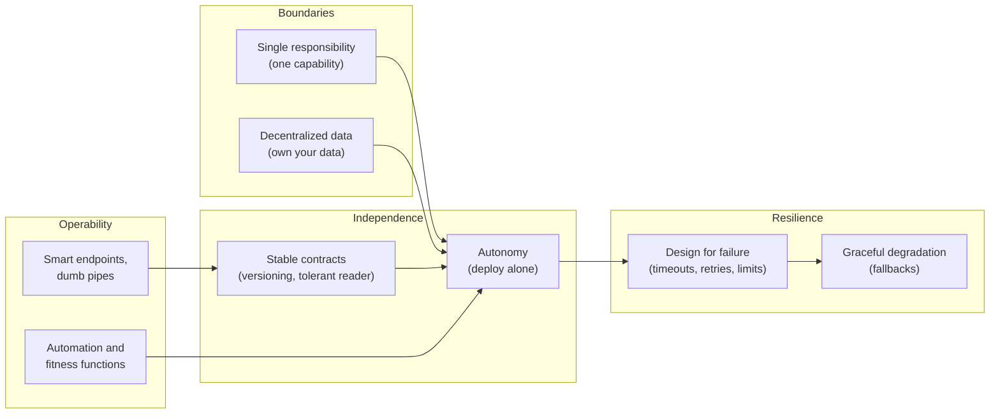
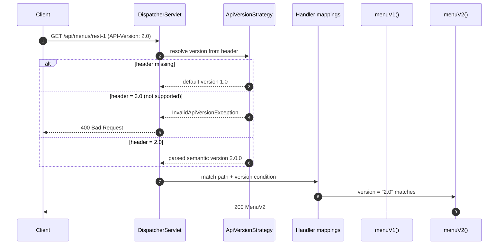
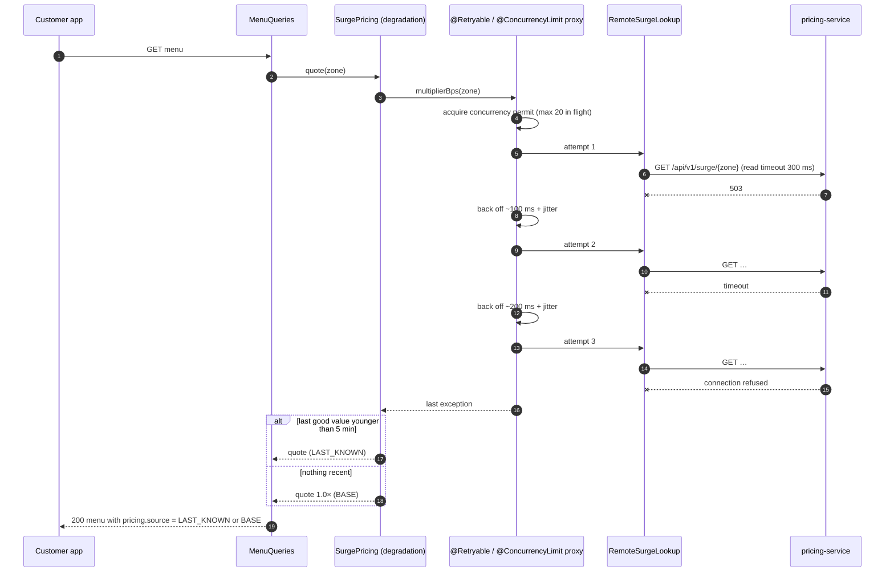

# 2. Characteristics & Principles

<div class="badges" markdown><span class="badge badge-l1">L1 · Foundation</span><span class="badge badge-l2">L2 · Practitioner</span><span class="badge badge-l3">L3 · Senior/Lead</span><span class="badge badge-meta">Java 25 · Spring Boot 4.1 · Spring Framework 7 resilience · ArchUnit</span></div>

<div class="grid two" markdown>

!!! info "Prerequisites"
    - [Chapter 1](ch01-architecture-styles.md): architecture styles and the two axes
    - REST and JSON basics
    - Optional: [Environment Setup](../getting-started/environment-setup.md) to run the code

!!! abstract "What you'll learn"
    - The nine characteristics that define microservices, and which ones matter most
    - **Single responsibility, autonomy, decentralization, smart endpoints and dumb pipes, design for failure** in practice
    - Evolving an API without breaking clients: Spring Boot 4 **API versioning**, the **tolerant reader**, Deprecation and Sunset headers
    - Designing for failure with **timeouts, `@Retryable`, `@ConcurrencyLimit` and graceful degradation**
    - Turning principles into **fitness functions** that fail the build

</div>

---

## 1 · Introduction & Context

### Principles are what make the style work

Chapter 1 ended with a warning: splitting a system into deployables does not make it modular. What separates real microservices from a distributed monolith is a handful of **principles** applied consistently. Each service owns one capability and its data. It can be changed and deployed without asking anyone. It talks through stable contracts. It assumes every dependency will fail.

These principles are not new. They restate decades of software engineering (cohesion, coupling, information hiding) at the scale of deployables, teams and networks. What is new is the price of ignoring them: in a monolith a bad boundary costs a refactor, while between services it costs outages and coordinated releases.

### A food-court analogy, continued 🟢

The food court from chapter 1 only works because of a few house rules:

| Food-court rule | Principle |
|---|---|
| Each stall sells one kind of food and is responsible for it | **Single responsibility** |
| A stall changes its menu or hours without a meeting with the other stalls | **Autonomy / independent deployability** |
| Each stall keeps its own stock; nobody walks into another stall's fridge | **Decentralized data management** |
| The token display just shows numbers; it doesn't decide who cooks what | **Smart endpoints, dumb pipes** |
| When the dosa stall's gas runs out, the rest of the court stays open, and the dosa stall puts up a sign rather than a locked shutter | **Design for failure, graceful degradation** |
| A new stall can add a "spice level" field to its order slips without reprinting everyone else's | **Tolerant reader, backward-compatible evolution** |

### Where the vocabulary comes from

In 2014, James Lewis and Martin Fowler described nine **common characteristics** of systems people were calling microservices. They were careful to say not every system has all nine. A decade later, they remain the best checklist for whether a design is getting the benefits or only the costs.

!!! note "Where this chapter fits"
    Every later part goes deep on one principle: data ownership in [Part 4](../data/index.md), contracts in [ch 27](../communication/ch27-api-contracts.md), resilience in [Part 6](../resilience/index.md), automation in [Part 8](../deployment/index.md). This chapter gives you the map and a working example of each.

---

## 2 · Core Concepts & Terminology

### The nine characteristics (Lewis & Fowler)

| # | Characteristic | Meaning | In FoodFleet |
|---|---|---|---|
| 1 | **Componentization via services** | Components are independently deployable services, not just libraries | menu-service ships without anyone else shipping |
| 2 | **Organized around business capabilities** | Teams and services follow capabilities (menu, ordering, delivery), not technical layers (UI team, DB team) | The restaurant-partner team owns menu and kitchen |
| 3 | **Products not projects** | The team that builds a service owns and runs it for its lifetime ("you build it, you run it") | menu-service team is on call for menu-service |
| 4 | **Smart endpoints and dumb pipes** | Business logic lives in services; transport (HTTP, Kafka) only moves messages | No pricing rules in the gateway or broker |
| 5 | **Decentralized governance** | Teams choose tools that fit, within platform guardrails | Golden path is Spring Boot; a Go service is allowed with an ADR |
| 6 | **Decentralized data management** | Each service owns its data and its model; no shared database | Only menu-service reads the menu catalogue |
| 7 | **Infrastructure automation** | CI/CD, infrastructure as code and automated testing are mandatory | Every service gets a pipeline from a template |
| 8 | **Design for failure** | Any dependency can fail; services detect, contain and degrade | Menus still load when pricing-service is down |
| 9 | **Evolutionary design** | Services are designed to be changed, split or replaced | API versions, tolerant readers, extraction seams |

### The principles this chapter focuses on



Read the arrows as "enables". You cannot deploy a service autonomously if its data is shared or its contract breaks callers. Autonomy then makes independent failure possible, and therefore makes it necessary to design for.

### Key definitions

Single responsibility (service level)
:   A service has one reason to change: one business capability. It's the Single Responsibility Principle applied to a deployable and its team, not a rule about lines of code.

Autonomy
:   A service can be changed, deployed, scaled and operated **without coordinating with other teams**. The practical test is "Can we deploy this on a Tuesday afternoon without telling anyone?"

Independent deployability
:   The concrete, testable form of autonomy. It needs backward-compatible contracts, owned data and no shared runtime state.

Decentralized governance
:   Standards emerge from teams and a platform's "paved road" rather than from a central architecture board. The platform constrains *how services are run* (observability, security, deployment), not *how they are written*.

Smart endpoints, dumb pipes
:   Logic, routing decisions and data transformation belong in the services at the ends. The pipe (HTTP, a message broker) only delivers bytes reliably.

Design for failure
:   Every remote call has a timeout. Transient failures are retried with backoff and jitter, only when safe. Concurrency is bounded. Each dependency has a defined **degradation mode**.

Tolerant reader
:   A consumer reads only the fields it needs and ignores the rest, so the provider can add fields freely. It pairs with Postel's robustness principle: *be conservative in what you send, liberal in what you accept.*

Fitness function
:   An automated check that a system still has an architectural property (layering, dependency direction, latency budget). Principles become fitness functions when they fail the build.

---

## 3 · How It Works Internally

### Autonomy is a property of contracts, data and runtime

A service is only as autonomous as its weakest coupling:

| Coupling | Breaks autonomy when… | Mechanism that restores it |
|---|---|---|
| **Contract** | A field rename forces consumers to release first | Additive changes, API versions, tolerant readers, contract tests |
| **Data** | Another service reads your tables | Database per service, events, APIs |
| **Runtime** | Your request path fails when a dependency is down | Timeouts, async messaging, caching, degradation modes |
| **Release** | Two services must deploy in a specific order | Expand/contract changes, feature flags |
| **Team** | A change needs approval from another team | Clear ownership, platform self-service |

### Evolving a contract without breaking anyone

Most API changes can be made **additive**. The provider adds, the consumer tolerates, and nobody coordinates:

| Change | Safe for existing consumers? | Why |
|---|---|---|
| Add an optional response field | ✅ (if consumers are tolerant readers) | Unknown fields are ignored |
| Add an optional request field with a default | ✅ | Old requests still valid |
| Add a new endpoint or event type | ✅ | Nobody calls it yet |
| Rename or remove a field | ❌ | Old consumers read a missing value |
| Change a field's type or unit (₹ → paise) | ❌ | Old consumers misinterpret it, silently |
| Change a field's **meaning** while keeping its name | ❌ **and the most dangerous** | Nothing fails visibly; the business is wrong |
| Make an optional request field required | ❌ | Old requests rejected |
| Tighten validation | ⚠️ | Previously valid requests now fail |

When a change is unavoidably breaking, you **version**. Spring Framework 7, configured through Spring Boot 4, resolves versions natively:



Versions can come from a header, query parameter, path segment or media-type parameter. Header versioning keeps URLs stable, which helps caching keys and gateway routes. The deprecation story matters as much as the mechanism: old versions should **announce** their retirement with the `Deprecation` (RFC 9745) and `Sunset` (RFC 8594) response headers, so client teams see it in their logs months before anything breaks.

### Design for failure: what happens when pricing-service is down

menu-service enriches menus with a live surge multiplier from pricing-service, another team's service. This is the full failure path:



Four mechanisms, four jobs:

| Mechanism | Job | Without it |
|---|---|---|
| **Timeout** (300 ms read) | Bound how long one attempt can take | One hung dependency holds every request thread or connection until the gateway gives up |
| **Retry with backoff and jitter** (2 retries, 100 → 200 ms ± 20 ms) | Ride out blips: a pod restart, a GC pause | Every blip becomes a user-visible error. With retries but no jitter, every pod retries at the same moment |
| **Concurrency limit** (20 in flight) | Cap the load we put on the dependency and on ourselves | With virtual threads there is no thread pool to act as an accidental cap. A slow dependency can accumulate thousands of waiting calls |
| **Degradation mode** (last known, then base price) | Keep the core use case working | An *optional* enrichment takes down the *core* journey |

!!! warning "Retries multiply load"
    Retries are only safe on **idempotent** operations, and only for **transient** errors (I/O, 5xx). If three layers each make up to three attempts, the bottom service sees up to 3 × 3 × 3 = **27 requests** for one user click, which is how a brief slowdown turns into an outage. Retry at one layer, usually the one closest to the failing dependency. [Chapter 44](../resilience/ch44-timeouts-retries-backpressure.md) covers retry budgets.

### Smart endpoints, dumb pipes in practice

The gateway authenticates, rate-limits and routes. It does **not** compute surge prices, merge menus or apply promotions. Kafka stores and delivers events. It does **not** filter by business rules or transform payloads into an enterprise canonical model. Put that logic in a pipe and it gains a central owner, a deployment schedule and a queue of change requests: the ESB from chapter 1 again.

### Decentralized governance without chaos

Decentralization is not "every team picks anything". Mature organisations split governance in two:

| Centrally provided (the paved road) | Decided by the owning team |
|---|---|
| Container base images, CI/CD templates, deployment platform | Internal code structure and libraries |
| Observability: log format, trace propagation, metrics conventions | Choice of database (within the supported list) |
| Security: identity provider, mTLS, secret management | API design within the API style guide |
| API style guide and linting, event naming conventions | Release cadence |

Deviation from the paved road is allowed but costs an ADR and ongoing ownership ([ch 72](../governance-org/ch72-platform-engineering.md)).

---

## 4 · Design Considerations & Trade-offs

Every principle has a cost, and every principle is sometimes worth bending:

| Principle | Benefit | Cost | When to bend it |
|---|---|---|---|
| Single responsibility | Small cognitive load, clear ownership | More services, more network hops | Two capabilities always change together → merge them |
| Autonomy | Teams ship without waiting | Duplication, eventual consistency | Regulatory flows that need lock-step change control |
| Decentralized data | No schema coupling; each service picks the right store | Cross-service queries need APIs, events or read models | Reporting: replicate into a warehouse instead of querying services ([ch 34](../data/ch34-reporting-analytics.md)) |
| Decentralized governance | Right tool per problem | Polyglot sprawl, harder hiring and on-call | Keep a small, explicit tech radar |
| Smart endpoints, dumb pipes | Logic owned by product teams | Some cross-cutting logic is duplicated | Genuinely cross-cutting edge concerns (authentication, rate limits) belong in the gateway |
| Design for failure | Partial failure stays partial | Code paths for every failure, harder testing | Hard dependencies with no sensible degradation must **fail closed** (payments) |
| Tolerant reader | Providers evolve freely | A consumer can miss a meaningful new field | Security-sensitive contracts may need strict validation |

### DRY versus decoupling

Inside a service, *Don't Repeat Yourself* is good advice. **Across services, duplication is often the price of autonomy, and usually worth paying.** In the code below, menu-service keeps its own `SurgeResponse` record instead of importing pricing-service's model from a shared JAR. If pricing-service renames a class, nothing breaks. Share **technical** libraries (logging setup, tracing), never **domain** models.

### Fail open or fail closed?

Design for failure does not always mean "keep going". The degradation mode is a **business decision**:

| Dependency down | FoodFleet behaviour | Mode |
|---|---|---|
| pricing-service (surge) | Show last known or base price | **Fail open** (degrade) |
| recommendation-service | Hide the "You may also like" rail | **Fail open** (omit) |
| kitchen availability ([ch 1](ch01-architecture-styles.md)) | Refuse the order with 503 + Retry-After | **Fail closed** (retryable) |
| payment-service | Never assume success; order stays `PAYMENT_PENDING` | **Fail closed** (safe state) |
| fraud scoring (fintech) | Hold the transaction for review | **Fail closed** (manual path) |

!!! tip "Rule of thumb"
    Fail **open** for enrichment, fail **closed** for anything involving money, safety or irreversible actions, and write the decision down per dependency.

---

## 5 · Hands-on Implementation

All code lives in `code/chapters/ch02-principles/`: one FoodFleet service, **menu-service** (port 8081). It answers one question, "what can I order from this restaurant, and at what price right now?", and shows each principle in code.

```text
dev/foodfleet/ch02/menu/
├── api/        versioned HTTP contract: MenuController, MenuResponses (v1, v2), ApiExceptionHandler
├── browse/     the use case: MenuQueries → PricedMenu
├── catalog/    data this service owns: MenuCatalog, Restaurant, MenuItem
├── pricing/    adapter to pricing-service: PricingClient, RemoteSurgeLookup, SurgePricing (fallback)
└── config/     wiring: @EnableResilientMethods, @ImportHttpServices, Clock
```

```bash
cd code
mvn -B -pl chapters/ch02-principles -am verify
```

### 🟢 Level 1: single responsibility and owned data

<div class="badges" markdown><span class="badge badge-l1">L1 · Foundation</span></div>

The service owns its catalogue. No other service reads it directly; they call the API:

```java title="catalog/MenuCatalog.java"
--8<-- "code/chapters/ch02-principles/src/main/java/dev/foodfleet/ch02/menu/catalog/MenuCatalog.java"
```

One use case, with no knowledge of HTTP or of how pricing works:

```java title="browse/MenuQueries.java"
--8<-- "code/chapters/ch02-principles/src/main/java/dev/foodfleet/ch02/menu/browse/MenuQueries.java"
```

!!! question "Check your understanding"
    Where would you put "apply a 20% Diwali discount"? Not in menu-service. Promotions change on a marketing cadence and need their own rules and audit trail. That is a different capability (pricing-promotion-service in FoodFleet). menu-service would ask for, or receive, the discounted price.

### 🔵 Level 2: API-first and evolving without breaking clients

<div class="badges" markdown><span class="badge badge-l2">L2 · Practitioner</span></div>

**Configure versioning once**, in `application.yml`:

```yaml title="application.yml (excerpt)"
spring:
  mvc:
    apiversion:
      use:
        header: API-Version   # (1)!
      default: 1.0            # (2)!
      supported: 1.0,2.0      # (3)!
```

1. Clients send `API-Version: 2.0`. Alternatives: `use.query-parameter`, `use.path-segment`, `use.media-type-parameter`.
2. Clients that existed before versioning was introduced send no header and keep getting v1.
3. Any other version is rejected with `400 Bad Request` instead of silently falling through to some handler.

**Map handlers by version** on the same path:

```java title="api/MenuController.java"
--8<-- "code/chapters/ch02-principles/src/main/java/dev/foodfleet/ch02/menu/api/MenuController.java"
```

**Keep wire contracts separate from the domain**, one record per version:

```java title="api/MenuResponses.java"
--8<-- "code/chapters/ch02-principles/src/main/java/dev/foodfleet/ch02/menu/api/MenuResponses.java"
```

Note the comment on v1. When surge pricing arrived, v1's **shape** stayed frozen but its **meaning** was kept honest: `pricePaise` is what the customer pays now. An old app that kept showing the base price would overcharge-shock customers at checkout. That would be a breaking change no compiler or schema check catches.

**Be a tolerant reader** of other teams' APIs:

```java title="pricing/PricingClient.java"
--8<-- "code/chapters/ch02-principles/src/main/java/dev/foodfleet/ch02/menu/pricing/PricingClient.java"
```

=== "Spring Boot 4 (after)"

    ```java
    @GetMapping(path = "/{restaurantId}", version = "2.0")   // (1)!
    MenuV2 menuV2(@PathVariable String restaurantId) { … }
    ```

    1. Version is a first-class mapping condition. Resolution, parsing, defaulting and validation are configured once in properties.

=== "Spring Boot 3 (before)"

    ```java
    @GetMapping(path = "/{restaurantId}", headers = "API-Version=2.0")   // (1)!
    MenuV2 menuV2(@PathVariable String restaurantId) { … }

    @GetMapping(path = "/{restaurantId}", headers = "!API-Version")       // (2)!
    MenuV1 menuV1Default(@PathVariable String restaurantId) { … }
    ```

    1. Exact string matching: `2`, `2.0` and `2.0.0` were three different versions.
    2. The default had to be hand-coded per endpoint, and unsupported versions fell through to 404 instead of 400.

The controller test pins each version's contract:

```java title="api/MenuControllerTest.java"
--8<-- "code/chapters/ch02-principles/src/test/java/dev/foodfleet/ch02/menu/api/MenuControllerTest.java"
```

### 🟣 Level 3: design for failure

<div class="badges" markdown><span class="badge badge-l3">L3 · Senior/Lead</span></div>

**Layer 1: a well-behaved remote call.** Spring Framework 7's built-in `@Retryable` and `@ConcurrencyLimit` replace the separate spring-retry library for common cases:

```java title="pricing/RemoteSurgeLookup.java"
--8<-- "code/chapters/ch02-principles/src/main/java/dev/foodfleet/ch02/menu/pricing/RemoteSurgeLookup.java"
```

The annotations do nothing until they are switched on. Spring Boot does not enable them automatically:

```java title="config/PlatformConfiguration.java"
--8<-- "code/chapters/ch02-principles/src/main/java/dev/foodfleet/ch02/menu/config/PlatformConfiguration.java"
```

**Layer 2: graceful degradation.** The caller never sees the failure, only a clearly labelled degraded answer:

```java title="pricing/SurgePricing.java"
--8<-- "code/chapters/ch02-principles/src/main/java/dev/foodfleet/ch02/menu/pricing/SurgePricing.java"
```

**Test every failure path.** The retry test runs the real retry proxy in a minimal Spring context against a mocked pricing-service:

```java title="pricing/RemoteSurgeLookupTest.java"
--8<-- "code/chapters/ch02-principles/src/test/java/dev/foodfleet/ch02/menu/pricing/RemoteSurgeLookupTest.java"
```

The degradation test needs no Spring at all. A controllable clock and a lambda stand in for time and pricing-service:

```java title="pricing/SurgePricingTest.java"
--8<-- "code/chapters/ch02-principles/src/test/java/dev/foodfleet/ch02/menu/pricing/SurgePricingTest.java"
```

=== "Spring Framework 7 (after)"

    ```java
    @Retryable(includes = {ResourceAccessException.class, HttpServerErrorException.class},
               maxRetries = 2, delay = 100, multiplier = 2, jitter = 20)   // (1)!
    @ConcurrencyLimit(20)                                                  // (2)!
    public int multiplierBps(String zone) { … }
    ```

    1. `org.springframework.resilience.annotation.Retryable`, in spring-core. `maxRetries` counts retries, so this is 3 attempts in total.
    2. Built-in throttling for virtual-thread-heavy services. Enabled with `@EnableResilientMethods`.

=== "Boot 3 + spring-retry (before)"

    ```java
    @Retryable(retryFor = {ResourceAccessException.class, HttpServerErrorException.class},
               maxAttempts = 3,                                             // (1)!
               backoff = @Backoff(delay = 100, multiplier = 2, random = true))
    public int multiplierBps(String zone) { … }
    // + spring-retry dependency, spring-boot-starter-aop, @EnableRetry
    // + no concurrency limiting: use Resilience4j Bulkhead or a Semaphore by hand
    ```

    1. spring-retry counted *attempts*, not retries. A common migration bug is to copy `maxAttempts = 3` into `maxRetries = 3` and get four calls.

### 🔴 Level 4: principles as fitness functions

<div class="badges" markdown><span class="badge badge-l4">L4 · Architect</span></div>

Principles decay unless they are checked on every build. ArchUnit turns them into tests:

```java title="ArchitectureTest.java"
--8<-- "code/chapters/ch02-principles/src/test/java/dev/foodfleet/ch02/menu/ArchitectureTest.java"
```

At organisation scale, ship rules like these in a shared **test-only** library (`foodfleet-architecture-rules`) that every service template includes. Teams get the guardrails without a central review board: decentralized governance with a paved road.

### Run and verify

```bash
mvn -pl chapters/ch02-principles spring-boot:run

# v1 (no header): Deprecation and Sunset headers, only available items
curl -si localhost:8081/api/menus/rest-biryani-house

# v2: nothing listens on :8083, so after ~0.3 s of retries pricing.source is "BASE"
curl -s localhost:8081/api/menus/rest-biryani-house -H 'API-Version: 2.0' | jq .pricing

# unsupported version → 400
curl -si localhost:8081/api/menus/rest-biryani-house -H 'API-Version: 3.0' | head -1
```

!!! question "Try it: break it"
    1. Remove `@EnableResilientMethods` and run `RemoteSurgeLookupTest`. Which tests fail, and why does `givesUpAfterTwoRetries` now see one request instead of three?
    2. Remove `@JsonIgnoreProperties(ignoreUnknown = true)` from `SurgeResponse` and run the tolerant-reader test. Then check whether Spring Boot's own Jackson defaults would have saved you. Never rely on a framework default for a contract guarantee: make it explicit.
    3. Make `MenuResponses` call `PriceSource` directly and watch `ArchitectureTest` fail.

---

## 6 · Production Readiness

### Service readiness review (per service, before first production traffic)

- [x] **Single, written purpose** in the service charter (section 8); owned data listed
- [x] **No shared database**; consumers use the API or events
- [x] **Every outbound call has a timeout**, set per client group in configuration
- [x] **Retries only on idempotent operations and transient errors**, at one layer, with jitter
- [x] **Concurrency limits** on calls to each dependency (or a Resilience4j bulkhead)
- [x] **A documented degradation mode** for each dependency: fail open or fail closed
- [x] **Degradation is observable**: a metric per mode (`pricing.degraded{source="BASE"}`), not just a log line ([ch 48](../observability/ch48-metrics-micrometer.md))
- [x] **API versions** declared in configuration; deprecated versions send `Deprecation` and `Sunset`
- [x] **Consumers are tolerant readers**, made explicit in code
- [x] **Fitness functions** (ArchUnit, Spring Modulith) run in CI
- [x] **Externalized configuration** for URLs, timeouts and business thresholds (12-factor, [ch 4](ch04-twelve-factor.md))
- [x] **Owning team on call**, with a runbook link in the service catalogue

### Tuning the failure budget

For a menu page with a **p99 target of 400 ms**:

| Budget item | Value | Reasoning |
|---|---|---|
| menu-service own work | ~20 ms | In-memory catalogue (cached DB in production) |
| pricing call, happy path | ~15 ms p99 | Same-zone HTTP |
| pricing call, worst case | 3 × 300 ms + ~300 ms backoff ≈ 1.2 s | **Exceeds the page budget** |

The worst case only happens during a pricing-service incident, but that is exactly when tail latency matters. Production options, covered in [ch 43](../resilience/ch43-resilience4j-deep-dive.md) and [ch 44](../resilience/ch44-timeouts-retries-backpressure.md):

- Add a **circuit breaker**, so after a few failures calls skip straight to the fallback with no waiting.
- Cut retries to 1 and the read timeout to 150 ms for this optional dependency.
- Serve surge from a **local cache refreshed asynchronously**, removing pricing from the request path entirely.

### Deprecation policy

A versioning mechanism without a policy only accumulates versions. FoodFleet's policy:

1. A new major version requires an ADR explaining why the change cannot be additive.
2. Old versions announce `Deprecation` immediately and a `Sunset` date at least **6 months** out (mobile app update cycles).
3. Track per-version traffic from gateway metrics. Contact the top remaining consumers 8 and 4 weeks before sunset.
4. After sunset, return `410 Gone` with a Problem Details link to the migration guide, never a silent 404.

---

## 7 · Anti-patterns & Pitfalls

!!! pitfall "Incident 1: the retry storm"
    **Context.** Checkout → order → inventory → database, with each layer configured to "retry 3 times on any error".
    **Symptoms.** A 30-second database failover turned into a 20-minute outage. Database CPU stayed at 100% after it recovered.
    **Root cause.** Retry amplification: one click became up to 4 × 4 × 4 = 64 database calls, and none had jitter, so they arrived in synchronized waves.
    **Fix.** Retry at the innermost layer only, on transient errors only, with exponential backoff and jitter. Add circuit breakers and a retry budget.

!!! pitfall "Incident 2: the strict reader"
    **Context.** A partner integration deserialized responses with "fail on unknown properties" enabled.
    **Symptoms.** The provider added an optional `deliveryInstructions` field in a minor release. The partner's order sync failed for 6 hours.
    **Root cause.** The consumer treated any change as an error.
    **Fix.** Tolerant readers by default, contract tests that include "provider adds a field", and a schema compatibility check in the provider's pipeline.

!!! pitfall "Incident 3: the optional dependency that took down checkout"
    **Context.** The cart page called recommendation-service synchronously, with no timeout, to render "frequently bought together".
    **Symptoms.** A slow recommendation-service deploy made cart and checkout time out across the platform.
    **Root cause.** An enrichment sat on the critical path with no timeout and no degradation mode.
    **Fix.** A 100 ms timeout, omit-on-failure, and later an asynchronous prefetch into a cache.

!!! pitfall "Incident 4: the shared domain model JAR"
    **Context.** Twenty services depended on `foodfleet-common-model`, which contained `Order`, `Restaurant` and `Customer`.
    **Symptoms.** Adding one enum value to `OrderStatus` required releasing all twenty services. Services pinned to old versions failed to deserialize events containing the new value.
    **Root cause.** Domain coupling through a shared library: a distributed monolith in disguise.
    **Fix.** Each service owns its model. Events are documented contracts (AsyncAPI, schema registry). Shared libraries are limited to technical concerns.

| Anti-pattern | Principle violated | Symptom | Fix |
|---|---|---|---|
| Entity services (CustomerService, AddressService, PhoneService) | Single responsibility (by capability) | Every feature touches 5 services | Split by business capability ([ch 6](ch06-service-decomposition.md)) |
| Logic in the gateway or ESB | Smart endpoints, dumb pipes | Gateway team becomes a bottleneck | Gateway handles authentication, routing and limits only |
| Polyglot free-for-all | Decentralized governance (abused) | Seven languages, nobody can be on call for all of them | Tech radar plus paved road |
| No timeouts | Design for failure | Thread or connection exhaustion during dependency incidents | Timeouts on every client, enforced by fitness functions |
| Silent fallbacks | Design for failure (unobservable) | Degraded for days and nobody noticed | Degradation metrics and alerts |
| Breaking change "because it's a small field" | Evolutionary design | Old mobile apps crash | Additive changes, versioning, contract tests |

---

## 8 · Enterprise Case Study

### FoodFleet's service charter

Every FoodFleet service has a one-page **charter**, kept in the developer portal ([Backstage](../components-tools/backstage.md)) next to the code. Here it is for menu-service:

| Field | menu-service |
|---|---|
| **Purpose (one sentence)** | Tell a customer what they can order from a restaurant and what it costs right now |
| **Owning team / on call** | Restaurant Partner Experience · `#rpx-oncall` |
| **Owned data** | Menu catalogue (items, base prices, veg flag, availability) |
| **Provided APIs** | `GET /api/menus/{restaurantId}` (v1 deprecated, sunset 2027-03-31; v2 current) |
| **Published events** | `foodfleet.menu.item-availability-changed.v1` (added in later chapters) |
| **Dependencies and degradation** | pricing-service: fail open (last known ≤ 5 min, then base price) · restaurant-service: fail closed (no menu without restaurant) |
| **SLOs** | Availability 99.95% · p99 < 400 ms (v2) |
| **Runbook** | Link · top alerts: `pricing.degraded` rate, p99 latency, 5xx rate |

!!! decision "ADR-002: Every synchronous dependency declares a degradation mode"
    **Status:** Accepted · **Date:** 2026-02-03

    **Context.** Two incidents in Q4 were caused by optional enrichments (recommendations, ETA) on the critical path without timeouts or fallbacks.

    **Decision.** Every outbound synchronous call must (1) use a declarative HTTP client group with explicit connect and read timeouts; (2) retry only idempotent calls, on transient errors, with jitter, at one layer; (3) declare **fail open** or **fail closed** in the service charter; (4) emit a degradation metric. ArchUnit rules in `foodfleet-architecture-rules` reject `RestTemplate` and ad-hoc `HttpClient` usage.

    **Consequences.** ✅ Partial failures stay partial; behaviour during incidents is predictable. ⚠️ More code paths to test, and charters must be kept current (reviewed quarterly).

### Fintech analogue: the same principles, different defaults 🔴

A payments platform applies identical principles with **opposite degradation choices**. The payment orchestration service must **fail closed**: if the fraud service is unreachable, the transaction is held for review, never approved by default. The tolerant reader is applied carefully. Unknown fields in a card network response are logged and alerted, not ignored, because a new field may carry a compliance flag. Decentralized governance is tighter, with an approved crypto library list and mandatory audit logging. Principles are universal; their **parameters** depend on the cost of being wrong.

---

## 9 · Interview Q&A + Summary

#### Q1. What are the key characteristics of microservices? · <span class="badge badge-l1">L1</span> · Cognizant · TCS · Infosys

**Short answer:** Independently deployable services organised around business capabilities. Each owns its data and is run by the team that built it. They communicate through smart endpoints and dumb pipes, are designed for failure, and depend on heavy automation.

**Detailed answer:** Walk through Lewis and Fowler's nine characteristics and give a concrete example of each from a system you know.

**Follow-ups:** "Which matters most?" Independent deployability; most other characteristics exist to enable it.

**Red flags:** "Microservices are small services" (size is not a characteristic), or "Microservices use REST".

**What a 15-YoE answer adds:** which characteristics they deliberately relaxed in a real system, and why.

#### Q2. What does single responsibility mean for a service? · <span class="badge badge-l1">L1</span><span class="badge badge-l2">L2</span> · Accenture · Flipkart

**Short answer:** One business capability and one reason to change, owned by one team. It is not a line-count limit and not one entity per service.

**Follow-ups:** "How do you know a service does too much?" Several teams change it, unrelated features collide in its releases, or parts have different scaling or compliance needs. "Too little?" Every feature changes it together with its neighbours.

**Red flags:** "One service per database table."

#### Q3. How do you evolve an API without breaking consumers? · <span class="badge badge-l2">L2</span> · Amazon · SAP · Flipkart

**Short answer:** Prefer additive changes, make consumers tolerant readers, version only for unavoidable breaking changes, announce deprecation (Deprecation and Sunset headers), measure per-version traffic, and protect it all with contract tests.

**Detailed answer:** Explain the safe and unsafe changes table, including meaning-changes that keep the same name. Describe Spring Boot 4's built-in versioning (header, default version, supported list, 400 on unknown versions) and the expand/contract approach for event schemas.

**Follow-ups:** "Header, path or query versioning?" Header keeps URLs stable for caching and routing. Path is easiest to see in logs and docs. Be consistent across the organisation.

**Red flags:** "Just tell all the clients to upgrade."

**What a 15-YoE answer adds:** deprecation policies tied to mobile release cycles, consumer analytics, and the cost of carrying versions.

#### Q4. Explain "smart endpoints and dumb pipes". · <span class="badge badge-l2">L2</span> · JP Morgan · SAP

**Short answer:** Business logic lives in services; the transport only moves messages. This avoids the ESB trap, where routing and transformation logic in middleware creates a central bottleneck.

**Follow-ups:** "Isn't Kafka Streams a smart pipe?" A Kafka Streams application is itself a service with an owner, deployed independently. The broker stays dumb. "What belongs in an API gateway?" Authentication, rate limiting, routing, TLS. Not business rules.

#### Q5. What does "design for failure" mean in code? · <span class="badge badge-l2">L2</span><span class="badge badge-l3">L3</span> · Amazon · Goldman Sachs

**Short answer:** Timeouts on every remote call. Retries only for idempotent operations and transient errors, with backoff and jitter. Bounded concurrency. Circuit breakers. A defined degradation mode per dependency. And tests for each failure path.

**Detailed answer:** Use the menu-service example: `@Retryable` with `includes` for I/O and 5xx, `@ConcurrencyLimit`, a last-known-good fallback with a staleness limit, and labelled degraded responses.

**Follow-ups:** "Why jitter?" To prevent synchronized retry waves. "Why not retry everything?" Retries on 4xx waste capacity, and retries on non-idempotent operations duplicate side effects.

**Red flags:** "Wrap it in try/catch and retry until it works."

#### Q6. Your service calls three downstream services. How do you set timeouts? · <span class="badge badge-l3">L3</span> · Flipkart · Amazon

**Short answer:** Start from the caller's latency SLO and allocate a budget per hop, using each dependency's measured p99 plus headroom. Make sure retries fit inside the budget. Propagate a deadline so downstream services stop work the caller has abandoned.

**What a 15-YoE answer adds:** the retry amplification arithmetic, deadline propagation headers, and making optional calls parallel and droppable.

#### Q7. Fail open or fail closed? · <span class="badge badge-l3">L3</span> · Goldman Sachs · JP Morgan

**Short answer:** It depends on the cost of being wrong. Enrichments (recommendations, surge display) fail open. Money movement, fraud checks and irreversible actions fail closed into a safe, recoverable state. The choice is documented per dependency.

**Red flags:** one rule for everything.

#### Q8. Is code duplication across services acceptable? · <span class="badge badge-l2">L2</span><span class="badge badge-l3">L3</span> · Amazon · SAP

**Short answer:** Often yes. DRY across service boundaries creates coupling through shared libraries. Share technical concerns (logging, tracing setup), never domain models. Duplicate small DTOs and own them.

**Follow-ups:** "What about validation rules both sides need?" Put them in the contract (OpenAPI or JSON Schema constraints), not a shared JAR.

#### Q9. How do you enforce principles across 50 teams without an architecture review board? · <span class="badge badge-l4">L4</span> · SAP · Amazon · Flipkart

**Short answer:** Paved road plus fitness functions. Service templates with secure, observable defaults. Shared architecture-rule tests (ArchUnit, Spring Modulith) run in every pipeline. API linting. Scorecards in the developer portal. Exceptions through lightweight ADRs.

**What a 15-YoE answer adds:** measuring adoption, keeping the paved road attractive rather than mandatory, and retiring rules that no longer earn their cost.

#### Q10. How does decentralized data management affect reporting? · <span class="badge badge-l3">L3</span> · Goldman Sachs · Flipkart

**Short answer:** You can't join across service databases, so you replicate. Services publish events or CDC streams into an analytics store (warehouse or lake) where reporting joins happen. Operational queries across services use API composition or dedicated read models.

#### Q11. Spring Framework 7 has `@Retryable`. Do you still need Resilience4j? · <span class="badge badge-l3">L3</span> · any Spring shop

**Short answer:** For simple retries and concurrency throttling, the built-in annotations are enough and need no extra dependency. Resilience4j still provides circuit breakers, rate limiters, time limiters, fail-fast bulkheads and rich metrics, which most production services need for their critical dependencies ([ch 43](../resilience/ch43-resilience4j-deep-dive.md)).

**Red flags:** "`maxRetries = 3` means three attempts" (it means four).

#### Q12. What is a fitness function? Give examples. · <span class="badge badge-l4">L4</span> · SAP · ThoughtWorks-style consultancies

**Short answer:** An automated, objective check that an architectural property still holds. Examples: layering rules (ArchUnit), module boundaries (Spring Modulith `verify()`), "no `RestTemplate`" rules, API breaking-change detection in CI, p99 latency gates in performance tests, dependency-age checks.

### Key takeaways

- The principles exist to make **independent deployability** real: single responsibility, owned data, stable contracts.
- Evolve contracts **additively**, read them **tolerantly**, version only when you must, and **announce** deprecations with Deprecation and Sunset headers.
- **Design for failure** in layers: timeouts, then careful retries with jitter, then concurrency limits, then a documented degradation mode that shows up in metrics.
- Decide **fail open or fail closed** per dependency, based on the cost of being wrong.
- **Duplication across services is acceptable**; shared domain libraries are not.
- Principles that aren't checked will decay. Encode them as **fitness functions**.

### Further reading

- James Lewis & Martin Fowler, [Microservices](https://martinfowler.com/articles/microservices.html), the nine characteristics
- Martin Fowler, [Tolerant Reader](https://martinfowler.com/bliki/TolerantReader.html)
- Spring Framework reference, [Resilience features](https://docs.spring.io/spring-framework/reference/core/resilience.html) (`@Retryable`, `@ConcurrencyLimit`)
- Spring blog, [API Versioning in Spring](https://spring.io/blog/2025/09/16/api-versioning-in-spring/)
- RFC 9745, [The Deprecation HTTP Response Header Field](https://www.rfc-editor.org/rfc/rfc9745), and RFC 8594, [The Sunset HTTP Header Field](https://www.rfc-editor.org/rfc/rfc8594)
- Amazon Builders' Library, [Timeouts, retries, and backoff with jitter](https://aws.amazon.com/builders-library/timeouts-retries-and-backoff-with-jitter/)
- Michael Nygard, *Release It!*, 2nd ed. (Pragmatic Bookshelf, 2018)
- [ArchUnit user guide](https://www.archunit.org/userguide/html/000_Index.html)

---

**Previous:** [← 1. Monolith vs SOA vs Microservices vs Modular Monolith](ch01-architecture-styles.md) · **Next:** [3. Distributed Systems Fundamentals →](ch03-distributed-systems-fundamentals.md)
