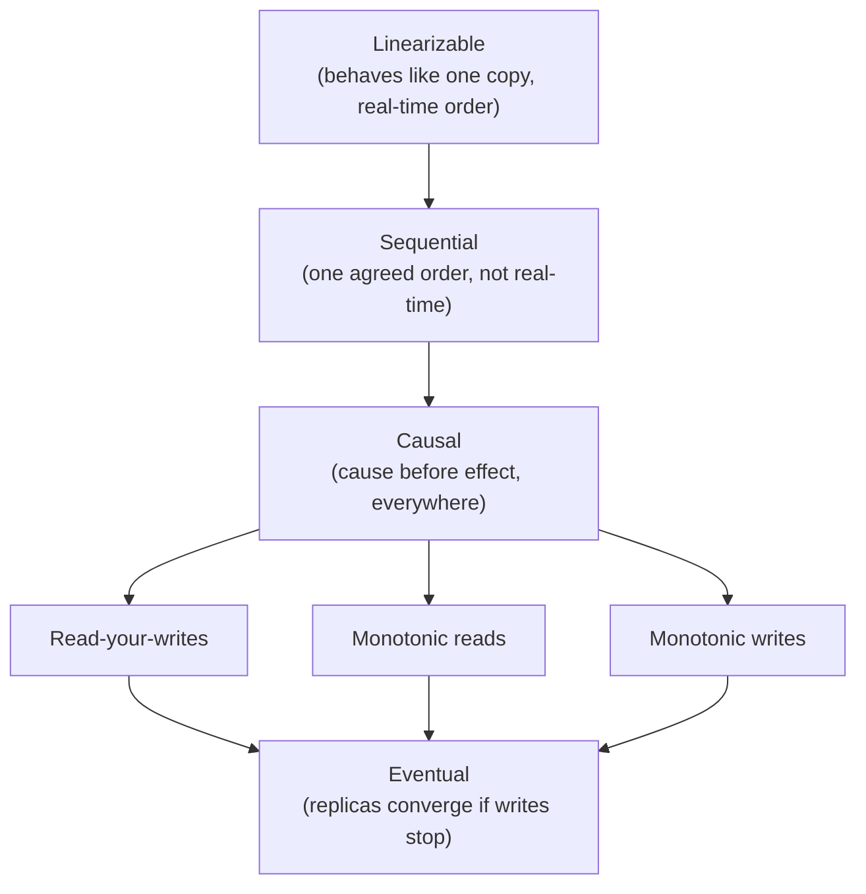
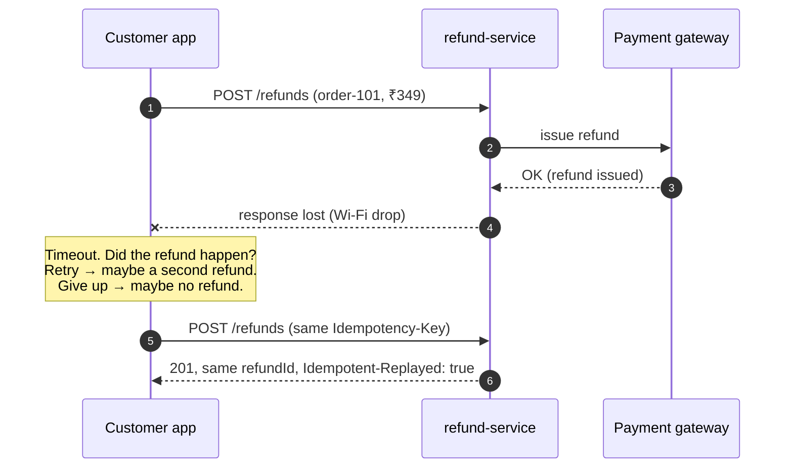
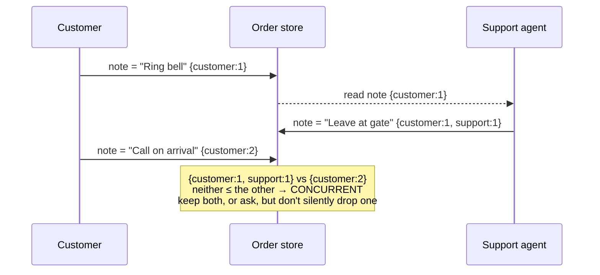
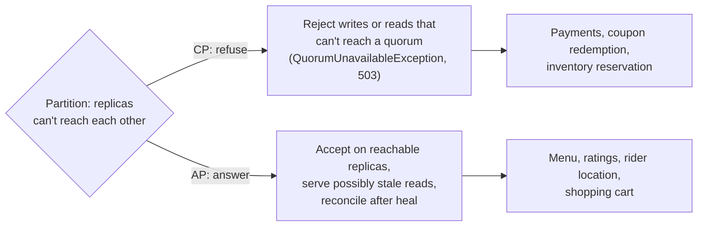

# 3. Distributed Systems Fundamentals

<div class="badges" markdown><span class="badge badge-l2">L2 · Practitioner</span><span class="badge badge-l3">L3 · Senior/Lead</span><span class="badge badge-l4">L4 · Architect</span><span class="badge badge-meta">Plain Java 21+ simulations · Spring Boot 4 · every number on this page comes from running the code</span></div>

<div class="grid two" markdown>

!!! info "Prerequisites"
    - [Chapter 1](ch01-architecture-styles.md) and [Chapter 2](ch02-characteristics-principles.md)
    - Basic Java concurrency (threads, atomics)
    - No prior distributed-systems theory needed

!!! abstract "What you'll learn"
    - The **eight fallacies** and what each one costs in a microservice system
    - Why a **timeout can't tell you whether something happened**
    - **CAP** stated precisely, the common misreadings, and why **PACELC** is the more useful tool
    - **Consistency models** from linearizable to eventual, and which one each kind of data needs
    - **Lamport, vector and hybrid logical clocks**, and why wall clocks can't order events
    - **Quorums** (R + W > N), and **exactly-once** honestly defined: at-least-once delivery plus idempotency

</div>

---

## 1 · Introduction & Context

### Why distributed systems are different

Inside one process, a method call either returns or throws, memory is shared, and there is one clock. Across a network **none of that holds**:

1. **Partial failure.** One part of the system fails while the rest keeps running, and the rest often *can't tell*.
2. **Unbounded latency.** A message can take 1 ms or 30 seconds. "Slow" and "dead" look identical from outside.
3. **No global clock.** Each machine's clock drifts and can jump. "Which happened first?" has no free answer.

Every pattern in this handbook (sagas, outboxes, circuit breakers, idempotency keys) is a response to these three facts. This chapter is the theory they share.

### An analogy 🟢

Imagine coordinating FoodFleet's kitchen with a restaurant only over a patchy mobile connection. Messages sometimes arrive late, twice, or not at all. "Delivered" ticks occasionally lie. Your phone's clock and theirs differ by a few minutes. If you send "cancel order 42" and hear nothing back, you can't know whether the cancel arrived, was rejected, or was applied and the reply got lost. You have three tools: **ask again safely** (idempotency), **agree on an order of events without trusting clocks** (logical clocks), and **decide in advance what to do when you can't reach them** (CAP and degradation modes).

### A short history

| Year | Milestone | Why it still matters |
|---|---|---|
| 1978 | Leslie Lamport, *Time, Clocks, and the Ordering of Events in a Distributed System* | Defines "happened-before" and logical clocks |
| 1985 | Fischer, Lynch & Paterson (FLP) impossibility result | In an asynchronous network, no deterministic algorithm can guarantee consensus if even one process may crash. Real systems rely on timeouts, which are guesses |
| 1994–97 | Peter Deutsch's seven fallacies, plus James Gosling's eighth | The checklist every architect should know |
| 2000–02 | Brewer's CAP conjecture (2000), proved by Gilbert & Lynch (2002) | Choose consistency or availability during a partition |
| 2007 | Amazon's Dynamo paper | Leaderless replication, quorums, vector clocks, hinted handoff |
| 2012 | Abadi's PACELC; Google Spanner and TrueTime | Latency vs consistency in normal operation; bounded clock uncertainty |
| 2014 | Hybrid Logical Clocks (Kulkarni et al.) | Causality-respecting timestamps close to wall time, used by CockroachDB and YugabyteDB |
| 2017 | Kafka exactly-once semantics (transactions, idempotent producer) | Exactly-once *within* Kafka; idempotency still needed at the edges |

!!! note "Where this chapter fits"
    It is the theory behind [Saga](../architecture-patterns/ch14-saga-pattern.md), [Outbox](../architecture-patterns/ch15-outbox-inbox-cdc.md), [distributed transactions](../data/ch30-distributed-transactions.md), [data consistency](../data/ch31-data-consistency.md), [idempotency keys](../communication/ch28-idempotency-correlation.md) and [resilience](../resilience/index.md).

---

## 2 · Core Concepts & Terminology

### The eight fallacies of distributed computing

| # | Fallacy | Reality | What it breaks in microservices | Mitigation (chapter) |
|---|---|---|---|---|
| 1 | The network is reliable | Packets drop, connections reset, messages duplicate | Lost or double-processed orders and payments | Retries + idempotency ([28](../communication/ch28-idempotency-correlation.md)), outbox ([15](../architecture-patterns/ch15-outbox-inbox-cdc.md)) |
| 2 | Latency is zero | Every hop costs ms; tails cost seconds | Chatty call chains miss SLOs | Fewer hops, async, caching, deadline budgets ([44](../resilience/ch44-timeouts-retries-backpressure.md)) |
| 3 | Bandwidth is infinite | Links saturate; payloads grow | Huge JSON responses, N+1 calls | Pagination, field selection, compression, gRPC ([23](../communication/ch23-grpc.md)) |
| 4 | The network is secure | Every hop is an attack surface | Lateral movement after one breach | mTLS, zero trust ([38](../security/ch38-service-to-service-security.md)) |
| 5 | Topology doesn't change | Pods move, IPs churn, autoscalers add and remove nodes | Hard-coded hosts, stale connection pools | Service discovery ([11](../architecture-patterns/ch11-service-discovery-patterns.md)), DNS TTLs |
| 6 | There is one administrator | Many teams, clouds and vendors | Uncoordinated config, cert or firewall changes break calls | Platform guardrails, GitOps ([58](../deployment/ch58-cicd-gitops.md)) |
| 7 | Transport cost is zero | Serialization CPU, cross-AZ data transfer fees | Cloud bills dominated by inter-service traffic | Locality, batching, compact formats ([70](../performance-scalability/ch70-finops.md)) |
| 8 | The network is homogeneous | Mixed protocols, versions, MTUs, clients | Edge cases in old clients and proxies | Standards, contract tests, tolerant readers ([ch 2](ch02-characteristics-principles.md)) |

### Definitions

Partial failure
:   Some components fail while others keep working. The defining property of distributed systems, and the reason a remote call has three outcomes: success, failure, and **unknown**.

Network partition
:   A set of nodes that can't communicate with another set, while both sets keep running and serving their own clients.

Replica
:   A copy of data on another node, kept for availability, durability or read scaling.

Quorum
:   The minimum number of replicas that must take part in an operation. With N replicas, a write quorum W and a read quorum R overlap whenever **R + W > N**.

Idempotent operation
:   An operation where applying it several times has the same effect as applying it once. `SET status = PREPARING` is idempotent; `balance = balance - 100` is not.

Delivery semantics
:   **At-most-once**: may lose, never duplicates. **At-least-once**: never loses (with retries), may duplicate. **Exactly-once**: no network can deliver exactly once across failures; what systems offer is *exactly-once effects*, meaning at-least-once delivery plus deduplication.

### Consistency models, strongest to weakest



| Model | Guarantee | Typical cost | FoodFleet example |
|---|---|---|---|
| **Linearizable** | Every read sees the latest completed write, as if there were one copy | Coordination on every operation; unavailable under partition | Coupon single-use redemption; payment status |
| **Sequential** | All nodes see operations in the same order, not necessarily real-time | Coordination, but more flexible | Rarely chosen explicitly |
| **Causal** | If A caused B, everyone sees A before B; concurrent ops may differ | Metadata (vector clocks) | Chat between rider and customer |
| **Read-your-writes** | A client always sees its own writes | Session routing or version tokens | Customer edits address, then views it |
| **Monotonic reads** | A client never sees data go back in time | Sticky replica or version tokens | Order status never shows PREPARING → PLACED |
| **Eventual** | Replicas converge when writes stop | Cheapest, fastest, always available | Restaurant ratings, menu cache |

!!! tip "The model belongs to the data, not the system"
    A single FoodFleet request may touch linearizable data (payment), causal data (chat) and eventual data (ratings). Choose per data type, and section 8 shows the full map.

---

## 3 · How It Works Internally

### The unknown outcome: why timeouts are guesses



This is the **Two Generals' Problem** in miniature: no finite exchange of messages over an unreliable channel can give both sides certainty. The way out is to stop needing certainty. Make the operation **safe to repeat**, then retry until you get an answer.

### Measuring fallacy #1

The chapter's `UnreliableNetwork` sends messages through a deterministic, seeded model of a real link. With a 5% drop rate, 10% duplication and up to 5 ticks of delay, sending 1,000 messages (seed 42) gives:

| Sent | Dropped | Duplicated | Delivered | In original order? |
|---|---|---|---|---|
| 1,000 | 46 | 85 | 1,039 | No |

Now bill 500 FoodFleet orders of ₹100 each through it. The correct total is **₹50,000**:

| Strategy | Network behaviour | Amount billed | Error |
|---|---|---|---|
| **At-most-once** (fire and forget) | 5% loss, no retries | **₹47,000** | ₹3,000 lost revenue |
| **At-least-once**, naive consumer | Retries cause 30% duplicates | **₹62,800** | ₹12,800 over-billed |
| **At-least-once + idempotent consumer** | Same duplicates, deduplicated by message id | **₹50,000** | None |

The last row is what "exactly-once" means in practice.

### Time and ordering

**Why not wall clocks?** Clock synchronization across a network is only as good as the network's delay estimates. NTP typically holds servers within milliseconds of each other on a good network, but clocks drift between syncs, virtual machines pause, and NTP can **step a clock backwards**. Two events 1 ms apart on different machines cannot be reliably ordered by their wall-clock timestamps.

| Clock | What it gives you | What it can't do | Used by |
|---|---|---|---|
| **Wall clock** (`Instant.now()`) | Human-readable time | Order events across machines; it can jump backwards | Logs, display |
| **Lamport clock** | If a → b then L(a) < L(b); a total order | Detect concurrency (L(a) < L(b) doesn't imply a → b) | Total-order broadcast, simple versioning |
| **Vector clock** | Exact causality: before, after or **concurrent** | Stay small (one entry per writer), or relate to real time | Conflict detection (Dynamo, Riak) |
| **Hybrid logical clock** | Causality plus closeness to wall time; never goes backwards | Bound clock uncertainty | CockroachDB, YugabyteDB, MongoDB cluster time |
| **TrueTime** (Spanner) | Real time with explicit uncertainty bounds (GPS and atomic clocks) | Run without special hardware | Google Spanner |

How a vector clock exposes a conflict:



### Replication and quorums

FoodFleet's order status is replicated to N = 3 replicas. A write is acknowledged once W replicas have it, and a read asks R replicas. The `QuorumRegister` simulation shows the arithmetic:

| N | W | R | R + W > N? | After writing PLACED, then PREPARING, a read returns | Why |
|---|---|---|---|---|---|
| 3 | 1 | 1 | No | **PLACED** (stale) | Write hit replica 0, read hit replica 2 |
| 3 | 2 | 2 | **Yes** | PREPARING | Read set {2, 1} overlaps write set {0, 1} at replica 1 |
| 3 | 3 | 1 | Yes | PREPARING | Every replica written synchronously; slow and fragile writes |
| 3 | 1 | 3 | Yes | PREPARING | Fast writes, slow and fragile reads |

### CAP, stated precisely

> **When a network partition occurs, a replicated system must choose between consistency (linearizability) and availability (every non-failed node answers every request).**



Common misreadings:

- **"Pick two of three."** You don't get to give up P. Partitions happen whether you like it or not. The choice is only between C and A, and only *during* a partition.
- **"My database is CP."** Systems are configurable, and different operations make different choices. Cassandra at `QUORUM` behaves differently from Cassandra at `ONE`.
- **"AP means inconsistent."** AP systems are eventually consistent and can offer session guarantees (read-your-writes, monotonic reads).
- **The C in CAP is not the C in ACID.** CAP's C is linearizability. ACID's C is "the transaction preserves invariants".

### PACELC: the trade-off you pay every day

Partitions are rare. Latency is paid on every request. Abadi's PACELC adds the normal-operation trade-off: **if Partition, choose Availability or Consistency; Else, choose Latency or Consistency.**

| System (Abadi's 2012 classification) | P: A or C | E: L or C | Notes |
|---|---|---|---|
| Dynamo, Cassandra, Riak | A | L | Tunable per operation; defaults favour latency |
| PNUTS (Yahoo) | C | L | Per-record timeline consistency |
| VoltDB, Megastore | C | C | Pays latency for consistency always |
| BigTable / HBase | C | C | Single-master per region/tablet |

*Modern systems are configurable. Treat these as the defaults the paper describes, and check your own configuration.*

Concrete latency cost: a synchronous quorum write across three availability zones in one region adds roughly one cross-AZ round trip (about 1–2 ms). Across regions (for example Mumbai and Singapore) it adds tens of milliseconds. That cost is paid on every write, which is why most data doesn't get strong consistency.

### Exactly-once, honestly

| Claim | What's actually true |
|---|---|
| "Kafka gives exactly-once" | Kafka's idempotent producer and transactions give exactly-once **for read-process-write pipelines inside Kafka**. The moment your consumer calls a payment gateway or writes to PostgreSQL, you need idempotency or an inbox table ([ch 15](../architecture-patterns/ch15-outbox-inbox-cdc.md)) |
| "Our HTTP client retries, so it's reliable" | Retries convert at-most-once into at-least-once. They create duplicates unless the server is idempotent |
| "We deduplicate in memory" | Only within one process and one dedup window. A restart or a second replica forgets |
| "Exactly-once delivery" | Not achievable over an unreliable network with failures. **Exactly-once effect** = at-least-once delivery + idempotent processing, with the dedup record committed atomically with the effect |

### Four ways to make an operation idempotent

| Technique | How | FoodFleet example |
|---|---|---|
| **Natural idempotency** | Use absolute assignments, not increments | `PUT /orders/42/status {PREPARING}` instead of "advance status" |
| **Idempotency key** | Client sends a unique key; server stores key → result | `POST /refunds` with `Idempotency-Key` (this chapter) |
| **Dedup by message id** | Consumer records processed ids in the same transaction as the effect | Kitchen ticket per `orderId` ([ch 1](ch01-architecture-styles.md)) |
| **Conditional write** | Version check or compare-and-set (`If-Match`, `WHERE version = ?`) | Coupon redemption: `UPDATE … SET used = true WHERE id = ? AND used = false` |

---

## 4 · Design Considerations & Trade-offs

### Choosing consistency per data type

| Question | If yes, lean toward… |
|---|---|
| Is being wrong expensive or irreversible (money, inventory, legal)? | Strong (linearizable) within one service; sagas across services |
| Can the user see their own stale write and get confused? | Read-your-writes session guarantees |
| Is the data a view of other data (search, counts, recommendations)? | Eventual consistency with a freshness SLO |
| Do concurrent edits need merging rather than one winner? | Vector clocks, CRDTs, or domain-specific merge |
| Is availability during a regional outage more valuable than precision? | AP with reconciliation |

### The trade-off table

| Choice | You gain | You pay |
|---|---|---|
| R + W > N (strong reads) | Reads see the latest acknowledged write | Higher latency; less tolerant of replica loss |
| R = W = 1 | Lowest latency, highest availability | Stale reads; need read repair and anti-entropy |
| CP under partition | No incorrect answers | Errors (503) for some users during the partition |
| AP under partition | Every user gets an answer | Possibly stale or conflicting data, merge logic |
| Last-write-wins | Simple convergence | **Silently loses concurrent writes**; depends on timestamp quality |
| Vector clocks or CRDTs | No silent loss | Metadata growth, merge complexity |
| Idempotency keys | Safe client retries | A storage write per request, plus retention and cleanup |
| Synchronous cross-region replication | Survives region loss with RPO = 0 | Tens to hundreds of ms on every write |

!!! warning "Last-write-wins needs good timestamps"
    LWW with wall-clock timestamps loses data whenever one node's clock runs ahead: its stale writes "win" for as long as the skew lasts. Use HLC or logical versions, or avoid LWW for data where concurrent writes matter.

---

## 5 · Hands-on Implementation

Code: `code/chapters/ch03-distributed-fundamentals/`. Everything except `refund/` is **plain Java with no framework**, so you can step through the theory in a debugger.

```bash
cd code
mvn -B -pl chapters/ch03-distributed-fundamentals -am verify
```

### 🔵 Level 2: an unreliable network and the three delivery semantics

<div class="badges" markdown><span class="badge badge-l2">L2 · Practitioner</span></div>

```java title="net/UnreliableNetwork.java"
--8<-- "code/chapters/ch03-distributed-fundamentals/src/main/java/dev/foodfleet/ch03/net/UnreliableNetwork.java"
```

```java title="idempotency/IdempotentConsumer.java"
--8<-- "code/chapters/ch03-distributed-fundamentals/src/main/java/dev/foodfleet/ch03/idempotency/IdempotentConsumer.java"
```

```java title="idempotency/ExactlyOnceEffectsTest.java"
--8<-- "code/chapters/ch03-distributed-fundamentals/src/test/java/dev/foodfleet/ch03/idempotency/ExactlyOnceEffectsTest.java"
```

### 🔵 Level 2: idempotency keys for non-idempotent APIs

<div class="badges" markdown><span class="badge badge-l2">L2 · Practitioner</span></div>

The server side of the `Idempotency-Key` header, with the status codes the IETF draft recommends: **409** while the first request is still running, **422** when a key is reused with a different payload:

```java title="idempotency/IdempotencyKeyExecutor.java"
--8<-- "code/chapters/ch03-distributed-fundamentals/src/main/java/dev/foodfleet/ch03/idempotency/IdempotencyKeyExecutor.java"
```

=== "Java 21"

    ```java
    case InProgress<R> running when !running.fingerprint().equals(requestFingerprint) -> …
    case InProgress<R> running -> throw new RequestInProgressException(key);
    ```

=== "Java 25"

    ```java
    case InProgress<R> running when !running.fingerprint().equals(requestFingerprint) -> …
    case InProgress<R> _ -> throw new RequestInProgressException(key);   // unnamed pattern (final in Java 22)
    ```

Applied to FoodFleet refunds in a Spring Boot 4 endpoint:

```java title="refund/RefundController.java"
--8<-- "code/chapters/ch03-distributed-fundamentals/src/main/java/dev/foodfleet/ch03/refund/RefundController.java"
```

```java title="refund/RefundControllerTest.java"
--8<-- "code/chapters/ch03-distributed-fundamentals/src/test/java/dev/foodfleet/ch03/refund/RefundControllerTest.java"
```

The concurrency test fires 50 identical requests at once on virtual threads. Exactly one refund is issued; the other 49 are told the request is in progress:

```java title="idempotency/IdempotencyKeyExecutorTest.java (excerpt)"
--8<-- "code/chapters/ch03-distributed-fundamentals/src/test/java/dev/foodfleet/ch03/idempotency/IdempotencyKeyExecutorTest.java:58:86"
```

### 🟣 Level 3: logical clocks

<div class="badges" markdown><span class="badge badge-l3">L3 · Senior/Lead</span></div>

```java title="clock/VectorClock.java"
--8<-- "code/chapters/ch03-distributed-fundamentals/src/main/java/dev/foodfleet/ch03/clock/VectorClock.java"
```

```java title="clock/HybridLogicalClock.java"
--8<-- "code/chapters/ch03-distributed-fundamentals/src/main/java/dev/foodfleet/ch03/clock/HybridLogicalClock.java"
```

```java title="clock/ClocksTest.java"
--8<-- "code/chapters/ch03-distributed-fundamentals/src/test/java/dev/foodfleet/ch03/clock/ClocksTest.java"
```

### 🔴 Level 4: quorums, partitions, CP versus AP

<div class="badges" markdown><span class="badge badge-l4">L4 · Architect</span></div>

```java title="replication/QuorumRegister.java"
--8<-- "code/chapters/ch03-distributed-fundamentals/src/main/java/dev/foodfleet/ch03/replication/QuorumRegister.java"
```

```java title="replication/QuorumRegisterTest.java"
--8<-- "code/chapters/ch03-distributed-fundamentals/src/test/java/dev/foodfleet/ch03/replication/QuorumRegisterTest.java"
```

### Run and verify

```bash
mvn -pl chapters/ch03-distributed-fundamentals spring-boot:run

KEY=$(uuidgen)
for i in 1 2; do
  curl -si -X POST localhost:8084/api/v1/refunds -H "Idempotency-Key: $KEY" \
       -H 'Content-Type: application/json' -d '{"orderId":"order-101","amountPaise":34900}' \
       | grep -E "HTTP|Idempotent-Replayed|refundId"
done
# → same refundId twice; the second response carries Idempotent-Replayed: true
```

!!! question "Try it: break it"
    1. In `ExactlyOnceEffectsTest`, shrink the dedup window to 10. Duplicates delivered more than 10 messages apart slip through. How do you size a production dedup window?
    2. In `QuorumRegisterTest`, change the AP test to N = 5, W = 3, R = 3 with a 2/3 split. Which side can still form a quorum in CP mode?
    3. Replace the HLC in `QuorumRegisterTest` with a supplier that returns a *decreasing* wall clock and plain millisecond timestamps. Which test now loses a write, and why?

---

## 6 · Production Readiness

### Checklist

- [x] **Every write API is idempotent**: naturally, by key, or by conditional update. Document which, per endpoint
- [x] **Idempotency keys live in a shared, durable store** (a database table with a unique key, or Redis `SET NX` with a TTL), not in process memory
- [x] **Dedup records are committed atomically with the effect** (inbox table in the same transaction)
- [x] **Dedup and key retention exceeds the maximum redelivery horizon** (client retry window, broker retention, replay jobs). 24 hours is a common default for API keys
- [x] **Never order events across machines by wall-clock time.** Use versions, sequence numbers, HLC or the database's commit order
- [x] **Monitor clock offset** (chrony or NTP metrics) and alert on drift beyond a threshold your design tolerates
- [x] **Consistency is chosen per data type** and written in the service charter
- [x] **Replication lag is a metric with an SLO** for every replica that serves reads
- [x] **Kafka durability settings** for important topics: replication factor 3, `acks=all`, `min.insync.replicas=2`, unclean leader election disabled
- [x] **Partitions are tested**, not assumed away: chaos experiments that cut a node or a zone off ([ch 45](../resilience/ch45-chaos-engineering.md))

### Read-your-writes in practice

A customer changes their delivery address and immediately sees the old one, because the read went to a lagging replica. Options, from simplest to most precise:

1. **Read from the primary for a short window** after a write by that user (for example 5 seconds, tracked in the session).
2. **Version tokens**: the write returns a version (LSN or HLC timestamp). The client sends it on the next read, and the server waits for a replica at least that fresh, or falls back to the primary.
3. **Sticky routing** of a user's reads to one replica (gives monotonic reads, not read-your-writes after a failover).

---

## 7 · Anti-patterns & Pitfalls

!!! pitfall "Incident 1: the clock that ran ahead"
    **Context.** Order-status updates from several service instances were merged last-write-wins using `System.currentTimeMillis()`.
    **Symptoms.** For about 40 minutes some orders "went back in time" (DELIVERED → OUT_FOR_DELIVERY) and riders were re-dispatched.
    **Root cause.** One VM's clock was 2 minutes ahead after a host migration, so its stale writes won every comparison.
    **Fix.** Status transitions became conditional updates on a per-order version (`WHERE version = ?`), and clock-offset alerts were added.

!!! pitfall "Incident 2: \"Kafka is exactly-once\""
    **Context.** A consumer read payment events with Kafka transactions enabled and called the payment gateway's capture API.
    **Symptoms.** During a consumer-group rebalance, a few hundred customers were charged twice.
    **Root cause.** The gateway call was outside Kafka's transaction. Offsets weren't committed before the rebalance, so the events were reprocessed.
    **Fix.** The gateway capture uses an idempotency key derived from the payment id, plus an inbox table checked before calling.

!!! pitfall "Incident 3: timeout treated as failure"
    **Context.** The support tool retried refunds after a 5-second timeout.
    **Symptoms.** Customers received two refunds whenever the gateway was slow.
    **Root cause.** A timeout means **unknown**, not failed.
    **Fix.** Idempotency keys on refund requests, and a reconciliation job comparing the gateway's ledger with FoodFleet's.

!!! pitfall "Incident 4: split brain without fencing"
    **Context.** A scheduler used a lease in Redis to ensure only one instance ran payouts.
    **Symptoms.** After a long GC pause, two instances believed they held the lease and both paid restaurants.
    **Root cause.** The paused instance's lease had expired, and it kept acting on it.
    **Fix.** Fencing tokens: every write carries the lease's monotonically increasing token, and storage rejects older tokens ([distributed locks](../components-tools/distributed-locks.md)).

| Anti-pattern | Symptom | Fix |
|---|---|---|
| Wall-clock ordering across nodes | Lost or reordered updates | Versions, HLC, conditional writes |
| In-memory dedup only | Duplicates after restart or scale-out | Durable inbox or idempotency table |
| Retrying non-idempotent calls | Double charges, double messages | Idempotency keys, natural idempotency |
| Assuming exactly-once delivery | Rare, expensive duplicate effects | At-least-once + idempotent consumers |
| Reads from replicas right after writes | "My change disappeared" support tickets | Read-your-writes strategy |
| One consistency level for everything | Slow everywhere, or wrong where it matters | Per-data-type consistency map |
| Locks without fencing | Two leaders after a pause | Fencing tokens, or consensus-based leases |

---

## 8 · Enterprise Case Study

### FoodFleet's consistency map

| Data | Owner | Model | Mechanism | If replicas disagree |
|---|---|---|---|---|
| Payment status | payment-service | **Linearizable** (single primary) | PostgreSQL primary, synchronous standby | Primary wins; reconcile with gateway daily |
| Coupon redemption | pricing-promotion-service | **Linearizable per coupon** | Conditional update `WHERE used = false` | Impossible by construction |
| Order status | order-service | **Linearizable per order**; monotonic for readers | Versioned state machine, outbox events | Higher version wins; illegal transitions rejected |
| Delivery address edit | customer-service | **Read-your-writes** | Primary reads for 5 s after a write | Latest version |
| Restaurant menu | restaurant-service | **Eventual** (cache TTL 60 s + invalidation events) | Redis L2 + Caffeine L1 | Next refresh |
| Rider location | tracking-service | **Eventual, latest wins** | Redis GEO, HLC-stamped pings | Newest timestamp; old pings dropped |
| Ratings and review counts | rating-review-service | **Eventual** | Event-driven aggregates | Recomputed nightly |
| Chat (rider ↔ customer) | support-service | **Causal** | Per-conversation sequence numbers | Ordered by sequence |

!!! decision "ADR-003: Consistency is chosen per data type, and money is never eventually consistent"
    **Status:** Accepted · **Date:** 2026-02-10

    **Context.** Early prototypes used one replicated store with eventual consistency everywhere. Coupon double-redemption and order-status regressions followed.

    **Decision.** Each service charter lists its data types with a consistency model from the map above. Money movement and single-use resources are linearizable within their owning service and use conditional writes. Cross-service workflows use sagas with idempotent steps. Wall-clock timestamps are never used to order writes.

    **Consequences.** ✅ Correctness where it matters, speed elsewhere. ⚠️ Engineers must understand the models, so this chapter is required onboarding. ⚠️ Payment and promotion services pay latency for a synchronous standby.

### Fintech analogue: the double-entry ledger 🔴

Banks and brokers (the Goldman Sachs and JP Morgan interview context) treat the **ledger** as the place where linearizability is non-negotiable. Postings are append-only and idempotent by transaction id (replays are rejected by a unique constraint). Balances are derived from postings, not updated in place. Every external interaction (card networks, UPI, SWIFT) is assumed to be at-least-once and is reconciled daily. The architecture accepts eventual consistency in **views** (statements, dashboards) while forbidding it in the **book of record**.

### E-commerce analogue: flash-sale inventory

During a sale like Flipkart's Big Billion Days, the hot path is "reserve one unit of SKU X". The scalable, correct pattern is a **conditional decrement** on the inventory partition that owns the SKU (`UPDATE stock SET qty = qty - 1 WHERE sku = ? AND qty > 0`), with reservations expiring if checkout doesn't complete. Read-heavy product pages use eventually consistent counts ("only 3 left!"), clearly approximate. Correctness is concentrated in one small, partitioned, strongly consistent step.

---

## 9 · Interview Q&A + Summary

#### Q1. Name the fallacies of distributed computing. Which hurt microservices most? · <span class="badge badge-l2">L2</span> · Cognizant · TCS · Amazon

**Short answer:** The network is reliable; latency is zero; bandwidth is infinite; the network is secure; topology doesn't change; there is one administrator; transport cost is zero; the network is homogeneous. The first two hurt most: unreliability causes lost or duplicated work, and latency kills chatty designs.

**What a 15-YoE answer adds:** a concrete incident per fallacy, and the cost dimension (cross-AZ transfer fees).

#### Q2. Explain the CAP theorem precisely. · <span class="badge badge-l2">L2</span><span class="badge badge-l3">L3</span> · Amazon · Flipkart · Goldman Sachs

**Short answer:** During a network partition, a replicated system must choose between linearizable consistency and availability. Partition tolerance isn't optional, and the choice only applies while partitioned.

**Follow-ups:** "Is MongoDB CP or AP?" It depends on configuration (write concern, read concern, read preference). Explain the trade-off per operation rather than labelling the system.

**Red flags:** "Pick any two." "We are CA because we use a single database." (A single node isn't a distributed system; once you add replicas, partitions are possible.)

#### Q3. What is PACELC and why is it more useful day to day? · <span class="badge badge-l3">L3</span> · Goldman Sachs · SAP

**Short answer:** If there's a Partition, choose Availability or Consistency; Else, choose Latency or Consistency. Partitions are rare but latency is paid on every request, so the E side drives most design decisions, such as synchronous versus asynchronous replication.

#### Q4. Explain consistency models. Which would you choose for an order-status page? · <span class="badge badge-l3">L3</span> · Flipkart · Swiggy-style product companies

**Short answer:** From linearizable through causal and session guarantees to eventual. For an order-status page: linearizable writes inside order-service (versioned transitions), and **monotonic reads** for the customer so status never goes backwards. Read-your-writes if the customer can change something on that page.

#### Q5. Why can't we order events by timestamp? What do we use instead? · <span class="badge badge-l3">L3</span> · Amazon · JP Morgan

**Short answer:** Clocks drift and can jump backwards, so cross-machine timestamps can't establish order. Use Lamport clocks for a total order consistent with causality, vector clocks to detect concurrency, HLC for causality close to real time, or the database's own commit order and versions.

**Follow-ups:** "How does Spanner do it?" TrueTime returns an interval with bounded uncertainty, and commits wait out the uncertainty before becoming visible.

#### Q6. Lamport clocks versus vector clocks? · <span class="badge badge-l3">L3</span> · Goldman Sachs · Amazon

**Short answer:** Lamport: if a → b then L(a) < L(b), but not the converse, so it can't detect concurrency. Vector clocks capture causality exactly (before, after, concurrent) at the cost of one counter per node or writer.

#### Q7. What is "exactly-once" and is it possible? · <span class="badge badge-l2">L2</span><span class="badge badge-l3">L3</span> · Flipkart · Amazon · Goldman Sachs

**Short answer:** Exactly-once *delivery* over an unreliable network isn't achievable. Exactly-once *effects* are: at-least-once delivery plus idempotent processing, with the dedup record committed atomically with the effect. Kafka's EOS covers read-process-write within Kafka. External side effects still need idempotency.

**Red flags:** "Enable exactly-once in Kafka and you're done."

**What a 15-YoE answer adds:** the billing simulation numbers, inbox tables, and reconciliation as the final safety net.

#### Q8. Design an idempotency-key mechanism for a payments API. · <span class="badge badge-l3">L3</span><span class="badge badge-l4">L4</span> · JP Morgan · Goldman Sachs · Amazon

**Short answer:** The client generates a unique key per logical operation. The server atomically claims it (insert-if-absent with a unique constraint), stores a fingerprint of the request, runs the operation, and stores the response. Same key and body → replay the stored response. Same key while running → 409. Same key with a different body → 422. Failures release the key. Keys expire after a retention period longer than any retry horizon.

**Follow-ups:** "Where do you store it?" In the same database transaction as the business effect if possible; otherwise Redis with a TTL plus reconciliation. "What about the downstream gateway?" Pass a derived idempotency key to it too.

#### Q9. With N = 3, which R and W give strong consistency? Trade-offs? · <span class="badge badge-l3">L3</span> · Amazon · SAP

**Short answer:** Any R + W > N: (2, 2) is balanced; (3, 1) gives fast reads but writes fail if any replica is down; (1, 3) is the reverse. Even with R + W > N, concurrent writes need conflict resolution, and "sloppy quorums" with hinted handoff weaken the guarantee during failures.

#### Q10. A customer updates their address and immediately sees the old one. Why, and how do you fix it? · <span class="badge badge-l3">L3</span> · Flipkart · Swiggy-style

**Short answer:** The read went to an asynchronously replicated replica that hadn't caught up. Provide read-your-writes: route that user's reads to the primary for a short window, or return a version token on write and require a replica at least that fresh.

#### Q11. What is split brain and how do fencing tokens prevent damage? · <span class="badge badge-l4">L4</span> · Goldman Sachs · SAP

**Short answer:** Two nodes both believe they are leader, for example after a GC pause outlives a lease. A fencing token is a monotonically increasing number issued with each lease. The protected resource rejects writes carrying an older token, so a stale leader's writes fail even if it doesn't know it's stale.

#### Q12. A request times out. Should the client retry? · <span class="badge badge-l2">L2</span> · any company

**Short answer:** Only if the operation is idempotent (naturally or via an idempotency key). A timeout means "unknown". Retrying a non-idempotent operation risks doing it twice, and not retrying risks not doing it at all. Retry with backoff and jitter, within the caller's deadline.

#### Q13. How do you choose between CP and AP for a FoodFleet feature? · <span class="badge badge-l4">L4</span> · Amazon · Flipkart

**Short answer:** By the cost of each kind of error. A stale menu price is cheap and recoverable, so choose AP with a freshness SLO. Double-redeeming a coupon or double-paying a restaurant is expensive, so choose CP with conditional writes. Write it in the service charter, and test the partition behaviour.

### Key takeaways

- Remote calls have **three outcomes**: success, failure and **unknown**. Design for unknown with idempotency.
- **Exactly-once effects = at-least-once delivery + idempotent processing**, with dedup committed atomically with the effect. The simulation shows ₹47,000, ₹62,800 and ₹50,000 for the three approaches.
- **CAP** is about partitions only; **PACELC**'s latency-vs-consistency trade-off is paid every day.
- Choose a **consistency model per data type**. Money and single-use resources need strong consistency; views can be eventual.
- **Never order events by wall clock** across machines. Use versions, logical clocks or HLC.
- **R + W > N** gives overlapping quorums; CP refuses under partition, AP answers and reconciles.

### Further reading

- Leslie Lamport, [Time, Clocks, and the Ordering of Events in a Distributed System](https://lamport.azurewebsites.net/pubs/time-clocks.pdf) (1978)
- Daniel Abadi, [Consistency Tradeoffs in Modern Distributed Database System Design](https://www.cs.umd.edu/~abadi/papers/abadi-pacelc.pdf), IEEE Computer (2012): PACELC
- Kulkarni et al., [Logical Physical Clocks and Consistent Snapshots in Globally Distributed Databases](https://cse.buffalo.edu/tech-reports/2014-04.pdf) (2014): HLC
- DeCandia et al., *Dynamo: Amazon's Highly Available Key-value Store*, SOSP 2007
- Gilbert & Lynch, *Brewer's Conjecture and the Feasibility of Consistent, Available, Partition-Tolerant Web Services* (2002)
- [Jepsen: Consistency Models](https://jepsen.io/consistency), a clickable map of the models above
- IETF HTTPAPI, [The Idempotency-Key HTTP Header Field](https://datatracker.ietf.org/doc/draft-ietf-httpapi-idempotency-key-header/) (draft)
- Martin Kleppmann, *Designing Data-Intensive Applications* (O'Reilly): chapters 5, 8 and 9

---

**Previous:** [← 2. Characteristics & Principles](ch02-characteristics-principles.md) · **Next:** [4. Twelve-Factor & Fifteen-Factor Apps →](ch04-twelve-factor.md)
