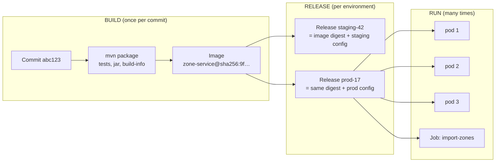
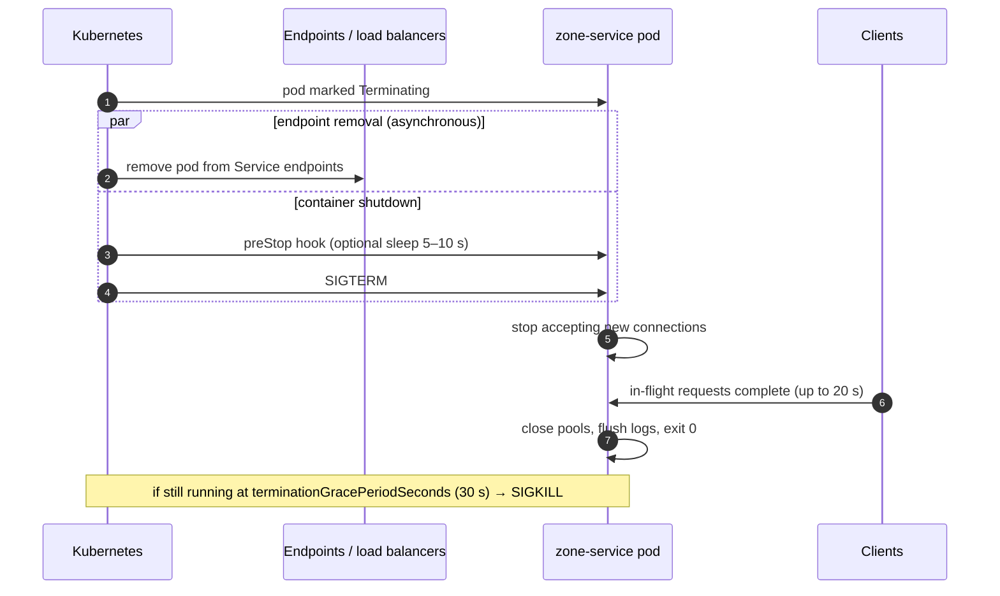

# 4. Twelve-Factor & Fifteen-Factor Apps

<div class="badges" markdown><span class="badge badge-l1">L1 · Foundation</span><span class="badge badge-l2">L2 · Practitioner</span><span class="badge badge-l3">L3 · Senior/Lead</span><span class="badge badge-meta">Spring Boot 4.1 · Testcontainers 2 · Java 25 AOT cache · Kubernetes</span></div>

<div class="grid two" markdown>

!!! info "Prerequisites"
    - [Chapter 2](ch02-characteristics-principles.md): principles, especially autonomy and design for failure
    - Basic Docker (`docker build`, `docker run`)
    - Optional: Docker running locally, for the PostgreSQL container test and `spring-boot:run`

!!! abstract "What you'll learn"
    - All **twelve factors**, plus the **three added by "Beyond the Twelve-Factor App"**
    - The **Spring Boot 4 mechanism** and **Kubernetes object** that implements each factor
    - Validated, environment-driven **configuration that fails fast**
    - **Graceful shutdown**, **structured logs**, **admin processes as Jobs**, and **immutable images with a Java 25 AOT cache**
    - Which factors to bend, and when

</div>

---

## 1 · Introduction & Context

### A contract between your service and the platform

In 2011, Adam Wiggins and colleagues at Heroku published **The Twelve-Factor App**, distilled from running hundreds of thousands of applications on their platform. The factors describe what an application must do so that **any platform can build, configure, run, scale and replace it without special handling**. In 2016, Kevin Hoffman's *Beyond the Twelve-Factor App* (O'Reilly) revisited them for cloud-native microservices and added three: **API first, telemetry, and authentication and authorization**. In November 2024 Heroku open-sourced the twelve-factor definition so the community can modernise it.

For microservices this contract matters more than for monoliths. With 40 services, every one that needs a hand-edited config file, a pet server or a manual migration step multiplies the toil.

### A cloud-kitchen analogy 🟢

FoodFleet's partner brands run in shared cloud kitchens across Bengaluru. A brand can open in a new kitchen tomorrow only if its **recipe card** follows house rules:

| Recipe-card rule | Factor |
|---|---|
| One master recipe, the same everywhere | I. Codebase |
| Every ingredient listed, nothing assumed to be "in the pantry" | II. Dependencies |
| Spice level and portion size come from the outlet's order sheet, not printed in the recipe | III. Config |
| The gas line and cold storage are utilities you connect to, not part of the recipe | IV. Backing services |
| Prep (build), plating for this outlet (release) and serving (run) are separate steps | V. Build, release, run |
| A cook keeps nothing in their head; everything is on the ticket | VI. Processes (stateless) |
| Any cook can be sent home mid-shift without losing an order | IX. Disposability |
| The training kitchen uses the same equipment as the real one | X. Dev/prod parity |

!!! note "Where this chapter fits"
    Later chapters build on each factor: configuration servers and Vault ([ct: Configuration Management](../components-tools/configuration-management.md)), containers ([ch 53](../deployment/ch53-containerization.md)), Kubernetes ([ch 54](../deployment/ch54-kubernetes-for-spring.md)), logs ([ch 50](../observability/ch50-structured-logging.md)), health probes ([ch 52](../observability/ch52-health-checks-actuator.md)).

---

## 2 · Core Concepts & Terminology

### The fifteen factors, mapped to Spring Boot 4 and Kubernetes

| # | Factor | Rule | Spring Boot 4 mechanism | Kubernetes | Code in this chapter |
|---|---|---|---|---|---|
| I | **Codebase** | One codebase per app, many deploys | One Maven module = one deployable | One image per service | Module `ch04-twelve-factor` |
| II | **Dependencies** | Declare and isolate every dependency | Starters + BOMs; executable jar bundles everything | Image contains the JRE and app | `pom.xml` |
| III | **Config** | Store config in the environment | `@ConfigurationProperties` + `@Validated`, relaxed binding, `configtree:` | ConfigMap, Secret (env or mounted files) | `ZoneProperties`, `application.yml` |
| IV | **Backing services** | Treat them as attached resources | Auto-configured `DataSource` from `SPRING_DATASOURCE_URL`; `@ServiceConnection` | Service DNS name, external endpoints | `ZoneStore`, `JdbcZoneStore` |
| V | **Build, release, run** | Strictly separate the stages | Layered jar, `build-info`, Buildpacks or Dockerfile | Image by **digest** + config = release | `Dockerfile`, `k8s/` |
| VI | **Processes** | Stateless, share-nothing | No HTTP session state; state in backing services | Deployment (pods are cattle) | `ServiceabilityService` |
| VII | **Port binding** | Export services via a port | Embedded Tomcat or Jetty, `server.port=${PORT}` | `containerPort`, Service | `application.yml` |
| VIII | **Concurrency** | Scale out via the process model | Virtual threads in-process; more replicas for more | `replicas`, HPA | `k8s/zone-service.yaml` |
| IX | **Disposability** | Fast startup, graceful shutdown | `server.shutdown=graceful`, AOT cache, probes | `terminationGracePeriodSeconds`, probes | `application.yml`, `Dockerfile` |
| X | **Dev/prod parity** | Keep environments as similar as possible | Docker Compose support, Testcontainers | Same image across environments | `compose.yaml`, container test |
| XI | **Logs** | Treat logs as event streams | Structured logging to stdout (ECS, GELF, Logstash) | Node log agent → Loki or Elasticsearch | `logging.structured.format.console` |
| XII | **Admin processes** | Run one-off tasks as one-off processes | `ApplicationRunner` + `SpringApplication.exit` | Job / CronJob from the same image | `ZoneImportTask` |
| 13 | **API first** | Design the contract before the code | OpenAPI-first, versioned controllers ([ch 2](ch02-characteristics-principles.md)) | Gateway routes from specs | `ServiceabilityController` |
| 14 | **Telemetry** | Metrics, traces and health are built in | Actuator, Micrometer, OpenTelemetry | ServiceMonitor, probes | Business counter in `ServiceabilityService` |
| 15 | **Authentication & authorization** | Security is part of the app, not an afterthought | Spring Security resource server | mTLS via mesh, NetworkPolicy | Chapters [37](../security/ch37-spring-security-7.md), [38](../security/ch38-service-to-service-security.md) |

### Build, release, run



The image that passed tests in staging is **byte-for-byte** the image in production. Only configuration differs. Rolling back means re-releasing an older digest, never rebuilding.

### Key definitions

Configuration (twelve-factor sense)
:   Everything that varies between deploys: URLs, credentials, feature toggles, per-city values. **Not** configuration: wiring that's the same everywhere (which beans exist, how routes map). That belongs in code.

Attached resource
:   A backing service (database, broker, cache, SMTP, payment gateway) reached through a locator in config. Local and third-party resources are treated the same way.

Release
:   An immutable combination of a build artifact and an environment's config, with its own identifier.

Disposable process
:   A process that starts quickly, shuts down gracefully on SIGTERM, and is robust against sudden death.

---

## 3 · How It Works Internally

### Where Spring Boot gets configuration from

Spring Boot merges many property sources. Higher entries override lower ones:

| Precedence (high → low) | Source | Typical use |
|---|---|---|
| 1 | Command-line arguments (`--server.port=9000`) | One-off overrides, admin tasks |
| 2 | `SPRING_APPLICATION_JSON` | Structured config in one env var |
| 3 | Java system properties (`-D…`) | JVM-level overrides |
| 4 | **OS environment variables** | **The twelve-factor default**: Kubernetes ConfigMaps and Secrets as env |
| 5 | Profile-specific config files (`application-prod.yml`) | Rarely needed if env vars are used |
| 6 | `application.yml` inside the jar | Settings identical in every environment |
| 7 | `@PropertySource`, then defaults | Library defaults |

Config data imports (`spring.config.import`) such as `configtree:` (Kubernetes Secret files), Config Server or Vault are loaded as config data alongside the config files. This is a simplified view; the Spring Boot reference lists every source.

**Relaxed binding** maps environment variables to properties: uppercase, dots become underscores, dashes are removed. `foodfleet.zones.default-delivery-fee-paise` is set by `FOODFLEET_ZONES_DEFAULTDELIVERYFEEPAISE`.

**Config trees** turn mounted files into properties: the file `/run/secrets/spring/datasource/password` becomes `spring.datasource.password`. Secrets as files are preferable to secrets as environment variables. Environment variables leak into `/proc`, crash dumps, child processes and careless `env` debug output.

### Fail fast on bad configuration

`ZoneProperties` has no defaults and is `@Validated`. A missing or absurd value stops the service **at startup**, so Kubernetes never marks the pod ready, the rollout halts, and the old version keeps serving. Compare that with discovering a wrong fee from customer complaints.

### Graceful shutdown on Kubernetes



Two details catch teams out:

1. **Endpoint removal is asynchronous.** For a few seconds after SIGTERM, load balancers may still send new requests. A short `preStop` sleep lets them catch up before the app stops accepting connections.
2. **The grace period must exceed the app's shutdown timeout.** Here: 30 s > 20 s, so Spring Boot finishes draining before the kubelet sends SIGKILL.

### Logs as event streams

The app writes one JSON event per line to **stdout** and never manages files. The platform collects, enriches and ships it:

```text
{"@timestamp":"2026-10-01T07:12:44.120Z","log.level":"INFO","message":"zone.unknown pincode=110001 city=Bengaluru",
 "service.name":"zone-service","log.logger":"dev.foodfleet.ch04.zones.zone.ServiceabilityService",
 "process.thread.name":"tomcat-handler-12","ecs.version":"8.11"}
```

*Representative ECS output. The exact field set depends on your Spring Boot version and tracing setup.*

A node-level agent (Fluent Bit, Grafana Alloy) tails container stdout and forwards to Loki or Elasticsearch ([ct: logging stack](../components-tools/logging-stack.md)). The service knows nothing about log destinations, rotation or retention.

### Fast startup: Java 25 AOT cache

Disposability needs fast startup so autoscaling and rescheduling react quickly. Java 24's JEP 483 (*Ahead-of-Time Class Loading & Linking*) introduced the AOT cache, and Java 25's JEP 514 (*AOT Command-Line Ergonomics*) made creating it a single step (`-XX:AOTCacheOutput`). The `Dockerfile` runs a **training run** at image build time: it starts the Spring context once and exits (`-Dspring.context.exit=onRefresh`). Every container then starts from the cached, pre-linked classes. [Chapter 60](../deployment/ch60-native-images-startup.md) compares this with CRaC and GraalVM native images.

---

## 4 · Design Considerations & Trade-offs

| Factor | Bend it when… | How to bend safely |
|---|---|---|
| III Config in env vars | Config is large or structured (routing tables, 300 city zones) | Mount files (ConfigMap volume, `configtree:`) or use a config service; still external to the image |
| III Secrets in env vars | Always worth avoiding | Mounted Secret files, Vault, or a cloud secret manager ([ch 39](../security/ch39-secrets-management.md)) |
| VI Stateless | WebSockets and SSE (rider live tracking) hold connections | Keep *connections* sticky but *state* external (Redis pub/sub, Kafka); clients reconnect anywhere ([ch 26](../communication/ch26-websockets-sse.md)) |
| VI Stateless | Local caches for hot reads | Fine as long as losing them is harmless (Caffeine L1 + invalidation events) |
| IX Fast startup | Large apps with long warm-up | AOT cache or CRaC; readiness gates traffic until warm |
| X Dev/prod parity | Laptop resources (a 9-service stack plus Kafka) | Containers for the service under development; shared ephemeral environments for the rest |
| I One codebase per app | A monorepo hosts many services | Fine: one *deployable* per build path, with independent pipelines |
| XII Admin processes | Database migrations | Run Flyway on startup for simple services, or as a pre-deploy Job for large schemas and zero-downtime expand/contract ([ch 33](../data/ch33-database-scaling.md)) |

### Config: environment variables vs config server vs mounted files

| Option | Strengths | Weaknesses | FoodFleet use |
|---|---|---|---|
| Env vars (ConfigMap `envFrom`) | Universal, simple, visible in manifests | Flat, restart to change, leak risk for secrets | Per-city scalars |
| Mounted files (`configtree:`, ConfigMap volume) | Structured, secret-safe, can reload | Needs volume wiring | DB credentials, TLS material |
| Spring Cloud Config / Kubernetes ConfigMap watcher | Central history, refresh without restart | Another runtime dependency | Feature flags, tunables |
| Vault / cloud secret manager | Dynamic, rotated, audited secrets | Operational complexity | Payment gateway credentials |

---

## 5 · Hands-on Implementation

Code: `code/chapters/ch04-twelve-factor/`, the FoodFleet **zone-service** (port 8085): *"Do we deliver to this pincode, and what does delivery cost?"*

```text
ch04-twelve-factor/
├── src/main/java/dev/foodfleet/ch04/zones/
│   ├── config/ZoneProperties.java        III  validated, env-driven config
│   ├── zone/ZoneStore, JdbcZoneStore      IV   backing service behind a port
│   ├── zone/ServiceabilityService         VI, 14  stateless + business telemetry
│   ├── api/ServiceabilityController       VII, 13
│   └── admin/ZoneImportTask, ZoneCsvParser XII  one-off admin process
├── src/main/resources/application.yml     IX, XI  graceful shutdown, JSON logs
├── src/main/resources/db/migration/       V    versioned schema (Flyway)
├── compose.yaml                           X    local PostgreSQL 17
├── Dockerfile                             V, IX layers + AOT cache
└── k8s/zone-service.yaml                  III, V, VIII, IX, XII
```

```bash
cd code
mvn -B -pl chapters/ch04-twelve-factor -am verify   # the PostgreSQL container test skips itself without Docker
```

### 🟢 Level 1: config, port binding and logs

<div class="badges" markdown><span class="badge badge-l1">L1 · Foundation</span></div>

```java title="config/ZoneProperties.java"
--8<-- "code/chapters/ch04-twelve-factor/src/main/java/dev/foodfleet/ch04/zones/config/ZoneProperties.java"
```

```yaml title="src/main/resources/application.yml"
--8<-- "code/chapters/ch04-twelve-factor/src/main/resources/application.yml"
```

The configuration tests prove the binding from **real environment-variable names** and the fail-fast behaviour:

```java title="config/ZonePropertiesTest.java"
--8<-- "code/chapters/ch04-twelve-factor/src/test/java/dev/foodfleet/ch04/zones/config/ZonePropertiesTest.java"
```

### 🔵 Level 2: backing services and dev/prod parity

<div class="badges" markdown><span class="badge badge-l2">L2 · Practitioner</span></div>

```java title="zone/JdbcZoneStore.java"
--8<-- "code/chapters/ch04-twelve-factor/src/main/java/dev/foodfleet/ch04/zones/zone/JdbcZoneStore.java"
```

Locally, `compose.yaml` provides PostgreSQL 17. Spring Boot's Docker Compose support starts it on `spring-boot:run` and wires the connection, so there's no URL in any file:

```yaml title="compose.yaml"
--8<-- "code/chapters/ch04-twelve-factor/compose.yaml"
```

In tests, Testcontainers runs the same PostgreSQL version and `@ServiceConnection` supplies the connection details:

```java title="ZoneServiceContainerTest.java"
--8<-- "code/chapters/ch04-twelve-factor/src/test/java/dev/foodfleet/ch04/zones/ZoneServiceContainerTest.java"
```

=== "Boot 4 + Testcontainers 2 (after)"

    ```xml
    <artifactId>spring-boot-starter-flyway</artifactId>          <!-- (1)! -->
    <artifactId>testcontainers-postgresql</artifactId>           <!-- (2)! -->
    <artifactId>testcontainers-junit-jupiter</artifactId>
    ```

    1. Boot 4 modularised auto-configuration: Flyway needs its starter, not just `flyway-core`.
    2. Testcontainers 2 prefixes module artifacts with `testcontainers-` and moves classes to module packages (`org.testcontainers.postgresql.PostgreSQLContainer`).

=== "Boot 3 + Testcontainers 1 (before)"

    ```xml
    <artifactId>flyway-core</artifactId>                         <!-- auto-configured by Boot 3 -->
    <artifactId>postgresql</artifactId>                          <!-- org.testcontainers:postgresql -->
    <artifactId>junit-jupiter</artifactId>
    ```
    ```java
    import org.testcontainers.containers.PostgreSQLContainer;     // deprecated in Testcontainers 2
    static PostgreSQLContainer<?> postgres = new PostgreSQLContainer<>("postgres:16-alpine");
    ```

The stateless service, with a business metric (factor 14):

```java title="zone/ServiceabilityService.java"
--8<-- "code/chapters/ch04-twelve-factor/src/main/java/dev/foodfleet/ch04/zones/zone/ServiceabilityService.java"
```

### 🟣 Level 3: disposability and admin processes

<div class="badges" markdown><span class="badge badge-l3">L3 · Senior/Lead</span></div>

The admin task is ordinary application code, run by the same image with different arguments:

```java title="ZoneServiceApplication.java"
--8<-- "code/chapters/ch04-twelve-factor/src/main/java/dev/foodfleet/ch04/zones/ZoneServiceApplication.java"
```

```java title="admin/ZoneImportTask.java"
--8<-- "code/chapters/ch04-twelve-factor/src/main/java/dev/foodfleet/ch04/zones/admin/ZoneImportTask.java"
```

All-or-nothing validation: one bad line rejects the whole file, and every problem is reported at once:

```java title="admin/ZoneCsvParser.java"
--8<-- "code/chapters/ch04-twelve-factor/src/main/java/dev/foodfleet/ch04/zones/admin/ZoneCsvParser.java"
```

```java title="admin/ZoneImportTaskTest.java"
--8<-- "code/chapters/ch04-twelve-factor/src/test/java/dev/foodfleet/ch04/zones/admin/ZoneImportTaskTest.java"
```

### 🔴 Level 4: build, release, run

<div class="badges" markdown><span class="badge badge-l4">L4 · Architect</span></div>

The image is built once, with dependency layers separated from application code and an AOT cache trained at build time:

```dockerfile title="Dockerfile"
--8<-- "code/chapters/ch04-twelve-factor/Dockerfile"
```

=== "Java 25: AOT cache"

    ```dockerfile
    RUN java -XX:AOTCacheOutput=app.aot -Dspring.context.exit=onRefresh -jar application.jar
    ENTRYPOINT ["java", "-XX:AOTCache=app.aot", "-jar", "application.jar"]
    ```

=== "Java 21: CDS"

    ```dockerfile
    RUN java -XX:ArchiveClassesAtExit=application.jsa -Dspring.context.exit=onRefresh -jar application.jar
    ENTRYPOINT ["java", "-XX:SharedArchiveFile=application.jsa", "-jar", "application.jar"]
    ```

A **release** is that image's digest plus one environment's configuration. The web Deployment and the import Job run the same image:

```yaml title="k8s/zone-service.yaml"
--8<-- "code/chapters/ch04-twelve-factor/k8s/zone-service.yaml"
```

### Run and verify

```bash
# web process, with compose.yaml's PostgreSQL started automatically
mvn -pl chapters/ch04-twelve-factor spring-boot:run -Dspring-boot.run.profiles=local
curl -s localhost:8085/api/v1/serviceability/560034 | jq      # Koramangala, ₹29 fee
curl -s localhost:8085/api/v1/serviceability/560038 | jq      # Indiranagar, default ₹35 from config
curl -s localhost:8085/actuator/info | jq .build               # build identity (factor V)

# admin process: same code, same config, exits when done
mvn -pl chapters/ch04-twelve-factor spring-boot:run -Dspring-boot.run.profiles=local \
  -Dspring-boot.run.arguments="--spring.main.web-application-type=none --foodfleet.admin.task=import-zones --foodfleet.admin.file=data/zones.csv"

# fail fast: start without the city
mvn -pl chapters/ch04-twelve-factor spring-boot:run \
  -Dspring-boot.run.arguments="--foodfleet.zones.default-delivery-fee-paise=3500 --foodfleet.zones.max-delivery-km=7"
# → startup fails: binding to ZoneProperties failed, property foodfleet.zones.city, "must not be blank" (abbreviated)
```

!!! question "Try it: break it"
    1. Add `@DefaultValue("Bengaluru")` to `city`, deploy "Mumbai" without setting the variable, and think about what customers in Mumbai would see.
    2. Write uploaded restaurant photos to `/tmp` in the container, scale to 3 replicas, and request the photo a few times. Which factor did you break?
    3. Remove `server.shutdown: graceful`, run a load test (`hey -z 30s …`) and do a rolling restart. Count the 5xx responses.

---

## 6 · Production Readiness

### Twelve-factor review (per service, in the readiness checklist)

- [x] **I** One deployable per pipeline; the image is tagged with the commit SHA and deployed by digest
- [x] **II** No reliance on tools in the base image beyond the JRE; dependency and image scanning in CI
- [x] **III** No environment-specific values in the image; config validated at startup with no unsafe defaults
- [x] **III** Secrets as mounted files or from Vault, never baked in, never logged
- [x] **IV** Every backing service located by config; swap rehearsed (for example promoting a replica)
- [x] **V** Releases are immutable and recorded; rollback is "deploy previous digest"
- [x] **VI** No local disk or memory state that matters after a restart; no sticky sessions for correctness
- [x] **VII** Port from config; nothing else listening
- [x] **VIII** Horizontal scaling tested; no singleton assumptions (scheduled jobs use ShedLock or a Job)
- [x] **IX** Startup time measured and budgeted; graceful shutdown tested during rolling deploys; `preStop` and grace periods set
- [x] **X** Same database major versions in Testcontainers, Compose and production
- [x] **XI** JSON logs on stdout with trace ids; no file appenders; log volume budgeted
- [x] **XII** Migrations and one-off tasks run as Jobs from the same image; nobody `kubectl exec`s scripts
- [x] **13–15** API contract published; RED and business metrics exported; authentication enforced at the service

### Numbers worth tracking

| Metric | Why | Typical target |
|---|---|---|
| Startup to ready | Autoscaling and rescheduling speed | Seconds, not minutes; measure with and without AOT cache |
| Shutdown duration | Rolling deploys without errors | Below the grace period with margin |
| 5xx rate during deploys | Disposability in practice | Indistinguishable from baseline |
| Config drift | Releases match what's declared | GitOps diff = 0 ([ch 58](../deployment/ch58-cicd-gitops.md)) |
| Log volume per request | Cost (fallacy #7) | Budgeted per service; DEBUG off in production |

---

## 7 · Anti-patterns & Pitfalls

!!! pitfall "Incident 1: the production-only build"
    **Context.** Each environment had its own Maven profile that baked URLs and fees into the jar at build time.
    **Symptoms.** A release passed staging, then failed in production with a serialization error.
    **Root cause.** The production build pulled a different transitive dependency version, so the artifact in production had never been tested.
    **Fix.** Build once, promote the same image digest, and inject config at release time (factors III and V).

!!! pitfall "Incident 2: the disk that filled up"
    **Context.** A service logged to a rolling file inside the container *and* to stdout.
    **Symptoms.** After a busy IPL weekend, pods were evicted for disk pressure, taking healthy neighbours on the node with them.
    **Root cause.** Container filesystems aren't log storage, and rotation was misconfigured.
    **Fix.** stdout only (factor XI), with the node agent handling shipping and retention.

!!! pitfall "Incident 3: H2 in tests, PostgreSQL in production"
    **Context.** Integration tests used H2 in PostgreSQL compatibility mode.
    **Symptoms.** An `on conflict … do update` upsert and a partial index behaved differently in production. The import silently skipped rows.
    **Root cause.** Dev/prod disparity in the backing service.
    **Fix.** Testcontainers with the production PostgreSQL major version (factor X), exactly as in `ZoneServiceContainerTest`.

!!! pitfall "Incident 4: 502s on every deploy"
    **Context.** The app ignored SIGTERM's grace period and had no `preStop` delay.
    **Symptoms.** Every rolling deploy produced a burst of 502s at the ingress.
    **Root cause.** Pods stopped accepting connections before load balancers removed them, and in-flight requests were cut.
    **Fix.** `server.shutdown=graceful`, a phase timeout, a short `preStop` sleep and a grace period longer than both (factor IX).

| Anti-pattern | Factor broken | Fix |
|---|---|---|
| `if (env == "prod")` in code | III | Externalize the differing values |
| Credentials in `application.yml` committed to Git | III | Secret files or Vault; secret scanning in CI |
| Uploads stored on local disk | VI | Object storage (S3-compatible) as a backing service |
| In-memory sessions with sticky load balancing | VI | Stateless tokens, or sessions in Redis |
| `kubectl exec` to run migrations | XII | Flyway on startup, or a Job |
| Re-tagging `latest` for releases | V | Deploy by digest; tags are just labels |
| Scheduled jobs inside every replica | VIII | ShedLock, a single-replica worker, or a CronJob |

---

## 8 · Enterprise Case Study

### FoodFleet's platform contract

FoodFleet runs **one deployment per city cell** (Bengaluru, Mumbai, Delhi NCR…). Fifteen-factor discipline is what makes adding a city a configuration exercise:

| The platform provides | Every service must |
|---|---|
| Base images, a Dockerfile template with AOT cache, CI pipeline template | Build once; expose `build-info`; pass image and dependency scans |
| ConfigMaps per city cell, Vault for secrets, GitOps for releases | Take every city- or environment-specific value from config; fail fast when it's missing |
| Managed PostgreSQL, Kafka and Redis endpoints per cell | Locate backing services only through config; tolerate failover |
| Log collection, metrics scraping, tracing collector | Log JSON to stdout; expose Actuator health, metrics and info |
| Rolling deploys with surge, PodDisruptionBudgets | Start fast, drain gracefully, hold no critical local state |
| Job runner for migrations and imports | Implement admin tasks as idempotent, testable runners in the same image |

Launching FoodFleet in **Hyderabad** took one new ConfigMap per service, a zone import Job, and a GitOps pull request. No service was rebuilt.

!!! decision "ADR-004: Immutable images, promoted by digest; all variation through configuration"
    **Status:** Accepted · **Date:** 2026-02-17

    **Context.** Rebuilding per environment produced untested production artifacts (Incident 1). City launches required code changes for city-specific values.

    **Decision.** Every service builds one OCI image per commit. Environments and city cells receive the **same digest**. Configuration comes from ConfigMaps (non-secret) and Vault or mounted Secret files (secret). Services validate configuration at startup and must not ship defaults for business-critical values. One-off operations run as Kubernetes Jobs from the service image.

    **Consequences.** ✅ What was tested is what runs; rollbacks are instant; new cities need no code. ⚠️ Config becomes a first-class artifact needing review, schema validation and drift detection. ⚠️ Startup validation can block a rollout on a typo, which is intended.

### Fintech analogue: promotion with evidence 🔴

Regulated environments (banks, brokers, payment aggregators under RBI guidelines) usually need **evidence that the audited artifact is the deployed artifact**. Fifteen-factor practice provides it almost for free: signed image digests (Cosign, [ct: Cosign & Syft](../components-tools/cosign-syft.md)), SBOMs per build, releases recorded as digest-plus-config in Git, and secrets from an HSM-backed vault. Change-approval boards then review **config diffs and digests**, not "a new build for production".

---

## 9 · Interview Q&A + Summary

#### Q1. What is the Twelve-Factor App? Name the factors. · <span class="badge badge-l1">L1</span> · Cognizant · TCS · Infosys · Accenture

**Short answer:** A methodology from Heroku (2011) for building apps that any platform can deploy, scale and replace without special handling. The factors: codebase, dependencies, config, backing services, build-release-run, processes, port binding, concurrency, disposability, dev/prod parity, logs, admin processes.

**What a 15-YoE answer adds:** the three later additions (API first, telemetry, authentication and authorization), and which factors you bend and why.

#### Q2. Why store configuration in the environment rather than in the jar? · <span class="badge badge-l1">L1</span><span class="badge badge-l2">L2</span> · Amazon · Flipkart

**Short answer:** So one build can run in every environment. If config is baked in, each environment needs its own build, and production runs an artifact that was never tested.

**Follow-ups:** "Are environment variables good for secrets?" Not ideal: they leak into process listings, crash dumps and child processes. Prefer mounted secret files or a vault.

#### Q3. How does Spring Boot resolve configuration from many sources? · <span class="badge badge-l2">L2</span> · SAP · service companies

**Short answer:** A precedence order in which command-line arguments override system properties, which override environment variables, which override config files (profile-specific over default). Environment variables bind through relaxed binding (`FOODFLEET_ZONES_CITY` → `foodfleet.zones.city`). `spring.config.import` adds config trees, Config Server or Vault.

#### Q4. What does "stateless" mean for a service that keeps WebSocket connections? · <span class="badge badge-l3">L3</span> · Flipkart · Swiggy-style

**Short answer:** Connections are inherently tied to a pod, but *state* must not be. Fan out updates through Redis or Kafka so any pod can push to its connected clients. Clients reconnect to any pod after a restart and resume from a cursor.

#### Q5. Explain graceful shutdown on Kubernetes. · <span class="badge badge-l2">L2</span><span class="badge badge-l3">L3</span> · Amazon · JP Morgan

**Short answer:** Kubernetes removes the pod from endpoints and sends SIGTERM at about the same time. The app stops accepting new connections, finishes in-flight work within a timeout, releases resources and exits. Add a short `preStop` sleep because endpoint removal is asynchronous, and set `terminationGracePeriodSeconds` higher than the app's shutdown timeout.

#### Q6. How do you run database migrations in a twelve-factor way? · <span class="badge badge-l3">L3</span> · Goldman Sachs · SAP

**Short answer:** Versioned migrations (Flyway or Liquibase) in the codebase, applied by the release: on startup for simple services, or as a pre-deploy Job for large changes. Use expand/contract so old and new versions run against the same schema during rolling deploys. Never apply them by hand.

#### Q7. What is dev/prod parity and how do you achieve it with Spring Boot? · <span class="badge badge-l2">L2</span> · Flipkart · Cognizant

**Short answer:** Minimise the time, personnel and tooling gaps between development and production. With Spring Boot: Docker Compose support for local backing services, Testcontainers with `@ServiceConnection` for tests (same major versions as production), the same image in every environment, and continuous deployment so changes reach production quickly.

#### Q8. How do you make a Spring Boot service start fast? · <span class="badge badge-l3">L3</span><span class="badge badge-l4">L4</span> · Amazon · SAP

**Short answer:** Measure first. Then use a layered image, and on Java 25 an AOT cache trained at build time (JEP 483 and 514). Consider CRaC for checkpoint/restore, or GraalVM native images when startup and memory dominate and their build constraints are acceptable. Avoid heavy work in the startup path, and lazily initialise optional components.

#### Q9. Your scheduled job runs in every replica after scaling to 5 pods. What's wrong and how do you fix it? · <span class="badge badge-l2">L2</span><span class="badge badge-l3">L3</span> · any company

**Short answer:** Factors VIII and XII. The process model assumes replicas are interchangeable, so in-process schedulers multiply. Use a Kubernetes CronJob, a distributed lock (ShedLock) with fencing where correctness matters, or a dedicated single-replica worker.

#### Q10. What did "Beyond the Twelve-Factor App" add, and why? · <span class="badge badge-l3">L3</span><span class="badge badge-l4">L4</span> · SAP · Goldman Sachs

**Short answer:** API first (contracts enable parallel teams), telemetry (you can't operate what you can't see), and authentication and authorization (security can't be bolted on in a zero-trust, many-service world). It also reinterpreted some factors for containers and microservices.

#### Q11. Which factors would you relax for a stateful system like Kafka or PostgreSQL on Kubernetes? · <span class="badge badge-l4">L4</span> · Amazon · Flipkart

**Short answer:** The factors are about *applications*. Stateful backing services are run with operators and StatefulSets, stable identities, persistent volumes and careful disruption budgets. The application side treats them as attached resources and stays twelve-factor.

#### Q12. How do you prove to an auditor that production runs the tested artifact? · <span class="badge badge-l4">L4</span> · JP Morgan · Goldman Sachs

**Short answer:** Build once and deploy by immutable digest. Sign images and attach SBOMs, record each release (digest plus config commit) in Git, enforce signature verification at admission, and show that only configuration differs between UAT and production.

### Key takeaways

- The factors are a **contract with the platform**: honour them and any service can be built, configured, scaled and replaced the same way.
- **Config in the environment, validated at startup, no unsafe defaults.** Secrets as files or from a vault.
- **Build once, release by digest plus config, run many times.** Rollback is a re-release.
- **Stateless, disposable processes**: fast start (AOT cache), graceful stop (shutdown timeout < grace period, `preStop`).
- **Dev/prod parity** with Docker Compose support and Testcontainers on the production database version.
- **Logs to stdout as JSON; admin tasks as Jobs from the same image.** Then add API first, telemetry and security.

### Further reading

- [The Twelve-Factor App](https://12factor.net/), and the [open-source announcement](https://12factor.net/blog/open-source-announcement) (November 2024)
- Kevin Hoffman, *Beyond the Twelve-Factor App* (O'Reilly, 2016)
- Spring Boot reference: [Externalized Configuration](https://docs.spring.io/spring-boot/reference/features/external-config.html), [Graceful Shutdown](https://docs.spring.io/spring-boot/reference/web/graceful-shutdown.html), [Dockerfiles](https://docs.spring.io/spring-boot/reference/packaging/container-images/dockerfiles.html)
- [JEP 483: Ahead-of-Time Class Loading & Linking](https://openjdk.org/jeps/483) (JDK 24) and [JEP 514: Ahead-of-Time Command-Line Ergonomics](https://openjdk.org/jeps/514) (JDK 25)
- Kubernetes documentation: [Pod termination](https://kubernetes.io/docs/concepts/workloads/pods/pod-lifecycle/#pod-termination)
- [Testcontainers for Java](https://java.testcontainers.org/)

---

**Previous:** [← 3. Distributed Systems Fundamentals](ch03-distributed-systems-fundamentals.md) · **Next:** [5. Domain-Driven Design →](ch05-domain-driven-design.md)
