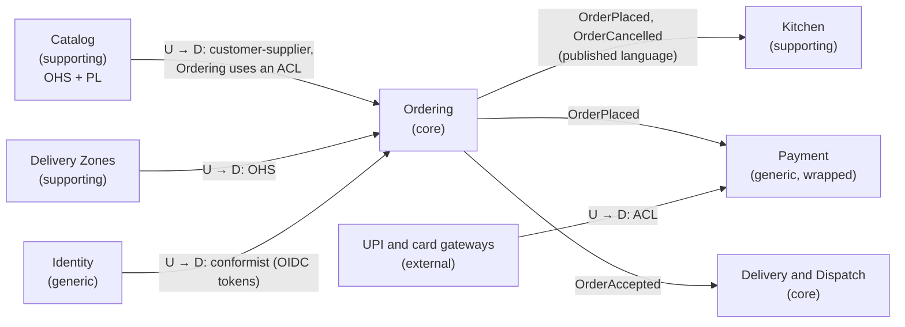
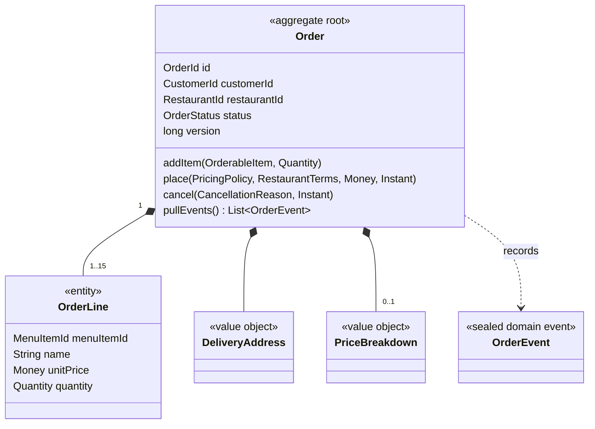
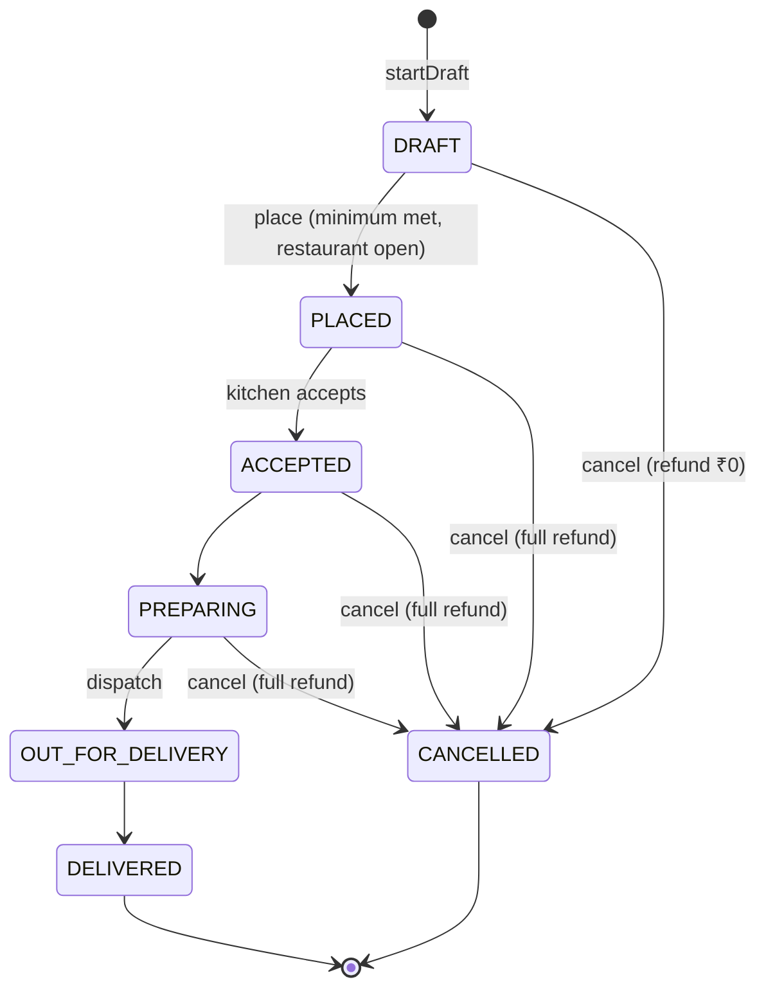
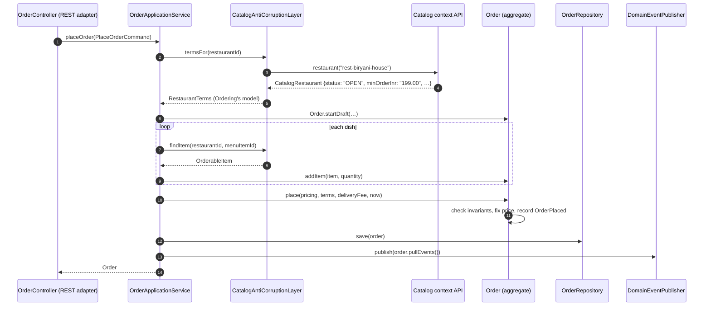

# 5. Domain-Driven Design

<div class="badges" markdown><span class="badge badge-l2">L2 · Practitioner</span><span class="badge badge-l3">L3 · Senior/Lead</span><span class="badge badge-l4">L4 · Architect</span><span class="badge badge-meta">Plain-Java domain model · Spring Boot 4 adapters · ArchUnit</span></div>

<div class="grid two" markdown>

!!! info "Prerequisites"
    - [Chapter 1](ch01-architecture-styles.md) (modules and extraction seams) and [Chapter 3](ch03-distributed-systems-fundamentals.md) (consistency)
    - Comfortable with Java records, enums and sealed types
    - No prior DDD knowledge needed

!!! abstract "What you'll learn"
    - **Strategic DDD**: subdomains, bounded contexts, ubiquitous language and **context maps**, the main tool for drawing service boundaries
    - **Tactical DDD**: value objects, entities, **aggregates**, domain events, domain services, repositories, factories
    - How to design aggregates that protect invariants and stay small
    - How an **anti-corruption layer** keeps another team's model out of yours
    - How to keep the domain framework-free, and enforce it

</div>

---

## 1 · Introduction & Context

### The word "order" means four different things

Ask four people at FoodFleet what an "order" is:

| Who | What "order" means to them | What they care about |
|---|---|---|
| **Customer app team** | A basket being built, then a purchase | Dishes, price, ETA |
| **Kitchen staff** | A ticket to cook | Dishes, special instructions, prep time; *not* the price |
| **Rider** | A pickup and a drop | Two addresses, a time window, cash or prepaid |
| **Finance** | A taxable transaction | Amounts, GST, commission, refunds, settlement date |

One shared `Order` class serving all four becomes a 60-field monster that every team edits and nobody owns. Domain-Driven Design's central insight is that **a model is only coherent within a boundary**. Inside that boundary, a **bounded context**, words have one precise meaning. Across boundaries you translate.

### Why DDD matters for microservices

Chapters 1 and 2 said service boundaries should follow business capabilities. DDD supplies the method for finding them: **bounded contexts are the strongest candidates for service (or module) boundaries**, and the **context map** documents how they relate. Get the contexts wrong and you build the distributed monolith from chapter 1. Get them right and most coupling problems never appear.

### A short history

| Year | Milestone |
|---|---|
| 2003 | Eric Evans, *Domain-Driven Design: Tackling Complexity in the Heart of Software* (the "blue book") |
| 2013 | Vaughn Vernon, *Implementing Domain-Driven Design* (the "red book"); Alberto Brandolini popularises **Event Storming** |
| 2014 | Microservices adopt bounded contexts as the default boundary heuristic |
| 2016 | Vernon, *Domain-Driven Design Distilled* |
| 2021 | Vlad Khononov, *Learning Domain-Driven Design*: strategic design for modern systems |
| Today | DDD Crew's open-source tools (context mapping, bounded context canvas); jMolecules annotations in the Spring ecosystem |

!!! note "Where this chapter fits"
    [Chapter 6](ch06-service-decomposition.md) uses these tools to decompose FoodFleet. [Chapter 9](../architecture-patterns/ch09-hexagonal-clean-architecture.md) shows how the code inside a context is structured. [Chapter 16](../architecture-patterns/ch16-strangler-fig-migration.md) uses anti-corruption layers to migrate monoliths.

---

## 2 · Core Concepts & Terminology

### Strategic design

Domain
:   The business area the software serves: food delivery.

Subdomain
:   A part of the domain. **Core**: where you differentiate and must excel (rider dispatch, ETA prediction). **Supporting**: necessary and specific to you, but not a differentiator (restaurant onboarding). **Generic**: solved problems you should buy or reuse (identity, payments gateway, email).

Ubiquitous language
:   The vocabulary shared by domain experts and developers *within one context*, used in conversation, code, tests and APIs. If operations says "the kitchen rejected it", the code says `CancellationReason.RESTAURANT_REJECTED`, not `status = 7`.

Bounded context
:   The explicit boundary within which one model and one ubiquitous language apply. Usually owned by one team.

Context map
:   A diagram of bounded contexts and the **relationships** between them: who depends on whom, and how models are translated.

#### FoodFleet's subdomains

| Subdomain | Type | Investment | Example decisions |
|---|---|---|---|
| Rider dispatch and ETA | **Core** | Best engineers, rich model, experiments | Built in-house, ML-assisted |
| Ordering and checkout | **Core** | Rich domain model (this chapter) | Built in-house |
| Surge pricing and promotions | **Core** | Rich model, analytics | Built in-house |
| Restaurant catalogue and onboarding | Supporting | Pragmatic, CRUD-heavy | In-house, simple architecture |
| Kitchen workflow | Supporting | Moderate | In-house |
| Payments | Generic (integration) | Integrate gateways (UPI, cards) behind an ACL | Buy, wrap |
| Identity and access | Generic | Keycloak or a managed IdP | Buy |
| Notifications | Generic | SMS and push providers | Buy, wrap |

### Context map patterns

| Pattern | Relationship | When | FoodFleet example |
|---|---|---|---|
| **Partnership** | Two teams succeed or fail together; plan jointly | Tightly coupled goals | Ordering ↔ Payment during checkout redesign |
| **Shared Kernel** | Small shared model both teams change together | Rare; high trust, small scope | Shared `Money` definition in the API style guide, not code |
| **Customer–Supplier** | Upstream supplier prioritises downstream customer's needs | Downstream has negotiating power | Ordering (customer) ← Catalog (supplier) |
| **Conformist** | Downstream adopts upstream's model as is | Upstream won't change; translating isn't worth it | Analytics conforms to event schemas |
| **Anti-Corruption Layer (ACL)** | Downstream translates upstream's model into its own | Upstream model is awkward, legacy or volatile | Ordering ← Catalog (this chapter); Payment ← UPI gateway |
| **Open Host Service (OHS)** | Upstream offers a well-designed API for many consumers | Many downstreams | Catalog's REST API |
| **Published Language** | A documented shared format | Integration via events or APIs | AsyncAPI-documented `OrderPlaced` event |
| **Separate Ways** | No integration; duplicate if needed | Integration cost exceeds value | Marketing site vs ordering |

### FoodFleet's context map



*U = upstream (its model influences the other side), D = downstream.*

### Tactical design

| Building block | What it is | Identity? | Mutable? | In the code |
|---|---|---|---|---|
| **Value object** | Describes something; equal when all values are equal; self-validating | No | No | `Money`, `Quantity`, `DeliveryAddress`, `OrderId` |
| **Entity** | Has identity that persists through changes | Yes | Yes | `OrderLine` (identity: menu item, within one order) |
| **Aggregate** | A cluster of entities and value objects that is a **consistency boundary** | Root's id | Through the root only | `Order` + its lines, address, price |
| **Aggregate root** | The single entry point that enforces the aggregate's invariants | Yes | Yes | `Order` |
| **Domain event** | Something that happened that domain experts care about | — | No | `OrderPlaced`, `OrderCancelled` |
| **Domain service** | Domain logic that doesn't belong to one entity | — | Stateless | `PricingPolicy` |
| **Application service** | Orchestrates a use case; no business rules | — | Stateless | `OrderApplicationService` |
| **Repository** | Collection-like persistence for aggregate roots only | — | — | `OrderRepository` |
| **Factory** | Creates valid aggregates | — | — | `Order.startDraft(...)` |

---

## 3 · How It Works Internally

### Designing aggregates: four rules

Vaughn Vernon's guidelines (from *Effective Aggregate Design*), applied to `Order`:

1. **Model true invariants inside consistency boundaries.** "An order's dishes come from one restaurant" and "the item total meets the minimum before placing" must hold *at every commit*, so lines and status live in one aggregate.
2. **Design small aggregates.** `Order` doesn't contain the `Customer`, the `Restaurant` or the `Rider`. A Restaurant aggregate that contained its orders would lock every order of a popular restaurant during the dinner peak.
3. **Reference other aggregates by identity.** `Order` holds a `CustomerId` and a `RestaurantId`, not objects. Loading an order never loads a restaurant's menu.
4. **Use eventual consistency outside the boundary.** When an order is placed, Kitchen creates a ticket and Payment starts a charge *in their own transactions*, triggered by `OrderPlaced`.



### The order lifecycle



The allowed transitions live in `OrderStatus.next()`, the single source of truth. This diagram mirrors it by hand. In production, generate the diagram from the enum in a test (or check the two against each other) so they can't drift apart.

### A request through the layers



### What the anti-corruption layer does

Catalog's published model and Ordering's model differ in almost every detail, which is normal between teams:

| Catalog says | Ordering needs | ACL decision |
|---|---|---|
| `sku` | `MenuItemId` | Rename and type |
| `priceInr: "349.00"` (text) | `Money` in paise | Parse; malformed text is a **contract breach** (502), not a business error |
| `stockStatus: IN_STOCK, OUT_OF_STOCK, SEASONAL, …` | `available: boolean` | Only `IN_STOCK` is orderable. **Unknown future values fail safe** |
| `status: OPEN, CLOSED, PAUSED` | `acceptingOrders: boolean` | Only `OPEN` accepts |
| `allergens`, `photoUrl`, `cuisine` | Nothing | Dropped: not Ordering's concern |

When Catalog renames a field, adds a status or moves to a new API version, **one class changes**. The domain never notices.

---

## 4 · Design Considerations & Trade-offs

### Where to spend DDD effort

| Subdomain type | Recommended approach | Avoid |
|---|---|---|
| **Core** | Rich domain model, ubiquitous language, aggregates, events, Event Storming with experts | Shortcuts that leak framework concerns into the model |
| **Supporting** | Simple layered or transaction-script code; Spring Data repositories; CRUD where honest | Heavy tactical DDD ceremony |
| **Generic** | Buy or reuse; wrap behind an ACL | Building it yourself |

!!! warning "DDD is not a coding style for everything"
    Applying aggregates, domain services and events to a CRUD admin screen adds cost without benefit. Use the strategic tools everywhere, and the tactical tools where the business logic is complex and valuable.

### Aggregate size trade-offs

| Choice | Benefit | Cost |
|---|---|---|
| Large aggregate (Restaurant contains its Orders) | Every rule enforceable in one transaction | Lock contention, huge loads, every order change conflicts at peak |
| Small aggregates (Order, Restaurant separate) | Concurrency, fast loads, independent scaling | Cross-aggregate rules become eventually consistent |
| Rule spanning aggregates ("restaurant can't exceed 40 active orders") | — | Enforce in one aggregate (a capacity counter in Kitchen), or accept and compensate (reject after the fact) |

### Bounded context vs microservice

A bounded context is a *model* boundary. A microservice is a *deployment* boundary. They usually align, but not always:

- **One context, one service**: the default.
- **One context, several services**: for scaling or isolation inside one model (Delivery's live-tracking ingestion split from dispatch logic).
- **Several contexts, one deployable**: a modular monolith (chapter 1) with one module per context. A good starting point.
- **One service spanning several contexts**: a smell. Two models are being forced together.

### Rich vs anemic domain model

| | Anemic (getters and setters, logic in services) | Rich (behaviour on the aggregate) |
|---|---|---|
| Where rules live | Spread across services, controllers, validators | In one place: the aggregate |
| Invalid state possible? | Yes, anyone can `setStatus(DELIVERED)` | No, only allowed transitions exist |
| Testability | Needs mocks of collaborators | Plain unit tests (`OrderTest`) |
| Fit | CRUD, supporting subdomains | Core subdomains |

---

## 5 · Hands-on Implementation

Code: `code/chapters/ch05-domain-driven-design/`, FoodFleet's **Ordering** bounded context (port 8086).

```text
dev/foodfleet/ch05/
├── catalog/                 upstream Catalog context's published API (simulated)
└── ordering/
    ├── domain/              plain Java: value objects, Order aggregate, events, PricingPolicy, ports
    ├── application/         plain Java: OrderApplicationService, PlaceOrderCommand
    ├── infrastructure/      ACL, repository adapter, Spring composition root
    └── api/                 REST adapter
```

```bash
cd code
mvn -B -pl chapters/ch05-domain-driven-design -am verify
```

### 🔵 Level 2: value objects

<div class="badges" markdown><span class="badge badge-l2">L2 · Practitioner</span></div>

Value objects make invalid states unrepresentable. A negative price, a 25-plate order line or a five-digit pincode can't exist anywhere in the domain:

```java title="domain/Money.java"
--8<-- "code/chapters/ch05-domain-driven-design/src/main/java/dev/foodfleet/ch05/ordering/domain/Money.java"
```

```java title="domain/Quantity.java"
--8<-- "code/chapters/ch05-domain-driven-design/src/main/java/dev/foodfleet/ch05/ordering/domain/Quantity.java"
```

Typed identifiers stop arguments being swapped:

```java title="domain/Identifiers.java"
--8<-- "code/chapters/ch05-domain-driven-design/src/main/java/dev/foodfleet/ch05/ordering/domain/Identifiers.java"
```

### 🔵 Level 2: the aggregate

<div class="badges" markdown><span class="badge badge-l2">L2 · Practitioner</span><span class="badge badge-l3">L3 · Senior/Lead</span></div>

```java title="domain/Order.java"
--8<-- "code/chapters/ch05-domain-driven-design/src/main/java/dev/foodfleet/ch05/ordering/domain/Order.java"
```

```java title="domain/OrderStatus.java"
--8<-- "code/chapters/ch05-domain-driven-design/src/main/java/dev/foodfleet/ch05/ordering/domain/OrderStatus.java"
```

Every invariant has a test written in the ubiquitous language, with no Spring and no mocks:

```java title="domain/OrderTest.java"
--8<-- "code/chapters/ch05-domain-driven-design/src/test/java/dev/foodfleet/ch05/ordering/domain/OrderTest.java"
```

### 🟣 Level 3: domain events, domain service, application service

<div class="badges" markdown><span class="badge badge-l3">L3 · Senior/Lead</span></div>

```java title="domain/OrderEvent.java"
--8<-- "code/chapters/ch05-domain-driven-design/src/main/java/dev/foodfleet/ch05/ordering/domain/OrderEvent.java"
```

Because the event hierarchy is sealed, a consumer's `switch` is checked for completeness by the compiler. Add a new event type and every consumer that doesn't handle it fails to compile:

=== "Java 21"

    ```java
    String describe(OrderEvent event) {
        return switch (event) {
            case OrderPlaced p -> "Placed, total " + p.total();
            case DeliveryAddressChanged c -> "Address changed to " + c.newAddress().area();
            case OrderAccepted a -> "Accepted by the kitchen";
            case OrderDispatched d -> "Picked up by " + d.riderId();
            case OrderDelivered d -> "Delivered";
            case OrderCancelled c -> "Cancelled (" + c.reason() + "), refund " + c.refund();
        };   // no default: the compiler proves every event is handled
    }
    ```

=== "Java 25"

    ```java
    String describe(OrderEvent event) {
        return switch (event) {
            case OrderPlaced(var id, var customer, var restaurant, var total, var items, var at) -> "Placed, total " + total;
            case DeliveryAddressChanged(var id, var address, var at) -> "Address changed to " + address.area();
            case OrderAccepted _ -> "Accepted by the kitchen";          // unnamed pattern (Java 22+)
            case OrderDispatched(var id, var rider, var at) -> "Picked up by " + rider;
            case OrderDelivered _ -> "Delivered";
            case OrderCancelled(var id, var reason, var refund, var at) -> "Cancelled (" + reason + "), refund " + refund;
        };
    }
    ```

Pricing needs data from three places (the order's lines, the restaurant's terms, the zone's fee), so it's a **domain service**, not a method on `Order`:

```java title="domain/PricingPolicy.java"
--8<-- "code/chapters/ch05-domain-driven-design/src/main/java/dev/foodfleet/ch05/ordering/domain/PricingPolicy.java"
```

The application service orchestrates and holds no business rules:

```java title="application/OrderApplicationService.java"
--8<-- "code/chapters/ch05-domain-driven-design/src/main/java/dev/foodfleet/ch05/ordering/application/OrderApplicationService.java"
```

### 🔴 Level 4: the anti-corruption layer and enforced boundaries

<div class="badges" markdown><span class="badge badge-l4">L4 · Architect</span></div>

The upstream context's model, exactly as its team publishes it:

```java title="catalog/CatalogApi.java"
--8<-- "code/chapters/ch05-domain-driven-design/src/main/java/dev/foodfleet/ch05/catalog/CatalogApi.java"
```

The translation, where every interpretation decision lives:

```java title="infrastructure/CatalogTranslator.java"
--8<-- "code/chapters/ch05-domain-driven-design/src/main/java/dev/foodfleet/ch05/ordering/infrastructure/CatalogTranslator.java"
```

```java title="infrastructure/CatalogTranslatorTest.java"
--8<-- "code/chapters/ch05-domain-driven-design/src/test/java/dev/foodfleet/ch05/ordering/infrastructure/CatalogTranslatorTest.java"
```

The composition root is the only place that knows which adapter implements which port:

```java title="infrastructure/OrderingConfiguration.java"
--8<-- "code/chapters/ch05-domain-driven-design/src/main/java/dev/foodfleet/ch05/ordering/infrastructure/OrderingConfiguration.java"
```

The boundaries, enforced on every build:

```java title="ArchitectureTest.java"
--8<-- "code/chapters/ch05-domain-driven-design/src/test/java/dev/foodfleet/ch05/ArchitectureTest.java"
```

!!! tip "jMolecules: making the building blocks explicit"
    The [jMolecules](https://github.com/xmolecules/jmolecules) library offers annotations and interfaces such as `@AggregateRoot`, `@ValueObject` and `@DomainEvent`. Its ArchUnit integration can then verify DDD rules automatically (for example "aggregates reference other aggregates only by id"). This chapter keeps the domain annotation-free to show the concepts. In a larger codebase the annotations make intent machine-checkable.

### Run and verify

```bash
mvn -pl chapters/ch05-domain-driven-design spring-boot:run

# place: 2 × biryani + raita → ₹767 + ₹30 packaging + ₹39.85 GST + ₹35 delivery = ₹871.85
curl -s -X POST localhost:8086/api/v1/orders -H 'Content-Type: application/json' -d '{
  "customerId": "cust-42", "restaurantId": "rest-biryani-house",
  "address": {"line1": "12, 5th Cross", "area": "Koramangala", "city": "Bengaluru", "pincode": "560034"},
  "items": [{"menuItemId": "dum-biryani", "quantity": 2}, {"menuItemId": "boondi-raita", "quantity": 1}]}' | jq

# business rule → 422 "Minimum order is ₹199.00; your items total ₹69.00"
# seasonal item  → 422 "Mango Lassi is not available right now"   (the ACL's fail-safe rule)
# closed restaurant (rest-midnight-dosa) → 422 "The restaurant is not accepting orders right now"
```

!!! question "Try it: break it"
    1. Add `public void setStatus(OrderStatus s)` to `Order`. Which invariants can a caller now bypass? Remove it again.
    2. Make `OrderApplicationService` import `CatalogApi.CatalogMenuItem` and run `ArchitectureTest`.
    3. Model "a restaurant can have at most 40 active orders" first inside `Order`, then think about why it doesn't belong there. Which aggregate, in which context, should own it?

---

## 6 · Production Readiness

- [x] **Each context has a written ubiquitous-language glossary**, linked from its service catalogue entry and reviewed with domain experts
- [x] **The context map is a living document**, updated in the same pull request that changes an integration
- [x] **One transaction modifies one aggregate.** Cross-aggregate changes go through domain events
- [x] **Optimistic locking** on the aggregate's `version` (`UPDATE … WHERE id = ? AND version = ?`), so concurrent changes conflict visibly instead of overwriting silently
- [x] **Domain events are published reliably**: outbox or Spring Modulith's event publication registry ([ch 1](ch01-architecture-styles.md), [ch 15](../architecture-patterns/ch15-outbox-inbox-cdc.md)), not "publish after commit and hope"
- [x] **Events crossing contexts are versioned published language** (AsyncAPI, schema registry); internal domain events can evolve freely
- [x] **Aggregates stay small and bounded**: hard limits (15 dishes, 50 items) keep loading cost and lock duration predictable
- [x] **ACLs are tested against recorded upstream payloads** and contract tests ([ch 63](../testing/ch63-contract-testing.md))
- [x] **Domain and application layers are framework-free**, enforced by ArchUnit or jMolecules rules

### Persisting the aggregate (preview of chapter 12)

| Concern | Approach |
|---|---|
| Tables | `orders` (root, including status, version, price columns) + `order_line` (FK to order) |
| Loading | Load root and lines together; never load lines separately |
| Saving | One transaction: update root with a version check, replace or merge lines |
| Mapping | Hand-written mapper or Spring Data JDBC (which treats aggregates as units); keep JPA lazy loading away from the domain model |

---

## 7 · Anti-patterns & Pitfalls

!!! pitfall "Incident 1: the god aggregate"
    **Context.** `Restaurant` was modelled as an aggregate containing its menu *and* its active orders, so it could enforce "max 40 active orders".
    **Symptoms.** At 8 pm on a Friday, popular restaurants saw constant optimistic-locking failures. Checkout latency p99 hit 9 s.
    **Root cause.** Every order placement updated the same Restaurant aggregate, so a whole restaurant's orders were serialized through one row.
    **Fix.** Order became its own aggregate. The capacity rule moved to Kitchen as a counter with eventual consistency, and orders over capacity are rejected by Kitchen and compensated.

!!! pitfall "Incident 2: the shared Order library"
    **Context.** `foodfleet-domain-model.jar` contained one `Order` used by ordering, kitchen, delivery and finance.
    **Symptoms.** Finance added GST fields, kitchen added prep timers, and the class reached 70 fields. Every release needed four teams' approval.
    **Root cause.** Four bounded contexts were forced into one model.
    **Fix.** Each context owns its own model: `Order` (Ordering), `KitchenTicket` (Kitchen), `DeliveryJob` (Delivery), `Invoice` (Finance), linked by `OrderId` and events.

!!! pitfall "Incident 3: accidental conformist"
    **Context.** Ordering used Catalog's REST DTOs directly in its domain code.
    **Symptoms.** Catalog renamed `price` to `priceInr` and changed it to a string. Ordering's checkout broke in production.
    **Root cause.** No translation boundary: Catalog's model had leaked everywhere.
    **Fix.** An ACL (exactly the `CatalogTranslator` pattern), contract tests, and an ArchUnit rule that only the ACL may import Catalog types.

| Anti-pattern | Symptom | Fix |
|---|---|---|
| Anemic domain model | Rules scattered, invalid states possible | Behaviour on aggregates; no public setters |
| Primitive obsession | `String customerId, String restaurantId` swapped; money as `double` | Value objects and typed ids |
| Repository per entity | `OrderLineRepository` used directly | Repositories for aggregate roots only |
| Multi-aggregate transactions | Deadlocks, long locks, distributed-transaction temptation | One aggregate per transaction; events between them |
| Entity references across aggregates | Huge object graphs, lazy-loading surprises | Reference by id |
| Tactical DDD on CRUD | Ceremony without value | Simple code for supporting and generic subdomains |
| Context named after a team or a database | Boundaries drift with reorgs | Name contexts after business capabilities |

---

## 8 · Enterprise Case Study

### FoodFleet: from subdomains to teams to services

| Bounded context | Subdomain type | Team | Deployable(s) | Key aggregates |
|---|---|---|---|---|
| Ordering | Core | Checkout | order-service | `Order` |
| Catalog | Supporting | Restaurant Partner Experience | restaurant-service | `Restaurant`, `Menu` |
| Kitchen | Supporting | Restaurant Partner Experience | kitchen-service | `KitchenTicket`, `KitchenCapacity` |
| Delivery and Dispatch | Core | Logistics | delivery-service, tracking-service | `DeliveryJob`, `Rider` |
| Pricing and Promotions | Core | Growth | pricing-promotion-service | `Coupon`, `SurgeRule` |
| Payment | Generic (wrapped) | Payments | payment-service | `Payment`, `Refund` |
| Delivery Zones | Supporting | Logistics | zone-service ([ch 4](ch04-twelve-factor.md)) | `Zone` |
| Identity | Generic | Platform | Keycloak | — |

Note that one team (Restaurant Partner Experience) owns two contexts, and one context (Delivery) has two deployables. Contexts, teams and services align *mostly*, by design rather than by accident ([ch 7](ch07-conways-law-team-topologies.md)).

!!! decision "ADR-005: Ordering protects its model with an anti-corruption layer towards Catalog"
    **Status:** Accepted · **Date:** 2026-02-24

    **Context.** Catalog (a supporting subdomain) serves many consumers (customer app, search, partner portal) and evolves quickly. Its model is shaped by restaurant onboarding needs: stock codes, photos, allergens, text prices. Ordering is a core subdomain whose correctness directly affects revenue.

    **Decision.** Catalog provides an Open Host Service with a published language (versioned REST API). Ordering consumes it **only** through an anti-corruption layer that translates into Ordering's `OrderableItem` and `RestaurantTerms`. Unknown or malformed upstream values fail safe (not orderable) or are reported as contract breaches (502). An ArchUnit rule forbids Catalog types outside the ACL.

    **Consequences.** ✅ Catalog can evolve without coordinating with Checkout; Ordering's rules stay expressed in its own language. ⚠️ Translation code and contract tests must be maintained. ⚠️ Some duplication of concepts (price, availability) between contexts, which is intended.

### Fintech analogue: bounded contexts in a bank 🔴

A bank modernising a legacy core banking system typically finds contexts such as **Accounts and Ledger** (core: double-entry postings, balances), **Payments Initiation** (UPI, NEFT/RTGS, IMPS orchestration), **Fraud and Risk** (scoring, holds), **Customer and KYC** (supporting), and **Statements and Reporting** (conformist to ledger events). The legacy core sits behind an **anti-corruption layer**: new services speak "Posting", "Hold", "AvailableBalance", while the ACL translates to the core system's transaction codes and fixed-width messages. When the core is eventually replaced, only the ACL changes. This is the strangler-fig strategy of [chapter 16](../architecture-patterns/ch16-strangler-fig-migration.md).

### E-commerce analogue: "product" at a large marketplace

At a Flipkart-scale marketplace, "product" splits into several contexts: **Catalog** (descriptions, attributes, images), **Listing** (a seller's offer: price, condition), **Inventory** (units per warehouse), **Pricing** (dynamic prices, sale prices), and **Search** (an indexed read model). During a sale event, Inventory and Pricing need very different consistency and scaling (chapter 3) from Catalog. That is only possible because they are separate contexts with separate models.

---

## 9 · Interview Q&A + Summary

#### Q1. What is a bounded context? · <span class="badge badge-l2">L2</span> · SAP · Cognizant · Accenture

**Short answer:** The explicit boundary within which a model and its ubiquitous language are consistent. Inside it each term has one meaning; across contexts the same word ("order") can mean different things, and you translate at the boundary.

**What a 15-YoE answer adds:** how contexts map to teams and deployables, and that they're the best first heuristic for service boundaries.

#### Q2. Entity vs value object? · <span class="badge badge-l2">L2</span> · TCS · Infosys · Flipkart

**Short answer:** An entity has identity that persists as its attributes change (an order line within an order). A value object has no identity, is immutable and is equal by value (Money, Address). Prefer value objects: they're simpler, thread-safe and self-validating.

**Follow-ups:** "Is an address an entity or a value object?" It depends on the context. In Ordering it's a value object (where this order goes); in Customer it's an entity (a saved, named, editable address).

#### Q3. What is an aggregate and how do you choose its boundary? · <span class="badge badge-l3">L3</span> · Amazon · Flipkart · Goldman Sachs

**Short answer:** A cluster of objects treated as one consistency unit, accessed through its root. The boundary comes from **invariants that must hold at every commit**. Keep aggregates small, reference others by id, and use eventual consistency between them.

**Follow-ups:** "What if a rule spans aggregates?" Make one aggregate own it (a capacity counter), or accept eventual consistency with compensation. Revisit the boundary only if the rule truly must be immediate.

**Red flags:** "An aggregate is a group of related tables." "Put everything related to a restaurant in one aggregate."

#### Q4. Why only one aggregate per transaction? · <span class="badge badge-l3">L3</span> · Amazon · JP Morgan

**Short answer:** It keeps locks small and transactions short, avoids contention, and keeps each aggregate independently storable and scalable, which is a prerequisite for splitting contexts into services. Changes elsewhere follow via domain events in their own transactions.

#### Q5. Domain service vs application service? · <span class="badge badge-l2">L2</span><span class="badge badge-l3">L3</span> · SAP · service companies

**Short answer:** A domain service holds domain logic that doesn't fit one entity (`PricingPolicy`). An application service orchestrates a use case: load, call the domain, save, publish. It contains no business rules.

**Red flags:** business `if` statements in application services or controllers.

#### Q6. What is an anti-corruption layer? When do you need one? · <span class="badge badge-l3">L3</span> · JP Morgan · Goldman Sachs · SAP

**Short answer:** A translation layer that converts an upstream model into the downstream's own model, protecting the downstream from upstream quirks and changes. Use it with legacy systems, external vendors, volatile upstreams, or whenever the upstream model doesn't fit your domain.

**What a 15-YoE answer adds:** fail-safe interpretation of unknown values, contract breaches surfaced as 502 rather than business errors, ArchUnit enforcement, and the ACL as the key piece of a strangler-fig migration.

#### Q7. Explain the context map patterns. · <span class="badge badge-l3">L3</span><span class="badge badge-l4">L4</span> · SAP · Amazon

**Short answer:** Partnership, Shared Kernel, Customer–Supplier, Conformist, Anti-Corruption Layer, Open Host Service, Published Language, Separate Ways. They describe both the technical integration and the **power relationship** between teams: who adapts to whom.

#### Q8. Core, supporting and generic subdomains: why does it matter? · <span class="badge badge-l4">L4</span> · Amazon · Flipkart

**Short answer:** It decides where to invest. Core gets the best people and rich models. Supporting gets pragmatic, simple solutions. Generic gets bought or reused. Misclassifying a generic subdomain as core (building your own payment gateway) wastes years.

#### Q9. How do you find bounded contexts in a new domain? · <span class="badge badge-l3">L3</span><span class="badge badge-l4">L4</span> · Flipkart · consulting firms

**Short answer:** Talk to domain experts. Run Event Storming: domain events on a timeline, then commands, actors, policies and aggregates. Look for language changes ("order" becomes "ticket" becomes "delivery job"), different rules and lifecycles, and team and process boundaries. Validate with the context map and the expected rate of change. [Chapter 6](ch06-service-decomposition.md) walks through it.

#### Q10. Bounded context vs microservice: always one-to-one? · <span class="badge badge-l3">L3</span><span class="badge badge-l4">L4</span> · Amazon · SAP

**Short answer:** No. A context is a model boundary, a service a deployment boundary. One context can be several services (for scaling), and several contexts can live in one modular monolith. One service spanning several contexts is a smell.

#### Q11. What's wrong with an anemic domain model? · <span class="badge badge-l2">L2</span><span class="badge badge-l3">L3</span> · Goldman Sachs · Flipkart

**Short answer:** The rules live outside the objects, so invalid states are possible and rules get duplicated and drift. It's fine for CRUD-like supporting subdomains, and costly for core domains with real invariants.

#### Q12. How do domain events relate to integration events? · <span class="badge badge-l3">L3</span> · Amazon · Flipkart

**Short answer:** Domain events are facts inside a context, and can evolve with the model. Integration events are the **published language** for other contexts: versioned, documented, backward-compatible, often a reduced projection. Many teams translate domain events into integration events at the boundary (an outbox writer).

#### Q13. How do you keep the domain model independent of Spring and JPA? · <span class="badge badge-l3">L3</span> · any Spring shop

**Short answer:** Plain Java domain and application layers; ports defined in the domain; adapters (persistence, messaging, HTTP) in infrastructure; wiring in a composition root (`@Configuration`); ArchUnit rules that fail the build if the domain imports a framework. Map to persistence explicitly or use Spring Data JDBC, which respects aggregate boundaries.

### Key takeaways

- **Strategic DDD comes first.** Subdomains decide investment, bounded contexts decide model boundaries, and the context map documents relationships and power.
- **One model per context**, with a ubiquitous language used in code. Translate at the boundaries, with an **ACL** where the upstream model would corrupt yours.
- **Aggregates are consistency boundaries**: small, referenced by id, changed one per transaction, with rules enforced in the root.
- **Value objects** remove whole classes of bugs. **Domain events** connect aggregates and contexts with eventual consistency.
- Keep the domain **framework-free** and enforce it. Spend tactical DDD effort on **core** subdomains only.

### Further reading

- Eric Evans, *Domain-Driven Design: Tackling Complexity in the Heart of Software* (Addison-Wesley, 2003)
- Vaughn Vernon, *Implementing Domain-Driven Design* (2013), *Domain-Driven Design Distilled* (2016), and the *Effective Aggregate Design* essays
- Vlad Khononov, *Learning Domain-Driven Design* (O'Reilly, 2021)
- Alberto Brandolini, *Introducing EventStorming* (Leanpub)
- Martin Fowler, [BoundedContext](https://martinfowler.com/bliki/BoundedContext.html)
- DDD Crew, [Context Mapping](https://github.com/ddd-crew/context-mapping) and the Bounded Context Canvas
- [jMolecules](https://github.com/xmolecules/jmolecules): architectural and DDD concepts as Java annotations and types

---

**Previous:** [← 4. Twelve-Factor & Fifteen-Factor Apps](ch04-twelve-factor.md) · **Next:** [6. Service Decomposition →](ch06-service-decomposition.md)
