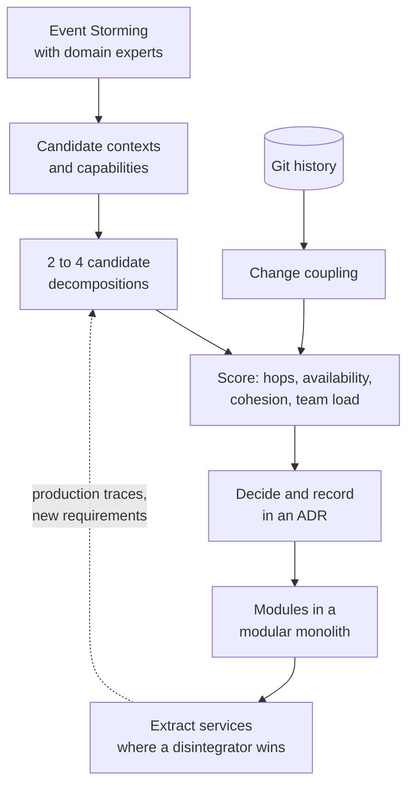

# 6. Service Decomposition

<div class="badges" markdown><span class="badge badge-l2">L2 · Practitioner</span><span class="badge badge-l3">L3 · Senior/Lead</span><span class="badge badge-l4">L4 · Architect</span><span class="badge badge-meta">Decomposition scoring · git co-change mining · Spring Boot 4 CLI</span></div>

<div class="grid two" markdown>

!!! info "Prerequisites"
    - [Chapter 1](ch01-architecture-styles.md) (modular monolith, distributed monolith) and [Chapter 3](ch03-distributed-systems-fundamentals.md) (availability arithmetic)
    - [Chapter 5](ch05-domain-driven-design.md): subdomains, bounded contexts and context maps
    - Basic `git log` usage

!!! abstract "What you'll learn"
    - The **decomposition strategies** (capability, subdomain, volatility, team, scaling, security) and the two that fail (by layer, by entity)
    - How to run an **Event Storming** session and read candidate boundaries off the board
    - **Granularity disintegrators and integrators**: the forces that pull a service apart or hold it together
    - How to **score** candidate decompositions (sync hops, availability, cohesion, team load) instead of arguing about them
    - How to mine **change coupling** from git history, and when to overrule it
    - Sizing heuristics, decomposition smells, and what interviewers expect at each level

</div>

---

## 1 · Introduction & Context

### The most expensive line you'll draw

Every other decision in this handbook can be changed in a sprint: the HTTP client, the broker, the database index, the retry policy. **Service boundaries can't.** Once a boundary exists, data is split across databases, contracts are published, teams are organised around it, and dashboards, on-call rotations and budgets follow. Moving a capability from one service to another later means a data migration, a contract migration and often a reorg.

That is why decomposition gets its own chapter. Get the boundaries roughly right and most later problems are local. Get them wrong and you build the **distributed monolith** from [chapter 1](ch01-architecture-styles.md): every feature touches four services, every release needs lock-step deploys, and every checkout makes a dozen network calls.

!!! example "FoodFleet's first attempt"
    In 2023, FoodFleet's first microservices push split the monolith **one service per database table**: `cart-service`, `order-service`, `order-line-service`, `menu-service`, `menu-price-service` and nine more. It looked clean on a slide. In production, placing an order made **16 synchronous calls** across **11 services**, the checkout SLO dropped from 99.9% to under 99%, and adding a "note to restaurant" field needed pull requests in three repositories. This chapter shows how to predict that outcome *before* building it, with a tool that does the arithmetic.

### A short history of "where do we cut?"

<ul class="mh-timeline">
<li><span class="when">1972 · David Parnas</span><span class="what"><em>On the Criteria To Be Used in Decomposing Systems into Modules</em>: decompose by <strong>design decisions likely to change</strong> (information hiding), not by processing steps. Still the best single idea on the topic.</span></li>
<li><span class="when">2003 · Eric Evans</span><span class="what"><em>Domain-Driven Design</em>: bounded contexts as model boundaries (chapter 5).</span></li>
<li><span class="when">2013 · Alberto Brandolini</span><span class="what">Introduces <strong>Event Storming</strong>: discover the domain with orange sticky notes on a long wall.</span></li>
<li><span class="when">2015 · Sam Newman, Adam Tornhill</span><span class="what"><em>Building Microservices</em> popularises "decompose by business capability"; <em>Your Code as a Crime Scene</em> shows how to mine <strong>change coupling</strong> from version control.</span></li>
<li><span class="when">2018–2019 · Chris Richardson, Juval Löwy, Skelton &amp; Pais</span><span class="what"><em>Microservices Patterns</em> catalogues decompose-by-capability and by-subdomain; <em>Righting Software</em> argues for <strong>volatility-based</strong> decomposition; <em>Team Topologies</em> makes team cognitive load a design input.</span></li>
<li><span class="when">2021 · Ford, Richards, Sadalage, Dehghani</span><span class="what"><em>Software Architecture: The Hard Parts</em> names <strong>granularity disintegrators and integrators</strong>, the forces used in section 2.</span></li>
</ul>

---

## 2 · Core Concepts & Terminology

### Decomposition strategies

Business capability
:   Something the business *does*, independent of how: "take orders", "assign riders", "collect payments". Capabilities are stable (food delivery has always needed riders) even when processes and org charts change, which makes them good boundaries.

Subdomain / bounded context
:   The DDD view from [chapter 5](ch05-domain-driven-design.md): one model and one language per boundary. In practice capabilities and contexts usually line up; where they don't, the context boundary (where the *meaning* of words changes) wins.

Volatility
:   Parnas's idea, sharpened by Löwy: isolate the things likely to change (pricing rules, payment providers, dispatch algorithms) behind stable interfaces, so change stays local. Useful **inside** a capability as well as between them.

Team
:   A service should be owned by exactly one team, and a team should own a small number of related services. Boundaries that fight team structure lose ([chapter 7](ch07-conways-law-team-topologies.md)).

Scaling and performance profile
:   Split when two parts need very different scale, latency or availability: zone lookups run on every menu browse, rider assignment once per order.

Security and compliance boundary
:   Split to shrink an audit scope: card data in one small tokenisation service keeps the rest of the system out of PCI DSS scope.

!!! pitfall "Two strategies that reliably fail"
    **By technical layer** (`ui-service`, `business-service`, `data-service`): every feature crosses every service, so nothing is independently deployable. **By entity** (one CRUD service per table): business operations span many services, so every use case becomes a chain of synchronous calls and invariants that used to be one transaction become distributed. Decomposition A below is this strategy, measured.

### Granularity disintegrators and integrators

*Software Architecture: The Hard Parts* gives a vocabulary for the argument every design review has. **Disintegrators** are reasons to split a service; **integrators** are reasons to keep (or put) things together. A boundary is justified when the disintegrators clearly outweigh the integrators.

<div class="grid two" markdown>

!!! success "Disintegrators: split when…"
    - **Scope and function**: it does two unrelated things (orders *and* coupons)
    - **Code volatility**: one part changes weekly, the rest yearly
    - **Scalability and throughput**: one part needs 40 pods, the rest 2
    - **Fault tolerance**: one part's crash (a PDF renderer's memory leak) shouldn't take down the rest
    - **Security**: one part handles card data or PII with stricter controls
    - **Extensibility**: new variants (payment providers) keep being added

!!! failure "Integrators: keep together when…"
    - **Database transactions**: an invariant needs ACID across both parts (order + order lines)
    - **Workflow and choreography**: they call each other on every request (menu + price)
    - **Shared code**: they share substantial domain logic, not just utilities
    - **Data relationships**: one can't do its job without the other's data, constantly

</div>

### Words used in this chapter

| Term | Meaning |
|---|---|
| **Candidate decomposition** | One proposed assignment of capabilities to services |
| **Sync hop** | One synchronous call between *different* services during a use case |
| **Sync path** | The set of services that must all be up for the use case to succeed |
| **Cohesion** (as measured here) | Share of interaction volume that stays inside a service |
| **Change coupling** | Two modules that keep changing in the same commits |
| **Coupling degree** | Commits touching both ÷ commits touching the less-changed one |

---

## 3 · How It Works Internally

### The decomposition process

Decomposition is a loop that goes from discovery to evidence to a reversible first step, not a one-off whiteboard session:



The important arrow is **ADR → modules**: first make the boundary a module boundary (chapter 1's Spring Modulith), live with it, and only then turn it into a network boundary. Moving a capability between modules is a refactoring; moving it between services is a project.

### Step 1: Event Storming

An Event Storming session puts domain experts and engineers in front of a long wall (or a Miro board). It runs in phases:

1. **Chaotic exploration**: everyone writes **domain events** (orange, past tense: "Order Placed") and sticks them roughly in time order.
2. **Timeline enforcement**: sort them, remove duplicates, and mark disagreements and unknowns as **hotspots** (red).
3. **Commands and actors**: what caused each event (blue: "Place Order") and who issued it (yellow: Customer).
4. **Policies**: reactions of the form "whenever X happens, do Y" (lilac: "when payment is authorised, send ticket to kitchen").
5. **Aggregates and external systems**: what accepts the command and protects the rules (pale yellow), and third parties (pink: payment gateway).
6. **Boundaries**: draw lines where the **language changes** or where **pivotal events** hand work from one group of people to another.

The FoodFleet checkout board, after phase 6:

<div class="mh-es" markdown>
<div class="mh-es__legend"><span class="ev">Domain event</span><span class="cmd">Command</span><span class="act">Actor</span><span class="pol">Policy</span><span class="agg">Aggregate</span><span class="ext">External system</span><span class="hot">Hotspot</span></div>
<div class="mh-es__lanes">
<div class="mh-es__lane"><strong>Catalog</strong><div class="mh-es__flow"><span class="n act">Restaurant owner</span><span class="n cmd">Publish Menu</span><span class="n agg">Menu</span><span class="n ev">Menu Published</span><span class="n cmd">Change Price</span><span class="n ev">Item Price Changed</span><span class="n hot">Is "price" incl. packaging?</span></div></div>
<div class="mh-es__lane"><strong>Ordering</strong><div class="mh-es__flow"><span class="n act">Customer</span><span class="n cmd">Add To Cart</span><span class="n ev">Item Added To Cart</span><span class="n cmd">Place Order</span><span class="n agg">Order</span><span class="n ev">Order Placed</span><span class="n hot">Coupon applied before or after GST?</span></div></div>
<div class="mh-es__lane"><strong>Payment</strong><div class="mh-es__flow"><span class="n pol">When order placed, authorise payment</span><span class="n ext">Payment gateway</span><span class="n ev">Payment Authorised</span><span class="n ev">Payment Failed</span></div></div>
<div class="mh-es__lane"><strong>Kitchen</strong><div class="mh-es__flow"><span class="n pol">When payment authorised, create ticket</span><span class="n agg">Kitchen Ticket</span><span class="n ev">Ticket Accepted</span><span class="n ev">Food Ready</span></div></div>
<div class="mh-es__lane"><strong>Delivery</strong><div class="mh-es__flow"><span class="n pol">When ticket accepted, find rider</span><span class="n agg">Delivery Job</span><span class="n ev">Rider Assigned</span><span class="n ev">Order Picked Up</span><span class="n ev">Order Delivered</span></div></div>
</div>
</div>

Reading boundaries off the board:

- **Language changes**: the customer's "order" becomes the kitchen's "ticket" and the rider's "job". Each change is a candidate boundary (chapter 5).
- **Pivotal events**: *Order Placed*, *Payment Authorised* and *Ticket Accepted* hand work to a different group of people. They become **integration events** between services ([chapter 19](../architecture-patterns/ch19-event-driven-architecture.md)).
- **Policies** sitting between two lanes ("when payment authorised, create ticket") are usually **asynchronous** interactions. That matters for the scoring below: async edges don't add to the sync path.
- **Hotspots** are the questions to answer before building. "Is price inclusive of packaging?" is precisely the kind of semantic mismatch an anti-corruption layer exists for.

### Step 2: candidate decompositions

From the board, FoodFleet has **14 fine-grained capabilities** owned by **6 teams**. Four candidate decompositions were proposed:

| | Candidate | How capabilities are grouped |
|---|---|---|
| **A** | One service per entity | 14 services, one per capability (the 2023 attempt) |
| **B** | By business capability | 9 services following chapter 5's bounded contexts: ordering = cart + order + order-line; catalog = restaurant-profile + menu + pricing; customer = profile + address book; plus kitchen, delivery-zones, delivery, promotions, notification, payment |
| **C** | Three coarse services | customer-facing, restaurant-side, fulfilment |
| **D** | Modular monolith | Everything in one deployable, with module boundaries inside |

### Step 3: scoring

Each use case is described as a list of interactions: *who calls whom, sync or async, how many times per execution*. Placing a 3-dish order is 13 interactions (order → cart, order → menu ×3, menu → pricing ×3, order → payment, …, plus 3 async notifications). Given a candidate, the evaluator computes:

| Metric | How | Why it matters |
|---|---|---|
| **Sync hops** | Sum of sync interactions whose two ends are in *different* services | Each hop adds latency, a failure mode and a timeout to tune |
| **Availability** | 0.999<sup>n</sup>, n = services on the sync path | Every service on the path must be up (chapter 3's serial availability) |
| **Cohesion** | Interaction volume inside services ÷ total volume | Low = chatty services |
| **Max teams per service** | Distinct owning teams of one service's capabilities | > 1 means releases need negotiation |
| **Max services per team** | Distinct services one team owns | High = a team spread thin, on call for many things |

!!! warning "No single metric decides"
    Cohesion alone always favours the monolith (100%), and sync hops alone always favour it too (zero). The team metrics pull the other way. The point of scoring is to make the **trade-off visible**, not to compute a winner.

### Step 4: evidence from version control

What the team *believes* belongs together can be checked against what actually *changes* together. For every pair of modules, count the commits that touched both:

```text
degree(A, B) = commits touching both A and B ÷ min(commits touching A, commits touching B)
```

Dividing by the **less-changed** module answers "when the smaller one changes, how often does the other change too?". `order-line` changed 7 times and `order` changed 12 times, and all 7 `order-line` commits also touched `order`: degree 100%. Pairs above a threshold (60%, with at least 3 shared commits so two coincidences don't count) are merged with **union-find** into suggested groups.

Mass changes (a formatter run, a Spring Boot upgrade, a package rename) touch everything and say nothing about the domain, so commits touching more than N modules are dropped before counting.

---

## 4 · Design Considerations & Trade-offs

### The four candidates, scored

Output of the chapter's tool on the FoodFleet model (verified):

| | Services | Sync hops | Services on sync path | Availability | Cohesion | Max teams per service | Max services per team |
|---|---:|---:|---:|---:|---:|---:|---:|
| **A** · per entity | 14 | **16** | 11 | **98.91%** | **0%** | 1 | **4** |
| **B** · by capability | 9 | 9 | 6 | 99.40% | 58% | **1** | 2 |
| **C** · three coarse | 3 | 6 | 3 | 99.70% | 68% | **3** | 2 |
| **D** · modular monolith | 1 | 0 | 1 | 99.90% | 100% | **6** | 1 |

Sync hops, sync path and availability are for checkout (place-order, 3 dishes). The three async messages (kitchen, rider, notification) cross service boundaries in A, B and C, and stay in-process in D.

Browsing a menu of 10 dishes: **12** sync hops in A (menu calls pricing once per dish), **1** in B (only the zone check leaves the catalog service).

What the numbers mean in practice, at 99.9% per service:

| Candidate | Checkout downtime budget per 30 days | Comment |
|---|---:|---|
| A | ~7.9 h | 11 services that must all be up; per-dish pricing calls multiply load |
| B | ~4.3 h | Still a real cost; [chapter 18](../architecture-patterns/ch18-resilience-patterns.md) (timeouts, fallbacks) and caching the menu earn it back |
| C | ~2.2 h | Good availability, but three teams negotiate every customer-facing release |
| D | ~43 min | Best runtime numbers; six teams share one deployable and one release train |

<div class="mh-axes" markdown>
<div class="mh-axes__y">Interaction kept inside services →</div>
<div class="mh-axes__cell ok"><strong>Coordination bottleneck (C, D)</strong>Chatty code stays in-process, but several teams share each deployable and its release.<br><span class="pin">D is the right start for a small org</span></div>
<div class="mh-axes__cell good"><strong>Capability services (B)</strong>Each team owns one or two services, and the hottest interactions (order ↔ lines, menu ↔ price) stay in-process.<br><span class="pin">FoodFleet target</span></div>
<div class="mh-axes__cell bad"><strong>Distributed big ball of mud</strong>Shared services, chatty calls and no clear owner. Usually the result of splitting along the existing code layout.</div>
<div class="mh-axes__cell bad"><strong>Entity services (A)</strong>One team per service on paper, but every use case is a chain of network calls, and each team carries four on-call services.<br><span class="pin">FoodFleet 2023</span></div>
<div class="mh-axes__x">Team autonomy (one team per service, few services per team) →</div>
</div>

### Where evidence and judgment disagree

The co-change groups mined from FoodFleet's last 40 monolith commits rediscover most of decomposition B:

| Co-change group (≥ 60%, ≥ 3 commits) | Decomposition B | Verdict |
|---|---|---|
| cart, order, order-line | ordering | ✅ Agrees |
| address-book, customer-profile | customer | ✅ Agrees |
| menu, menu-item-pricing | catalog | ✅ Agrees |
| rider-assignment, zone (75%) | delivery **and** delivery-zones | ⚠️ Disagrees |
| restaurant-profile (alone) | catalog | ⚠️ Disagrees |

Both disagreements are resolved by **judgment**, and the reasoning belongs in the ADR:

- **restaurant-profile stays in catalog.** A singleton in the co-change output only means "no strong evidence it must live with anything". It is not evidence that it must live apart. The same team owns it, and browse-menu reads profile and menu together on every request, so putting them in separate services would add a hop to the hottest read path for no gain.
- **zone stays a separate deployable, owned by the same team as rider assignment.** The evidence says zone and rider assignment change together, which is an integrator. But zone lookups happen on *every* menu browse and must be fast and highly available, while rider assignment runs once per order and is CPU-heavy. That is a **scaling disintegrator**, and it wins here. The co-change result still shapes the decision: one team, one repository, contract tests between them, and a review in six months.

!!! tip "Evidence first, then judgment, and write both down"
    Change coupling is the most objective signal you have, and the cheapest. But it describes the **past** structure of the code, including its accidents. Use it to challenge proposals ("why are these two separate if they changed together 9 times out of 10?"), not to generate the architecture.

### Sizing heuristics

"How big should a microservice be?" has no number of lines as an answer. These heuristics are more useful:

| Heuristic | Rule of thumb | Watch out for |
|---|---|---|
| **One team owns it** | Exactly one owning team; a team owns 1–3 services | "Shared ownership" means nobody's on call |
| **One reason to change** | A typical feature changes one service | Features that always touch 3+ services |
| **Fits in heads** | A new team member understands it in a couple of weeks | "Only Priya understands billing" |
| **Independent deploy** | Can ship on a Tuesday without anyone else shipping | Lock-step release trains |
| **Owns its data** | No other service reads its tables ([chapter 12](../architecture-patterns/ch12-database-per-service.md)) | Reporting jobs joining across schemas |
| **Survives a dependency outage** | Degrades rather than fails when a non-critical neighbour is down | Checkout failing because notifications are slow |
| **Earns its keep** | The disintegrator that justified it is still true | Services created for one-off reasons nobody remembers |

### Decomposition smells

| Smell | What you see | Likely cause | Fix |
|---|---|---|---|
| **Shotgun change** | One feature needs PRs in 3+ services | Boundary cuts through a capability | Merge, or move the capability |
| **Lock-step deploys** | "Deploy order-service before cart-service" | Shared model, missing contract versioning | Merge, or add tolerant reader and versioning ([ch 2](ch02-characteristics-principles.md)) |
| **Chatty call chains** | A use case makes 10+ sync calls | Entity services; logic split from its data | Merge, or replicate data via events |
| **Distributed transaction temptation** | Someone proposes 2PC or XA | An invariant was split across services | Move the invariant into one aggregate (ch 5), or use a saga ([ch 14](../architecture-patterns/ch14-saga-pattern.md)) |
| **Shared database** | Two services write the same table | Split the code, not the data | Database per service, one owner |
| **Generic service names** | `common-service`, `order-manager`, `util-service` | No capability behind it | Fold back into the capabilities that use it |
| **Cyclic dependencies** | A calls B calls A | Two halves of one capability | Merge, or invert one edge with an event |
| **Multi-team service** | Releases need sign-off from three teams | Too coarse (candidate C) | Split along team and capability lines |

---

## 5 · Hands-on Implementation

Code: `code/chapters/ch06-service-decomposition/`, a small Spring Boot command-line tool (no web server) that scores decompositions and mines change coupling.

```text
dev/foodfleet/ch06/
├── DecompositionApplication.java   CLI: bundled sample, or --git-log + --mapping for your own repo
├── decomposition/
│   ├── DomainModel.java            capabilities, teams, use-case interactions
│   ├── FoodFleetModel.java         FoodFleet's model and candidates A–D
│   ├── Decomposition.java          capability → service assignment
│   ├── DecompositionEvaluator.java the scoring
│   ├── CoChangeAnalyzer.java       coupling degree + union-find grouping
│   └── GitLogImporter.java         real git log → module-level commits
└── report/DecompositionReport.java plain-text report
```

```bash
cd code
mvn -B -pl chapters/ch06-service-decomposition -am verify
mvn -q -pl chapters/ch06-service-decomposition spring-boot:run
```

### 🔵 Level 2: describe the domain, then the candidates

<div class="badges" markdown><span class="badge badge-l2">L2 · Practitioner</span></div>

The domain model is plain data: capabilities with their owning team, and interactions per use case. The numbers come from the Event Storming board and use-case walkthroughs, and later from production traces:

```java title="decomposition/FoodFleetModel.java (model)"
--8<-- "code/chapters/ch06-service-decomposition/src/main/java/dev/foodfleet/ch06/decomposition/FoodFleetModel.java:25:63"
```

A candidate is drawn the way people draw it on a whiteboard, "service → capabilities". The factory rejects a capability placed in two services:

```java title="decomposition/FoodFleetModel.java (candidate B)"
--8<-- "code/chapters/ch06-service-decomposition/src/main/java/dev/foodfleet/ch06/decomposition/FoodFleetModel.java:72:85"
```

### 🟣 Level 3: score the candidates

<div class="badges" markdown><span class="badge badge-l3">L3 · Senior/Lead</span></div>

```java title="decomposition/DecompositionEvaluator.java"
--8<-- "code/chapters/ch06-service-decomposition/src/main/java/dev/foodfleet/ch06/decomposition/DecompositionEvaluator.java:28:89"
```

The tests pin the numbers from section 4, so a change to the model that shifts them is visible in review:

```java title="DecompositionEvaluatorTest.java"
--8<-- "code/chapters/ch06-service-decomposition/src/test/java/dev/foodfleet/ch06/decomposition/DecompositionEvaluatorTest.java"
```

### 🟣 Level 3: mine change coupling

<div class="badges" markdown><span class="badge badge-l3">L3 · Senior/Lead</span></div>

```java title="decomposition/CoChangeAnalyzer.java (coupling degree)"
--8<-- "code/chapters/ch06-service-decomposition/src/main/java/dev/foodfleet/ch06/decomposition/CoChangeAnalyzer.java:25:51"
```

Strong pairs are merged with union-find, so if A–B and B–C are both strong, A, B and C end up in one group:

```java title="decomposition/CoChangeAnalyzer.java (grouping)"
--8<-- "code/chapters/ch06-service-decomposition/src/main/java/dev/foodfleet/ch06/decomposition/CoChangeAnalyzer.java:53:88"
```

```java title="CoChangeAnalyzerTest.java (FoodFleet history)"
--8<-- "code/chapters/ch06-service-decomposition/src/test/java/dev/foodfleet/ch06/decomposition/CoChangeAnalyzerTest.java:29:44"
```

### 🔴 Level 4: run it on your own monolith

<div class="badges" markdown><span class="badge badge-l4">L4 · Architect</span></div>

`GitLogImporter` reads real `git log --name-only` output. A mapping file turns paths into modules (longest prefix wins, so `order/line/` beats `order/`), paths that map to nothing (build files, docs) are ignored, and mass changes are dropped:

```java title="decomposition/GitLogImporter.java"
--8<-- "code/chapters/ch06-service-decomposition/src/main/java/dev/foodfleet/ch06/decomposition/GitLogImporter.java:65:106"
```

```java title="GitLogImporterTest.java"
--8<-- "code/chapters/ch06-service-decomposition/src/test/java/dev/foodfleet/ch06/decomposition/GitLogImporterTest.java:30:56"
```

```bash
# 1. export a year of history: one '#<hash>' line per commit, then the files it changed
git -C ~/work/monolith log --since=12.months --no-merges --name-only --pretty=format:'#%h' > /tmp/git.log

# 2. map path prefixes to modules
cat > /tmp/modules.txt <<'MAP'
src/main/java/com/acme/order/=order
src/main/java/com/acme/order/line/=order-line
src/main/java/com/acme/cart/=cart
src/main/resources/db/migration/order/=order
MAP

# 3. analyse; commits touching more than 6 modules are skipped as mass changes
mvn -q -pl chapters/ch06-service-decomposition spring-boot:run \
  -Dspring-boot.run.arguments="--git-log=/tmp/git.log --mapping=/tmp/modules.txt --max-modules-per-commit=6"
```

!!! tip "Getting a useful signal from real history"
    - Use **12 months** or more. A single quarter mostly reflects whichever project ran that quarter.
    - Map **database migrations** to their module, or schema changes become invisible.
    - Squash-merged repositories give one commit per pull request, which is actually the better unit ("one feature"). With merge commits, keep `--no-merges`.
    - Tune `--max-modules-per-commit` by looking at what's dropped: if real features touch 5 modules, the problem is the modules, not the threshold.

### Run and verify

```text
== Candidate decompositions (place-order = 3 dishes) ==
Decomposition                          Services  Sync hops   Async Availability   Cohesion  Max teams/ Max services/
                                                (checkout)    msgs   (checkout)                service         team
A. One service per entity                    14         16       3       98.91%         0%           1            4
B. By business capability                     9          9       3       99.40%        58%           1            2
C. Three coarse services                      3          6       3       99.70%        68%           3            2
D. Modular monolith (one deployable)          1          0       0       99.90%       100%           6            1

== Strongest change couplings (40 commits) ==
order                order-line             7 together  100%
cart                 order                  6 together  100%
menu                 menu-item-pricing      5 together  100%
address-book         customer-profile       3 together  100%
rider-assignment     zone                   3 together   75%
cart                 order-line             4 together   67%

== Groups suggested by co-change (degree >= 60%, >= 3 commits) ==
 - cart, order, order-line
 - address-book, customer-profile
 - menu, menu-item-pricing
 - rider-assignment, zone
 - coupon
 - kitchen-ticket
 - notification
 - payment
 - restaurant-profile
```

!!! question "Try it"
    1. Add a candidate **E** that is B with `zone` merged into `delivery`. Which numbers change, and does the change in availability matter for browse-menu?
    2. Make menu → pricing **one** batched call per checkout instead of three. How much does that close the gap between A and B? (Batching hides chattiness; it doesn't fix the boundary.)
    3. Change `coupon` to **async** (apply discounts after the order is placed). What does the business lose?
    4. Run the importer on a repository you know. Do the suggested groups match what the team believes?

---

## 6 · Production Readiness

Decomposition decisions are production decisions. Before a new boundary goes live:

- [x] **An ADR records the boundary**: which disintegrator justified it, which integrators were considered, and what would make you revisit it
- [x] **Candidates were scored**, not just drawn: sync hops, availability on the critical path, team load
- [x] **Change coupling was checked** against at least 12 months of history, and disagreements are explained in the ADR
- [x] **The boundary existed as a module first** (Spring Modulith verification green) before becoming a network boundary
- [x] **Every service has exactly one owning team** in the service catalogue ([Backstage](../components-tools/backstage.md)), with an on-call rotation
- [x] **Data ownership is explicit**: one service writes each table, others use APIs or events ([chapter 12](../architecture-patterns/ch12-database-per-service.md))
- [x] **The critical path's availability budget is computed**: if checkout must hit 99.9% and five services are on the sync path, each needs better than 99.98% or the path needs fallbacks
- [x] **Cross-service invariants are handled deliberately**: a saga, a reservation, or a redesign, not "we'll be careful"
- [x] **Smells are monitored**: PRs per feature across repositories, lock-step deploys, and sync fan-out per request (from traces, [chapter 49](../observability/ch49-distributed-tracing-otel.md))

---

## 7 · Anti-patterns & Pitfalls

!!! pitfall "Incident 1: the entity services"
    **Context.** FoodFleet's 2023 split created one service per table (decomposition A).
    **Symptoms.** Checkout p99 rose from 280 ms to 1.9 s; monthly checkout availability fell below 99%; a "note to restaurant" field needed changes in `order-service`, `order-line-service` and `kitchen-ticket-service`, released in that order.
    **Root cause.** Boundaries followed nouns in the schema, not capabilities. Order and order lines share an invariant ("at most 15 dishes, total ≥ minimum order") that now crossed a network.
    **Fix.** Merged back into capability services (B), behind a modular monolith step for ordering. Sync hops per checkout went from 16 to 9, and the order invariant became one aggregate again (chapter 5).

!!! pitfall "Incident 2: the shared notification templates"
    **Context.** `notification-service` owned every message template: order confirmations, rider alerts, refund emails, marketing.
    **Symptoms.** Every team's feature queued behind the notification team's backlog. A refund-copy change waited three weeks.
    **Root cause.** A **generic technical capability** ("send messages") was treated as a business capability, and it absorbed business logic from every other domain.
    **Fix.** Notification became a platform service that sends; each domain owns its templates and decides *what* to say. The service's backlog dropped by 70%.

!!! pitfall "Incident 3: decomposing the unknown"
    **Context.** A new "grocery delivery" line was launched with eight microservices designed upfront.
    **Symptoms.** Within six months three services had been merged and two split differently; each change needed data migrations.
    **Root cause.** Boundaries were drawn before the domain was understood. The Event Storming board still had a dozen red hotspots.
    **Fix.** The next new line (pharmacy) started as **one modular service**, with modules extracted only once the boundaries had stopped moving. This matches the "monolith first" advice of [chapter 1](ch01-architecture-styles.md).

| Anti-pattern | Symptom | Fix |
|---|---|---|
| Decompose by layer | Every feature changes every service | Vertical slices by capability |
| Decompose by entity | Chatty sync chains, split invariants | Group by capability and aggregate |
| Decompose by org chart of today | Boundaries change with every reorg | Capabilities first, then align teams (ch 7) |
| Big-bang decomposition | Months of migration, nothing shipped | Strangler fig, one capability at a time ([ch 16](../architecture-patterns/ch16-strangler-fig-migration.md)) |
| "Micro" means tiny | 200 services for 40 engineers | Size by team and capability, not lines of code |
| Splitting before understanding | Constant re-splitting | Modular monolith until boundaries are stable |
| Ignoring the data | Services split, database shared | Split data ownership in the same plan |

---

## 8 · Enterprise Case Study

### FoodFleet: the decomposition decision

!!! decision "ADR-006: FoodFleet decomposes by business capability, verified by scoring and change coupling"
    **Status:** Accepted · **Date:** 2026-03-10

    **Context.** The 2023 entity-service split (decomposition A) is being consolidated. Four candidates were scored against the checkout and browse-menu use cases and against 40 commits of monolith history. Six teams own fourteen capabilities.

    **Decision.** Adopt decomposition **B** (nine services along chapter 5's bounded contexts). Two deviations from the co-change evidence are deliberate: `restaurant-profile` stays in catalog (same team, read together on every menu browse), and `zone` stays a separate deployable from `delivery` because of its very different scaling and latency profile, while both remain with the Logistics team in one repository. Ordering is consolidated first, as a modular monolith step, before re-extraction.

    **Consequences.** ✅ Checkout sync hops fall from 16 to 9 and services on the sync path from 11 to 6; every service has one owning team, and no team owns more than two. ⚠️ Checkout availability (99.40% at 99.9% per service) still needs timeouts, menu caching and a coupon fallback to meet its SLO. ⚠️ `zone`–`delivery` change coupling is watched; if it stays above 60% for two more quarters, they merge.

### Fintech analogue: drawing boundaries around regulation 🔴

At an investment bank or a large payments company, **compliance boundaries** are often the strongest disintegrator. Card numbers live only in a small **tokenisation vault**, so the rest of the estate (checkout, ledger, analytics) handles tokens and stays out of PCI DSS scope. Trade capture, risk and settlement are separated because they have different regulators, audit trails and availability requirements (trading hours versus end-of-day batch). The same organisations are usually conservative about splitting the **ledger** itself: double-entry postings are an invariant that must stay inside one transactional boundary, which makes it a textbook integrator.

### E-commerce analogue: scaling profiles during a sale

A large marketplace's catalog, pricing and inventory are all "about products", but on a sale day they behave very differently. Catalog reads grow tenfold and can be served from caches and search indexes; prices change constantly and must be consistent at checkout; inventory decrements must never oversell. Separating them is driven by **scalability and consistency disintegrators**, not by the data model. At the same time, cart and checkout typically stay together, because the cart-to-order conversion carries invariants (price lock, stock reservation) that are painful to distribute.

---

## 9 · Interview Q&A + Summary

#### Q1. How do you decide service boundaries? · <span class="badge badge-l2">L2</span><span class="badge badge-l3">L3</span> · Cognizant · SAP · Flipkart

**Short answer:** Start from business capabilities and bounded contexts, discovered with domain experts (Event Storming). Group things that change together and must be consistent together; separate things with different owners, scaling needs, volatility or compliance requirements. Validate candidates against real use cases (how many calls per checkout?) and against change history, and start as modules before making them services.

**What a 15-YoE answer adds:** naming disintegrators and integrators, scoring candidates with numbers, explaining the ADR, and a plan to revisit.

**Red flags:** "One service per table." "Each service should be under 1,000 lines."

#### Q2. Decompose by business capability vs by subdomain? · <span class="badge badge-l2">L2</span> · Cognizant · Accenture · SAP

**Short answer:** Capability asks *what the business does* (take orders, dispatch riders); subdomain asks *where the model and language change*. They usually produce the same boundaries. When they differ, the language boundary wins, because one service with two meanings of "order" is the worse problem.

#### Q3. What is Event Storming and what do you get out of it? · <span class="badge badge-l3">L3</span> · SAP · Flipkart · consulting firms

**Short answer:** A workshop where domain experts and engineers place domain events (orange) on a timeline, then add commands, actors, policies, aggregates, external systems and hotspots. You get a shared understanding of the process, a list of open questions, aggregate candidates, and boundary candidates where the language changes and at pivotal events. Policies between lanes usually become asynchronous integration events.

#### Q4. How big should a microservice be? · <span class="badge badge-l2">L2</span><span class="badge badge-l3">L3</span> · Amazon · TCS · Infosys

**Short answer:** Not a line count. Owned by one team, changed for one reason, deployable on its own, owning its data, and understandable by a new team member in a couple of weeks. Too small shows up as chatty call chains and shotgun changes; too large shows up as several teams negotiating releases.

**Follow-ups:** "What's a two-pizza team?" Amazon's heuristic for team size (roughly 6–10 people). It bounds how much one team can own, which bounds service count indirectly.

#### Q5. What goes wrong when you decompose by entity? · <span class="badge badge-l3">L3</span> · Flipkart · Amazon · Goldman Sachs

**Short answer:** Business operations span many services, so use cases become long synchronous call chains: more latency, lower availability (0.999<sup>11</sup> ≈ 98.9% for 11 services on a path), and invariants that used to be one transaction now need sagas. Features need coordinated changes across services. It's a distributed monolith.

#### Q6. What are granularity disintegrators and integrators? · <span class="badge badge-l3">L3</span><span class="badge badge-l4">L4</span> · Goldman Sachs · JP Morgan · Amazon

**Short answer:** From *Software Architecture: The Hard Parts*. Disintegrators justify splitting: scope and function, code volatility, scalability, fault tolerance, security, extensibility. Integrators justify keeping together: database transactions, workflow coupling, shared code, data relationships. A boundary is right when the disintegrators clearly outweigh the integrators, and you write down which ones.

#### Q7. How would you find service boundaries in an existing monolith? · <span class="badge badge-l4">L4</span> · JP Morgan · Goldman Sachs · SAP

**Short answer:** Combine three sources: Event Storming with the people who run the business process; static structure (package dependencies, Spring Modulith's module report); and **change coupling** from git history (modules that change together belong together). Where they agree, you have a candidate. Where they disagree, you have a design discussion. Then extract one capability at a time with the strangler fig.

**What a 15-YoE answer adds:** filtering mass-change commits, mapping database migrations to modules, using at least a year of history, and treating co-change as a challenge to proposals rather than a generator of architecture.

#### Q8. A checkout path has 6 services at 99.9% each. What's its availability, and what do you do about it? · <span class="badge badge-l3">L3</span> · Amazon · Flipkart

**Short answer:** 0.999<sup>6</sup> ≈ 99.4%, about 4.3 hours of downtime a month if failures are independent. Options: fewer services on the sync path (merge, or make steps async), higher availability per service, and fallbacks so non-critical dependencies (coupon, recommendations) degrade instead of failing checkout.

**Red flags:** "Each service is 99.9%, so the system is 99.9%."

#### Q9. When is it right to keep things in one service even though the teams want to split? · <span class="badge badge-l4">L4</span> · Goldman Sachs · JP Morgan

**Short answer:** When a strong integrator holds: an invariant that must be ACID (ledger postings, order and its lines), very high call volume between the parts, or a domain still too new to have stable boundaries. You can still give teams autonomy with module boundaries and code ownership inside one deployable.

#### Q10. What are the signs that a decomposition is wrong? · <span class="badge badge-l3">L3</span> · Flipkart · Cognizant · Amazon

**Short answer:** Shotgun changes across services, lock-step deploys, chatty sync chains, proposals for distributed transactions, shared tables, generic "common" or "manager" services, cyclic calls, and services whose releases need several teams' sign-off.

#### Q11. How do you split the database when you split a service? · <span class="badge badge-l3">L3</span><span class="badge badge-l4">L4</span> · JP Morgan · SAP

**Short answer:** Give each table one owning service; others use the owner's API or subscribe to its events and keep a local read model. Do it in steps: split schemas inside one database, remove cross-schema joins and foreign keys, then move schemas to separate databases. [Chapter 12](../architecture-patterns/ch12-database-per-service.md) covers the patterns and [chapter 16](../architecture-patterns/ch16-strangler-fig-migration.md) the migration.

#### Q12. Design the services for a food delivery platform. · <span class="badge badge-l4">L4</span> · Swiggy-/Zomato-style system design rounds · Amazon

**Short answer:** Run through capabilities (catalog, ordering, payment, kitchen, delivery and dispatch, zones, promotions, notification, customer), state the integrators that keep cart, order and order lines together, and the disintegrators that split zones (read-heavy, latency-critical) from dispatch (CPU-heavy, per order) and payments (compliance). Show the checkout sync path, its availability, and which steps are async (kitchen, rider assignment, notifications). Mention that you'd start ordering as a modular monolith if the domain were new.

### Key takeaways

- **Boundaries are the most expensive decision to reverse.** Spend time on them, and make the first version a module boundary.
- Decompose by **business capability and bounded context**; refine with volatility, team, scaling and compliance. Never by layer or by entity.
- Argue with **disintegrators and integrators**, not taste.
- **Score candidates**: sync hops, availability on the critical path, cohesion, and team load. No single number wins; the trade-off has to be visible.
- **Mine change coupling** from git to challenge proposals, then apply judgment, and write both into an ADR.

### Further reading

- David L. Parnas, *On the Criteria To Be Used in Decomposing Systems into Modules*, Communications of the ACM, 1972
- Neal Ford, Mark Richards, Pramod Sadalage, Zhamak Dehghani, *Software Architecture: The Hard Parts* (O'Reilly, 2021), chapters on service granularity
- Sam Newman, *Building Microservices*, 2nd ed. (O'Reilly, 2021) and *Monolith to Microservices* (2019)
- Chris Richardson, *Microservices Patterns* (Manning, 2018) and [microservices.io decomposition patterns](https://microservices.io/patterns/decomposition/decompose-by-business-capability.html)
- Alberto Brandolini, *Introducing EventStorming* (Leanpub)
- Adam Tornhill, *Your Code as a Crime Scene*, 2nd ed. (Pragmatic Bookshelf, 2024): change coupling and hotspot analysis
- Juval Löwy, *Righting Software* (Addison-Wesley, 2019): volatility-based decomposition
- Matthew Skelton, Manuel Pais, *Team Topologies* (IT Revolution, 2019)

---

**Previous:** [← 5. Domain-Driven Design](ch05-domain-driven-design.md) · **Next:** [7. Conway's Law & Team Topologies →](ch07-conways-law-team-topologies.md)
