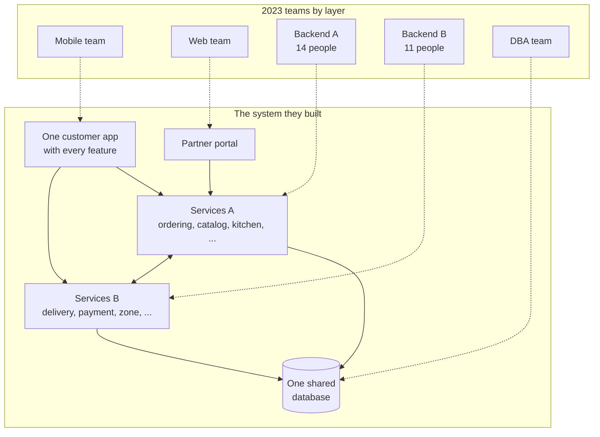

# 7. Conway's Law & Team Topologies

<div class="badges" markdown><span class="badge badge-l3">L3 · Senior/Lead</span><span class="badge badge-l4">L4 · Architect</span><span class="badge badge-meta">Org design as code · CODEOWNERS · Backstage · Spring Boot 4 CLI</span></div>

<div class="grid two" markdown>

!!! info "Prerequisites"
    - [Chapter 1](ch01-architecture-styles.md) (distributed monolith) and [Chapter 5](ch05-domain-driven-design.md) (bounded contexts)
    - [Chapter 6](ch06-service-decomposition.md): capability-based decomposition and FoodFleet's nine services
    - Some experience of working across teams

!!! abstract "What you'll learn"
    - What **Conway's Law** actually says, and how the **inverse Conway maneuver** uses it
    - **Cognitive load** as a design constraint, and how to estimate it
    - The four **team types** and three **interaction modes** of *Team Topologies*
    - Ownership models: strong, weak and collective, and why services need strong ownership
    - How to **check** an org design for handoffs, overload and missing coordination
    - How to keep **CODEOWNERS** and the **Backstage** catalog in sync with the org, in CI

</div>

---

## 1 · Introduction & Context

### Same code, different organisation, different system

In 2023 FoodFleet had good engineers, a reasonable architecture diagram and a delivery problem. Adding a "note to restaurant" field took five weeks. The code change was a few hundred lines. The rest was waiting: the mobile team waited for the backend team's API, the backend team waited for a DBA review of the migration, and the partner-portal team found out about the field in the release notes.

Nobody was slow. The work simply had to pass through **four teams**, because the teams were organised by technology layer (mobile, web, backend, database) while every feature cut vertically through all of them. The architecture had quietly grown to match: a shared database owned by DBAs, a backend split along whichever team had capacity at the time, and APIs shaped by the meetings between teams rather than by the domain.

That is **Conway's Law**, and this chapter is about designing with it rather than being surprised by it.

### Conway's Law

> "Organizations which design systems (in the broad sense used here) are constrained to produce designs which are copies of the communication structures of these organizations."
>
> — Melvin E. Conway, *How Do Committees Invent?*, Datamation, April 1968

The mechanism is mundane. Two pieces of software can only integrate well if the people building them talk. Where people talk easily (same team), interfaces are fluid and get refactored freely. Where they talk rarely (different teams, departments, time zones), interfaces become formal, slow to change and defensive. Over time, the boundaries in the code settle where the boundaries between people are.

!!! tip "The practical reading"
    You can't choose whether Conway's Law applies. You can choose **which** org structure the architecture will copy. If you want nine independent capability services (chapter 6), you need teams whose communication structure looks like nine independent capabilities.

### A short history

<ul class="mh-timeline">
<li><span class="when">1968 · Melvin Conway</span><span class="what"><em>How Do Committees Invent?</em> Rejected by Harvard Business Review, published in Datamation.</span></li>
<li><span class="when">1975 · Fred Brooks</span><span class="what"><em>The Mythical Man-Month</em> cites the paper and names it "Conway's Law"; also Brooks's Law: adding people to a late project makes it later, because communication paths grow quadratically.</span></li>
<li><span class="when">Early 2000s · Amazon</span><span class="what">"Two-pizza teams" own services end to end. Werner Vogels (2006): <strong>"You build it, you run it."</strong></span></li>
<li><span class="when">2008 · Cataldo, Herbsleb, Carley</span><span class="what"><strong>Socio-technical congruence</strong>: teams whose coordination matches their technical dependencies deliver faster. The metric used in this chapter's tool.</span></li>
<li><span class="when">2008–2012 · MacCormack, Rusnak, Baldwin</span><span class="what">Empirical support for the <strong>mirroring hypothesis</strong>: loosely coupled organisations produce more modular products.</span></li>
<li><span class="when">2010–2015 · LeRoy &amp; Simons, Thoughtworks</span><span class="what">The <strong>inverse Conway maneuver</strong>: shape the teams first to get the architecture you want.</span></li>
<li><span class="when">2019 · Matthew Skelton &amp; Manuel Pais</span><span class="what"><em>Team Topologies</em>: four team types, three interaction modes, cognitive load as the limiting factor.</span></li>
</ul>

---

## 2 · Core Concepts & Terminology

### The vocabulary

Inverse Conway maneuver
:   Design the team structure to match the architecture you want, so Conway's Law works for you. In practice the two change **together**: a reorganisation that leaves a shared database in place gets pulled back to the old shape.

Cognitive load
:   How much a team has to hold in its heads to do its work. *Team Topologies* borrows John Sweller's split: **intrinsic** (the problem itself), **extraneous** (the environment: builds, deployments, tickets) and **germane** (the domain learning that adds value). Good platforms remove extraneous load so teams can spend their capacity on germane load.

Team API
:   Everything a team offers to others: its services' APIs and events, documentation, on-call contact, roadmap, and how to ask for things. A team with a clear API can be depended on without meetings.

Stream of change
:   A continuous flow of work aligned to a business area (a product, a user journey, a capability). The thing stream-aligned teams are aligned to.

### The four team types

<div class="grid cards" markdown>

-   **Stream-aligned**

    ---

    Aligned to one stream of change, owning it end to end: build, run, measure. **Most teams** should be this type. FoodFleet: Checkout, Restaurant Partner, Logistics, Growth.

-   **Platform**

    ---

    Provides internal services that reduce stream-aligned teams' extraneous load: runtime, CI/CD, observability, gateway. Consumed **as a product, self-service**. FoodFleet: Platform.

-   **Complicated-subsystem**

    ---

    Owns a part that needs rare specialist knowledge, so stream-aligned teams don't have to: dispatch optimisation, a payments ledger, a video codec. FoodFleet: Dispatch, Payments.

-   **Enabling**

    ---

    Specialists who help other teams acquire a capability (SRE practices, security, test automation), then step away. They **don't own** production services. FoodFleet: SRE Enablement.

</div>

### The three interaction modes

| Mode | What it looks like | When | How long | Smell if… |
|---|---|---|---|---|
| **Collaboration** | Two teams work closely together on a shared goal | Discovery, new technology, unclear boundaries | **Time-boxed**: weeks to a few months | It never ends; it's really one team split in two |
| **X-as-a-Service** | One team consumes another's API or platform with minimal coordination | Boundaries are well understood | Long-lived | The provider needs a meeting for every request |
| **Facilitating** | An enabling team coaches another team | Building a capability (SLOs, threat modelling) | Weeks | The enabling team ends up doing the work |

Every team should be able to name its interactions and their modes. A team with eight collaborations isn't collaborating; it's overloaded.

### Ownership models

Martin Fowler distinguishes three code ownership models:

| Model | Meaning | Fits |
|---|---|---|
| **Strong** | Only the owning team changes the code; others ask or send a pull request for the owner to review | Services in production, with an on-call owner |
| **Weak** | Anyone may change it; the owner reviews and is responsible | Shared libraries, internal tools, inner source |
| **Collective** | Everyone owns everything; no designated owner | One small team; breaks down beyond it |

For microservices the answer is **strong ownership of every deployable by exactly one team**, combined with weak ownership (inner source) for libraries. "Owned by two teams" means owned by nobody at 3 a.m.

---

## 3 · How It Works Internally

### How the org copies itself into the system

The 2023 FoodFleet organisation and the architecture it produced:



Each team boundary became a technical boundary, and every boundary sits **across** the flow of a feature. A feature that touches the app, ordering and the database touches three teams, three backlogs and three release schedules. The shared database exists because a DBA team exists, not because the domain needs one.

### Three questions the tool answers

The chapter's tool models an organisation as data (teams, domains, components with owners and data owners, dependencies, declared interactions) and answers three questions.

**1. How many teams does a typical feature need?** (flow)

For each feature on the roadmap: the owners of the components it changes, plus, when it changes a schema, the owners of those components' data. With a shared database, that adds the DBA team to almost everything. Each extra team is a **handoff**: a ticket in someone else's backlog and a wait.

**2. Can each team hold what it owns in its head?** (cognitive load)

*Team Topologies* gives heuristics in terms of **domain complexity**: a team can own two or three simple domains; a team with a complex domain should own nothing else; no team should own two complicated domains. Weights simple = 1, complicated = 2, complex = 3 with a budget of 3 reproduce exactly those rules:

| Team owns | Weight | Within budget? | Heuristic |
|---|---:|---|---|
| 1 complex | 3 | ✅ | A complex domain alone |
| 1 complex + 1 simple | 4 | ❌ | Complex means nothing else |
| 1 complicated + 1 simple | 3 | ✅ | |
| 2 complicated | 4 | ❌ | Not two complicated domains |
| 3 simple | 3 | ✅ | Two or three simple domains |
| 4 simple | 4 | ❌ | |

Team size is checked too: above about 9 people, trust and communication break down; below about 4, a team can't build, run and be on call for its services (enabling teams excepted).

**3. Do teams that must coordinate have an agreed way to do it?** (Conway / congruence)

Two teams **need** to coordinate when one's component depends on the other's, or when a feature needs both. **Socio-technical congruence** is the share of those needs covered by a declared interaction:

```text
congruence = coordination needs with a declared interaction ÷ all coordination needs
```

Missing pairs are where Conway's Law will act unsupervised: the teams will coordinate anyway, through escalations, side channels and "quick calls". The tool also checks modes: collaboration older than six months, collaboration with a platform team, and facilitating without an enabling team.

!!! warning "Models, not measurements of people"
    These numbers are estimates from a model the organisation writes down. They're good at finding questions ("why does every feature need DBA?") and bad at answering them on their own. Pair them with team surveys (the *Team Topologies* cognitive-load questionnaire), DORA metrics and conversations.

---

## 4 · Design Considerations & Trade-offs

### 2023 vs 2026, measured

The same eight roadmap features, against both organisations (verified output):

| | 2023: layer teams | 2026: Team Topologies |
|---|---:|---:|
| Teams | 6 | 8 |
| Teams per feature (average) | **3.38** | **1.75** |
| Handoffs across the 8 features | 19 | 6 |
| Features one team can deliver alone | 0 | 2 |
| Teams over cognitive-load budget | 4 (Mobile, Backend A, Backend B, Ops) | 1 (Platform) |
| Teams outside 4–9 people | 3 (Backend A 14, Backend B 11, DBA 3) | 0 |
| Socio-technical congruence | 62% (8 of 13) | 92% (12 of 13) |
| Collaborations older than 6 months | 4 | 1 |

The 2026 organisation follows chapter 6's capability decomposition:

| Team | Type | People | Owns | Interactions |
|---|---|---:|---|---|
| **Checkout** | Stream-aligned | 8 | app checkout, ordering | XaaS → Restaurant Partner, Growth, Payments, Logistics, Platform |
| **Restaurant Partner** | Stream-aligned | 7 | app discovery, partner portal, catalog, kitchen | XaaS → Logistics, Platform |
| **Logistics** | Stream-aligned | 7 | app tracking, delivery, zone | XaaS → Growth, Platform · **collaboration ↔ Dispatch** (since Nov 2025) |
| **Growth** | Stream-aligned | 6 | promotions, customer, notification | XaaS → Platform |
| **Payments** | Complicated-subsystem | 5 | payment | XaaS → Platform |
| **Dispatch** | Complicated-subsystem | 5 | dispatch optimizer | collaboration ↔ Logistics · ⚠️ **none with Platform** |
| **Platform** | Platform | 8 | app shell, API gateway, Kubernetes, observability | provides XaaS to the teams above |
| **SRE Enablement** | Enabling | 3 | nothing (by design) | facilitating → Logistics, Dispatch |

### What the 2026 report still flags

A reorganisation is never finished. The tool found three things, and each is a real decision:

- **Platform is over budget** (runtime platform *and* observability, two complicated domains). Two options: split it into two platform teams, or make observability **simple** by buying it (a managed observability stack) and keeping only the integration. *Team Topologies* calls this the **thinnest viable platform**: build only what you can't sensibly buy. FoodFleet chose to buy (ADR-007 below).
- **Dispatch and Platform have no agreed interaction**, although `dispatch-optimizer` runs on the platform. Dispatch was formed in 2025 and was never onboarded: it runs its own scripts to deploy. A gap in congruence is usually a team doing things the hard way, quietly.
- **Logistics ↔ Dispatch has collaborated for 7 months.** Collaboration was right while the dispatch API was being discovered. Now it should become X-as-a-Service with a versioned dispatch API, or the two teams should merge.

### Choosing interaction modes

| Situation | Mode | Why |
|---|---|---|
| A new capability spans two teams and the boundary isn't clear yet | Collaboration, time-boxed | Discovery needs fast feedback |
| A stream-aligned team uses deployment, logging, the gateway | X-as-a-Service | The platform should be self-service |
| A team needs to adopt SLOs or threat modelling | Facilitating | Build the capability in the team, then leave |
| A stream-aligned team calls payments | X-as-a-Service | Specialist subsystem behind a stable API |
| Two teams collaborate permanently | Merge them, or redraw the boundary | Permanent collaboration means the boundary is wrong |

### Is a reorganisation worth it?

<div class="mh-axes" markdown>
<div class="mh-axes__y">Architecture already modular →</div>
<div class="mh-axes__cell ok"><strong>Teams lag the architecture</strong>Services are well bounded, but teams are organised by layer. Re-align teams to services: cheap and fast.</div>
<div class="mh-axes__cell good"><strong>Aligned</strong>Teams own capabilities end to end. Keep checking: new teams, new services and slow drift undo it.<br><span class="pin">FoodFleet 2026</span></div>
<div class="mh-axes__cell bad"><strong>Both by layer</strong>Changing only the teams fails: Conway pulls them back to the old shape. Change teams and architecture together, one capability at a time.<br><span class="pin">FoodFleet 2023</span></div>
<div class="mh-axes__cell ok"><strong>Teams ahead of the architecture</strong>Stream-aligned teams sharing a monolith or a database. Workable with strong module ownership; extract as boundaries prove themselves.</div>
<div class="mh-axes__x">Teams aligned to streams of change →</div>
</div>

---

## 5 · Hands-on Implementation

Code: `code/chapters/ch07-team-topologies/`, a Spring Boot command-line tool (no web server).

```text
dev/foodfleet/ch07/
├── TopologyApplication.java       CLI: report, --codeowners=generate|<file>, --backstage
├── topology/
│   ├── Topology.java              teams, domains, components, dependencies, interactions (validated)
│   └── FoodFleetTeams.java        2023 and 2026 organisations, one quarter's roadmap
├── analysis/
│   ├── FlowAnalyzer.java          teams and handoffs per feature
│   ├── CognitiveLoadAnalyzer.java domain-complexity load, team size
│   └── ConwayAnalyzer.java        socio-technical congruence, mode warnings
├── ownership/
│   ├── CodeOwners.java            generate and check GitHub CODEOWNERS
│   └── BackstageCatalog.java      generate Backstage Group and Component entities
└── report/TopologyReport.java
```

```bash
cd code
mvn -B -pl chapters/ch07-team-topologies -am verify
mvn -q -pl chapters/ch07-team-topologies spring-boot:run
```

### 🟣 Level 3: the organisation as data

<div class="badges" markdown><span class="badge badge-l3">L3 · Senior/Lead</span></div>

The 2026 organisation. Note `dataOwner`: each service's schema is owned by the team that owns the service. In 2023 it was `"DBA"` for every service:

```java title="topology/FoodFleetTeams.java (2026)"
--8<-- "code/chapters/ch07-team-topologies/src/main/java/dev/foodfleet/ch07/topology/FoodFleetTeams.java:148:196"
```

The roadmap both organisations are measured against:

```java title="topology/FoodFleetTeams.java (features)"
--8<-- "code/chapters/ch07-team-topologies/src/main/java/dev/foodfleet/ch07/topology/FoodFleetTeams.java:198:209"
```

### 🟣 Level 3: flow and cognitive load

<div class="badges" markdown><span class="badge badge-l3">L3 · Senior/Lead</span></div>

```java title="analysis/FlowAnalyzer.java"
--8<-- "code/chapters/ch07-team-topologies/src/main/java/dev/foodfleet/ch07/analysis/FlowAnalyzer.java:26:46"
```

```java title="analysis/CognitiveLoadAnalyzer.java"
--8<-- "code/chapters/ch07-team-topologies/src/main/java/dev/foodfleet/ch07/analysis/CognitiveLoadAnalyzer.java"
```

### 🔴 Level 4: Conway, checked

<div class="badges" markdown><span class="badge badge-l4">L4 · Architect</span></div>

```java title="analysis/ConwayAnalyzer.java"
--8<-- "code/chapters/ch07-team-topologies/src/main/java/dev/foodfleet/ch07/analysis/ConwayAnalyzer.java:58:120"
```

```java title="ConwayAnalyzerTest.java"
--8<-- "code/chapters/ch07-team-topologies/src/test/java/dev/foodfleet/ch07/analysis/ConwayAnalyzerTest.java"
```

### 🔴 Level 4: ownership as code

<div class="badges" markdown><span class="badge badge-l4">L4 · Architect</span></div>

Ownership written down in three places drifts in three directions. Generate the other two from the topology instead. GitHub's CODEOWNERS uses **the last matching line**, which is easy to get wrong by hand:

```java title="ownership/CodeOwners.java (checking)"
--8<-- "code/chapters/ch07-team-topologies/src/main/java/dev/foodfleet/ch07/ownership/CodeOwners.java:75:101"
```

```java title="CodeOwnersTest.java"
--8<-- "code/chapters/ch07-team-topologies/src/test/java/dev/foodfleet/ch07/ownership/CodeOwnersTest.java:24:57"
```

Generated CODEOWNERS (`--codeowners=generate`):

```text
# Generated from the team topology (FoodFleet 2026 (Team Topologies)). Do not edit by hand.
# Exactly one owning team per component; the last matching line wins.
/apps/customer-app/checkout/       @foodfleet/checkout
/apps/customer-app/discovery/      @foodfleet/restaurant-partner
/apps/customer-app/shell/          @foodfleet/platform
/apps/customer-app/tracking/       @foodfleet/logistics
/apps/partner-portal/              @foodfleet/restaurant-partner
/platform/api-gateway/             @foodfleet/platform
/platform/k8s/                     @foodfleet/platform
/platform/observability/           @foodfleet/platform
/services/catalog/                 @foodfleet/restaurant-partner
/services/customer/                @foodfleet/growth
/services/delivery/                @foodfleet/logistics
/services/dispatch-optimizer/      @foodfleet/dispatch
/services/kitchen/                 @foodfleet/restaurant-partner
/services/notification/            @foodfleet/growth
/services/ordering/                @foodfleet/checkout
/services/payment/                 @foodfleet/payments
/services/promotions/              @foodfleet/growth
/services/zone/                    @foodfleet/logistics
```

And a Backstage catalog entry (`--backstage`), so the developer portal shows the same owners and dependencies:

```yaml
apiVersion: backstage.io/v1alpha1
kind: Component
metadata:
  name: ordering
  annotations:
    backstage.io/source-location: url:./services/ordering/
spec:
  type: service
  lifecycle: production
  owner: group:checkout
  system: foodfleet
  dependsOn:
    - component:catalog
    - component:customer
    - component:delivery
    - component:k8s-platform
    - component:kitchen
    - component:notification
    - component:observability
    - component:payment
    - component:promotions
    - component:zone
```

Run the check on every pull request that touches CODEOWNERS or the topology:

```yaml title=".github/workflows/ownership.yml"
name: ownership
on:
  pull_request:
    paths: [".github/CODEOWNERS", "code/chapters/ch07-team-topologies/**"]
jobs:
  check:
    runs-on: ubuntu-latest
    steps:
      - uses: actions/checkout@v4
      - uses: actions/setup-java@v4
        with: { distribution: temurin, java-version: "25" }
      - working-directory: code
        run: >
          mvn -B -q -pl chapters/ch07-team-topologies -am spring-boot:run
          -Dspring-boot.run.arguments=--codeowners=${{ github.workspace }}/.github/CODEOWNERS
```

!!! tip "Turn on branch protection"
    CODEOWNERS only enforces anything when **Require review from Code Owners** is enabled in the branch protection rule (or ruleset) for `main`. Without it the file just suggests reviewers.

### Run and verify

```text
######## FoodFleet 2023 (layer teams) (as of 2023-10-01) ########

== Flow: teams needed per feature ==
Note to restaurant       4  Backend A, DBA, Mobile, Web
Coupon stacking          3  Backend A, DBA, Mobile
Live rider tracking      2  Backend B, Mobile
Launch city: Pune        3  Backend A, Backend B, DBA
Menu item photos         4  Backend A, DBA, Mobile, Web
UPI Autopay              4  Backend A, Backend B, DBA, Mobile
Restaurant busy mode     4  Backend A, DBA, Mobile, Web
ETA on the cart          3  Backend A, Backend B, Mobile
Average 3.38 teams per feature, 19 handoffs, 0 of 8 features need one team

== Cognitive load (budget 3) ==
Mobile               LAYER                   7 people  load 7 !  Delivery logistics (complicated), Ordering (complicated), Runtime platform (complicated), Restaurant catalog (simple)
    ! owns 3 complicated domains: at most one per team
Web                  LAYER                   4 people  load 1    Restaurant catalog (simple)
Backend A            LAYER                  14 people  load 7 !  Ordering (complicated), Promotions (complicated), Customer engagement (simple), Kitchen (simple), Restaurant catalog (simple)
    ! owns 2 complicated domains: at most one per team
    ! 14 people: beyond about 9, trust and communication break down; split the team
Backend B            LAYER                  11 people  load 8 !  Dispatch optimisation (complex), Delivery logistics (complicated), Payments (complicated), Customer engagement (simple)
    ! owns a complex domain plus 3 more: a complex domain should be the team's only one
    ! owns 2 complicated domains: at most one per team
    ! 11 people: beyond about 9, trust and communication break down; split the team
DBA                  LAYER                   3 people  load 2    Shared data (complicated)
    ! 3 people: too few to build, run and be on call for what it owns
Ops                  LAYER                   6 people  load 4 !  Observability (complicated), Runtime platform (complicated)
    ! owns 2 complicated domains: at most one per team

== Conway: socio-technical congruence 8/13 = 62% ==
  missing DBA <-> Mobile: feature: Coupon stacking; feature: Menu item photos; feature: Note to restaurant; feature: Restaurant busy mode; feature: UPI Autopay
  missing DBA <-> Web: feature: Menu item photos; feature: Note to restaurant; feature: Restaurant busy mode
  missing Mobile <-> Ops: app-checkout -> api-gateway; app-discovery -> api-gateway; app-tracking -> api-gateway
  missing Mobile <-> Web: feature: Menu item photos; feature: Note to restaurant; feature: Restaurant busy mode
  missing Ops <-> Web: partner-portal -> api-gateway
  ! Backend A <-> Mobile: collaborating for 16 months; time-box collaboration, then move to X-as-a-Service
  ! Backend B <-> Mobile: collaborating for 16 months; time-box collaboration, then move to X-as-a-Service
  ! Backend A <-> Web: collaborating for 13 months; time-box collaboration, then move to X-as-a-Service
  ! Backend A <-> Backend B: collaborating for 21 months; time-box collaboration, then move to X-as-a-Service

######## FoodFleet 2026 (Team Topologies) (as of 2026-06-01) ########

== Flow: teams needed per feature ==
Note to restaurant       2  Checkout, Restaurant Partner
Coupon stacking          2  Checkout, Growth
Live rider tracking      2  Growth, Logistics
Launch city: Pune        2  Logistics, Restaurant Partner
Menu item photos         1  Restaurant Partner
UPI Autopay              2  Checkout, Payments
Restaurant busy mode     1  Restaurant Partner
ETA on the cart          2  Checkout, Logistics
Average 1.75 teams per feature, 6 handoffs, 2 of 8 features need one team

== Cognitive load (budget 3) ==
Checkout             STREAM_ALIGNED          8 people  load 2    Ordering (complicated)
Restaurant Partner   STREAM_ALIGNED          7 people  load 2    Kitchen (simple), Restaurant catalog (simple)
Logistics            STREAM_ALIGNED          7 people  load 2    Delivery logistics (complicated)
Growth               STREAM_ALIGNED          6 people  load 3    Promotions (complicated), Customer engagement (simple)
Payments             COMPLICATED_SUBSYSTEM   5 people  load 2    Payments (complicated)
Dispatch             COMPLICATED_SUBSYSTEM   5 people  load 3    Dispatch optimisation (complex)
Platform             PLATFORM                8 people  load 4 !  Observability (complicated), Runtime platform (complicated)
    ! owns 2 complicated domains: at most one per team
SRE Enablement       ENABLING                3 people  load 0    -

== Conway: socio-technical congruence 12/13 = 92% ==
  missing Dispatch <-> Platform: dispatch-optimizer -> k8s-platform; dispatch-optimizer -> observability
  ! Dispatch <-> Logistics: collaborating for 7 months; time-box collaboration, then move to X-as-a-Service
```

!!! question "Try it"
    1. Add `new Interaction("Platform", "Dispatch", X_AS_A_SERVICE, ...)` to the 2026 topology. Congruence goes to 100%. Has anything actually changed for the Dispatch team?
    2. Reclassify the Observability domain as `SIMPLE` (bought, not built). Is Platform within budget now?
    3. In the 2026 topology, give `kitchen` to Checkout. Which features get better, which get worse, and what happens to Checkout's load?
    4. Make the 2026 services keep a shared database (`dataOwner = "DBA"` and a DBA team). How far does teams-per-feature regress?

---

## 6 · Production Readiness

- [x] **Every deployable has exactly one owning team**, recorded in one place and generated into CODEOWNERS and the service catalog
- [x] **Owners run what they build**: the owning team is on the service's on-call rotation and receives its alerts ([chapter 51](../observability/ch51-slo-alerting.md))
- [x] **Each service exposes its owner at runtime**: an `info.team` entry in `/actuator/info` and a `team` label on metrics and logs, so incidents route without guesswork
- [x] **Every team publishes a team API**: services, events, docs, support channel, response times
- [x] **Interactions are explicit and reviewed quarterly**; collaborations have an end date
- [x] **Cognitive load is checked** at every reorganisation, new service and new team, and with a short survey every quarter
- [x] **Data ownership follows service ownership**: no team approves another team's schema changes ([chapter 12](../architecture-patterns/ch12-database-per-service.md))
- [x] **The platform is a product**: it has users (the stream-aligned teams), a roadmap, documentation and satisfaction metrics
- [x] **Flow is measured**: DORA metrics per team, and the number of teams per delivered feature

```yaml title="application.yml (every service)"
info:
  team:
    name: checkout
    slack: "#team-checkout"
    oncall: checkout-primary
management:
  info:
    env:
      enabled: true            # expose info.* properties at /actuator/info
  metrics:
    tags:
      team: checkout           # every metric carries its owner
```

---

## 7 · Anti-patterns & Pitfalls

!!! pitfall "Incident 1: the DBA queue"
    **Context.** In 2023 all schema changes went through a three-person DBA team.
    **Symptoms.** Median wait for a migration review was 6 working days; teams batched changes to "save tickets", making each migration riskier. A batched migration locked the `orders` table for 11 minutes during dinner peak.
    **Root cause.** Data ownership was organised as a separate function, so every feature had a mandatory handoff, and the shared database grew one schema for everyone.
    **Fix.** Database per service ([chapter 12](../architecture-patterns/ch12-database-per-service.md)) with each team owning its migrations; the DBAs became an **enabling** team (query tuning, migration safety, Flyway practices) and part of the platform (managed PostgreSQL).

!!! pitfall "Incident 2: the platform that collaborated with everyone"
    **Context.** After the reorganisation, the new Platform team said yes to every request and paired with each team on its deployment pipeline.
    **Symptoms.** Platform had nine active collaborations. Lead time for platform changes reached five weeks, and stream-aligned teams built their own workarounds.
    **Root cause.** A platform delivered through collaboration doesn't scale: every team's extraneous load moved to the platform team.
    **Fix.** Golden-path templates and self-service onboarding (X-as-a-Service), a public roadmap, and collaboration only for discovering new platform features, time-boxed to one quarter.

!!! pitfall "Incident 3: the reorg that changed only the org chart"
    **Context.** A sister business renamed its layer teams to "squads" and "tribes" without changing what they owned.
    **Symptoms.** Same handoffs, same shared database, same release train, plus a new layer of coordination meetings.
    **Root cause.** The inverse Conway maneuver applied to the org chart but not to the architecture or the data. Conway's Law pulled communication back to the old shape.
    **Fix.** Move ownership of services, data and on-call with the teams, one capability at a time ([chapter 16](../architecture-patterns/ch16-strangler-fig-migration.md)).

| Anti-pattern | Symptom | Fix |
|---|---|---|
| Teams by technology layer | Every feature crosses 3+ teams | Stream-aligned teams owning a vertical slice |
| Shared ownership of a service | Nobody fixes it at 3 a.m. | Exactly one owning team |
| Permanent collaboration | Two teams in every meeting together | Merge them, or define an API and switch to X-as-a-Service |
| Platform as gatekeeper | Tickets for every deployment | Self-service, golden paths, platform as a product |
| Enabling team doing the work | Dependency never ends, capability never transfers | Coach, pair, then leave |
| Copying the "Spotify model" | Squads and tribes in name only | Start from your streams of change, not someone else's labels |
| Hero team owning everything critical | Burnout, single point of failure | Spread ownership by capability; complicated-subsystem teams only for genuine specialism |
| Reorg every six months | Nobody owns anything long enough to improve it | Long-lived teams; change ownership deliberately and rarely |

---

## 8 · Enterprise Case Study

### FoodFleet: from layers to streams

!!! decision "ADR-007: FoodFleet organises around streams of change (Team Topologies)"
    **Status:** Accepted · **Date:** 2024-03-15 · **Amended:** 2026-06-10

    **Context.** Six layer teams; features needed 3.4 teams on average; four teams over cognitive-load budget; schema changes queued for a DBA team; chapter 6's decomposition (ADR-006) defines nine capability services.

    **Decision.** Four stream-aligned teams (Checkout, Restaurant Partner, Logistics, Growth), two complicated-subsystem teams (Payments; Dispatch, added 2025), one platform team, one enabling team (SRE, formed from the DBA and Ops specialists). Every deployable and its data has exactly one owner; CODEOWNERS and the Backstage catalog are generated from the topology model and checked in CI. **Amendment (2026):** observability moves to a managed service so Platform owns one complicated domain; Dispatch is onboarded to the platform; the Logistics–Dispatch collaboration ends in Q3 with a versioned dispatch API.

    **Consequences.** ✅ Teams per feature fell from 3.38 to 1.75; congruence rose from 62% to 92%; no team is above nine people. ⚠️ Some engineers changed teams and domains, with a temporary productivity dip. ⚠️ Cross-team features still exist (6 handoffs per quarter's roadmap) and need X-as-a-Service APIs that are actually good.

### Fintech analogue: regulation as a team type 🔴

Large banks and payment companies often find that **compliance and risk** knowledge is the scarcest resource. Patterns that work: a **complicated-subsystem** team for the ledger or the pricing and risk engine (specialist quantitative or accounting knowledge); **enabling** teams for security, regulatory reporting and model risk, which coach stream-aligned teams rather than approve every change; and a **platform** that bakes controls in (audit logging, encryption, segregation of duties in the pipeline), so compliance is X-as-a-Service instead of a review board. A change advisory board that reviews every release is a layer team in disguise: it puts a mandatory handoff on every feature.

### E-commerce analogue: "you build it, you run it"

Amazon's two-pizza teams own services end to end, including operations; Werner Vogels described the principle in a 2006 ACM Queue interview as "you build it, you run it". The point is the feedback loop: the team that gets paged is the team that can fix the design. A common journey at large marketplaces is the move from functional teams (catalog engineering, order engineering, QA, ops) to product-aligned teams with embedded quality and operations, with a central platform providing deployment and observability. The recurring lesson is the one in this chapter: the reorganisation only delivers when ownership of data and on-call moves with the teams.

---

## 9 · Interview Q&A + Summary

#### Q1. What is Conway's Law? · <span class="badge badge-l2">L2</span><span class="badge badge-l3">L3</span> · Cognizant · TCS · SAP

**Short answer:** Systems end up mirroring the communication structure of the organisation that builds them (Melvin Conway, 1968). Teams that talk easily produce tightly integrated parts; teams that rarely talk produce formal interfaces between their parts.

**What a 15-YoE answer adds:** the mechanism (communication cost shapes interfaces), the evidence (mirroring hypothesis, socio-technical congruence studies), and the consequence: you can't design service boundaries without designing team boundaries.

#### Q2. What is the inverse Conway maneuver? · <span class="badge badge-l3">L3</span> · Flipkart · Amazon

**Short answer:** Deliberately shape teams to match the architecture you want, so that Conway's Law produces it. In practice teams, ownership, data and architecture must change together; changing only the org chart doesn't work.

**Red flags:** "Reorganise and the architecture will follow on its own."

#### Q3. Explain the four team types in Team Topologies. · <span class="badge badge-l3">L3</span> · SAP · Amazon · JP Morgan

**Short answer:** **Stream-aligned** (owns a stream of change end to end; the default), **platform** (self-service internal services that reduce others' load), **complicated-subsystem** (owns something needing rare specialist skills), **enabling** (coaches teams in a capability, then leaves). Most teams should be stream-aligned; the others exist to make stream-aligned teams fast.

#### Q4. What are the interaction modes, and how do you choose? · <span class="badge badge-l3">L3</span><span class="badge badge-l4">L4</span> · Goldman Sachs · SAP

**Short answer:** **Collaboration** (close joint work, for discovery, time-boxed), **X-as-a-Service** (consume an API or platform with little coordination, for well-understood boundaries), **facilitating** (an enabling team coaching). Choose by how well the boundary is understood; expect modes to evolve from collaboration to X-as-a-Service.

**Follow-ups:** "What if two teams collaborate permanently?" The boundary is probably wrong: merge them or redraw it.

#### Q5. What is cognitive load and why does it matter for microservices? · <span class="badge badge-l3">L3</span> · Amazon · Flipkart

**Short answer:** The amount a team must keep in mind to do its work. Microservices multiply what a team has to know (deployments, observability, contracts, on-call). If a team's load exceeds its capacity, quality and speed drop. Limit domains per team, and use platforms to remove extraneous load.

#### Q6. How would you size and staff teams for 40 microservices? · <span class="badge badge-l4">L4</span> · JP Morgan · Goldman Sachs · Amazon

**Short answer:** Don't start from 40 services; start from streams of change and domain complexity. Small long-lived teams (up to about 9), each owning one complex domain, or one complicated plus a simple one, or two or three simple ones. Strong single-team ownership; a platform team so service count doesn't multiply extraneous load. If 40 services can't be distributed that way, there are too many services (chapter 6).

#### Q7. Strong vs weak vs collective code ownership? · <span class="badge badge-l2">L2</span><span class="badge badge-l3">L3</span> · SAP · Cognizant

**Short answer:** Strong: only the owner changes the code. Weak: anyone may change it, the owner reviews. Collective: no owner. For production services, one owning team per service (strong or weak with mandatory owner review); collective ownership only inside a single team.

#### Q8. How do you know whether your org structure matches your architecture? · <span class="badge badge-l4">L4</span> · Goldman Sachs · Flipkart

**Short answer:** Measure: teams per delivered feature, cross-team pull requests, lock-step releases, wait time for other teams; compare dependencies between components with declared team interactions (socio-technical congruence); survey cognitive load. Look for coordination needs without an agreed channel and channels with no need.

#### Q9. What makes a good platform team? · <span class="badge badge-l3">L3</span><span class="badge badge-l4">L4</span> · Amazon · JP Morgan

**Short answer:** It treats the platform as a product for internal users: self-service, documented, with a roadmap and satisfaction metrics; it builds the thinnest viable platform (buy what you can); it's consumed as a service, and collaborates only to discover new features. A platform that needs tickets for routine work is a bottleneck, not a platform.

#### Q10. A team owns 12 services and is constantly firefighting. What do you do? · <span class="badge badge-l4">L4</span> · Flipkart · Amazon

**Short answer:** First check whether the 12 services are really separate capabilities or a fragmented one (merge if they always change together, chapter 6). Then check the load: domain count and complexity, operational toil. Options: merge services, move a domain to another or a new team, invest in platform capabilities that remove toil, and add an enabling team for reliability practices. Track the result with on-call load and lead time.

#### Q11. Who should own the shared database during a migration to microservices? · <span class="badge badge-l3">L3</span><span class="badge badge-l4">L4</span> · JP Morgan · SAP

**Short answer:** In the end, nobody: each service owns its data. During migration, assign each table to the team owning the capability that writes it, even while it physically lives in the shared database; other teams read through APIs or views, and DBA expertise moves to an enabling or platform role. That is the first step of database per service.

#### Q12. Is the Spotify model a good template? · <span class="badge badge-l3">L3</span> · startups · consulting firms

**Short answer:** It's a snapshot of how one company described its teams around 2012, and people who worked there have said it wasn't fully implemented even then. Copying the labels (squads, tribes, chapters, guilds) doesn't reproduce the outcome. Start from your own streams of change, cognitive load and interactions; Team Topologies gives vocabulary for that, not a template.

### Key takeaways

- **Conway's Law is a force, not a suggestion.** The system will copy the communication structure; choose that structure deliberately.
- Organise **most teams around streams of change**, with platform, complicated-subsystem and enabling teams supporting them.
- **Cognitive load** is the limiting factor: limit domains per team, and use a platform to remove extraneous load.
- Make **interactions explicit** and expect them to evolve: collaboration is time-boxed, platforms are consumed as a service.
- Give every service and its data **exactly one owner**, write ownership down once, and generate CODEOWNERS and the catalog from it.

### Further reading

- Melvin E. Conway, [*How Do Committees Invent?*](https://www.melconway.com/Home/Committees_Paper.html), Datamation, April 1968
- Matthew Skelton, Manuel Pais, *Team Topologies* (IT Revolution, 2019) and [teamtopologies.com](https://teamtopologies.com/)
- Marcelo Cataldo, James Herbsleb, Kathleen Carley, *Socio-Technical Congruence* (ESEM 2008)
- Alan MacCormack, John Rusnak, Carliss Baldwin, *Exploring the Duality between Product and Organizational Architectures* (Research Policy, 2012)
- Martin Fowler, [CodeOwnership](https://martinfowler.com/bliki/CodeOwnership.html) and [ConwaysLaw](https://martinfowler.com/bliki/ConwaysLaw.html)
- Nicole Forsgren, Jez Humble, Gene Kim, *Accelerate* (IT Revolution, 2018)
- GitHub Docs, [About code owners](https://docs.github.com/en/repositories/managing-your-repositorys-settings-and-features/customizing-your-repository/about-code-owners)
- Backstage, [Descriptor format of catalog entities](https://backstage.io/docs/features/software-catalog/descriptor-format)

---

**Previous:** [← 6. Service Decomposition](ch06-service-decomposition.md) · **Next:** [8. Spring Boot 4 Essentials for Microservices →](ch08-spring-boot-4-essentials.md)
