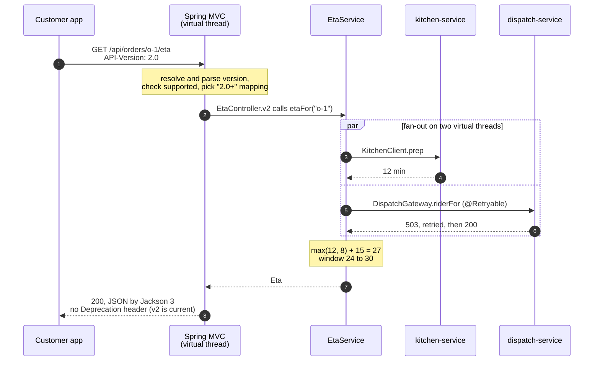
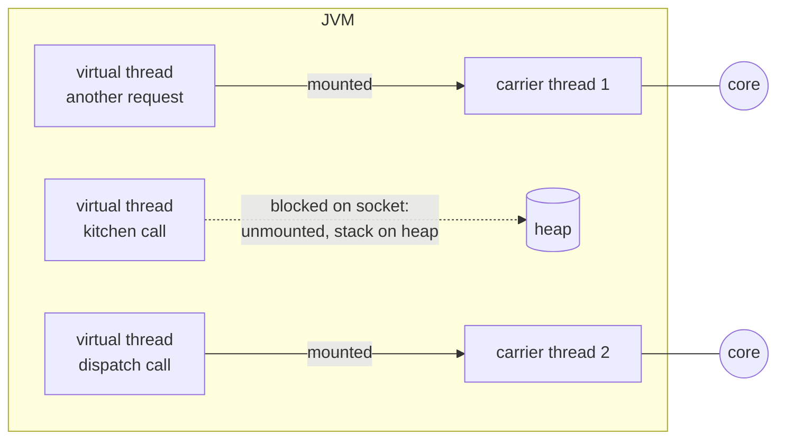

# 8. Spring Boot 4 Essentials for Microservices

<div class="badges" markdown><span class="badge badge-l1">L1 · Foundations</span><span class="badge badge-l2">L2 · Practitioner</span><span class="badge badge-l3">L3 · Senior/Lead</span><span class="badge badge-meta">Spring Boot 4.1 · Spring Framework 7 · Java 25</span></div>

<div class="grid two" markdown>

!!! info "Prerequisites"
    - Java 17+ (the code targets Java 25) and basic Spring Boot: `@SpringBootApplication`, `application.yml`, a REST controller
    - [Chapter 2](ch02-characteristics-principles.md) (tolerant reader, API evolution) and [Chapter 4](ch04-twelve-factor.md) (config, containers)
    - Helpful: having upgraded a Boot 2 or 3 application before

!!! abstract "What you'll learn"
    - What actually changed from Boot 3 to Boot 4, and what it means for a microservice
    - **Modular starters**, and the one missing dependency that passes tests and fails in production
    - **Jackson 3**: new packages, new defaults, `@JacksonComponent`
    - **JSpecify** null safety from the framework down to your code
    - **Virtual threads** for simple, blocking, parallel calls to other services
    - **HTTP service clients**, built-in **API versioning** and **deprecation headers**, `@Retryable`
    - Testing with `MockMvcTester` and `RestTestClient`; startup with the **AOT cache**
    - A safe migration path from Boot 3

</div>

---

## 1 · Introduction & Context

### Why a framework chapter in an architecture handbook

The patterns in this handbook are framework-independent. But a microservice spends most of its code on the same few jobs: expose an HTTP API, call other services, serialize JSON, survive slow neighbours, start quickly in a container. Spring Boot 4 and Spring Framework 7 moved several of those jobs from add-on libraries into the core:

- calling another service is an **interface** (HTTP service clients), configured by properties;
- **API versioning** is built into request mapping, including standard deprecation headers;
- **retry and concurrency limits** are annotations in Spring Framework itself;
- **virtual threads** make plain blocking code scale, so most services don't need reactive programming;
- the whole framework is **null-annotated** with JSpecify.

This chapter builds one service, FoodFleet's **eta-service** ("when will my food arrive?"), that uses all of it. Later chapters assume these basics.

### How we got here

<ul class="mh-timeline">
<li><span class="when">2014 · Spring Boot 1.0</span><span class="what">Auto-configuration and starters; executable jars with embedded Tomcat.</span></li>
<li><span class="when">2018 · Spring Boot 2.0</span><span class="what">Spring Framework 5, WebFlux, Micrometer, Java 8 baseline.</span></li>
<li><span class="when">Nov 2022 · Spring Boot 3.0</span><span class="what">Java 17 baseline, Jakarta EE namespace (<code>javax.*</code> → <code>jakarta.*</code>), Micrometer Observation, GraalVM native images.</span></li>
<li><span class="when">Nov 2023 · Spring Boot 3.2</span><span class="what"><code>RestClient</code>, <code>JdbcClient</code>, virtual threads with one property, CRaC.</span></li>
<li><span class="when">Nov 2025 · Spring Boot 4.0</span><span class="what">Spring Framework 7, Jakarta EE 11, <strong>Jackson 3</strong>, <strong>modular starters</strong>, JSpecify, API versioning, HTTP service registry, built-in resilience.</span></li>
<li><span class="when">2026 · Spring Boot 4.1</span><span class="what">The version this handbook pins (4.1.1), with Spring Cloud 2025.1.</span></li>
</ul>

---

## 2 · Core Concepts & Terminology

### Boot 3 vs Boot 4 at a glance

| Area | Spring Boot 3.x | Spring Boot 4.x | What it means for a microservice |
|---|---|---|---|
| Baseline | Java 17, Jakarta EE 10, Framework 6 | Java 17 (25 recommended), **Jakarta EE 11**, Servlet 6.1, **Framework 7**, Kotlin 2.2 | Undertow is gone (no Servlet 6.1 support); use Tomcat or Jetty |
| Packaging of Boot itself | Few large jars | **One module per technology** (`spring-boot-webmvc`, `spring-boot-restclient`, …) with matching starters | Smaller apps, clearer dependencies; you must declare what you use |
| JSON | Jackson 2 (`com.fasterxml.jackson`) | **Jackson 3** (`tools.jackson`), `JsonMapper` | New packages and defaults; Jackson 2 support is deprecated |
| Null safety | Spring's own `@Nullable` | **JSpecify** (`@NullMarked`, `@Nullable`) throughout | Tools such as NullAway can check your code against the framework's contracts |
| Calling services | `RestClient`, `@HttpExchange` with manual factory setup | **HTTP service registry**: `@ImportHttpServices` + `spring.http.serviceclient.<group>.*` | A client is an interface plus properties |
| API versioning | DIY (paths, headers, custom conditions) | **Built in**: `@GetMapping(version = "2.0")`, `spring.mvc.apiversion.*`, deprecation handler | Several versions of one endpoint without custom plumbing |
| Retry / concurrency limits | Spring Retry or Resilience4j | **`@Retryable`, `@ConcurrencyLimit`** in Framework 7 | Basic resilience without another library (Resilience4j still for circuit breakers, chapter 18) |
| Testing | `@MockBean`, `MockMvc`, `TestRestTemplate` | `@MockitoBean`, `MockMvcTester`, **`RestTestClient`**; `@SpringBootTest` no longer configures MockMvc by itself | Update test annotations; prefer AssertJ-style testers |
| Startup | CDS (Java 21+) | **AOT cache** (Java 24/25, JEP 483 and 514), Spring AOT, native images | Faster starts in containers without going native |

### Modular starters

Boot 4 splits its own code into modules named after the technology, each with a starter:

| You use | Starter | Test starter |
|---|---|---|
| Spring MVC | `spring-boot-starter-webmvc` | `spring-boot-starter-webmvc-test` |
| `RestClient`, HTTP service clients | `spring-boot-starter-restclient` | |
| `WebClient` | `spring-boot-starter-webclient` | |
| Flyway | `spring-boot-starter-flyway` | |
| JDBC | `spring-boot-starter-jdbc` | `spring-boot-starter-jdbc-test` |
| Everything, as in Boot 3 (migration aid) | `spring-boot-starter-classic` | `spring-boot-starter-test-classic` |

!!! pitfall "Green tests, broken production"
    `spring-boot-starter-webmvc-test` pulled in the RestClient module transitively (through `RestTestClient`), so a service with `@ImportHttpServices` but **without** `spring-boot-starter-restclient` passed every test and then failed at startup in production with a missing `RestClient.Builder`. The Spring Boot team changed that dependency to optional ([spring-boot#48253](https://github.com/spring-projects/spring-boot/issues/48253)), but the rule stands: **declare the starter for every technology your main code uses.** This handbook's chapter 1 and 2 examples were corrected for exactly this.

### Jackson 3 in one table

| | Jackson 2 | Jackson 3 |
|---|---|---|
| Packages, group id | `com.fasterxml.jackson.*` | `tools.jackson.*` (annotations stay in `com.fasterxml.jackson.annotation`) |
| Main type | `ObjectMapper` (mutable) | `JsonMapper` (immutable; `JsonMapper.builder()`, `mapper.rebuild()`) |
| Exceptions | Checked `JsonProcessingException` | Unchecked `JacksonException`; `DatabindException`, `StreamReadException` |
| `java.time`, `Optional`, parameter names | Separate modules | **Built in** |
| Dates | Timestamps (numbers) by default | **ISO-8601 strings** by default |
| `null` for an `int` | Silently becomes `0` | **Error** (`FAIL_ON_NULL_FOR_PRIMITIVES` on) |
| Property order | Declaration order | **Alphabetical** (`SORT_PROPERTIES_ALPHABETICALLY` on) |
| Trailing tokens after the JSON value | Ignored | **Error** |
| Spring Boot customisation | `Jackson2ObjectMapperBuilderCustomizer`, `@JsonComponent`, `@JsonMixin` | `JsonMapperBuilderCustomizer`, `@JacksonComponent`, `@JacksonMixin` |
| Properties | `spring.jackson.read.*`, `write.*` | `spring.jackson.json.read.*`, `json.write.*` |

Spring Boot offers `spring.jackson.use-jackson2-defaults=true` to keep Jackson 2's behaviour while you migrate.

### JSpecify, virtual threads, AOT: the vocabulary

`@NullMarked`
:   Placed on a package (in `package-info.java`), it makes every type in it non-null by default. You mark the exceptions with `@Nullable`. Spring Framework 7 and Boot 4 are annotated this way.

NullAway
:   An Error Prone plugin from Uber that fails the build when code can dereference a possible `null`. In JSpecify mode it understands the annotations above, including Spring's.

Virtual thread
:   A thread managed by the JVM, not the OS (Java 21, JEP 444). Blocking I/O unmounts it from its **carrier** platform thread, so millions can exist. Since Java 24 (JEP 491), `synchronized` no longer pins it to the carrier.

Spring AOT
:   Build-time processing that generates bean definitions as code, required for GraalVM native images and optional on the JVM.

AOT cache
:   A JVM feature (Java 24 JEP 483, simplified in Java 25 by JEP 514) that records classes loaded and linked during a **training run** and reuses them at startup. The successor of CDS for this purpose.

---

## 3 · How It Works Internally

### One request through eta-service



Five framework features meet in that request:

1. **Virtual threads.** With `spring.threads.virtual.enabled=true`, Tomcat runs each request on a new virtual thread. `EtaService` starts two more for the downstream calls. All three block on sockets, and blocking costs almost nothing.
2. **API versioning.** The `ApiVersionStrategy` resolves the version (here from the `API-Version` header), parses it with the semantic parser (`2.0` → 2.0.0), rejects unsupported versions with 400, and lets the handler mapping choose the best `version` match. After the handler, the **deprecation handler** adds `Deprecation`, `Sunset` and `Link` headers if the resolved version is deprecated.
3. **HTTP service clients.** At startup, `@ImportHttpServices(group = "kitchen", …)` registers the interface in a **group**. Boot builds one `RestClient` per group from `spring.http.serviceclient.kitchen.*` (base URL, timeouts, API version to send) and creates a proxy that turns each method call into an HTTP request.
4. **`@Retryable`.** `@EnableResilientMethods` adds an interceptor that re-invokes `riderFor` on the listed exceptions, with exponential backoff. Here dispatch returned 503 once, so the call took two attempts.
5. **Jackson 3.** The auto-configured `JsonMapper` writes the response: the `Instant` as an ISO string, the window through our `@JacksonComponent`.

### Virtual threads, briefly



- A small pool of **carrier** platform threads (about one per core) runs whichever virtual threads are ready. A virtual thread that blocks on I/O is **unmounted**: its stack moves to the heap and the carrier picks up other work.
- Virtual threads are cheap to create and are **never pooled**: create one per task (`Executors.newVirtualThreadPerTaskExecutor()`).
- What used to limit concurrency (the Tomcat thread pool, typically 200) no longer does. **Limits must be explicit**: connection pools, `@ConcurrencyLimit`, rate limiters. Otherwise a slow dependency collects thousands of waiting calls.
- `ThreadLocal` still works, but caching heavy objects in thread-locals (one per thread, millions of threads) wastes memory.

### The HTTP service registry

```text
@ImportHttpServices(group = "kitchen", types = KitchenClient.class)
            │
            ▼
HttpServiceProxyRegistry ── group "kitchen" ──► RestClient ◄── spring.http.serviceclient.kitchen.*
            │                                       (base-url, connect-timeout, read-timeout,
            ▼                                        apiversion.default, apiversion.insert.header)
   KitchenClient proxy  (injectable bean)
```

Groups matter because each downstream service needs its own base URL, timeouts and API version. Global defaults for every client live under `spring.http.clients.*` (for example `connect-timeout`, and `imperative.factory` to choose the HTTP library).

---

## 4 · Design Considerations & Trade-offs

### Virtual threads or WebFlux?

| | Spring MVC + virtual threads | Spring WebFlux (reactive) |
|---|---|---|
| Programming model | Plain blocking Java; stack traces and debuggers work as usual | `Mono`/`Flux` operators; harder to read and debug |
| Scaling with slow I/O | Excellent: blocking is cheap | Excellent |
| Back-pressure and streaming | Manual (limits, queues) | Built in |
| Libraries | Anything blocking: JDBC, JPA, most SDKs | Needs reactive drivers end to end (R2DBC, reactive clients) |
| Best for | **Most request/response microservices** | Streaming (SSE, WebSocket fan-out), gateways, very high fan-in |

[Lab 14](../code-lab/lab-14-virtual-threads-vs-webflux.md) benchmarks both. FoodFleet's rule: **MVC with virtual threads by default**; WebFlux only for the live-tracking stream ([chapter 26](../communication/ch26-websockets-sse.md)) and the gateway ([chapter 10](../architecture-patterns/ch10-api-gateway-bff.md)).

### Choosing how clients send the API version

| Strategy | Example | Pros | Cons |
|---|---|---|---|
| **Header** | `API-Version: 2.0` | Clean URLs; default version for old clients | Invisible in browser history and some logs |
| Path segment | `/api/v2/orders/…` | Obvious, cache-friendly | Every version is a new URL; links break between versions |
| Query parameter | `?version=2.0` | Easy to test | Mixes with business parameters |
| Media type parameter | `Accept: application/json;version=2.0` | Purest HTTP | Unfamiliar to many client developers |

FoodFleet uses the **header**, with **1.0 as the default**: app versions installed before 2026 send no header and keep working, while v1 responses tell them about the sunset date. Versioning is not a substitute for compatible evolution ([chapter 2](ch02-characteristics-principles.md)): add fields freely, version only for breaking changes.

### Startup and memory options

| Option | Effort | Startup | Peak throughput | Notes |
|---|---|---|---|---|
| Plain JVM | None | Baseline | Full JIT | Fine for long-running services |
| **JVM + AOT cache** | One training run in the Dockerfile | Noticeably faster | Full JIT | Same JVM and JDK required at training and run time |
| JVM + Spring AOT + AOT cache | Build plugin step, fixed bean graph | Faster still | Full JIT | Conditions evaluated at build time; profiles must be known |
| GraalVM native image | Native build, reachability metadata | Fastest, lowest memory | Lower without PGO | Longer builds; some libraries need hints |

FoodFleet uses **AOT cache** for every service (chapter 4's and this chapter's Dockerfile) and native images only for scale-to-zero functions. Measure on your own services; the gains depend on how many classes your context loads.

### Migration from Boot 3: the safe order

1. Upgrade to the **latest 3.5.x** and remove every deprecation warning: deprecated APIs in 3.x are the ones removed in 4.0.
2. Run the OpenRewrite recipe `org.openrewrite.java.spring.boot4.UpgradeSpringBoot_4_0` (rewrite-spring) to update the build, starters, packages and properties.
3. Temporarily add `spring-boot-properties-migrator` (it reports renamed properties at startup) and, if needed, the **classic starters** to get compiling quickly; then move to modular starters.
4. Decide on Jackson: migrate to Jackson 3 with `use-jackson2-defaults=true` first, then switch defaults off **one by one with contract tests** (chapter 63).
5. Replace `@MockBean` with `@MockitoBean`, add `@AutoConfigureMockMvc` where `@SpringBootTest` used MockMvc, and check that every technology has its starter in `main`, not just `test`.

---

## 5 · Hands-on Implementation

Code: `code/chapters/ch08-spring-boot-4/`, FoodFleet **eta-service** (port 8088).

```text
dev/foodfleet/ch08/
├── EtaApplication.java
└── eta/
    ├── domain/   plain Java, @NullMarked: EtaCalculator, EtaWindow
    ├── client/   HTTP service clients, DispatchGateway (@Retryable), EtaService (virtual-thread fan-out)
    ├── api/      EtaController (v1, v2), EtaWindowJacksonComponent, ApiErrors (Problem Details)
    ├── config/   client groups, deprecation handler, JsonMapper customizer, properties
    └── support/  ThreadKindHeaderFilter (debug aid)
```

```bash
cd code
mvn -B -pl chapters/ch08-spring-boot-4 -am verify
```

### 🟢 Level 1: starters and configuration

<div class="badges" markdown><span class="badge badge-l1">L1 · Foundations</span></div>

One starter per technology the code uses, including the RestClient starter in `main` scope:

```xml title="pom.xml"
--8<-- "code/chapters/ch08-spring-boot-4/pom.xml:21:48"
```

Everything environment-specific is a property ([chapter 4](ch04-twelve-factor.md)):

```yaml title="application.yml"
--8<-- "code/chapters/ch08-spring-boot-4/src/main/resources/application.yml"
```

### 🔵 Level 2: clients, versions and JSON

<div class="badges" markdown><span class="badge badge-l2">L2 · Practitioner</span></div>

A downstream service is an interface. Records bind only the fields we use (tolerant reader):

```java title="client/KitchenClient.java"
--8<-- "code/chapters/ch08-spring-boot-4/src/main/java/dev/foodfleet/ch08/eta/client/KitchenClient.java"
```

```java title="config/ClientConfiguration.java"
--8<-- "code/chapters/ch08-spring-boot-4/src/main/java/dev/foodfleet/ch08/eta/config/ClientConfiguration.java"
```

Two versions of one endpoint:

```java title="api/EtaController.java"
--8<-- "code/chapters/ch08-spring-boot-4/src/main/java/dev/foodfleet/ch08/eta/api/EtaController.java"
```

Deprecating v1 and tuning Jackson happen in configuration, not in the controller:

```java title="config/WebConfiguration.java"
--8<-- "code/chapters/ch08-spring-boot-4/src/main/java/dev/foodfleet/ch08/eta/config/WebConfiguration.java"
```

```java title="api/EtaWindowJacksonComponent.java"
--8<-- "code/chapters/ch08-spring-boot-4/src/main/java/dev/foodfleet/ch08/eta/api/EtaWindowJacksonComponent.java"
```

What Jackson 3 changes, pinned in a test so the team sees it:

```java title="Jackson3DefaultsTest.java"
--8<-- "code/chapters/ch08-spring-boot-4/src/test/java/dev/foodfleet/ch08/eta/jackson/Jackson3DefaultsTest.java"
```

### 🟣 Level 3: virtual-thread fan-out with built-in resilience

<div class="badges" markdown><span class="badge badge-l3">L3 · Senior/Lead</span></div>

Two downstream calls in parallel, a time budget for both, and different failure policies: no kitchen estimate means no ETA (503); no dispatch answer means a wider window with `degraded: true`.

```java title="client/EtaService.java"
--8<-- "code/chapters/ch08-spring-boot-4/src/main/java/dev/foodfleet/ch08/eta/client/EtaService.java:46:82"
```

```java title="client/DispatchGateway.java"
--8<-- "code/chapters/ch08-spring-boot-4/src/main/java/dev/foodfleet/ch08/eta/client/DispatchGateway.java"
```

The domain stays plain Java, null-safe by default:

```java title="domain/EtaCalculator.java"
--8<-- "code/chapters/ch08-spring-boot-4/src/main/java/dev/foodfleet/ch08/eta/domain/EtaCalculator.java:20:46"
```

!!! tip "Make the null checks build failures"
    `@NullMarked` documents intent; **NullAway** enforces it. Add Error Prone with the NullAway plugin to the compiler configuration, set `-XepOpt:NullAway:JSpecifyMode=true` and `-XepOpt:NullAway:OnlyNullMarked=true`, and calling `rider.minutesToCustomer()` without the `null` check in `EtaCalculator` becomes a compile error. Spring's own APIs are checked the same way, because they're annotated too.

### 🟣 Level 3: testing the contract and the clients

<div class="badges" markdown><span class="badge badge-l3">L3 · Senior/Lead</span></div>

`@WebMvcTest` with `MockMvcTester` (AssertJ style) for the HTTP contract, and `RestTestClient`, Framework 7's RestClient-style test client, bound to the same MockMvc:

```java title="EtaControllerTest.java"
--8<-- "code/chapters/ch08-spring-boot-4/src/test/java/dev/foodfleet/ch08/eta/api/EtaControllerTest.java"
```

The real clients, retry proxy and fan-out against two stub servers built on the JDK's `HttpServer` (no extra dependency):

```java title="EtaServiceIntegrationTest.java (excerpt)"
--8<-- "code/chapters/ch08-spring-boot-4/src/test/java/dev/foodfleet/ch08/eta/client/EtaServiceIntegrationTest.java:64:107"
```

### 🔴 Level 4: container startup with the AOT cache

<div class="badges" markdown><span class="badge badge-l4">L4 · Architect</span></div>

```dockerfile title="Dockerfile"
--8<-- "code/chapters/ch08-spring-boot-4/Dockerfile"
```

The training run starts the Spring context once (`spring.context.exit=onRefresh`) and writes `app.aot`. The runtime JVM must be the same JDK build, with the same classpath, which a multi-stage Dockerfile guarantees.

### Run and verify

```bash
mvn -pl chapters/ch08-spring-boot-4 spring-boot:run       # needs kitchen on 8091 and dispatch on 8092

# v1 (no header): deprecated, says so
curl -si localhost:8088/api/orders/o-1/eta | grep -Ei '^(HTTP|deprecation|sunset|link)|etaMinutes'

# v2
curl -s localhost:8088/api/orders/o-1/eta -H 'API-Version: 2.0' | jq
# {
#   "orderId": "o-1",
#   "window": { "from": 24, "to": 30, "display": "24–30 min" },
#   "estimatedArrival": "2026-10-01T08:27:00Z",
#   "breakdown": { "prepMinutes": 12, "waitForRiderMinutes": 0, "travelMinutes": 15 },
#   "degraded": false
# }

# unsupported version → 400 Problem Details
curl -si localhost:8088/api/orders/o-1/eta -H 'API-Version: 3.0' | head -1

# are requests really on virtual threads?
mvn -pl chapters/ch08-spring-boot-4 spring-boot:run -Dspring-boot.run.arguments=--foodfleet.debug.thread-kind-header=true
curl -si localhost:8088/api/orders/o-1/eta | grep -i x-thread-kind        # X-Thread-Kind: virtual
```

!!! question "Try it"
    1. Remove `spring-boot-starter-restclient` from the POM and run the tests, then `spring-boot:run`. What happens in each case? Put it back.
    2. Remove the `JsonMapperBuilderCustomizer` and call v2. In what order do the properties come back now?
    3. Set dispatch's `read-timeout` to `400ms`. Three attempts no longer fit in the 800 ms budget. What does the customer see when dispatch is slow?
    4. Set `spring.threads.virtual.enabled=false` and check `X-Thread-Kind`. Then lower `server.tomcat.threads.max` to 2 and send 10 parallel requests to a slow stub. What changes?

---

## 6 · Production Readiness

- [x] **Every technology used in `main` has its starter in `main` scope**; a smoke test starts the packaged jar in CI, not only the test context
- [x] **Virtual threads on**, and every shared resource **explicitly limited**: JDBC pool size, `@ConcurrencyLimit` per downstream service, rate limits at the edge
- [x] **Per-group client timeouts** (`connect-timeout`, `read-timeout`) shorter than the caller's budget, including retries
- [x] **Retries only for transient failures** (I/O, 5xx), with backoff, and only for idempotent operations ([chapter 3](ch03-distributed-systems-fundamentals.md))
- [x] **API versions**: supported list is explicit; deprecated versions send `Deprecation`, `Sunset` and `Link`; usage per version is measured before the sunset date
- [x] **Jackson 3 behaviour pinned by contract tests** on serialized output, especially dates, enums, nulls and property names
- [x] **`@NullMarked` packages** and NullAway in the build for new code
- [x] **Problem Details** (RFC 9457) for all errors (`spring.mvc.problemdetails.enabled=true`)
- [x] **AOT cache** in the image; startup time and memory tracked per release
- [x] **Graceful shutdown** (`server.shutdown=graceful`) and Kubernetes probes enabled ([chapter 52](../observability/ch52-health-checks-actuator.md))

---

## 7 · Anti-patterns & Pitfalls

!!! pitfall "Incident 1: the starter that only existed in tests"
    **Context.** A team migrated menu-service to Boot 4 and moved to modular starters.
    **Symptoms.** All tests passed. The first canary pod crashed at startup: no `RestClient.Builder` bean for the HTTP service client.
    **Root cause.** The RestClient module came transitively through the webmvc **test** starter, so it was on the test classpath only.
    **Fix.** `spring-boot-starter-restclient` in `main` scope, and a CI step that starts the packaged jar (`java -jar … --spring.context.exit=onRefresh`) after the tests.

!!! pitfall "Incident 2: `null` stopped meaning zero"
    **Context.** After moving to Jackson 3, a partner integration started receiving 400 errors.
    **Symptoms.** The partner's POS system sent `"packagingFeePaise": null` for restaurants without a packaging fee. Jackson 2 had quietly turned it into 0.
    **Root cause.** Jackson 3 enables `FAIL_ON_NULL_FOR_PRIMITIVES`.
    **Fix.** The field became `Integer` with an explicit default in the anti-corruption layer (chapter 5): the *business* decision "no fee means zero" now lives in code, not in a library default. A contract test with the partner's real payloads was added.

!!! pitfall "Incident 3: virtual threads removed the accidental limit"
    **Context.** order-service switched on virtual threads during a sale.
    **Symptoms.** Throughput rose, then PostgreSQL connection acquisition timeouts appeared, and the payment provider started rate limiting.
    **Root cause.** The 200-thread Tomcat pool had been acting as an unplanned concurrency limit. Without it, thousands of requests reached the 30-connection pool and the provider at once.
    **Fix.** Explicit limits: `@ConcurrencyLimit` on the payment client, a bounded wait for DB connections with fast 503s, and a rate limiter at the gateway ([chapter 18](../architecture-patterns/ch18-resilience-patterns.md)).

| Anti-pattern | Symptom | Fix |
|---|---|---|
| `spring-boot-starter-classic` forever | Every module on the classpath; slower start, larger attack surface | Classic starters only as a migration step |
| Pooling virtual threads | Fixed pool of "virtual" threads that queue like platform threads | One virtual thread per task; limit the *resource*, not the threads |
| Heavy `ThreadLocal` caches | Memory grows with concurrent requests | Pass context explicitly, or use scoped values when your JDK provides them |
| Retrying everything | Retry storms; duplicate side effects | Retry only transient errors on idempotent calls, with backoff |
| One huge HTTP client group | Same timeouts for a 50 ms service and a 2 s one | One group per downstream service |
| Versioning every change | v7 of an endpoint nobody can remove | Compatible evolution first; versions only for breaking changes, with a sunset |
| `use-jackson2-defaults` forever | Two JSON behaviours across the fleet | Treat it as a migration flag with an end date |
| Reactive code "for performance" in simple services | Hard-to-debug pipelines, no gain | MVC + virtual threads unless you need streaming or back-pressure |

---

## 8 · Enterprise Case Study

### FoodFleet: one baseline for 30 services

!!! decision "ADR-008: Spring Boot 4.1 baseline for all FoodFleet services"
    **Status:** Accepted · **Date:** 2026-08-25

    **Context.** Services ran a mix of Boot 3.3–3.5 with three HTTP client styles, two retry libraries and Jackson 2. Boot 3.5 is the last 3.x line, and the platform team wants one golden path.

    **Decision.** All services move to Spring Boot 4.1 and Java 25 using the order above, one stream-aligned team at a time. The golden-path template ([chapter 7](ch07-conways-law-team-topologies.md)'s platform) provides: modular starters; MVC with virtual threads; HTTP service client groups with timeouts; built-in API versioning via header with 1.0 default; `@Retryable`/`@ConcurrencyLimit` for simple cases and Resilience4j circuit breakers where needed; Jackson 3 with contract tests; `@NullMarked` packages with NullAway; AOT cache in the image.

    **Consequences.** ✅ One way to call a service, version an API and build an image; less code per service. ✅ Faster container starts help autoscaling during dinner peaks. ⚠️ Jackson 3 default changes need contract tests per public API. ⚠️ Teams must declare limits explicitly once virtual threads are on.

### Fintech analogue: serialization is a contract 🔴

In payments and trading systems, JSON output often feeds reconciliation, regulators' reports and partners' parsers that nobody controls. A silent change in date format, enum naming or property order can break a downstream batch job days later. Banks typically treat a Jackson major upgrade like an API change: freeze the serialized form with **golden-file contract tests**, keep money as `BigDecimal` or integer minor units (never `double`), and only then flip defaults one at a time. The same discipline applies to Boot's `use-jackson2-defaults`.

### E-commerce analogue: sale-day concurrency

On sale days, a marketplace's product, cart and checkout services see several times their normal traffic within minutes. Virtual threads let blocking services absorb the spike in waiting requests without thread-pool tuning, but the bottlenecks move to databases, caches and third-party APIs. The teams that handle sale days well size those **resources** explicitly (bulkheads per dependency, connection pools, queueing with fast rejection) and rehearse with load tests ([chapter 65](../testing/ch65-performance-chaos-arch-tests.md)).

---

## 9 · Interview Q&A + Summary

#### Q1. What are the biggest changes in Spring Boot 4 compared with Boot 3? · <span class="badge badge-l2">L2</span> · Cognizant · TCS · Infosys

**Short answer:** Spring Framework 7 and Jakarta EE 11; Boot split into **modular starters**; **Jackson 3**; **JSpecify** null-safety annotations; built-in **API versioning**; the **HTTP service registry** for declarative clients; **`@Retryable`/`@ConcurrencyLimit`** in the framework; `@MockitoBean`, `MockMvcTester`, `RestTestClient` for testing. Java 17 is still the minimum.

**What a 15-YoE answer adds:** the migration order (3.5 first, OpenRewrite, properties migrator, classic starters as a bridge), and the production risks: missing starters in `main`, Jackson default changes, concurrency limits after enabling virtual threads.

#### Q2. How do virtual threads work, and when should you not use them? · <span class="badge badge-l2">L2</span><span class="badge badge-l3">L3</span> · Amazon · Flipkart · Goldman Sachs

**Short answer:** They're JVM-scheduled threads that unmount from a carrier platform thread when they block on I/O, so blocking code scales to many concurrent requests. They don't help CPU-bound work. Don't pool them, avoid heavy `ThreadLocal` caches, and put explicit limits on shared resources. On Java 21–23, long `synchronized` blocks around I/O pin the carrier; Java 24 fixed that (JEP 491).

**Red flags:** "Virtual threads make code faster." They raise concurrency for I/O-bound work; they don't speed up a single request.

#### Q3. Virtual threads or WebFlux for a new service? · <span class="badge badge-l3">L3</span> · Flipkart · JP Morgan

**Short answer:** For request/response services that call databases and other services, Spring MVC with virtual threads: simpler code, same scalability for I/O-bound work, every blocking library works. WebFlux when you need streaming, back-pressure, or a fully non-blocking gateway.

#### Q4. How does Spring Boot 4's API versioning work? · <span class="badge badge-l2">L2</span><span class="badge badge-l3">L3</span> · SAP · Amazon

**Short answer:** Configure where the version comes from (header, query parameter, path segment or media type parameter) with `spring.mvc.apiversion.*`, then add `version = "1.0"` or `"2.0+"` to request mappings. Unsupported versions get 400. A default version can serve old clients. An `ApiVersionDeprecationHandler` bean adds `Deprecation`, `Sunset` and `Link` headers to deprecated versions. Clients (RestClient, HTTP service clients) can send the version automatically.

**Follow-ups:** "Header or path?" Header keeps URLs stable and allows a default; path is more visible and cache-friendly. Either way, prefer compatible evolution and version only breaking changes.

#### Q5. What changed in Jackson 3 that can break a running system? · <span class="badge badge-l3">L3</span> · Goldman Sachs · JP Morgan

**Short answer:** New packages (`tools.jackson`), immutable `JsonMapper`, unchecked exceptions, and new defaults: ISO-8601 dates instead of timestamps, errors for `null` into primitives and for trailing tokens, alphabetical property order, enums read and written with `toString()`. Each can change your API's output or reject input that used to work. Pin output with contract tests and switch defaults deliberately.

#### Q6. How do you call another microservice in Spring Boot 4? · <span class="badge badge-l2">L2</span> · Cognizant · Accenture · Flipkart

**Short answer:** Declare an interface with `@HttpExchange`/`@GetExchange`, register it with `@ImportHttpServices(group = "kitchen", types = …)`, and configure `spring.http.serviceclient.kitchen.base-url`, timeouts and API version in properties. Inject the interface. Add `spring-boot-starter-restclient`. Use one group per downstream service so timeouts differ.

#### Q7. What are `@Retryable` and `@ConcurrencyLimit` in Spring Framework 7, and when are they not enough? · <span class="badge badge-l3">L3</span> · Amazon · Flipkart

**Short answer:** Annotations in `org.springframework.resilience.annotation`, enabled with `@EnableResilientMethods`. `@Retryable` retries selected exceptions with backoff and jitter; `@ConcurrencyLimit` caps concurrent invocations (a simple bulkhead). They don't provide circuit breakers, rate limiters or time limiters: use Resilience4j (Spring Cloud CircuitBreaker) for those (chapter 18).

#### Q8. What is JSpecify and why did Spring adopt it? · <span class="badge badge-l2">L2</span><span class="badge badge-l3">L3</span> · SAP · any Spring shop

**Short answer:** A standard set of nullness annotations (`@NullMarked`, `@Nullable`, `@NonNull`, `@NullUnmarked`) agreed by several vendors. Spring Framework 7 and Boot 4 annotate their APIs with it, so tools like NullAway, IntelliJ and Kotlin see consistent nullness from the framework down to your code. `@NullMarked` on a package makes non-null the default.

#### Q9. How do you make a Spring Boot service start faster in Kubernetes? · <span class="badge badge-l3">L3</span><span class="badge badge-l4">L4</span> · Amazon · Goldman Sachs

**Short answer:** Measure first. Then: trim the classpath (modular starters), lazy-initialize only where safe, use the **AOT cache** (Java 25: `-XX:AOTCacheOutput` training run in the Dockerfile, `-XX:AOTCache` at runtime), optionally Spring AOT on the JVM, and GraalVM native images for scale-to-zero. Tune CPU requests: JIT and startup are CPU-hungry. Use startup probes so slow starts don't trigger restarts.

#### Q10. How would you migrate 30 services from Boot 3 to Boot 4? · <span class="badge badge-l4">L4</span> · JP Morgan · SAP · Flipkart

**Short answer:** Upgrade all to the latest 3.5 and clear deprecations; publish a Boot 4 golden-path template; migrate a pilot service with OpenRewrite (`UpgradeSpringBoot_4_0`), the properties migrator and classic starters as a bridge; add contract tests around JSON before switching Jackson defaults; then roll out team by team behind canaries, with a packaged-jar smoke test in CI. Track progress on a dashboard of service versions.

#### Q11. What changed in Spring Boot testing? · <span class="badge badge-l2">L2</span> · TCS · Infosys · Cognizant

**Short answer:** `@MockBean`/`@SpyBean` are gone; use `@MockitoBean`/`@MockitoSpyBean`. `@SpringBootTest` doesn't configure MockMvc or `TestRestTemplate` by itself; add `@AutoConfigureMockMvc` or `@AutoConfigureTestRestTemplate`. Test starters are per technology (`spring-boot-starter-webmvc-test`). `MockMvcTester` gives AssertJ-style assertions, and `RestTestClient` offers a RestClient-style API bound to MockMvc, an application context or a running server.

#### Q12. What happens when an old app version calls a versioned endpoint without a version? · <span class="badge badge-l2">L2</span> · Swiggy-/Zomato-style product companies

**Short answer:** With `spring.mvc.apiversion.default` set, it gets the default version (FoodFleet: 1.0); without a default and with versioning required, it gets 400. Serve old clients a default, mark that version deprecated with `Deprecation`/`Sunset` headers, measure its traffic, and force-update the app before the sunset date.

### Key takeaways

- Boot 4 moves everyday microservice needs into the core: **declarative HTTP clients, API versioning, retry and concurrency limits, null safety**.
- **Modular starters** make dependencies explicit; declare every starter your main code needs, and smoke-test the packaged jar.
- **Jackson 3** changes packages *and* defaults; pin your JSON with contract tests before switching defaults.
- **Virtual threads** make blocking code scale; once they're on, **limits must be explicit**.
- Use the **AOT cache** for faster container starts, and migrate from Boot 3 in a fixed, boring order.

### Further reading

- Spring Boot, [4.0 Migration Guide](https://github.com/spring-projects/spring-boot/wiki/Spring-Boot-4.0-Migration-Guide) and [release notes](https://github.com/spring-projects/spring-boot/wiki)
- Spring Boot reference: [HTTP service interface clients](https://docs.spring.io/spring-boot/reference/io/rest-client.html), [JSON](https://docs.spring.io/spring-boot/reference/features/json.html), [Spring MVC API versioning](https://docs.spring.io/spring-boot/reference/web/servlet.html)
- Spring Framework reference: [API versioning](https://docs.spring.io/spring-framework/reference/web/webmvc-versioning.html)
- Spring blog, [Introducing Jackson 3 support in Spring](https://spring.io/blog/2025/10/07/introducing-jackson-3-support-in-spring/)
- FasterXML, [Migrating to Jackson 3](https://github.com/FasterXML/jackson/blob/main/jackson3/MIGRATING_TO_JACKSON_3.md)
- [JSpecify](https://jspecify.dev/) and [NullAway](https://github.com/uber/NullAway)
- OpenRewrite, [Migrate to Spring Boot 4.0](https://docs.openrewrite.org/recipes/java/spring/boot4/upgradespringboot_4_0-community-edition)
- JEP 444 (virtual threads), JEP 491 (synchronize without pinning), JEP 483 and JEP 514 (AOT cache)

---

**Previous:** [← 7. Conway's Law & Team Topologies](ch07-conways-law-team-topologies.md) · **Next:** [9. Hexagonal & Clean Architecture →](../architecture-patterns/ch09-hexagonal-clean-architecture.md)
