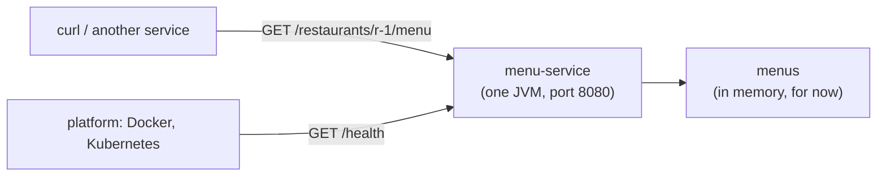

# Your First Microservice in 15 Minutes

<div class="badges" markdown><span class="badge badge-l1">L1 · Foundation</span></div>

A microservice is a small program that owns one business capability, answers over the network, and can be built, tested, deployed and scaled on its own. Frameworks help a lot with that, but none is required. This walkthrough builds FoodFleet's **menu-service** with nothing but a JDK 25, so every moving part is visible. [Chapter 8](../foundations/ch08-spring-boot-4-essentials.md) then shows what Spring Boot 4 adds.

You'll need a JDK 25 ([Environment setup](environment-setup.md)), `curl`, and Docker for the last two steps.



## 1. The data: a record that can't be invalid

```java title="code/getting-started/menu-service/src/main/java/dev/foodfleet/menu/MenuItem.java"
--8<-- "code/getting-started/menu-service/src/main/java/dev/foodfleet/menu/MenuItem.java"
```

A record gives you the constructor, accessors, `equals` and `hashCode`. The compact constructor checks its inputs, so an invalid item can't exist. Prices are whole paise, because floating-point money rounds wrongly.

## 2. The service: one endpoint, a health check, proper errors

```java title="code/getting-started/menu-service/src/main/java/dev/foodfleet/menu/MenuService.java"
--8<-- "code/getting-started/menu-service/src/main/java/dev/foodfleet/menu/MenuService.java:31:38"
```

The service does four things every microservice in this handbook does:

| What | Where | Why |
|---|---|---|
| **One request per virtual thread** | `Executors.newVirtualThreadPerTaskExecutor()` | Simple blocking code that still serves thousands of concurrent requests ([chapter 66](../performance-scalability/ch66-latency-virtual-threads-reactive.md)) |
| **A health endpoint** | `GET /health` | Platforms decide whether to send traffic or restart from it ([chapter 52](../observability/ch52-health-checks-actuator.md)) |
| **Errors as RFC 9457 problem documents** | `problem(…)` | Callers get `application/problem+json` with a status, title and detail, never an HTML error page ([chapter 21](../communication/ch21-rest-api-design.md)) |
| **Port from the environment** | `PORT` | The platform chooses where it listens ([chapter 4](../foundations/ch04-twelve-factor.md)) |

## 3. Run it, straight from source

No build tool: the JDK's source launcher compiles in memory (JEP 330, and since JDK 22 across several files, JEP 458):

```bash
cd code/getting-started/menu-service
java src/main/java/dev/foodfleet/menu/MenuService.java
```

In another terminal:

```console
$ curl -s localhost:8080/restaurants/r-1/menu?veg=true
{"restaurantId":"r-1","items":[{"id":"m-1","name":"Paneer tikka","pricePaise":24900,"vegetarian":true},{"id":"m-3","name":"Masala dosa","pricePaise":14900,"vegetarian":true}]}

$ curl -s -i localhost:8080/restaurants/r-9/menu
HTTP/1.1 404 Not Found
Content-type: application/problem+json
{"type":"about:blank","title":"Restaurant not found","status":404,"detail":"No restaurant with id r-9","instance":"/restaurants/r-9/menu"}
```

## 4. Test it

The tests start the service on a free port and call it over HTTP, as its callers will. They use only the JDK:

```java title="code/getting-started/menu-service/src/test/java/dev/foodfleet/menu/MenuServiceTest.java"
--8<-- "code/getting-started/menu-service/src/test/java/dev/foodfleet/menu/MenuServiceTest.java:24:29"
```

```console
$ javac -d build/main $(find src/main/java -name '*.java')
$ javac -d build/test -cp build/main $(find src/test/java -name '*.java')
$ java -cp build/main:build/test dev.foodfleet.menu.MenuServiceTest
PASS menu returns 200 and three items
PASS ?veg=true leaves out the biryani
PASS unknown restaurant is a 404 problem document
PASS POST is a 405 problem document
PASS a menu item can't cost nothing
all tests passed
```

## 5. Package and containerise it

```bash
jar --create --file build/menu-service.jar --main-class dev.foodfleet.menu.MenuService -C build/main .
docker build -t foodfleet/menu-service:0.1.0 .
docker run -d --name menu-service -p 8080:8080 --memory 256m --cpus 1 foodfleet/menu-service:0.1.0
curl -s localhost:8080/health
```

```dockerfile title="code/getting-started/menu-service/Dockerfile"
--8<-- "code/getting-started/menu-service/Dockerfile"
```

The image holds a JRE and a 5 KB jar, and runs as user 10001, not root ([chapter 53](../deployment/ch53-containerization.md) explains each of these choices and measures the alternatives).

## Measured: how long it takes

`verify/run.sh` runs every step above and times it:

```bash
JAVA_HOME=/path/to/jdk-25 code/getting-started/menu-service/verify/run.sh
```

On the handbook's 2-vCPU VM (JDK 25.0.4, Docker 29, the image built on chapter 54's Temurin 25 JRE base):

| Step | First run ever | Later runs (two) |
|---|---|---|
| 1. `java MenuService.java` until `/health` answers | 7.8 s | 1.6–1.7 s |
| 2. compile and run the 5 tests | 5.2 s | 2.6–2.9 s |
| 3. `jar` (5,181 bytes) | 0.5 s | 0.1–0.2 s |
| … `java -jar` until `/health` | 0.26 s | 0.25–0.28 s |
| 4. `docker build` | 3.2 s | 0.4 s |
| 5. `docker run` until `/health` | 1.7 s | 0.6–0.7 s |
| **all steps** | **25.5 s** | **7.0–7.2 s** |

Other figures from the runs:

- The service used **58 MB** of memory (RSS) after its first request.
- The image's content was **30 MB**.

The machine needs seconds; the 15 minutes are for you to read the code, run the commands and break things.

## 6. Break it

!!! question "Try it"
    1. Request `/restaurants/r-1/menu` with `POST`. What status and body come back, and why is a problem document better than a stack trace?
    2. Add a `MenuItem` with a negative price to `MENUS`. When does the service fail, and how is that better than failing on the first request that reads it?
    3. Start two copies on ports 8081 and 8082. What would a client need to use both? (That's [chapter 11](../architecture-patterns/ch11-service-discovery-patterns.md) and [chapter 22](../communication/ch22-http-clients.md).)
    4. Kill the process while `curl` is in a loop. What does the caller see, and what should a platform do? (That's [chapter 52](../observability/ch52-health-checks-actuator.md).)

## 7. The same service on Spring Boot 4

Hand-written routing and JSON stop scaling at the second endpoint. Spring Boot 4 gives the same service:

- controllers;
- JSON with Jackson 3;
- validation;
- Problem Details by configuration;
- Actuator's health groups;
- HTTP service clients;
- virtual threads with one property;
- test slices.

[Chapter 8](../foundations/ch08-spring-boot-4-essentials.md) builds FoodFleet's eta-service that way, and [Lab 01](../code-lab/lab-01-hello-microservice.md) builds this menu-service on Spring Boot 4, step by step.

What doesn't change is what this page showed: one capability, its own process, a health endpoint, errors callers can parse, configuration from the environment, tests over HTTP, and an image that runs as non-root.
