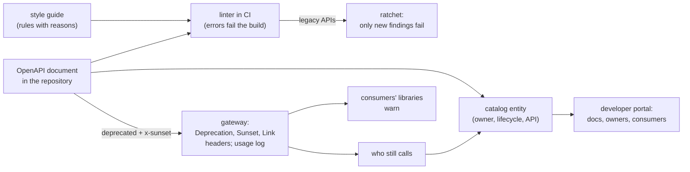

# 71. API Governance & Developer Portals

<div class="badges" markdown><span class="badge badge-l3">L3 · Senior/Lead</span><span class="badge badge-l4">L4 · Architect</span><span class="badge badge-meta">API style guides · linting · Spectral · Zalando guidelines · ratchets · versioning policy · Deprecation and Sunset headers · usage monitoring · Backstage · software catalog · developer portals</span></div>

<div class="grid two" markdown>

!!! info "Prerequisites"
    - [Chapter 21](../communication/ch21-rest-api-design.md): REST API design and versioning by header
    - [Chapter 27](../communication/ch27-api-contracts.md): API contracts, schema evolution and expand–migrate–contract
    - [Chapter 63](../testing/ch63-contract-testing.md): breaking-change detection with contracts and OpenAPI diffs
    - [Chapter 65](../testing/ch65-performance-chaos-arch-tests.md): fitness functions and freezing existing violations

!!! abstract "What you'll learn"
    - **A generic linter checks completeness, not design.** Against 33 problems planted in six OpenAPI documents:
        - **Spectral's recommended rules** caught **10**, such as a missing operationId or undefined path parameters.
        - **FoodFleet's house rules** caught **16** more, such as verbs in URLs, versions in paths, non-problem+json errors and money as floats.
        - **7** needed a reviewer: no Idempotency-Key on a payment POST, a card number in a query string, errors returned as 200.
        - There were **no false findings**. Linting took about 0.6 ms per document.
    - **A ratchet lets rules apply to old APIs.** order-service's 7 existing findings were recorded. A change was then judged only on its **3 new** findings, and **1 fix** was counted.
    - **Deprecation needs headers and a usage log.** Of 4 applications still calling a deprecated operation, the 2 using FoodFleet's client library logged warnings. The other 2 called with plain HTTP, and **neither was declared in the catalog**. Only the gateway's access log found them.
    - **The catalog is only as good as its checks.** **15 of 31** components and APIs failed at least one governance check:
        - missing lifecycles
        - owners that don't exist
        - an API with no definition
        - API documents with lint errors
        - production services with no runbook

</div>

---

## 1 · Introduction & Context

### Sixty APIs, six styles

By the time FoodFleet had sixty services, its public and internal APIs looked like six companies had built them:

- order-service versioned in the URL and everyone else by header.
- payment-service returned errors in its own format.
- promotions-service answered 200 with `{"ok": false}`.
- rider-service had an endpoint called `/getRiderLocation`.

When payment-service removed an old endpoint after announcing it on a mailing list, the support console broke. It wasn't on the list, and nobody knew it called payment-service.

The architecture review board tried to fix this with a review checklist, and became a bottleneck: two weeks to review an API, and the reviews still missed things. This chapter measures the alternative, governance that runs as code:

- **A style guide as linting rules** in every build.
- **A ratchet** so old APIs can adopt the rules without stopping work.
- **Deprecation that machines can read** and providers can measure.
- **A software catalog** whose entries are checked like code.

### Where it comes from

<ul class="mh-timeline">
<li><span class="when">2015–2016 · Public style guides</span><span class="what">Zalando publishes its RESTful API guidelines; Microsoft's and Google's API design guides follow. OpenAPI 3.0 (2017) becomes the common description.</span></li>
<li><span class="when">2018–2020 · Linting OpenAPI</span><span class="what">Spectral (Stoplight) turns style guides into rulesets; Zally does the same for Zalando's guidelines.</span></li>
<li><span class="when">2020 · Backstage</span><span class="what">Spotify open-sources its developer portal: a software catalog of components, APIs, systems and owners. It joins the CNCF.</span></li>
<li><span class="when">2019–2025 · Deprecation on the wire</span><span class="what">RFC 8594 (Sunset, 2019) and RFC 9745 (Deprecation, 2025) give HTTP headers to deprecation; RFC 9457 (2023) updates problem details.</span></li>
<li><span class="when">2025–2026 · Framework support</span><span class="what">Spring Framework 7 adds API versioning with a deprecation handler. Spectral rulesets 1.16.0, Zalando's guidelines, Backstage 1.55.3 and Spring Framework 7.0.9 are checked here.</span></li>
</ul>

---

## 2 · Core Concepts & Terminology



API governance
:   The rules for how APIs are designed, changed and retired, and how they are enforced. Good governance is mostly automated and explains itself, so teams don't wait on a board.

Style guide and linting
:   A style guide states the rules with reasons; a linter checks an API's description against them. **Spectral** runs rulesets over OpenAPI and AsyncAPI documents, with severities (error, warn, info).

Ratchet (baseline)
:   Recording an existing API's findings so a build fails only on new ones (like ArchUnit's freezing in chapter 65). The baseline only shrinks.

Versioning policy
:   When a change needs a new version (breaking changes only), how versions are named (FoodFleet: the `API-Version` header, not the URL), how long old ones live, and who approves exceptions.

Deprecation and sunset
:   A deprecated operation still works but should no longer be used; its sunset is when it stops working. RFC 9745's `Deprecation` header carries the date it was deprecated, RFC 8594's `Sunset` the removal date, and a `Link` points to the migration guide.

Software catalog and developer portal
:   A catalog lists every component, API, system and owning team, each described by a file kept with the code (Backstage's `catalog-info.yaml`). A developer portal (Backstage) puts documentation, ownership, API definitions and templates in one place.

---

## 3 · How It Works Internally

### Rules over an OpenAPI document

The linter reads a document and walks paths, operations and schemas. Spectral's rules check completeness and consistency. The house rules check design: here, path segments (kebab-case, no verbs, plural collections, no versions):

```java title="lint/Linter.java: path rules"
--8<-- "code/chapters/ch71-api-governance/src/main/java/dev/foodfleet/ch71/lint/Linter.java:116:142"
```

Every rule carries its source: the ten Spectral rules use `spectral:oas`'s names and severities, and the ten house rules cite the Zalando guideline they come from (or say where FoodFleet differs). Error responses, for example:

```java title="lint/Linter.java: problem+json for errors"
--8<-- "code/chapters/ch71-api-governance/src/main/java/dev/foodfleet/ch71/lint/Linter.java:183:187"
```

With Spectral itself, the house rules are a ruleset file that `extends: [[spectral:oas, recommended]]` and adds rules with `given` JSONPath expressions and functions such as `pattern`, `truthy` and `schema`.

### A ratchet

Findings are identified by rule and JSON pointer. The baseline is the list of findings when the rule was introduced:

```java title="lint/Baseline.java"
--8<-- "code/chapters/ch71-api-governance/src/main/java/dev/foodfleet/ch71/lint/Baseline.java:26:31"
```

### Deprecation on the wire

The document marks the operation `deprecated: true` with `x-deprecated-since`, `x-sunset` and `x-migration-guide`; the gateway turns them into headers on every response from that operation:

```java title="deprecation/Deprecations.java"
--8<-- "code/chapters/ch71-api-governance/src/main/java/dev/foodfleet/ch71/deprecation/Deprecations.java:69:75"
```

Spring Framework 7's `StandardApiVersionDeprecationHandler` does the same for whole API versions: `Deprecation` as `@` + epoch seconds, `Sunset` formatted with Java's `RFC_1123_DATE_TIME`, and `Link`s with `rel="deprecation"` and `rel="sunset"`. Two details from its source: pass the sunset date in UTC, or the header carries an offset instead of `GMT`; and days 1–9 come out with one digit, where RFC 9110's preferred date format has two (recipients generally accept both). FoodFleet's gateway formats the date itself.

---

## 4 · Design Considerations & Trade-offs

### Test setup

All runs used:

- JDK 25.0.4.
- Six OpenAPI 3.1 documents for FoodFleet services, with 33 design problems planted across five of them; menu-service is clean.
- A catalog of 37 Backstage entities (24 components, 7 APIs, 6 groups) with planted gaps.
- An HTTP gateway and eight consumer applications for the deprecation experiment.

There were two runs, with identical results apart from timings. `check_apis.sh` checks **26 statements** in the sources of Spectral's rulesets 1.16.0, Zalando's guidelines (commit 19a1905), Backstage 1.55.3 and Spring Framework 7.0.9, and all were found.

### Measured: what linting catches

| Document | Planted | Caught by Spectral's rules | Caught by house rules | Missed | False findings |
|---|---|---|---|---|---|
| menu-service | 0 | 0 | 0 | 0 | 0 |
| order-service | 7 | 1 | 6 | 0 | 0 |
| delivery-service | 6 | 4 | 2 | 0 | 0 |
| payment-service | 9 | 2 | 4 | 3 | 0 |
| rider-service | 8 | 3 | 4 | 1 | 0 |
| promotions-service | 3 | 0 | 0 | 3 | 0 |
| **total** | **33** | **10** | **16** | **7** | **0** |

The 7 that no rule caught:

- payment-service: no `Idempotency-Key` header on a payment POST
- payment-service: a card number in a query string (it ends up in access logs)
- payment-service: two booleans (`succeeded`, `failed`) for one status
- rider-service: PUT to start a shift: not idempotent, so it should be POST
- promotions-service: errors as 200 with `{"ok": false}`
- promotions-service: a discount as a bare number: percent or rupees?
- promotions-service: a date as a plain string, with no format

What the table shows:

- **Generic rules check that a document is complete, not that the API is good.** Spectral's recommended rules caught 10 of 33: missing operationIds, undefined tags, path parameters that don't match the template, missing contact and servers. Not one of them was a design problem a consumer would feel.
- **House rules caught the design problems the style guide names.** Verbs and versions in URLs, camelCase segments, singular collections, errors that aren't problem+json, money as floats, page/size instead of cursors, a deprecated operation with no sunset date: 16 more, with no false findings. Rules taken from a published guide (Zalando's here) arrive with reasons, which is what makes teams accept them.
- **A third of the design problems needed a person.** Idempotency, sensitive data in URLs, status modelling and the meaning of a number can be described by rules only partly (a rule can demand an `Idempotency-Key` on every POST, not judge which POSTs need one). promotions-service had no lint findings at all and three real problems. Linting makes review shorter, not unnecessary.
- **Severity decides what blocks.** 13 findings were errors and 13 warnings. Failing the build on errors would have stopped 4 of the 6 documents (all but menu-service and promotions-service), which is what a team adopting the rules would face on day one.

Linting took 0.56–0.67 ms per document.

### Measured: a ratchet on a legacy API

| | Findings |
|---|---|
| order-service as it was, recorded as the baseline | 7 |
| after a change adding `POST /orders/{orderId}/applyCoupon` and a `discountAmount` property, and fixing `total` | 9 |
| reported as new (fail the build) | **3**: `kebab-case-paths` and `verb-free-urls` on the new path, `money-as-decimal-string` on `discountAmount` |
| fixed (remove from the baseline) | 1: `total` |
| in the baseline, not reported | 6 |

The ratchet let the rules apply to order-service on the day they were introduced without blocking its team: the change was judged on its own three problems, and the baseline shrank by one. Findings are keyed by rule and location, so moving a problem counts as new; that's deliberate, since moved code is touched code.

### Measured: who still calls a deprecated operation

payment-service's `GET /payment-methods`, deprecated since 2026-01-05 with a sunset of 2026-07-06. The gateway's headers:

```text
Deprecation: @1767571200
Link: <https://developer.foodfleet.dev/apis/payment-service/migrations/payment-methods>; rel="deprecation"; type="text/html"
Sunset: Mon, 06 Jul 2026 00:00:00 GMT
```

Eight applications called payment-service for seven "days", 1,022 calls in all. Callers of the deprecated operation:

| Application | Calls | Declared in the catalog | Warned by FoodFleet's client library |
|---|---|---|---|
| checkout-bff | 140 | yes | yes |
| restaurant-portal | 21 | yes | yes |
| support-console | 14 | **no** | no (plain HTTP) |
| analytics-ingest | 7 | **no** | no (plain HTTP) |

The catalog declared 6 consumers of payment-service; the access log saw 8 callers. The two that weren't declared both called the deprecated operation.

What the table shows:

- **Headers reach only clients that read them.** The two applications using FoodFleet's client library logged a warning with the dates and the migration guide on their first deprecated call. The two calling with plain HTTP got the same headers and ignored them.
- **The catalog's consumer list was incomplete exactly where it mattered.** Declared dependencies (`consumesApis`) are written by people; the two undeclared callers were an internal tool and a batch ingester, the kind nobody remembers. Removing the endpoint by the catalog's list would have broken them, as it broke the support console in FoodFleet's incident.
- **Usage by caller is the sunset criterion.** The gateway logged the client identity (`X-Client-Id`) with each deprecated call, so the provider knew whom to contact and when the last caller had moved. Zalando's guideline [188] makes this a MUST.

### Measured: checking the catalog

37 entities: 24 components, 7 APIs and 6 groups. Results per check:

| Check | Failing | Entities |
|---|---|---|
| required: type, lifecycle, owner (Backstage's schema) | 2 | analytics-ingest, catalog-importer |
| required: definition (Backstage's schema, APIs) | 1 | geo-api |
| owner is a group in the catalog | 2 | cart-service (`team-ordering`), settlement-job (a person) |
| lifecycle is experimental, production or deprecated | 1 | recommendations (`prod`) |
| providesApis names an API in the catalog | 1 | eta-service |
| the API's owner owns the component that provides it | 1 | menu-service |
| the API's OpenAPI document has no lint errors | 4 | delivery, order, payment and rider APIs |
| a production component has a runbook annotation | 3 | geo-cache, promotions-service, refund-service |

**16 of 31** components and APIs passed every check.

What the table shows:

- **Backstage's schema is a floor.** Only 3 of the 15 failures broke a required field. Owners that don't exist, a lifecycle of `prod`, an API reference that resolves to nothing, and an owner mismatch all load into Backstage without complaint.
- **The catalog is where the other governance meets.** "The API's document lints clean" joins this chapter's linter to ownership; "has a runbook" joins chapter 46's runbooks; consumers join the deprecation log. A catalog is useful when it's checked like code, in CI, with failures routed to the owning team.

### Choosing

| Question | Do | Why (measured) |
|---|---|---|
| A style guide that's followed | Rules from a published guide (Zalando, Microsoft, Google), adapted, as a Spectral ruleset in CI | Spectral's rules alone caught 10 of 33; house rules 16 more, with no false findings |
| What blocks a build | Errors only; warnings visible in the pull request | Errors stopped 4 of 6 documents on day one |
| Existing APIs | A baseline per API that only shrinks | The change was judged on 3 new findings out of 9 |
| What rules can't see | A short API review for new APIs and breaking changes, with a checklist for idempotency, sensitive data, status modelling and units | 7 of 33 problems needed a person |
| Versioning | Additive changes need no version; breaking changes a new `API-Version`, run side by side | URL versions failed a house rule |
| Deprecation | `deprecated` + `x-sunset` in the document; Deprecation, Sunset and Link headers; client libraries that warn | 2 of 4 callers saw the warning; 2 used plain HTTP |
| Sunset decisions | Access logs by client identity, not the catalog's consumer list | 2 undeclared callers of the deprecated operation |
| Catalog quality | Catalog checks in CI beyond Backstage's schema | 15 of 31 entities failed a check |

---

## 5 · Hands-on Implementation

```text
ch71-api-governance/
├── src/main/java/dev/foodfleet/ch71/
│   ├── lint/          Linter (10 Spectral rules, 10 house rules), Baseline
│   ├── deprecation/   Deprecations (headers from the document, a client that warns, usage by caller)
│   ├── catalog/       Catalog (Backstage's required fields and FoodFleet's governance checks)
│   └── json/          Json
├── src/main/resources/openapi/   six OpenAPI documents
├── src/main/resources/catalog/   37 Backstage entities
├── src/test/java/…   UnitTest (3, tag unit)
└── verify/   build-libs.sh, run.sh, check_apis.sh, violations.tsv (33 planted problems), tools/ (Lab, RunSuites)
```

### 🟣 Level 3: governance in the pipeline

<div class="badges" markdown><span class="badge badge-l3">L3 · Senior/Lead</span></div>

- Every service keeps its OpenAPI document in its repository (generated from code in a build step, or written first), and CI runs Spectral with FoodFleet's ruleset; errors fail the build, and warnings appear as pull-request annotations.
- Legacy APIs carry a baseline file; a weekly report shows each baseline's size by team.
- `catalog-info.yaml` in every repository, with `owner`, `lifecycle`, `providesApis`, `consumesApis` and the runbook annotation; a catalog check runs in CI.

```yaml
# .spectral.yaml (sketch)
extends: [[spectral:oas, recommended]]
rules:
  verb-free-urls:
    description: "[141] URLs name resources, not actions."
    severity: error
    given: $.paths
    then: {field: "@key", function: pattern, functionOptions: {notMatch: "/(get|create|update|delete|cancel|apply)[A-Za-z-]*(/|$)"}}
```

### 🔴 Level 4: an operating model

<div class="badges" markdown><span class="badge badge-l4">L4 · Architect</span></div>

- A small API guild owns the style guide and ruleset, changes them by pull request with reasons, and reviews only new APIs and breaking changes.
- Deprecation as a process: `x-sunset` at least 6 months out for internal APIs (12 for partners), headers from the gateway, usage reviewed monthly by caller, brownouts in the final month, removal only when the log is empty.
- The developer portal (Backstage) shows each API's documentation, owner, consumers seen in traffic, lint status and deprecations.

```bash
JAVA_HOME=/path/to/jdk-25 verify/run.sh   # under a minute
```

### Run and verify

```text
$ verify/run.sh ratchet
== ratchet
order-service as it is: 7 findings, recorded as the baseline
a change adds an operation (POST /orders/{orderId}/applyCoupon) and a property (discountAmount), and fixes total:
  findings after the change: 9; new: 3; fixed: 1; still there (baselined, not reported): 6
  new:   kebab-case-paths at /paths/~1orders~1{orderId}~1applyCoupon
  new:   verb-free-urls at /paths/~1orders~1{orderId}~1applyCoupon
  new:   money-as-decimal-string at /components/schemas/Order/properties/discountAmount
  fixed: money-as-decimal-string at /components/schemas/Order/properties/total
```

!!! question "Try it"
    1. Write a rule that every POST under `/payments` declares an `Idempotency-Key` header. Which planted problem does it catch, and what else does it flag?
    2. Add a rule that query parameters must not be named like sensitive data (`card`, `cvv`, `pan`, `otp`). How would you keep it from flagging `cardBrand`?
    3. Change support-console to use the client library. What does it log, and what does the provider learn that it didn't before?
    4. Make the catalog check fail when a component is seen calling an API it doesn't declare in `consumesApis`.

---

## 6 · Production Readiness

- [x] **OpenAPI documents in every repository**, linted in CI with a shared ruleset
- [x] **Errors block, warnings inform**; baselines for legacy APIs, shrinking
- [x] **Review for new APIs and breaking changes only**, with a checklist for what rules can't see
- [x] **Versioning policy written down**: header versions, breaking changes only, side-by-side support
- [x] **Deprecation in the document** (`deprecated`, `x-sunset`), on the wire (Deprecation, Sunset, Link) and in client libraries
- [x] **Usage of deprecated operations by caller**, reviewed before every sunset
- [x] **A catalog checked in CI**: owners, lifecycles, API references, runbooks

---

## 7 · Anti-patterns & Pitfalls

!!! pitfall "Incident 1: the endpoint removed by mailing list"
    **Context.** payment-service deprecated `GET /payment-methods`, announced the removal by email to the teams listed as consumers, and removed it after three months.

    **Symptoms.** The support console's payment screen broke the next morning.

    **Root cause.** The consumer list was declared by hand and incomplete. Measured: of four applications still calling the deprecated operation, two weren't declared in the catalog, and both called with plain HTTP, so they never saw a warning.

    **Fix.** Sunset by usage: the gateway logs callers of deprecated operations by client identity, and an operation is removed only when the log is empty.

!!! pitfall "Incident 2: the linter everyone ignored"
    **Context.** The platform team enabled Spectral's recommended ruleset as a blocking check across all services.

    **Symptoms.** Builds failed everywhere on the first day; within a week the check was made optional, and nobody looked at it again.

    **Root cause.** A blocking check on existing APIs with no baseline, and rules that checked completeness rather than design. Measured: errors would have stopped 4 of 6 documents, and the design problems were caught by house rules or needed a reviewer, never by the recommended rules.

    **Fix.** House rules with reasons, a baseline per legacy API, errors blocking only new findings.

!!! pitfall "Incident 3: the API that passed every check"
    **Context.** promotions-service's API linted clean and went live.

    **Symptoms.** Mobile clients showed "success" for invalid coupon codes; discounts were applied as rupees where the backend meant percent.

    **Root cause.** Errors returned as 200 with `{"ok": false}`, and a bare number for the discount. Measured: no rule caught any of promotions-service's three problems.

    **Fix.** A review checklist for new APIs (status modelling, units, idempotency, sensitive data), and a `Money`/`Percentage` type in the shared schemas.

| Anti-pattern | Symptom | Fix |
|---|---|---|
| A review board for every change | Weeks of waiting, still misses | Rules in CI; review only new APIs and breaking changes |
| Generic rules only | Complete documents, inconsistent APIs | House rules from a published guide |
| Blocking checks with no baseline | Rules switched off | Ratchet per API |
| Rules without reasons | Arguments, exceptions | Cite the guideline; change rules by pull request |
| Deprecation by email | Breakage at sunset | Headers, client warnings, usage by caller |
| A catalog nobody checks | Stale owners, broken references | Catalog checks in CI |
| Versions in URLs for every change | Many versions, duplicated code | Additive changes without versions |

---

## 8 · Enterprise Case Study

### FoodFleet: governance that runs in the build

!!! decision "ADR-071: every API has an OpenAPI document in its repository, linted in CI with FoodFleet's Spectral ruleset (spectral:oas recommended plus house rules from Zalando's guidelines), errors blocking new findings and baselines for legacy APIs; an API guild reviews only new APIs and breaking changes; deprecations carry x-sunset and are served with Deprecation, Sunset and Link headers, and an operation is removed only when the gateway's log shows no callers; catalog-info.yaml in every repository, checked in CI"
    **Status:** Accepted · **Date:** 2026-03-02

    **Context.** Six API styles across sixty services, a two-week review queue, and an endpoint removal that broke an undeclared consumer. Measured:

    - Spectral's recommended rules caught 10 of 33 planted problems; house rules 16 more; 7 needed a reviewer; no false findings.
    - A ratchet judged a change on its 3 new findings out of 9.
    - Of 4 callers of a deprecated operation, 2 used plain HTTP and saw no warning, and those 2 weren't in the catalog.
    - 15 of 31 catalog entities failed a governance check; only 3 failures broke Backstage's required fields.

    **Decision.**

    - **Style:** the ruleset lives in the platform repository; rule changes by pull request with a cited reason; errors block new findings only.
    - **Review:** the API guild reviews new APIs and breaking changes within two working days, using a checklist for what rules can't check.
    - **Versioning:** `API-Version` header; breaking changes only; old versions supported for 6 months internally and 12 for partners.
    - **Deprecation:** gateway headers from the document; FoodFleet's client libraries warn and export a metric; usage by `X-Client-Id` on the portal; brownouts in the final month.
    - **Catalog:** Backstage, with CI checks for owners, lifecycles, API references, lint status and runbooks.

    **Consequences:**

    - ✅ Most review comments arrive in seconds, from the build.
    - ✅ Sunsets are decided by data, not by a mailing list.
    - ⚠️ The ruleset needs an owner; stale rules get ignored like stale checklists.
    - ⚠️ Every caller must send a client identity, which the gateway enforces.

### Fintech analogue: APIs regulators read

Banks with open-banking APIs publish them to external partners under regulatory standards, so their governance is stricter: specifications follow the regulator's schema, changes go through a published change calendar, deprecations carry contractual notice periods, and usage by partner is reported before any removal. The linting and usage tracking in this chapter are the internal version of the same discipline.

### E-commerce analogue: the platform's partner APIs

Marketplaces expose seller and logistics APIs to thousands of partners they don't control. They version by header or date, never remove without long sunsets, warn through headers and partner dashboards, and run brownouts (short planned outages of the old endpoint) in the final weeks to flush out callers who ignored every notice.

---

## 9 · Interview Q&A + Summary

#### Q1. What is API governance? · <span class="badge badge-l3">L3</span> · TCS · Infosys

**Short answer:** The rules for designing, changing and retiring APIs, and how they're enforced. Effective governance is mostly automated: a style guide as linting rules in CI, a versioning and deprecation policy, a catalog of APIs and owners, and human review only where rules can't judge.

#### Q2. What does Spectral do, and what can't it do? · <span class="badge badge-l3">L3</span> · Postman · Atlassian

**Short answer:** It runs rulesets over OpenAPI and AsyncAPI documents and reports findings with severities. Its recommended rules check completeness; design rules must be added. Measured: the recommended rules caught 10 of 33 planted problems, house rules 16 more, and 7 (idempotency, sensitive data in URLs, errors as 200, units) needed a reviewer.

#### Q3. How do you introduce lint rules to existing APIs? · <span class="badge badge-l3">L3</span> · Thoughtworks

**Short answer:** Record each API's current findings as a baseline and fail only on new ones; shrink the baseline over time. Measured: order-service's 7 findings were baselined; a change was judged on its 3 new ones and credited with 1 fix.

#### Q4. How should FoodFleet version its APIs? · <span class="badge badge-l3">L3</span> · Swiggy

**Short answer:** Additive changes need no version (consumers ignore unknown fields); breaking changes get a new version in the `API-Version` header (Spring Framework 7 supports header versioning), running side by side with the old one until its sunset. No versions in URLs.

#### Q5. How do you deprecate an endpoint safely? · <span class="badge badge-l3">L3</span> · Flipkart · Razorpay

**Short answer:** Mark it in the document (`deprecated`, `x-sunset`), serve `Deprecation`, `Sunset` and `Link` headers, have client libraries warn, track usage by caller, contact the remaining callers, brown out near the date, and remove only when usage is zero. Measured: two of four callers saw nothing because they used plain HTTP.

#### Q6. What do the Deprecation and Sunset headers contain? · <span class="badge badge-l2">L2</span> · any API team

**Short answer:** RFC 9745's `Deprecation` is a structured-field date, `@` followed by epoch seconds (`@1767571200`); RFC 8594's `Sunset` is an HTTP-date (`Mon, 06 Jul 2026 00:00:00 GMT`). A `Link` with `rel="deprecation"` or `rel="sunset"` points to details.

#### Q7. How do you know who calls your API? · <span class="badge badge-l3">L3</span> · Uber

**Short answer:** From traffic, not declarations: a client identity on every call (`X-Client-Id`, mTLS identity, OAuth client ID) logged at the gateway or mesh. Measured: the catalog declared 6 consumers of payment-service; the log saw 8, and both undeclared ones used the deprecated operation.

#### Q8. What is Backstage, and what makes a catalog useful? · <span class="badge badge-l3">L3</span> · Spotify · Red Hat

**Short answer:** An open-source developer portal around a software catalog of components, APIs, systems and owners, described in files kept with the code. A catalog is useful when it's correct, so check it in CI. Measured: 15 of 31 entities failed a governance check, and only 3 of those broke Backstage's required fields.

#### Q9. Should an architecture board review every API? · <span class="badge badge-l3">L3</span> · Atlassian

**Short answer:** No; it becomes a queue. Automate what rules can check (26 of 33 problems here), and review only new APIs and breaking changes, with a checklist for the rest (the 7 that needed a person).

#### Q10. snake_case or camelCase for JSON properties? · <span class="badge badge-l2">L2</span> · Zalando

**Short answer:** Either, consistently. Zalando's guideline [118] requires snake_case; FoodFleet chose camelCase to match Jackson's defaults and its Java code, and wrote that down as a deliberate deviation. Consistency, enforced by a rule, matters more than the choice.

#### Q11. How do you govern event schemas? · <span class="badge badge-l3">L3</span> · Confluent

**Short answer:** The same way: AsyncAPI documents or schemas in a registry with compatibility modes (chapter 27), linted in CI, owned in the catalog, versioned semantically (Zalando's events guideline), with consumers tracked by consumer group.

#### Q12. Design FoodFleet's API governance for 200 services. · <span class="badge badge-l4">L4</span> · architecture rounds

**Short answer:**

- **Rules:** a Spectral ruleset (recommended + house rules with cited reasons) in every build; baselines for legacy APIs.
- **People:** an API guild reviewing new APIs and breaking changes in two days.
- **Lifecycle:** header versioning; deprecation with headers, client warnings and usage by caller; brownouts; removal at zero usage.
- **Catalog:** Backstage with CI checks; consumers reconciled with traffic.
- **Metrics:** lint findings and baseline size by team, deprecated-operation traffic, catalog check failures.

### Key takeaways

- **Lint the design, not just the document**: house rules caught what the recommended rules couldn't.
- **Ratchet old APIs** so rules can apply on day one.
- **Deprecate with headers and usage data**, and remove only when nobody calls.
- **Check the catalog like code**: a schema-valid catalog can still be wrong.

### Further reading

- Zalando, [RESTful API and Event Guidelines](https://opensource.zalando.com/restful-api-guidelines/)
- Stoplight, [Spectral documentation](https://docs.stoplight.io/docs/spectral/)
- [RFC 9745: The Deprecation HTTP Response Header Field](https://www.rfc-editor.org/rfc/rfc9745) and [RFC 8594: The Sunset HTTP Header Field](https://www.rfc-editor.org/rfc/rfc8594)
- Backstage, [Software Catalog](https://backstage.io/docs/features/software-catalog/)
- James Higginbotham, *Principles of Web API Design* (2021)

---

**Previous:** [← 70. Cost Optimization (FinOps)](../performance-scalability/ch70-finops.md) · **Next:** [72. Platform Engineering & Golden Paths →](ch72-platform-engineering.md)
