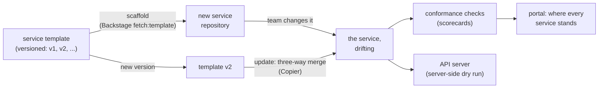

# 72. Platform Engineering & Golden Paths

<div class="badges" markdown><span class="badge badge-l3">L3 · Senior/Lead</span><span class="badge badge-l4">L4 · Architect</span><span class="badge badge-meta">internal developer platform · golden paths · paved roads · service templates · Backstage scaffolder · Copier · template drift · three-way merge · conformance checks · scorecards · server-side dry run · platform as a product</span></div>

<div class="grid two" markdown>

!!! info "Prerequisites"
    - [Chapter 7](../foundations/ch07-conways-law-team-topologies.md): team topologies and the platform team
    - [Chapter 8](../foundations/ch08-spring-boot-4-essentials.md): the Spring Boot 4 golden path (ADR-008)
    - [Chapter 54](../deployment/ch54-kubernetes-for-spring.md): what a service's manifests must contain
    - [Chapter 71](ch71-api-governance.md): API linting and the catalog

!!! abstract "What you'll learn"
    - **A golden path makes the right setup the fast one.** From a name and a team to two ready pods answering through a Service took **6.5–8.0 s**.
        - The template generated 8 files: **90 lines of platform files** (Dockerfile, manifests, catalog entry, OpenAPI, CI) and **45 of application code**.
        - The new service passed **all 12** of the platform's checks.
    - **Every way of starting a service drifts, at different speeds.** Twelve services, each changed by its team since it was created, against the twelve checks:
        - From the **current template**: **96%** passed.
        - **Written by hand**: **42%**.
        - From the **previous template version**: **8%**. The platform's decisions had moved on, and the old template couldn't follow.
    - **Templates need an update path, not just a starting point.** A three-way merge per file, as Copier's `update` does, took the four old-template services from **4 to 40 of 48 checks**.
        - 18 files updated cleanly, 2 merged with the teams' changes, and 8 were added.
        - **4 conflicted** where a team had changed the same lines as the template.
        - Hand-written services had no base to merge from.
    - **Text checks and the API server catch different things.** One hand-written manifest passed the probe check but was rejected by a server-side dry run: its probe had no port.

</div>

---

## 1 · Introduction & Context

### Seventy services, seventy setups

By its seventieth service, FoodFleet's earlier chapters had produced a long list of decisions: JVM flags (ADR-067), no CPU limits (ADR-054 and 070), probes and graceful shutdown (ADR-052), PodDisruptionBudgets, VPA recommendations, catalog entries with runbooks, linted OpenAPI documents (ADR-071).

Each decision was written down, announced, and followed by the next new service, if its team read the announcement. The services that existed before each decision mostly didn't change.

A new team starting a service spent its first two weeks copying another service's setup, including its mistakes, and asking around which parts were still right. An audit found that no two services were configured alike.

The platform team's answer was a **golden path**: the supported, documented, easiest way to build and run a service, delivered as a product rather than as a set of rules. This chapter measures three parts of it:

- **The template**, from a name to a running service.
- **Conformance checks** that show where every service stands.
- **An update path** that brings existing services along when the template changes.

### Where it comes from

<ul class="mh-timeline">
<li><span class="when">2014–2017 · Paved roads</span><span class="what">Netflix's "paved road" and Spotify's "golden path": supported defaults that teams may leave, with the cost on them. Cookiecutter templates for projects (2013).</span></li>
<li><span class="when">2019 · Team Topologies</span><span class="what">Skelton and Pais name the platform team, whose product is the internal platform and whose customers are stream-aligned teams.</span></li>
<li><span class="when">2020 · Backstage</span><span class="what">Spotify open-sources its developer portal with a scaffolder for software templates; it joins the CNCF.</span></li>
<li><span class="when">2021–2023 · Updatable templates; platform engineering</span><span class="what">Copier and Cruft update generated projects by merging template changes. The CNCF's platforms white paper (2023) describes platform engineering as a discipline.</span></li>
<li><span class="when">2026 · Versions checked here</span><span class="what">Backstage 1.55.3, Copier 9.19.1, git 2.56.0, VPA 1.8.0 and Kubernetes 1.37.1.</span></li>
</ul>

---

## 2 · Core Concepts & Terminology



Internal developer platform (IDP)
:   The self-service tools, templates and infrastructure a platform team provides so stream-aligned teams can build and run services without tickets. Its success is measured by adoption and by its users' lead time.

Golden path (paved road)
:   The supported way to do a common task, from creating a service to adding a database, with good defaults built in. It's optional but much easier than the alternatives; leaving it is allowed, and the team that leaves owns what it takes on.

Service template
:   A skeleton repository with placeholders that the scaffolder fills in: application code, Dockerfile, manifests, catalog entry, API description, CI. Backstage's scaffolder runs it as a `Template` entity with steps such as `fetch:template`, `publish:github` and `catalog:register`.

Template drift
:   The distance between a service and the current template. It grows two ways: the team changes the service, and the platform changes the template.

Three-way merge (template update)
:   Updating a generated project by merging the template's change (old version → new version) into the project, which keeps the project's own changes. Copier's `update` uses `git merge-file`; changes on the same lines conflict.

Conformance check (scorecard)
:   An automated check of a service against a platform decision, shown per service and team in the portal. Examples are Backstage's Tech Insights, Cortex and OpsLevel.

Server-side dry run
:   Sending manifests to the Kubernetes API server with `dryRun=All`: they're validated and defaulted as if applied, but not stored.

---

## 3 · How It Works Internally

### The template

FoodFleet's template has two versions in the repository. **v2**, the current one, carries every decision made so far:

- **Application:** separate liveness and readiness endpoints, and a graceful shutdown.
- **Dockerfile:** an explicit collector, `ExitOnOutOfMemoryError`, and a non-root user.
- **Manifests:** a CPU request with no CPU limit, the memory limit equal to the request, and a PodDisruptionBudget.
- **Alongside:** a VPA in recommendation mode, a catalog entry with lifecycle and runbook, an OpenAPI document, and CI that lints it.

**v1** is the template from a year earlier: 1 CPU and 2 GiB with limits, one health path, no PDB, no VPA, no API document, no lint step.

Rendering is plain substitution of `{{name}}`, `{{team}}`, `{{description}}`, `{{version}}` and the Java package. In the developer portal, Backstage's scaffolder does the same with `fetch:template` (`src/main/resources/backstage/template.yaml` is FoodFleet's entry), then publishes the repository and registers it in the catalog.

### Conformance checks

Each check is one earlier decision, read from the files a service keeps:

```java title="conformance/Conformance.java"
--8<-- "code/chapters/ch72-platform-engineering/src/main/java/dev/foodfleet/ch72/conformance/Conformance.java:35:50"
```

A file left with merge-conflict markers counts as unreadable, so its checks fail until the conflict is resolved.

### Updating a service to a new template version

For each file, the old template's version is the base, the service's file is "ours" and the new template's is "theirs". Files the team never touched are simply replaced, and new template files are added. Files both changed go through `git merge-file`, whose exit code is the number of conflicts:

```java title="scaffold/Upgrade.java"
--8<-- "code/chapters/ch72-platform-engineering/src/main/java/dev/foodfleet/ch72/scaffold/Upgrade.java:49:57"
```

Copier's `update` does the same, with the labels "before updating", "last update" and "after updating", after first trying the template's diff as a patch. It needs to know which template version a project was generated from; Copier records it in `.copier-answers.yml`.

---

## 4 · Design Considerations & Trade-offs

### Test setup

All runs used:

- JDK 25.0.4 and git 2.43.
- Docker, and k3s 1.37.1 on one 2-vCPU VM.
- Twelve services built by the lab:
    - 4 generated from template v1, then changed by their teams.
    - 4 generated from v2, then changed.
    - 4 written by hand from older services.

There were two runs, identical apart from timings. `check_apis.sh` checks **7 statements** in the sources of Backstage 1.55.3, Copier 9.19.1, git 2.56.0, VPA 1.8.0 and Kubernetes 1.37.1, and all were found.

### Measured: from a name to a running service

rider-ratings, for the delivery team, from template v2:

| Step | Time |
|---|---|
| render the template (8 files) | under 0.05 s |
| compile | 1.1–1.2 s |
| build the image | 0.4 s (base image cached) |
| load it into the cluster | 1.8–1.9 s |
| apply the manifests and wait for 2 ready copies | 2.3–4.0 s |
| first answer through the Service | 0.7 s |
| **total** | **6.5–8.0 s** |

The service answered `{"service":"rider-ratings"}` and passed **12 of 12** checks. The template generated 90 lines of platform files (Dockerfile, manifests, VPA, catalog entry, OpenAPI document, CI workflow) and 45 lines of application code.

What the table shows:

- **The golden path's cost is seconds; the alternative's is days.** Everything the earlier chapters decided arrived with the first commit: the team wrote none of the 90 platform lines, and none of them were copied from another service's mistakes. In production the same path adds repository creation, a pipeline run and a registry push, which takes minutes, not seconds, but is still self-service.
- **Correct by construction, at the start.** A new service from the current template met every decision. The rest of this section is about what happens next.

### Measured: a fleet that drifted

Twelve services, each changed by its team since it was created. A `+` means the check passed:

| Service | Origin | C1 | C2 | C3 | C4 | C5 | C6 | C7 | C8 | C9 | C10 | C11 | C12 | Passed | API server (dry run) |
|---|---|---|---|---|---|---|---|---|---|---|---|---|---|---|---|
| ratings-service | v1 | - | - | - | - | - | - | - | - | + | - | - | - | 1/12 | accepted |
| coupon-service | v1 | - | - | - | - | - | - | - | - | + | - | - | - | 1/12 | accepted |
| invoice-service | v1 | - | - | - | - | - | - | - | - | + | - | - | - | 1/12 | accepted |
| kitchen-display | v1 | - | - | - | - | - | - | - | - | + | - | - | - | 1/12 | accepted |
| eta-predictor | v2 | + | + | + | + | + | + | + | **-** | + | + | + | + | 11/12 | accepted |
| menu-images | v2 | + | + | + | + | + | **-** | + | + | + | + | + | + | 11/12 | accepted |
| loyalty-service | v2 | + | + | + | + | + | + | + | + | + | + | + | + | 12/12 | accepted |
| referral-service | v2 | + | + | + | + | + | + | + | + | + | + | + | + | 12/12 | accepted |
| support-console | hand | - | - | - | - | - | - | - | - | + | - | - | - | 1/12 | accepted |
| fraud-scorer | hand | - | + | + | + | + | + | + | + | + | + | - | - | 9/12 | accepted |
| zone-planner | hand | + | + | - | - | + | + | + | + | + | + | + | + | 10/12 | **rejected**: livenessProbe.httpGet.port: Invalid value: 0: must be between 1 and 65535 |
| tax-calculator | hand | - | - | - | - | - | - | - | - | - | - | - | - | 0/12 | accepted |

The checks:

- **C1** catalog entity with owner and lifecycle (ADR-071)
- **C2** runbook linked from the catalog (ADR-071)
- **C3** OpenAPI document in the repository (ADR-071)
- **C4** CI lints the API (ADR-071)
- **C5** explicit collector (ADR-067)
- **C6** `ExitOnOutOfMemoryError` (ADR-053/067)
- **C7** non-root (ADR-053)
- **C8** no CPU limit (ADR-054/070)
- **C9** memory limit = request (ADR-054)
- **C10** separate liveness and readiness (ADR-052)
- **C11** PodDisruptionBudget (ADR-054)
- **C12** VPA in recommendation mode (ADR-070)

| Origin | Checks passed | Manifests accepted by the API server |
|---|---|---|
| current template (v2) | **46 of 48 (96%)** | 4 of 4 |
| written by hand | 20 of 48 (42%) | 3 of 4 |
| previous template (v1) | **4 of 48 (8%)** | 4 of 4 |

What the table shows:

- **The current template kept services close.** Two of four v2 services had drifted, each on one check: eta-predictor added a CPU limit, and menu-images dropped `ExitOnOutOfMemoryError` from its Dockerfile. Teams change things for reasons, so the checks are there to show the drift, not to forbid it.
- **An old template was worse than no template.** The v1 services were consistent, but consistently a year out of date: they met only C9. Without an update path, every template decision applies to new services only, and the fleet's average falls behind as the template moves.
- **Hand-written services varied most.** From 0 to 10 of 12, depending on which older service each was copied from and what its team remembered. Nothing could bring them up to date except a person.
- **Text checks and the API server see different things.** zone-planner passed the probes check (C10: both paths present) but its manifest was invalid: the liveness probe had no port, and a server-side dry run rejected it. The platform's CI runs both: the scorecard for decisions, the dry run (or a schema validator) for validity.

### Measured: updating the old services to template v2

The four v1 services, each with its team's changes, merged to v2 file by file:

| Service | Team's changes | Updated | Merged | Conflicts | Added | Checks before → after |
|---|---|---|---|---|---|---|
| ratings-service | a new endpoint; 3 replicas | 4 | 2 | 0 | 2 | 1 → **12** |
| kitchen-display | none | 6 | 0 | 0 | 2 | 1 → **12** |
| coupon-service | a JVM flag; a better description | 4 | 0 | **2** (Dockerfile, catalog-info.yaml) | 2 | 1 → 8 |
| invoice-service | 1 GiB memory; a test step in CI | 4 | 0 | **2** (CI workflow, deploy/k8s.yaml) | 2 | 1 → 8 |
| **all** | | **18** | **2** | **4** | **8** | **4 → 40 of 48** |

coupon-service's Dockerfile conflict, as the team saw it:

```text
<<<<<<< service
ENTRYPOINT ["java", "-XX:MaxRAMPercentage=75", "-Xss512k", "-cp", "/app/classes", "dev.foodfleet.couponservice.Application"]
=======
USER 10001
ENTRYPOINT ["java", "-XX:+UseG1GC", "-XX:MaxRAMPercentage=70", "-XX:+ExitOnOutOfMemoryError", "-cp", "/app/classes", "dev.foodfleet.couponservice.Application"]
>>>>>>> new template
```

What the table shows:

- **Most of an upgrade needs no one.** 26 of 32 files were replaced or added outright, and 2 merged the team's change (ratings-service's endpoint and replica count) with the template's (health endpoints, resources) without help. Two services went from 1 to 12 checks with no human step.
- **Conflicts land exactly where a team and the platform changed the same thing.** coupon-service's JVM flag and the template's new flags were on one line; invoice-service's 1 GiB memory and the template's 384 MiB on the same lines. Those are the decisions that need a conversation, and the conflict puts them in front of the team: keep 1 GiB (the VPA will say whether that's right), add `-Xss512k` to the new flags.
- **An update path needs the template version recorded.** Each merge used the v1 rendering as its base; without knowing a service came from v1, there's no base, and that's the hand-written services' position. Copier records it in `.copier-answers.yml`. The lab kept it outside the services; template v2 doesn't record it yet, so ADR-072 adds it to the catalog entry (Try it 3).
- **Updates go out as pull requests.** FoodFleet's platform opens one per service when the template changes, with conflicts marked, so teams review what changes instead of discovering it.

### Choosing

| Question | Do | Why (measured) |
|---|---|---|
| Starting a service | A versioned template in the developer portal (Backstage scaffolder) | Name to running in 6.5–8.0 s; 12 of 12 checks |
| Keeping services current | Template updates by three-way merge, as pull requests | 4 → 40 of 48 checks with no human step; 4 conflicts to decide |
| Knowing where services stand | Conformance checks per service in the portal | v2 96%, hand-written 42%, v1 8% |
| Validity of manifests | Server-side dry run (or schema validation) in CI as well | A manifest that passed the checks was rejected by the API server |
| Hand-written services | Migrate them onto the template once, then they update like the rest | No base to merge from |
| Teams that need to differ | Allow it; the checks show the difference and its owner | 2 of 4 v2 services had a deliberate change |
| What the platform owns | The template, its updates, the checks and the paths they encode | 90 platform lines per service the team didn't write |

---

## 5 · Hands-on Implementation

```text
ch72-platform-engineering/
├── src/main/java/dev/foodfleet/ch72/
│   ├── scaffold/      Template (render, scaffold), Upgrade (three-way merge with git merge-file)
│   └── conformance/   Conformance (twelve checks)
├── src/main/resources/templates/v1, v2   the golden path, a year apart
├── src/main/resources/backstage/template.yaml   its Backstage scaffolder entry
├── src/test/java/…   UnitTest (3, tag unit)
└── verify/   build-libs.sh, run.sh, check_apis.sh, tools/ (Lab, RunSuites)
```

### 🟣 Level 3: the golden path as a product

<div class="badges" markdown><span class="badge badge-l3">L3 · Senior/Lead</span></div>

- One template per kind of workload (Java service, Kafka consumer, batch job), versioned, with a changelog that says which decision each change implements.
- The portal's "Create" page is the only documented way to start a service; it creates the repository, pipeline, catalog entry, namespace and dashboards.
- Every repository's CI runs the conformance checks and a server-side dry run of its manifests; results go to the portal's scorecards, not to a gate (except for invalid manifests).

### 🔴 Level 4: an evolving platform

<div class="badges" markdown><span class="badge badge-l4">L4 · Architect</span></div>

- Template releases open update pull requests in every generated service; the platform team tracks how many are merged per release.
- Hand-written services are migrated onto the template once, by the platform team with the owning team.
- The platform team measures its product: time to first deploy, adoption of each path, update PRs merged, scorecard trends, and a quarterly developer survey.
- New platform decisions arrive as a template change plus a check, never as an announcement alone.

```bash
JAVA_HOME=/path/to/jdk-25 verify/run.sh   # about 2 minutes; needs docker, git and a cluster
```

### Run and verify

```text
$ verify/run.sh scaffold
== scaffold
rider-ratings from template v2, by the delivery team: 3 objects applied; deployment "rider-ratings" successfully rolled out
  render the template (8 files)                       0.0 s
  compile                                             1.2 s
  build the image                                     0.4 s
  load it into the cluster                            1.8 s
  deploy and wait for 2 ready copies                  2.3 s
  first answer through the Service                    0.7 s
  total                                               6.5 s
  answer: {"service":"rider-ratings"}
  conformance: 12 of 12 checks
```

!!! question "Try it"
    1. Write template v3 that adds a NetworkPolicy and a startup probe. Upgrade the v2 fleet: which services merge cleanly?
    2. Resolve coupon-service's Dockerfile conflict by keeping `-Xss512k` alongside the new flags, and rerun the checks.
    3. Add a check that a service's catalog entry records its template version. How many of the twelve pass?
    4. Migrate support-console onto v2 by scaffolding v2 with its name and moving its code in. How many checks does it pass?

---

## 6 · Production Readiness

- [x] **Versioned templates** for each common kind of workload, with a changelog tied to decisions
- [x] **Self-service creation** in the portal: repository, pipeline, catalog, namespace, dashboards
- [x] **The template version recorded** in every generated service
- [x] **Template updates as pull requests**, by three-way merge, conflicts marked
- [x] **Conformance checks and a server-side dry run** in every repository's CI, results in the portal
- [x] **Hand-written services migrated** onto the template
- [x] **Platform metrics**: time to first deploy, adoption, update PRs merged, developer satisfaction

---

## 7 · Anti-patterns & Pitfalls

!!! pitfall "Incident 1: the template that aged in place"
    **Context.** FoodFleet's first service template was used for forty services, then improved for new services only.

    **Symptoms.** A year later, the oldest services had CPU limits, a single health endpoint, no PDB, and nobody knew which ones.

    **Root cause.** No update path and no checks. Measured: services from the previous template passed 4 of 48 checks, below hand-written ones (20 of 48).

    **Fix.** Template versions recorded per service, updates by three-way merge as pull requests (4 → 40 of 48), and scorecards.

!!! pitfall "Incident 2: the update that overwrote a team's fix"
    **Context.** To roll out new defaults, the platform team regenerated services from the latest template and pushed the result.

    **Symptoms.** invoice-service started getting OOMKilled: its memory had been raised to 1 GiB months earlier for a reason.

    **Root cause.** Regeneration discards the team's changes. Measured: a three-way merge kept the team's changes in 2 files and raised conflicts in 4, including exactly this memory setting.

    **Fix.** Merge, never regenerate; conflicts go to the team as a pull request.

!!! pitfall "Incident 3: green scorecard, broken deploy"
    **Context.** zone-planner's scorecard showed 10 of 12 checks, including probes.

    **Symptoms.** Its deployment failed at the API server on the next release.

    **Root cause.** Text checks confirm decisions, not validity. Measured: the probe check passed while a server-side dry run rejected the missing port.

    **Fix.** A server-side dry run (or schema validation) in CI beside the conformance checks.

| Anti-pattern | Symptom | Fix |
|---|---|---|
| Standards by announcement | New services follow, old ones don't | A template change plus a check |
| Templates with no update path | Old services fall furthest behind | Versioned templates, three-way merge |
| Regenerating to update | Teams' fixes lost | Merge; conflicts to the team |
| Mandatory platform, no alternatives | Shadow platforms | An attractive, optional golden path |
| Scorecards as gates | Gaming, resentment | Visibility first; gate only on validity |
| Copying another service to start | Its mistakes, multiplied | Scaffold from the template |
| A platform without product metrics | No idea if it helps | Time to first deploy, adoption, surveys |

---

## 8 · Enterprise Case Study

### FoodFleet: decisions delivered as a product

!!! decision "ADR-072: services start from a versioned template through the developer portal (Backstage scaffolder), which records the template version; every platform decision ships as a template change plus a conformance check; template releases open three-way-merge update pull requests in every generated service; CI runs the conformance checks and a server-side dry run, with results in the portal's scorecards; hand-written services are migrated onto the template"
    **Status:** Accepted · **Date:** 2026-03-09

    **Context.** Seventy services configured seventy ways, decisions that reached only new services, and two weeks for a new team to set up. Measured:

    - From a name to two ready pods answering in 6.5–8.0 s, passing 12 of 12 checks.
    - Fleet conformance: 96% from the current template, 42% hand-written, 8% from the previous template.
    - A three-way merge took four old services from 4 to 40 of 48 checks, with 4 conflicts where teams had changed the same settings.
    - A manifest passing every text check was rejected by the API server.

    **Decision.**

    - **Templates:** Java service, Kafka consumer and batch job, versioned in the platform repository; the version written into each service's catalog entry.
    - **Changes:** each platform decision is a template change plus a check, released with a changelog; update PRs opened automatically.
    - **Visibility:** scorecards per service and team in the portal; only invalid manifests block a build.
    - **Migration:** the platform team pairs with owners to move hand-written services onto the template this quarter.

    **Consequences:**

    - ✅ New decisions reach every service within a release cycle, not only new ones.
    - ✅ Teams see their drift and decide about it.
    - ⚠️ The platform team owns templates as a product: releases, support, deprecations.
    - ⚠️ Conflicted update PRs need team time; unmerged ones are a backlog to watch.

### Fintech analogue: compliance as a template

Regulated firms bake controls into their golden paths: encryption, audit logging, access policies and evidence collection come with the template, and the checks double as compliance evidence. A service off the path needs an exception with an owner and an expiry date, which makes the path the cheaper choice.

### E-commerce analogue: hundreds of teams, one road

Large marketplaces with hundreds of teams run platform teams whose product is the paved road: templates, a portal, managed data stores and pipelines. They measure the platform like any product (adoption, time to first deploy, satisfaction) and keep the road optional and attractive, since mandated platforms grow shadow alternatives.

---

## 9 · Interview Q&A + Summary

#### Q1. What is platform engineering? · <span class="badge badge-l3">L3</span> · Thoughtworks · Infosys

**Short answer:** Building and running an internal developer platform (self-service tools, templates, infrastructure and documentation) as a product for the organisation's developers, so stream-aligned teams can deliver without tickets or deep infrastructure knowledge.

#### Q2. What is a golden path? · <span class="badge badge-l2">L2</span> · Spotify

**Short answer:** The supported, easiest way to do a common task, such as creating a service, with good defaults built in. Optional, but far cheaper than the alternatives. Measured: from a name to two ready pods in 6.5–8.0 s with every platform decision included.

#### Q3. Why do service templates drift, and what do you do about it? · <span class="badge badge-l3">L3</span> · Atlassian

**Short answer:** Teams change their services, and the platform changes the template. Without an update path, old services fall behind (measured: 8% conformance for the previous template version against 96% for the current one). Record each service's template version and merge template changes into services.

#### Q4. How do you update services generated from an older template? · <span class="badge badge-l3">L3</span> · Red Hat

**Short answer:** A three-way merge per file: old template as base, the service as ours, the new template as theirs (Copier's `update`, using `git merge-file`). Measured: 26 of 32 files replaced or added, 2 merged with teams' changes, 4 conflicts, and conformance from 4 to 40 of 48. Never regenerate; it discards teams' fixes.

#### Q5. What goes into a service template? · <span class="badge badge-l3">L3</span> · Swiggy

**Short answer:** Everything a service needs that isn't its business logic: build, Dockerfile with JVM flags, manifests (requests, probes, PDB), autoscaling and VPA, catalog entry, API description, CI with linting, dashboards and alerts. Here: 90 lines of platform files to 45 of starter code.

#### Q6. Should the platform be mandatory? · <span class="badge badge-l3">L3</span> · Netflix

**Short answer:** Make it the easiest choice, not the only one. Teams leave it for good reasons; scorecards show the difference, and the team owns what it takes on. Gate only on validity and security essentials. Mandated platforms tend to grow shadow alternatives.

#### Q7. How do you know where every service stands? · <span class="badge badge-l3">L3</span> · Uber

**Short answer:** Conformance checks per decision, run in each repository's CI and shown as scorecards in the portal (Backstage Tech Insights, Cortex, OpsLevel). Measured across 12 services: from 0 to 12 of 12, with averages of 96%, 42% and 8% by origin.

#### Q8. Are text checks on manifests enough? · <span class="badge badge-l2">L2</span> · any platform team

**Short answer:** No; they confirm decisions, not validity. Measured: a manifest passed the probe check while the API server rejected it (a probe without a port). Add a server-side dry run (`kubectl apply --dry-run=server`) or schema validation.

#### Q9. What is Backstage's scaffolder? · <span class="badge badge-l3">L3</span> · Spotify

**Short answer:** Backstage's template engine: a `Template` entity (`scaffolder.backstage.io/v1beta3`, with a type and steps) whose steps fetch and render a skeleton (`fetch:template`), publish a repository and register it in the catalog. It creates services; updating them needs something else, such as Copier-style merges.

#### Q10. How do you measure a platform team's success? · <span class="badge badge-l4">L4</span> · Google

**Short answer:** As a product: time to first deploy for a new service, adoption of each golden path, how many update PRs are merged per template release, scorecard trends, DORA metrics of teams on the platform, and developer satisfaction.

#### Q11. What should the platform team not own? · <span class="badge badge-l3">L3</span> · Thoughtworks

**Short answer:** The services. The platform owns the paths (templates, tools, infrastructure, checks) and their updates; stream-aligned teams own their services, including decisions to differ. A platform team that ends up running services becomes a bottleneck.

#### Q12. Design FoodFleet's internal developer platform. · <span class="badge badge-l4">L4</span> · architecture rounds

**Short answer:**

- **Portal:** Backstage with catalog, docs and scaffolder; versioned templates per workload kind.
- **Evolution:** every decision a template change plus a check; update PRs by three-way merge.
- **Visibility:** scorecards per service and team; dry-run validation in CI.
- **Infrastructure:** self-service namespaces, databases and topics behind the same paths.
- **Product management:** time to first deploy, adoption, update PRs merged, surveys.

### Key takeaways

- **The golden path makes the right setup the fastest one**: seconds, with every decision included.
- **Templates must be updatable**: an old template was worse than none.
- **Merge, don't regenerate**: conflicts mark exactly the decisions teams should look at.
- **Check decisions and validity**: scorecards for one, the API server for the other.

### Further reading

- CNCF TAG App Delivery, [Platforms White Paper](https://tag-app-delivery.cncf.io/whitepapers/platforms/)
- Backstage, [Software Templates](https://backstage.io/docs/features/software-templates/)
- Copier, [Updating a project](https://copier.readthedocs.io/en/stable/updating/)
- Matthew Skelton, Manuel Pais, *Team Topologies* (2nd ed., 2025)
- Camille Fournier, Ian Nowland, *Platform Engineering* (2024)

---

**Previous:** [← 71. API Governance & Developer Portals](ch71-api-governance.md) · **Next:** [73. ADRs, Fitness Functions & Tech Radar →](ch73-adrs-fitness-functions.md)
