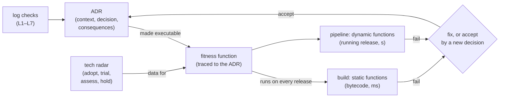

# 73. ADRs, Fitness Functions & Tech Radar

<div class="badges" markdown><span class="badge badge-l3">L3 · Senior/Lead</span><span class="badge badge-l4">L4 · Architect</span><span class="badge badge-meta">architecture decision records · Nygard format · MADR · adr-tools · supersession · decision log hygiene · evolutionary architecture · fitness functions · atomic vs holistic · static vs dynamic · traceability · technology radar · Build Your Own Radar · ClassFile API · flaky performance checks</span></div>

<div class="grid two" markdown>

!!! info "Prerequisites"
    - [Chapter 9](../architecture-patterns/ch09-hexagonal-clean-architecture.md): ports and adapters (ADR-009)
    - [Chapter 27](../communication/ch27-api-contracts.md): contracts and compatibility (ADR-027)
    - [Chapter 65](../testing/ch65-performance-chaos-arch-tests.md): fitness functions over bytecode and open-model load
    - [Chapter 72](ch72-platform-engineering.md): platform checks per decision

!!! abstract "What you'll learn"
    - **A decision log needs checks of its own.** Three real logs were linted for sections, status, numbering, dates, references and supersession:
        - adr-tools' own log: **9 of 9** clean.
        - MADR's own: status and date are optional in MADR, and **18 of 19** records had no status.
        - **This handbook's 72 ADRs: 60 clean.** **11 were dated out of order** (ADR-008 is the newest of all), and one decision's text cites a decision made 14 months later.
    - **Most decisions weren't checked by anything.** Before this chapter, code named **7 of the handbook's 72 decisions**.
    - **Fitness functions traced to ADRs caught one problem per release.** Eight releases of order-service, five functions:
        - **Static functions** (bytecode) caught a domain-to-adapter dependency, a class on the radar's hold ring and two API breaks. One break was a new field on a record, which removes its old constructor. They took **under 5 ms** each.
        - **Dynamic functions** (the release running) caught a **7–9× rise in p99 latency** and a **1.3–1.5 s start**, in about 8 s per release.
    - **Performance functions need a relative budget and repeats.** The latency check was repeated 12 times on unchanged code and on three regressions:
        - The ADR's **fixed 20 ms budget passed a fourfold regression** in 9 of 12 runs.
        - A **single run raised false alarms**: up to 9 of 12 at +10% over the baseline.
        - **+50% over the baseline, best of three**: no false alarms, and the fourfold regression caught every time.

</div>

---

## 1 · Introduction & Context

### Decisions that were written down, and then?

FoodFleet had written its decisions down since chapter 1: 72 ADRs by the end of [Part 10](../performance-scalability/index.md), one per chapter, each with a context, a decision and its consequences. Two questions kept coming up in reviews:

- **Is the log itself trustworthy?** Engineers searching for "why do we do X" found decisions that cited later decisions, and dates that didn't fit the story.
- **Is anyone following it?** Decisions like "the domain depends on nothing", "no CPU limits" or "p99 within budget" were only as good as the last review that remembered them.

This chapter measures both: the log, with checks of its own, and the code, with **fitness functions**, each one a decision made executable. A **technology radar** turns another group of decisions (which libraries and techniques to adopt, try or avoid) into data that a fitness function can read.

### Where it comes from

<ul class="mh-timeline">
<li><span class="when">2011 · Architecture decision records</span><span class="what">Michael Nygard's "Documenting Architecture Decisions": short, numbered records of context, decision, status and consequences, kept with the code. Superseded, not edited.</span></li>
<li><span class="when">2010–2016 · Technology radar</span><span class="what">Thoughtworks publishes its radar (Adopt, Trial, Assess, Hold) and encourages companies to build their own; Build Your Own Radar (2016) draws one from a CSV.</span></li>
<li><span class="when">2016–2018 · Tools and templates</span><span class="what">adr-tools writes and links Nygard records from the shell; MADR adds considered options and pros and cons.</span></li>
<li><span class="when">2017 · Fitness functions</span><span class="what"><em>Building Evolutionary Architectures</em> (Ford, Parsons, Kua): automated checks that keep an architecture's characteristics as it changes. Atomic or holistic, triggered or continual, static or dynamic.</span></li>
<li><span class="when">2026 · Versions checked here</span><span class="what">adr-tools 3.0.0, MADR 4.0.0, Build Your Own Radar 1.2.1 (whose fourth ring is now called Caution) and the JDK 25 ClassFile API.</span></li>
</ul>

---

## 2 · Core Concepts & Terminology



Architecture decision record (ADR)
:   A short, numbered record of one decision: its context, the decision, its status (Proposed, Accepted, Deprecated, Superseded) and its consequences. Records are immutable once accepted. A changed decision is a new record that supersedes or amends the old one, whose status section links to it.

Decision log
:   The sequence of a system's ADRs. It answers "why is it like this?", so its order, dates and links matter as much as each record.

Fitness function
:   An automated, objective check of an architectural characteristic, such as dependencies, compatibility, latency or startup.
    - **Atomic** functions check one characteristic in isolation; **holistic** ones check several together on a running system.
    - **Static** functions read code or configuration; **dynamic** ones measure the running system.

Traceability
:   Each fitness function names the decision it protects, and each decision names its functions, so a failure points at a "why" and a decision points at its evidence.

Technology radar
:   A team's view of technologies in four rings: **Adopt**, **Trial**, **Assess** and **Hold** (Build Your Own Radar now calls Hold "Caution"), across four quadrants. Each blip has a short rationale.

Ratchet (relative budget)
:   A check against the last accepted value rather than a fixed limit, so things can get better but not worse.

---

## 3 · How It Works Internally

### Checking the log

`DecisionLog` reads three formats: Nygard's (as adr-tools writes it), MADR's, and this handbook's `!!! decision` blocks. Seven checks run over every log:

| Check | What fails |
|---|---|
| L1 sections | a required section is missing (Nygard: Context, Decision, Consequences; MADR: Context and Problem Statement, Considered Options, Decision Outcome) |
| L2 status | no status, or one outside Proposed, Accepted, Rejected, Deprecated, Superseded |
| L3 numbering | a number used twice or skipped |
| L4 date | no date |
| L5 chronology | dates don't rise with numbers |
| L6 references | a reference to a record that doesn't exist, or a decision's text citing a later decision |
| L7 supersession | a record superseded without naming its successor, or a successor whose predecessor still says Accepted |

Two details matter:

- **Status links are exempt from L6.** adr-tools writes "Amended by" and "Superseded by" into older records on purpose, so those links point forward by design. Only references in a record's own text count.
- **L5 flags as few records as possible.** It keeps the longest run of dates that rises with the numbers and reports the rest, so one misdated record doesn't flag everything after it:

```java title="adr/DecisionLog.java"
--8<-- "code/chapters/ch73-adrs-fitness-functions/src/main/java/dev/foodfleet/ch73/adr/DecisionLog.java:253:287"
```

### Fitness functions traced to decisions

Each function carries the ADR it protects. The static ones read a release's classes with the JDK's ClassFile API (final since JDK 24). Dependencies are every class named in the constant pool or in a descriptor, as `jdeps` reads them:

```java title="fitness/Functions.java (F1)"
--8<-- "code/chapters/ch73-adrs-fitness-functions/src/main/java/dev/foodfleet/ch73/fitness/Functions.java:24:39"
```

The other functions:

- **F2** reads FoodFleet's radar, a Build Your Own Radar CSV (`name,ring,quadrant,isNew,description`), and a second file that maps blips to class prefixes.
- **F3** compares the public members of the `api` package with the last release that shipped.
- **F4 and F5** start the release in its own JVM and measure it. Startup counts from process launch to the first healthy answer. Latency is measured under an open load of 200 requests/s: 2 s of warm-up, then 5 s measured from each request's scheduled time.

```java title="fitness/Functions.java (F4, F5)"
--8<-- "code/chapters/ch73-adrs-fitness-functions/src/main/java/dev/foodfleet/ch73/fitness/Functions.java:76:85"
```

### Fix, or accept by decision

A release ships when every function passes. A failure can also be **accepted**, but only by a recorded decision. In the release train below, release 2's API break was accepted as an amendment to ADR-027, and F3 then compared later releases with release 2.

---

## 4 · Design Considerations & Trade-offs

### Test setup

All runs used:

- JDK 25.0.4 on one shared 2-vCPU VM.
- The source trees of adr-tools 3.0.0, MADR 4.0.0 and Build Your Own Radar 1.2.1.
- This handbook's `docs/` and `code/` as they stood before this chapter.

order-service is a small JDK HTTP service: 1,000 orders of 20 lines priced from a 50,000-item menu, in ports-and-adapters packages (domain, api, app, adapter). Each release changes its sources, compiles them and starts them in their own JVM with a 512 MiB heap.

There were two runs. The log results were identical; where measurements differed, both values are shown. `check_apis.sh` checks **8 statements** in the sources of adr-tools, MADR, Build Your Own Radar and the JDK, and all were found.

### Measured: three decision logs

| Log | Records | L1 | L2 | L3 | L4 | L5 | L6 | L7 | Clean |
|---|---|---|---|---|---|---|---|---|---|
| adr-tools 3.0.0, its own | 9 | 0 | 0 | 0 | 0 | 0 | 0 | 0 | **9 of 9** |
| MADR 4.0.0, its own | 19 | 0 | **19** | 0 | **19** | 0 | 0 | 0 | 0 of 19 |
| this handbook (FoodFleet) | 72 | 0 | 0 | 0 | 0 | **11** | **1** | 0 | **60 of 72** |

What the table shows:

- **adr-tools' log is what the format intends.** Nine records, each dated and accepted; its two links between records ("Amends" and "Amended by") sit in their status sections.
- **MADR's log uses MADR's optional fields sparingly.** All 19 records have the three sections, but 18 have no status and none has a date. One record's status is "on hold", which isn't among the values in MADR's own template. Status and date are optional in MADR, so this is a choice, not a defect. For a log that people search by date, though, it's worth making them required.
- **This handbook's log failed its own checks.** All 72 records had every section and were Accepted, but:
    - **11 were dated out of order: ADR-001 to ADR-010, and ADR-012.** Dates run from 2024-01-22 (ADR-012) to 2026-08-25 (ADR-008, the newest of all 72), and ADR-001 to ADR-006 are dated 2026, after ADR-060.
    - **ADR-023's text cites ADR-057**, decided 14 months later ("load balancing per request through the mesh"). The record was edited after acceptance instead of being amended.
    - **None of the 72 is marked superseded or amended.**

  A log that numbers decisions by chapter rather than by date, and edits records in place, loses what the log is for: the order of reasoning.
- **Most decisions had no executable check.** Code in the handbook's chapters named 7 of the 72 decisions: ADR-020 in chapter 20's thresholds, and six in chapter 72's platform checks. This chapter adds four more (ADR-009, 027, 060 and 066) and its own, ADR-073.

### Measured: eight releases against five fitness functions

| Function | ADR | Kind | Checks |
|---|---|---|---|
| F1 domain-is-independent | ADR-009 | static | domain classes depend only on the domain, `java.lang`, `java.util`, `java.time` |
| F2 radar-hold | ADR-073 | static | no class depends on a technology the radar holds (4 of 19 blips) |
| F3 api-compatible | ADR-027 | static | no public member of the `api` package removed or changed since the last release that shipped |
| F4 startup | ADR-060 | dynamic | healthy within 1,000 ms of launch |
| F5 latency | ADR-066 | dynamic | p99 ≤ 20 ms at 200 requests/s |

| Release | F1 | F2 | F3 | F4 | F5 | Ships | First answer · latency |
|---|---|---|---|---|---|---|---|
| r1 baseline | + | + | + | + | + | yes | 413–447 ms · p99 7.3–8.2 ms |
| r2 adds a currency to `OrderView` | + | + | **FAIL** | + | + | yes (accepted) | 397–484 ms · p99 5.9–6.0 ms |
| r3 `Pricing` gets a default menu | **FAIL** | + | + | + | + | no | 406–465 ms · p99 5.7–7.0 ms |
| r4 formats `placedAt` with `SimpleDateFormat` | + | **FAIL** | + | + | + | no | 364–376 ms · p99 5.7–5.9 ms |
| r5 renames `cancel` to `cancelOrder` | + | + | **FAIL** | + | + | no | 416–436 ms · p99 5.1–5.3 ms |
| r6 keeps the menu in display order | + | + | + | + | **FAIL** | no | 330–331 ms · p50 8.1–11.2 ms, **p99 55.6–68.9 ms** |
| r7 builds a search index at startup | + | + | + | **FAIL** | FAIL in 1 run of 2 | no | **1,315–1,460 ms** · p99 5.5 / 28.9 ms |
| r8 adds `byRestaurant` | + | + | + | + | + | yes | 354–378 ms · p99 4.5–4.8 ms |

What the functions reported:

- **r2:** `removed: api.OrderApi$OrderView.<init>(String, String, int, long, String, String)`. A new record component changes the canonical constructor. Readers of `OrderView` are unaffected, but anyone who constructs one, such as a consumer's test stub, no longer compiles or links. Accepted as an amendment to ADR-027, with the two consumers told.
- **r3:** `domain.Pricing -> adapter.menu.InMemoryMenu`. A convenience constructor for tests pulled an adapter into the domain.
- **r4:** `app.OrderService -> java.text.SimpleDateFormat, java.util.Date`, both on hold in the radar.
- **r5:** `removed: api.OrderApi.cancel(String)`. A rename is a removal for every caller.
- **r6:** a menu kept as a list (in display order) turned each price lookup into a scan. The median went up 4–6× and p99 7–9×.
- **r7:** an index of every prefix of every item name, built before the service reports healthy.
- **r8:** an added interface method passed F3, as it should for callers. Classes outside the service that implement `OrderApi` would need the method too, so F3 is a callers' check.

What it cost:

| Step | Time per release |
|---|---|
| read the classes (ClassFile API) | 1.7–18.8 ms |
| F1, F2, F3 | at most 4.8 ms each |
| launch until healthy (shared by F4 and F5) | 0.33–1.46 s |
| F5 (2 s warm-up, 5 s measured) | 7.0–7.4 s |

What the run shows:

- **Static functions are nearly free and exact.** They belong in every build, on every commit, as part of the compile step.
- **Dynamic functions cost seconds and give a distribution, not a fact.** r7 also failed the latency check in one run of two: its p99 was 28.9 ms in one and 5.5 ms in the other. The next experiment measures how often that happens.

### Measured: how much to trust a latency fitness function

The latency check was run 12 times on each of four builds:

- the unchanged release;
- three regressions that scan the first 1,000, 5,000 or 20,000 menu items before the lookup (a "featured items first" change).

Before each lab run, 6 calibration runs of the unchanged release set the baseline: a p99 of 4.03 ms in one run and 4.98 ms in the other.

| Build | p50 (median of 12) | p99 (median of 12) |
|---|---|---|
| unchanged | 1.28–1.29 ms | 4.79–5.17 ms |
| scan 1,000 | 1.34–1.43 ms | 5.75–7.16 ms |
| scan 5,000 | 1.93–2.01 ms | 6.31–6.53 ms |
| scan 20,000 | 5.46–5.83 ms | 19.41–19.59 ms |

Failures, as single runs out of 12 and as best-of-three (fail only if all three of a group fail) out of 4:

| Budget | unchanged (false alarms) | scan 1,000 | scan 5,000 | scan 20,000 |
|---|---|---|---|---|
| fixed 20 ms (the ADR's per-hop budget) | 0–1 · 0 | 0–1 · 0 | 0–1 · 0 | **3 · 0** |
| baseline +10% | **3–9** · 0–1 | 9–12 · 1–4 | 11–12 · 3–4 | 12 · 4 |
| baseline +25% | 2 · 0 | 3–11 · 0–3 | 8–12 · 2–4 | 12 · 4 |
| baseline +50% | 0–1 · **0** | 1–7 · 0–1 | 2–8 · 0–2 | 12 · **4** |

What the table shows:

- **A fixed budget with headroom misses big regressions.** The service's p99 was about 5 ms against a 20 ms budget, so a regression had to quadruple it before the check noticed. With scan 20,000, p99 quadrupled and still passed 9 of 12 single runs and all four best-of-threes. The fixed budget is the contract with callers; it isn't a regression check.
- **Single runs are noisy.** One to three runs in each lab run of 48 had a p99 of 29–104 ms with nothing changed: a pause on a shared VM. At +10% over the baseline, the unchanged build failed 3–9 times in 12, and a check that cries wolf that often gets disabled.
- **Best of three removed the outliers.** At +50%, no best-of-three failed on unchanged code, and every best-of-three caught the fourfold regression.
- **Small regressions are below what one service's p99 can resolve.** Scan 5,000 raised the median by half, and even best-of-three at +25% caught it only 2–4 times in 4. Catching changes that small takes a benchmark of the code path, not a check of the whole service.
- **The baseline itself moves.** Calibration p99 was 4.03 ms in one lab run and 4.98 ms in the other. A ratchet should compare with a recent baseline from the same environment, not with a number written down once.

### Choosing

| Question | Do | Why (measured) |
|---|---|---|
| Keeping a log usable | Lint it in CI: sections, status, numbering, dates, links, supersession | The handbook's own log had 11 misdated records and one edited after acceptance |
| Changing a decision | A new record that supersedes or amends it; never edit an accepted one | Edited text cited a decision made 14 months later |
| Which decisions get functions | Every decision with a checkable consequence, each naming its ADR | 7 of 72 decisions were checked by any code |
| Structure, dependencies, compatibility | Static functions on every build | Under 5 ms each; exact |
| Performance and startup | Dynamic functions in the pipeline, relative to a recent baseline, best of three | Fixed budget missed 4×; single runs had false alarms |
| Small performance regressions | Microbenchmarks of the hot path | 1.5× on the median was below the service-level check's resolution |
| Technology choices | A radar as data, with a function for Hold | Caught `SimpleDateFormat` in r4 |
| A failure the team wants to keep | Accept it with a recorded decision | r2's API break, accepted as an amendment |

---

## 5 · Hands-on Implementation

```text
ch73-adrs-fitness-functions/
├── src/main/java/dev/foodfleet/ch73/
│   ├── adr/       DecisionLog (Nygard, MADR, handbook formats; checks L1–L7; ADRs named in code)
│   └── fitness/   Bytecode (ClassFile API), Radar (BYOR CSV), Probe (own JVM, open load),
│                  FitnessFunction, Functions (F1–F5)
├── src/main/resources/orders/   order-service's sources (the lab changes them release by release)
├── src/main/resources/radar/    foodfleet-radar.csv, radar-prefixes.csv
├── src/test/java/…   UnitTest (3, tag unit)
└── verify/   build-libs.sh, run.sh, check_apis.sh, tools/ (Lab, RunSuites)
```

### 🟣 Level 3: decisions that check themselves

<div class="badges" markdown><span class="badge badge-l3">L3 · Senior/Lead</span></div>

- ADRs live in the repository, one file per decision, written with adr-tools or a MADR template. The CI lints the log.
- Every new ADR asks "how will we know it's being followed?" and names its fitness functions; the functions name the ADR.
- Static functions run in the build; dynamic ones run in the pipeline against a staging deployment.

### 🔴 Level 4: an evolving architecture

<div class="badges" markdown><span class="badge badge-l4">L4 · Architect</span></div>

- A radar per organisation, reviewed twice a year, published as data. Hold blips have functions; Trial blips have owners and end dates.
- Function failures are fixed or accepted by a decision; accepted failures are visible in the portal with their ADR.
- Performance functions compare with a rolling baseline in the same environment, best of three, plus an absolute budget for the contract.
- Quarterly, review which decisions have no functions and whether their consequences turned out as expected.

```bash
JAVA_HOME=/path/to/jdk-25 verify/run.sh   # about 20 minutes; needs git
```

### Run and verify

```text
$ verify/run.sh log
== log
log                               ADRs   L1   L2   L3   L4   L5   L6   L7  clean
adr-tools 3.0.0 (its own log)        9    0    0    0    0    0    0    0  9 of 9
MADR 4.0.0 (its own log)            19    0   19    0   19    0    0    0  0 of 19
this handbook (FoodFleet)           72    0    0    0    0   11    1    0  60 of 72
```

!!! question "Try it"
    1. Rerun `log` after this chapter: ADR-073 joins the log. Does it pass, and how many decisions does code name now?
    2. Add a function for ADR-022 (service calls use RestClient), using the radar's Hold blips for `RestTemplate` and `HttpURLConnection`. Which chapters' code would it flag?
    3. Change F5 to compare with the last shipped release's p99, best of three, and rerun the release train. Does r7 still fail F5 in some runs?
    4. Write the ADR that accepts r2's break as an amendment to ADR-027, in adr-tools' format, and link both records with `adr link`.

---

## 6 · Production Readiness

- [x] **ADRs in the repository**, one per file, never edited after acceptance; changes supersede or amend
- [x] **The log linted in CI**: sections, status, numbering, chronology, references, supersession
- [x] **Each decision with a checkable consequence has fitness functions**, and each function names its ADR
- [x] **Static functions in every build**; dynamic functions in the pipeline
- [x] **Performance functions** relative to a recent baseline, best of three, plus the absolute budget
- [x] **A radar as data**, with functions for Hold
- [x] **Accepted failures** recorded as decisions and visible

---

## 7 · Anti-patterns & Pitfalls

!!! pitfall "Incident 1: the log that rewrote history"
    **Context.** FoodFleet's ADRs were numbered by handbook chapter and fixed up in place as later chapters changed things.

    **Symptoms.** An engineer tracing why gRPC load balancing went through the mesh found ADR-023 citing ADR-057, which was decided 14 months later. Eleven records' dates didn't fit their order.

    **Root cause.** Records edited after acceptance, and numbers assigned by topic rather than by time. Measured: 12 of 72 records failed the log checks.

    **Fix.** Lint the log in CI; amend or supersede instead of editing; number records in the order they're decided.

!!! pitfall "Incident 2: the budget that was never close"
    **Context.** order-service's latency function checked p99 against the ADR's 20 ms hop budget.

    **Symptoms.** A release that quadrupled p99, from 5 ms to about 20, passed the function and shipped; checkout slowed down at the next peak.

    **Root cause.** A fixed budget with fourfold headroom isn't a regression check. Measured: a fourfold regression passed 9 of 12 single runs and 4 of 4 best-of-threes.

    **Fix.** A ratchet against a recent baseline, +50% best of three, beside the absolute budget.

!!! pitfall "Incident 3: the flaky check that got switched off"
    **Context.** A team tightened the latency function to +10% over baseline, one run per build.

    **Symptoms.** Builds failed on unchanged code; within a month the check was marked "allowed to fail".

    **Root cause.** One run's p99 on shared machines is noisy. Measured: 3–9 false alarms in 12 at +10%; single runs as bad as 104 ms with nothing changed.

    **Fix.** Best of three, a +50% threshold, and microbenchmarks for regressions smaller than that.

| Anti-pattern | Symptom | Fix |
|---|---|---|
| Editing accepted ADRs | Decisions citing later ones; no history | Supersede or amend |
| ADRs without functions | Decisions forgotten | Name the functions in the ADR |
| Functions without ADRs | Nobody knows why a check exists | Name the ADR in the function |
| Fixed budgets as regression checks | Large regressions pass | Ratchet against a baseline |
| Single-run performance checks | False alarms, disabled checks | Best of three, relative thresholds |
| A radar as a slide | Hold technologies keep arriving | Radar as data, with a function |
| Failures waived in chat | Exceptions nobody can find | Accept by a recorded decision |

---

## 8 · Enterprise Case Study

### FoodFleet: the log and its evidence

!!! decision "ADR-073: decisions are recorded as ADRs in each repository (adr-tools or MADR format), numbered in the order decided and never edited after acceptance; the log is linted in CI; every decision with a checkable consequence names its fitness functions and each function names its ADR; static functions run in every build, dynamic ones in the pipeline against a recent baseline, best of three, beside the absolute budget; the technology radar is published as data with functions for its Hold ring; a failing function is fixed or accepted by a new decision"
    **Status:** Accepted · **Date:** 2026-03-16

    **Context.** Measured:

    - FoodFleet's own log of 72 decisions failed its checks on 12: eleven dated out of order, and one edited after acceptance.
    - Only 7 of the 72 decisions were checked by any code.
    - Five functions traced to ADRs caught one problem in each of six releases out of eight: static ones in under 5 ms, dynamic ones in about 8 s.
    - A fixed latency budget passed a fourfold regression, and single runs raised false alarms on unchanged code.

    **Decision.**

    - **The log:** adr-tools or MADR files, linted for sections, status, numbering, chronology, references and supersession. Changes supersede or amend.
    - **Functions:** a `@Decision("ADR-NNN")`-style reference in each; a list of functions in each ADR; static ones in the build, dynamic ones in the pipeline.
    - **Performance:** relative to a rolling baseline (+50%, best of three) plus the absolute budget from ADR-066.
    - **The radar:** a BYOR CSV reviewed twice a year; Hold blips mapped to packages and checked.
    - **Exceptions:** a failing function is accepted only by a new ADR, shown in the portal.

    **Consequences:**

    - ✅ Decisions keep their order and their evidence; a failure points at its reason.
    - ✅ Regressions are caught at the release that causes them, not at the next incident.
    - ⚠️ Dynamic functions add about 8 s per service per pipeline run, and baselines need upkeep.
    - ⚠️ Changes smaller than about half the median still need microbenchmarks.

### Fintech analogue: decisions as audit evidence

Regulated firms keep decision records because auditors ask why a control exists and who approved it. Each control has a check that runs continuously, such as encryption settings, access reviews or data residency. Each check names the decision and the regulation behind it, so an audit reads the log and its evidence instead of interviewing people.

### E-commerce analogue: a radar for hundreds of teams

Large retailers publish an internal radar so that hundreds of teams converge on a few databases, languages and frameworks. Hold entries come with build checks and a migration date. Trial entries have an owning team that reports back at the next review, which keeps the radar a record of experience rather than of opinion.

---

## 9 · Interview Q&A + Summary

#### Q1. What is an ADR, and what goes in one? · <span class="badge badge-l2">L2</span> · Thoughtworks · Infosys

**Short answer:** A short, numbered record of one architectural decision, kept with the code: context, decision, status and consequences (Nygard's format), optionally with considered options and their pros and cons (MADR). It records why, so later engineers don't relitigate or unknowingly undo it.

#### Q2. How do you change a decision recorded in an ADR? · <span class="badge badge-l2">L2</span> · Thoughtworks

**Short answer:** Write a new ADR that supersedes or amends it, and update the old one's status with a link (adr-tools' `adr new -s` and `adr link` do both). Never edit an accepted record. Measured on this handbook's log: an edited record cited a decision made 14 months later.

#### Q3. How do you keep a decision log healthy? · <span class="badge badge-l3">L3</span> · Atlassian

**Short answer:** Lint it in CI: required sections, valid statuses, unique and contiguous numbers, dates that rise with numbers, references that resolve and don't point forward, supersession recorded on both sides. Measured: adr-tools' own log passed 9 of 9; this handbook's passed 60 of 72.

#### Q4. What is a fitness function? · <span class="badge badge-l3">L3</span> · Thoughtworks

**Short answer:** An automated, objective check that an architectural characteristic still holds: dependencies, compatibility, latency, startup, security settings. Atomic or holistic; static (reads code) or dynamic (measures the running system); triggered on change or continual.

#### Q5. How do ADRs and fitness functions relate? · <span class="badge badge-l3">L3</span> · Swiggy

**Short answer:** The ADR says what and why; the function checks it. Each function names its ADR and each ADR lists its functions, so a failure explains itself and a decision has evidence. Measured: before this chapter, code checked 7 of FoodFleet's 72 decisions.

#### Q6. Static vs dynamic fitness functions: where does each run? · <span class="badge badge-l3">L3</span> · Uber

**Short answer:** Static ones (dependencies, API compatibility, banned technologies) in every build: under 5 ms each here. Dynamic ones (latency, startup, resilience) in the pipeline against a deployment: about 8 s per release here, and noisy, so they need repeats.

#### Q7. Why did a latency fitness function miss a fourfold regression? · <span class="badge badge-l4">L4</span> · Google

**Short answer:** It checked a fixed 20 ms budget on a service whose p99 was 5 ms; quadrupling still fit. Budgets are contracts, not regression checks. Add a ratchet against a recent baseline (+50%, best of three caught every fourfold regression with no false alarms).

#### Q8. How do you make performance checks in CI not flaky? · <span class="badge badge-l3">L3</span> · Flipkart

**Short answer:** Repeat and aggregate (best of three), use relative thresholds wide enough for the environment's noise, refresh the baseline in the same environment, and push small regressions to microbenchmarks. Measured: single runs at +10% raised 3–9 false alarms in 12.

#### Q9. What is a technology radar, and how do you enforce it? · <span class="badge badge-l3">L3</span> · Thoughtworks

**Short answer:** A periodic view of technologies in Adopt, Trial, Assess and Hold rings (Build Your Own Radar now calls Hold "Caution"), with a reason for each. Publish it as data and map Hold blips to packages or artifacts that a build check rejects; here it caught `SimpleDateFormat` in one release.

#### Q10. Is adding a field to a Java record in an API a breaking change? · <span class="badge badge-l3">L3</span> · Goldman Sachs

**Short answer:** For anyone who constructs it, yes: the canonical constructor's signature changes and the old one is gone. Readers are unaffected. A compatibility function over bytecode reported exactly that removed constructor.

#### Q11. What do you do when a fitness function fails but the team wants to ship? · <span class="badge badge-l4">L4</span> · any architect round

**Short answer:** Fix it, or accept it with a recorded decision (a new or amended ADR) that says why and for how long, visible in the portal. Accepted failures become the new baseline, as release 2's API break did here.

#### Q12. Design FoodFleet's architecture governance. · <span class="badge badge-l4">L4</span> · architecture rounds

**Short answer:**

- **Decisions:** ADRs in each repository, linted, superseded not edited.
- **Evidence:** a fitness function per checkable consequence, traced both ways; static in builds, dynamic in pipelines.
- **Performance:** ratchets with repeats, plus the contract budgets.
- **Technology:** a radar as data with Hold checks.
- **Exceptions:** accepted only by decision, shown in the portal.

### Key takeaways

- **A decision log needs checks too**: this handbook's failed on 12 of 72.
- **Trace decisions to functions both ways**: 7 of 72 were checked before.
- **Static functions are cheap and exact**; dynamic ones are slow and noisy.
- **Budgets are contracts, ratchets catch regressions**: best of three, relative to a recent baseline.

### Further reading

- Michael Nygard, [Documenting Architecture Decisions](https://cognitect.com/blog/2011/11/15/documenting-architecture-decisions) (2011)
- [adr-tools](https://github.com/npryce/adr-tools) and [MADR](https://adr.github.io/madr/)
- Neal Ford, Rebecca Parsons, Patrick Kua, Pramod Sadalage, *Building Evolutionary Architectures* (2nd ed., 2022)
- Thoughtworks, [Build Your Own Radar](https://www.thoughtworks.com/radar/byor)
- JEP 484, [Class-File API](https://openjdk.org/jeps/484)

---

**Previous:** [← 72. Platform Engineering & Golden Paths](ch72-platform-engineering.md) · **Next:** [74. Maturity Model & Migration Roadmap →](ch74-maturity-migration-roadmap.md)
