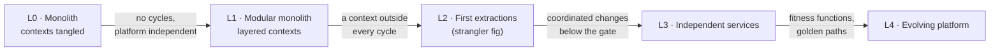

# 74. Maturity Model & Migration Roadmap

<div class="badges" markdown><span class="badge badge-l4">L4 · Architect</span><span class="badge badge-meta">migration roadmap · maturity model · modular monolith · bounded contexts · import coupling · change coupling · Code Maat · dependency cycles · feedback arc set · layering · extraction order · value vs cost · distributed monolith · strangler fig · independent deployability</span></div>

<div class="grid two" markdown>

!!! info "Prerequisites"
    - [Chapter 1](../foundations/ch01-architecture-styles.md): the modular monolith (ADR-001)
    - [Chapter 6](../foundations/ch06-service-decomposition.md): decomposition and change coupling
    - [Chapter 16](../architecture-patterns/ch16-strangler-fig-migration.md): the strangler fig, mechanically
    - [Chapter 73](ch73-adrs-fitness-functions.md): fitness functions to hold each step

!!! abstract "What you'll learn"
    - **Measure the monolith before drawing the roadmap.** Broadleaf Commerce 7.1.0, an open-source Java commerce platform, has 2,788 source files in 14 contexts:
        - **9 business contexts form one dependency cycle.** 12 pairs import each other, and the shared platform imports 4 business contexts.
        - **At least 157 imports** must be removed or inverted before the contexts form layers; **217** with the platform.
    - **History says how independent services could ever be.** Of 2,486 commits in ten years:
        - **84.6% changed one context.**
        - Even with every candidate extracted, **15.4%** would need coordinated releases, and only **49%** could ship from one service alone.
    - **Extraction order decides what each step costs and buys.** Five orders, compared step by step:
        - **Fewest dependants first** was cheap and nearly useless: 5% of changes independent after three steps.
        - **Most changed first** freed 33% of changes, with **1,083** dependencies crossing the network.
        - **Value per remote dependency** freed **32% for 340**.
    - **A maturity model is a set of measured gates**, not a questionnaire. Each level has a number that says whether you're there.

</div>

---

## 1 · Introduction & Context

### The migration plan that started with a diagram

FoodFleet's grocery business arrived through an acquisition: a commerce monolith of the size and shape of Broadleaf Commerce, run by a team that wanted microservices "like the rest of FoodFleet". The first roadmap was a slide with twelve boxes and an arrow per quarter, ordered by which team shouted loudest.

[Chapter 16](../architecture-patterns/ch16-strangler-fig-migration.md) covered how to extract one piece safely: a facade, shadow traffic, canaries and anti-corruption layers. This chapter is about the questions before that:

- **Is the monolith ready to be split?**
- **In what order?**
- **When should you stop?**

To answer them with numbers, it measures a real monolith: **Broadleaf Commerce**, an open-source Java e-commerce platform maintained since 2008. Its code is at the tag `broadleaf-7.1.0-GA`, and its history covers ten years.

### Where it comes from

<ul class="mh-timeline">
<li><span class="when">2004 · Strangler fig, bounded contexts</span><span class="what">Fowler's strangler fig application; Evans's bounded contexts in <em>Domain-Driven Design</em>.</span></li>
<li><span class="when">2015 · Code as a crime scene</span><span class="what">Adam Tornhill mines version control for hotspots and change coupling; Code Maat implements the analyses.</span></li>
<li><span class="when">2015–2019 · Migration patterns</span><span class="what">Sam Newman's <em>Building Microservices</em> and <em>Monolith to Microservices</em>; "monolith first", and modular monoliths as a destination, not only a step.</span></li>
<li><span class="when">2018–2023 · Maturity models</span><span class="what">Cloud-native and microservice maturity models appear from vendors and consultancies, mostly as questionnaires.</span></li>
<li><span class="when">2026 · Versions checked here</span><span class="what">Broadleaf Commerce 7.1.0-GA, Code Maat 1.0.4 and git 2.56.0.</span></li>
</ul>

---

## 2 · Core Concepts & Terminology



Bounded context
:   A part of the domain with its own model and language, such as catalog, order or payment. In code, a set of packages; as a candidate service, a unit that could be deployed alone.

Import coupling
:   One edge per source file per imported class from another context. It's a floor: references by string (configuration, reflection) aren't counted.

Change coupling
:   How often two contexts change in the same commit. Code Maat's degree is shared revisions divided by the average of the two contexts' revisions.

Cycle and layering
:   Contexts that depend on each other, directly or through others, form a cycle and can't be separated without breaking it. A **layering** orders contexts so that dependencies only point down. The **fewest edges against any layering** (a minimum feedback arc set) is how much must change before the contexts can be layered.

Remote dependency
:   An import edge between two deployables. After extraction it becomes an API call, an event or a shared contract.

Coordinated change
:   A commit that touches two or more deployables, so their releases have to be coordinated.

Maturity model
:   Levels of capability, each with exit criteria. Useful when the criteria are measured; vague when they're self-assessed.

---

## 3 · How It Works Internally

### From code and history to contexts

`Contexts` maps package prefixes to contexts (`broadleaf-contexts.csv`), and the longest prefix wins:

- **12 candidate services:** catalog, order, offer, pricing, payment, checkout, inventory, search, rating, customer, content and admin.
- **What stays:** the storefront web layer (the strangler's facade), and a **platform** context for shared infrastructure. The platform becomes a library linked into every deployable.

`Codebase` counts imports between contexts in the 2,788 main source files. `History` reads `git log --no-merges --name-only` and turns each commit into the set of contexts it touched. Like Code Maat, it leaves out commits that touch more than 30 files (renames, reformatting).

### What a split costs and buys

For a set of extracted contexts, every import edge and every commit is classified by deployable:

```java title="roadmap/Roadmap.java"
--8<-- "code/chapters/ch74-maturity-migration-roadmap/src/main/java/dev/foodfleet/ch74/roadmap/Roadmap.java:53:92"
```

The classification yields five counts:

| Count | What it is |
|---|---|
| remote | import edges that now cross deployables: calls and types that need an API or a contract |
| inversions | the platform library importing an extracted service, which must be inverted |
| both ways | pairs of deployables that depend on each other: the mark of a distributed monolith |
| coordinated | commits that would need two deployables released together |
| independent | commits that one extracted service could have shipped alone: what the migration buys |

### The fewest edges in the way of layers

To find how far the monolith is from layered contexts, the lab searches every order of contexts for the one with the fewest dependencies pointing upwards. It does this exactly, by dynamic programming over subsets, which takes milliseconds for 14 contexts:

```java title="roadmap/Roadmap.java (layering)"
--8<-- "code/chapters/ch74-maturity-migration-roadmap/src/main/java/dev/foodfleet/ch74/roadmap/Roadmap.java:184:210"
```

---

## 4 · Design Considerations & Trade-offs

### Test setup

All runs used:

- JDK 25.0.4 and git.
- Broadleaf Commerce at `broadleaf-7.1.0-GA` (commit `6054d9ebbd`): main sources only.
- Its history from 2016-10-14 to the tag: 4,123 commits without merges.

The lab is deterministic: two runs gave identical results apart from timings. Reading the sources took about 0.3 s. Reading the history took 0.8 s once git had fetched the trees; the first time in a fresh clone took 37 s.

`check_apis.sh` checks **8 statements** in Code Maat 1.0.4, git 2.56.0 and the Broadleaf tag, and all were found.

### Measured: how tangled is the monolith?

Import edges from each context (rows) to each other context (columns), with the platform in the last column:

| from \ to | files | catalog | order | offer | pricing | payment | checkout | inventory | search | customer | admin | platform |
|---|---|---|---|---|---|---|---|---|---|---|---|---|
| catalog | 126 | . | 17 | 1 | 0 | 0 | 0 | 5 | 18 | 0 | 0 | 488 |
| order | 180 | 79 | . | 64 | 15 | 14 | 0 | 2 | 0 | 34 | 0 | 428 |
| offer | 152 | 1 | 104 | . | 4 | 0 | 5 | 0 | 0 | 15 | 0 | 410 |
| pricing | 30 | 6 | 78 | 9 | . | 1 | 0 | 0 | 0 | 4 | 0 | 68 |
| payment | 98 | 0 | 23 | 0 | 0 | . | 3 | 0 | 0 | 33 | 0 | 119 |
| checkout | 28 | 7 | 31 | 0 | 6 | 48 | . | 4 | 0 | 1 | 0 | 72 |
| inventory | 11 | 9 | 8 | 0 | 0 | 0 | 4 | . | 0 | 0 | 0 | 20 |
| search | 105 | 60 | 0 | 0 | 0 | 0 | 0 | 0 | . | 0 | 0 | 263 |
| customer | 103 | 0 | 0 | 0 | 0 | 5 | 0 | 0 | 0 | . | 0 | 214 |
| content | 141 | 0 | 0 | 0 | 0 | 0 | 0 | 0 | 0 | 0 | 87 | 491 |
| admin | 581 | 111 | 2 | 14 | 0 | 1 | 0 | 1 | 12 | 11 | . | 1,007 |
| storefront web | 231 | 102 | 166 | 13 | 15 | 40 | 2 | 6 | 23 | 133 | 0 | 434 |
| platform | 985 | 0 | 18 | 0 | 0 | 24 | 2 | 0 | 0 | 16 | 0 | . |

Columns left out: nothing imports content or the storefront; rating is imported only by the storefront (11). Rating (17 files) imports customer 15 times and the platform 26 times.

What the table shows:

- **Most coupling goes to the platform, which is fine.** 4,040 of the 5,583 edges between contexts point into the shared platform, a library each service can link.
- **The platform imports business contexts.** It has 60 edges into order, payment, customer and checkout. A shared library can't depend on services, so these must be inverted first.
- **Nine business contexts are one cycle.** Catalog, order, offer, pricing, payment, checkout, inventory, search and customer all reach each other. 12 pairs import each other directly, for example offer and order (104 and 64 edges) and catalog and order (17 and 79).
- **The way out is measurable.** The best possible layering, from catalog and customer at the bottom up to storefront web, still has **157 edges pointing upwards** (217 counting the platform's). The largest are order → offer (64), catalog → search (18), catalog → order (17), order → pricing (15) and order → payment (14). Removing or inverting those 157, for example with events or interfaces owned by the lower layer, is the work that turns this into a modular monolith.
- **Only rating, content and admin are outside the cycle.** They are the only contexts that could leave without a dependency in both directions.

### Measured: what history says about independence

| | Commits |
|---|---|
| without merges, 2016-10-14 to the tag | 4,123 |
| more than 30 files (left out) | 67 |
| no main sources (tests, build, docs) | 1,570 |
| analysed | 2,486 |
| changed **one** context | **2,104 (84.6%)** |
| changed 2 / 3 / 4 / 5 or more | 261 / 67 / 35 / 19 |

Revisions per context over the decade: platform 889, admin 733, storefront web 344, catalog 223, order 203, content 185, search 167, offer 152, customer 77, payment 38, checkout 26, pricing 17, inventory 16, rating 7.

What the history shows:

- **The contexts are better than the imports suggest.** 85% of changes stayed inside one context, so the boundaries mostly match how the code changes.
- **There's a ceiling on independence.** With all 12 candidates extracted, 15.4% of commits would still span deployables, and only 49.0% would belong to one service alone. The rest touch the storefront or the platform. No extraction order can beat that ceiling; only redrawing boundaries or shrinking the platform can.
- **Change coupling between contexts was weak.** No pair reached Code Maat's default 30% degree. The strongest were admin and platform (15.2%), catalog and order (12.7%), and offer and order (11.3%).
- **One coupling had no import behind it.** Catalog and content changed together in 19 commits (9.3%) without importing each other. That's a hidden dependency through configuration, templates or conventions, which import counts miss and history finds.

### Measured: five extraction orders

Each order extracts all 12 candidates, one per step. After 3 and 6 steps:

| Order | Remote edges (3 · 6 steps) | Independent changes (3 · 6) | Coordinated changes (3 · 6) | First three |
|---|---|---|---|---|
| fewest dependants first | 224 · 500 | **5.3% · 10.5%** | 10.6% · 11.7% | content, rating, checkout |
| greedy: fewest remote edges | 152 · 485 | 4.9% · 11.1% | 10.7% · 11.5% | rating, inventory, content |
| largest first | 922 · 1,152 | 30.9% · 45.4% | 13.6% · 14.7% | admin, order, offer |
| most changed first | **1,083** · 1,152 | 32.7% · 45.4% | 13.8% · 14.7% | admin, catalog, order |
| **value per remote edge** | **340** · 1,152 | **31.8%** · 45.4% | 12.3% · 14.7% | admin, content, search |

Before any extraction, 9.6% of commits already spanned the monolith and the platform library. With everything extracted:

- **1,483** remote edges;
- **60** platform-to-service inversions;
- **12** pairs depending both ways;
- **15.4%** coordinated and **49.0%** independent changes.

What the table shows:

- **Cheap first buys almost nothing.** Leaf-first and fewest-edges-first orders kept remote dependencies low, but after six extractions only 10–11% of changes could ship alone. The extracted contexts were the ones that rarely change.
- **Value first, done naively, pays for the hub early.** Most-changed-first extracted order third, and remote edges jumped to 1,083, because order is the hub of the cycle.
- **Value per remote edge got the value without the bill.** Admin, content and search freed 31.8% of changes, about as much as most-changed-first, with 340 remote edges instead of 1,083. It deferred catalog and order until later, and by step 6 both orders had extracted the same six contexts.
- **Cycles come along for the ride.** Every order passed through 12–16 pairs of deployables that depend on each other both ways. Breaking the 157 upward edges before extracting removes those pairs; extracting first just distributes them.

### Choosing

| Question | Do | Why (measured) |
|---|---|---|
| Is the monolith ready? | Measure cycles and the fewest upward edges | 9 contexts in one cycle; 157 edges from layers |
| What to do first | Make it a modular monolith: break cycles, invert the platform | 60 platform-to-service edges; 12 pairs both ways |
| Are the boundaries right? | Check history: share of single-context commits, hidden couplings | 84.6% single-context; catalog–content coupled with no imports |
| How far can it go? | Compute the independence ceiling for the context map | 49% of changes independent at best; 15.4% coordinated |
| What to extract first | Most value per new remote dependency | 31.8% freed for 340 edges vs 1,083 |
| When to stop | When the next extraction buys little | Steps 7–12 added 3.6% for 331 edges |
| How to hold each level | Fitness functions per gate ([chapter 73](ch73-adrs-fitness-functions.md)) | Cycles and inversions are checkable in every build |

---

## 5 · Hands-on Implementation

```text
ch74-maturity-migration-roadmap/
├── src/main/java/dev/foodfleet/ch74/roadmap/
│   ├── Contexts   package prefixes to contexts (longest match), candidates
│   ├── Codebase   import edges between contexts
│   ├── History    commits as sets of contexts (git log, Code Maat's 30-file limit)
│   └── Roadmap    cost of a split, extraction orders, cycles, minimum layering
├── src/main/resources/broadleaf-contexts.csv
├── src/test/java/…   UnitTest (3, tag unit)
└── verify/   build-libs.sh, run.sh, check_apis.sh, tools/ (Lab, RunSuites)
```

### FoodFleet's maturity model, with gates

<div class="badges" markdown><span class="badge badge-l4">L4 · Architect</span></div>

| Level | Exit gate (measured) | Broadleaf 7.1.0 |
|---|---|---|
| L0 Monolith | contexts named and mapped to packages | 14 contexts mapped |
| L1 Modular monolith | **0** dependency cycles between contexts; **0** platform → business edges; fitness functions in the build | 157 upward edges; 60 platform edges: **not yet** |
| L2 First extractions | each extracted context outside every cycle; facade and anti-corruption layers in place ([chapter 16](../architecture-patterns/ch16-strangler-fig-migration.md)) | only rating, content and admin qualify |
| L3 Independent services | coordinated changes under 5% of commits per service; no pairs depending both ways | 15.4% even when fully split: **boundaries need work** |
| L4 Evolving platform | golden paths, conformance and fitness functions per decision ([chapters 72](ch72-platform-engineering.md)–[73](ch73-adrs-fitness-functions.md)) | n/a |

The numbers in the gates are FoodFleet's policy. The measurements tell you which side of each gate you're on.

```bash
JAVA_HOME=/path/to/jdk-25 verify/run.sh   # under a minute after a 70 MB clone; needs git
```

### Run and verify

```text
$ verify/run.sh coupling
Broadleaf Commerce broadleaf-7.1.0-GA (commit 6054d9ebbd): 2788 main source files in 14 contexts (12 candidates)
== coupling
5583 import edges between contexts; 4040 of them into the platform; 60 from the platform into business contexts
cycles (strongly connected contexts), without the platform: [[catalog, checkout, customer, inventory, offer, order, payment, pricing, search]]
layering without the platform (lowest first): [catalog, customer, order, offer, payment, pricing, checkout, inventory, search, rating, admin, content, storefront-web]
  157 import edges point upwards (fewest possible)
```

!!! question "Try it"
    1. Move `org.broadleafcommerce.core.offer` into order (one context, "ordering"). How do the cycle, the 157 edges and the independence ceiling change?
    2. Add a strategy that refuses to extract a context still in a cycle. Which order does it produce, and at what cost?
    3. Rerun `history` over only the last three years. Do the hotspots and the single-context share change?
    4. Point the lab at your own monolith (a contexts CSV and a clone). Which level of the model does it reach?

---

## 6 · Production Readiness

- [x] **Contexts mapped to code**, with the mapping in the repository
- [x] **Coupling, cycles and the fewest upward edges** measured, and tracked over time
- [x] **History analysed**: single-context share, hidden couplings, the independence ceiling
- [x] **Cycles broken and the platform inverted** before the first extraction
- [x] **Extraction order by value per remote dependency**, re-planned after each step
- [x] **A stopping rule**: stop when the next extraction buys little
- [x] **Fitness functions for each gate**: no new cycles, no platform → business edges

---

## 7 · Anti-patterns & Pitfalls

!!! pitfall "Incident 1: the hub extracted first"
    **Context.** The grocery team started with order, the busiest and most visible context.

    **Symptoms.** Within a quarter, order-service called five services and was called by four; every release needed three others to be released with it.

    **Root cause.** Order was the hub of a nine-context cycle. Measured: extracting it among the first three created 1,083 remote dependencies, against 340 for an order that freed as many changes.

    **Fix.** Break the cycle inside the monolith first; extract by value per remote dependency.

!!! pitfall "Incident 2: the easy wins that changed nothing"
    **Context.** To show progress, the team extracted the smallest, least-coupled contexts: rating, inventory, content.

    **Symptoms.** Three services in production, and lead time unchanged.

    **Root cause.** They rarely changed. Measured: cheapest-first orders freed 5% of changes after three extractions.

    **Fix.** Measure what each extraction buys (independently shippable changes) as well as what it costs.

!!! pitfall "Incident 3: the shared library that needed the services"
    **Context.** The common platform module became a shared library for the new services.

    **Symptoms.** The library couldn't be built without order and payment classes; every service ended up depending on them.

    **Root cause.** The platform imported business contexts. Measured: 60 platform-to-service edges.

    **Fix.** Invert those dependencies (interfaces in the platform, implementations in the contexts) before the first extraction, and add a fitness function that keeps them out.

| Anti-pattern | Symptom | Fix |
|---|---|---|
| Roadmap from a diagram | Surprises at every step | Measure coupling and history first |
| Extracting the hub first | Distributed monolith | Value per remote dependency; hubs last |
| Easy wins only | Services that never change | Count independent changes bought |
| Splitting before breaking cycles | Pairs calling each other | Modular monolith first (L1) |
| A shared library with business code | Every service depends on all | Invert platform → business edges |
| Extracting everything | Coordination cost without benefit | Stop at the ceiling; keep a modular core |
| Maturity by questionnaire | Self-assessed levels | Measured gates |

---

## 8 · Enterprise Case Study

### FoodFleet: the grocery migration

!!! decision "ADR-074: migrations start from measurements of the monolith's import coupling, cycles and history; the monolith first becomes a modular monolith (no cycles between contexts, no platform-to-business dependencies, held by fitness functions); contexts are extracted in order of independent changes gained per remote dependency added, re-planned after each step, and only from outside every cycle; the migration stops when the next extraction buys little; maturity levels are judged by measured gates"
    **Status:** Accepted · **Date:** 2026-03-23

    **Context.** The grocery platform, measured on a commerce monolith of its shape (Broadleaf Commerce 7.1.0):

    - 9 business contexts in one cycle; 157 upward edges from layers (217 with the platform); 60 platform-to-business edges.
    - 84.6% of commits within one context, but an independence ceiling of 49% and 15.4% coordinated changes even when fully split.
    - Three extractions freed 31.8% of changes for 340 remote dependencies by value per edge, against 1,083 by most-changed-first.

    **Decision.**

    - **Phase 1 (L1):** break the cycles, starting with the largest upward edges (order → offer, catalog → search, catalog → order), mostly with domain events and interfaces owned by the lower context. Invert the platform's 60 edges. Fitness functions for both.
    - **Phase 2 (L2):** extract admin, content and search through the strangler facade; re-measure after each.
    - **Phase 3:** re-plan from the new measurements; redraw boundaries where coordinated changes stay high.
    - **Stop rule:** no extraction that gains less than 2% of changes independent.

    **Consequences:**

    - ✅ Each step is justified by numbers that can be re-measured.
    - ✅ The monolith gets better even if the migration stops early.
    - ⚠️ Phase 1 delivers no services, only a modular monolith, and needs explaining as progress.
    - ⚠️ Import counts miss configuration and reflection; history catches some (catalog–content).

### Fintech analogue: the core banking monolith

Banks rarely extract the ledger first. They peel off channels (mobile, web), product catalogues and notifications, which change often and couple weakly to the core. The core stays a well-modularised monolith for years, because the coordination cost of splitting it exceeds the benefit. The deciding numbers are the same: what changes often, and what depends on what.

### E-commerce analogue: commerce platforms and their admin

Commerce platforms often move the back office (admin, content) out first. It changes often, has its own users and release rhythm, and is mostly a consumer of the core's data. Broadleaf's numbers agree: admin alone accounted for 22.6% of independently shippable changes. Checkout and payment, which sit in the cycle, come last or not at all.

---

## 9 · Interview Q&A + Summary

#### Q1. How do you plan a monolith-to-microservices migration? · <span class="badge badge-l4">L4</span> · Thoughtworks · Infosys

**Short answer:** Measure first: contexts mapped to code, import coupling, cycles, history. Make it a modular monolith (no cycles, shared code independent of business code), then extract contexts in order of value per new remote dependency through a strangler facade, re-measuring after each step and stopping when the next step buys little.

#### Q2. Which service do you extract first? · <span class="badge badge-l3">L3</span> · Amazon

**Short answer:** One that changes often, sits outside the dependency cycles and adds few remote dependencies. Measured on Broadleaf: admin, content and search freed 31.8% of changes for 340 remote edges; starting with the hub (order) cost 1,083 for about the same.

#### Q3. Why not start with the easiest service? · <span class="badge badge-l3">L3</span> · Flipkart

**Short answer:** The easiest are usually the ones that rarely change, so extracting them buys little. Measured: fewest-dependants-first freed 5% of changes after three extractions.

#### Q4. What is a modular monolith, and why go there first? · <span class="badge badge-l3">L3</span> · Swiggy

**Short answer:** One deployable whose contexts have explicit boundaries and no cycles, with shared code that doesn't depend on business code. Splitting a tangled monolith distributes its cycles: every extraction order passed through 12–16 pairs of services depending on each other.

#### Q5. How do you know how tangled a codebase is? · <span class="badge badge-l3">L3</span> · SAP

**Short answer:** Map packages to contexts, count imports between them, find strongly connected components, and compute the fewest edges that stop a layering. Broadleaf: one cycle of 9 contexts and 157 edges in the way.

#### Q6. What does change coupling add to import analysis? · <span class="badge badge-l3">L3</span> · Atlassian

**Short answer:** It shows what actually changes together, including couplings with no import (configuration, templates, conventions). Catalog and content changed together in 19 commits without importing each other.

#### Q7. Can every change become independently deployable? · <span class="badge badge-l4">L4</span> · Google

**Short answer:** Not with a given context map. History gives the ceiling: for Broadleaf, 49% of changes would belong to one service even with all 12 extracted, and 15.4% would need coordinated releases. Raising the ceiling means redrawing boundaries, not extracting more.

#### Q8. What's wrong with a shared library in a migration? · <span class="badge badge-l3">L3</span> · Goldman Sachs

**Short answer:** Nothing, if it depends on no business code. Broadleaf's platform imported order, payment, customer and checkout 60 times; as a library, that would make every service depend on them. Invert those edges first.

#### Q9. What is a microservices maturity model good for? · <span class="badge badge-l4">L4</span> · Accenture

**Short answer:** Sequencing capabilities: modular monolith, first extractions, independent services, evolving platform. It's useful only with measured exit gates (cycles, platform edges, coordinated changes); self-assessed questionnaires tell you little.

#### Q10. When do you stop extracting? · <span class="badge badge-l4">L4</span> · any architect round

**Short answer:** When the next extraction buys little independent change for its coordination cost. On Broadleaf, the last six extractions of the value-per-edge order added 3.6% of independent changes for 331 more remote edges.

#### Q11. How do you keep a migration from sliding back? · <span class="badge badge-l3">L3</span> · Uber

**Short answer:** Fitness functions for each gate in every build: no new cycles between contexts, no platform → business imports, no new remote dependencies without an ADR. Track the numbers on a dashboard.

#### Q12. Plan the migration of a 2,800-file commerce monolith. · <span class="badge badge-l4">L4</span> · architecture rounds

**Short answer:**

- **Measure:** contexts, imports, cycles, history (a day with these tools).
- **L1:** break the 157 upward edges (events, interfaces), invert the platform, add fitness functions.
- **L2:** extract admin, content and search behind a strangler facade; re-measure.
- **Then:** re-plan by value per remote dependency; redraw boundaries where coordination stays high; stop at diminishing returns.

### Key takeaways

- **Measure before you draw**: coupling, cycles, history.
- **Modular monolith first**: cycles split into services become distributed cycles.
- **Order by value per remote dependency**, not by size, ease or loudness.
- **History sets the ceiling**: some coupling is in the boundaries, not the deployment.

### Further reading

- Sam Newman, *Monolith to Microservices* (2019)
- Adam Tornhill, *Your Code as a Crime Scene* (2nd ed., 2024); [Code Maat](https://github.com/adamtornhill/code-maat)
- Martin Fowler, [StranglerFigApplication](https://martinfowler.com/bliki/StranglerFigApplication.html)
- [Broadleaf Commerce](https://github.com/BroadleafCommerce/BroadleafCommerce), the codebase measured here

---

**Previous:** [← 73. ADRs, Fitness Functions & Tech Radar](ch73-adrs-fitness-functions.md) · **Next:** [75. Multi-Tenancy, Multi-Region & Compliance →](ch75-multi-tenancy-multi-region-compliance.md)
