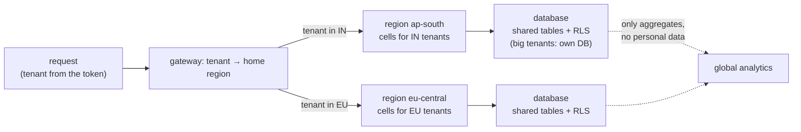

# 75. Multi-Tenancy, Multi-Region & Compliance

<div class="badges" markdown><span class="badge badge-l3">L3 · Senior/Lead</span><span class="badge badge-l4">L4 · Architect</span><span class="badge badge-meta">multi-tenancy · pool vs bridge vs silo · row-level security · FORCE ROW LEVEL SECURITY · SET LOCAL · tenant context · noisy neighbour · bulkheads · data residency · cells · right to erasure · crypto-shredding · backups and WAL · DPDP · GDPR</span></div>

<div class="grid two" markdown>

!!! info "Prerequisites"
    - [Chapter 12](../architecture-patterns/ch12-database-per-service.md): data ownership per service
    - [Chapter 39](../security/ch39-secrets-management.md): keys and secrets
    - [Chapter 46](../resilience/ch46-disaster-recovery.md): cells, regions and replication
    - [Chapter 74](ch74-maturity-migration-roadmap.md): measured gates

!!! abstract "What you'll learn"
    - **Three tenancy models, measured at 10, 100 and 1,000 tenants:**
        - **Shared table + RLS:** a new tenant in under 1 ms, 1,000 tenants in 298 MB, one migration.
        - **Schema per tenant:** 6–10 ms per tenant, 6,413 relations at 1,000, a migration of 3.2–3.3 s.
        - **Database per tenant:** 52–105 ms per tenant, **811 MB for 100**, and a connection per tenant.
        - Queries took **under 1.5 ms at p99** in every model; the costs are operational.
    - **Row-level security protects only when it applies.** A query that forgot its tenant returned all 20 tenants' orders without RLS, to the table's owner (unless forced) and to a superuser.
    - **Pooled connections leak a per-session tenant.** When 10% of requests forgot to set it:
        - **177 of 193 forgotten requests saw another tenant's orders.**
        - Setting it per transaction leaked none. With a naive policy those requests failed; with `NULLIF` they saw nothing.
    - **A big tenant's reports raised everyone's p99 from 4–5 ms to 25–38 ms.**
        - A bulkhead of one report at a time kept p99 at 8–11 ms, for 4–11% fewer reports.
        - A 100 ms timeout cancelled every report and still raised p99 to 34–40 ms.
    - **Erasure has to reach every copy.** After DELETE and VACUUM, an erased email was still in the WAL (2 copies) and the backup (1). With crypto-shredding the plaintext was never stored, and deleting a 32-byte key made every copy unreadable. The key itself stayed in the key store's WAL.

</div>

---

## 1 · Introduction & Context

### From one marketplace to a platform for chains

FoodFleet began as one marketplace. Then large restaurant chains asked for their own ordering, loyalty and reporting on FoodFleet's platform: their brand, their customers, their data kept apart. Each chain is a **tenant**.

The chains came with demands:

- **Separation:** "Nobody else can see our orders."
- **Fairness:** "Our month-end reports can't be slowed by someone else's."
- **Residency:** "Our Indian customers' data stays in India, our European customers' in the EU."
- **Erasure:** "When a customer asks to be forgotten, they're forgotten everywhere, including backups."

This chapter measures what each demand costs and where the usual implementations fail.

### Where it comes from

<ul class="mh-timeline">
<li><span class="when">2006–2010 · SaaS tenancy models</span><span class="what">Shared database, shared schema; shared database, separate schemas; separate databases. Later named pool, bridge and silo by AWS's SaaS guidance.</span></li>
<li><span class="when">2016 · Row-level security in PostgreSQL 9.5</span><span class="what">Policies filter rows per query, with FORCE ROW LEVEL SECURITY for table owners; SQL Server and Oracle (VPD) have equivalents.</span></li>
<li><span class="when">2018 · GDPR in force</span><span class="what">Article 17's right to erasure, and Article 44 onwards on transfers out of the EU, make "where is this person's data" an engineering question.</span></li>
<li><span class="when">2023 · India's DPDP Act</span><span class="what">The Digital Personal Data Protection Act: consent, erasure on withdrawal, and transfers restricted by government notification.</span></li>
<li><span class="when">2026 · Versions checked here</span><span class="what">PostgreSQL 16.13 and the PostgreSQL JDBC driver 42.7.</span></li>
</ul>

---

## 2 · Core Concepts & Terminology



Tenant
:   A customer organisation (here, a restaurant chain) whose users and data are kept apart from other tenants on shared infrastructure.

Pool, bridge, silo
:   How much is shared:
    - **Pool:** shared tables with a tenant column.
    - **Bridge:** a schema per tenant in a shared database.
    - **Silo:** a database, or a whole stack, per tenant.

    Many platforms mix them: pool for most tenants, silo for the largest or most regulated.

Row-level security (RLS)
:   Database policies that filter every query on a table by a condition, here `tenant_id = <the current tenant>`. Superusers and `BYPASSRLS` roles always bypass it, and table owners do unless the table has `FORCE ROW LEVEL SECURITY`.

Tenant context
:   The current request's tenant, carried from the token to the database. In PostgreSQL that's a setting such as `app.tenant_id`, set per transaction (`SET LOCAL`), never per session.

Noisy neighbour
:   One tenant's workload degrading others' on shared resources. Limited with per-tenant quotas, bulkheads and, for the largest tenants, separate capacity.

Data residency
:   Keeping personal data in a given jurisdiction. Implemented by giving each tenant (or user) a home region and routing to it; only non-personal or aggregated data leaves.

Crypto-shredding
:   Encrypting each data subject's personal data with their own key, and erasing them by deleting the key. Every copy of the ciphertext, in tables, logs, WAL or backups, becomes unreadable at once.

---

## 3 · How It Works Internally

### The tenant setting, per transaction

Every database call for a tenant runs in a transaction that sets the tenant with `set_config(..., true)`, the function form of `SET LOCAL`. The setting is gone at commit, so the next borrower of a pooled connection can't inherit it:

```java title="tenancy/TenantScope.java"
--8<-- "code/chapters/ch75-multi-tenancy-multi-region-compliance/src/main/java/dev/foodfleet/ch75/tenancy/TenantScope.java:24:41"
```

### The shared table and its policy

The application connects as a role that doesn't own the table. The policy is forced, so even the owner is filtered, and it reads the setting defensively:

```java title="tenancy/TenancyModel.java"
--8<-- "code/chapters/ch75-multi-tenancy-multi-region-compliance/src/main/java/dev/foodfleet/ch75/tenancy/TenancyModel.java:21:25"
```

```java title="tenancy/TenancyModel.java (shared table)"
--8<-- "code/chapters/ch75-multi-tenancy-multi-region-compliance/src/main/java/dev/foodfleet/ch75/tenancy/TenancyModel.java:64:76"
```

The `NULLIF` matters. `current_setting(name, true)` returns NULL if the setting was never used on the connection. After a transaction-local value has come and gone, it returns an **empty string**, and `''::int` is an error. The leak experiment below shows both cases.

### Crypto-shredding

Each subject's fields are encrypted with AES-256-GCM using a key of their own, with the subject's identifier as associated data so a field can't be decrypted as someone else's. Keys live in a separate store:

```java title="erasure/CryptoShredder.java"
--8<-- "code/chapters/ch75-multi-tenancy-multi-region-compliance/src/main/java/dev/foodfleet/ch75/erasure/CryptoShredder.java:59:68"
```

```java title="erasure/CryptoShredder.java (erasure)"
--8<-- "code/chapters/ch75-multi-tenancy-multi-region-compliance/src/main/java/dev/foodfleet/ch75/erasure/CryptoShredder.java:82:88"
```

### Regions and residency

Each tenant has a **home region**, recorded in the tenant registry and in its tokens:

- The gateway routes the tenant's requests to cells in that region ([chapter 46](../resilience/ch46-disaster-recovery.md)). Personal data is written only there.
- Cross-region replication carries only what may leave: reference data (menus, catalogue) and aggregates without personal data.
- A tenant whose customers sit in two jurisdictions is split into two tenants, one per region.

Disaster recovery for a regulated tenant stays within its jurisdiction, for example two regions inside the EU, or two zones inside India.

---

## 4 · Design Considerations & Trade-offs

### Test setup

All runs used:

- PostgreSQL 16.13 on one 2-vCPU VM, a fresh cluster per experiment, `fsync` on.
- JDK 25.0.4 with the PostgreSQL JDBC driver 42.7.14.
- Each tenant had 2,000 orders.

There were two runs. The leak and erasure results were identical; where measurements differed, both values are shown. `check_apis.sh` checks **7 statements** in PostgreSQL 16.13's documentation, and all were found.

### Measured: three tenancy models

| Model | Tenants | Provisioning (all · per tenant) | Size | Relations | Migration (column + index) | Last 20 orders p50 / p99 | Connections |
|---|---|---|---|---|---|---|---|
| shared + RLS | 10 | 14–18 ms · 0.6–0.9 ms | 10.8 MB | 423 | 12–18 ms | 0.23–0.24 / 0.65–0.90 ms | 1 |
| schema per tenant | 10 | 86–109 ms · 7.9–10.4 ms | 11.3 MB | 473 | 43–49 ms | 0.30–0.31 / 0.81–0.83 ms | 1 |
| database per tenant | 10 | 1.2–1.3 s · 59–104 ms | 81.1 MB | 4,190 | 57–77 ms | 0.16 / 0.64–0.78 ms | 10 |
| shared + RLS | 100 | 36–41 ms · 0.3–0.4 ms | 35.8 MB | 423 | 62–69 ms | 0.27–0.30 / 0.66–0.79 ms | 1 |
| schema per tenant | 100 | 0.8–0.9 s · 7.1–7.5 ms | 43.1 MB | 1,013 | 374–416 ms | 0.39–0.40 / 0.96–1.34 ms | 1 |
| database per tenant | 100 | **6.3–9.7 s** · 52–87 ms | **811 MB** | **41,900** | 444–530 ms | 0.19–0.20 / 0.92–0.99 ms | **100** |
| shared + RLS | 1,000 | 0.38–0.43 s · 0.3–0.4 ms | 298 MB | 423 | 0.8–1.1 s | 0.30–0.35 / 0.75–0.91 ms | 1 |
| schema per tenant | 1,000 | 7.2–8.0 s · 6.7–7.6 ms | 376 MB | **6,413** | **3.2–3.3 s** | 0.44–0.47 / 1.29–1.42 ms | 1 |
| database per tenant | 1,000 | not run: about 7.5 GB and 1,000 connections per application instance | | | | | |

Revenue over 30 days (an aggregate over a tenant's month) took 0.5–1.0 ms at p50 and 1.1–2.3 ms at p99 in every model. Opening a connection to a tenant's database took 4.6–7.4 ms at p50 and 14–82 ms at p99.

What the table shows:

- **Query speed doesn't decide between the models.** Every model answered both queries in about a millisecond. A database per tenant was slightly faster per query (smaller tables and indexes), but paid 5–7 ms whenever a connection had to be opened.
- **Operations do.** Going from shared tables to databases per tenant:
    - provisioning went from under 1 ms to 52–105 ms a tenant;
    - storage from 36 MB to 811 MB for 100 tenants (each empty database is about 7.5 MB);
    - catalog relations from 423 to 41,900.
- **A migration is one statement or a thousand.** The shared table migrated 1,000 tenants in one `ALTER` and one index build (0.8–1.1 s). Schemas needed 1,000 of each (3.2–3.3 s), and any one of them can fail halfway, leaving tenants on different versions.
- **Connections are the silo's hidden cost.** One application instance held 100 connections for 100 tenants. With 10 instances and a pool of 5 per tenant, that's 5,000 connections, more than one PostgreSQL server serves well.

### Measured: what a forgotten tenant predicate returns

There were 20 tenants with 500 orders each. Tenant 7's request ran a query that forgot `WHERE tenant_id = ?`, with tenant 7 set for its transaction:

| Table and role | Rows returned |
|---|---|
| no RLS, application role | **10,000 rows from 20 tenants** |
| RLS enabled and forced, application role | 500 rows from 1 tenant |
| RLS enabled, not forced, as the table's owner | **10,000 rows from 20 tenants** |
| RLS enabled and forced, as the table's owner | 500 rows from 1 tenant |
| RLS enabled and forced, as a superuser | **10,000 rows from 20 tenants** |

Then 2,000 requests from random tenants went through a pool of 4 connections, with 1 request in 10 on a code path that forgot to set the tenant (193 requests):

| Tenant setting | Saw another tenant's orders | Saw nothing | Failed with an error |
|---|---|---|---|
| per session (`SET`) | **177** | 0 | 0 |
| per transaction, policy `current_setting(...)::int` | 0 | 0 | 193 |
| per transaction, policy with `NULLIF(...)` | 0 | **193** | 0 |

What the tables show:

- **RLS is a safety net only for the roles it applies to.** The owner and a superuser saw everything; the application must connect as a non-owner, non-superuser role, and owner-run jobs need `FORCE`.
- **A per-session tenant is a cross-tenant leak waiting for a forgotten call.** On a pool, the connection still carries the previous request's tenant. 177 of 193 forgotten requests read another chain's orders; the other 16 happened to follow their own tenant.
- **Per transaction fails closed.** It either errors (a naive cast of the empty string) or returns nothing (`NULLIF`). Both are safe; the error is easier to notice, and returning nothing is easier to operate. FoodFleet uses `NULLIF` plus an alert on tenant-less transactions.

### Measured: a noisy neighbour

There were 20 small tenants (2,000 orders each) and one large chain with 1,000,000 orders:

- The small tenants sent "last 20 orders" at 100 requests/s through a pool of 8, for 10 s.
- The large chain's report, a grouping over its million orders, took 133–135 ms alone. It ran in a loop on 6 connections.

| Variant | Small tenants p50 / p99 / max | Reports completed in 10 s |
|---|---|---|
| no reports | 1.2 / **3.8–4.8** / 9–11 ms | – |
| 6 concurrent reports, no limit | 1.3–4.2 / **25–38** / 41–68 ms | 81 |
| bulkhead: 1 report at a time per tenant | 0.8 / **8.4–10.6** / 23–39 ms | 72–78 |
| 6 concurrent, `statement_timeout` 100 ms for the chain's role | 1.1–1.8 / 34–40 / 63–66 ms | **0** (525–529 cancelled) |

What the table shows:

- **One tenant can take a shared database's CPU.** Six concurrent reports on two cores raised everyone else's p99 five- to tenfold.
- **A bulkhead per tenant fixed it at little cost.** One report at a time kept others' p99 within 2× of quiet. The chain got 4–11% fewer reports, because six concurrent reports were mostly waiting for the same two cores anyway.
- **A timeout below the work's duration is the worst of both.** Every report was cancelled after doing 100 ms of work, so the CPU was still spent and nothing came out. Timeouts protect against runaway queries; quotas and bulkheads protect neighbours.
- **The biggest tenants get their own capacity.** A chain whose reports need more than its share moves to a read replica or a silo, which is what the mixed model is for.

### Measured: where an erased customer survives

There were 10,000 customers, stored twice: once in plain columns, and once with crypto-shredded columns whose keys sat in a separate PostgreSQL instance. A base backup was taken first, as a nightly backup would be. Then subject-4242 asked to be erased. The table shows occurrences of their email's bytes:

| After | Table files | WAL | Backup |
|---|---|---|---|
| storing it (plain columns) | 1 | 1 | 1 |
| storing it (encrypted columns) | **0** | **0** | **0** |
| DELETE and a checkpoint | 1 | 2 | 1 |
| VACUUM | 0 | 2 | 1 |
| VACUUM FULL | 0 | 2 | 1 |

| Crypto-shredding | Result |
|---|---|
| decrypt before erasure | the email |
| delete subject-4242's key (1.4–2.0 ms; DELETE took 28 ms) | decrypt returns nothing, for the table's, the WAL's and the backup's copies alike |
| the deleted key's bytes in the key store | table files 0, **WAL 1**, also after VACUUM FULL |

What the tables show:

- **DELETE erases a row, not a person.** The email stayed in the WAL (the insert, plus a full-page image written after the checkpoint) and in the backup, until both age out. A WAL archive or backups kept for 35 days mean 35 days of copies.
- **VACUUM removed the bytes from the table files here;** VACUUM FULL is what the documentation promises to rewrite. Neither touches WAL or backups.
- **Crypto-shredding erased every copy at once.** The plaintext never reached disk, and without the key the ciphertext in the backup is noise.
- **It moves the problem to the key store.** The deleted key was still in the key store's WAL, so the key store needs short WAL and backup retention, or a KMS whose key deletion is itself the guarantee.

### Choosing

| Question | Do | Why (measured) |
|---|---|---|
| Most tenants | Shared tables, forced RLS, a non-owner application role | under 1 ms to provision, one migration, 1 connection |
| The largest or most regulated tenants | A database (or stack) of their own | Isolation and capacity; 52–105 ms and 7.5 MB each |
| Schema per tenant | Only for a handful of tenants that need separate schemas | 6,413 relations and 1,000 migrations at 1,000 tenants |
| Carrying the tenant to the database | Per transaction (`SET LOCAL`), `NULLIF` in the policy | Per session leaked in 177 of 193 forgotten requests |
| Who bypasses RLS | Only migrations and break-glass roles, audited | Owner and superuser saw all 20 tenants |
| Fairness | Per-tenant bulkheads and quotas; silo for the heaviest | p99 25–38 ms unlimited, 8–11 ms with a bulkhead |
| Timeouts | For runaway queries, above the longest legitimate one | 100 ms cancelled every 135 ms report |
| Residency | A home region per tenant; only aggregates leave | Routing, not replication, keeps personal data in place |
| Erasure | Crypto-shred personal fields; keys in a KMS or a short-retention store | DELETE left copies in WAL and backup |

---

## 5 · Hands-on Implementation

```text
ch75-multi-tenancy-multi-region-compliance/
├── src/main/java/dev/foodfleet/ch75/
│   ├── tenancy/   Cluster (throwaway PostgreSQL), TenancyModel (shared + RLS, schema, database),
│   │              TenantScope (tenant per transaction)
│   └── erasure/   CryptoShredder (per-subject AES-GCM keys), ByteScan (where bytes survive)
├── src/test/java/…   UnitTest (3, tag unit)
└── verify/   build-libs.sh, run.sh, check_apis.sh, tools/ (Lab, RunSuites)
```

### 🟣 Level 3: one platform, many chains

<div class="badges" markdown><span class="badge badge-l3">L3 · Senior/Lead</span></div>

- The tenant comes from the token (a claim the identity provider sets), never from a request parameter, and flows to the database through `TenantScope`.
- Shared tables carry `tenant_id` in every primary key and index, with a forced RLS policy. The application role neither owns the tables nor bypasses RLS.
- A test per repository asserts that every table with `tenant_id` has a forced policy: a fitness function ([chapter 73](ch73-adrs-fitness-functions.md)).
- Per-tenant limits sit at the gateway (rate) and in the services (bulkheads for expensive endpoints).

### 🔴 Level 4: tiers, regions and erasure

<div class="badges" markdown><span class="badge badge-l4">L4 · Architect</span></div>

- **Tiers.** The standard tier is pooled; the enterprise tier gets a dedicated database or cell, by contract. Moving a tenant between tiers is a tested, scripted operation.
- **Regions.** A tenant registry holds each tenant's home region, tier and cell. Personal data is written only in the home region, and analytics receive aggregates.
- **Erasure.** Personal fields are crypto-shredded with keys in a KMS. Erasure requests are recorded with their completion time; the backup retention is stated in the privacy notice.
- **Audit.** Every bypass of RLS (migrations, support tooling) runs under an audited role.

```bash
JAVA_HOME=/path/to/jdk-25 verify/run.sh   # about 7 minutes and 2 GB of disk; needs PostgreSQL 16
```

### Run and verify

```text
$ verify/run.sh leaks
== leaks
tenant 7 runs a query that forgot its tenant predicate (20 tenants, 500 orders each):
  no RLS, as the application role:            10000 rows from 20 tenant(s)
  RLS enabled and forced, application role:   500 rows from 1 tenant(s)
  RLS enabled, not forced, as table owner:    10000 rows from 20 tenant(s)
pooled connections (4), 2,000 requests, 10% of them on a code path that forgets to set the tenant:
  tenant set per session (SET):                         forgotten 193: saw another tenant's orders 177
  tenant set per transaction, policy with NULLIF:       forgotten 193: saw another tenant's orders   0, saw nothing 193
```

!!! question "Try it"
    1. Give the large chain its own database (the silo) and rerun `noisy`. What happens to the small tenants' p99, and to the chain's reports?
    2. Raise `statement_timeout` to 500 ms. How many reports complete, and what's the small tenants' p99?
    3. Archive WAL (`archive_mode = on`) in the erasure experiment. How many copies of the email does the archive hold after DELETE and VACUUM FULL?
    4. Write the fitness function: every table with a `tenant_id` column has RLS enabled and forced. Run it against the shared model's database.

---

## 6 · Production Readiness

- [x] **Tenant from the token**, carried per transaction, never per session
- [x] **Forced RLS** on every tenant table; the application role neither owns tables nor bypasses RLS
- [x] **A fitness function** for "every tenant table has a forced policy"
- [x] **Per-tenant limits**: gateway quotas, bulkheads for expensive work; silos for the heaviest tenants
- [x] **A tenant registry**: tier, home region, cell; tested moves between tiers
- [x] **Residency by routing**: personal data written only in the home region
- [x] **Crypto-shredding** for personal fields, keys in a KMS; erasure requests tracked to completion
- [x] **Backup and WAL retention** stated and enforced

---

## 7 · Anti-patterns & Pitfalls

!!! pitfall "Incident 1: the report that saw every chain"
    **Context.** A support tool queried the orders table to investigate a chain's complaint.

    **Symptoms.** The export contained orders from every chain on the platform.

    **Root cause.** The tool connected as the table's owner; RLS was enabled but not forced. Measured: as owner, a forgotten predicate returned all 20 tenants' rows.

    **Fix.** `FORCE ROW LEVEL SECURITY` on every tenant table; tools use the application role, and break-glass access is audited.

!!! pitfall "Incident 2: yesterday's tenant on today's connection"
    **Context.** A new endpoint for loyalty points forgot to set the tenant; the code used `SET app.tenant_id` per session.

    **Symptoms.** Customers of one chain occasionally saw another chain's offers.

    **Root cause.** The pooled connection still carried the previous request's tenant. Measured: 177 of 193 forgotten requests read another tenant's rows.

    **Fix.** `TenantScope` with `SET LOCAL` in every data access path; a policy with `NULLIF`; an alert on tenant-less transactions.

!!! pitfall "Incident 3: forgotten, except in the backups"
    **Context.** A customer exercised their right to erasure; support deleted their rows and closed the ticket.

    **Symptoms.** A restore test three weeks later brought the customer's data back.

    **Root cause.** DELETE doesn't reach WAL archives or backups. Measured: after DELETE and VACUUM FULL, the email was still in the WAL twice and in the backup.

    **Fix.** Crypto-shredding for personal fields, with keys in a KMS; documented backup retention.

| Anti-pattern | Symptom | Fix |
|---|---|---|
| Tenant filter only in application code | One forgotten WHERE leaks everything | Forced RLS as a safety net |
| Application connects as owner or superuser | RLS silently bypassed | A non-owner role without BYPASSRLS |
| Tenant set per session on pooled connections | Cross-tenant reads | Per transaction (SET LOCAL) |
| A database per tenant for everyone | Thousands of connections and databases | Pool by default, silo by tier |
| Timeouts as fairness | Work cancelled, CPU still burnt | Per-tenant bulkheads and quotas |
| Replicating personal data everywhere for DR | Residency broken | DR within the jurisdiction |
| DELETE as erasure | Data alive in WAL and backups | Crypto-shredding; retention limits |

---

## 8 · Enterprise Case Study

### FoodFleet: the chain platform

!!! decision "ADR-075: restaurant chains are tenants on pooled, shared tables with tenant_id in every key and a forced row-level security policy, accessed through a non-owner role with the tenant set per transaction; enterprise-tier chains get a dedicated database or cell; per-tenant quotas and bulkheads protect neighbours; every tenant has a home region that receives all its personal data, and only aggregates leave; personal fields are crypto-shredded with keys in a KMS, and erasure deletes the key"
    **Status:** Accepted · **Date:** 2026-03-30

    **Context.** Measured on PostgreSQL 16:

    - Pooled tables provisioned a tenant in under 1 ms and migrated 1,000 tenants in one statement. Databases per tenant cost 52–105 ms, 7.5 MB and a connection each.
    - RLS stopped a forgotten predicate except for owners (unforced) and superusers. A per-session tenant leaked in 177 of 193 forgotten requests; per transaction, none.
    - One chain's reports raised others' p99 from 4–5 ms to 25–38 ms; a bulkhead held it at 8–11 ms.
    - DELETE left an erased email in WAL and backups; crypto-shredding left only unreadable ciphertext.

    **Decision.**

    - **Isolation:** pool by default; silo for the enterprise tier; schema per tenant not used.
    - **Access:** `TenantScope` in the data layer, the `NULLIF` policy, a fitness function per table, audited bypass roles.
    - **Fairness:** quotas at the gateway, a bulkhead per tenant for reports, statement timeouts only against runaway queries.
    - **Residency:** a tenant registry with home region, tier and cell; routing at the gateway; DR within the jurisdiction.
    - **Erasure:** crypto-shredded personal fields with keys in a KMS; backup retention of 30 days, stated in the privacy notice.

    **Consequences:**

    - ✅ One migration path for most tenants; the expensive model only where it's paid for.
    - ✅ A forgotten predicate or tenant setting fails closed.
    - ⚠️ Encrypted fields can't be searched or indexed by value; lookups use a keyed hash (blind index).
    - ⚠️ The KMS becomes part of every read of personal data: its latency and availability matter.

### Fintech analogue: regulators and residency

Banks and payment companies often face strict localisation. India's RBI, for example, requires payment data to be stored only in India. Their designs pin each customer's data to a region by routing, keep DR inside the country, and send only aggregated, de-identified data to global analytics. Isolation for large institutional clients is usually a silo by contract.

### E-commerce analogue: marketplaces of storefronts

Commerce platforms that host many storefronts pool the long tail of small shops in shared databases, sharded by shop. The largest merchants get dedicated capacity, and per-merchant rate limits protect everyone else during sales events. Erasure requests flow through the platform to each merchant's data, so merchant-level keys and auditable deletion workflows are common.

---

## 9 · Interview Q&A + Summary

#### Q1. What are the main multi-tenancy models? · <span class="badge badge-l2">L2</span> · Infosys · TCS

**Short answer:** Pool (shared tables with a tenant column), bridge (a schema per tenant), silo (a database or whole stack per tenant). Measured at 100 tenants: provisioning 0.3 ms, 7 ms and 52–87 ms per tenant; 36 MB, 43 MB and 811 MB; 1, 1 and 100 connections.

#### Q2. How do you choose between them? · <span class="badge badge-l3">L3</span> · Salesforce

**Short answer:** By operations, isolation requirements and tenant size, not query speed (every model answered in about a millisecond here). Pool by default, silo for the largest or most regulated tenants, and a tested way to move tenants between tiers.

#### Q3. How does PostgreSQL row-level security work, and where does it fail? · <span class="badge badge-l3">L3</span> · Atlassian

**Short answer:** Policies add a condition to every query on a table. Superusers and BYPASSRLS roles always bypass it, owners do unless the table is forced. Measured: a forgotten predicate returned all 20 tenants' rows to the owner (unforced) and to a superuser.

#### Q4. How do you pass the tenant to the database safely with a connection pool? · <span class="badge badge-l3">L3</span> · Zomato

**Short answer:** Per transaction: `SET LOCAL` (or `set_config(..., true)`) at the start of each transaction, read by the policy with `NULLIF(current_setting(..., true), '')`. Per session, 177 of 193 forgotten requests read another tenant's data; per transaction, none.

#### Q5. What is a noisy neighbour, and how do you handle it? · <span class="badge badge-l3">L3</span> · Swiggy

**Short answer:** One tenant's load degrading others'. Per-tenant quotas and bulkheads limit concurrency; the heaviest tenants get their own capacity. Measured: six concurrent reports raised others' p99 from 4–5 ms to 25–38 ms; a bulkhead of one held it at 8–11 ms for 4–11% fewer reports.

#### Q6. Why isn't a statement timeout enough for fairness? · <span class="badge badge-l3">L3</span> · Uber

**Short answer:** It cancels work after spending the CPU. With a 100 ms timeout on a 135 ms report, all 525–529 reports were cancelled and others' p99 still rose to 34–40 ms. Use timeouts for runaway queries, bulkheads for fairness.

#### Q7. How do you implement data residency in a multi-region system? · <span class="badge badge-l4">L4</span> · Amazon

**Short answer:** A home region per tenant (or user) in a registry and in tokens; the gateway routes there; personal data is written only there; replication carries reference data and aggregates; DR stays within the jurisdiction.

#### Q8. How do you honour the right to erasure with backups? · <span class="badge badge-l4">L4</span> · Goldman Sachs

**Short answer:** Crypto-shredding: per-subject keys, erasure by deleting the key, which makes every copy of the ciphertext unreadable. Measured: after DELETE and VACUUM FULL the email survived in WAL and backup; encrypted, it never reached disk.

#### Q9. What does crypto-shredding not solve? · <span class="badge badge-l4">L4</span> · JP Morgan

**Short answer:** The key store becomes the copy to worry about: the deleted key was still in its WAL. Use a KMS or a key store with short retention. It also makes value search harder (blind indexes) and puts the KMS on the read path.

#### Q10. Where should the tenant ID come from? · <span class="badge badge-l2">L2</span> · any SaaS company

**Short answer:** From the authenticated token, as a claim set by the identity provider, never from a header or parameter the client controls. Then carried in the request context to every data access.

#### Q11. How do you test tenant isolation? · <span class="badge badge-l3">L3</span> · Thoughtworks

**Short answer:** Fitness functions (every tenant table has a forced policy; no service connects as owner), tests that run queries without a tenant and expect nothing, and periodic cross-tenant probes in staging.

#### Q12. Design FoodFleet's multi-tenant, multi-region chain platform. · <span class="badge badge-l4">L4</span> · architecture rounds

**Short answer:**

- **Isolation:** pooled tables with forced RLS; silos for the enterprise tier.
- **Access:** tenant from the token, per transaction; audited bypass roles.
- **Fairness:** quotas at the gateway, per-tenant bulkheads.
- **Residency:** a registry with home region and cell; routing; DR in-jurisdiction; aggregates out.
- **Erasure:** crypto-shredding with a KMS; stated backup retention.

### Key takeaways

- **Tenancy models differ in operations, not query speed**: pool by default, silo by tier.
- **RLS must be forced and the tenant set per transaction**: or one forgotten call leaks.
- **Fairness needs bulkheads**: timeouts only burn the work.
- **Erasure must reach every copy**: crypto-shredding does; DELETE doesn't.

### Further reading

- PostgreSQL, [Row Security Policies](https://www.postgresql.org/docs/16/ddl-rowsecurity.html)
- AWS, [SaaS Tenant Isolation Strategies](https://docs.aws.amazon.com/whitepapers/latest/saas-tenant-isolation-strategies/saas-tenant-isolation-strategies.html)
- GDPR, [Article 17: Right to erasure](https://gdpr-info.eu/art-17-gdpr/)
- India, [Digital Personal Data Protection Act, 2023](https://www.meity.gov.in/data-protection-framework)

---

**Previous:** [← 74. Maturity Model & Migration Roadmap](ch74-maturity-migration-roadmap.md) · **Next:** [76. Serverless & Function-Based Services →](ch76-serverless-microservices.md)
