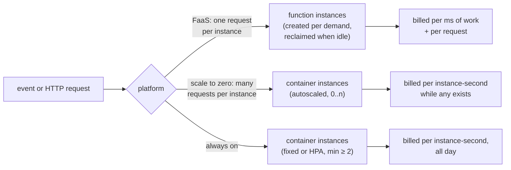

# 76. Serverless & Function-Based Services

<div class="badges" markdown><span class="badge badge-l3">L3 · Senior/Lead</span><span class="badge badge-l4">L4 · Architect</span><span class="badge badge-meta">FaaS · AWS Lambda · scale to zero · Knative · Cloud Run · cold starts · INIT billing · JDK 25 AOT cache · C1 · Spring Cloud Function · keep-alive · bursty workloads · break-even · per-request vs per-instance pricing</span></div>

<div class="grid two" markdown>

!!! info "Prerequisites"
    - [Chapter 56](../deployment/ch56-autoscaling.md): autoscaling containers
    - [Chapter 59](../deployment/ch59-cloud-native-platforms.md): managed platforms
    - [Chapter 60](../deployment/ch60-native-images-startup.md): JVM startup, AOT caches and native images
    - [Chapter 70](../performance-scalability/ch70-finops.md): what capacity costs

!!! abstract "What you'll learn"
    - **The JVM's share of a cold start is fixable.** Two functions were hosted as a FaaS runtime hosts them and cold-started in four configurations:
        - JVM: **246–299 ms** to the fee quote's first answer, 314–329 ms to the thumbnail's.
        - **JDK 25 AOT cache + C1 + Serial GC: 113–122 ms and 169–196 ms**, with 43–56 MB of memory against 57–70.
        - The AOT cache needs the application on JARs; a class directory on the class path stopped the training run.
    - **Bursty and sparse work is where functions win.** Over a simulated day, using those times and AWS list prices:
        - 2,000 webhooks cost **$0.0005–0.0006** as functions, $1.05 on scale-to-zero containers and $2.37 on two always-on containers.
        - 24 bursts of photo uploads cost **$0.009–0.010**, against $0.05 and $2.37.
    - **Keep-alive decides cold starts for sparse traffic.** Webhooks had 0.15% cold starts with instances kept 5 minutes, and **25%** with 1 minute.
    - **Sustained work crosses over.** A function call cost **8× (fee quote) and 1.9× (thumbnail)** what a 70%-busy container does. Two always-on containers became cheaper above **106 fee quotes or 28–31 thumbnails a second**.

</div>

---

## 1 · Introduction & Context

### "Should this be a Lambda?"

FoodFleet's platform runs JVM services on Kubernetes ([Part 7](../deployment/index.md)). Every few weeks a team asks whether their new piece should be a function instead:

- a webhook receiver for partners;
- an image resizer for menu photos;
- a fee calculator called at checkout;
- a nightly report.

The arguments on each side are familiar. For functions: no servers, pay per use, scale to zero. Against: cold starts, the JVM, lock-in, cost at scale.

This chapter puts numbers on both sides. It measures the part of a cold start the team controls, the JVM's, on real processes. Then it runs four of FoodFleet's workloads through a simulated day on three kinds of platform, driven by those measurements and today's list prices.

### Where it comes from

<ul class="mh-timeline">
<li><span class="when">2014 · AWS Lambda</span><span class="what">Functions triggered by events, billed per 100 ms of execution; Java supported from 2015.</span></li>
<li><span class="when">2017–2019 · Containers that scale to zero</span><span class="what">Spring Cloud Function (2017) decouples business functions from their runtime; Knative (2018) and Google Cloud Run (2019) scale containers to zero on request traffic.</span></li>
<li><span class="when">2020 · 1 ms billing</span><span class="what">Lambda moves to per-millisecond billing; SnapStart (2022) restores Java functions from a snapshot.</span></li>
<li><span class="when">2025 · INIT billed, AOT caches</span><span class="what">From 1 August 2025, Lambda bills the INIT phase of on-demand functions; JDK 24–25 add ahead-of-time class loading and linking caches (JEPs 483, 514, 515).</span></li>
<li><span class="when">2026 · Versions checked here</span><span class="what">JDK 25.0.4, Spring Cloud Function 5.0.4, Knative Serving 1.23.0; AWS prices as of October 2026.</span></li>
</ul>

---

## 2 · Core Concepts & Terminology



Function as a service (FaaS)
:   The platform runs a function per event, creating instances on demand. Each instance handles one request at a time on Lambda, and is reclaimed after an idle period the platform chooses. Billing is per request and per millisecond of execution, scaled by memory.

Cold start
:   A request that finds no idle instance waits for a new one: the platform's sandbox, the runtime's start (the JVM), the function's initialisation, then the request itself. Since August 2025, Lambda bills the INIT phase too.

Scale to zero
:   A container platform (Knative, Cloud Run) that removes the last instance when traffic stops. Its defaults include a 60 s stable window and a 30 s grace period before the last pod goes. The first request after that waits for a cold start; others share warm instances, many requests each.

Keep-alive
:   How long an idle instance survives. It's fixed by the platform: on Lambda it's undocumented and varies.

Spring Cloud Function
:   Business logic written as `java.util.function` beans and selected by `spring.cloud.function.definition`. Adapters run the same functions on AWS Lambda (`FunctionInvoker`), Azure, or as plain web endpoints.

AOT cache (JDK 24+)
:   A file, written by a training run, that holds classes already loaded and linked, plus method profiles. Later runs start from it instead of loading and linking again.

---

## 3 · How It Works Internally

### A function, hosted like a FaaS runtime hosts it

Each function is a `Function<String, String>`, the same shape Spring Cloud Function adapts. A minimal host loads it by name and serves it behind HTTP, one JVM per instance:

```java title="functions/FunctionHost.java"
--8<-- "code/chapters/ch76-serverless-microservices/src/main/java/dev/foodfleet/ch76/functions/FunctionHost.java:25:31"
```

The two functions:

- **FeeQuote** parses a small JSON body and computes a delivery fee: light work.
- **Thumbnail** renders a 1,600 × 1,200 image, scales it to 400 × 300 with bicubic interpolation and encodes a PNG: CPU-heavy, about 20–26 ms warm.

Four JVM configurations were cold-started repeatedly:

| Configuration | Flags |
|---|---|
| JVM | `-Xmx1g` |
| C1 + Serial GC | `-XX:TieredStopAtLevel=1 -XX:+UseSerialGC`, the usual advice for short-lived functions |
| AOT cache | `-XX:AOTCache=…`, trained by `-XX:AOTCacheOutput` with 500 (fee) or 20 (thumbnail) requests, then a normal exit |
| AOT cache + C1 + Serial | both |

### A day on three platforms

`Simulation` replays a day of arrivals against each platform. It samples the cold-start, initialisation and warm times measured in the same run:

```java title="platform/Simulation.java (functions)"
--8<-- "code/chapters/ch76-serverless-microservices/src/main/java/dev/foodfleet/ch76/platform/Simulation.java:68:103"
```

The three platforms:

- **Scale-to-zero containers** are sized every 2 s from the request rate over a 60 s window, at 70% of an instance's measured capacity (1 vCPU each). The last instance is removed 60 s plus a 30 s grace after the last request: Knative's defaults. Billing is per instance-second, with a one-minute minimum.
- **Always-on containers** are sized for the day's peak at 70%, and never fewer than two.

The prices:

```java title="platform/Prices.java"
--8<-- "code/chapters/ch76-serverless-microservices/src/main/java/dev/foodfleet/ch76/platform/Prices.java:8:28"
```

Three things the model leaves out, deliberately:

- **The platform's own sandbox start** (tens to hundreds of milliseconds on top of the JVM's).
- **Queueing inside a container.**
- **Free tiers.** A front door (an HTTP API at $1.00 per million, or a load balancer) is needed by all three platforms, so it's excluded from all of them.

---

## 4 · Design Considerations & Trade-offs

### Test setup

All runs used:

- JDK 25.0.4 on a 2-vCPU VM.
- Each configuration started 12 times (fee quote) or 8 times (thumbnail).
- **Init:** from launching `java` to the first answer from `/health`.
- **First request:** the function's first call.
- **Warm:** requests 51–200 (fee) or 8–30 (thumbnail) of each instance.

Prices are AWS us-east-1, x86, on demand, as published in October 2026:

- **Lambda:** $0.0000166667 per GB-second at 1,769 MB (one vCPU), $0.20 per million requests, duration and INIT billed per millisecond.
- **Fargate:** one vCPU and 2 GB for $0.0494 an hour, per second, with a one-minute minimum.

There were two runs; where they differed, both values are shown. `check_apis.sh` checks **7 statements** in Spring Cloud Function 5.0.4 and Knative Serving 1.23.0, and all were found.

### Measured: the JVM's part of a cold start

| Function | Configuration | Init p50 | First request | Cold start p50 / p99 | Memory (RSS) | Warm p50 | After 2,000 (300) more |
|---|---|---|---|---|---|---|---|
| fee quote | JVM | 242–288 ms | 5.8–7.2 ms | **246–299** / 363–367 ms | 57 MB | 1.61–1.63 ms | 0.37–0.40 ms |
| fee quote | C1 + Serial GC | 183–188 ms | 4.4–4.7 ms | 186–193 / 256–314 ms | 51 MB | 0.90–0.94 ms | 0.26–0.36 ms |
| fee quote | AOT cache | 137–145 ms | 3.2–4.2 ms | 143–151 / 188–207 ms | 48 MB | 0.65–0.70 ms | 0.28–0.32 ms |
| fee quote | AOT cache + C1 + Serial | 110–120 ms | 2.1–2.3 ms | **113–122** / 137–173 ms | 43 MB | 0.57–0.65 ms | 0.26–0.29 ms |
| thumbnail | JVM | 209–214 ms | 102–110 ms | **314–329** / 371–417 ms | 70 MB | 23.4–26.0 ms | 21.2–25.6 ms |
| thumbnail | C1 + Serial GC | 179–190 ms | 91–95 ms | 269–285 / 306–318 ms | 64 MB | 20.4–21.5 ms | 19.9 ms |
| thumbnail | AOT cache | 144–146 ms | 74–76 ms | 207–239 / 251–266 ms | 62 MB | 24.5–25.4 ms | 22.3–23.4 ms |
| thumbnail | AOT cache + C1 + Serial | 116–136 ms | 56–60 ms | **169–196** / 202–226 ms | 56 MB | 22.3–22.7 ms | 19.7–20.5 ms |

Training each cache took 2.6–3.0 s, and the caches were 16–20 MB.

What the table shows:

- **The AOT cache cut the JVM's part of a cold start by a third to a half,** and C1 with Serial GC took another 30–40 ms off. The first request also got 2–3× faster: the classes it needed were already loaded and linked.
- **The first request of a heavy function is itself a cold start.** The thumbnail's first call took 56–110 ms against a warm 20–26 ms: imaging and PNG classes loaded on first use. A training run that exercises the function moves that into the cache.
- **C1 alone didn't hurt these functions.** C2's advantage needs longer-lived, hotter code; after 2,000 more calls the fee quote was as fast with C1 as with C2. For long-running services, [chapter 67](../performance-scalability/ch67-jvm-tuning-containers.md) still applies.
- **The AOT cache has one practical constraint.** Writing it with the application in a class directory stopped with "Cannot have non-empty directory in paths". Functions ship as JARs anyway; tests and IDE runs often don't.
- **These are the JVM's milliseconds only.** A FaaS platform adds its own sandbox start, and a Spring Boot function adds framework startup: 1.1–1.2 s for chapter 60's Spring service at one CPU.

### Measured: a day on three platforms

Four workloads, each a simulated day of arrivals:

| Workload | Platform | Cold starts | p50 | p99 | Instance-hours | $ per day |
|---|---|---|---|---|---|---|
| **partner webhooks**: 2,000 a day, evenly (fee quote) | functions, JVM, kept 5 min | 0.15% | 1.6 ms | 7.4–8.6 ms | 0.00 | **0.0006** |
| | functions, AOT + C1, kept **1 min** | **24.8%** | 0.7 ms | **137–173 ms** | 0.02 | 0.0021–0.0023 |
| | functions, AOT + C1, kept 5 min | 0.15% | 0.6 ms | 3.9–4.6 ms | 0.00 | **0.0005** |
| | functions, AOT + C1, kept 15 min | 0.05% | 0.6 ms | 3.9–4.6 ms | 0.00 | 0.0005 |
| | scale-to-zero containers | 12.2% | 0.6 ms | 128–173 ms | 21.2 | 1.05 |
| | always-on containers (2) | 0 | 1.6 ms | 7.3–8.3 ms | 48 | 2.37 |
| **menu photo uploads**: 24 bursts of 400 in a minute (thumbnail) | functions, JVM, kept 5 min | 0.90–0.91% | 23.5–25.8 ms | 49–59 ms | 0.07–0.08 | **0.010** |
| | functions, AOT + C1, kept 5 min | 0.77% | 22.3–22.7 ms | 44–47 ms | 0.07 | **0.009** |
| | scale-to-zero containers | 0.24% | 22.3–22.7 ms | 44–47 ms | 0.98 | 0.049 |
| | always-on containers (2) | 0 | 23.4–25.8 ms | 47–57 ms | 48 | 2.37 |
| **checkout fee quotes**: lunch and dinner peaks, 1.49 million a day | functions, JVM, kept 5 min | 0.00% | 1.6 ms | 8.2–8.3 ms | 0.89–0.91 | **0.41–0.42** |
| | functions, AOT + C1, kept 5 min | 0.01% | 0.6 ms | 4.4–4.6 ms | 0.32–0.36 | **0.35** |
| | scale-to-zero containers | 0.00% | 0.6 ms | 4.4–4.6 ms | 24.0 | 1.19 |
| | always-on containers (2) | 0 | 1.6 ms | 7.9–8.3 ms | 48 | 2.37 |
| **thumbnails all day**: 12 a second, 1.04 million (thumbnail) | functions, JVM, kept 5 min | 0.01% | 23.5–26.0 ms | 47–57 ms | 7.2–7.7 | 0.97–1.02 |
| | functions, AOT + C1, kept 5 min | 0.01% | 22.3–22.7 ms | 42–44 ms | 7.0 | **0.94–0.95** |
| | scale-to-zero containers | 0 | 22.3–22.7 ms | 42–44 ms | 24.0 | 1.19 |
| | always-on containers (2) | 0 | 23.4–26.0 ms | 47–57 ms | 48 | 2.37 |

What the table shows:

- **Sparse and bursty work belongs on functions.** Webhooks and photo bursts cost less than a cent a day as functions. Containers, even scaling to zero, paid for 21 and 1 instance-hours of mostly idle time.
- **Scale to zero has its own cold-start problem at low rates.** A webhook every 43 s on average kept falling into the 90 s idle window, so 12% of requests waited for a container to start, and the instance was up 21 hours a day anyway.
- **Keep-alive matters more than the JVM for sparse traffic,** and it isn't yours to set. At 1 minute, a quarter of webhooks were cold; at 5 minutes, 0.15%. Lambda doesn't document its idle lifetime; measure your own cold-start rate in production.
- **The cold-start configuration showed up in p99 only where cold starts were common.** At 0.15% cold, p99 was set by warm requests, and the AOT cache helped there by being faster from the first calls.
- **The busier the workload, the closer the platforms.** For 1.04 million thumbnails a day, functions ($0.94–1.02) and a single scale-to-zero container ($1.19) were close. The two-container minimum, for availability, is what made always-on cost most.

### Measured: where containers win

Per call, at the measured warm median:

| Function | Warm median | Function call | Container at 70% busy | Function / container | Two always-on containers cheaper above |
|---|---|---|---|---|---|
| fee quote | 1.62–1.63 ms (billed 2 ms) | $2.58 × 10⁻⁷ | $3.2 × 10⁻⁸ | **8.1×** | **106.5 requests/s** (9.2 million a day) |
| thumbnail | 23.5–26.1 ms | $8.9–9.8 × 10⁻⁷ | $4.6–5.1 × 10⁻⁷ | **1.9×** | **28–31 requests/s** (2.4–2.7 million a day) |

What the table shows:

- **For light functions, the request fee dominates.** $0.20 per million is 78% of a 2 ms call's price, so making the function faster barely changes the bill. Containers amortise requests over a busy CPU.
- **For CPU-heavy functions, the price of a busy vCPU decides.** A Lambda second at 1,769 MB (one vCPU) costs about 2.1× a Fargate second of one vCPU and 2 GB; at 70% container utilisation, functions cost 1.9× per call.
- **The minimum of two containers sets the crossover for small services.** Below about 30 thumbnails or 100 fee quotes a second, sustained, functions were cheaper than the smallest highly available container deployment.

### Choosing

| Workload | Do | Why (measured) |
|---|---|---|
| Sparse events, webhooks, schedules | Functions | $0.0006 a day for 2,000 requests against $1.05–2.37 |
| Bursts with long idle gaps | Functions (or scale-to-zero containers) | 24 bursts: $0.009–0.010 a day; containers paid for idle time |
| Steady, high-rate APIs | Containers | Above 28–31 (heavy) or 106 (light) requests/s, two containers cost less |
| Latency-sensitive and sparse | Functions with provisioned instances, or always-on | 25% cold at a 1-minute keep-alive; p99 137–173 ms |
| Java on FaaS | AOT cache (or SnapStart, or a native image), C1, Serial GC, a training run that exercises the function | JVM part of a cold start 113–196 ms, not 246–329 |
| Portability | Spring Cloud Function: one function, several adapters | Same `Function` bean behind Lambda or HTTP |
| Deciding | Measure your rates and service times, then price them | Crossovers depended on service time and request fees |

---

## 5 · Hands-on Implementation

```text
ch76-serverless-microservices/
├── src/main/java/dev/foodfleet/ch76/
│   ├── functions/   FeeQuote, Thumbnail, FunctionHost (one function behind HTTP)
│   └── platform/    Prices (AWS list prices), Simulation (functions, scale-to-zero, always-on)
├── src/test/java/…   UnitTest (3, tag unit)
└── verify/   build-libs.sh, run.sh, check_apis.sh, tools/ (Lab, RunSuites)
```

### 🟣 Level 3: a function that starts fast

<div class="badges" markdown><span class="badge badge-l3">L3 · Senior/Lead</span></div>

- Business logic as `Function` beans (Spring Cloud Function), tested as plain Java; the adapter is a deployment detail.
- The JAR is built with an AOT cache from a training run that calls the function the way production does; `JAVA_TOOL_OPTIONS` sets C1 and Serial GC.
- Initialisation (clients, configuration) happens once per instance, outside the handler; nothing per request that could be per instance.
- Cold-start rate and INIT duration are dashboards, not guesses.

### 🔴 Level 4: choosing per workload

<div class="badges" markdown><span class="badge badge-l4">L4 · Architect</span></div>

- A platform decision per workload: rate profile, latency objective, service time, then the price of each option ([chapter 70](../performance-scalability/ch70-finops.md)).
- Functions for events, schedules and bursts; containers for steady APIs; scale-to-zero containers where the same image must serve both.
- Provisioned instances only where the latency objective needs them; they turn a function back into an always-on cost.
- Re-evaluate quarterly: workloads that grow past the crossover move to containers, and idle services move to functions.

```bash
JAVA_HOME=/path/to/jdk-25 verify/run.sh   # about 2 minutes; needs git
```

### Run and verify

```text
$ verify/run.sh starts
== starts
function   configuration               init p50   first req    cold p50/p99   RSS MB     warm p50    after 2,000
fee quote  JVM                           242 ms      7.2 ms     246/ 363 ms       57      1.61 ms        0.40 ms
fee quote  AOT cache + C1 + Serial       120 ms      2.3 ms     122/ 173 ms       43      0.65 ms        0.29 ms  (training 2.7 s, cache 16 MB)
thumbnail  AOT cache + C1 + Serial       116 ms     56.0 ms     169/ 202 ms       56     22.67 ms       19.71 ms  (training 2.8 s, cache 19 MB)
```

!!! question "Try it"
    1. Train the thumbnail's cache with only `/health` calls, not the function. How much of the first request's cost comes back?
    2. Add a 60 ms sandbox start to every function cold start in `Simulation` and rerun `day`. Which workloads' p99 changes?
    3. Price the checkout workload with Lambda at 512 MB, using a warm time scaled by 1,769/512. Is it still cheaper than containers?
    4. Give the scale-to-zero platform a minimum of one instance (`min-scale: 1`) for the webhook workload. What does it cost, and what happens to cold starts?

---

## 6 · Production Readiness

- [x] **A platform decision per workload**, from its rate profile, service time and latency objective
- [x] **Functions as plain `Function` beans**, with the platform adapter at the edge
- [x] **Fast-starting Java functions**: AOT cache from a representative training run (or SnapStart, or native), C1, Serial GC
- [x] **Cold-start rate and INIT time** on dashboards, with alerts on the latency objective
- [x] **Provisioned instances** only where the objective needs them, and priced
- [x] **Cost per workload** reviewed quarterly against the crossover

---

## 7 · Anti-patterns & Pitfalls

!!! pitfall "Incident 1: the checkout API that moved to Lambda"
    **Context.** To "go serverless", a team moved a steady, busy pricing API to functions.

    **Symptoms.** The monthly bill for that service rose severalfold, with no traffic change.

    **Root cause.** Sustained high rates are where per-request pricing loses. Measured: a light call cost 8× a call on a 70%-busy container, and two containers became cheaper above 106 requests a second.

    **Fix.** Keep steady APIs on containers; use functions for the events around them.

!!! pitfall "Incident 2: the partner webhook that timed out"
    **Context.** A partner's webhook client used a 150 ms timeout; FoodFleet's receiver was a Java function.

    **Symptoms.** A fraction of deliveries failed and were retried, mostly at quiet hours.

    **Root cause.** Sparse traffic plus a short keep-alive meant frequent cold starts. Measured: 25% cold at a 1-minute keep-alive, with p99 of 137–173 ms for the JVM's part alone.

    **Fix.** An AOT cache with C1 and Serial GC, acknowledge-then-process (return 202 and queue the work), and provisioned instances if the objective still isn't met.

!!! pitfall "Incident 3: the AOT cache that never got built"
    **Context.** A team added `-XX:AOTCacheOutput` to their function's build.

    **Symptoms.** The cache never appeared, and cold starts didn't change.

    **Root cause.** The training run had the application on a class directory, which writing a cache refuses ("Cannot have non-empty directory in paths"); and the process was killed instead of exiting.

    **Fix.** Train from the packaged JAR, exit normally, and fail the build if the cache is missing.

| Anti-pattern | Symptom | Fix |
|---|---|---|
| Functions for steady, busy APIs | Bill grows with traffic | Containers above the crossover |
| Containers for sparse events | Paying for idle | Functions, or scale to zero |
| Ignoring keep-alive | Surprise cold starts at quiet hours | Measure the cold-start rate; provision or warm if needed |
| Unoptimised JVM functions | 250–330 ms of JVM start per cold start | AOT cache, C1, Serial GC; SnapStart or native |
| Heavy work in the first request | First call 2–5× slower | Initialise and train before serving |
| Lock-in in business code | Rewrites to move | Function beans, adapters at the edge |
| Provisioned concurrency everywhere | Always-on cost, function limits | Only where the objective needs it |

---

## 8 · Enterprise Case Study

### FoodFleet: functions where they win

!!! decision "ADR-076: event-driven, scheduled and bursty workloads run as functions (Spring Cloud Function beans on AWS Lambda, adapters at the edge), packaged with a JDK AOT cache from a representative training run and run with C1 and Serial GC; steady request/response APIs stay on containers; scale-to-zero containers serve workloads that need one image for both; each workload's platform is chosen from its measured rate, service time and latency objective, and re-checked quarterly against the cost crossover"
    **Status:** Accepted · **Date:** 2026-04-06

    **Context.** Measured:

    - The JVM's part of a cold start fell from 246–329 ms to 113–196 ms with an AOT cache, C1 and Serial GC.
    - Over a simulated day at list prices, webhooks and photo bursts cost under a cent a day as functions, against $1.05–2.37 on containers.
    - A light function call cost 8× a call on a busy container; two containers became cheaper above 106 (light) or 28–31 (heavy) requests a second.
    - Sparse traffic with a 1-minute keep-alive had 25% cold starts.

    **Decision.**

    - **Functions:** partner webhooks, menu photo processing, scheduled reports, and event handlers off Kafka bridges, with acknowledge-then-process for any caller with a tight timeout.
    - **Containers:** checkout, orders, tracking and every API above the crossover.
    - **Packaging:** a training run in CI produces the AOT cache; a missing cache fails the build.
    - **Review:** a quarterly report of each function's rate and cost, and each small container service's utilisation.

    **Consequences:**

    - ✅ Idle services stop costing the price of two containers each.
    - ✅ Business code stays portable between functions and containers.
    - ⚠️ Two operational models (functions and Kubernetes) to support.
    - ⚠️ Keep-alive and sandbox start are the platform's; cold-start rates must be watched in production.

### Fintech analogue: batch on functions, ledgers on servers

Payment companies often run reconciliation files, statement generation and fraud-rule updates as functions triggered by uploads and schedules: bursty and idle most of the day. The ledger and authorisation APIs, with steady traffic and strict latency, stay on always-on capacity, often with reserved pricing.

### E-commerce analogue: images and sales events

Retailers resize product images as functions on upload: bursty, CPU-heavy, and idle between catalogue updates. For flash sales they keep the storefront on pre-scaled containers, because a wave of cold starts in the first minute of a sale is exactly what they can't afford.

---

## 9 · Interview Q&A + Summary

#### Q1. When does serverless (FaaS) make sense? · <span class="badge badge-l2">L2</span> · Infosys · TCS

**Short answer:** For sparse, bursty or event-driven work, where per-request pricing and scale to zero beat paying for idle capacity. Measured over a simulated day: 2,000 webhooks cost $0.0006 as functions, against $2.37 for two always-on containers.

#### Q2. When is it the wrong choice? · <span class="badge badge-l3">L3</span> · Amazon

**Short answer:** For steady, high-rate APIs, and for sparse but latency-critical calls. A light call cost 8× a call on a busy container; two containers were cheaper above 106 (light) or 28–31 (heavy) requests a second. Sparse traffic risks cold starts.

#### Q3. What makes up a Java cold start, and how do you shorten it? · <span class="badge badge-l3">L3</span> · Flipkart

**Short answer:** Platform sandbox, JVM start, class loading and linking, framework start and the first request. An AOT cache from a representative training run, C1 and Serial GC cut the JVM's part from 246–329 ms to 113–196 ms here; SnapStart or a native image go further.

#### Q4. Why does the first request of a function take longer than later ones? · <span class="badge badge-l3">L3</span> · Swiggy

**Short answer:** Classes it uses are loaded on first use and the code is interpreted. The thumbnail's first call took 56–110 ms against 20–26 ms warm; a training run that exercises the function moves that work into the AOT cache.

#### Q5. How do Lambda and a scale-to-zero container platform differ? · <span class="badge badge-l3">L3</span> · Google

**Short answer:** Lambda gives one request per instance and bills per millisecond of work. Knative and Cloud Run serve many requests per instance and bill instance time, including idle time until scale-down (60 s window, 30 s grace by default). At low rates, scale-to-zero containers still paid for 21 instance-hours a day for 2,000 webhooks.

#### Q6. What is the cost crossover between functions and containers? · <span class="badge badge-l4">L4</span> · Uber

**Short answer:** Where requests × (duration × memory × GB-second price + request fee) exceeds the cost of the smallest highly available container deployment. With measured times: about 106 light or 28–31 heavy requests a second against two containers.

#### Q7. What changed in Lambda billing in 2025? · <span class="badge badge-l3">L3</span> · AWS-heavy shops

**Short answer:** From 1 August 2025, the INIT phase of on-demand functions on managed runtimes is billed as part of duration. Slow initialisation now costs money as well as latency.

#### Q8. What is Spring Cloud Function for? · <span class="badge badge-l2">L2</span> · Thoughtworks

**Short answer:** Writing business logic as `Function`/`Consumer`/`Supplier` beans, selected with `spring.cloud.function.definition`, and running them through adapters (AWS `FunctionInvoker`, Azure, HTTP) without changing the code.

#### Q9. How do you handle a caller with a tight timeout on a function? · <span class="badge badge-l3">L3</span> · Zomato

**Short answer:** Acknowledge quickly and process asynchronously (202 plus a queue), optimise cold starts, and add provisioned instances only if the objective still isn't met. A short keep-alive gave 25% cold starts on sparse traffic.

#### Q10. Does memory size matter for a Java function? · <span class="badge badge-l3">L3</span> · AWS-heavy shops

**Short answer:** Yes: Lambda allocates CPU in proportion to memory, one vCPU at 1,769 MB. Too little memory slows JVM start and every request; the GB-second price means the right size is found by measuring duration × memory.

#### Q11. What does provisioned concurrency do to the economics? · <span class="badge badge-l4">L4</span> · Netflix

**Short answer:** It keeps instances initialised, removing cold starts, and is billed whether used or not, which turns a function back into always-on capacity. Use it where the latency objective needs it.

#### Q12. Decide FoodFleet's serverless strategy. · <span class="badge badge-l4">L4</span> · architecture rounds

**Short answer:**

- **Functions:** webhooks, image processing, schedules, event handlers.
- **Containers:** steady APIs above the crossover.
- **Java:** functions with AOT caches, C1 and Serial GC, portable through Spring Cloud Function.
- **Governance:** choose per workload from measured rate, service time and objective; review quarterly.

### Key takeaways

- **The JVM's cold start is fixable**: 113–196 ms with an AOT cache, C1 and Serial GC.
- **Functions win sparse and bursty work**: cents against dollars a day.
- **Containers win steady, busy work**: past 28–106 requests a second here.
- **Keep-alive is the platform's**: measure your cold-start rate.

### Further reading

- AWS, [Lambda pricing](https://aws.amazon.com/lambda/pricing/) and [AWS Lambda standardizes billing for INIT phase](https://aws.amazon.com/blogs/compute/aws-lambda-standardizes-billing-for-init-phase/)
- AWS, [Configure Lambda function memory](https://docs.aws.amazon.com/lambda/latest/dg/configuration-memory.html)
- AWS, [Fargate pricing](https://aws.amazon.com/fargate/pricing/)
- [Spring Cloud Function](https://spring.io/projects/spring-cloud-function) and Knative, [Configuring scale to zero](https://knative.dev/docs/serving/autoscaling/scale-to-zero/)
- JEP 514, [Ahead-of-Time Command-Line Ergonomics](https://openjdk.org/jeps/514)

---

**Previous:** [← 75. Multi-Tenancy, Multi-Region & Compliance](ch75-multi-tenancy-multi-region-compliance.md) · **Next:** [77. AI-Native Microservices →](ch77-ai-native-microservices.md)
