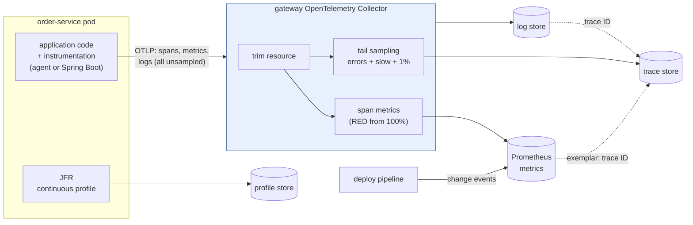

# 47. Observability Fundamentals

<div class="badges" markdown><span class="badge badge-l1">L1 · Foundation</span><span class="badge badge-l2">L2 · Practitioner</span><span class="badge badge-l3">L3 · Senior/Lead</span><span class="badge badge-meta">monitoring vs observability · metrics · logs · traces · profiles · events · wide events · sampling · cardinality · OpenTelemetry</span></div>

<div class="grid two" markdown>

!!! info "Prerequisites"
    - [Chapter 42](../resilience/ch42-failure-modes.md): gray failures and tail latency
    - [Chapter 45](../resilience/ch45-chaos-engineering.md): steady state in SLO terms
    - [Chapter 28](../communication/ch28-idempotency-correlation.md): correlation IDs across calls

!!! abstract "What you'll learn"
    - **Which signal answers which question**: a canary that added 600 ms to 5% of orders took order-service's p99 from about 24 ms to **681–711 ms** on the dashboard within one window; 11,000 log lines said nothing; spans and wide events with the request's fields named the cause exactly
    - **Sampling**: 1% head sampling kept **2–4 of 248–285** slow traces; tail sampling kept all of them in 18–19% of the bytes
    - **Cost per signal**: per order, **2.6 KB** of spans, 0.6 KB of wide events, 0.24 KB of logs; one label with 1,000 values took Prometheus from about 100 MB to **670 MB**
    - **Instrumentation isn't free**: the Java agent cost **38–56%** more CPU on thin services and 13–15 s of startup; JFR 4–7%
    - **Profiles find code; resources leak**: JFR put 63–64% of a service's CPU in one method a trace couldn't see into; a token on the JVM command line ended up in spans and Prometheus labels

</div>

---

## 1 · Introduction & Context

### The canary that every dashboard saw and none could explain

On a Friday evening, payment-service 1.5 went out to half of FoodFleet's payment pods. Within ten seconds the checkout p99 on the main dashboard went from about 25 ms to about 700 ms. Error rate: zero. CPU, memory, database connections: normal. The logs said what they always said, "Authorised payment for order …", twelve thousand times a minute, all at INFO.

The on-call engineer could see *that* something was wrong and *roughly where*: the per-pod panel showed it was the canary. Rolling back stopped it. But nobody could say *what* was wrong, so 1.5 couldn't ship again, and the team spent Monday adding log lines and guessing. The cause, when they found it, was narrow: a new fraud check, called only for UPI payments through one bank, that waited 600 ms on a slow dependency. About one order in twenty.

**Monitoring** answers the questions you thought of in advance: is the error rate up, is p99 up, on which pod. **Observability** is being able to answer the ones you didn't, such as "what do the slow payments have in common?", from data you already collected, without shipping new code. This chapter reproduces that Friday on real services instrumented by the OpenTelemetry Java agent, then looks at it through each signal in turn, and measures what each one costs.

### Where it comes from

<ul class="mh-timeline">
<li><span class="when">1999–2012 · Logs and checks</span><span class="what">syslog, then Nagios-style checks and RRD graphs: monitoring as "is it up?". Graphite and StatsD (2008–2011) make application metrics cheap.</span></li>
<li><span class="when">2010 · Dapper</span><span class="what">Google describes Dapper, its always-on distributed tracing with sampling; Zipkin (2012) and Jaeger (2017) follow in the open.</span></li>
<li><span class="when">2012–2016 · Prometheus</span><span class="what">A pull-based time-series database with labels and a query language, inspired by Google's Borgmon; joins the CNCF in 2016.</span></li>
<li><span class="when">2016–2019 · "Observability"</span><span class="what">The control-theory term is borrowed for software: high-cardinality, high-dimensionality events you can slice after the fact (Honeycomb and others); OpenTracing and OpenCensus compete.</span></li>
<li><span class="when">2019–2024 · OpenTelemetry</span><span class="what">OpenTracing and OpenCensus merge into OpenTelemetry: one API, SDK, wire protocol (OTLP) and Collector for traces, metrics and logs; profiles become its fourth signal.</span></li>
</ul>

---

## 2 · Core Concepts & Terminology



Monitoring and observability
:   Monitoring watches known failure modes with predefined checks and dashboards. Observability is the ability to explain new, unknown failures from the system's outputs. You need both: monitoring tells you *that*, observability tells you *why*.

Metrics
:   Numbers aggregated in the process (counters, gauges, histograms) and sent as time series, one per distinct combination of labels. Cheap and fast to query, ideal for alerts and SLOs; they lose the individual request.

Logs
:   Timestamped records of what code chose to say. As free text they are hard to query; as structured JSON with a trace ID they join everything else.

Traces and spans
:   A trace is one request's path through the system; each span is one operation in it (a server handling a request, a client calling another service), with timings, attributes and its parent. They show *where* the time went.

Profiles
:   Samples of what the CPU (or allocator, or lock) was doing, aggregated by stack. They show *which code* used the time; JDK Flight Recorder records them continuously at low cost.

Events and wide events
:   Change events are deploys, flag flips and config changes: most incidents start with one. A wide event (or canonical log line) is one structured record per request per service, with every field that might explain it, kept unsampled.

Cardinality and dimensionality
:   Cardinality is how many distinct values a field has (route: 20, user ID: millions); dimensionality is how many fields there are. Metrics multiply cost by every label combination; traces and events pay per record, so they can afford high cardinality.

Head and tail sampling
:   Head sampling decides at the start of a trace, by trace ID, before anyone knows how it will go. Tail sampling decides after the whole trace has been seen, so it can keep every error and every slow request.

Resource and semantic conventions
:   The resource describes *who* is reporting (service.name, service.version, service.instance.id); semantic conventions fix attribute names (http.route, http.response.status_code) so every service and tool agrees.

---

## 3 · How It Works Internally

The lab runs FoodFleet's checkout as three JVMs (gateway → order-service → payment-service, the JDK's HTTP server and client), each started with the OpenTelemetry Java agent 2.32.0, which instruments both without code changes. Everything goes over OTLP to an OpenTelemetry Collector 0.162.0; Prometheus 3.15.0 scrapes the metrics; JDK Flight Recorder records profiles.

### What instrumentation produces for one order

One order produces five spans: the gateway's server and client spans, order-service's server and client spans, and payment-service's server span. Each carries the request's attributes (route, status, and the request headers the agent was told to capture) and its service's **resource**. Every service also reports metrics such as `http.server.request.duration`, a histogram per route and status; and the agent forwards each `java.util.logging` record with the trace and span IDs of the request it was written in.

The resource deserves a look. By default the agent describes the process in detail, including `process.command_args`, the full JVM command line. It masks the values of `-D` properties whose names contain `password` or `secret`, and nothing else:

```properties
--8<-- "code/chapters/ch47-observability-fundamentals/src/main/resources/otel/agent.properties"
```

### Correlation: one ID through every signal

The agent passes the W3C `traceparent` header on every call, so every service sees the same trace ID. It is the key that joins a slow point on a metrics graph (an *exemplar*), the log lines written during that request, its wide event and its trace:

```java
--8<-- "code/chapters/ch47-observability-fundamentals/verify/tools/Services.java:147:155"
```

### Wide events

A wide event is built up while the request runs and written once at the end. Fields cost nothing to add, so it carries everything: version, pod, tenant, payment method, bank, retries, cache hits, the trace ID:

```java
--8<-- "code/chapters/ch47-observability-fundamentals/verify/tools/Services.java:118:135"
```

### Head sampling and tail sampling

Head sampling keeps a trace if its trace ID falls below a threshold. OpenTelemetry's rule uses the lower 64 bits, so every service makes the same decision without talking to the others; but it is made before the request has done anything:

```java
--8<-- "code/chapters/ch47-observability-fundamentals/src/main/java/dev/foodfleet/ch47/sampling/TraceIdRatio.java:23:29"
```

Tail sampling waits until the trace is complete, so it can keep what matters. FoodFleet's gateway collector derives RED metrics from every span first, then keeps every error, everything slower than 300 ms and 1% of the rest, and strips the command line from the resource:

```yaml
--8<-- "code/chapters/ch47-observability-fundamentals/src/main/resources/otel/collector.yaml:21:54"
```

The pipelines wire it so that span metrics see every span and only the sampled traces are stored:

```yaml
--8<-- "code/chapters/ch47-observability-fundamentals/src/main/resources/otel/collector.yaml:72:90"
```

The collector's latency policy measures a trace from its first span's start to its last span's end. All spans of a trace must reach the same collector: with several replicas, a first tier routes by trace ID.

### Metrics: aggregation, and why labels cost

A metric is aggregated in the process: one counter or histogram per *combination* of label values, however many requests it counts. Prometheus stores each combination as its own time series. That is why metrics are cheap per request and expensive per label value, and why FoodFleet's recording rules keep `job`, `http_route` and `instance` and nothing with more values:

```yaml
--8<-- "code/chapters/ch47-observability-fundamentals/src/main/resources/prometheus/foodfleet-red.rules.yml"
```

### Asking "what is different about the bad ones?"

Given events with many fields, compare how often each value occurs among the bad requests and among the rest, rank the differences, and combine the top ones into a filter. Nothing about the failure needs to be known in advance; the fields just have to be there:

```java
--8<-- "code/chapters/ch47-observability-fundamentals/src/main/java/dev/foodfleet/ch47/analysis/BubbleUp.java:49:77"
```

In Spring Boot 4, the same signals leave through Micrometer and OpenTelemetry with properties; the agent is for services you can't change:

```yaml
--8<-- "code/chapters/ch47-observability-fundamentals/src/main/resources/application.yml"
```

---

## 4 · Design Considerations & Trade-offs

All runs: JDK 25.0.4, OpenTelemetry Java agent 2.32.0 (SDK 1.66.0), OpenTelemetry Collector Contrib 0.162.0, Prometheus 3.15.0, one 2-vCPU container with 8 GB. Two runs; where they differed, both values are shown. `check_apis.sh` checks **25 defaults and behaviours** in the sources of OpenTelemetry Java, its instrumentation, the Collector, Prometheus and Spring Boot 4.1.1 (all found); the collector and Prometheus configurations in `src/main/resources` pass `otelcol-contrib validate` and `promtool check config`.

### Measured: the canary, through each signal

Load: 100 orders a second, tenants Zipf-distributed, payments 50% UPI, 35% card, 15% wallet, banks evenly spread. payment-service 1.4 runs on payment-a; 25 s into the run, 1.5 joins as payment-b and takes half the payments. 1.5 adds 600 ms to UPI payments through bank-x: about 5% of orders once it is in.

**Metrics** (Prometheus over the agent's `http.server.request.duration` histograms, 10 s windows):

| Window (seconds after the deploy) | Orders/s | 5xx/s | order-service p50 | order-service p99 | Users' p99 (client) | payment p99: payment-a | payment p99: payment-b |
|---|---|---|---|---|---|---|---|
| −25 to −15 | 100 | 0 | 7 ms | 24 ms | 20–21 ms | 14–17 ms | — |
| −15 to −5 | 100 | 0 | 7 ms | 23 ms | 20–21 ms | 10 ms | — |
| −5 to +5 (deploy) | 100 | 0 | 7 ms | 23–25 ms | **608–612 ms** | 10–18 ms | — |
| +5 to +15 | 100 | 0 | 8 ms | **681–702 ms** | 613–614 ms | 17–21 ms | **720–726 ms** |
| +15 to +55 (four windows) | 99–102 | 0 | 7 ms | 693–711 ms | 611–613 ms | 10–17 ms | 722–732 ms |

**Change events**: the deploy pipeline's event (`payment-service 1.5, payment-b, canary 50%`) falls exactly at the step.

**Logs** after the deploy: 11,000–11,001 records from payment and order services, **all INFO**; none mentioning slow, timeout, latency, error or failure; every one carrying its trace ID. A payment's line: `Authorised payment for order 104501`.

**Traces**, the same traffic kept four ways (sampling applied in the collector so all four see identical requests):

| Kept by | Traces | Slow (> 300 ms) | Share of all slow | Slow span found in | Bytes stored |
|---|---|---|---|---|---|
| Every trace (100%) | 8,000 | 248–285 | 100% | payment-service 1.5 (245–278), order-service (3–7) | 100% |
| Head sampling 10% | 793–820 | 27 | 9–11% | payment-service 1.5 | 11.0–11.1% |
| Head sampling 1% | 68–88 | **2–4** | 1% | payment-service 1.5 | 1.5–1.7% |
| Tail: errors + slower than 300 ms + 1% | 310–360 | **248–285** | **100%** | as for every trace | 17.8–18.7% |

**"What is different about the slow payments?"**, asked of each data set (payment-service server spans or wide events after the deploy; the filter keeps values that cover at least 90% of slow requests):

| Data | Payments after the deploy | Slow | Top differences (share of slow vs the rest) | Filter found | Precision / recall |
|---|---|---|---|---|---|
| Wide events (unsampled) | 5,500 | 248–285 | bank-x 100% vs 13%; UPI 100% vs 46–48%; payment-b 100% vs 47–48% | bank-x, UPI, payment-b | 100% / 100% |
| Every span | 5,500 | 248–285 | the same | bank-x, UPI, payment-b | 100% / 100% |
| Tail-sampled spans | 294–335 | 248–285 | bank-x 100% vs 6–15% | bank-x, UPI, payment-b | 100% / 100% |
| Head-sampled spans, 10% | 546–551 | 27 | bank-x 100% vs 12–14% | bank-x, payment-b, UPI | 100% / 100% |
| Head-sampled spans, 1% | 42–61 | **2–4** | bank-x 100% vs 18–19% | bank-x, payment-b, UPI | 100% / 100%, from 2–4 examples |

- **Metrics saw it at once, and saw where**: order-service's p99 went from 23–25 ms to 681–711 ms in the first full window, and the per-pod panel put it on payment-b (720–732 ms against 10–21 ms). They lagged the users by one window: in the window containing the deploy the users' p99 was already 608–612 ms while Prometheus still showed 23–25 ms (5-second export plus 5-second scrape). The **median never moved** (7–8 ms): a dashboard of averages would have shown almost nothing.
- **The change event was the best single clue**: the step lines up with the deploy. "What changed?" is the first question in most incidents.
- **Logs said nothing**: a gray failure doesn't log errors. What made the 11,000 lines useful later was the trace ID on each.
- **Traces showed where; only enough of them showed why**: every slow trace's slow span was payment-service 1.5 (or, in 3–7 traces, order-service: scheduling stalls on two vCPUs, the noise any real system has). Head sampling at 1% kept 2–4 slow traces in 55 seconds; tail sampling kept all of them, for 18–19% of the bytes (each tail-sampled trace is exported with its own copy of the resource, so it costs more per trace).
- **Grouping by fields found the cause**: every data set with the request's fields isolated *bank-x, UPI, payment-b* exactly. So did 1% sampling, from 2 to 4 examples, because this failure is clean and deterministic; with a noisier failure, or one hitting 0.1% of requests, 1% keeps too few to tell cause from chance. Without the fields (the agent captures headers only when told to), the spans could have said "payment-service 1.5" and nothing more.

### Measured: what each signal costs

Per order, from the find runs (10,000 orders including warm-up; OTLP protobuf as the agent sends it, wide events as JSON lines):

| Signal | Records per order | Bytes per order | Per 100 million orders |
|---|---|---|---|
| Traces, every span (3 services) | 5 spans | 2,577–2,578 | 258 GB |
| Wide events (order + payment) | 2 | 624 | 62 GB |
| Logs (one text line per service) | 2 | 244 | 24 GB |
| Metrics (the agent's defaults, 4 JVMs) | — | 502–515 KB per minute, whatever the traffic | — |

- **Spans are the expensive signal per request**: 2.6 KB for five, four times the wide events carrying the same request context. That's why they are sampled, and why FoodFleet derives RED metrics from them first.
- **The resource rides on every batch**: payment-a's had 19 attributes and 1,645 characters, **983 of them the JVM command line**. Making every resource attribute a Prometheus label made a scrape of the collector 5.7 times bigger (155 KB → 887–889 KB) and copied the command line into every series.
- **The command line carried a secret**: payment-a ran with `-Dpayments.db.password=…` and `-Dpayments.gateway.token=…` (invented values). The password was masked; **the token appeared** in the exported spans and, with all resource attributes as labels, in Prometheus.
- **Metrics cost doesn't grow with traffic**: about 500 KB a minute from four JVMs whether they serve ten orders a second or ten thousand. It grows with label values.

### Measured: what instrumentation costs the service

gateway → order-service → payment-service at 150 orders a second; 15 s warm-up, 30 s measured; each JVM `-Xmx256m`, SerialGC; the three JVMs start together on two vCPUs.

| Setup | p50 | p99 | Service CPU per 1,000 orders | Collector CPU per 1,000 | Memory (3 JVMs) | Startup |
|---|---|---|---|---|---|---|
| No instrumentation | 8.2–8.3 ms | 16.8–16.9 ms | 3,387–3,531 ms | — | 394–404 MB | 1.1 s |
| Agent, every trace exported | 9.0–9.2 ms | 18.6–21.3 ms | **4,864–5,289 ms** | 73 ms | 740–770 MB | **15.7–16.1 s** |
| Agent, 10% of traces exported | 9.0 ms | 17.7–18.9 ms | 4,731–4,900 ms | 33–40 ms | 713–750 MB | 14.7–15.6 s |
| Agent, nothing exported | 8.6–8.7 ms | 16.6–17.4 ms | 4,418–4,596 ms | 7–9 ms | 668–685 MB | 13.6–13.7 s |
| JFR, default settings | 8.0–8.1 ms | 15.2–16.2 ms | 3,593–3,673 ms | — | 413–421 MB | 2.0–2.1 s |
| JFR, profile settings | 8.1–8.2 ms | 15.4–17.6 ms | 3,638–3,742 ms | — | 406–426 MB | 2.0 s |

- **The agent added 38–56% CPU per order, 25–36% with nothing exported**: most of the cost is creating spans and recording metrics, not sending them. These services do almost nothing themselves, so this is a worst case in relative terms; in absolute terms it is 1.3–1.9 ms of CPU per order, roughly 0.3 ms per span.
- **Exporting 10% instead of 100%** saved little service CPU and halved the collector's: sampling saves storage and network more than CPU.
- **Memory and startup**: about 110–125 MB more per JVM, and 1.1 s → 14–16 s to start three JVMs at once on two vCPUs, because the agent transforms classes as they load. That matters for autoscaling and startup probes ([chapter 52](ch52-health-checks-actuator.md)).
- **Latency**: +0.4–0.9 ms at p50 for five spans; p99 within the runs' noise.
- **JFR always on cost 4–7% CPU** and about a second of startup: cheap enough for every JVM.

### Measured: traces show time, profiles show code

payment-service 1.6 derives each payment's idempotency key with PBKDF2 (4,000 iterations, a password-hashing function copied from the login code). 60 orders a second for 30 s; the payment JVM records with JFR's profile settings.

| What the trace shows | |
|---|---|
| `POST /payments`, p50 / p99 | 7.0–7.4 ms / 13.3–13.9 ms (2–8 ms of it is the database) |
| Child spans under it | 0 of 1,800 payments |
| payment-service CPU | 3.4 ms per payment |

| What the profile shows (484–549 CPU samples) | Share of samples with this method on the stack |
|---|---|
| `Services.payment` | 73–75% |
| `Services.idempotencyKey` | **63–64%** |
| `javax.crypto.SecretKeyFactory.generateSecret` | 61–63% |
| `Services.respond` | 4% |

The trace says payment-service spends a few milliseconds of its own per payment and has no children to say on what. The profile names the method. Its "hottest methods" view (where the CPU was at each sample) lists only `MessageDigest` and `PBKDF2KeyImpl` internals (16–17%, 13%, 7–9%): read profiles by inclusive time, or as a flame graph, to get from the library frame back to the code that called it.

### Measured: what one label costs Prometheus

One service's order metrics: a counter and a 10-bucket latency histogram per route (5) × status (4), plus a `restaurant_id` label with more and more values. Prometheus 3.15.0 scrapes every 5 s for 60 s.

| `restaurant_id` values | Label sets | Series | Scrape body | Scrape took | Prometheus RSS | Heap in use | p99-by-route query |
|---|---|---|---|---|---|---|---|
| none | 20 | 265 | < 0.1 MB | 7–10 ms | 94–106 MB | 20–34 MB | 4–5 ms |
| 10 | 200 | 2,605 | 0.3 MB | 14–18 ms | 99–100 MB | 28–31 MB | 6–8 ms |
| 100 | 2,000 | 26,005 | 2.8 MB | 59–69 ms | 143 MB | 81–84 MB | 44–49 ms |
| 1,000 | 20,000 | **260,005** | 28.1 MB | **718–752 ms** | **672–673 MB** | 645–691 MB | **406–457 ms** |

- **Series grow with the product of label values**: 13 series per combination, so 1,000 restaurants turned 265 series into 260,005. FoodFleet has tens of thousands of restaurants: one label would mean millions of series from one service.
- **Everything else grows with them**: memory about 7×, a scrape from 10 ms to over 700 ms (a seventh of every 5-second interval spent on one target), and a simple p99-by-route query about 100×, because it reads every series it aggregates away.
- "Is restaurant r-10042 slow?" is a filter on traces or wide events, which cost per request, not per distinct value.

### Choosing

| Question | Signal | Keep | Cardinality | FoodFleet's rule |
|---|---|---|---|---|
| Is it broken, how badly, where (service, route, pod)? | Metrics | All, aggregated | Low: tens of values per label | RED per service, route and pod; SLOs and alerts only on metrics |
| What changed? | Change events | All | — | Deploys, flag flips and config changes as events on every dashboard |
| Which requests, and what do they share? | Wide events | All, or all errors and slow plus a sample | Any | One per request per service, with trace ID |
| Where did the time go in one request? | Traces | Errors, slow, and a baseline (tail) | Any | 100% sent, tail-sampled in the collector |
| Which code used the CPU? | Profiles | Continuous | — | JFR on every JVM, sent to a profile store |
| What did the code decide? | Logs | All, structured | Any | JSON with trace ID; no log line that a span or event already says |

---

## 5 · Hands-on Implementation

```text
ch47-observability-fundamentals/
├── src/main/java/dev/foodfleet/ch47/
│   ├── events/       WideEvent, WideEventWriter
│   ├── correlation/  TraceParent
│   ├── sampling/     TraceIdRatio, TailPolicy
│   └── analysis/     BubbleUp
├── src/main/resources/   otel/collector.yaml, otel/agent.properties, prometheus/*.yml, application.yml
├── src/test/java/…       19 tests
└── verify/               build-libs.sh, run.sh, check_apis.sh, tools/ (Services, Lab, Measure, MetricsEmitter, Json)
```

### 🟢 Level 1: see all three signals for one request

<div class="badges" markdown><span class="badge badge-l1">L1 · Foundation</span></div>

- Start the lab with `verify/run.sh find` and open `/tmp/c47`: `traces-all.json`, `logs.json`, `events-payment-b.jsonl`.
- Pick one slow order's trace ID from `events-payment-b.jsonl`; find its spans and its log lines by that ID.

### 🔵 Level 2: correlate and structure

<div class="badges" markdown><span class="badge badge-l2">L2 · Practitioner</span></div>

- Logs as JSON with `trace.id` (`logging.structured.format.console=ecs`); every service exports OTLP to one collector.
- RED metrics per service, route and pod, with the recording rules above; the deploy pipeline sends change events.

### 🟣 Level 3: sample after the fact, budget cardinality

<div class="badges" markdown><span class="badge badge-l3">L3 · Senior/Lead</span></div>

- Send 100% of spans to a gateway collector; derive RED from them, then tail-sample (errors, slow, a baseline).
- A cardinality budget per service: labels allowed on metrics are reviewed like an API; everything else goes on spans and wide events.
- Strip `process.command_args` from the resource (`otel.resource.disabled.keys`, or the collector's `resource` processor).

```bash
verify/run.sh find cardinality     # about 7 minutes
```

### 🔴 Level 4: observability as a platform

<div class="badges" markdown><span class="badge badge-l4">L4 · Architect</span></div>

- One telemetry pipeline (OTLP and collectors) owned by a platform team; backends replaceable behind it.
- Cost per signal per team, reported monthly; sampling and retention set per tier of service ([chapter 46](../resilience/ch46-disaster-recovery.md)).
- Continuous profiling on every JVM; wide events in a column store that can group by any field.

### Run and verify

```text
$ verify/run.sh overhead
gateway -> order -> payment, 150 orders/s: 15 s warm-up, then 30 s measured; each JVM -Xmx256m, SerialGC
setup                               p50        p99   CPU per 1,000 orders (services / collector)   memory (3 JVMs)   startup
no instrumentation                  8.2 ms     16.9 ms               3387 ms /    9 ms                      394 MB      1.1 s
agent, every trace exported         9.2 ms     21.3 ms               5289 ms /   73 ms                      770 MB     16.1 s
agent, 10% of traces exported       9.0 ms     18.9 ms               4900 ms /   33 ms                      713 MB     15.6 s
agent, nothing exported             8.6 ms     16.6 ms               4596 ms /    9 ms                      668 MB     13.6 s
JFR, default settings               8.0 ms     15.2 ms               3593 ms /    4 ms                      413 MB      2.0 s
JFR, profile settings               8.2 ms     17.6 ms               3638 ms /    9 ms                      426 MB      2.0 s
```

!!! question "Try it"
    1. In `Services.payment`, make the slow path depend on the tenant instead of the bank. Which signals still find it?
    2. Change the tail policy's threshold to 100 ms. How many traces are kept now, and what does storage do?
    3. Run `cardinality` with 10,000 restaurants (edit the list in `Measure.cardinality`). Does Prometheus survive?
    4. Remove `otel.instrumentation.http.server.capture-request-headers` from `Lab.service`. What can the trace-based analysis still find?

---

## 6 · Production Readiness

- [x] **Every service emits all three signals over OTLP** to one collector tier; nothing talks to a backend directly
- [x] **Resource attributes set** (service.name, service.version, service.instance.id, environment); the command line removed
- [x] **Trace context propagated** on every hop, including messaging ([chapter 49](ch49-distributed-tracing-otel.md))
- [x] **Logs structured, with trace ID**; no secrets or personal data in logs, spans or labels ([chapter 50](ch50-structured-logging.md))
- [x] **RED metrics per service, route and pod**; SLOs and alerts on metrics only ([chapter 51](ch51-slo-alerting.md))
- [x] **Tail sampling** keeps all errors and slow traces; RED derived before sampling
- [x] **Cardinality budget** per service; new metric labels reviewed
- [x] **Change events** for deploys, flags and config on every dashboard
- [x] **Continuous profiling** (JFR) on every JVM
- [x] **Telemetry cost tracked** per signal and team

---

## 7 · Anti-patterns & Pitfalls

!!! pitfall "Incident 1: the dashboard that knew where but not why"
    **Context.** The canary of payment-service 1.5.
    **Symptoms.** checkout p99 up nearly thirtyfold, on one pod, with no errors; logs at INFO said nothing new; 1.5 was rolled back without a cause.
    **Root cause.** The only per-request data was a log line with no fields, and traces were head-sampled at 1%. Measured: the per-pod p99 showed the canary within one 10-second window (720–732 ms against 10–21 ms); 11,000 log lines after the deploy said nothing; 1% head sampling kept 2–4 of 248–285 slow traces; spans or wide events with method, bank and pod isolated the cause with 100% precision and recall.
    **Fix.** Wide events per request; 100% of spans to the collector with tail sampling; request context (method, bank, tenant) on spans.

!!! pitfall "Incident 2: the restaurant label"
    **Context.** A developer added `restaurant_id` to the order latency histogram "to debug one restaurant".
    **Symptoms.** Prometheus's memory climbed until it was killed; dashboards timed out.
    **Root cause.** One label multiplied every histogram's series by the number of restaurants. Measured: 1,000 values turned 265 series into 260,005; Prometheus went from about 100 MB to 670 MB, a scrape from 10 ms to over 700 ms and a p99 query from 5 ms to over 400 ms.
    **Fix.** Per-restaurant questions go to traces and wide events; metric labels are reviewed against a cardinality budget.

!!! pitfall "Incident 3: the token in the telemetry"
    **Context.** A payment gateway token was passed as `-Dpayments.gateway.token=…` for one urgent release.
    **Symptoms.** A security review found the token in the trace backend, and in every Prometheus series of the service once someone enabled "all resource attributes as labels".
    **Root cause.** The agent puts the full JVM command line in the resource and masks only properties named `*password*` or `*secret*`. Measured: a `-D…password` property was masked; a `-D…token` property appeared in the exported spans' resource and, with all resource attributes converted to labels, in Prometheus. The command line was 983 of the resource's 1,645 characters, sent with every batch.
    **Fix.** Secrets from a secret store, never flags ([chapter 39](../security/ch39-secrets-management.md)); `otel.resource.disabled.keys` and the collector's `resource` processor drop the command line.

| Anti-pattern | Symptom | Fix |
|---|---|---|
| Dashboards as the only tool | You know *that*, never *why* | Wide events and traces you can slice by any field |
| Head sampling at 1% | The rare slow requests are rarely kept | Tail sampling after the whole trace |
| High-cardinality metric labels | Prometheus memory and query time explode | Labels budgeted; detail in traces and events |
| Unstructured log lines | Grep and regex instead of queries | JSON with trace ID and fields |
| Logging what spans already say | Paying twice for the same fact | One wide event per request; logs for decisions |
| No change events | "What changed?" asked in chat | Deploys and flags as events on every graph |
| All resource attributes as labels | 5–6× bigger scrapes, secrets in labels | Pick the few that matter (`resource_constant_labels`) |
| Observability added after the incident | New code shipped to learn what happened | Instrument by default; ask questions of data you have |

---

## 8 · Enterprise Case Study

### FoodFleet: three questions, three signals

!!! decision "ADR-047: All three signals over OTLP to a gateway collector; 100% of spans sent and tail-sampled after RED is derived; wide events per request; metrics with a cardinality budget; change events and continuous profiling"
    **Status:** Accepted · **Date:** 2025-09-15

    **Context.** A canary's latency regression was visible on dashboards within seconds but couldn't be explained, because per-request data was a field-less log line and traces were head-sampled at 1%. Measured on the lab: metrics showed the canary's p99 (720–732 ms) within one window but not why; 11,000 log lines said nothing; 1% head sampling kept 2–4 of 248–285 slow traces, tail sampling all of them for 18–19% of the bytes; fields on spans or wide events isolated the cause exactly; a restaurant label would multiply series a thousandfold (Prometheus 100 → 670 MB); the agent cost 38–56% CPU on thin services and carried a token from the command line into telemetry.

    **Decision.** Every service exports traces, metrics and logs over OTLP (Spring Boot's OpenTelemetry support; the Java agent where code can't change) to a gateway collector, which removes the command line from resources, derives RED metrics from 100% of spans, and keeps every error, every trace slower than 300 ms and 1% of the rest. Each service writes one wide event per request with its trace ID. Metric labels are limited to service, route, status and pod, and new labels need review. Deploys, flags and config changes are sent as events. JFR runs on every JVM with its default settings.

    **Consequences.** ✅ Any question about requests can be asked of data already collected. ✅ Slow and failed requests are always traceable. ⚠️ The collector tier is critical infrastructure (memory for tail sampling, routing by trace ID). ⚠️ The agent costs CPU and startup time; Spring Boot's instrumentation is measured in chapters 48 and 49.

### Fintech analogue: every payment explained

Payment processors keep a complete record per transaction (merchant, issuer, network, response codes, timings at each hop) because any decline or delay may have to be explained to a merchant or a regulator. That is a wide event under another name; the operational metrics on top of it are aggregates with few labels, and per-merchant questions go to the transaction store.

### E-commerce analogue: sale-day dashboards and the long tail

Retailers on sale days watch a handful of metrics (orders per minute, checkout errors, payment success by provider) and keep every failed or slow checkout trace. The interesting failures are narrow: one bank's 3-D Secure page, one region's CDN, one app version. Finding them is a group-by over request attributes, not another dashboard panel.

---

## 9 · Interview Q&A + Summary

#### Q1. What is the difference between monitoring and observability? · <span class="badge badge-l1">L1</span> · TCS · Infosys

**Short answer:** Monitoring checks for failures you anticipated, with predefined metrics, dashboards and alerts. Observability is being able to explain failures you didn't anticipate from data you already collect, by slicing it by any field. Monitoring tells you *that* and *where*; observability tells you *why*.

#### Q2. Name the signals and what each is for. · <span class="badge badge-l1">L1</span><span class="badge badge-l2">L2</span> · Wipro · Accenture

**Short answer:** Metrics: aggregated numbers for alerting and trends. Logs: records of what code decided. Traces: one request's path and where its time went. Profiles: which code used CPU or memory. Events: changes (deploys, flags) and wide per-request records for slicing.

#### Q3. Why can't metrics answer "which users are affected"? · <span class="badge badge-l2">L2</span> · Swiggy · Flipkart

**Short answer:** Each label value multiplies the number of time series, so user IDs, order IDs or restaurant IDs can't be labels. Measured: a `restaurant_id` label with 1,000 values turned 265 series into 260,005 and took Prometheus from about 100 MB to 670 MB. Per-entity questions go to traces and wide events, which cost per record, not per distinct value.

#### Q4. What is cardinality, and how do you control it? · <span class="badge badge-l2">L2</span><span class="badge badge-l3">L3</span> · Atlassian · PhonePe

**Short answer:** The number of distinct values of a label (and, multiplied, of label combinations). Control it with a budget per service, reviewed labels, route templates instead of raw paths, and dropping or aggregating labels in the collector before storage.

#### Q5. Head sampling or tail sampling? · <span class="badge badge-l3">L3</span> · Uber · Razorpay

**Short answer:** Head sampling decides at the start, by trace ID: cheap and stateless, but it keeps rare slow or failed requests only at the sampling rate. Tail sampling decides after the whole trace: it keeps every error and slow request, at the cost of buffering traces in a collector tier that routes by trace ID. Measured: 1% head sampling kept 2–4 of 248–285 slow traces; tail sampling (errors, slower than 300 ms, 1% baseline) kept all of them for 18–19% of the bytes.

#### Q6. How do you correlate logs, metrics and traces? · <span class="badge badge-l2">L2</span> · Zomato · Walmart

**Short answer:** Propagate W3C trace context on every hop; put the trace ID in every log record and wide event; attach trace IDs to metric histograms as exemplars; use the same resource attributes (service.name, service.version, service.instance.id) on all signals.

#### Q7. What is a wide event? · <span class="badge badge-l3">L3</span> · Atlassian · Stripe-style rounds

**Short answer:** One structured record per request per service, written at the end, with every field that might explain it: version, pod, tenant, inputs, decisions, timings, counts, trace ID. Stored unsampled or with errors and slow ones kept, it lets you group by anything after the fact.

#### Q8. What does the OpenTelemetry Collector do? · <span class="badge badge-l2">L2</span><span class="badge badge-l3">L3</span> · Microsoft · Amazon

**Short answer:** It receives telemetry (OTLP and other formats), processes it (memory limits, batching, attribute changes, redaction, sampling, deriving metrics from spans) and exports it to backends. It decouples services from backends and is where tail sampling and cost controls live.

#### Q9. What does instrumentation cost? · <span class="badge badge-l3">L3</span> · Flipkart · Goldman Sachs

**Short answer:** CPU, memory, startup time and network, plus storage downstream. Measured on three thin services: the Java agent added 38–56% CPU per order (25–36% with nothing exported), 110–125 MB per JVM and 13–15 s of startup; JFR 4–7% CPU. Measure it per service, and budget it like any other dependency.

#### Q10. When do you need a profiler instead of a trace? · <span class="badge badge-l3">L3</span> · Netflix-style rounds

**Short answer:** When a span is slow but has no children: the time is inside the service's own code. A trace shows *where*; a CPU profile shows *which method*. Measured: a 7 ms payment span had no children; JFR put 63–64% of the service's CPU samples in the method that hashed idempotency keys with PBKDF2.

#### Q11. What should never go into telemetry? · <span class="badge badge-l2">L2</span><span class="badge badge-l3">L3</span> · banks · PayPal

**Short answer:** Secrets, credentials, card numbers and other personal data, in logs, span attributes, metric labels and resource attributes alike. Measured: the Java agent's default resource includes the JVM command line and masks only properties named *password* or *secret*; a token passed with `-D` appeared in spans and in Prometheus labels. Redact at the source and again in the collector.

#### Q12. Design FoodFleet's observability. · <span class="badge badge-l4">L4</span> · Swiggy-/Zomato-style system design rounds

**Short answer:** OTLP from every service to a gateway collector tier; RED metrics per service, route and pod derived from 100% of spans; tail sampling keeping errors, slow traces and a baseline; structured logs and wide events with trace IDs; change events from the deploy pipeline; continuous JFR profiles; a cardinality budget and cost per signal per team; SLO alerts on metrics (chapter 51).

### Key takeaways

- **Monitoring tells you that; observability tells you why.** Design for questions you haven't thought of.
- **Each signal answers a different question**: metrics *how bad and where*, events *what changed*, traces *which hop*, wide events *which requests*, profiles *which code*.
- **Cardinality decides where data goes**: few values on metrics, anything on spans and events.
- **Keep the interesting traces**: tail sampling, after deriving metrics from all of them.
- **Telemetry costs CPU, bytes and risk**: measure it, budget it, and keep secrets out of it.

### Further reading

- OpenTelemetry, [Observability primer](https://opentelemetry.io/docs/concepts/observability-primer/) and [Sampling](https://opentelemetry.io/docs/concepts/sampling/)
- Sigelman et al., [Dapper, a Large-Scale Distributed Systems Tracing Infrastructure](https://research.google/pubs/dapper-a-large-scale-distributed-systems-tracing-infrastructure/) (2010)
- Prometheus documentation, [Metric and label naming](https://prometheus.io/docs/practices/naming/) and [Instrumentation](https://prometheus.io/docs/practices/instrumentation/)
- Majors, Fong-Jones and Miranda, *Observability Engineering* (O'Reilly, 2022)
- W3C, [Trace Context](https://www.w3.org/TR/trace-context/)

---

**Previous:** [← 46. Disaster Recovery & Multi-Region](../resilience/ch46-disaster-recovery.md) · **Next:** [48. Metrics with Micrometer →](ch48-metrics-micrometer.md)
