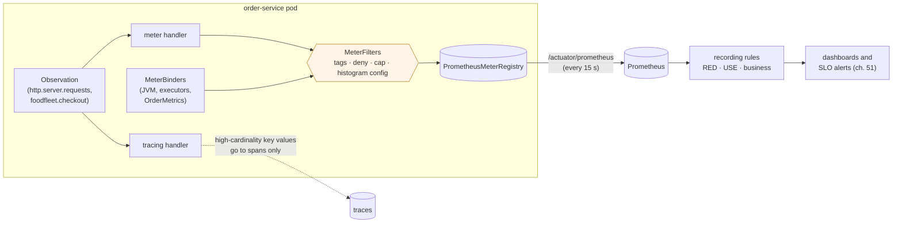

# 48. Metrics with Micrometer

<div class="badges" markdown><span class="badge badge-l2">L2 · Practitioner</span><span class="badge badge-l3">L3 · Senior/Lead</span><span class="badge badge-meta">Micrometer · Observation API · Timer · histogram vs percentiles · RED · USE · golden signals · MeterFilter · cardinality</span></div>

<div class="grid two" markdown>

!!! info "Prerequisites"
    - [Chapter 47](ch47-observability-fundamentals.md): what metrics are for, and what cardinality costs Prometheus
    - [Chapter 22](../communication/ch22-http-clients.md): RestClient and its URI templates
    - [Chapter 8](../foundations/ch08-spring-boot-4-essentials.md): Spring Boot 4 auto-configuration

!!! abstract "What you'll learn"
    - **Percentiles don't average**: with one slow pod in four, the average of the pods' p99s said **137 ms**; the true fleet p99 was **322 ms**, and summed histogram buckets said **317–318 ms**
    - **Windows remember**: after a 10-second spike, client-side p99 took **50–60 s** to recover, the timer's max over **2 minutes**; a 30-second `rate` window, 30 s
    - **The uri tag**: 10,000 requests made **24 meters** with Spring's path patterns, **15,954** with raw paths and **19,918** with a concatenated RestClient URI (a **135 MB** scrape with histograms); a cap stopped it and silently denied the next new endpoint
    - **Recording costs**: 12–13 ns for a counter, 51–52 ns for a timer, 84–97 ns with a histogram, 674–1,276 ns for an Observation, and client-side percentiles 1.4–1.5 µs under contention
    - **Spring Boot 4 and Micrometer 1.17**: filters, Observations, RED and USE as recording rules

</div>

---

## 1 · Introduction & Context

### The p99 that wasn't

For a month FoodFleet's checkout dashboard showed a p99 of about 140 ms, comfortably inside the 250 ms objective. Customers in one city kept complaining about slow checkouts; support kept escalating; the dashboard kept saying no. The panel's query was `avg(http_server_requests_seconds{quantile="0.99"})`: the average, across pods, of each pod's own p99. One pod in four was misbehaving. Its p99 was 350 ms; the others' about 60 ms; the average of the four, 137 ms. The real fleet p99, computed from every request, was over 300 ms.

A percentile can't be averaged, and a percentile computed inside one process can't be combined with another process's. The fix was one property: publish a histogram, sum the buckets across pods, and compute the percentile in Prometheus. The same month, an innocent-looking line in a client, `restClient.get().uri("/restaurants/" + id + "/menu")`, created a new timer for every restaurant and made each scrape of the service tens of megabytes.

This chapter is about the decisions that make metrics trustworthy: which meter to use, where percentiles are computed, how long a spike stays visible, and which tag values are allowed to exist. Every claim is measured on Micrometer 1.17.1 (the version Spring Boot 4.1.1 manages), Spring Framework 7.0.9's own HTTP observation conventions, and Prometheus 3.15.0.

### Where it comes from

<ul class="mh-timeline">
<li><span class="when">2010–2014 · Dropwizard Metrics</span><span class="what">Coda Hale's Metrics library brings timers, meters and histograms to the JVM; percentiles are computed in the process, from reservoirs.</span></li>
<li><span class="when">2016 · USE and RED</span><span class="what">Brendan Gregg's USE method (utilisation, saturation, errors, for resources) and Tom Wilkie's RED (rate, errors, duration, for services); Google's SRE book names the four golden signals: latency, traffic, errors, saturation.</span></li>
<li><span class="when">2017–2018 · Micrometer</span><span class="what">A vendor-neutral metrics facade for the JVM ("SLF4J for metrics"); Micrometer 1.0 becomes Spring Boot 2's metrics layer.</span></li>
<li><span class="when">2022 · Observation API</span><span class="what">Micrometer 1.10 and Spring Boot 3 instrument once with an Observation and derive metrics, traces and logs from it through handlers.</span></li>
<li><span class="when">2024–2025 · Prometheus client 1.x, Boot 4</span><span class="what">Micrometer moves its Prometheus registry to the new Prometheus Java client; Spring Boot 4 splits metrics and observation into their own modules.</span></li>
</ul>

---

## 2 · Core Concepts & Terminology



Meter types
:   **Counter**: only goes up (orders placed). **Gauge**: a value sampled when read (queue length). **Timer**: count, total time and max of events, optionally with a histogram. **DistributionSummary**: the same for non-time values (basket size). **LongTaskTimer**: tasks in progress and how long they have been running. **FunctionCounter/FunctionTimer**: read from an object that already counts.

Tags and the meter ID
:   A meter is identified by its name and its tags; every distinct set of tag values is a separate meter and, in Prometheus, separate time series. Tag values must come from a small, known set.

Observation API
:   One instrumentation point (`Observation`) with low-cardinality key values (become metric tags and span attributes) and high-cardinality key values (span attributes only). Handlers turn it into a timer, a span, log lines.

Percentiles: client-side vs histogram
:   Client-side percentiles (`publishPercentiles`) are computed inside one process over a sliding window and published as fixed numbers: they cannot be aggregated across pods. A percentile histogram (`publishPercentileHistogram`) publishes bucket counters that Prometheus can sum across pods and turn into any percentile with `histogram_quantile`.

SLO boundaries
:   Extra histogram buckets at exactly the latencies your objectives use (250 ms), so "share of requests within 250 ms" is a count, not an interpolation.

MeterFilter
:   A rule applied before a meter is created: add common tags, remove or rename tags, deny meters, cap a tag's values, configure histograms.

RED, USE and golden signals
:   **RED** for anything that serves requests: rate, errors, duration. **USE** for anything that is a resource (CPU, heap, pools, queues): utilisation, saturation, errors. The **four golden signals** combine them: latency, traffic, errors, saturation.

---

## 3 · How It Works Internally

### Where meters come from in Spring Boot 4

Spring MVC and RestClient instrument every request with an Observation (`http.server.requests`, `http.client.requests`); Boot registers a meter handler that turns each into a timer, binds JVM, process and executor metrics, applies every `MeterFilter` bean to every registry before meters are created, and serves the Prometheus registry at `/actuator/prometheus`. FoodFleet's policy is a handful of filters:

```java
--8<-- "code/chapters/ch48-metrics-micrometer/src/main/java/dev/foodfleet/ch48/metrics/MetricsPolicy.java:33:61"
```

Most of it is properties, in Spring Boot 4.1.1's names:

```yaml
--8<-- "code/chapters/ch48-metrics-micrometer/src/main/resources/application.yml"
```

```java
--8<-- "code/chapters/ch48-metrics-micrometer/src/main/java/dev/foodfleet/ch48/config/MetricsConfiguration.java:17:41"
```

### The uri tag

Spring's server convention tags each request with the **path pattern** of the handler that matched (`/orders/{id}`), or `NOT_FOUND`, `REDIRECTION` or `UNKNOWN`, never the raw path; the raw path goes into `http.url`, a high-cardinality key value that becomes a span attribute only. On the client side, the uri tag is the **URI template** that was passed to RestClient, and RestClient records whatever string you gave `uri(...)`: `uri("/restaurants/{id}/menu", id)` is one tag value, `uri("/restaurants/" + id + "/menu")` is one per restaurant. Boot caps uri values at 100 per meter name (`max-uri-tags`), first come, first served.

### Business metrics: registered once, tags from enums

```java
--8<-- "code/chapters/ch48-metrics-micrometer/src/main/java/dev/foodfleet/ch48/metrics/OrderMetrics.java:32:58"
```

### An Observation: one instrumentation, two kinds of key value

```java
--8<-- "code/chapters/ch48-metrics-micrometer/src/main/java/dev/foodfleet/ch48/observation/CheckoutObservation.java:14:47"
```

```java
--8<-- "code/chapters/ch48-metrics-micrometer/src/main/java/dev/foodfleet/ch48/observation/Checkout.java:26:38"
```

### How a timer remembers

A Prometheus timer keeps a count and a total that only grow (Prometheus takes `rate()` of them), a **max** and, if asked, **client-side percentiles**, both over sliding windows. In Micrometer's Prometheus registry the window's expiry is the registry's step, 1 minute, split into 3 buffers. Percentile buffers rotate every expiry ÷ buffers (20 s); the max rotates every expiry (60 s), through all 3 buffers, so a single slow request can stay the max for up to 3 minutes. When a timer publishes a histogram, the Prometheus registry writes the buckets and **leaves the client-side percentiles out** altogether.

### RED, USE and golden signals as recording rules

```yaml
--8<-- "code/chapters/ch48-metrics-micrometer/src/main/resources/prometheus/foodfleet-signals.rules.yml"
```

---

## 4 · Design Considerations & Trade-offs

All runs: JDK 25.0.4; Micrometer 1.17.1, its Prometheus registry and the Prometheus Java client 1.7.0, built from their release tags; Spring Framework 7.0.9's HTTP observation conventions compiled from source; Prometheus 3.15.0; one 2-vCPU container. Two runs; where they differed, both values are shown. `check_apis.sh` checks **25 defaults and behaviours** in the sources of Micrometer, Spring Framework and Spring Boot 4.1.1 (all found); the Prometheus configuration and its 10 rules pass `promtool check config`.

### Measured: a fleet percentile, four ways

Four pods of order-service at 400 orders a second for 90 s (30/30/30/10% of the traffic); order-d adds 300 ms to 20% of its orders. Every order is recorded in four timers on its pod: client-side percentiles, the default percentile histogram, FoodFleet's bounded histogram, and SLO buckets only. Prometheus scrapes every 5 s; queries cover the last minute. The load comes from a fixed seed, so the true values are the same in both runs.

| Pod | Share | True p99 | Its client-side p99 | p99 from its histogram |
|---|---|---|---|---|
| order-a | 30% | 61 ms | 63 ms | 61 ms |
| order-b | 30% | 65 ms | 67 ms | 66 ms |
| order-c | 30% | 64 ms | 65 ms | 64 ms |
| order-d | 10% | 349 ms | 352 ms | 355 ms |

| Fleet percentile computed as | p99 | p50 |
|---|---|---|
| **True** (every order in the last minute) | **322 ms** | 20.3 ms |
| `avg()` of the pods' client-side percentiles | **137 ms** | 21.4 ms |
| `max()` of the pods' client-side percentiles | 352 ms | 24.0 ms |
| `histogram_quantile` over summed buckets: default histogram (1 ms – 30 s) | **317–318 ms** | 20.5 ms |
| `histogram_quantile` over summed buckets: bounded histogram + SLO buckets | **317–318 ms** | 20.5 ms |
| `histogram_quantile` over summed buckets: SLO buckets only (100, 250, 500, 1000 ms) | 382–386 ms | 51.1–51.2 ms |

Series per pod and tag set: client-side percentiles 5, default histogram 72, bounded histogram 68, SLO buckets only 8. Orders within 250 ms: true 97.81%, from the SLO bucket 97.82–97.87%. Three runs (the third for the run log below).

- **Averaging percentiles hid the slow pod**: 137 ms against a true 322 ms. `max()` was closer here only by accident: it reports the worst pod's p99 (352 ms) whatever share of traffic that pod has.
- **Summed histogram buckets got it right**: 317–318 ms, within one bucket of the truth, from data that adds up across pods and time windows.
- **Bucket boundaries decide precision**: with only four SLO buckets, interpolation between 250 and 500 ms gave 382–386 ms for p99 and 51 ms for the median (true: 20 ms). SLO buckets answer "what share was within 250 ms" directly (97.82–97.87% against a true 97.81%, the difference being the minute Prometheus's rate window covers); they are not enough for percentiles on their own.
- **The bounded histogram cost 68 series instead of 72**: limiting the range to 10 s saves little; the point of FoodFleet's filter is the exact SLO buckets, at no extra cost.

### Measured: how long a spike is remembered

One pod at 200 orders a second; every order takes about 600 ms from 30 s to 40 s, about 20 ms otherwise. Client-side values are read from the registry every 5 s; histogram percentiles are computed by Prometheus at the same instants.

| t (s) | True p99 (last 5 s) | Client-side p99 | Timer max | p99, `rate[30s]` of buckets | p99, `rate[1m]` of buckets |
|---|---|---|---|---|---|
| 30 | 66 ms | 65 ms | 735 ms | 64 ms | 64 ms |
| 40 (spike ends) | 1,925 ms | 1,409 ms | 3,544 ms | 1,455–1,465 ms | 1,406–1,411 ms |
| 50 | 63 ms | 1,342 ms | 3,544 ms | 1,585 ms | 1,405 ms |
| 70 | 62 ms | 1,342 ms | 3,544 ms | **67 ms** | 1,337 ms |
| 90 | 63 ms | **96–218 ms** | 3,544 ms | 64 ms | 1,237–1,242 ms |
| 100 | 63 ms | 67 ms | 3,544 ms | 67 ms | **66 ms** |
| 170 | 59 ms | 67 ms | **3,544 ms** | 66 ms | 65 ms |
| 180 | 61 ms | 67 ms | **272 ms** | 65 ms | 66 ms |

Back under 100 ms after the spike ended: true p99 after 5 s; histogram p99 over `rate[30s]` after 30 s; over `rate[1m]` after 60 s; client-side p99 after 50–60 s; the timer's max fell from 3,544 ms only at 180 s, **130–140 s after**, and then to the normal tail (272 ms).

- **Client-side percentiles forget after about a minute**: their window is the Prometheus registry's step (1 minute) in 3 buffers rotating every 20 s, so the spike stays in the p99 for 40–60 s. You can't choose that window in the query.
- **Max remembers for two to three minutes**: it rotates once per step through all three buffers. An alert on `_max` keeps firing minutes after recovery; a dashboard of `_max` shows the worst single request of the last few minutes, not the current state.
- **With histograms, the query chooses the memory**: `rate[30s]` recovered after 30 s, `rate[1m]` after 60 s, exactly the window asked for, and both could be computed from the same data.

### Measured: the uri tag

10,000 requests through Spring Framework 7.0.9's own `DefaultServerRequestObservationConvention` and `DefaultClientRequestObservationConvention` and Micrometer's meter handler, into a Prometheus registry: five routes (`GET /orders/{id}` 40%, `GET /restaurants/{id}/menu` 30%, `POST /orders` 15%, `GET /riders/{id}/location` 10%, `GET /search` 5%), IDs random between 1 and 1,000,000, 2% 404s and 1% 500s.

| Setup | Histogram | Meters | Series | Scrape size | Scrape time | Heap held |
|---|---|---|---|---|---|---|
| Server: Spring's convention (path pattern) | none | 24 | 72 | < 0.1 MB | 7–9 ms | 1 MB |
| | bounded | 24 | 852 | 0.1 MB | 9–10 ms | < 1 MB |
| Server: raw path as the uri tag | none | **15,954** | 47,862 | 6.5 MB | 212–268 ms | 26 MB |
| | bounded | 15,954 | **566,367** | **86.9 MB** | 936–1,004 ms | 116–117 MB |
| Server: raw path, capped at 100 uri values | none | 208 | 624 | 0.1 MB | 1–2 ms | < 1 MB |
| | bounded | 208 | 7,384 | 1.1 MB | 23 ms | 3 MB |
| Client: `uri("/restaurants/" + id + "/menu")` | none | **19,918** | 59,754 | 10.4 MB | 301–365 ms | 35 MB |
| | bounded | 19,918 | **707,089** | **135.4 MB** | 1,353–1,368 ms | 174–175 MB |
| Client: `uri("/restaurants/{id}/menu", id)` | none | 2 | 6 | < 0.1 MB | < 1 ms | 0 MB |
| | bounded | 2 | 71 | < 0.1 MB | < 1 ms | 0 MB |

After the cap filled, a new endpoint (`POST /orders/{id}/cancel`, 100 requests) got **0 timers**: denied, like every value after the first 100.

- **Spring's defaults are safe; overriding them or concatenating URIs is not**: path patterns gave 24 meters for five routes; raw paths and concatenated client URIs gave a meter per distinct ID, 1,600 to 2,000 times more.
- **Each request Observation makes two meters**: a timer and a `.active` long-task timer (15,954 and 19,918 meters for about 8,000 and 10,000 distinct values). Turning long-task timers off (`management.metrics.observations.ignored-meters`) halves the count in any case.
- **Histograms multiply whatever cardinality there is**: 47,862 series became 566,367 and a 6.5 MB scrape an 87 MB one, taking a second, every 15 s, in every pod.
- **The cap is a backstop with a cost**: it kept the scrape at 0.1–1.1 MB, and denied the new cancel endpoint completely, because the first 100 raw paths had taken every slot. Boot's own cap works the same way and warns once.

### Measured: what recording costs

Nanoseconds per operation on a Prometheus registry (median of 5 rounds after 2 warm-up rounds; with 2 threads, one per vCPU, recording into the same meter):

| Operation | 1 thread | 2 threads |
|---|---|---|
| `Counter.increment()` | 12–13 | 15–19 |
| `Timer.record()`, no histogram | 51–52 | 54–58 |
| `Timer.record()`, bounded percentile histogram | 84–97 | **428–441** |
| `Timer.record()`, client-side percentiles 0.5 / 0.95 / 0.99 | 186–217 | **1,432–1,513** |
| `Timer.builder(...).tags(3 tags).register(r).record()` on every call | 218–254 | 179–191 |
| Observation with the meter handler, long-task timer on | 1,202–1,276 | 2,284–2,285 |
| Observation with the meter handler, long-task timer off | 674–851 | 776–811 |

- **Plain meters are nearly free**: tens of nanoseconds. A histogram doubles a timer's cost on one thread and makes it contended across threads (428–441 ns), still far below a millisecond request.
- **Client-side percentiles are the expensive option**: 1.4–1.5 µs per record with two threads, because each record updates a sliding window of HdrHistograms under contention, for numbers that can't be aggregated.
- **Building a meter per call costs 4 times a cached one** (the registry looks it up by name and tags and allocates the ID): register once.
- **An Observation costs about a microsecond with long-task timers on**, two under contention; turning them off saved 29–66%.

### Measured: a gauge on an object nobody holds

| Gauge | Before GC | After GC |
|---|---|---|
| `registry.gauge(name, obj)`, object kept in a field | 42 | 42 |
| `registry.gauge(name, new AtomicInteger(42))` | 42 | **NaN** |
| `Gauge.builder(...).strongReference(true)` | 42 | 42 |

The scrape after the collection reads `queue_weak NaN`. Micrometer holds a gauge's object weakly by default so that a gauge doesn't keep, say, a whole cache alive; an object that only the gauge refers to disappears at the next GC.

### Choosing

| You want | Use | Not | Why |
|---|---|---|---|
| Latency percentiles across pods, SLO compliance | Timer with percentile histogram + SLO boundaries; `histogram_quantile` over `sum by (le)` | `publishPercentiles` averaged across pods | Only bucket counts add up |
| One pod's latency in a quick local check | `publishPercentiles` | — | Fine for one process; not for a fleet |
| Something happened N times | Counter (`rate()` in PromQL) | Gauge of a running total | Counters survive restarts and scrape gaps |
| A current level (queue, pool in use) | Gauge, strongly referenced; or a binder | Gauge on a temporary object | Weak references go to NaN |
| Long-running work in progress | LongTaskTimer | Timer | A timer records only when work ends |
| Request handling in Spring | The built-in Observations | Hand-written timers | Same names and tags in every service |
| Per-restaurant, per-user questions | Spans and wide events (ch. 47) | A tag | Series multiply |

---

## 5 · Hands-on Implementation

```text
ch48-metrics-micrometer/
├── src/main/java/dev/foodfleet/ch48/
│   ├── metrics/      MetricsPolicy, OrderMetrics
│   ├── observation/  CheckoutObservation, Checkout
│   └── config/       MetricsConfiguration
├── src/main/resources/   application.yml, prometheus/prometheus.yml, prometheus/foodfleet-signals.rules.yml
├── src/test/java/…       14 tests
└── verify/               build-libs.sh (Micrometer and friends from source), run.sh, check_apis.sh, tools/
```

### 🔵 Level 2: the defaults, used well

<div class="badges" markdown><span class="badge badge-l2">L2 · Practitioner</span></div>

- Add Actuator and `micrometer-registry-prometheus`; expose `health` and `prometheus` only.
- Turn on percentile histograms and SLO boundaries for `http.server.requests` and `http.client.requests`.
- Always call RestClient with a template and variables: `uri("/restaurants/{id}/menu", id)`.
- Business metrics in a `MeterBinder`, registered once, tags from enums.

### 🟣 Level 3: one policy for every service

<div class="badges" markdown><span class="badge badge-l3">L3 · Senior/Lead</span></div>

- A shared starter with `MetricsPolicy`'s filters, `max-uri-tags`, and the recording rules: every service gets the same RED.
- Observations for business operations, with low- and high-cardinality keys declared in an `ObservationDocumentation` enum where reviewers can see them.
- Dashboards and alerts read recording rules, never raw histograms across all pods.

```bash
verify/run.sh aggregate cardinality      # about 3 minutes
```

### 🔴 Level 4: metrics as a governed API

<div class="badges" markdown><span class="badge badge-l4">L4 · Architect</span></div>

- Metric names and tags are an API: reviewed, versioned, documented with their cardinality.
- A per-service series budget checked in CI by scraping a test instance and counting.
- Native histograms (Prometheus 3) where the whole pipeline supports them: buckets without choosing boundaries.

### Run and verify

```text
$ verify/run.sh aggregate
4 pods of order-service, 400 orders/s for 90 s; traffic 30/30/30/10%; order-d adds 300 ms to 20% of its orders
each pod records every order in four timers; Prometheus scrapes every 5 s; queries over the last minute

pod        share   true p99   client p99 (summary)   p99 from its histogram
order-a      30%        61 ms              63 ms                    61 ms
order-b      30%        65 ms              67 ms                    66 ms
order-c      30%        64 ms              65 ms                    64 ms
order-d      10%       349 ms             352 ms                   355 ms

fleet percentile computed as                                                     p99        p50
true (every order in the last minute)                                           322 ms    20.3 ms
avg of the pods' client-side percentiles                                        137 ms    21.4 ms
max of the pods' client-side percentiles                                        352 ms    24.0 ms
histogram_quantile over summed buckets: default percentile histogram (1 ms - 30 s)    317 ms    20.5 ms
histogram_quantile over summed buckets: bounded histogram (1 ms - 10 s + SLO buckets)    317 ms    20.5 ms
histogram_quantile over summed buckets: SLO buckets only (100, 250, 500, 1000 ms)    382 ms    51.1 ms

series per pod: summary 5, default histogram 72, bounded histogram 68, SLO buckets only 8
orders within 250 ms: true 97.81%; SLO bucket le=0.25: 97.87%; the default histogram's nearest buckets: le=0.246065832 (97.87%) and le=0.268435456 (97.87%)
```

!!! question "Try it"
    1. In `Measure.aggregate`, make two pods slow instead of one. How far apart are the averaged and the true p99 now?
    2. Change the Prometheus registry's step to 10 s (`PrometheusConfig` with `step()`), rerun `decay`: what happens to max and to the client-side p99?
    3. In `Measure.cardinality`, set the cap to 1,000 and send the new endpoint first. What is recorded now?
    4. Add a fourth tag with 10 values to `OrderMetrics`'s counter. How many series is that?

---

## 6 · Production Readiness

- [x] **Percentile histograms with SLO boundaries** on HTTP server and client timers; no averaging of client-side percentiles
- [x] **Recording rules** for RED, USE and business metrics; dashboards and alerts read them
- [x] **uri tags from templates**: path patterns on the server, `uri(template, vars)` on clients
- [x] **`max-uri-tags`** set deliberately, and the "Reached the maximum number of 'uri' tags" warning alerted on
- [x] **Identifiers never as tags** (`MeterFilter.ignoreTags`), high-cardinality keys only on Observations' high side
- [x] **Gauges strongly referenced** or owned by binders
- [x] **Business meters registered once**, never built per request
- [x] **Long-task timers off** for request Observations unless someone uses them
- [x] **Actuator scrapes kept out** of `http.server.requests`
- [x] **Series per service counted** in CI against a budget

---

## 7 · Anti-patterns & Pitfalls

!!! pitfall "Incident 1: the averaged p99"
    **Context.** Checkout's latency SLO panel.
    **Symptoms.** The panel said 140 ms for a month while one city's customers waited seconds.
    **Root cause.** `avg()` of per-pod client-side percentiles. Measured with one slow pod in four: averaged client-side p99 137 ms, true fleet p99 322 ms, `histogram_quantile` over summed buckets 317–318 ms.
    **Fix.** Percentile histograms, `histogram_quantile(0.99, sum by (le) (rate(..._bucket[1m])))`, and an SLO bucket at 250 ms.

!!! pitfall "Incident 2: a timer per restaurant"
    **Context.** A new menu-prefetch feature called restaurant-service with `uri("/restaurants/" + id + "/menu")`.
    **Symptoms.** order-service's scrape grew to tens of megabytes and took over a second; Prometheus started missing scrapes; heap usage crept up.
    **Root cause.** RestClient uses the string given to `uri(...)` as the template, so every restaurant was a new uri tag value. Measured: 10,000 calls made 19,918 meters (a timer and a long-task timer per restaurant), a 10.4 MB scrape taking 301–365 ms, and with histograms 707,089 series, 135 MB and 1.35 s per scrape; the template form made 2 meters.
    **Fix.** `uri("/restaurants/{id}/menu", id)`; `max-uri-tags` for clients too; a series-count check in CI.

!!! pitfall "Incident 3: the endpoint with no metrics"
    **Context.** A team overrode the server convention to tag the raw path "for more detail", then turned on Boot's uri cap when the series exploded.
    **Symptoms.** Weeks later, a new cancel endpoint had no metrics at all; its error-rate alert could never fire.
    **Root cause.** The cap is first come, first served: the first 100 raw paths filled it, and every later value, including the new route, was denied, with one warning in the log at startup. Measured: with raw paths capped at 100 values, a new endpoint's 100 requests produced 0 timers.
    **Fix.** Fix the tag (path patterns), not just cap it; alert on the cap's warning.

| Anti-pattern | Symptom | Fix |
|---|---|---|
| `avg()` or `max()` of client-side percentiles | A fleet p99 that is half the truth, or one pod's | Histograms, summed buckets |
| `publishPercentiles` and a histogram on the same timer | The percentiles silently missing from Prometheus | Pick histograms |
| Alerting on the timer's `_max` | Alerts that stay firing minutes after recovery | `histogram_quantile` over a short `rate` window |
| Raw paths or IDs as tags | Series, scrape size and heap grow with traffic | Templates; ignore identifier tags |
| A cap without a fix | New endpoints silently unmeasured | Fix the source of values; alert on the cap |
| `Timer.builder(...).register()` per request | Lookups and allocation on every request | Register once in a binder |
| Gauge on a temporary object | NaN after the next GC | Hold the object; `strongReference(true)` |
| Averages instead of percentiles | Tail problems invisible | Histograms, p99 and SLO share |

---

## 8 · Enterprise Case Study

### FoodFleet: metrics everyone can add up

!!! decision "ADR-048: Percentile histograms with SLO boundaries for every request timer; percentiles only from summed buckets; uri tags from templates with a cap that is alerted on; identifiers never as tags; business meters in binders; RED, USE and business recording rules"
    **Status:** Accepted · **Date:** 2025-09-22

    **Context.** The checkout p99 panel averaged per-pod percentiles and under-reported a slow pod for a month; one client call created a timer per restaurant. Measured on the lab: averaged client-side p99 137 ms vs a true 322 ms (summed buckets: 317–318 ms); client-side p99 remembered a 10-second spike for 50–60 s and max for 130–140 s; raw paths and concatenated client URIs made 15,954–19,918 meters from 10,000 requests (with histograms up to 707,089 series and a 135 MB scrape), template forms 2–24; a cap stopped it and denied a new endpoint entirely; a histogram costs 84–97 ns per record, client-side percentiles up to 1.5 µs under contention.

    **Decision.** Every service uses the shared metrics starter: `MetricsPolicy`'s filters, Boot's histogram and SLO properties for `http.server.requests` and `http.client.requests` (100, 250, 500 ms, 1 s), `max-uri-tags: 200` with an alert on its warning, long-task timers off for request Observations, the Actuator excluded from request metrics. Percentiles on dashboards and in SLOs come only from `histogram_quantile` over summed buckets in recording rules. Business metrics are `MeterBinder`s with enum tags; business operations are Observations with their key values declared. A CI check scrapes each service after its integration tests and fails above its series budget.

    **Consequences.** ✅ Fleet percentiles and SLO shares that are correct by construction. ✅ Series per service bounded and visible. ⚠️ Histograms add tens of series per timer and tag set; the budget pays for them by forbidding high-cardinality tags. ⚠️ Recording rules are code to maintain.

### Fintech analogue: authorisation latency by network

A card processor measures authorisation latency per card network and response code (tens of values) with histograms whose buckets sit at its scheme-mandated timeouts, so "share answered within the network's limit" is exact. Per-merchant latency, with hundreds of thousands of merchants, lives in the transaction store, not in metrics.

### E-commerce analogue: sale-day capacity dashboards

Retailers precompute RED per service and route and USE per pool and queue with recording rules, because on a sale day the dashboards are opened by hundreds of people at once; querying raw histograms across thousands of pods for every panel load would slow the very system they are watching.

---

## 9 · Interview Q&A + Summary

#### Q1. Counter, gauge, timer, distribution summary: when to use which? · <span class="badge badge-l2">L2</span> · TCS · Infosys

**Short answer:** Counter for things that happen (orders placed; take `rate()`), gauge for a current level read when scraped (queue length), timer for durations (count, total, max, histogram), distribution summary for non-time sizes (basket value), long-task timer for work still running.

#### Q2. Why can't you average percentiles across pods? · <span class="badge badge-l2">L2</span><span class="badge badge-l3">L3</span> · Swiggy · Flipkart

**Short answer:** A percentile isn't additive: the fleet's p99 depends on how every pod's whole distribution combines, which the per-pod p99s don't contain. Measured with one slow pod in four: the average of the pods' p99s was 137 ms, the true fleet p99 322 ms, `histogram_quantile` over summed buckets 317–318 ms. Publish histogram buckets and compute the percentile from their sum.

#### Q3. publishPercentiles or publishPercentileHistogram? · <span class="badge badge-l3">L3</span> · Atlassian · PhonePe

**Short answer:** Histograms, for anything you aggregate or alert on: buckets add up across pods and time windows, and any percentile can be computed later. Client-side percentiles are fixed numbers per process. In Micrometer's Prometheus registry, enabling the histogram drops the client-side percentiles from the output anyway.

#### Q4. What are RED, USE and the four golden signals? · <span class="badge badge-l2">L2</span> · Google-style SRE rounds

**Short answer:** RED for services: rate, errors, duration. USE for resources: utilisation, saturation, errors. The golden signals: latency, traffic, errors, saturation. In Spring: RED from `http.server.requests`; USE from JVM, executor and connection-pool meters.

#### Q5. What is the Observation API, and why use it? · <span class="badge badge-l2">L2</span><span class="badge badge-l3">L3</span> · Spring-heavy shops

**Short answer:** Instrument once with an Observation; handlers turn it into a timer, a span and anything else. Low-cardinality key values become metric tags and span attributes; high-cardinality ones only span attributes. In the tests, the checkout Observation's timer carried payment.method, city.tier and outcome, never order.id or restaurant.id; measured, an Observation with the meter handler costs 0.7–1.3 µs.

#### Q6. How does Spring decide the uri tag, and how does it go wrong? · <span class="badge badge-l3">L3</span> · Walmart · Zomato

**Short answer:** On the server, the matched path pattern (or NOT_FOUND / REDIRECTION / UNKNOWN); on the client, the URI template given to RestClient. It goes wrong when code concatenates IDs into the template, or overrides the convention with the raw path. Measured: 10,000 requests gave 24 meters with path patterns, 15,954 with raw paths and 19,918 with concatenated client URIs.

#### Q7. What does max-uri-tags do? · <span class="badge badge-l3">L3</span> · Razorpay · Uber

**Short answer:** It caps the distinct uri values per meter name (100 by default), first come, first served: once full, new values are denied, with one warning. It stops the explosion but can hide new endpoints; fix the source of values and alert on the warning.

#### Q8. Why does my timer's max stay high after an incident? · <span class="badge badge-l3">L3</span> · Netflix-style rounds

**Short answer:** Max is kept over a sliding window: in Micrometer's Prometheus registry it rotates once per step (1 minute) through 3 buffers. Measured: after a 10-second spike, max stayed at 3,544 ms for 130–140 s; client-side p99 recovered after 50–60 s, a 30-second bucket rate after 30 s. Alert on percentiles from short-window bucket rates instead.

#### Q9. What does recording a metric cost? · <span class="badge badge-l3">L3</span> · Goldman Sachs · Flipkart

**Short answer:** Tens of nanoseconds for a counter or plain timer, about a hundred with a histogram; client-side percentiles and Observations cost more, especially under contention. Measured: 12–13 ns for a counter, 51–52 ns for a timer, 84–97 ns with a histogram, about 200 ns for client-side percentiles (1.4–1.5 µs contended), 0.7–1.3 µs for an Observation. Register meters once; turn off long-task timers you don't use.

#### Q10. Why did my gauge become NaN? · <span class="badge badge-l2">L2</span> · Infosys · Accenture

**Short answer:** Micrometer holds a gauge's object weakly so a gauge doesn't keep it alive; if nothing else references it, it is garbage-collected and the gauge reports NaN. Keep a reference, register it in a binder that owns it, or use `strongReference(true)`.

#### Q11. How do you keep metric cardinality under control? · <span class="badge badge-l3">L3</span><span class="badge badge-l4">L4</span> · Atlassian · Amazon

**Short answer:** Tag values from enums and templates; `MeterFilter.ignoreTags` for identifiers; caps as a backstop with alerts; a series budget per service checked in CI; recording rules that aggregate away pod-level detail; per-entity questions in traces and events.

#### Q12. Design FoodFleet's metrics. · <span class="badge badge-l4">L4</span> · Swiggy-/Zomato-style system design rounds

**Short answer:** Micrometer with Spring Boot's Observations for HTTP and business operations; histograms with SLO boundaries; a shared policy of filters and caps; business meters in binders; Prometheus with RED, USE and business recording rules; dashboards and SLO alerts (chapter 51) on those rules; a series budget per service; identifiers in traces and wide events, never in tags.

### Key takeaways

- **Percentiles don't add up; buckets do.** Histograms and `histogram_quantile` over summed buckets.
- **Every tag value is a series.** Templates and enums, never IDs or raw paths.
- **Windows remember.** Client-side percentiles for about a minute, max for up to three; Prometheus `rate` windows for exactly as long as you ask.
- **Instrument once.** Observations for metrics and traces; meters registered once.
- **A cap is a backstop, not a fix**, and it can hide new endpoints.

### Further reading

- Micrometer documentation, [Concepts](https://docs.micrometer.io/micrometer/reference/concepts.html) and [Observation](https://docs.micrometer.io/micrometer/reference/observation.html)
- Spring Boot reference, [Metrics](https://docs.spring.io/spring-boot/reference/actuator/metrics.html) and [Observability](https://docs.spring.io/spring-boot/reference/actuator/observability.html)
- Prometheus documentation, [Histograms and summaries](https://prometheus.io/docs/practices/histograms/)
- Brendan Gregg, [The USE Method](https://www.brendangregg.com/usemethod.html); Tom Wilkie, [The RED Method](https://grafana.com/blog/2018/08/02/the-red-method-how-to-instrument-your-services/)
- Google SRE book, [Monitoring Distributed Systems](https://sre.google/sre-book/monitoring-distributed-systems/)

---

**Previous:** [← 47. Observability Fundamentals](ch47-observability-fundamentals.md) · **Next:** [49. Distributed Tracing with OpenTelemetry →](ch49-distributed-tracing-otel.md)
