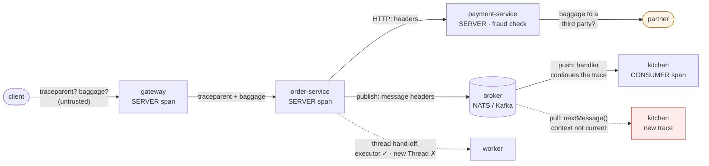

# 49. Distributed Tracing with OpenTelemetry

<div class="badges" markdown><span class="badge badge-l2">L2 · Practitioner</span><span class="badge badge-l3">L3 · Senior/Lead</span><span class="badge badge-meta">W3C trace context · spans · context propagation · executors · Kafka and NATS · sampling · baggage · Micrometer Tracing</span></div>

<div class="grid two" markdown>

!!! info "Prerequisites"
    - [Chapter 47](ch47-observability-fundamentals.md): what traces are for, head and tail sampling
    - [Chapter 25](../communication/ch25-asynchronous-messaging.md): FoodFleet's events on a broker
    - [Chapter 48](ch48-metrics-micrometer.md): Observations, which also produce spans

!!! abstract "What you'll learn"
    - **Thread hand-offs**: JDK executors, `CompletableFuture`, scheduled and virtual-thread executors and async HTTP callbacks kept the trace **200 of 200** times; `new Thread()`, `Thread.ofVirtual().start()` and a hand-rolled queue lost it **every time**, until wrapped with `Context.wrap`
    - **Messaging on a real broker (NATS)**: a handler-style consumer continued the order's trace 220 of 220 times; a pull loop **0 of 220**; extracting from the message headers by hand fixed it
    - **Sampling**: one service with a non-parent-based sampler dropped itself from 43–47 of 74–85 sampled traces or stored 400–904 orphan fragments; a B3-only service broke **every** trace; clients sending `traceparent ...-01` forced **100%** sampling
    - **Baggage**: a client-supplied email and session token reached a third-party partner on **50 of 50** calls; an edge allow-list and stripping before partner calls stopped it
    - **Kafka and Spring Boot 4**, checked in source: record-header propagation, process spans from `next()` to `hasNext()`, observations off by default in Spring Kafka, and `remote-fields` that isn't an allow-list

</div>

---

## 1 · Introduction & Context

### The traces that stopped at order-service

FoodFleet turned on tracing and the first traces looked perfect: gateway, order-service, payment-service, every hop in one waterfall. Then someone looked for the kitchen. Orders reached the kitchen through the broker, and the kitchen's spans were there, but each in a trace of its own, unconnected to the order that caused it. The same was true for the confirmation email, sent from a worker thread order-service started at boot, and for the loyalty points, credited by a scheduled job reading an outbox table.

Nothing was broken. Each of those hand-offs simply had nobody carrying the trace across: a consumer that pulled messages instead of registering a handler; a thread started by hand rather than through an executor; a database row with no place for a trace ID. Two weeks later the opposite problem appeared: a partner's security team asked why FoodFleet was sending them a customer's email address in an HTTP header called `baggage`.

This chapter follows a trace through every kind of hand-off FoodFleet has and measures, under the OpenTelemetry Java agent, which ones keep it: threads, executors, virtual threads, HTTP, a real message broker (NATS) pushed and pulled. It then measures what happens when services disagree about sampling or propagation formats, and what baggage carries to whom.

### Where it comes from

<ul class="mh-timeline">
<li><span class="when">2010–2012 · Dapper, Zipkin</span><span class="what">Google's Dapper paper; Twitter's Zipkin and its B3 headers (<code>X-B3-TraceId</code>), the first widely used propagation format.</span></li>
<li><span class="when">2016–2019 · OpenTracing, OpenCensus</span><span class="what">Two competing vendor-neutral APIs; Jaeger joins the CNCF.</span></li>
<li><span class="when">2020 · W3C Trace Context</span><span class="what"><code>traceparent</code> and <code>tracestate</code> become a W3C Recommendation; W3C Baggage follows as a header for application context.</span></li>
<li><span class="when">2021 · OpenTelemetry tracing 1.0</span><span class="what">The tracing API, SDK and OTLP are declared stable; the Java agent instruments hundreds of libraries without code changes.</span></li>
<li><span class="when">2022–2025 · Micrometer Tracing, messaging conventions</span><span class="what">Spring Boot 3 replaces Spring Cloud Sleuth with Micrometer Tracing over OpenTelemetry or Brave; OpenTelemetry's messaging semantic conventions settle how producers, consumers and batches relate.</span></li>
</ul>

---

## 2 · Core Concepts & Terminology



Trace, span, span context
:   A trace is a tree of spans sharing a trace ID. A span is one operation with a start, an end, a kind (server, client, producer, consumer, internal), attributes, events, links and a status. Its span context (trace ID, span ID, flags, trace state) is what travels.

W3C trace context
:   `traceparent: 00-<trace-id>-<parent-span-id>-<flags>`; the low flag bit is *sampled*. `tracestate` carries vendor-specific data.

Context and propagation
:   Inside a process, the current span and baggage live in a `Context` bound to the thread; crossing a thread needs the context captured and restored. Between processes, propagators *inject* the context into headers and *extract* it on the other side.

Producer and consumer spans, links
:   A message's publish is a PRODUCER span; its handling a CONSUMER span. The consumer either continues the producer's trace (parent) or starts a new trace that *links* to it, which suits batches and long delays.

Sampling decisions
:   Made once, at the root, and carried in the sampled flag. *Parent-based* samplers follow the caller's decision; a sampler that isn't parent-based decides again and can drop half a trace or keep fragments.

Baggage
:   Key-value pairs propagated with the trace (header `baggage`) for application context: tenant, experiment, priority. It goes wherever the context goes, and it is not recorded on spans unless code copies it.

---

## 3 · How It Works Internally

All of the following runs under the OpenTelemetry Java agent 2.32.0. Application code uses the OpenTelemetry API, which the agent connects to its SDK; Spring Boot's own tracing (Micrometer Tracing with the OpenTelemetry bridge) produces the same spans and headers from Observations.

### Across processes: inject and extract

Instrumented clients and servers (HTTP, gRPC, Kafka, NATS, JMS) inject and extract for you. Anything else that carries data between processes needs the same two calls by hand: an outbox row, a file, a cache entry with a job behind it.

```java
--8<-- "code/chapters/ch49-distributed-tracing-otel/src/main/java/dev/foodfleet/ch49/propagation/MessageHeaders.java:45:55"
```

### Across threads: capture and restore

The agent instruments the JDK's executors, fork/join tasks and the HTTP client's async callbacks, so work submitted through them carries the submitter's context. It does not instrument `Thread.start()`: a thread started by hand, platform or virtual, begins with an empty context, and so does any worker reading from a queue it owns.

```java
--8<-- "code/chapters/ch49-distributed-tracing-otel/src/main/java/dev/foodfleet/ch49/propagation/TracedExecutors.java:21:38"
```

### Messaging: push, pull, Kafka

For NATS, the agent instruments publishing (it adds `traceparent` and `baggage` message headers) and `MessageHandler.onMessage`, so a dispatcher-based consumer gets a CONSUMER span whose parent is the producer's span. A consumer that pulls with `nextMessage()` gets nothing: the message's headers carry the context, but nobody extracts it.

```java
--8<-- "code/chapters/ch49-distributed-tracing-otel/verify/tools/Services.java:209:230"
```

For Kafka, checked in the instrumentation's source: the producer writes the context into the record's headers (on by default); the consumer's `ConsumerRecords` iterator is wrapped, so each record gets a `process` span that is current from `next()` until the following `hasNext()`, a child of the producer's span (receive telemetry, which would start new traces with links instead, is off by default). Processing must therefore happen inside the loop body; records collected into a list and processed later, or handed to a thread pool after the loop, lose it. In Spring Kafka, the template's and listener's Observations are off by default (`spring.kafka.template.observation-enabled`, `spring.kafka.listener.observation-enabled`).

### Manual spans where instrumentation can't see

```java
--8<-- "code/chapters/ch49-distributed-tracing-otel/src/main/java/dev/foodfleet/ch49/spans/PaymentSpans.java:37:61"
```

### Sampling across services

The root decides; every later service should follow the sampled flag. The SDK's parent-based sampler does: for a remote parent that is sampled it uses `alwaysOn`, whatever ratio is configured for roots. That also means a client that sends `traceparent` with the sampled flag set is always traced, at whatever rate it likes, unless the edge removes incoming trace context.

### Baggage

Baggage is extracted from whatever the client sends and injected into every outgoing call, including calls to third parties. FoodFleet sanitizes it at the edge and drops it before calling partners:

```java
--8<-- "code/chapters/ch49-distributed-tracing-otel/src/main/java/dev/foodfleet/ch49/baggage/BaggagePolicy.java:28:50"
```

In Spring Boot 4.1.1, tracing is configured with properties. Note that `remote-fields` is not an allow-list: with W3C propagation, Boot's propagator includes the W3C baggage propagator, which carries every entry; remote fields are *additionally* sent as their own headers.

```yaml
--8<-- "code/chapters/ch49-distributed-tracing-otel/src/main/resources/application.yml"
```

```properties
--8<-- "code/chapters/ch49-distributed-tracing-otel/src/main/resources/agent.properties"
```

---

## 4 · Design Considerations & Trade-offs

All runs: JDK 25.0.4, OpenTelemetry Java agent 2.32.0 (SDK 1.66.0), the OpenTelemetry API 1.66.0 built from source (its five AutoValue-generated value classes written by hand, see `verify/lib-src`), NATS server 2.15.1 with jnats 2.26.4, OpenTelemetry Collector 0.162.0, one 2-vCPU container. Kafka itself couldn't be run here (neither the broker nor the client library was reachable), so Kafka's behaviour is checked in the instrumentation's and Spring Boot's source instead. Two runs; where they differed, both values are shown. `check_apis.sh` checks **21 defaults and behaviours** (all found).

### Measured: which thread hand-offs keep the trace

order-service, under the agent: for each of 200 orders (after 20 for warm-up), a span is started after handing work over each way; it either lands in the order's trace or starts a new one. Both runs gave the same counts.

| Hand-off | In the order's trace | New trace (lost) |
|---|---|---|
| Same thread | 200 | 0 |
| `ExecutorService` (fixed pool) | 200 | 0 |
| `ScheduledExecutorService` | 200 | 0 |
| `CompletableFuture.runAsync` | 200 | 0 |
| `Executors.newVirtualThreadPerTaskExecutor()` | 200 | 0 |
| `HttpClient.sendAsync().thenRun(...)` | 200 | 0 |
| `new Thread(...).start()` | 0 | **200** |
| `Thread.ofVirtual().start(...)` | 0 | **200** |
| Own queue + worker thread started at boot | 0 | **200** |
| `new Thread(Context.current().wrap(...))` | 200 | 0 |
| Own queue, task enqueued as `Context.current().wrap(task)` | 200 | 0 |

- **The agent covers the JDK's executors, not threads**: anything submitted to an executor kept the trace, including virtual-thread executors; a thread started directly, platform or virtual, began with an empty context every time.
- **A queue you own is a thread you own**: the classic "worker started at boot reads tasks from a queue" lost the trace on every task.
- **`Context.wrap` fixes both** by capturing the context when the work is created. The failure is silent: the lost spans are recorded, just in traces of their own.

### Measured: messages, pushed and pulled

order-service publishes `orders.placed` on NATS 2.15.1 for each of 220 orders (20 of them warm-up); the kitchen consumes it and starts a `prepare order` span.

| Kitchen consumes by | Spans the agent made in the kitchen | `prepare order` in the order's trace | Publish to process (p50) |
|---|---|---|---|
| Push: a `Dispatcher` callback (`MessageHandler`) | `orders.placed process` (consumer), 220 | **220 of 220** | 1.6–2.0 ms |
| Pull: a `nextMessage()` loop | none | **0 of 220** | — |
| Pull, with the context extracted from the headers by hand | none | **220 of 220** | 1.6–1.7 ms |

The push consumer's span is a child of order-service's `orders.placed publish` (producer) span, with `messaging.system=nats`, `messaging.destination.name=orders.placed`, `messaging.operation=process` and the body size as attributes.

- **The broker carried the context either way**: the agent added `traceparent` and `baggage` headers to every published message, even ones published without headers.
- **Only the handler style used it**: the agent instruments `MessageHandler.onMessage`, not `nextMessage()`. The pull loop's spans all started new traces, with no warning.
- **Four lines fixed it**: read the message's headers, extract with the configured propagators, make the context current around the processing (`MessageHeaders` above).
- **Kafka, from its instrumentation's source**: the poll loop is covered as long as the processing happens between `next()` and the next `hasNext()`; records buffered and processed later behave like the pull loop here.

### Measured: when services disagree about sampling or propagation

1,000 orders at 50 a second: gateway → order-service → payment-service → partner, and order-service → NATS → kitchen. A complete trace has spans from the gateway, order-service, payment-service and the kitchen; a fragment is a trace with no gateway span. The gateway's root ratio is 10%, so about 100 traces are expected.

| Configuration | Complete traces | Sampled traces missing a service | Fragments | Spans stored |
|---|---|---|---|---|
| Parent-based everywhere; the gateway keeps 10% | 105–108 | 0 | 0 | 1,050–1,080 |
| …payment-service: `traceidratio` 0.5, not parent-based | 89–105 | 0 | **400–401** | 2,093–2,250 |
| …payment-service: `traceidratio` 0.05, not parent-based | **31–38** | **43–47** (no payment spans) | 0 | 611–709 |
| …payment-service: B3 propagation only | **0** | 101–106 (no payment spans) | **1,000** | 3,707–3,742 |
| …payment-service: `always_on`, not parent-based | 96–99 | 0 | **901–904** | 3,672–3,693 |
| Parent-based, 10%; clients send `traceparent` with the sampled flag | **1,000** | 0 | 0 | **10,000** |

- **Parent-based everywhere gives whole traces**: every sampled order had all four services, 10 spans each.
- **A service that re-decides breaks traces one way or the other**: with a higher ratio (0.5, or always on) it kept its own spans for unsampled orders, 400 to 904 orphan fragments that nobody can connect to anything; with a lower ratio (0.05) it dropped itself from about half of the sampled traces. The ratios agree on trace IDs only up to the lower ratio.
- **A propagation mismatch broke every trace**: payment-service reading only B3 never saw `traceparent`, so all 1,000 of its requests started new traces and none of the sampled orders had payment spans. Spring Boot consumes W3C and both B3 formats by default for this reason.
- **Clients can turn sampling up to 100%**: a random `traceparent` with the sampled flag made the gateway's parent-based sampler keep every order, ten times the spans. Anything the internet sends is a remote parent.

### Measured: what baggage carries, and to whom

50 orders; the client sends `baggage: tenant=chain-7,city.tier=metro,user.email=priya%40example.com,session=eyJ…,debug.note=xxx…` (407 bytes). Each service records the `baggage` header it receives (the agent's `capture-request-headers`); the partner is an uninstrumented server outside FoodFleet. Both runs gave the same results.

| Policy | At order-service | At payment-service | At the external partner | `tenant` on payment's fraud span |
|---|---|---|---|---|
| None | 5 keys, 405 bytes | 5 keys, 405 bytes | **5 keys, 405 bytes** (email and session token included) | 50 of 50 |
| Allow-list at the gateway (`BaggagePolicy.sanitize`) | 2 keys, 30 bytes | 2 keys, 30 bytes | 2 keys, 30 bytes | 50 of 50 |
| Allow-list, and `withoutBaggage` for the partner call | 2 keys, 30 bytes | 2 keys, 30 bytes | **none** | 50 of 50 |

The partner received `traceparent` on all 50 calls in every configuration.

- **Baggage is input from the caller**: the agent extracted whatever the client sent and propagated it through every service, to the partner.
- **It goes everywhere the context goes**: even after the allow-list, tenant and city tier reached the partner until the call was made without baggage.
- **It isn't recorded unless copied**: the tenant appeared on payment-service's fraud span only because `PaymentSpans` copies it (Boot's `tag-fields` does the same).
- **Trace IDs leave too**: the partner saw `traceparent` on every call. That is usually acceptable (it identifies nothing outside FoodFleet), but it is a choice to make, not a default to discover.

### Choosing

| Situation | Do | Why |
|---|---|---|
| Work handed to another thread | JDK executors, or `Context.taskWrapping` / `Context.wrap` | Bare threads and own queues start empty |
| Consuming messages | Handler/listener style, or extract from headers by hand when pulling | Pull loops get no context |
| Kafka consumers | Process inside the poll loop body; enable Spring Kafka's observations | The process span lives from `next()` to `hasNext()` |
| Long delays, batches, fan-in | Start a new trace and link to the producer | One trace spanning hours or a batch of 500 parents helps nobody |
| Sampling | Decide at the edge, parent-based everywhere else, tail-sample in the collector (ch. 47) | Disagreeing samplers break traces |
| Mixed propagation formats | Consume W3C and B3, produce W3C | A service that can't read the caller's header starts new traces |
| Untrusted callers | Strip incoming `traceparent`, `tracestate` and `baggage` at the edge | Clients can force sampling and inject baggage |
| Calls to third parties | No baggage | It goes everywhere the context goes |

---

## 5 · Hands-on Implementation

```text
ch49-distributed-tracing-otel/
├── src/main/java/dev/foodfleet/ch49/
│   ├── propagation/  MessageHeaders, TracedExecutors
│   ├── baggage/      BaggagePolicy
│   └── spans/        PaymentSpans
├── src/main/resources/   application.yml (Spring Boot 4), agent.properties
├── src/test/java/…       12 tests
└── verify/               build-libs.sh, run.sh, check_apis.sh, lib-src/, tools/ (Services, Lab, Measure, Json)
```

### 🔵 Level 2: one trace per request

<div class="badges" markdown><span class="badge badge-l2">L2 · Practitioner</span></div>

- Spring Boot tracing (or the agent) on every service, exporting OTLP to the collector; sampling probability 1.0 in services, sampling in the collector.
- Executors from the JDK or Spring, never `new Thread()` for request work; `@Async` and `TaskExecutor` are wrapped by Boot.
- Spring Kafka observations enabled for templates and listeners.

### 🟣 Level 3: every hand-off accounted for

<div class="badges" markdown><span class="badge badge-l3">L3 · Senior/Lead</span></div>

- A list of every asynchronous hand-off per service (threads, queues, brokers, outbox, schedulers) and how each carries context; `MessageHeaders` for the ones nothing instruments.
- Links instead of parents for batch jobs and long delays.
- Baggage allow-list at the edge; no baggage to partners.

```bash
verify/run.sh context messaging      # about 4 minutes
```

### 🔴 Level 4: trace context as a contract

<div class="badges" markdown><span class="badge badge-l4">L4 · Architect</span></div>

- One propagation format (W3C) produced everywhere; B3 accepted until the last caller migrates.
- The edge (ingress or API gateway) strips trace context and baggage from the internet and starts traces itself.
- A trace-completeness check in staging: a synthetic order must produce spans from every service, in one trace.

### Run and verify

```text
$ verify/run.sh context
order-service, under the agent: for each of 200 orders, a span started after handing work over eleven ways
hand-off                                    in the request's trace    new trace (lost)
same thread                                         200                    0
ExecutorService (fixed pool)                        200                    0
ScheduledExecutorService                            200                    0
CompletableFuture.runAsync                          200                    0
newVirtualThreadPerTaskExecutor()                   200                    0
HttpClient.sendAsync().thenRun                      200                    0
new Thread(...).start()                               0                  200
Thread.ofVirtual().start()                            0                  200
own queue + worker thread                             0                  200
new Thread, Context.wrap()                          200                    0
own queue, Context.wrap()                           200                    0
```

!!! question "Try it"
    1. In `Services.probes`, replace `new Thread(...)` with Spring's `SimpleAsyncTaskExecutor`. Does the probe keep the trace?
    2. Make the kitchen's pull loop start a new trace with a *link* to the producer instead of continuing it. How would that look in a trace viewer?
    3. Set the gateway to `traceidratio` 0.1 (not parent-based) and send random sampled `traceparent` headers. What changes?
    4. Add `user.id` to `BaggagePolicy.ALLOWED`. Who receives it now?

---

## 6 · Production Readiness

- [x] **W3C trace context produced everywhere**; B3 consumed where old callers remain
- [x] **Parent-based sampling** in every service; head ratio only at the edge; tail sampling in the collector
- [x] **Incoming trace context and baggage stripped at the internet edge**
- [x] **Every asynchronous hand-off carries context**: executors, wrapped tasks, message headers, outbox columns
- [x] **Consumers continue or link** the producer's trace; Spring Kafka observations enabled
- [x] **Baggage allow-listed and size-capped**, never sent to third parties, copied onto spans only where queried
- [x] **Manual spans** for important internal work, with namespaced attributes, errors recorded, status set
- [x] **A trace-completeness check** for the critical journey in staging

---

## 7 · Anti-patterns & Pitfalls

!!! pitfall "Incident 1: the kitchen in its own trace"
    **Context.** The kitchen service polled the broker in a loop.
    **Symptoms.** Every order's trace ended at order-service; kitchen spans existed but each in a new trace.
    **Root cause.** Pull-style consumption: the context is in the message's headers, but no instrumentation extracts it for `nextMessage()`. Measured on NATS: a handler-style consumer continued the order's trace 220 of 220 times, a `nextMessage()` loop 0 of 220, and the loop with the context extracted from the headers 220 of 220.
    **Fix.** A handler-style consumer, or extract from the headers and make the context current (or link to it) around the processing.

!!! pitfall "Incident 2: half-traces from a service that knew better"
    **Context.** payment-service's team configured `traceidratio` 0.05 "to save money"; another team's service still spoke only B3.
    **Symptoms.** Many checkout traces had no payment spans; payment-service's own traces had no parents.
    **Root cause.** A sampler that isn't parent-based re-decides and drops spans of sampled traces; a service that can't read `traceparent` starts new traces. Measured: with payment-service on `traceidratio` 0.05, 43–47 of 74–85 sampled orders had no payment spans; with B3 only, all 1,000 payment requests started new traces and no sampled order had payment spans.
    **Fix.** Parent-based everywhere; consume W3C and B3; sample in the collector.

!!! pitfall "Incident 3: the email in the partner's logs"
    **Context.** A mobile app release started sending `baggage` with the user's email and session token "for debugging".
    **Symptoms.** A payment partner reported receiving them on every charge request.
    **Root cause.** Services extract baggage from any caller and propagate it on every outgoing call. Measured: a client's email and session token in `baggage` reached the partner on 50 of 50 calls; an allow-list at the gateway reduced the header to 2 keys and 30 bytes, and `withoutBaggage` around the partner call removed it.
    **Fix.** An allow-list at the edge, no baggage to third parties, and the edge stripping trace headers from the internet.

| Anti-pattern | Symptom | Fix |
|---|---|---|
| `new Thread()` or `Thread.ofVirtual().start()` for request work | Child spans in new traces | Executors, `Context.wrap` |
| Own queue and worker thread | Lost context, silently | Enqueue `Context.current().wrap(task)` |
| Pull consumers without extraction | Consumer spans in their own traces | Extract from headers, or handler style |
| Kafka records processed after the loop | Processing outside the record's span | Process in the loop body |
| Non-parent-based samplers downstream | Incomplete traces, orphan fragments | Parent-based everywhere |
| Propagation format mismatch | A service starts new traces | Consume both, produce W3C |
| Trusting incoming `traceparent` | Clients force sampling | Strip at the edge |
| Baggage as a dumping ground | PII and secrets in every downstream request | Allow-list, size cap, none to partners |
| `remote-fields` as an allow-list | Every entry still propagated | Filter in code at the edge |

---

## 8 · Enterprise Case Study

### FoodFleet: one trace per order, end to end

!!! decision "ADR-049: W3C propagation produced everywhere (B3 consumed); parent-based sampling with the head decision at the edge and tail sampling in the collector; every asynchronous hand-off carries context; edge strips incoming context; baggage allow-listed and never sent to partners"
    **Status:** Accepted · **Date:** 2025-09-29

    **Context.** Order traces stopped at the broker and at hand-rolled worker threads; a downstream sampler broke traces; client-supplied baggage reached a payment partner. Measured on the lab: bare and virtual threads and own queues lost the trace on 200 of 200 hand-offs while executors kept it on 200 of 200; a pull consumer continued 0 of 220 orders' traces (220 with manual extraction); non-parent-based samplers dropped payment from 43–47 sampled traces or stored 400–904 fragments, B3-only broke all traces; client `traceparent` forced 100% sampling; client baggage reached a partner on 50 of 50 calls.

    **Decision.** Spring Boot tracing (Micrometer Tracing over OpenTelemetry) in every service, the Java agent where code can't change; `management.tracing.propagation.produce: [w3c]`, consume all; sampling probability 1.0 in services with the collector's tail sampling (ADR-047); the ingress strips `traceparent`, `tracestate` and `baggage` from internet traffic. Request work runs on executors; hand-rolled queues enqueue `Context.wrap`ped tasks; pull consumers extract context from headers; outbox rows store `traceparent`; batch jobs link to the traces they consume. Baggage: tenant, city tier, experiment and priority only, at most 512 bytes, removed before any third-party call. Spring Kafka observations on for templates and listeners. A synthetic order in staging must produce one trace containing every service.

    **Consequences.** ✅ An order is one trace from the app to the kitchen. ✅ No customer data leaves in headers. ⚠️ Every new asynchronous path needs a review of how it carries context. ⚠️ Stripping trace context at the edge means a partner's trace and FoodFleet's can only be joined by a link, not a shared trace.

### Fintech analogue: payments across a scheme

Card payments cross systems that don't share trace context at all (acquirer, network, issuer). Payment platforms trace their own side end to end and correlate across boundaries with the scheme's own identifiers (retrieval reference numbers) recorded as span attributes, never by sending their trace headers into the network.

### E-commerce analogue: order pipelines on Kafka

Retail order pipelines on Kafka often run dozens of consumers over hours (payment, fraud, warehouse, shipping). They continue traces for the first, fast steps and switch to links for anything batched or delayed, so a trace stays a readable picture of one request rather than a day-long chain.

---

## 9 · Interview Q&A + Summary

#### Q1. What is in a W3C traceparent header? · <span class="badge badge-l2">L2</span> · TCS · Infosys

**Short answer:** Version, a 16-byte trace ID, the 8-byte span ID of the caller's span, and flags whose low bit says whether the trace is sampled: `00-4bf92f3577b34da6a3ce929d0e0e4736-00f067aa0ba902b7-01`. `tracestate` carries vendor data alongside.

#### Q2. How does a trace continue across threads? · <span class="badge badge-l2">L2</span><span class="badge badge-l3">L3</span> · Swiggy · PhonePe

**Short answer:** The context is bound to the thread; it must be captured when work is handed over and restored when it runs. The agent does this for JDK executors and async callbacks; bare threads and own queues need `Context.wrap`. Measured: executors, `CompletableFuture`, scheduled and virtual-thread executors kept the trace 200 of 200 times; `new Thread()`, `Thread.ofVirtual().start()` and a hand-rolled queue lost it 200 of 200.

#### Q3. How is trace context carried through Kafka? · <span class="badge badge-l3">L3</span> · Flipkart · Walmart

**Short answer:** The producer's instrumentation writes `traceparent` (and baggage) into record headers; the consumer's instrumentation wraps the records iterator and makes a `process` span current per record, as a child of the producer's span, from `next()` until the next `hasNext()`. In Spring Kafka, enable template and listener observations (off by default).

#### Q4. Parent or link for a consumer span? · <span class="badge badge-l3">L3</span><span class="badge badge-l4">L4</span> · Uber · Zomato

**Short answer:** Parent when the message is handled promptly, one by one, as part of the same user action; a new trace with links when messages are batched, delayed for a long time, or many producers feed one consumer operation. OpenTelemetry's instrumentation calls the latter "receive telemetry".

#### Q5. What breaks a trace? · <span class="badge badge-l3">L3</span> · Atlassian · Razorpay

**Short answer:** Any hand-off nobody carries context across (bare threads, own queues, pull consumers, outbox tables, schedulers), a propagation format the next service can't read, and samplers that don't follow the parent. Measured: a pull consumer continued 0 of 220 orders' traces; a B3-only service broke all 1,000; a downstream ratio of 0.05 dropped payment from about half of the sampled traces.

#### Q6. What does parent-based sampling mean, and why use it? · <span class="badge badge-l2">L2</span><span class="badge badge-l3">L3</span> · Amazon · PayPal

**Short answer:** Follow the caller's sampled flag; apply a ratio only to new roots. Every service then keeps or drops the same traces, so sampled traces are complete. Measured: parent-based everywhere gave 105–108 complete traces from 1,000 orders at 10% and nothing else; one service re-deciding produced 400–904 orphan fragments or 43–47 incomplete traces.

#### Q7. What is baggage, and what can go wrong? · <span class="badge badge-l3">L3</span> · Goldman Sachs · banks

**Short answer:** Key-value context propagated with the trace to every downstream call. It is extracted from any caller and sent to any callee, so it can carry injected or personal data to places it shouldn't go, and it isn't on spans unless copied. Measured: a client's email and session token in baggage reached a third-party partner on 50 of 50 calls until the gateway filtered it and the partner call was made without baggage.

#### Q8. Should an internet-facing service trust an incoming traceparent? · <span class="badge badge-l3">L3</span><span class="badge badge-l4">L4</span> · Cloudflare-style rounds

**Short answer:** No. Parent-based sampling honours a sampled flag from anyone, so clients can force sampling (and costs), choose trace IDs and inject baggage. Strip trace headers at the edge and start new traces there; link to a partner's trace ID if you need it.

#### Q9. How does Spring Boot 4 do tracing? · <span class="badge badge-l2">L2</span> · Spring-heavy shops

**Short answer:** Micrometer Observations produce spans through Micrometer Tracing with an OpenTelemetry (or Brave) bridge; properties set sampling (`management.tracing.sampling.probability`, 0.1 by default), propagation (produce W3C, consume W3C and B3 by default) and baggage (`remote-fields`, `tag-fields`, `correlation.fields`); spans are exported over OTLP.

#### Q10. When do you add manual spans? · <span class="badge badge-l2">L2</span> · Infosys · Accenture

**Short answer:** Around internal work that matters and that instrumentation can't see: a fraud decision, a pricing calculation, a batch step. Name it for the operation, add namespaced attributes with low-to-moderate cardinality, record exceptions and set the status, and keep it short-lived.

#### Q11. How do you carry trace context through an outbox? · <span class="badge badge-l3">L3</span> · Swiggy-style rounds

**Short answer:** Inject the current context into a `traceparent` (and optional `baggage`) column when the outbox row is written; the relay extracts it and either continues the trace or links to it when publishing, so the event's consumers join the order's trace.

#### Q12. Design tracing for FoodFleet's order journey. · <span class="badge badge-l4">L4</span> · system design rounds

**Short answer:** W3C propagation everywhere; edge strips internet trace headers; parent-based sampling with 100% sent to a tail-sampling collector; instrumented HTTP and Kafka with observations enabled; context carried through executors, outbox rows and pull consumers; links for batch and delayed work; baggage allow-listed and kept internal; manual spans for fraud, pricing and dispatch; a synthetic end-to-end trace check in staging.

### Key takeaways

- **A trace is only as complete as its weakest hand-off**: bare threads, own queues and pull consumers start new traces.
- **Message brokers carry context in headers**; someone has to extract it.
- **Sampling must follow the parent**, and the parent must be trustworthy.
- **Baggage goes everywhere**: allow-list it, cap it, keep it in-house.
- **Spring Boot's remote-fields is not an allow-list**; filter at the edge.

### Further reading

- W3C, [Trace Context](https://www.w3.org/TR/trace-context/) and [Baggage](https://www.w3.org/TR/baggage/)
- OpenTelemetry, [Context propagation](https://opentelemetry.io/docs/concepts/context-propagation/) and [Semantic conventions for messaging spans](https://opentelemetry.io/docs/specs/semconv/messaging/messaging-spans/)
- OpenTelemetry Java instrumentation, [Kafka instrumentation](https://github.com/open-telemetry/opentelemetry-java-instrumentation/tree/main/instrumentation/kafka)
- Spring Boot reference, [Tracing](https://docs.spring.io/spring-boot/reference/actuator/tracing.html)
- Sigelman et al., [Dapper](https://research.google/pubs/dapper-a-large-scale-distributed-systems-tracing-infrastructure/)

---

**Previous:** [← 48. Metrics with Micrometer](ch48-metrics-micrometer.md) · **Next:** [50. Structured Logging & Correlation →](ch50-structured-logging.md)
