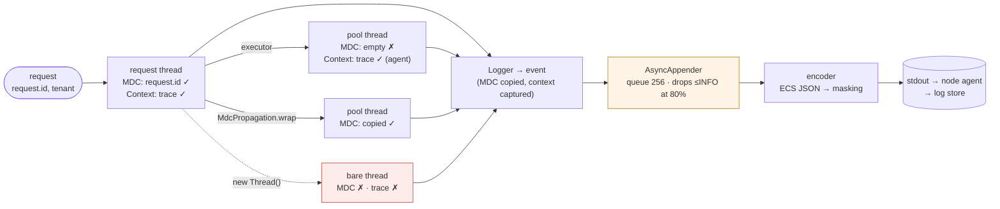

# 50. Structured Logging & Correlation

<div class="badges" markdown><span class="badge badge-l1">L1 · Foundation</span><span class="badge badge-l2">L2 · Practitioner</span><span class="badge badge-l3">L3 · Senior/Lead</span><span class="badge badge-meta">JSON logs · ECS · MDC · trace correlation · thread hand-offs · AsyncAppender · PII masking · Spring Boot 4</span></div>

<div class="grid two" markdown>

!!! info "Prerequisites"
    - [Chapter 47](ch47-observability-fundamentals.md): what logs are for next to metrics and traces
    - [Chapter 49](ch49-distributed-tracing-otel.md): trace context and how it crosses threads
    - [Chapter 39](../security/ch39-secrets-management.md): why secrets must never reach a log line

!!! abstract "What you'll learn"
    - **MDC across threads**: a request ID put in the MDC reached the log line only on the request's own thread. It was **missing on 200 of 200** lines from pools, virtual-thread executors, `CompletableFuture` and new threads. A pooled thread that leaked it logged the **wrong request on 99 of 200**.
    - **Trace IDs from the agent**: the OpenTelemetry agent's `trace_id` was right on every executor hop, and on the leaky thread too. It was **missing on bare threads** (200 of 200).
    - **AsyncAppender defaults drop INFO silently**: under a burst into a slow sink, **only 29–30% of INFO lines** arrived, though every WARN did. `neverBlock` lost 91% even of WARN.
    - **Cost**: JSON with Logback's defaults is **365 bytes and about 1.8–1.9 µs** a line, against 121 bytes and 0.7–0.8 µs for text. Masking every line adds **0.65–0.75 µs**.
    - **PII**: masking at the source missed message text, MDC values and exception messages (**5 of 5 leaked** in each). A masking encoder caught all of them. A regex masker was **6–18× slower** and masked timestamps as card numbers.

</div>

---

## 1 · Introduction & Context

### The refund nobody could follow

A customer's refund failed on a Saturday night. Support had the order ID; the on-call engineer had Kibana. The search for the order ID found three lines in order-service and nothing else. The payment call had run on an executor, the refund retry on a scheduled pool, and the notification on a virtual thread. All of their lines were there, but without the request ID that was supposed to tie them together. The trace ID was there on some of them, under a field name the dashboards didn't use.

The search that worked was by time window and customer phone number. It worked because the phone number was in the logs, in clear text, alongside the customer's email and, on one line from a partner SDK's exception message, a full card number. The masking filter, added a year earlier, ran on log arguments. Nobody had thought about exception messages.

The same week, a sale-day spike made the log shipper slow down, and order-service's logs for the busiest ten minutes had large holes. No errors were reported anywhere, because Logback's `AsyncAppender` drops INFO lines when its queue is 80% full, by design, without saying so.

This chapter measures each of those failures on Logback 1.5.38 (the version Spring Boot 4.1.1 uses) and the OpenTelemetry Java agent 2.32.0. It covers which thread hand-offs keep the request ID and the trace ID, what `AsyncAppender`'s settings do under a burst, what JSON and masking cost per line, and in which places personal data gets past each masking approach.

### Where it comes from

<ul class="mh-timeline">
<li><span class="when">1999–2006 · log4j, SLF4J, Logback</span><span class="what">log4j brings levels, appenders and the <em>mapped diagnostic context</em> (MDC), a per-thread map printed with every line. SLF4J becomes the facade; Logback is its native implementation.</span></li>
<li><span class="when">2010s · ELK and JSON lines</span><span class="what">Logstash and Elasticsearch make logs searchable; teams switch from parsing text with grok to writing one JSON object per line (logstash-logback-encoder).</span></li>
<li><span class="when">2019–2021 · ECS, Log4Shell</span><span class="what">Elastic Common Schema standardizes field names (<code>@timestamp</code>, <code>log.level</code>, <code>trace.id</code>). Log4Shell (December 2021) shows that a log line is attacker-controlled input.</span></li>
<li><span class="when">2022–2023 · SLF4J 2, OpenTelemetry logs, Logback JSON</span><span class="what">SLF4J 2.0 adds a fluent API with key-value pairs. OpenTelemetry stabilizes its log data model and correlates logs with traces. Logback 1.3.8/1.4.8 ships its own <code>JsonEncoder</code>. India's DPDP Act puts personal data, logs included, under statutory duties.</span></li>
<li><span class="when">2024–2025 · Spring Boot structured logging</span><span class="what">Spring Boot 3.4 adds <code>logging.structured.format</code> with ECS, Logstash and GELF built in. Boot 4 keeps it, with JSON members you can include, exclude, rename and add.</span></li>
</ul>

---

## 2 · Core Concepts & Terminology



Structured log
:   One machine-readable record per event, usually a JSON object per line, with named fields (`@timestamp`, `log.level`, `service.name`, `trace.id`, `order.id`) instead of a sentence for a regex to take apart. People still read the `message`; queries use the fields.

MDC (mapped diagnostic context)
:   A per-thread `Map<String,String>` in SLF4J. Logback copies it into each event when the event is created, and encoders write it as fields. Because it is a thread-local, it doesn't follow work to another thread, and a value left behind on a pooled thread stays there.

Key-value pairs
:   SLF4J 2's fluent API, `log.atInfo().addKeyValue("order.id", id).log(...)`, attaches fields to one event without touching the MDC.

Correlation ID and trace ID
:   A correlation (request) ID is an application value carried in headers and the MDC. A trace ID comes from the trace context (chapter 49). The OpenTelemetry agent adds `trace_id`, `span_id` and `trace_flags` to Logback's MDC. Spring Boot's Micrometer Tracing adds `traceId` and `spanId`. Pick one name for your dashboards.

Async appender
:   A queue in front of a slow appender. The caller enqueues and a worker thread writes. When the queue is full, the appender either blocks the caller or drops the event. Logback also drops TRACE, DEBUG and INFO **before** the queue is full.

Masking
:   Replacing personal data and secrets with a safe form (`a***@example.in`, `******3210`, `**** **** **** 1111`). You can do it at the source, with types that print themselves masked. You can also do it at the sink, by scanning every finished line.

---

## 3 · How It Works Internally

### An event's life in Logback

`logger.info("order {} placed", id)` checks the level, then creates a `LoggingEvent`. The event takes a **copy of the MDC** and the thread name as it is created, so later MDC changes don't affect it. It then goes through `callAppenders`, to each appender, to an encoder that turns it into bytes. Each step matters to this chapter:

- **The MDC is read from the logging thread.** If that thread's MDC doesn't have the request ID, nothing downstream can add it back.
- **The OpenTelemetry agent instruments two methods.** In `Logger.callAppenders` it saves the *current trace context* on the event. In `getMDCPropertyMap` it adds `trace_id`/`span_id` from that saved context. The trace ID is therefore correct even when an `AsyncAppender` encodes the event later, on its own thread.
- **The encoder decides the bytes.** Logback's `JsonEncoder` writes the message *template* plus the raw arguments by default. Spring Boot's ECS formatter writes the *formatted* message, plus every MDC entry and key-value pair as fields.

### The MDC across thread hand-offs

`RequestMdc` puts a request's fields into the MDC for exactly the request's lifetime. `MdcPropagation.wrap` copies the caller's map into a task and restores the worker's own map afterwards, so nothing leaks into the next task the worker runs:

```java title="mdc/RequestMdc.java"
--8<-- "code/chapters/ch50-structured-logging/src/main/java/dev/foodfleet/ch50/mdc/RequestMdc.java:23:36"
```

```java title="mdc/MdcPropagation.java"
--8<-- "code/chapters/ch50-structured-logging/src/main/java/dev/foodfleet/ch50/mdc/MdcPropagation.java:19:30"
```

For Spring's executors, `MdcTaskDecorator` applies the same wrap. Spring Boot applies a `TaskDecorator` bean to the auto-configured `ThreadPoolTaskExecutor` used by `@Async`.

The lab's order-service logs one line from each place its work can run:

```java title="verify/tools/MdcService.java"
--8<-- "code/chapters/ch50-structured-logging/verify/tools/MdcService.java:50:68"
```

### Masking: at the source, and over the whole line

`Pii` values print themselves masked. They only help where someone remembered to use them. `MaskingEncoder` wraps any encoder (Logback's JSON, Spring Boot's ECS) and masks the finished line, whatever field the data ended up in:

```java title="masking/MaskingEncoder.java"
--8<-- "code/chapters/ch50-structured-logging/src/main/java/dev/foodfleet/ch50/masking/MaskingEncoder.java:39:43"
```

`Masker` scans the line once. It finds `@` (an email when the domain has a dot, or a UPI handle such as `@okhdfc`), `eyJ…` tokens with two dots (JWTs), `Bearer …`, and runs of digits with single spaces or dashes between them. It then decides what a digit run is:

```java title="masking/Masker.java"
--8<-- "code/chapters/ch50-structured-logging/src/main/java/dev/foodfleet/ch50/masking/Masker.java:112:131"
```

The card-prefix check is there because of a measurement, described below. Epoch-millisecond timestamps are 13 digits, and about one in ten of them passes Luhn.

### Spring Boot 4 configuration

```yaml title="application.yml"
--8<-- "code/chapters/ch50-structured-logging/src/main/resources/application.yml"
```

When properties aren't enough (an async appender, the masking net), use `logback-spring.xml` with Boot's `StructuredLogEncoder`:

```xml title="logback-spring.xml"
--8<-- "code/chapters/ch50-structured-logging/src/main/resources/logback-spring.xml"
```

---

## 4 · Design Considerations & Trade-offs

### Test setup

All runs used:

- JDK 25.0.4.
- SLF4J 2.0.18 and Logback 1.5.38, built from their release tags.
- The OpenTelemetry Java agent 2.32.0.
- One 2-vCPU container.

Spring Boot 4.1.1's structured-logging formatters couldn't be compiled outside a full Boot build, so the experiments use Logback's own `JsonEncoder`. Boot's ECS field names and properties are checked in its source instead.

There were two runs. Where they differed, both values are shown. `check_apis.sh` checks **27 defaults and behaviours**, and all were found.

### Measured: which thread hand-offs keep the request ID and the trace ID

The lab sent order-service 200 requests. Each request's handler put `request.id=r-N` in the MDC and logged one line from each place. The run counted, per line, whether the line's `request.id` and `trace_id` were the request's own, missing, or another request's. The first table is without the agent; the second is with it. Both runs gave identical counts.

| Where the line was logged | `request.id`: right / missing / **wrong** | With the agent, `trace_id`: right / missing |
|---|---|---|
| Request thread | 200 / 0 / 0 | 200 / 0 |
| Fixed thread pool | 0 / **200** / 0 | 200 / 0 |
| Virtual-thread executor | 0 / **200** / 0 | 200 / 0 |
| `CompletableFuture.runAsync` | 0 / **200** / 0 | 200 / 0 |
| `new Thread(...)` | 0 / **200** / 0 | 0 / **200** |
| `Thread.ofVirtual().start(...)` | 0 / **200** / 0 | 0 / **200** |
| Fixed pool, task wrapped with `MdcPropagation.wrap` | 200 / 0 / 0 | 200 / 0 |
| Pooled thread after a task that set the MDC and didn't clear it | 100 / 1 / **99** | 200 / 0 |

What the counts show:

- **The MDC stays on the thread that set it.** Every hand-off, executors included, logged without the request ID. Unlike trace context (chapter 49), nothing carries the MDC across for you, not even the agent.
- **A leaked MDC is worse than a missing one.** A task that put a request ID on a pooled thread and didn't clear it made the next task on that thread log under **another request's ID**, 99 times in 200. The one "missing" was the first task, before anything had leaked. Searching by request ID returns wrong lines without any warning.
- **The agent's `trace_id` followed the work.** The agent records the trace context in the event, not in the MDC, and carries the context across executors (chapter 49). So `trace_id` was right on every executor hop, and right on the leaky thread too. Bare threads had no context, so no trace ID.
- **`MdcPropagation.wrap` fixed the request ID**, and restored the worker's own map afterwards.
- **Correlate on the trace ID.** Use `trace_id`/`traceId` as the correlation field, and keep request-scoped values in the trace context (baggage with Boot's `correlation.fields`, chapter 49) rather than only in the MDC.

### Measured: AsyncAppender under a burst

Eight threads each logged 2,000 events as fast as they could; every tenth event was WARN. The sink took 50 µs per event, like a slow disk or a log shipper pushing back.

| Appender | INFO delivered | WARN delivered | Log call p50 | p99 | Slowest call | Burst took |
|---|---|---|---|---|---|---|
| Synchronous | 100% | 100% | 59 µs | 14.2–15.0 ms | 37–65 ms | 970–984 ms |
| `AsyncAppender` defaults (queue 256) | **28.7–29.5%** | 100% | 0.3–0.5 µs | 22–26 µs | 75–96 ms | 300–345 ms |
| …`discardingThreshold` 0 | 100% | 100% | 0.2 µs | 11–13 µs | 108–111 ms | 814–825 ms |
| …`neverBlock` true | **2.6%** | **8.9–9.0%** | 0.2–0.3 µs | 1–6 µs | 1.7–8.4 ms | 10–20 ms |
| …queue 8192, `neverBlock` true | 47.9–54.6% | 100% | 0.2–0.8 µs | 3–9 µs | 2.7–12.6 ms | 9–24 ms |

What the table shows:

- **The defaults dropped about 70% of INFO without a word.** When less than a fifth of the queue is free, Logback discards TRACE, DEBUG and INFO events. WARN and ERROR still block. No counter and no warning record what was lost.
- **An async appender doesn't make the sink faster.** With nothing discarded, the burst took as long as the synchronous run (814–825 ms against 970–984 ms). The typical call became cheap, but some calls still blocked for over 100 ms while the queue drained.
- **`neverBlock` drops every level** when the queue is full: WARN delivery fell to 9%. A bigger queue absorbs bursts, but under sustained overload it only delays the same choice.
- **The real choice is block or lose.** For order and payment services, FoodFleet chose not to lose: a queue of 8192, `discardingThreshold` 0 and `neverBlock` false. It also alerts on the log pipeline's lag, so a slow sink is noticed before it slows requests.

### Measured: what JSON and masking cost per line

Four threads logged 100,000 events each to a file. Each event had two MDC fields and one argument. "Buffered" means `immediateFlush` false; "flush each" is Logback's default.

| Encoder | Bytes per event | ns per event, buffered | ns per event, flush each |
|---|---|---|---|
| Text pattern | 121 | 664–814 | 1,062–1,276 |
| Logback `JsonEncoder`, defaults | **365** | 1,794–1,944 | 2,334–2,348 |
| `JsonEncoder` trimmed (no context, sequence number, nanoseconds or raw arguments; formatted message) | 289 | 1,456–1,492 | 2,082–2,175 |
| Trimmed JSON + `MaskingEncoder` | 290 | 2,139–2,201 | 3,068–3,249 |

What the table shows:

- **JSON is three times the bytes of text with Logback's defaults.** The extras are the logger context's name and birth time, a sequence number, nanoseconds, and the arguments written a second time beside the template. Trimming took off 76 bytes per event. At 40,000 lines a second, that is about 260 GB a day.
- **The CPU cost is microseconds.** About 1 µs more per event than text, and 0.65–0.75 µs more for a masking scan of a line with nothing to mask. At a few hundred lines per request, that is well under a millisecond.

### Measured: where personal data leaks

Each event carried an email, a mobile number, a card number, a UPI address and a JWT in one of six places. The output was Logback's JSON, and the run counted how many of the five reached the file in clear text.

| Approach | Message text (concatenated) | `{}` argument | Object `toString` | Key-value pair | MDC value | Exception message | µs per event | …with a stack trace |
|---|---|---|---|---|---|---|---|---|
| No masking | 5/5 | 5/5 | 5/5 | 5/5 | 5/5 | 5/5 | 4.4–5.4 | 10.8–12.6 |
| `Pii` types at the source | **5/5** | 0/5 | 0/5 | 0/5 | **5/5** | **5/5** | 3.3–5.1 | 6.4–8.8 |
| `MaskingEncoder` on every line | 0/5 | 0/5 | 0/5 | 0/5 | 0/5 | 0/5 | 17.1–17.9 | 28.1–31.1 |
| Both | 0/5 | 0/5 | 0/5 | 0/5 | 0/5 | 0/5 | 10.6–14.3 | 22.4–26.5 |

This is an example of a masked line:

```text
"message":"payment by p***@example.com ******3210 card **** **** **** 1111 vpa p***@okhdfc token [jwt]"
```

What the table shows:

- **Masking at the source only covers the values someone wrapped.** A string concatenated into the message, a value put in the MDC, and a library's exception message all leaked, five of five.
- **Masking the finished line caught everything,** in every field. It costs about 12 µs per event on these 500-character lines that are full of secrets, and less than 1 µs on ordinary lines (the previous table). Doing both was cheaper than the encoder alone, probably because values already masked leave the scan less to replace.
- **The first masker, six regexes, was the wrong tool.** On 600 serialized lines it took **69–77 µs per line**, against **3.8–12.6 µs** for the single-pass scanner. It also differed on 44–65 lines, all false positives: the regexes masked the event's own epoch-millisecond timestamp as a card number whenever it happened to pass Luhn.
- **A pattern-based net can't know everything.** A name, an address or an order note isn't a pattern. Masking at the source still matters for anything the scanner can't recognize, and some fields shouldn't be logged at all.

### Choosing

| Situation | Do | Why |
|---|---|---|
| Format | One JSON object per line on stdout (Boot `logging.structured.format.console: ecs`) | Queryable fields; the platform ships stdout |
| Correlation | The trace ID from the agent or Micrometer Tracing on every line | It follows executors; the MDC doesn't |
| Request fields on other threads | `MdcPropagation.wrap` / a `TaskDecorator`, or baggage with `correlation.fields` | Executors don't copy the MDC |
| MDC hygiene | try-with-resources (`RequestMdc`, `MDC.putCloseable`) | Leaked values mislabel later requests |
| Slow sinks | `AsyncAppender` with `discardingThreshold` 0, a large queue, `neverBlock` false; monitor pipeline lag | The defaults drop INFO silently |
| Volume | Exclude fields nobody queries; trim JsonEncoder; DEBUG off in production | Bytes are the cost, not CPU |
| Personal data | `Pii` types where you can, a masking encoder on every line, nothing that isn't needed | Each layer misses what the other catches |
| Extra fields per event | Key-value pairs (`atInfo().addKeyValue`) | Scoped to one event, no cleanup |

---

## 5 · Hands-on Implementation

```text
ch50-structured-logging/
├── src/main/java/dev/foodfleet/ch50/
│   ├── masking/  Masker, Pii, MaskingEncoder
│   └── mdc/      RequestMdc, MdcPropagation, MdcTaskDecorator
├── src/main/resources/   application.yml (Spring Boot 4 ECS), logback-spring.xml
├── src/test/java/…       15 tests
└── verify/               build-libs.sh, run.sh, check_apis.sh, tools/ (MdcService, Measure, Lab, RegexMasker, Json)
```

### 🟢 Level 1: logs a machine can read

<div class="badges" markdown><span class="badge badge-l1">L1 · Foundation</span></div>

- Set `logging.structured.format.console: ecs` and log to stdout. Let the platform collect the logs.
- Use placeholders, not concatenation: `log.info("order {} placed", id)`.
- Use one level policy: INFO in production, DEBUG per logger when needed and switched off again.

### 🔵 Level 2: every line correlated

<div class="badges" markdown><span class="badge badge-l2">L2 · Practitioner</span></div>

- Make sure every line has the trace ID: Spring Boot tracing (`traceId`) or the agent (`trace_id`). Choose one name for dashboards, and rename the other with `otel.instrumentation.common.logging.trace-id-key` or `logging.structured.json.rename`.
- Open request fields with try-with-resources, and wrap tasks you hand to other threads (`MdcTaskDecorator`).
- Use key-value pairs for event-specific fields: `order.id`, `amount`, `attempt`.

### 🟣 Level 3: safe and survivable

<div class="badges" markdown><span class="badge badge-l3">L3 · Senior/Lead</span></div>

- Put `MaskingEncoder` around the structured encoder, and use `Pii` types for customer data in domain code.
- Use an `AsyncAppender` that never discards silently, and alert on log-pipeline lag.
- Exclude unused fields, and set `stacktrace.max-throwable-depth` so one exception isn't 40 KB.

```bash
verify/run.sh mdc async cost masking      # about 1 minute
```

### 🔴 Level 4: logging as a platform contract

<div class="badges" markdown><span class="badge badge-l4">L4 · Architect</span></div>

- Publish one field schema (ECS) across languages. Add `service.name`, `service.version`, `deployment.environment` and region to every line.
- Run a leak test in CI: log known fake PII through every path, and fail the build if it appears in the output (the `masking` experiment as a test).
- Set retention and access by field sensitivity, and keep logs out of tickets and chat.

### Run and verify

```text
$ verify/run.sh mdc
order-service: 200 requests, each with request.id in the MDC, logging once from each place its work runs
-- with the OpenTelemetry agent (its Logback instrumentation adds trace_id to the MDC)
where the line was logged                         request.id: right  missing  WRONG    trace_id: right  missing  wrong
same thread                                                     200        0      0              200        0      0
fixed thread pool                                                 0      200      0              200        0      0
virtual-thread executor                                           0      200      0              200        0      0
CompletableFuture.runAsync                                        0      200      0              200        0      0
new Thread                                                        0      200      0                0      200      0
Thread.ofVirtual                                                  0      200      0                0      200      0
fixed thread pool, MdcPropagation.wrap                          200        0      0              200        0      0
pooled thread after a task that left the MDC set                100        1     99              200        0      0
```

!!! question "Try it"
    1. In `MdcService`, give `POOL` a `MdcTaskDecorator`-style wrapper for every task. Which rows change?
    2. Run `async` with a queue of 8192, `discardingThreshold` 0 and `neverBlock` false, as in `logback-spring.xml`. How long is the slowest call?
    3. Add a customer's name to the masking experiment. Which approach catches it?
    4. Change `Masker.classify` to accept any first digit for cards. How many timestamps does it mask in `masking-raw.log`?

---

## 6 · Production Readiness

- [x] **JSON lines on stdout** in one schema (ECS), with service name, version, environment and region
- [x] **A trace ID on every line**, one field name across services and dashboards
- [x] **MDC set with try-with-resources**; tasks handed to other threads are wrapped; no MDC on bare threads
- [x] **Masking encoder on every appender**, `Pii` types for customer data, and a CI test that logs fake PII through every path
- [x] **AsyncAppender doesn't discard silently** (`discardingThreshold` 0); pipeline lag alerted
- [x] **Volume controlled**: unused fields excluded, stack traces capped, DEBUG off by default
- [x] **Retention and access** by data class; no production logs in tickets or chat

---

## 7 · Anti-patterns & Pitfalls

!!! pitfall "Incident 1: the request ID that pointed at someone else"
    **Context.** A payment retry worker on a shared pool put the request ID into the MDC with `MDC.put` and returned early on an error path.

    **Symptoms.** Searching one customer's request showed another customer's payment failures. A support agent quoted them to the wrong customer.

    **Root cause.** The MDC is a thread-local, and pool threads are reused. Measured: a task that left `request.id` set made the next task on that thread log another request's ID **99 times in 200**, with no error.

    **Fix.** Use try-with-resources (`RequestMdc`, `MDC.putCloseable`), and run pooled work through `MdcPropagation.wrap`, which restores the worker's own map. Correlate on the trace ID, which was right on all 200.

!!! pitfall "Incident 2: the sale-day hole in the logs"
    **Context.** order-service used `AsyncAppender` with its defaults, in front of a log shipper that slowed under load.

    **Symptoms.** INFO lines for ten minutes of the sale were mostly missing; WARN and ERROR were all there. Nothing reported a problem.

    **Root cause.** With less than 20% of the queue free, Logback drops TRACE to INFO without counting them. Measured: **29–30% of INFO** lines delivered under a burst into a slow sink. With `neverBlock`, only 9% of WARN were delivered.

    **Fix.** Set `discardingThreshold` 0, use a larger queue and keep `neverBlock` false. Alert on shipper lag, and reduce volume rather than dropping lines at random.

!!! pitfall "Incident 3: the card number in an exception"
    **Context.** Customer data in arguments was wrapped in `Pii` types; everything else was trusted.

    **Symptoms.** A security review found full card numbers and phone numbers in the log store, from a partner SDK's exception messages and from MDC values set by a filter.

    **Root cause.** Masking at the source covers only wrapped values. Measured: message concatenation, MDC values and exception messages each leaked **5 of 5** secrets with `Pii` alone. A masking encoder on the finished line leaked none.

    **Fix.** Put a masking encoder on every appender, keep `Pii` types, and run a CI leak test. Purge and rotate the affected data, and report it under the data-protection process.

| Anti-pattern | Symptom | Fix |
|---|---|---|
| `MDC.put` without a matching remove | Wrong request IDs on pooled threads | try-with-resources, wrap tasks |
| Relying on the MDC across executors | Lines without the request ID | Trace ID correlation, `TaskDecorator` |
| `AsyncAppender` defaults | INFO silently dropped under load | `discardingThreshold` 0, monitor lag |
| `neverBlock` for important logs | Any level dropped when full | Block, or log less |
| String concatenation in messages | No template for grouping; PII past source masking | Placeholders and key-value pairs |
| Regexes over every line for masking | Tens of µs per line, timestamps masked as cards | A single-pass scanner with validation |
| Logging whole request and response bodies | PII, secrets, gigabytes | Log IDs and sizes, not bodies |
| Text logs parsed with grok | Fragile parsing, broken multi-line stack traces | JSON lines |

---

## 8 · Enterprise Case Study

### FoodFleet: one schema, one correlation ID, no personal data

!!! decision "ADR-050: ECS JSON lines on stdout; the trace ID as the correlation field; MDC only through try-with-resources and wrapped tasks; a masking encoder on every appender; AsyncAppender that never discards silently"
    **Status:** Accepted · **Date:** 2025-10-06

    **Context.** On-call couldn't follow a request across threads. Searches by request ID returned other customers' lines. Logs had holes under load, and card and phone numbers appeared in the log store. Measured in the lab:

    - Request IDs in the MDC were missing on every thread hand-off, and wrong on 99 of 200 lines after a leak.
    - The agent's trace ID was right on every executor hop.
    - `AsyncAppender` defaults delivered 29–30% of INFO under a burst.
    - Source-only masking leaked from message text, the MDC and exception messages.
    - A regex masker cost 69–77 µs per line and masked timestamps.

    **Decision.** Every service logs ECS JSON to stdout (`logging.structured.format.console: ecs`) with service name, version, environment and region.

    - **Correlation:** the trace ID from Micrometer Tracing (`traceId`). Services under the agent rename `trace_id` to match. Request-scoped fields travel as baggage copied into the MDC (`correlation.fields`).
    - **MDC:** set only with try-with-resources; Spring executors get `MdcTaskDecorator`; bare threads aren't used for request work.
    - **Masking:** `MaskingEncoder` wraps every encoder, customer fields use `Pii` types, and a CI test logs fake PII through every path.
    - **Async appender:** queue 8192, `discardingThreshold` 0, `neverBlock` false, with shipper lag alerted.
    - **Volume:** JSON trimmed of unused fields, and stack traces capped at depth 10.

    **Consequences:**

    - ✅ One query by trace ID finds a request's lines in every service and thread.
    - ✅ No customer contact or card data in logs.
    - ⚠️ A slow log pipeline slows requests instead of losing lines, so the pipeline needs capacity and an alert.
    - ⚠️ The masking scan costs under 1 µs on an ordinary line, and it can't recognize names or free text.

### Fintech analogue: PCI DSS and logs

Card platforms treat logs as in scope for PCI DSS. The full card number (PAN) must never be stored unprotected; at most the first six and last four digits are shown. They mask at the sink, validate with Luhn to avoid destroying identifiers, and test the pipeline with known test card numbers. Some also tokenize at the edge, so services never see a PAN to log.

### E-commerce analogue: logs at sale-day volume

Large retailers log at hundreds of thousands of lines a second during sales. They control cost with sampling of INFO for successful requests, field budgets per service, and short retention for debug data. They never rely on an appender silently dropping lines: a deliberate sample is analyzable, but random holes aren't.

---

## 9 · Interview Q&A + Summary

#### Q1. Why structured logs instead of text? · <span class="badge badge-l1">L1</span> · TCS · Infosys

**Short answer:** Fields can be queried, aggregated and joined (`order.id`, `trace.id`, `log.level`) without fragile parsing, and multi-line stack traces stay in one record. Spring Boot 4 writes ECS, Logstash or GELF JSON with one property. The cost is bytes: 365 bytes against 121 per line here with Logback's defaults, about 290 when trimmed.

#### Q2. What is the MDC, and what goes wrong with it? · <span class="badge badge-l2">L2</span> · Swiggy · PhonePe

**Short answer:** It is a per-thread map that Logback copies into every event. It doesn't follow work to other threads, and values left on pooled threads mislabel later work. Measured: request IDs were missing on 200 of 200 lines from executors and new threads, and wrong on 99 of 200 after a task leaked one.

#### Q3. How do you correlate logs across services and threads? · <span class="badge badge-l2">L2</span><span class="badge badge-l3">L3</span> · Flipkart · Razorpay

**Short answer:** Put the trace ID on every line, from Micrometer Tracing or the OpenTelemetry agent. Trace context is propagated across HTTP, messaging and executors, so it follows the work. Measured: the agent's `trace_id` was right on every executor hop, including a thread with a leaked MDC. It was missing only on bare threads.

#### Q4. How does the OpenTelemetry agent get the trace ID into Logback's output, even with an async appender? · <span class="badge badge-l3">L3</span> · Uber-style rounds

**Short answer:** It instruments `Logger.callAppenders` to store the current context on the event, and `getMDCPropertyMap` to add `trace_id`, `span_id` and `trace_flags` from that stored context. The values reflect the logging thread at the time of the call, even when the encoding happens later on the async appender's thread. Baggage can be added with `logback-mdc.add-baggage`.

#### Q5. What does Logback's AsyncAppender do when the queue fills? · <span class="badge badge-l3">L3</span> · Amazon · Walmart

**Short answer:** Below 20% free capacity (`discardingThreshold`, default queue/5), it silently drops TRACE, DEBUG and INFO. When the queue is full, it blocks the caller, or with `neverBlock` drops any event. Measured under a burst: 29–30% of INFO delivered with the defaults; with `neverBlock`, 9% of WARN.

#### Q6. How do you keep personal data out of logs? · <span class="badge badge-l3">L3</span> · Paytm · banks

**Short answer:** Use layers: don't log what you don't need; use types that print masked (`Pii`); put a masking encoder over every finished line; and run a CI test that pushes fake PII through every path. Measured: source masking alone leaked from concatenated messages, MDC values and exception messages; the line-level encoder leaked nothing.

#### Q7. Why not mask with regexes? · <span class="badge badge-l3">L3</span> · Goldman Sachs · Atlassian

**Short answer:** It is slow, and it can be wrong. Six regexes cost 69–77 µs per 500-character line against 3.8–12.6 µs for a single-pass scanner. They also masked epoch-millisecond timestamps as card numbers, because 13-digit numbers often pass Luhn. Validate candidates (length, card prefix, Luhn) and scan once.

#### Q8. What fields should every log line have? · <span class="badge badge-l2">L2</span> · Zomato · Accenture

**Short answer:** Timestamp (UTC, ISO-8601), level, logger, message, service name and version, environment, region or zone, and trace and span IDs. Event-specific fields go in as key-value pairs: order ID, amount, attempt. Leave out anything nobody queries.

#### Q9. MDC or key-value pairs? · <span class="badge badge-l2">L2</span> · Spring-heavy shops

**Short answer:** Use the MDC for context that applies to everything a thread does during a request: request ID, tenant. Use key-value pairs (`atInfo().addKeyValue`) for facts about one event. Key-value pairs need no cleanup and can't leak into other requests.

#### Q10. How do you control logging cost? · <span class="badge badge-l3">L3</span> · Flipkart · Meesho

**Short answer:** Fewer bytes, not faster encoders. JSON costs about 1–2 µs per line in CPU. Volume costs storage and ingest money. Exclude unused fields, cap stack traces, sample INFO for successful requests on hot paths, use metrics for counts instead of a line per event, and set retention by data class.

#### Q11. Should logs go to files or stdout in Kubernetes? · <span class="badge badge-l2">L2</span> · Infosys · Wipro

**Short answer:** Stdout, as JSON lines. The node's agent (Fluent Bit, the OpenTelemetry Collector) collects, enriches with pod metadata and ships them. Apps don't manage rotation or disk, and a crashing pod's last lines are still collected.

#### Q12. Design FoodFleet's logging. · <span class="badge badge-l4">L4</span> · system design rounds

**Short answer:**

- **Format:** ECS JSON on stdout with service, version, environment and region.
- **Correlation:** the trace ID as the one correlation field.
- **MDC:** only with try-with-resources, with executors wrapped.
- **Personal data:** a masking encoder plus `Pii` types, and a CI leak test.
- **Async appender:** no silent discards, with pipeline lag alerted.
- **Cost:** field budgets and capped stack traces.
- **Pipeline:** a collector per node, routing to a log store with retention by sensitivity, plus links from traces to logs by trace ID.

### Key takeaways

- **JSON lines with a fixed schema** make logs queryable; bytes are their cost.
- **The MDC is a thread-local**: missing on hand-offs, wrong after leaks. Correlate on the trace ID.
- **AsyncAppender's defaults drop INFO silently** under pressure; decide between blocking and losing.
- **Mask the finished line** as well as at the source; validate matches, and don't run a regex per kind.
- **Test for leaks** the way you test for bugs: known fake data through every path.

### Further reading

- Spring Boot reference, [Structured logging](https://docs.spring.io/spring-boot/reference/features/logging.html#features.logging.structured)
- Logback manual, [Appenders: AsyncAppender](https://logback.qos.ch/manual/appenders.html#AsyncAppender) and [Encoders: JsonEncoder](https://logback.qos.ch/manual/encoders.html#JsonEncoder)
- SLF4J, [Fluent logging API](https://www.slf4j.org/manual.html#fluent)
- Elastic, [Elastic Common Schema reference](https://www.elastic.co/guide/en/ecs/current/index.html)
- OpenTelemetry Java instrumentation, [Logback MDC instrumentation](https://github.com/open-telemetry/opentelemetry-java-instrumentation/tree/main/instrumentation/logback/logback-mdc-1.0)
- OWASP, [Logging Cheat Sheet](https://cheatsheetseries.owasp.org/cheatsheets/Logging_Cheat_Sheet.html)

---

**Previous:** [← 49. Distributed Tracing with OpenTelemetry](ch49-distributed-tracing-otel.md) · **Next:** [51. SLIs, SLOs, Error Budgets & Alerting →](ch51-slo-alerting.md)
