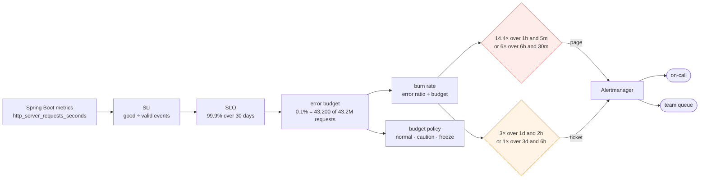

# 51. SLIs, SLOs, Error Budgets & Alerting

<div class="badges" markdown><span class="badge badge-l3">L3 · Senior/Lead</span><span class="badge badge-l4">L4 · Architect</span><span class="badge badge-meta">SLIs · SLOs · error budgets · burn rate · multi-window alerts · Prometheus rules · Alertmanager · budget policy</span></div>

<div class="grid two" markdown>

!!! info "Prerequisites"
    - [Chapter 47](ch47-observability-fundamentals.md): signals, and why alerts belong on metrics
    - [Chapter 48](ch48-metrics-micrometer.md): Micrometer timers, histograms and Prometheus
    - [Chapter 50](ch50-structured-logging.md): what on-call does once a page arrives

!!! abstract "What you'll learn"
    - **Five ways to alert on the same SLO**, replayed through Prometheus 3.15.0's rule engine:
        - A static "error ratio > 1%" alert **never fired** for slow failures that spent 15–43% of the month's budget.
        - "Error ratio above the SLO" fired within minutes of every sustained incident, kept firing **for days**, and fired **3 times** on a healthy service.
    - **Multi-window burn-rate alerts** paged within 1–43 minutes for fast incidents, with at most 2.3% of the budget gone. They opened a ticket for slow ones at 8% of the budget, and **stopped 4–29 minutes** after recovery, where a 1-hour-only alert took up to 59 minutes.
    - **Low traffic**: on a healthy service with one request a minute, burn-rate alerts **paged 16 times in 30 days**, once for every single failure. A 100-request minimum removed all 16.
    - **Latency SLI**: without a histogram bucket at 300 ms, the SLI read 99.14% for a true 99.41%. The service appeared to have spent **86% of its budget instead of 59%**. One `slo` bucket made it exact.
    - **Routing on a real Alertmanager**: pages and tickets reach different receivers, and a page silences the same SLO's ticket until it resolves.

</div>

---

## 1 · Introduction & Context

### Forty alerts and no answer

order-service had forty alerts. CPU above 80%, heap above 85%, error ratio above 1%, p99 above 500 ms, one per dependency, one per queue. On-call got paged three times a week, mostly at night, and mostly for nothing a customer noticed. Everyone learned to wait ten minutes before looking.

Then checkout failed for 0.6% of orders for most of a Saturday, because a payment provider was rejecting one card network. No alert fired: 0.6% is below 1%. By Monday a fifth of the month's acceptable failures were gone. Product asked a question nobody could answer: "How reliable is checkout supposed to be, and are we there?"

This chapter answers it with service level objectives. It defines checkout's SLIs from the metrics Spring Boot already produces, sets SLOs with an error budget, and generates the alerts the Google SRE Workbook recommends. It then tests them against simpler alerts by replaying incidents of every shape through Prometheus's own rule engine. It also measures how accurate a latency SLI is when read from Micrometer's histograms, and checks the routing on a real Alertmanager.

### Where it comes from

<ul class="mh-timeline">
<li><span class="when">2003–2014 · Google SRE</span><span class="what">Site Reliability Engineering at Google turns reliability into a target with a budget: if a service is more reliable than it needs to be, the spare budget is spent on releases.</span></li>
<li><span class="when">2016 · The SRE book</span><span class="what"><em>Site Reliability Engineering</em> publishes SLIs, SLOs, error budgets and error budget policies, and the advice to alert on symptoms users see rather than causes.</span></li>
<li><span class="when">2018 · The SRE Workbook</span><span class="what">"Alerting on SLOs" compares six alerting approaches and recommends multi-window, multi-burn-rate alerts: 14.4× over 1 hour and 6× over 6 hours to page, slower burns to ticket.</span></li>
<li><span class="when">2021–2022 · SLOs as code</span><span class="what">The OpenSLO specification, and Sloth and Pyrra, generate Prometheus recording rules and burn-rate alerts from a short SLO definition.</span></li>
<li><span class="when">2023–2026 · Prometheus 2.42 to 3.x</span><span class="what">Alerting rules gain <code>keep_firing_for</code> (2.42). By 3.15, <code>histogram_fraction</code> reads classic <code>le</code> histograms as well as native ones, so a latency SLI can be estimated between buckets.</span></li>
</ul>

---

## 2 · Core Concepts & Terminology



SLI (service level indicator)
:   A ratio of good events to valid events, measured where users experience it. Two examples are "checkout requests that didn't fail with a server error" and "successful checkout requests completed within 300 ms". Ratios of events, not averages or percentiles, so they can be added up over any window.

SLO (service level objective)
:   A target for an SLI over a rolling window, such as 99.9% over 30 days. It is internal, and stricter than any SLA (the contract with penalties).

Error budget
:   1 − SLO: the failures you are allowed. For 99.9% over 30 days, that is 0.1% of requests, or 43.2 minutes of total outage. The budget is spent by incidents, deploys and experiments. When it is gone, the error budget policy says what changes.

Burn rate
:   How fast the budget is being spent, relative to the pace that spends exactly all of it over the window. An error ratio of 0.1% is burn rate 1; 1.44% is 14.4, which spends 2% of a 30-day budget in an hour.

Multi-window, multi-burn-rate alert
:   An alert that fires when the burn rate exceeds a threshold over a long window **and** a short one. The long window (1 h) makes it significant: a real share of the budget is gone. The short window (5 min, a twelfth of the long one) makes it stop soon after the problem does. Fast burns page; slow ones open a ticket.

---

## 3 · How It Works Internally

### Burn-rate thresholds from the budget

Each condition is "this share of the budget gone within this window". The burn rate follows from the window lengths:

```java title="slo/BurnRateAlert.java"
--8<-- "code/chapters/ch51-slo-alerting/src/main/java/dev/foodfleet/ch51/slo/BurnRateAlert.java:24:26"
```

```java title="slo/BurnRateAlert.java"
--8<-- "code/chapters/ch51-slo-alerting/src/main/java/dev/foodfleet/ch51/slo/BurnRateAlert.java:43:54"
```

For a 30-day window this gives 14.4 and 6 to page, and 3 and 1 to open a ticket. For a 7-day window the same shares give 3.36 and 1.4, so the thresholds must come from the window, not be copied.

### SLIs from Spring Boot's metrics

Checkout's SLIs come from the `http.server.requests` timer Spring Boot already records. Availability counts server errors (`outcome="SERVER_ERROR"`), not 4xx, which are the client's doing. Latency counts successful requests that took longer than 300 ms. That needs a histogram bucket at exactly 0.3 s:

```java title="rules/CheckoutSlos.java"
--8<-- "code/chapters/ch51-slo-alerting/src/main/java/dev/foodfleet/ch51/rules/CheckoutSlos.java:21:37"
```

```yaml title="application.yml"
--8<-- "code/chapters/ch51-slo-alerting/src/main/resources/application.yml"
```

### Rules generated, not written

`PrometheusSloRules` turns each SLO into rules, the way Sloth and Pyrra do:

- **Recording rules** for the error ratio and request rate over all seven windows the alerts use.
- **The budget left** over 30 days, in its own group evaluated every 5 minutes, because it reads 30 days of samples.
- **A page and a ticket alert.**

A test fails if the committed file differs from the generator's output. Changing the objective therefore changes every threshold together.

```yaml title="prometheus/checkout-slo.rules.yml (the availability alerts)"
--8<-- "code/chapters/ch51-slo-alerting/src/main/resources/prometheus/checkout-slo.rules.yml:52:75"
```

The last condition in each branch is the low-traffic guard: no alert unless the long window saw at least 100 requests. Without it, one failure among 60 requests is a 1.7% error ratio.

### The budget and the policy

```java title="slo/ErrorBudget.java"
--8<-- "code/chapters/ch51-slo-alerting/src/main/java/dev/foodfleet/ch51/slo/ErrorBudget.java:47:62"
```

### Routing

```yaml title="alertmanager/alertmanager.yml"
--8<-- "code/chapters/ch51-slo-alerting/src/main/resources/alertmanager/alertmanager.yml"
```

---

## 4 · Design Considerations & Trade-offs

### Test setup

All runs used:

- JDK 25.0.4.
- Prometheus 3.15.0's rule engine, through `promtool test rules`: the same alert state machine, `for` handling and range-vector extrapolation as a Prometheus server.
- Micrometer 1.17.1 with its Prometheus registry, built from source as in chapter 48.
- Alertmanager 0.34.1.
- One 2-vCPU container.

There were two runs. The scenarios are deterministic (the random ones are seeded), and both runs gave identical results apart from Alertmanager's timing. `check_apis.sh` checks **16 defaults and behaviours**, and all were found. The generated rules pass `promtool check rules`, and the Alertmanager file passes `amtool check-config`.

### Measured: five ways to alert on the same SLO

The SLO is checkout availability, 99.9% over 30 days, at 1,000 requests a minute. Normal traffic fails 0.02% of requests (burn rate 0.2).

Each scenario replays three days of normal traffic, then an incident, a minute at a time, through these strategies:

- **A**: error ratio over 5 minutes > 1% for 5 minutes;
- **B**: the same > 0.1%, the SLO itself;
- **C**: burn rate > 14.4 over 1 hour alone;
- **D** and **E**: the multi-window page and ticket, from the generated rules.

"Fires after" counts from the incident's start. "Budget gone" is the share of the 30-day budget the incident had spent by then.

| Incident (budget it spends) | A: > 1% for 5m | B: > 0.1% for 5m | C: 14.4× over 1h only | D: multi-window page | E: multi-window ticket |
|---|---|---|---|---|---|
| Total outage, 3 min (6.9%) | 6 min, 6.9% | 6 min, 6.9% | 1 min, 2.3% | **1 min, 2.3%** | — |
| 10% fail for 20 min (4.6%) | 6 min, 1.4% | 6 min, 1.4% | 9 min, 2.1% | **9 min, 2.1%** | — |
| 2% fail for 2 h (5.5%) | 7 min, 0.3% | 6 min, 0.3% | 43 min, 2.0% | **43 min, 2.0%** | — |
| 0.6% fail for 18 h (14.5%) | **never** | 6 min, 0.1% | never | never | **9.9 h, 8.0%** |
| 0.25% fail for 4 days (30.7%) | **never** | 7 min, 0.0% | never | never | **25.1 h, 8.0%** |
| 0.15% fail for 10 days (43.3%) | **never** | 8 min, 0.0% | never | never | **44.3 h, 8.0%** |
| 5% fail for 1 min, six times an hour apart (0.7%) | never | never | never | never | never |

How long each kept firing after the incident ended:

| Incident | B: > 0.1% for 5m | C: 14.4× over 1h only | D: multi-window page | E: ticket |
|---|---|---|---|---|
| Total outage, 3 min | 4 min | **59 min** | 29 min | — |
| 10% fail for 20 min | 4 min | **51 min** | 4 min | — |
| 2% fail for 2 h | 4 min | 17 min | 21 min | — |
| 0.25% fail for 4 days (minutes firing in total) | 3 min (**5,756 min firing**) | — | — | 3.9 h (4,492) |

What the tables show:

- **A static threshold misses slow burns entirely.** "Error ratio > 1%" never fired for failures that spent 14.5%, 30.7% and 43.3% of the month's budget. Slow, partial failures are common: one card network, one region, one app version.
- **Alerting at the SLO itself is too sensitive.** It fired within minutes of every sustained incident, including the ones that would take weeks to matter. It then stayed on for days (5,756 minutes for the 4-day one), which on a pager means it gets silenced. It also fired 3 times on a healthy service (next table).
- **Burn rate over 1 hour alone is slow to stop.** A 3-minute outage kept it firing for 59 minutes, and a 20-minute one for 51 minutes after recovery. The 5-minute short window brought that down to 4 minutes for the 20-minute incident.
- **The 6-hour branch holds a page for up to half an hour.** After the 3-minute outage, its 30-minute short window kept the page firing for 29 minutes. That is the price of catching medium burns; `keep_firing_for` would lengthen it, never shorten it.
- **The multi-window alerts sorted incidents by urgency.** Fast incidents paged with at most 2.3% of the budget gone. Slow ones became tickets at 8% of the budget, hours or days before the month was at risk. Brief blips that cost 0.7% stayed quiet, which is the point: they are what the budget is for.

### Measured: false alarms on healthy services

Two services that meet the SLO comfortably: each request fails independently with probability 0.05% (burn rate about 0.5). Any alert here wakes someone for nothing.

| Service | A: > 1% | B: > 0.1% | C: 1h only | D: page | E: ticket | D: with a 100-request minimum |
|---|---|---|---|---|---|---|
| 1,000 requests/min, 7 days (5,068 failures) | 0 | **3** | 0 | 0 | 0 | 0 |
| 1 request/min, 30 days (16 failures) | 0 | 0 | **16 (944 min)** | **16 (64 min)** | 0 | **0** |

What the table shows:

- **Random noise crosses the SLO line.** With 5,000 requests per 5 minutes, a few extra failures by chance push the 5-minute ratio over 0.1%. That happened 3 times in a week.
- **Low traffic turns every failure into a burn.** At one request a minute, one failure is 1/60 = 1.7% of the last hour, above the 1.44% page threshold. The multi-window page fired for **each of the 16 failures in 30 days**, on a service using a third of its budget.
- **A minimum number of requests in the long window fixes it.** With the 100-request guard, the 1-hour branch can't fire on 60 requests, and the 6-hour branch sees 360 requests, where one failure is 0.28%, under the 0.6% threshold. All 16 pages went away. For a service this quiet, a longer SLO window or synthetic traffic are the other options.

### Measured: a latency SLI read from Micrometer histograms

For each latency distribution, 500,000 requests were recorded into three Micrometer timers configured the ways Spring Boot can configure `http.server.requests`. The scrapes were then queried by Prometheus. Micrometer's default histogram has 69 buckets between 1 ms and 30 s. The two nearest 300 ms are **268 ms and 358 ms**.

| Distribution (truly within 300 ms) | Default buckets: `histogram_fraction(0, 0.3)` | With `slo: 300ms`: `le="0.3"` bucket | p99 true / default buckets / `slo` bucket only |
|---|---|---|---|
| Healthy, log-normal, median 110 ms (**99.41%**) | **99.14%** | 99.41% | 278 / 289 / 299 ms |
| 3% take 0.8–2 s (96.96%) | 96.90% | 96.96% | 1,599 / 1,599 / 300 ms |
| Regression, median 180 ms (89.85%) | 88.14% | 89.85% | 458 / 464 / 300 ms |
| Everything 290–320 ms (33.33%) | 35.28% | 33.33% | 320 / 357 / 300 ms |

What the table shows:

- **Without a bucket at the threshold, the SLI is an interpolation.** `histogram_fraction` assumes requests are spread evenly between 268 ms and 358 ms. For the healthy service it read 99.14% instead of 99.41%. Against a 1% budget, that is **86% of the budget apparently spent instead of 59%**, and it could start budget conversations about a service that is fine.
- **One `slo` bucket makes it exact.** `management.metrics.distribution.slo.http.server.requests=300ms` adds a bucket at 0.3 s, and the SLI became a count: right to the hundredth of a percent in every case.
- **The SLO bucket alone can't give percentiles.** With only `le="0.3"` and `+Inf`, `histogram_quantile` reported 299–300 ms for everything, including a p99 of 1.6 s. Keep the percentile histogram for dashboards, and compute the SLI from the bucket.
- **Percentiles are not SLIs.** "p99 < 300 ms" passed or failed a whole window. The ratio said how far off it was: 96.96% is 3× the budget, and 89.85% is 10×.

### Measured: routing on a real Alertmanager

The chapter's `alertmanager.yml` ran on Alertmanager 0.34.1, with waits shortened to seconds and receivers pointed at a local webhook. Three alerts were posted, a page and a ticket for checkout availability and a ticket for checkout latency, and the page was resolved 7 seconds later.

| Time | Webhook | Alert |
|---|---|---|
| 2.0–2.1 s | `/page` (oncall-pager) | checkout-availability page, firing |
| 2.0–2.1 s | `/ticket` (team-queue) | checkout-latency ticket, firing |
| 8.0 s | `/page` | checkout-availability page, resolved |
| 8.0 s | `/ticket` | checkout-availability ticket, firing (no longer inhibited) |

The availability ticket was held back while the page for the same SLO fired, then delivered once the page resolved. The latency ticket, for another SLO, wasn't affected.

### Choosing

| Situation | Do | Why |
|---|---|---|
| What to alert on | SLO burn rate on user-facing SLIs; causes (CPU, heap, queue depth) on dashboards | Users notice symptoms, not CPU |
| Page or ticket | Page at 14.4× over 1h/5m or 6× over 6h/30m; ticket at 3× over 1d/2h or 1× over 3d/6h | Urgency matches budget at risk |
| Static error thresholds | Don't | Missed slow burns that spent up to 43% |
| Alerting at the SLO value | Don't | Fires on noise, stays on for days |
| Low-traffic services | A minimum event count, a longer window, or synthetic probes | One failure is a large ratio |
| Latency SLIs | A histogram bucket at the objective (`slo:` in Boot) | Interpolation misread the budget by half |
| Several SLOs | Generate the rules from definitions | Thresholds must follow the window |
| Same problem, two alerts | Inhibit the ticket while the page fires | One problem, one notification |

---

## 5 · Hands-on Implementation

```text
ch51-slo-alerting/
├── src/main/java/dev/foodfleet/ch51/
│   ├── slo/     Slo, BurnRateAlert, ErrorBudget
│   └── rules/   PrometheusSloRules, CheckoutSlos
├── src/main/resources/   prometheus/checkout-slo.rules.yml (generated), alertmanager/alertmanager.yml, application.yml
├── src/test/java/…       10 tests
└── verify/               build-libs.sh, run.sh, check_apis.sh, tools/ (Measure, Latency, Routing, Json)
```

### 🔵 Level 2: an SLO per user journey

<div class="badges" markdown><span class="badge badge-l2">L2 · Practitioner</span></div>

- For each critical journey (browse, checkout, track order), define availability and latency SLIs as good ÷ valid events, measured at the service the user calls.
- Add `management.metrics.distribution.slo.http.server.requests` at each latency objective.
- Start from what the service achieves today, not "five nines". Tighten the target later.

### 🟣 Level 3: alerts from the budget

<div class="badges" markdown><span class="badge badge-l3">L3 · Senior/Lead</span></div>

- Generate burn-rate rules for every SLO (`PrometheusSloRules`, Sloth or Pyrra). Delete static error-ratio pages.
- Route pages to on-call and tickets to the team; inhibit the ticket while a page fires.
- Give every alert a runbook: what the SLI is, the dashboards, and the first three things to check.

```bash
verify/run.sh alerts latency routing      # about 20 minutes
```

### 🔴 Level 4: the budget as a decision tool

<div class="badges" markdown><span class="badge badge-l4">L4 · Architect</span></div>

- Write an error budget policy that product and engineering both sign. Under half the budget spent: normal. Half or more: caution, with risky changes needing a rollback plan. All of it spent: freeze, and only fixes and reliability work ship.
- Review SLOs quarterly: tighten where users still complain, loosen where nobody notices. Keep SLAs looser than SLOs.
- Put dependencies' SLOs in the design. A service can't be more available than the product of its hard dependencies' availability.

### Run and verify

```text
$ verify/run.sh alerts
-- 0.6% fail for 18 hours: the incident itself spends 14.5% of the 30-day budget
strategy                                   fires after   budget gone by then   still firing after recovery   firings   minutes firing
error ratio > 1% for 5m                          never
error ratio > 0.1% (the SLO) for 5m              6 min                  0.1%                         4 min         1             1078
burn rate > 14.4 over 1h only                    never
multi-window burn rate: page                     never
multi-window burn rate: ticket                   9.9 h                  8.0%                         5.2 h         1              794
...page, with a 100-request minimum              never
```

!!! question "Try it"
    1. Change checkout availability to 99.95% in `CheckoutSlos` and regenerate. Which thresholds change, and which scenarios now page?
    2. Add `keep_firing_for: 10m` to the page alert. How long does it fire after the 20-minute incident?
    3. Give the quiet service a 7-day window instead of a guard. Do the 16 pages stay?
    4. Set the latency objective to 250 ms without adding a bucket. How far off is the healthy service's SLI?

---

## 6 · Production Readiness

- [x] **SLIs per critical journey**, measured as good ÷ valid events where users experience them
- [x] **SLOs with an error budget**, a 30-day rolling window, and an owner
- [x] **Rules generated from SLO definitions**; `promtool check rules` and unit tests in CI
- [x] **Multi-window, multi-burn-rate alerts**: page fast burns, ticket slow ones; no static error-ratio pages
- [x] **Low-traffic guard** or a longer window where traffic is thin
- [x] **A histogram bucket at every latency objective**
- [x] **Alertmanager routes** pages and tickets apart, with inhibition and a runbook link on every alert
- [x] **An error budget policy** agreed with product, and an SLO review every quarter

---

## 7 · Anti-patterns & Pitfalls

!!! pitfall "Incident 1: the Saturday nobody was paged"
    **Context.** order-service alerted on "5xx ratio > 1% for 5 minutes".

    **Symptoms.** A payment provider rejected one card network for most of a Saturday; 0.6% of checkouts failed. Nobody was alerted. By Monday a fifth of the month's budget was gone.

    **Root cause.** A static threshold above the failure rate. Measured: 0.6% for 18 hours (14.5% of the budget) never crossed "> 1%". Nor did 0.25% for 4 days or 0.15% for 10 days, which spent 30.7% and 43.3%.

    **Fix.** Burn-rate alerts. The multi-window ticket fired after 9.9 hours, with 8% of the budget spent.

!!! pitfall "Incident 2: the pager that cried wolf"
    **Context.** After incident 1, the team lowered the threshold to the SLO itself: "error ratio > 0.1% for 5 minutes".

    **Symptoms.** Pages several times a week, some lasting days. On-call started silencing it for 24 hours at a time.

    **Root cause.** Random variation crosses the SLO line, and any burn above 1× keeps the alert on for as long as it lasts. Measured: 3 false firings in a week on a healthy service, and 5,756 minutes of continuous firing during a 4-day slow burn.

    **Fix.** Page only on fast burns over two windows, and ticket slow ones.

!!! pitfall "Incident 3: refund-service paged for every refund that failed"
    **Context.** The internal refund service handles about one request a minute and got the same generated alerts as checkout.

    **Symptoms.** A page for each failed refund, a few times a week, each resolving itself within minutes.

    **Root cause.** At low traffic a single failure is a large error ratio. Measured: 16 pages in 30 days on a healthy service, one per failure.

    **Fix.** Use a minimum request count in the long window (100 removed all 16), a longer window, or synthetic traffic, and check whether the service needs a page at all.

| Anti-pattern | Symptom | Fix |
|---|---|---|
| Alerting on causes (CPU, heap) | Pages users never noticed | Alert on SLO burn; causes on dashboards |
| Static error-ratio thresholds | Slow burns go unnoticed | Burn-rate alerts |
| Alerting at the SLO value | Noise; alerts on for days | Multi-window, multi-burn-rate |
| One long window only | Alerts long after recovery | Add the short window |
| Hand-written thresholds | Wrong after the SLO changes | Generate rules |
| Percentile SLIs ("p99 < 300 ms") | Pass/fail with no budget | Ratio of fast requests to all |
| No bucket at the latency objective | SLI is an interpolation | `slo:` bucket |
| 100% SLOs | No budget, no releases | A target users can tell from perfect |
| SLOs without a policy | Budget spent, nothing changes | A signed error budget policy |

---

## 8 · Enterprise Case Study

### FoodFleet: SLOs for the order journey

!!! decision "ADR-051: SLOs per user journey with 30-day error budgets; burn-rate alerts generated from SLO definitions; static error and latency pages removed; an error budget policy agreed with product"
    **Status:** Accepted · **Date:** 2025-10-13

    **Context.** Forty alerts per service, mostly noise. A 0.6% checkout failure went unnoticed for a weekend, and nobody could say how reliable checkout should be. Measured in the lab:

    - A static 1% alert missed slow burns that spent up to 43% of the budget.
    - An alert at the SLO value fired 3 times a week on a healthy service and stayed on for days.
    - Multi-window burn-rate alerts paged within 1–43 minutes for fast incidents and ticketed slow ones at 8% of the budget.
    - Low-traffic services got a page per failure without a minimum-request guard.
    - A latency SLI without a bucket at the objective read 86% of the budget spent instead of 59%.

    **Decision.**

    - **SLOs, each with a 30-day window:**
        - Browse, 99.9% available.
        - Checkout, 99.9% available, and 99% of successful requests within 300 ms.
        - Order tracking, 99.5% available.
        - Each is defined in `CheckoutSlos`-style code, with rules generated by `PrometheusSloRules` and tested in CI.
    - **Alerting:**
        - Page at 14.4× (1h/5m) or 6× (6h/30m); ticket at 3× (1d/2h) or 1× (3d/6h).
        - A 100-request minimum on every SLO.
        - Alertmanager routes pages to on-call and tickets to the owning team, and inhibits tickets while a page fires for the same SLO.
        - Every alert links a runbook.
    - **Metrics:** Spring Boot services add an `slo` bucket at every latency objective.
    - **Removed:** static error-ratio and latency pages. Cause metrics stay on dashboards.
    - **Policy:** half the budget spent means caution (rollback plans, a second reviewer). All of it means a release freeze except fixes, until the window recovers. SLOs are reviewed quarterly with product.

    **Consequences:**

    - ✅ Pages fell from several a week to the incidents that threatened the month.
    - ✅ "How reliable is checkout?" has a number and a trend.
    - ⚠️ Slow burns are tickets, so they rely on the team working its queue.
    - ⚠️ Brief incidents that cost under 1% of the budget page nobody, by design. They show up in the weekly SLO review instead.

### Fintech analogue: payment success rate

Payment platforms define the SLI as authorization success excluding customer-caused declines (insufficient funds, wrong PIN). They split the SLO per card network and acquirer, because a failure at one network is a slow burn on the total but a fast burn on its own slice. They usually alert per slice, with a minimum volume, and on the total.

### E-commerce analogue: sale-day budgets

Retailers often spend error budget deliberately. They slow releases weeks before a big sale to save budget for the day, and freeze changes during it. Some run shorter, event-specific SLO windows (the sale's 48 hours) with tighter thresholds, so a burn that would be a ticket in a normal month pages during the sale.

---

## 9 · Interview Q&A + Summary

#### Q1. What are an SLI, an SLO and an SLA? · <span class="badge badge-l2">L2</span> · TCS · Infosys

**Short answer:** An SLI is a measured ratio of good to valid events, such as checkout requests without server errors. An SLO is the target for it over a window: 99.9% over 30 days. An SLA is a contract with consequences, set looser than the SLO so you hear about problems before you owe anything.

#### Q2. What is an error budget, and what is it for? · <span class="badge badge-l3">L3</span> · Swiggy · Razorpay

**Short answer:** 1 − SLO: the failures you can afford, 43.2 minutes a month at 99.9%. It turns reliability into a shared currency. While there is budget, ship. When it is running out, slow down and fix reliability. The error budget policy writes that down in advance, agreed with product.

#### Q3. What is a burn rate? · <span class="badge badge-l3">L3</span> · Flipkart · PhonePe

**Short answer:** The error ratio divided by the budget: how many times faster than "exactly on budget" you are failing. Burn rate 1 spends the budget in the window; 14.4 spends 2% of a 30-day budget in an hour.

#### Q4. Why multi-window, multi-burn-rate alerts? · <span class="badge badge-l3">L3</span><span class="badge badge-l4">L4</span> · Google-style rounds

**Short answer:** The long window makes an alert significant, and the short window makes it stop when the problem does. Several burn rates separate "page now" from "ticket". Measured: they paged fast incidents within 1–43 minutes with at most 2.3% of the budget gone, ticketed slow ones at 8%, and stopped 4–29 minutes after recovery. A 1-hour-only alert held on for up to 59 minutes.

#### Q5. Why not alert on error ratio > 1%? · <span class="badge badge-l2">L2</span> · Zomato · Amazon

**Short answer:** It has no relationship to the budget. It misses slow failures and pages on brief ones. Measured: it never fired for failure rates of 0.6%, 0.25% and 0.15% that spent 14.5–43% of the month's budget.

#### Q6. Why not alert when the error ratio exceeds the SLO? · <span class="badge badge-l3">L3</span> · Uber · Atlassian

**Short answer:** Noise and duration. Random variation crosses the line on healthy services (3 times a week here), and any burn over 1× keeps it on for as long as it lasts (more than 5,700 minutes for a 4-day burn). That trains people to silence it.

#### Q7. How do you alert for a low-traffic service? · <span class="badge badge-l3">L3</span> · PayPal · banks

**Short answer:** One failure is a big ratio, so burn-rate alerts page per failure: 16 pages in 30 days here, on a healthy service. Require a minimum number of events in the long window, lengthen the window, add synthetic probes, or combine small services into one SLO.

#### Q8. How do you define a latency SLI with Prometheus? · <span class="badge badge-l3">L3</span> · Spring-heavy shops

**Short answer:** As a ratio: requests under the threshold, from the histogram bucket at exactly that threshold, divided by all requests. In Spring Boot add `management.metrics.distribution.slo.<meter>=300ms`. Without that bucket, Prometheus interpolates; measured, 99.14% instead of 99.41%, which made the budget look 86% spent instead of 59%.

#### Q9. Percentile or ratio for latency SLOs? · <span class="badge badge-l3">L3</span> · Walmart · Myntra

**Short answer:** A ratio. Percentiles can't be averaged across windows or instances and only say pass or fail. A ratio gives a budget and a burn rate: 96.96% within 300 ms is 3× the budget; 89.85% is 10×.

#### Q10. What goes in an error budget policy? · <span class="badge badge-l4">L4</span> · Goldman Sachs · Atlassian

**Short answer:** Who owns the SLO, and the thresholds that change behaviour: for example caution at half spent (rollback plans, extra review) and a freeze at fully spent (only fixes and reliability work). It also covers who can grant exceptions, how incidents that spend more than a set share get a postmortem, and that product signs it.

#### Q11. How do SLOs work with dependencies? · <span class="badge badge-l4">L4</span> · system design rounds

**Short answer:** A service's availability is bounded by its hard dependencies: three at 99.9% in series give about 99.7%. So set dependency SLOs tighter than the user-facing one, remove hard dependencies with fallbacks and caches (Part 6), and measure SLIs at the user-facing edge, where the product of all of them shows.

#### Q12. Design SLOs and alerting for FoodFleet. · <span class="badge badge-l4">L4</span> · system design rounds

**Short answer:**

- **SLOs:** for browse, checkout and tracking, availability and latency SLIs from the edge services' HTTP metrics, each with a 30-day SLO.
- **Rules:** generated recording rules and burn-rate alerts, with a page at 14.4×/6× and a ticket at 3×/1×, and minimum-volume guards.
- **Latency:** `slo` buckets at every latency objective.
- **Routing:** Alertmanager routes pages and tickets apart, with inhibition, and every alert has a runbook.
- **Policy:** an error budget policy signed with product, budget dashboards, and quarterly reviews.

### Key takeaways

- **SLIs are ratios of events** users experience; SLOs give them a target and an error budget.
- **Alert on how fast the budget burns, over two windows**: fast burns page, slow burns ticket, blips stay quiet.
- **Static thresholds miss slow burns; thresholds at the SLO page on noise.**
- **Low traffic needs a minimum event count**, or a different way to measure.
- **Put a histogram bucket at every latency objective**, and generate the rules.

### Further reading

- Google, [Site Reliability Engineering: Service Level Objectives](https://sre.google/sre-book/service-level-objectives/)
- Google, [The Site Reliability Workbook: Alerting on SLOs](https://sre.google/workbook/alerting-on-slos/) and [Implementing SLOs](https://sre.google/workbook/implementing-slos/)
- Prometheus, [Alerting rules](https://prometheus.io/docs/prometheus/latest/configuration/alerting_rules/) and [Unit testing for rules](https://prometheus.io/docs/prometheus/latest/configuration/unit_testing_rules/)
- Alertmanager, [Configuration: routes and inhibition](https://prometheus.io/docs/alerting/latest/configuration/)
- [Sloth](https://github.com/slok/sloth), [Pyrra](https://github.com/pyrra-dev/pyrra) and the [OpenSLO specification](https://github.com/OpenSLO/OpenSLO)
- Spring Boot reference, [Metrics: customizing individual meters](https://docs.spring.io/spring-boot/reference/actuator/metrics.html#actuator.metrics.customizing.per-meter-properties)

---

**Previous:** [← 50. Structured Logging & Correlation](ch50-structured-logging.md) · **Next:** [52. Health Checks & Actuator Hardening →](ch52-health-checks-actuator.md)
