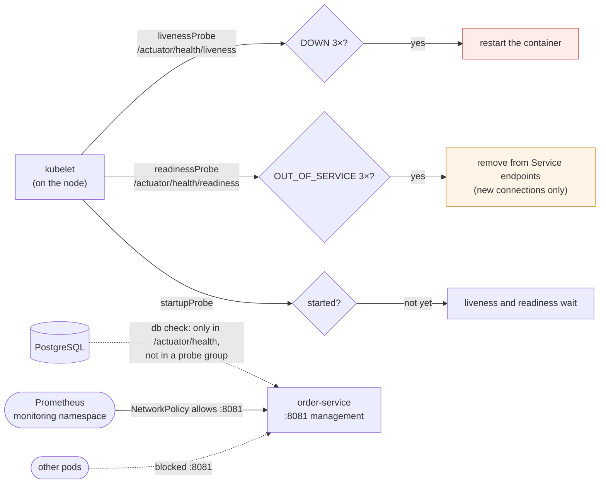

# 52. Health Checks & Actuator Hardening

<div class="badges" markdown><span class="badge badge-l1">L1 · Foundation</span><span class="badge badge-l2">L2 · Practitioner</span><span class="badge badge-l3">L3 · Senior/Lead</span><span class="badge badge-meta">liveness · readiness · startup probes · health groups · graceful shutdown · preStop · management port · NetworkPolicy · heap dumps</span></div>

<div class="grid two" markdown>

!!! info "Prerequisites"
    - [Chapter 42](../resilience/ch42-failure-modes.md): failure modes and cascading failures
    - [Chapter 47](ch47-observability-fundamentals.md): health endpoints are not monitoring
    - [Chapter 39](../security/ch39-secrets-management.md): secrets in memory

!!! abstract "What you'll learn"
    - **A database outage under three probe designs**, on a real Kubernetes 1.37 cluster:
        - Liveness that checks the database **restarted every pod twice** and broke even the requests that don't need it.
        - Readiness that checks it took **every pod out of the Service** and refused new connections for the whole outage.
        - Spring Boot's default groups kept all pods serving, and recovered **the moment the database did**.
    - **Slow starts**: a 40-second start under a liveness probe with a 10-second delay **never became ready** (4–5 restarts, CrashLoopBackOff). A startup probe got it ready in 43–44 seconds with none.
    - **Rolling restarts**: stopping at once failed **92–96** requests and graceful shutdown alone **79–96**. Refusing readiness and serving 5 more seconds failed 0–2, and a 5-second `preStop` sleep **0**.
    - **Actuator**: a heap dump contained the database password, and a NetworkPolicy closed the management port to everything but monitoring without breaking probes.

</div>

---

## 1 · Introduction & Context

### The database blip that became an outage

FoodFleet's PostgreSQL primary failed over on a Tuesday evening. Failover took 50 seconds, well inside what the services were designed to survive: orders would fail for a minute, the menu was served from memory, and the apps would reconnect.

What happened instead: every order-service pod restarted, twice, and the menu went down with the orders. Each restart took 15 seconds of Spring Boot startup, so pods came back, found the database still down, and were restarted again. When the database returned, order-service was mid-restart and took another quarter of a minute to answer. The liveness probe pointed at `/actuator/health`, which includes the database. Kubernetes did what it was told: the application said it was unhealthy, so Kubernetes restarted it.

Two weeks later, a security review found `/actuator/heapdump` reachable from inside the cluster, and the heap dump had the database password in it.

This chapter measures what each probe design does when a dependency fails, when startup is slow and when pods are replaced, on a real Kubernetes 1.37 cluster (k3s) with PostgreSQL outside it like a managed database. It then locks down Actuator and tests the lock.

### Where it comes from

<ul class="mh-timeline">
<li><span class="when">2015–2016 · Kubernetes probes</span><span class="what">Liveness and readiness probes from Kubernetes 1.0: restart a container that's stuck, stop sending traffic to one that isn't ready.</span></li>
<li><span class="when">2018 · Spring Boot 2 Actuator</span><span class="what">Endpoints move under <code>/actuator</code>, and only <code>health</code> and <code>info</code> are exposed over HTTP by default. Exposed heap dumps and environment endpoints had been a common source of leaked secrets.</span></li>
<li><span class="when">2020 · Startup probes, Boot availability</span><span class="what">Kubernetes 1.18 adds startup probes for slow starters. Spring Boot 2.3 adds liveness and readiness states, probe health groups, and graceful shutdown.</span></li>
<li><span class="when">2023–2024 · preStop sleep, graceful by default</span><span class="what">Kubernetes adds a <code>sleep</code> action for <code>preStop</code>, so images without a shell can drain. Spring Boot 3.4 makes graceful shutdown the default and introduces endpoint access levels.</span></li>
<li><span class="when">2025 · Spring Boot 4</span><span class="what">Health moves to its own module. <code>heapdump</code> is inaccessible unless granted, and probes are on by default, not only on Kubernetes.</span></li>
</ul>

---

## 2 · Core Concepts & Terminology



Liveness probe
:   "Is this process broken beyond repair?" After `failureThreshold` failures in a row, the kubelet kills and restarts the container. A restart fixes a deadlock or a corrupted state. It can't fix someone else's outage, and it costs a full startup.

Readiness probe
:   "Should this pod get new traffic now?" Failing removes the pod from the Service's endpoints, so new connections go elsewhere. It doesn't restart anything, and connections that are already open stay where they are.

Startup probe
:   "Has it finished starting?" Until it succeeds, liveness and readiness probes don't run. It replaces a long `initialDelaySeconds`, which delays failure detection after every restart too.

Spring Boot availability states and health groups
:   `LivenessState` (CORRECT or BROKEN) and `ReadinessState` (ACCEPTING_TRAFFIC or REFUSING_TRAFFIC) are the application's own view. They are served as `/actuator/health/liveness` and `/readiness`, which include only those states by default. `/actuator/health` aggregates every contributor (database, disk, broker) as the worst status, and that is what monitoring should read.

Graceful shutdown and drain
:   On SIGTERM: report REFUSING_TRAFFIC, keep serving while Kubernetes updates endpoints, then stop accepting connections and finish in-flight requests. Spring Boot does the first and last steps; the middle one is a `preStop` sleep or a delay.

---

## 3 · How It Works Internally

### Health groups: the worst member decides

The lab's order-service implements Spring Boot's health model: statuses ranked `DOWN, OUT_OF_SERVICE, UP, UNKNOWN`, where DOWN and OUT_OF_SERVICE answer 503. Each group runs its checks in parallel, with a timeout, so a hanging database can't make a probe slower than the probe's own timeout.

```java title="health/HealthGroup.java"
--8<-- "code/chapters/ch52-health-checks-actuator/src/main/java/dev/foodfleet/ch52/health/HealthGroup.java:41:64"
```

```java title="availability/Availability.java"
--8<-- "code/chapters/ch52-health-checks-actuator/src/main/java/dev/foodfleet/ch52/availability/Availability.java:39:47"
```

Which checks go into which group is the whole design decision. In the lab it's an environment variable; in Spring Boot it's `management.endpoint.health.group.<name>.include`:

```java title="verify/tools/OrderService.java"
--8<-- "code/chapters/ch52-health-checks-actuator/verify/tools/OrderService.java:50:63"
```

### Shutdown in three steps

```java title="shutdown/GracefulShutdown.java"
--8<-- "code/chapters/ch52-health-checks-actuator/src/main/java/dev/foodfleet/ch52/shutdown/GracefulShutdown.java:56:67"
```

The drain exists because removing a pod from a Service is asynchronous. The kubelet sends SIGTERM at the same time as the endpoint controller removes the pod. kube-proxy on every node, and any external load balancer, catch up some time later. Until they do, new connections still arrive.

### Spring Boot 4 and Kubernetes configuration

```yaml title="application.yml"
--8<-- "code/chapters/ch52-health-checks-actuator/src/main/resources/application.yml"
```

```yaml title="k8s/deployment.yaml"
--8<-- "code/chapters/ch52-health-checks-actuator/src/main/resources/k8s/deployment.yaml"
```

```yaml title="k8s/networkpolicy.yaml"
--8<-- "code/chapters/ch52-health-checks-actuator/src/main/resources/k8s/networkpolicy.yaml"
```

---

## 4 · Design Considerations & Trade-offs

### Test setup

All runs used:

- k3s v1.37.1+k3s1: real kubelet probes, EndpointSlices, kube-proxy (iptables) and NetworkPolicy (kube-router), on one 2-vCPU node.
- order-service as `OrderService` on a jlink'd Java 25 runtime in a container.
- PostgreSQL 16 outside the cluster, like a managed database.
- A load generator on the node, sending to the Service's NodePort.

Spring Boot itself couldn't be built here (Maven Central isn't reachable), so the lab service implements Boot's health model. Boot's statuses, groups and defaults are checked in its source instead.

There were two runs. Where they differed, both values are shown. `check_apis.sh` checks **20 defaults and behaviours**, and all were found.

Traffic comes in four streams, because Kubernetes treats them differently:

- `GET /menu` (served from memory) and `POST /orders` (needs the database).
- Each over pooled keep-alive connections, like another service's HTTP client.
- Each over a new connection per request, like a fresh client or a load balancer.

Readiness only affects which pod a **new** connection goes to.

### Measured: the database goes away for 60 seconds

Three replicas, with probes every 5 seconds, a 1-second timeout and 3 failures, and 15 seconds of startup behind a startup probe. Each stream sends 20 requests a second, and PostgreSQL is stopped at 30 s and started at 90 s. Each cell is the share of requests that succeeded in that phase.

| Probe design | Stream | Database down (60 s) | After (120 s) |
|---|---|---|---|
| **Liveness = `/actuator/health`** (includes the database) | /menu keep-alive | **43.8–47.1%** (646–687 refused) | 100% |
| | /menu new connection | **38.6–41.5%** (714–750 refused) | **83.2–85.3%** (347–396 refused) |
| | /orders, both | 0.2% (refused and 503) | 81.8–100% |
| | pods | **6 restarts**, 0 of 3 ready at the lowest | /orders back after **14–95 s** |
| **Readiness includes the database** | /menu keep-alive | 100% | 100% |
| | /menu new connection | **22.8–24.1%** (925–933 refused) | **89.5–91.2%** (208–248 refused) |
| | /orders, both | 0–0.2% (503 and refused) | 90.1–100% |
| | pods | 0 restarts, **0 of 3 ready** | /orders back after **1–41 s** |
| **Neither probe** (Boot's default groups) | /menu, both | **100%** | 100% |
| | /orders, both | 0.3% (fast 503) | 100% |
| | pods | 0 restarts, 3 of 3 ready | /orders back **immediately** |

In every configuration, 3–4 of about 600 /orders requests also failed with 503 in the 30 seconds before the outage. That happened the same way in all three, so it isn't a probe effect: it is the lab's database check (800 ms timeout) on new connections.

What the table shows:

- **Liveness on a shared dependency turns its outage into yours.** The database outage made every pod's liveness fail, so Kubernetes restarted all three, twice, during the 60 seconds. While pods restarted, even `/menu`, which never touches the database, failed half the time. After the database returned, pods still restarting, and in back-off between restarts, kept /orders down for 14 to 95 more seconds. Restarting can't fix a database.
- **Readiness on a shared dependency empties the Service.** All three pods went not-ready together, so new connections were refused. Clients on existing keep-alive connections kept getting answers: readiness doesn't touch open connections. After the database came back, new connections were still refused for another 10–12 seconds (208–248 requests) while readiness probes passed and endpoints were restored.
- **Keeping the database out of both probes was best by every measure.** Pods stayed ready and `/menu` never failed. Orders failed fast with a clear 503 instead of a refused connection, and recovered as soon as the database did. That is Spring Boot's default: the probe groups contain only the availability states, and `/actuator/health` (with the database) is for monitoring and alerts.
- **Readiness on a dependency belongs to dependencies that are per-pod**, such as a local cache warming up or a sidecar. It doesn't belong to dependencies every replica shares.

### Measured: a service that takes 40 seconds to start

One replica that takes 40 seconds to open its ports, with liveness every 5 seconds and 3 failures, watched for 180 seconds.

| Probes | Ready after | Restarts in 180 s |
|---|---|---|
| Liveness with `initialDelaySeconds: 10`, no startup probe | **never** | **4–5** (then CrashLoopBackOff) |
| Liveness with `initialDelaySeconds: 60`, no startup probe | 43–44 s | 0 |
| Startup probe (every 2 s, up to 60 times), liveness without delay | 43–44 s | 0 |

What the table shows:

- **A liveness probe shorter than startup kills the service before it starts.** The kubelet restarted it at about 25 seconds, every time, and backed off further each time. It would never have started. This is the classic failure after a release adds a slow migration or cache warm-up.
- **A long initial delay works, at a price.** The delay applies after every restart too, so a deadlocked pod goes undetected for a minute each time.
- **A startup probe gives startup its own budget.** Liveness only began once the pod had started, so it stayed strict afterwards.

### Measured: a rolling restart under load

Three replicas, rolling restart (`maxSurge: 1`, `maxUnavailable: 0`), 50 requests a second on each of the four streams.

| Shutdown | Failed requests | Of which |
|---|---|---|
| Stop at once on SIGTERM | **92–96** of about 8,400 | new connections: refused and timeouts; keep-alive: 9–10 reset mid-request |
| Graceful (finish in-flight) only | **79–96** of about 8,300 | new connections: 67–73 refused, the rest timeouts; keep-alive: 0–1 |
| Graceful + readiness REFUSING + keep serving 5 s | **0–2** of about 8,300 | 2 timeouts on new connections in one run |
| Graceful + `preStop: sleep: 5` | **0** of about 8,350 | — |

What the table shows:

- **Graceful shutdown protects in-flight requests, not new ones.** Finishing in-flight work stopped the resets on keep-alive connections (9–10 → 0). New connections kept arriving after the pod stopped listening, because kube-proxy hadn't yet removed it, and were refused.
- **The drain closed that gap.** Serving for 5 more seconds after SIGTERM, while readiness reports OUT_OF_SERVICE, gave endpoints time to update. A `preStop` sleep did the same with no application code, and it needs no shell in the image.
- **Spring Boot does both ends; you add the middle.** Since Boot 3.4 `server.shutdown` defaults to graceful, and on SIGTERM readiness goes REFUSING_TRAFFIC. The drain is a `preStop` sleep. The sum of the sleep and Spring's shutdown phase timeout must stay under `terminationGracePeriodSeconds` (30 s by default).

### Measured: Actuator exposure

A heap dump of order-service was taken with the HotSpot call `/actuator/heapdump` uses. The service had its database password in its environment, as a datasource does.

| What | Result |
|---|---|
| Heap dump | 4.6 MB, taken in 342–388 ms; **the password appears 2 times in it** |
| Management port reachable from `default` namespace, no policy | yes (200) |
| …from `monitoring`, no policy | yes (200) |
| …from `default`, NetworkPolicy allowing 8081 only from `monitoring` | **no** (connection refused) |
| …from `monitoring`, same policy | yes (200) |
| Application port 8080, with the policy | 200 from both |
| Pod readiness 30 s after the policy | 1 of 1 ready, 0 restarts (kubelet probes come from the node) |

What the table shows:

- **A heap dump is every secret the process holds.** That includes passwords, tokens, session data and customer records in flight. Spring Boot 4 makes `heapdump` inaccessible unless access is granted. Keep it that way, and take dumps with `jcmd` under change control when you need one.
- **A separate management port makes the boundary enforceable.** On 8081, Actuator isn't in the Service or the Ingress. A NetworkPolicy then admits only Prometheus, and probes keep working because the kubelet isn't a pod.

### Choosing

| Question | Do | Why |
|---|---|---|
| What does liveness check? | Only the application's own state (`livenessState`) | Restarts fixed nothing and added 14–95 s |
| What does readiness check? | Readiness state; per-pod dependencies at most | A shared dependency emptied the Service |
| Where do shared dependencies show? | `/actuator/health`, monitoring and alerts | Status without restarts |
| Slow startup | `startupProbe` with a generous budget | No restart loop, strict liveness afterwards |
| Shutdown | Graceful + `preStop: sleep` 5–10 s, inside `terminationGracePeriodSeconds` | 0 failures on rolling restarts |
| Probe timeouts | Checks with their own timeout below the probe's | A hanging check must fail fast |
| Actuator | Own port, `access.default: none`, expose only health, info, prometheus | Least exposure by default |
| Health details | `show-details: when-authorized` | Versions and hosts are reconnaissance |
| Heap dumps | Off over HTTP; `jcmd` when needed | Secrets in memory |

---

## 5 · Hands-on Implementation

```text
ch52-health-checks-actuator/
├── src/main/java/dev/foodfleet/ch52/
│   ├── health/        Status, HealthCheck, HealthGroup, CachedCheck
│   ├── availability/  Availability
│   ├── shutdown/      GracefulShutdown
│   └── pg/            PgPing
├── src/main/resources/   application.yml, k8s/deployment.yaml, k8s/networkpolicy.yaml
├── src/test/java/…       12 tests
└── verify/               k3s-lab.sh, build-libs.sh, run.sh, check_apis.sh, tools/ (OrderService, Measure, Fetch)
```

### 🟢 Level 1: probes that can't hurt

<div class="badges" markdown><span class="badge badge-l1">L1 · Foundation</span></div>

- Point liveness at `/actuator/health/liveness` and readiness at `/actuator/health/readiness`. Never point either at `/actuator/health`.
- Add a `startupProbe` instead of long initial delays.
- Expose only `health`, `info` and `prometheus`.

### 🔵 Level 2: zero-downtime deploys

<div class="badges" markdown><span class="badge badge-l2">L2 · Practitioner</span></div>

- Use graceful shutdown (the default) and a `preStop` sleep of 5–10 seconds.
- Keep `terminationGracePeriodSeconds` above the sleep plus `spring.lifecycle.timeout-per-shutdown-phase`.
- Use `maxUnavailable: 0` and `maxSurge: 1` for small replica counts.

```bash
verify/k3s-lab.sh                       # a single-node cluster, if you don't have one
verify/run.sh startup shutdown          # about 15 minutes
```

### 🟣 Level 3: Actuator as an internal API

<div class="badges" markdown><span class="badge badge-l3">L3 · Senior/Lead</span></div>

- Use `management.server.port: 8081`, kept out of the Service and the Ingress, with a NetworkPolicy that admits only the monitoring namespace.
- Set `management.endpoints.access.default: none` and grant access per endpoint, with `show-details: when-authorized` for an `ACTUATOR_ADMIN` role.
- Alert on `/actuator/health` components (chapter 51), not on probe restarts.

### Run and verify

```text
$ verify/run.sh startup
1 replica that takes 40 s to start; liveness every 5 s, 3 failures; watched for 180 s
-- liveness initialDelaySeconds 10, no startup probe       ready after: never    restarts in 180 s: 5 (now CrashLoopBackOff)
-- liveness initialDelaySeconds 60, no startup probe       ready after: 43 s     restarts in 180 s: 0
-- startup probe (2 s x 60), liveness without delay        ready after: 44 s     restarts in 180 s: 0
```

!!! question "Try it"
    1. Add the database to readiness for only one of three pods (an environment variable per pod). What happens to traffic during the outage?
    2. Shorten the `preStop` sleep to 1 second. Do failures come back?
    3. Make the database check hang instead of fail (block the port with a firewall rule). Does the 900 ms group timeout keep probes under their 1-second timeout?
    4. Remove the NetworkPolicy's namespace selector. Who can reach `/actuator/health` now?

---

## 6 · Production Readiness

- [x] **Liveness** on `/actuator/health/liveness` (application state only)
- [x] **Readiness** on `/actuator/health/readiness`, with no shared dependencies
- [x] **Startup probe** with a budget above the slowest startup seen
- [x] **Graceful shutdown + `preStop` sleep**, inside `terminationGracePeriodSeconds`
- [x] **Management port** separate, not in the Service or Ingress, NetworkPolicy to monitoring only
- [x] **Endpoints**: `access.default: none`; health, info and prometheus only; `heapdump` and `env` values off
- [x] **Health details** only when authorized; full `/actuator/health` scraped and alerted on
- [x] **Probe timeouts** above the health checks' own timeouts

---

## 7 · Anti-patterns & Pitfalls

!!! pitfall "Incident 1: the failover that restarted everything"
    **Context.** order-service's liveness probe pointed at `/actuator/health`, which includes the database.

    **Symptoms.** A 50-second database failover became a two-minute outage of the whole service, including endpoints that don't use the database.

    **Root cause.** Liveness failed with the database, so Kubernetes restarted every pod, repeatedly. Measured: 6 restarts in a 60-second outage, `/menu` at 39–47% while pods restarted, and orders back 14–95 seconds after the database.

    **Fix.** Liveness on the liveness group only. With that, `/menu` stayed at 100% and orders recovered immediately.

!!! pitfall "Incident 2: the release that never started"
    **Context.** A release added a cache warm-up; startup went from 12 to 40 seconds. The liveness probe had a 10-second initial delay.

    **Symptoms.** New pods restarted every 25 seconds, then went into CrashLoopBackOff. The rollout stalled, and the old pods kept serving.

    **Root cause.** Liveness started failing before the application listened. Measured: never ready, 4–5 restarts in 3 minutes.

    **Fix.** A startup probe. Measured: ready in 43–44 seconds, no restarts.

!!! pitfall "Incident 3: errors on every deploy"
    **Context.** Graceful shutdown was enabled, so the team expected clean deploys.

    **Symptoms.** A handful of connection-refused errors in every deploy, from clients opening new connections.

    **Root cause.** Pods stopped listening before every node's kube-proxy had removed them. Measured: 79–96 failed requests per rolling restart with graceful shutdown alone.

    **Fix.** `preStop: sleep: 5`. Measured: 0 failures.

| Anti-pattern | Symptom | Fix |
|---|---|---|
| Liveness on `/actuator/health` | Restart storms on dependency outages | Liveness group only |
| Shared dependencies in readiness | Service with no endpoints | Readiness state only; alert on health |
| Long `initialDelaySeconds` | Slow detection after every restart | Startup probe |
| No drain before shutdown | Refused connections on every deploy | `preStop` sleep |
| Grace period shorter than drain + shutdown | SIGKILL mid-request | Grace period > sleep + shutdown timeout |
| Health checks without timeouts | Probe timeouts, false restarts | Per-check timeout below the probe's |
| Actuator on the application port | Endpoints reachable via Ingress | Separate management port |
| `exposure.include: "*"` | heapdump, env, threaddump exposed | List endpoints explicitly |
| `show-details: always` | Versions and hosts to anyone | When authorized |

---

## 8 · Enterprise Case Study

### FoodFleet: probes that can't take a service down

!!! decision "ADR-052: liveness and readiness on Spring Boot's probe groups only; startup probes; graceful shutdown with a preStop drain; Actuator on a separate port behind a NetworkPolicy, with access denied by default"
    **Status:** Accepted · **Date:** 2025-10-20

    **Context.** A database failover restarted every order-service pod. A release with a slower start never became ready. Deploys produced connection errors. Actuator, with heap dumps, was reachable in-cluster. Measured on the lab cluster:

    - Liveness on the database: 6 restarts in a 60-second outage, half of `/menu` failing, and orders back 14–95 s late.
    - Readiness on the database: 0 ready pods, new connections refused, and orders back 1–41 s late.
    - Neither: no restarts, `/menu` at 100%, and orders back at once.
    - A 40 s start under a 10 s liveness delay never started.
    - Rolling restarts failed 79–96 requests without a drain, and 0 with a `preStop` sleep.
    - A heap dump held the database password.

    **Decision.** Every Spring Boot service:

    - **Liveness** on `/actuator/health/liveness` (10 s period, 3 failures).
    - **Readiness** on `/actuator/health/readiness` (5 s, 3 failures). Shared dependencies are never in a probe group; they appear in `/actuator/health` and SLO alerts.
    - **Startup probe** with a 2-minute budget.
    - **Shutdown:** graceful, with a 20 s shutdown phase, `preStop: sleep: 5` and a 30 s grace period.
    - **Actuator** on 8081, with `access.default: none` and `health`, `info` and `prometheus` read-only. `show-details` when authorized; no `heapdump`, and no `env` values.
    - **NetworkPolicy** admitting 8081 only from the monitoring namespace.
    - **Platform checks:** a policy check in CI rejects Deployments whose liveness probe points at `/actuator/health`.

    **Consequences:**

    - ✅ Dependency outages degrade the endpoints that need the dependency, nothing else.
    - ✅ Deploys are invisible to clients.
    - ⚠️ A pod that can't reach its database stays "ready" and answers 503 quickly. Dashboards and alerts on `/actuator/health` must make that visible.
    - ⚠️ Heap dumps need `kubectl exec` and `jcmd`, under change control.

### Fintech analogue: payment gateways and their banks

A payment gateway depends on dozens of acquiring banks; any one of them is down on a given day. Gateways keep bank connectivity out of probes entirely. Instead they route around a failing bank with circuit breakers (chapter 43) and report per-bank health on dashboards. Restarting the gateway because a bank is slow would turn one bank's problem into everyone's.

### E-commerce analogue: sale-day deploys

Retailers deploying during peak traffic make the drain longer than usual. They tune the `preStop` sleep to the slowest load balancer's deregistration delay, which is often 15–30 seconds for cloud load balancers, and raise the grace period to match. Many also freeze deploys during the sale itself (chapter 51's error budget policy).

---

## 9 · Interview Q&A + Summary

#### Q1. What's the difference between liveness and readiness? · <span class="badge badge-l1">L1</span> · TCS · Infosys

**Short answer:** Liveness failing restarts the container: use it for a stuck or broken process. Readiness failing removes the pod from Service endpoints for new connections, with no restart: use it for "not able to take traffic right now", such as during startup or shutdown.

#### Q2. Should the liveness probe check the database? · <span class="badge badge-l2">L2</span> · Swiggy · Flipkart

**Short answer:** No. A restart can't fix the database, and every replica fails together. Measured: during a 60-second outage, every pod restarted twice, `/menu` (no database) failed more than half the time, and orders came back 14–95 seconds after the database. Keep shared dependencies in `/actuator/health` for monitoring.

#### Q3. And readiness? · <span class="badge badge-l2">L2</span><span class="badge badge-l3">L3</span> · PhonePe · Razorpay

**Short answer:** Not for dependencies every replica shares: they all go not-ready together and the Service has no endpoints. Measured: new connections refused for the whole outage and 10–12 seconds after it. Answer 503 fast from the endpoints that need the dependency instead. Readiness on a dependency makes sense only when it is per-pod.

#### Q4. What is a startup probe for? · <span class="badge badge-l1">L1</span><span class="badge badge-l2">L2</span> · Accenture · Wipro

**Short answer:** Giving a slow start its own budget. Liveness and readiness don't run until it succeeds. Measured: a 40-second start under a 10-second liveness delay never started (4–5 restarts, CrashLoopBackOff); with a startup probe it was ready in 43–44 seconds.

#### Q5. Why do deploys fail requests even with graceful shutdown? · <span class="badge badge-l3">L3</span> · Uber · Zomato

**Short answer:** Endpoint removal is asynchronous. SIGTERM arrives while kube-proxies and load balancers still route new connections to the pod. Graceful shutdown finishes in-flight work but refuses new connections. Measured: 79–96 failures per rolling restart with graceful shutdown alone, 0 with a 5-second `preStop` sleep.

#### Q6. How does Spring Boot support Kubernetes probes? · <span class="badge badge-l2">L2</span> · Spring-heavy shops

**Short answer:** `ApplicationAvailability` tracks liveness (CORRECT/BROKEN) and readiness (ACCEPTING/REFUSING) states. They are served as `/actuator/health/liveness` and `/readiness` groups, on by default in Boot 4. Readiness goes REFUSING on shutdown, and `server.shutdown` is graceful by default since 3.4.

#### Q7. How do you secure Actuator? · <span class="badge badge-l2">L2</span><span class="badge badge-l3">L3</span> · banks · Goldman Sachs

**Short answer:**

- Run it on a separate management port that isn't in the Service or Ingress, with a NetworkPolicy to monitoring only.
- Set `access.default: none` and expose `health`, `info` and `prometheus` only.
- Use `show-details: when-authorized`, and keep `env` values hidden.
- Never expose `heapdump` (measured: it contained the database password).

#### Q8. What's the HTTP contract of a health endpoint? · <span class="badge badge-l1">L1</span> · Infosys · Cognizant

**Short answer:** UP and UNKNOWN answer 200; DOWN and OUT_OF_SERVICE answer 503. Kubernetes HTTP probes succeed on 200–399. The body has the aggregated status and, when authorized, each component's.

#### Q9. What timeouts do health checks need? · <span class="badge badge-l3">L3</span> · Amazon · Walmart

**Short answer:** Each check needs its own timeout below the probe's (1 second by default), running in parallel, with a timeout counted as DOWN. Otherwise one slow dependency makes the endpoint slow, the probe times out, and that counts as a failure. Cache expensive checks for a few seconds when many callers poll.

#### Q10. How should `terminationGracePeriodSeconds` be set? · <span class="badge badge-l3">L3</span> · Atlassian

**Short answer:** Above the `preStop` sleep plus Spring's `timeout-per-shutdown-phase` plus some margin, for example 5 + 20 + 5 = 30 seconds, the default. Otherwise SIGKILL arrives mid-request.

#### Q11. Who should alert on health? · <span class="badge badge-l3">L3</span> · Swiggy-style rounds

**Short answer:** Monitoring should: Prometheus scrapes `/actuator/health` components and SLO alerts (chapter 51) page on user impact. Probes are for Kubernetes' automation, not for people. A pod that's ready but has no database shows in health and in the SLO, not as restarts.

#### Q12. Design health checking for FoodFleet. · <span class="badge badge-l4">L4</span> · system design rounds

**Short answer:**

- **Probes:** liveness and readiness on Boot's groups (application state only), a startup probe, and graceful shutdown with a `preStop` drain inside the grace period.
- **Dependencies:** in `/actuator/health` and circuit breakers, never in probes; endpoints fail fast with 503 when theirs is down.
- **Actuator:** on its own port, behind a NetworkPolicy, with access denied by default; no heap dumps over HTTP.
- **Enforcement:** CI policy checks on manifests.
- **Alerting:** SLO burn rates for paging.

### Key takeaways

- **Liveness checks the process, never its dependencies.**
- **Readiness controls new connections, not open ones**; shared dependencies empty the Service.
- **Startup probes** give slow starts a budget without weakening liveness.
- **Drain before stopping**: graceful shutdown alone still refuses new connections.
- **Actuator is an internal API**: own port, network policy, least exposure, no heap dumps.

### Further reading

- Kubernetes, [Configure liveness, readiness and startup probes](https://kubernetes.io/docs/tasks/configure-pod-container/configure-liveness-readiness-startup-probes/) and [Pod lifecycle: termination](https://kubernetes.io/docs/concepts/workloads/pods/pod-lifecycle/#pod-termination)
- Spring Boot reference, [Kubernetes probes](https://docs.spring.io/spring-boot/reference/actuator/endpoints.html#actuator.endpoints.kubernetes-probes) and [Graceful shutdown](https://docs.spring.io/spring-boot/reference/web/graceful-shutdown.html)
- Spring Boot reference, [Securing HTTP endpoints](https://docs.spring.io/spring-boot/reference/actuator/endpoints.html#actuator.endpoints.security)
- Kubernetes, [Network policies](https://kubernetes.io/docs/concepts/services-networking/network-policies/)
- Colin Breck, [Kubernetes liveness and readiness probes: how to avoid shooting yourself in the foot](https://blog.colinbreck.com/kubernetes-liveness-and-readiness-probes-how-to-avoid-shooting-yourself-in-the-foot/)

---

**Previous:** [← 51. SLIs, SLOs, Error Budgets & Alerting](ch51-slo-alerting.md) · **Next:** [53. Containerization →](../deployment/ch53-containerization.md)
