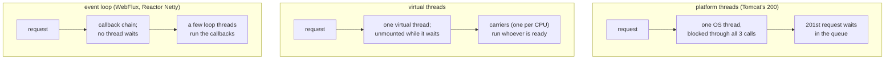

# 66. Latency, Tail Latency, Virtual Threads vs Reactive

<div class="badges" markdown><span class="badge badge-l3">L3 · Senior/Lead</span><span class="badge badge-l4">L4 · Architect</span><span class="badge badge-meta">latency budgets · percentiles · tail at scale · fan-out · hedged requests · Little's law · platform threads · virtual threads · pinning · JEP 491 · event loops · WebFlux · bulkheads · load shedding</span></div>

<div class="grid two" markdown>

!!! info "Prerequisites"
    - [Chapter 8](../foundations/ch08-spring-boot-4-essentials.md): virtual threads in Spring Boot, and FoodFleet's MVC-first rule
    - [Chapter 44](../resilience/ch44-timeouts-retries-backpressure.md): deadline budgets, hedging with a budget, admission control
    - [Chapter 65](../testing/ch65-performance-chaos-arch-tests.md): open load models, and why latency is timed from when a request was due

!!! abstract "What you'll learn"
    - **Below capacity, the concurrency model doesn't change latency.** A quote made of three sequential 50 ms calls took a p50 of **153–155 ms** at 250 requests a second in every model.
    - **It changes where capacity ends and what happens after.** On 2 CPUs:
        - **200 platform threads** served at most **1,060–1,100/s**. At 1,500/s the p50 was **3.7–4.4 s**.
        - **Virtual threads** and a **two-thread event loop** served all 1,500/s with **25 OS threads**, p99 279–411 ms.
        - At 2,500/s, past what the CPUs could do, both collapsed: **86–93% of requests failed**, and the event loop **ran out of memory** in both runs.
        - **Virtual threads with a limit of 300** in progress served **1,510–1,588/s** at 2,500/s, with p99 **261–303 ms**, and rejected the rest at once.
    - **Fan-out makes the tail the common case.** With 1 call in 100 slow, a request needing 50 calls was slow **39–41%** of the time. Hedging after 20 ms cut its p99 from **208–210 ms** to **53–86 ms** for 8–10% more calls. On a saturated backend, the same hedge doubled the calls and made p99 worse (**362–407 ms**).
    - **JDK 21 pins virtual threads in `synchronized`.** 1,000 tasks blocking 50 ms inside their own monitors took **25.2 s** on JDK 21 and **0.10–0.11 s** on JDK 25.

</div>

---

## 1 · Introduction & Context

### The upgrade that moved the queue

order-service's quote endpoint asks three services for a price, a discount and an ETA, one after the other. It ran on Tomcat's 200 threads. During dinner peaks, the quote's p99 rose from 200 ms to several seconds while CPU stayed below half. The threads were all waiting for downstream answers, and new requests queued behind them.

The team switched on `spring.threads.virtual.enabled` (ADR-008). The waiting stopped costing threads, and the next dinner peak went through. Two weeks later, a promotion doubled traffic. The service no longer had a 200-thread limit, so it took everything: requests piled up in memory as virtual threads, the heap filled, and the pod restarted in a loop. Meanwhile, one team's service on JDK 21 got slower after the same switch, not faster.

This chapter measures what decides latency and capacity in a service like this:

- **The concurrency model**: platform threads, virtual threads, or an event loop.
- **The tail**: why a request that fans out to many calls is slow far more often than any one call.
- **The JVM details** that undo virtual threads: pinning on JDK 21.

### Where it comes from

<ul class="mh-timeline">
<li><span class="when">1961 · Little's law</span><span class="what">In-flight work = arrival rate × time in the system. It sizes every pool, limit and queue in this chapter.</span></li>
<li><span class="when">1999–2004 · C10K and event loops</span><span class="what">Kegel's C10K problem; epoll (2002) and NIO make one thread serve many connections. Netty follows in 2004.</span></li>
<li><span class="when">2013 · The Tail at Scale</span><span class="what">Dean and Barroso: at fan-out, rare slow calls dominate, and hedged and tied requests cut the tail.</span></li>
<li><span class="when">2014–2017 · Reactive Streams and WebFlux</span><span class="what">Reactive Streams 1.0 (2015), Java 9's <code>Flow</code>, Spring WebFlux on Reactor Netty (2017).</span></li>
<li><span class="when">2023–2025 · Virtual threads</span><span class="what">JEP 444 in JDK 21 (pinned in <code>synchronized</code>); Spring Boot 3.2 adds one property; JEP 491 in JDK 24 lets monitors unmount. JDK 21.0.10, JDK 25.0.4, Spring Boot 4.1.1, Reactor Netty 1.3.7 and Reactor Core 3.8.7 are checked here.</span></li>
</ul>

---

## 2 · Core Concepts & Terminology



Latency budget
:   An endpoint's latency objective divided among the things it waits for. The quote's objective is a p99 under 500 ms; three sequential calls of about 50 ms spend 150 ms of it before any queueing, GC or network.

Percentiles and the tail
:   p50 is the typical request, p99 the slowest 1 in 100, p99.9 the slowest 1 in 1,000. The **tail** is everything above the p99. Users who make many requests meet it often.

Fan-out and tail amplification
:   A request that waits for *n* parallel calls is as slow as the slowest. If each call is slow with probability *p*, the request is slow with probability 1 − (1 − *p*)ⁿ: 1% per call becomes 18% at 20 calls and 39% at 50.

Hedged request
:   A second copy of a call that hasn't answered within a delay; the first answer wins. It cuts the tail when the slowness is random and capacity is spare. A **hedging budget** caps copies at a share of calls.

Platform thread, virtual thread, carrier
:   A platform thread is an OS thread, about 1 MB of reserved stack, and a JVM can run thousands. A virtual thread is a JVM object whose stack lives on the heap; when it blocks on I/O or `sleep`, it **unmounts** from its **carrier** (one of a few platform threads, one per CPU by default), and the carrier runs another.

Pinning
:   A virtual thread that can't unmount while blocked, so it holds its carrier. On JDK 21, blocking inside `synchronized` pins; JDK 24 and later (JEP 491) unmount there too. Native frames still pin.

Event loop
:   A few threads that never block: each I/O completion runs a callback, and the request's state lives in the callback chain (`CompletableFuture`, `Mono`, `Flux`). Reactor Netty starts max(CPUs, 4) of them.

Bulkhead (concurrency limit)
:   A cap on requests in progress, with immediate rejection beyond it (chapter 18). Little's law sizes it: limit ≈ target throughput × latency.

---

## 3 · How It Works Internally

### One endpoint, four models

`QuoteServer` serves `/quote` from the JDK's HTTP server. It calls menu, pricing and delivery one after the other through the JDK's `HttpClient`. The blocking models share one handler; only the executor differs:

```java title="quote/QuoteServer.java: platform, virtual and virtual-limited"
--8<-- "code/chapters/ch66-latency-virtual-threads-reactive/src/main/java/dev/foodfleet/ch66/quote/QuoteServer.java:46:72"
```

- **platform**: a fixed pool of 200 threads, Tomcat's default maximum (`server.tomcat.threads.max`). Requests beyond 200 wait in the pool's queue.
- **virtual**: a new virtual thread per request, what `spring.threads.virtual.enabled=true` gives Tomcat (a `VirtualThreadExecutor`). No thread limit at all.
- **virtual-limited**: the same, with a semaphore of 300 taken by `tryAcquire`: a request that doesn't get a permit gets a 503 straight away.

The non-blocking model chains the three calls with `thenCompose`. The handler returns at once, and the last callback completes the exchange. Both the server and the client run on the same two threads, as Reactor Netty shares its event loops between server and client:

```java title="quote/QuoteServer.java: async"
--8<-- "code/chapters/ch66-latency-virtual-threads-reactive/src/main/java/dev/foodfleet/ch66/quote/QuoteServer.java:78:90"
```

WebFlux code reads differently (`webClient.get()…retrieve().bodyToMono(…).flatMap(…)`), but it runs the same way: no thread waits for a response.

### Fan-out and hedging

`FanOut` sends *n* calls at once and waits for all. With hedging, a timer fires after the delay; if the call hasn't answered, and hedges are still under the budget, a copy goes out, and whichever answers first completes the call:

```java title="tail/FanOut.java"
--8<-- "code/chapters/ch66-latency-virtual-threads-reactive/src/main/java/dev/foodfleet/ch66/tail/FanOut.java:49:66"
```

The losing copy isn't cancelled here; its answer is ignored. That's the cost of a hedge: the backend does the work twice.

### Pinning

Each of 1,000 virtual threads takes its own lock, so there's no contention, and sleeps 50 ms while holding it. Without pinning, all 1,000 sleep at once and the whole run takes about 50 ms:

```java title="pinning/Pinning.java"
--8<-- "code/chapters/ch66-latency-virtual-threads-reactive/src/main/java/dev/foodfleet/ch66/pinning/Pinning.java:26:47"
```

On JDK 21 a virtual thread blocked inside `synchronized` keeps its carrier, so with 2 carriers only 2 sleep at a time. JDK 25 records `BLOCKED` virtual threads as unmounted; what still pins is a native frame on the stack (blocking in Java code called back from JNI, say) and the JVM's own critical sections. JDK 25 no longer reads the `jdk.tracePinnedThreads` property JDK 21 had; the JFR event `jdk.VirtualThreadPinned` reports pinning in both.

---

## 4 · Design Considerations & Trade-offs

### Test setup

All runs used JDK 25.0.4 (and JDK 21.0.10 for pinning) on one 2-vCPU VM. For the concurrency models:

- The backend (50 ms per call, on virtual threads) and the quote server each ran in their own JVM; the server had `-Xmx512m`.
- The load generator, an open model as in chapter 65, sent requests at a fixed rate for 20 s per rate, timed each from when it was due, and gave up after 10 s.
- Latencies are of successful requests. 503s are counted as rejected; errors and timeouts as failed.
- Server, backend and load generator shared the 2 CPUs. At 2,500 quotes a second that is 10,000 HTTP exchanges a second, which is more than the machine could process: the top rate tests behaviour past capacity.

There were two runs. Where they differed, both values are shown. `check_apis.sh` checks **12 behaviours** in the sources of JDK 21.0.10 and 25.0.4, Spring Boot 4.1.1, Reactor Netty 1.3.7 and Reactor Core 3.8.7, and all were found. Spring Boot and Reactor weren't run (see section 5).

### Measured: four concurrency models under rising load

| Model | Offered/s | Served/s | p50 | p99 | Rejected | Failed | OS threads | Peak RSS |
|---|---|---|---|---|---|---|---|---|
| 200 platform threads | 250 | 248 | 155 ms | 187–196 ms | 0 | 0 | 225 | 219–222 MB |
| | 1,000 | 992 | 156–160 ms | 188–246 ms | 0 | 0 | 225 | 232–233 MB |
| | 1,500 | **1,060–1,100** | **3,657–4,390 ms** | **7,219–8,260 ms** | 0 | 0 | 225 | 658–659 MB |
| | 2,500 | 405–420 | 6.9–13.1 s | 16.7–19.3 s | 0 | **36,623–37,998** | 225 | 658–660 MB |
| Virtual threads | 250 | 248 | 153–154 ms | 179–191 ms | 0 | 0 | 25 | 187–194 MB |
| | 1,000 | 992 | 155–162 ms | 198–249 ms | 0 | 0 | 25 | 205–268 MB |
| | 1,500 | **1,488–1,489** | 174–181 ms | 354–411 ms | 0 | 0 | 25 | 330–332 MB |
| | 2,500 | 190–577 | 1,035–1,137 ms | 4,647–6,514 ms | 0 | **45,446–46,544** | 25–26 | **640 MB** |
| Event loop (2 threads) | 250 | 248 | 153–154 ms | 180–190 ms | 0 | 0 | 25 | 189–192 MB |
| | 1,000 | 992 | 159–160 ms | 237–247 ms | 0 | 0 | 25 | 250–260 MB |
| | 1,500 | **1,487–1,488** | 180–181 ms | 279–404 ms | 0 | 0 | 25 | 319–335 MB |
| | 2,500 | 538–839 | 1,358–2,090 ms | 5,616–6,326 ms | 0 | **43,100–45,526** | 25 | 639 MB, **out of memory** |
| Virtual threads, limit 300 | 250 | 248 | 153–154 ms | 176–178 ms | 0 | 0 | 25 | 186–192 MB |
| | 1,000 | 992 | 156–157 ms | 206–208 ms | 0 | 0 | 25 | 201–203 MB |
| | 1,500 | 1,383–1,397 | 178–182 ms | 280–300 ms | 1,833–2,079 | 0 | 25 | 300–302 MB |
| | 2,500 | **1,510–1,588** | **181–186 ms** | **261–303 ms** | 17,920–19,570 | **0** | 25 | 302–338 MB |

Each rate sent rate × 20 requests: 50,000 at 2,500/s. The event loop's server died with `OutOfMemoryError` at 2,500/s in both runs.

What the table shows:

- **No model made a request faster.** Below capacity every model answered in the 150 ms the three calls take, plus 3–5 ms. Virtual threads and reactive code change how many requests can wait at once, not how long each one waits.
- **The platform pool hit its limit first, from waiting, not work.** By Little's law, 200 threads holding each request for 150 ms can finish at most 1,333 a second; with overhead, 1,060–1,100 were served. CPU wasn't the limit, since the other models served 1,490 a second on the same machine. At 1,500/s the queue in front of the pool grew by about 400 requests a second, and within 20 s the median request waited 4 s. Nothing failed: the queue only got longer.
- **Virtual threads and the event loop went as far as the CPUs did,** with 25 OS threads against the pool's 225. Their tails were alike (p99 279–411 ms at 1,500/s), and so were their memory use and their collapse. At this size, the blocking code was as efficient as the callbacks.
- **With no limit, overload takes everything down.** At 2,500/s both unbounded models accepted every request. Each waiting request held memory (a virtual thread's stack, or a callback chain with its buffers) until the heap filled (640 MB resident against a 512 MB heap), and 86–93% of requests timed out. The event loop's JVM ran out of memory. The platform pool's queue grew too, but its 200 threads limited the work in progress.
- **The limit kept the service working past capacity.** With 300 in progress (1,500/s × 0.18 s ≈ 270, with headroom), the server answered 1,510–1,588 a second at a p99 of 261–303 ms and rejected the rest with an immediate 503. Memory stayed at 300–338 MB. At 1,500/s it also rejected 6–7% during bursts; a slightly larger limit, or chapter 44's adaptive limit, trades that against tail latency.

### Measured: fan-out and the tail

Each backend call takes 5 ms, and 200 ms for 1 in 100. 2,000 requests per row:

| Calls per request | Calls in flight | Hedge | p50 | p90 | p99 | Requests > 100 ms | Extra calls |
|---|---|---|---|---|---|---|---|
| 1 | 4 | no | 6.6 ms | 9.0–9.3 ms | 17.6–200.6 ms | 0.8–1.1% | |
| 1 | 4 | after 20 ms | 6.6 ms | 9.0 ms | 26.2–27.0 ms | 0% | 1.6–2.2% |
| 5 | 20 | no | 6.7–6.9 ms | 10.4–11.3 ms | **203 ms** | 5.0–5.1% | |
| 5 | 20 | after 20 ms | 6.4–6.7 ms | 8.1–9.3 ms | **27 ms** | 0–0.1% | 0.9–1.1% |
| 20 | 80 | no | 7.3–7.6 ms | **202 ms** | 203–205 ms | **17.2–19.1%** | |
| 20 | 80 | after 20 ms | 8.8–9.8 ms | 27.0–27.6 ms | **33.0–36.5 ms** | 0.1–0.2% | 1.5–2.0% |
| 50 | 200 | no | 11.4–12.5 ms | 204 ms | 208–210 ms | **39.1–40.5%** | |
| 50 | 200 | after 20 ms | 18.5–21.4 ms | 33.8–36.1 ms | **52.9–86.1 ms** | 0.4–0.9% | 7.6–10.1% |
| 50 | 1,000 | no | 32.1–33.8 ms | 216–217 ms | 233–239 ms | 40.4–40.9% | |
| 50 | 1,000 | after 20 ms | **157–163 ms** | 232–238 ms | **362–407 ms** | **92.7–94.5%** | **99.9%** |
| 50 | 1,000 | after 20 ms, at most 5% | 44.6–45.5 ms | 231–232 ms | 269–280 ms | 31.1–31.5% | 5.3% |

What the table shows:

- **The tail becomes the median.** Slow requests rose with fan-out as 1 − 0.99ⁿ predicts: 1%, 5%, 18%, 39% for 1, 5, 20 and 50 calls. At 20 calls the p90 was the slow path; at 50 almost half of all requests were. A backend whose p99 looks like a rounding error makes a fan-out endpoint slow.
- **A single call's p99 is unstable when 1% is slow.** At one call, run 1's p99 was 17.6 ms and run 2's 200.6 ms: the 99th percentile sat exactly on the boundary between the fast 99% and the slow 1%. Report p99.9 and max too (chapter 65), or the number moves with luck.
- **Hedging fixed the tail while there was capacity to spare.** After 20 ms (about twice the fast path's p90), a copy usually landed on the fast path: p99 fell from 203–210 ms to 27–86 ms for 1–10% more calls. Extra calls grew with fan-out because the backend got busier and slower, and more calls passed the 20 ms mark.
- **On a saturated backend, the hedge was the overload.** With 1,000 calls in flight, the fast path itself took longer than 20 ms, so nearly every call was hedged: twice the work for a backend that was already behind. The p50 went from 32–34 ms to 157–163 ms, and the p99 from 233–239 ms to 362–407 ms. Chapter 44 saw the same collapse at 85% load.
- **A budget limits the damage but doesn't help.** Capped at 5%, hedging still made things worse than not hedging (p50 45 against 33 ms; p99 269–280 against 233–239 ms). Hedge delays need to follow the measured latency (chapter 44 hedges after the p95), and only idempotent reads should be hedged.

### Measured: pinning on JDK 21 and 25

1,000 virtual threads, each sleeping 50 ms while holding its own lock, on 2 carriers:

| JDK | No lock | `ReentrantLock` | `synchronized` |
|---|---|---|---|
| 21.0.10 | 0.09–0.11 s | 0.12 s | **25.16–25.17 s** (40 tasks/s) |
| 25.0.4 | 0.10–0.12 s | 0.11 s | **0.10–0.11 s** |

What the table shows:

- **On JDK 21, `synchronized` around blocking turns virtual threads into a pool of 2.** Two carriers × 1 task per 50 ms is exactly 40 tasks a second; the 1,000 tasks took 25 s instead of 0.1 s. No lock was contended: the cost is pinning alone. In a real service, the pinned blocking is usually inside a library (a connection pool, a logging appender, an old JDBC driver), and the service seems to have a tiny thread pool nobody configured.
- **`ReentrantLock` doesn't pin**, on either JDK.
- **JDK 25 removed the problem** for monitors (JEP 491). A JDK 21 service that switches on virtual threads needs a pinning check first: a JFR recording with `jdk.VirtualThreadPinned`, or `-Djdk.tracePinnedThreads=full`, under load.

### Choosing

| Question | Do | Why (measured) |
|---|---|---|
| A request/response service with blocking I/O | Spring MVC with virtual threads (ADR-008), on JDK 24 or later | Same latency and capacity as the event loop, plain code, 25 OS threads |
| Streaming, WebSockets, a gateway, reactive drivers already | WebFlux on Reactor Netty | Equal here for request/response; its strengths are backpressure and streams (chapter 26) |
| Enabling virtual threads | Add a concurrency limit per endpoint or dependency, from Little's law | Unbounded: 86–93% failed past capacity, and the event loop ran out of memory. Limited: 1,510–1,588/s at p99 ≤ 303 ms |
| Staying on platform threads | Size the pool by Little's law, bound its queue | 200 threads capped the quote at 1,060–1,100/s with a 4 s queue |
| JDK 21 with virtual threads | Find pinning with JFR; replace `synchronized` around I/O with `ReentrantLock`, or move to JDK 25 | 25 s against 0.1 s |
| A request that fans out | Budget for the tail: fewer calls, or hedged idempotent reads | 50 calls: 39–41% slow; hedged p99 53–86 ms |
| Hedging | Delay from the measured p95; a budget; off when the backend is saturated | Saturated: 99.9% extra calls, p99 362–407 ms |
| A latency objective | Spend it per hop: sequential calls add, parallel calls take the slowest | Three sequential 50 ms calls: a 150 ms floor in every model |

---

## 5 · Hands-on Implementation

```text
ch66-latency-virtual-threads-reactive/
├── src/main/java/dev/foodfleet/ch66/
│   ├── quote/     QuoteServer: platform, virtual, async, virtual-limited
│   ├── backend/   Backend: fast path and a slow share, on virtual threads
│   ├── tail/      FanOut: n parallel calls, hedging, hedging budget
│   └── pinning/   Pinning: synchronized, ReentrantLock or nothing, compiled for Java 21
├── src/test/java/…   UnitTest (6, tag unit)
└── verify/   build-libs.sh, run.sh, check_apis.sh, tools/ (Lab, RunSuites)
```

### 🟣 Level 3: the right model, with limits

<div class="badges" markdown><span class="badge badge-l3">L3 · Senior/Lead</span></div>

- `spring.threads.virtual.enabled=true` on JDK 25. With it, Tomcat's executor has no thread limit; `server.tomcat.max-connections` (8,192) is the only cap left, so add one: `@ConcurrencyLimit` on the endpoint or Resilience4j's `Bulkhead` (chapter 18), sized from Little's law.
- Timeouts on every client (chapter 44); a waiting virtual thread is cheap, a thousand of them waiting for a dead dependency is not.
- Percentile histograms on the endpoint and each client (chapter 48), so the latency budget per hop is visible.
- On JDK 21: a JFR recording under load with `jdk.VirtualThreadPinned` enabled before switching.

### 🔴 Level 4: budgets and tails as design inputs

<div class="badges" markdown><span class="badge badge-l4">L4 · Architect</span></div>

- A latency budget per user journey, divided among hops; an endpoint that calls sequentially what it could call in parallel is spending budget for nothing.
- Fan-out reviewed in design: the number of calls per request, and each dependency's p99 and p99.9, not its average.
- Hedging only for idempotent reads, with a delay from the measured p95 and a budget, and switched off by the dependency's load.
- Adaptive concurrency limits at the edge of each service (chapter 44), so capacity follows what the service can actually finish.

```bash
JAVA_HOME=/path/to/jdk-25 JDK21_HOME=/path/to/jdk-21 verify/run.sh   # about 10 minutes
```

The models reproduce what Spring Boot sets up: Tomcat's 200 threads, its `VirtualThreadExecutor`, and an event loop of two threads (Reactor Netty would start max(2, 4) = 4 on this machine). Spring Boot and Reactor themselves weren't run, because Maven Central wasn't reachable from the test machine; `check_apis.sh` checks those defaults in their sources.

### Run and verify

```text
$ verify/run.sh pinning
== pinning
1,000 virtual threads each block 50 ms holding their own lock (no contention), on 2 CPUs
   21.0.10 none: 1000 tasks of 50 ms in 0.11 s (9386 tasks/s; 2 carriers)
   21.0.10 synchronized: 1000 tasks of 50 ms in 25.16 s (40 tasks/s; 2 carriers)
   21.0.10 reentrantlock: 1000 tasks of 50 ms in 0.12 s (8578 tasks/s; 2 carriers)
   25.0.4 none: 1000 tasks of 50 ms in 0.12 s (8446 tasks/s; 2 carriers)
   25.0.4 synchronized: 1000 tasks of 50 ms in 0.11 s (9511 tasks/s; 2 carriers)
   25.0.4 reentrantlock: 1000 tasks of 50 ms in 0.11 s (8853 tasks/s; 2 carriers)
```

!!! question "Try it"
    1. Make the quote call its three services in parallel. What happens to the p50, and to the capacity of the 200-thread pool?
    2. Set the platform pool to 400 threads. Where does its capacity end now, and what limits it?
    3. Change the hedge delay to the fast path's measured p95 instead of a fixed 20 ms. How many extra calls does the saturated row make?
    4. Run `Pinning synchronized` on JDK 21 with `-Djdk.virtualThreadScheduler.parallelism=8`. How long does it take, and why?

---

## 6 · Production Readiness

- [x] **A latency budget per endpoint**, divided among its calls, with p99 and p99.9 per hop from histograms
- [x] **Virtual threads on JDK 24 or later**, or a pinning check with JFR on JDK 21
- [x] **An explicit concurrency limit** on every endpoint or dependency once virtual threads are on, rejecting fast with 503 and `Retry-After`
- [x] **Timeouts on every outbound call**, inside the endpoint's budget
- [x] **Capacity measured** with stepped open load (chapter 65), and the limit set from it
- [x] **Fan-out counted** in design reviews; hedging only for idempotent reads, with a budget
- [x] **Heap and threads watched**: queue growth shows up as RSS and GC long before errors

---

## 7 · Anti-patterns & Pitfalls

!!! pitfall "Incident 1: the 200 threads nobody chose"
    **Context.** The quote endpoint ran on Tomcat's defaults; each request waited 150 ms on three downstream calls.

    **Symptoms.** At dinner peaks, p99 went from 200 ms to seconds with CPU below half.

    **Root cause.** The thread pool, not the CPU, was the capacity. Measured: 200 threads served at most 1,060–1,100 quotes a second; at 1,500/s the p50 was 3.7–4.4 s, while virtual threads served 1,490/s on the same machine.

    **Fix.** Virtual threads (ADR-008), sized and limited explicitly.

!!! pitfall "Incident 2: the limit that went away"
    **Context.** After the switch to virtual threads, a promotion doubled the quote's traffic.

    **Symptoms.** Heap at its limit, long GC pauses, timeouts on almost every request, the pod restarting in a loop.

    **Root cause.** Nothing limited requests in progress any more. Measured: at 2,500/s, unbounded virtual threads failed 91–93% of requests and peaked at 640 MB with a 512 MB heap; the event loop ran out of memory.

    **Fix.** A limit of 300 in progress, from Little's law. Measured: 1,510–1,588 served a second at a p99 of 261–303 ms; the rest rejected at once and retried by the edge with backoff.

!!! pitfall "Incident 3: virtual threads that made it slower"
    **Context.** A team on JDK 21 enabled virtual threads on a service whose cache client wrapped its network calls in `synchronized`.

    **Symptoms.** Throughput fell to a fraction of the platform-thread version; thread dumps showed few carriers, all busy.

    **Root cause.** Pinning: each blocked virtual thread held a carrier. Measured: 1,000 tasks of 50 ms took 25.2 s inside `synchronized` on JDK 21, 0.10–0.11 s on JDK 25.

    **Fix.** JDK 25; until then, the client's lock replaced by a `ReentrantLock`, found with `jdk.VirtualThreadPinned` in JFR.

| Anti-pattern | Symptom | Fix |
|---|---|---|
| Expecting virtual threads to cut latency | Same p50, disappointment | They raise capacity; cut latency with fewer or parallel calls |
| Virtual threads with no limit | Memory exhaustion past capacity | Bulkhead or adaptive limit, 503 beyond it |
| A thread pool sized by default | Queueing with idle CPUs | Little's law, or virtual threads |
| `synchronized` around I/O on JDK 21 | Virtual threads slower than platform | `ReentrantLock`, JDK 24+ |
| Watching p99 of single calls only | Fan-out endpoints slow for no visible reason | 1 − (1 − p)ⁿ; p99.9 per dependency |
| Hedging with a fixed delay | Double load when the backend slows | Delay from the measured p95, a budget, off under load |
| Reactive code for request/response "for speed" | Harder code, same numbers | MVC with virtual threads; WebFlux for streams |

---

## 8 · Enterprise Case Study

### FoodFleet: capacity from the model, latency from the budget

!!! decision "ADR-066: request/response services run Spring MVC on virtual threads on JDK 25, each endpoint behind a concurrency limit sized from Little's law and measured capacity; latency objectives are split into per-hop budgets; fan-out endpoints are designed against their dependencies' p99.9, and hedging is used only for idempotent reads with a p95 delay and a 5% budget; WebFlux stays for streaming and the gateway"
    **Status:** Accepted · **Date:** 2026-01-26

    **Context.** The quote endpoint queued behind 200 threads, then fell over without them, and a JDK 21 service slowed down on virtual threads. Measured:

    - Below capacity, all four models served the quote at a p50 of 153–155 ms.
    - 200 platform threads capped it at 1,060–1,100/s; virtual threads and an event loop reached about 1,490/s with 25 OS threads.
    - Past capacity, the unbounded models failed 86–93% of requests and the event loop ran out of memory; with a limit of 300, 1,510–1,588/s were served at p99 ≤ 303 ms.
    - Fan-out to 50 calls made 39–41% of requests slow; hedging cut p99 to 53–86 ms with spare capacity, and made it worse on a saturated backend.
    - On JDK 21, `synchronized` around blocking took 25 s for what JDK 25 did in 0.1 s.

    **Decision.**

    - **Model:** Spring MVC with `spring.threads.virtual.enabled=true` on JDK 25. WebFlux for live tracking (chapter 26) and the gateway (chapter 10) only.
    - **Limits:** every endpoint and outbound dependency has a concurrency limit (chapter 18's bulkheads, chapter 44's adaptive limits at the edge), set from the capacity test in chapter 65.
    - **Budgets:** each journey's objective is divided among hops; independent calls are made in parallel; each hop's timeout comes from the budget (chapter 44).
    - **Tails:** dependencies publish p99 and p99.9; fan-out endpoints hedge idempotent reads after the dependency's p95, within 5% of calls.

    **Consequences:**

    - ✅ Capacity is set by CPUs and dependencies, not by a pool size nobody chose.
    - ✅ Overload turns into fast 503s instead of a heap full of waiting requests.
    - ⚠️ Limits need retuning as latency and hardware change; adaptive limits help.
    - ⚠️ Libraries with native frames still pin on JDK 25; JFR checks stay in the capacity test.

### Fintech analogue: the payment budget

A card payment has a hard deadline from the card network, a few seconds end to end, and the issuer's authorization service gets a fixed share. Banks divide that share among fraud scoring, limits and ledger checks, run independent checks in parallel, and give each a timeout with a default decision when it expires (approve below a threshold, decline above). Concurrency limits per dependency keep a slow fraud model from holding every authorization at once.

### E-commerce analogue: search fan-out

A product search queries dozens of index shards and waits for all. Retailers keep the shard count per query down, replicate shards so a slow one can be skipped or hedged, and return partial results after a deadline rather than waiting for the slowest shard. The tail-at-scale arithmetic is why one slow shard in a hundred becomes a slow search for many users.

---

## 9 · Interview Q&A + Summary

#### Q1. Do virtual threads make a service faster? · <span class="badge badge-l2">L2</span> · TCS · Infosys

**Short answer:** No. They make waiting cheap, so more requests can wait at once. Measured: at 250 requests a second, platform threads, virtual threads and an event loop all served the quote at a p50 of 153–155 ms. Virtual threads raised capacity from 1,060–1,100 to about 1,490 a second, because 200 platform threads were the limit.

#### Q2. Virtual threads or WebFlux? · <span class="badge badge-l3">L3</span> · Swiggy · Flipkart

**Short answer:** For request/response services with blocking I/O, virtual threads: the same capacity and tail (measured: both about 1,490/s, p99 279–411 ms) with plain code, stack traces and blocking libraries. WebFlux for streaming, backpressure, WebSockets and gateways, or when the stack is already reactive end to end.

#### Q3. What is pinning, and how do you find it? · <span class="badge badge-l3">L3</span> · Oracle · any Java shop

**Short answer:** A virtual thread that can't unmount while blocked, so it holds its carrier. On JDK 21, blocking inside `synchronized` pins (measured: 1,000 50 ms tasks took 25 s instead of 0.1 s); JDK 24+ fixed monitors, and native frames still pin. Find it with JFR's `jdk.VirtualThreadPinned` event; fix it with `ReentrantLock` or a newer JDK.

#### Q4. What replaces the thread pool's limit when you move to virtual threads? · <span class="badge badge-l3">L3</span> · Zomato

**Short answer:** An explicit one: a bulkhead, `@ConcurrencyLimit` or an adaptive limit per endpoint and dependency, sized by Little's law. Measured: unbounded, 86–93% of requests failed at 2,500/s and the event loop ran out of memory; a limit of 300 served 1,510–1,588/s at a p99 of 261–303 ms.

#### Q5. How does Little's law size a pool or a limit? · <span class="badge badge-l3">L3</span> · Amazon

**Short answer:** In-flight = throughput × latency. 200 threads at 150 ms per request finish at most 1,333 a second (measured: 1,060–1,100 with overhead). To serve 1,500/s at about 0.18 s, you need about 270 in progress, so a limit of 300.

#### Q6. Why is fan-out bad for tail latency? · <span class="badge badge-l3">L3</span> · Google · Uber

**Short answer:** The request waits for the slowest call, so it's slow if any call is: 1 − (1 − p)ⁿ. Measured with 1% slow calls: 5% of requests slow at 5 calls, 17–19% at 20, 39–41% at 50; at 20 calls, the p90 was the slow path.

#### Q7. What are hedged requests, and when do they backfire? · <span class="badge badge-l3">L3</span> · Google · LinkedIn

**Short answer:** A second copy of a slow call, first answer wins. With spare capacity, hedging after 20 ms cut a 50-call fan-out's p99 from 208–210 ms to 53–86 ms for 8–10% more calls. On a saturated backend, the fast path passed 20 ms, 99.9% of calls were hedged, and p99 rose to 362–407 ms. Use a p95-based delay, a budget, and only idempotent reads.

#### Q8. How do you build a latency budget? · <span class="badge badge-l3">L3</span> · Razorpay

**Short answer:** Start from the objective (the quote's p99 under 500 ms), subtract what the calls need (three sequential 50 ms calls: 150 ms), and give each hop a timeout from what's left. Parallelise independent calls: the budget then pays for the slowest, not the sum.

#### Q9. Why report p99.9 and max as well as p99? · <span class="badge badge-l2">L2</span> · Atlassian

**Short answer:** Because a p99 near a boundary is unstable and hides what's behind it. Measured: with 1% of calls slow, one run's p99 was 17.6 ms and the next 200.6 ms. Users who make many requests, or requests that fan out, see the p99.9.

#### Q10. Your service on virtual threads ran out of memory under load. Why? · <span class="badge badge-l3">L3</span> · PhonePe

**Short answer:** Nothing limited how many requests waited, so each one's stack and buffers stayed on the heap until the heap filled. Measured: unbounded virtual threads peaked at 640 MB with a 512 MB heap at 2,500/s; the event loop ran out of memory. Limit in-progress requests and time out calls.

#### Q11. How many threads does a WebFlux service use? · <span class="badge badge-l2">L2</span> · Red Hat

**Short answer:** Reactor Netty starts max(CPUs, 4) event-loop threads, shared by server and client. Blocking calls belong on `Schedulers.boundedElastic()` (10 × CPUs threads), never on the loop. A service that blocks on the loop stalls every connection on it.

#### Q12. Design order-service's quote for 5× traffic. · <span class="badge badge-l4">L4</span> · architecture rounds

**Short answer:**

- **Latency:** make the three calls in parallel (a 50 ms floor instead of 150); timeouts from a 500 ms budget.
- **Capacity:** MVC on virtual threads on JDK 25; a concurrency limit from Little's law and a stepped capacity test; horizontal scaling from there (chapter 68).
- **Overload:** 503 with `Retry-After` beyond the limit; adaptive limits at the edge; retries with budgets.
- **Tail:** p99.9 per dependency; hedge idempotent reads after their p95, within 5%.

### Key takeaways

- **Concurrency models change capacity, not latency**: every model served the quote in 153–155 ms below capacity.
- **Without a limit, more capacity becomes a bigger crash**: limit requests in progress by Little's law.
- **Fan-out turns a rare slow call into a common slow request**; hedge only with spare capacity and a budget.
- **On JDK 21, `synchronized` around blocking undoes virtual threads**; JDK 24+ fixes it.

### Further reading

- Jeffrey Dean, Luiz André Barroso, [The Tail at Scale](https://cacm.acm.org/research/the-tail-at-scale/) (CACM, 2013)
- [JEP 444: Virtual Threads](https://openjdk.org/jeps/444) and [JEP 491: Synchronize Virtual Threads without Pinning](https://openjdk.org/jeps/491)
- Spring Boot, [Virtual threads](https://docs.spring.io/spring-boot/reference/features/spring-application.html#features.spring-application.virtual-threads)
- Reactor, [Threading and Schedulers](https://projectreactor.io/docs/core/release/reference/coreFeatures/schedulers.html)
- Brendan Gregg, *Systems Performance* (2nd ed., 2020), on queueing and Little's law

---

**Previous:** [← 65. Performance, Chaos & Architecture Tests](../testing/ch65-performance-chaos-arch-tests.md) · **Next:** [67. JVM Tuning in Containers →](ch67-jvm-tuning-containers.md)
