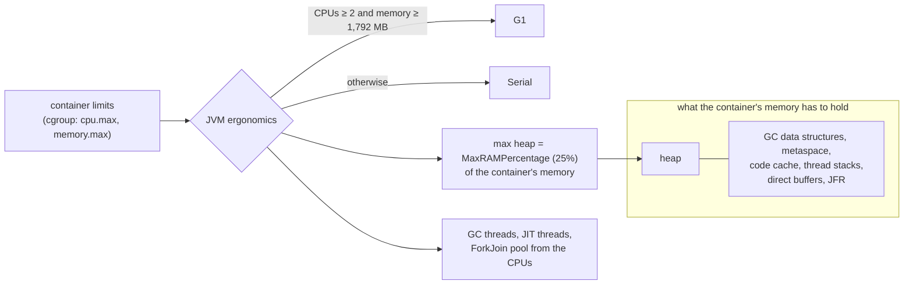

# 67. JVM Tuning in Containers

<div class="badges" markdown><span class="badge badge-l3">L3 · Senior/Lead</span><span class="badge badge-l4">L4 · Architect</span><span class="badge badge-meta">container awareness · ergonomics · MaxRAMPercentage · Serial · Parallel · G1 · Generational ZGC · Shenandoah · compact object headers · OOMKilled · Native Memory Tracking · JDK Flight Recorder</span></div>

<div class="grid two" markdown>

!!! info "Prerequisites"
    - [Chapter 53](../deployment/ch53-containerization.md): container images for Java services
    - [Chapter 54](../deployment/ch54-kubernetes-for-spring.md): requests, limits and what OOMKilled means
    - [Chapter 66](ch66-latency-virtual-threads-reactive.md): latency from when a request was due, and percentiles

!!! abstract "What you'll learn"
    - **The JVM picks its collector and heap from the container's limits, and small pods get surprises.** With no flags:
        - A 2-CPU, **1 GiB** container got the **Serial** collector and a **256 MB** heap.
        - G1 needs at least 2 CPUs **and** 1,792 MB.
    - **The collector decides the tail.** menu-service at 6,000 requests a second with a 350 MB live set and a 1 GB heap:
        - **Serial**: p99 **380–450 ms**, longest pause **655–704 ms**.
        - **G1**: p99 **37 ms**. **Parallel**: p99 **8–22 ms**.
        - **ZGC**: p99 **1.0–1.1 ms** and pauses of **0.1 ms**, for **27–31% more CPU** and **1.3 GB** resident instead of 0.95 GB.
        - **Compact object headers** made the live set 13% smaller.
    - **Heap headroom is a latency setting.** In a 1 GiB container with a 350 MB live set:
        - At **25%** the service didn't start.
        - At **50% and 75%**, G1 ran out of room and fell back to full collections: p99 **0.5–0.7 s**.
        - At **90%**, p99 was **25–35 ms**.
        - Adding 150 MB of direct buffers at 90% got the container **OOMKilled in one run of two**.
    - **The heap isn't the process.** Native Memory Tracking found 54 MB of G1 data structures and **238–266 MB of ZGC's**. A continuous JFR recording cost **2–9% more CPU**.

</div>

---

## 1 · Introduction & Context

### The pod that was given 2 CPUs and used one collector thread

menu-service moved to Kubernetes with `requests: 2 CPUs, 1 GiB` and no JVM options, because the JVM is "container-aware". Under the first dinner peak, its p99 climbed from 40 ms to over half a second, every couple of minutes. Profiles looked normal. The GC log said `Using Serial`.

The JVM had read the container's limits correctly and drawn its own conclusions. 1 GiB is less than the 1,792 MB it requires before calling a machine "server class", so it chose the single-threaded Serial collector and a heap of a quarter of the memory. The team then set `-Xmx900m` to fix the heap, and two weeks later the pod started getting OOMKilled. The heap fitted, but the heap plus everything else didn't.

This chapter measures what the JVM decides in a container, what each collector does with the same service, how much of a container the heap should get, and what the rest of the memory is for.

### Where it comes from

<ul class="mh-timeline">
<li><span class="when">2006 · Server-class ergonomics</span><span class="what">Java 5 picks a collector and heap from the machine: "server class" means at least 2 CPUs and 2 GB.</span></li>
<li><span class="when">2017–2018 · Container awareness</span><span class="what">JDK 10 reads cgroup limits (<code>UseContainerSupport</code>), backported to 8u191; <code>MaxRAMPercentage</code> replaces fractions.</span></li>
<li><span class="when">2017–2018 · G1 by default; Flight Recorder opens up</span><span class="what">JDK 9 makes G1 the default on server-class machines; JDK 11 open-sources JFR. JDK 14 adds event streaming.</span></li>
<li><span class="when">2018–2024 · Low-pause collectors</span><span class="what">ZGC (JDK 11, production in 15, generational in 21, generational only in 24) and Shenandoah (JDK 12).</span></li>
<li><span class="when">2025 · JDK 25</span><span class="what">Compact object headers become a product option (JEP 519). JDK 25.0.4's sources are checked here.</span></li>
</ul>

---

## 2 · Core Concepts & Terminology



Container awareness
:   The JVM reads its cgroup's CPU quota and memory limit, and treats them as the machine's size. `-XX:ActiveProcessorCount` overrides the CPU count.

Ergonomics
:   The JVM's defaults derived from that size: the collector, heap limits, and thread counts (GC worker threads, compiler threads, the common ForkJoin pool).

MaxRAMPercentage, InitialRAMPercentage, MinRAMPercentage
:   The heap's maximum and initial size as shares of memory: 25% and 1.5625% by default. MinRAMPercentage (50%) is the maximum used instead when memory is very small.

Live set
:   The memory still in use after a full collection: what the heap must hold at least. The headroom above it is what the collector works with.

Stop-the-world pause and concurrent collection
:   Serial and Parallel stop the application for every collection. G1 stops it for copying young objects and compacting, and marks the old generation concurrently. ZGC and Shenandoah do nearly everything concurrently, with pauses well under a millisecond, using more CPU and memory to do so.

Evacuation failure and full GC
:   When G1 has no free regions to copy live objects into, it fails the evacuation and falls back to a full, compacting, stop-the-world collection: the long pause this chapter's tuning tries to avoid.

Native memory
:   Everything the process holds outside the heap. Native Memory Tracking (`-XX:NativeMemoryTracking=summary`) reports it by category.

OOMKilled
:   The kernel killing the process because the container exceeded its memory limit (exit code 137). Unlike `OutOfMemoryError`, the JVM has no say and leaves no stack trace.

---

## 3 · How It Works Internally

### What the JVM decided

`WhatTheJvmSees` prints the JVM's view in one line. It runs in a fresh container for each size:

```java title="ergonomics/WhatTheJvmSees.java"
--8<-- "code/chapters/ch67-jvm-tuning-containers/src/main/java/dev/foodfleet/ch67/ergonomics/WhatTheJvmSees.java:20:27"
```

The rule behind the collector is in `os::is_server_class_machine`: at least 2 active processors, and at least 2 GB of memory less 256 MB. The rule is applied to the container's limits, so a container with less memory than that gets Serial whatever the host has.

### menu-service, measured from inside

The service keeps a cache of restaurant menus: 180,000 menus of 20 items each, about 350 MB of small objects that stay for minutes. Each request renders five menus as JSON, which is short-lived garbage, and half of the requests replace a menu, which creates old garbage. An open load runs inside the process. Each request runs on a virtual thread, and its latency counts from when it was due, so a pause that delays the scheduler still shows:

```java title="service/MenuService.java"
--8<-- "code/chapters/ch67-jvm-tuning-containers/src/main/java/dev/foodfleet/ch67/service/MenuService.java:54:78"
```

### GC pauses from Flight Recorder

Every collector reports `jdk.GarbageCollection` with the sum of its pauses and the longest one, so pauses can be compared across collectors. A `RecordingStream` reads them inside the process. G1's `jdk.EvacuationFailed` shows when it ran out of room:

```java title="service/GcEvents.java"
--8<-- "code/chapters/ch67-jvm-tuning-containers/src/main/java/dev/foodfleet/ch67/service/GcEvents.java:26:47"
```

### Native memory

With Native Memory Tracking on, the service asks for the summary through the DiagnosticCommand MBean, the same command as `jcmd <pid> VM.native_memory summary`:

```java title="memory/NativeMemory.java"
--8<-- "code/chapters/ch67-jvm-tuning-containers/src/main/java/dev/foodfleet/ch67/memory/NativeMemory.java:20:23"
```

---

## 4 · Design Considerations & Trade-offs

### Test setup

All runs used:

- JDK 25.0.4 on one 2-vCPU VM with 8 GB of memory.
- One fresh Docker container per measurement, with `--cpus` and `--memory` (and the same `--memory-swap`). The JDK was mounted read-only into a minimal image.
- For the collectors: 6,000 requests a second for 30 s after 10 s of warm-up.

There were two runs. Where they differed, both values are shown. `check_apis.sh` checks **18 behaviours** in JDK 25.0.4's sources, and all were found.

### Measured: what the JVM chooses

No JVM options except the ones shown. The results were the same in both runs:

| Container CPUs | Memory | Options | CPUs seen | Collector | Max heap | GC threads | ForkJoin pool |
|---|---|---|---|---|---|---|---|
| none | none | | 2 | G1 | 2,008 MB | 2 | 1 |
| 0.5 | 256 MiB | | 1 | Serial | 126 MB | 0 | 1 |
| 1 | 512 MiB | | 1 | Serial | 128 MB | 0 | 1 |
| 1 | 2 GiB | | 1 | **Serial** | 512 MB | 0 | 1 |
| 1.5 | 2 GiB | | 2 | G1 | 512 MB | 2 | 1 |
| 2 | 1 GiB | | 2 | **Serial** | **256 MB** | 0 | 1 |
| 2 | 1,792 MiB | | 2 | G1 | 448 MB | 2 | 1 |
| 2 | 4 GiB | | 2 | G1 | 1,024 MB | 2 | 1 |
| 1 | 2 GiB | `-XX:ActiveProcessorCount=2` | 2 | G1 | 512 MB | 2 | 1 |
| 2 | 1 GiB | `-XX:+UseG1GC` | 2 | G1 | 256 MB | 2 | 1 |
| 2 | 1 GiB | `-XX:MaxRAMPercentage=75` | 2 | Serial | 768 MB | 0 | 1 |

What the table shows:

- **The JVM reads the container, not the host.** It saw 1 CPU for a quota of 0.5 or 1, and 2 for 1.5 (the quota rounds up). Memory came from the container's limit.
- **G1 needs 2 CPUs and 1,792 MB.** One CPU or less than 1,792 MB meant Serial: a 2-CPU, 1 GiB pod, a very common size, got a single-threaded stop-the-world collector. Fixing the heap size doesn't change that: with `MaxRAMPercentage=75` it was still Serial. Choose the collector explicitly.
- **The default heap is a quarter of the container.** 256 MB of a 1 GiB pod leaves 768 MB for native memory, which this service needed about 105 MB of with G1 and 290–320 MB with ZGC (see below). Very small containers get half (126 MB of 256 MiB, MinRAMPercentage).
- **A container's CPU count shapes more than GC.** The common ForkJoin pool, which parallel streams use, had one thread in every container here (CPUs − 1, at least 1), so a parallel stream on a 2-CPU pod runs on the calling thread and one helper.

### Measured: six collectors, the same service

A 2 GiB container with 2 CPUs and `-Xmx1g`. The live set was 348–352 MB (303 MB with compact headers; ZGC reported 412–414 MB):

| Collector | p50 | p99 | p99.9 | GC pauses (30 s) | Longest pause | CPU used | Peak RSS |
|---|---|---|---|---|---|---|---|
| Serial | 0.1 ms | **380–450 ms** | 629–681 ms | 1,118–1,207 ms | **655–704 ms** (a full GC) | 0.51–0.54 cores | 1,028–1,032 MB |
| Parallel | 0.1 ms | **8–22 ms** | 34–97 ms | 383–565 ms | 58–87 ms | 0.49–0.50 | 948–950 MB |
| G1 | 0.1 ms | 37 ms | 74–95 ms | 611–622 ms | 85–112 ms | 0.55–0.56 | 949–962 MB |
| G1 + compact object headers | 0.1 ms | 20–33 ms | 60–83 ms | 493–645 ms | 69–107 ms | 0.54–0.57 | **836–841 MB** |
| ZGC (generational) | 0.1 ms | **1.0–1.1 ms** | **3.8–9.5 ms** | **1 ms** | **0.1 ms** | **0.70–0.72** | **1,312–1,329 MB** |
| Shenandoah | 0.1 ms | 30–36 ms | 39–46 ms | 5 ms | 0.8–1.0 ms | 0.69–0.70 | 1,100–1,108 MB |
| G1, **1 CPU** | 0.1 ms | 68–92 ms | 126–172 ms | 834–951 ms | 148–196 ms | 0.52–0.53 | 941–970 MB |
| ZGC, **1 CPU** | 0.1 ms | **106–136 ms** | 144–162 ms | 1 ms | 0.1 ms | 0.66–0.68 | 1,289–1,299 MB |

What the table shows:

- **Serial's one old collection was the whole tail.** A full collection of a 350 MB live set took 655–704 ms; at 6,000 requests a second, thousands of requests waited for it. This is what the 2-CPU, 1 GiB pod got by default.
- **ZGC took pauses out of the picture.** Pauses totalled 1 ms in 30 s, and the p99 was 1 ms. It paid for that with 27–31% more CPU (0.70–0.72 against 0.55–0.56 cores, for concurrent marking and relocation) and 37–40% more resident memory: its own data structures were 238–266 MB (see native memory below).
- **G1 met its 200 ms goal comfortably** (longest pause 85–112 ms) at a cost close to Parallel's. Parallel's young collections were shorter, and in 30 s with a 1 GB heap it never needed an old collection. With a longer run or a fuller heap, an old collection would have looked like Serial's, only shorter.
- **Shenandoah's pauses were tiny, but its p99 wasn't.** Its pauses summed to 5 ms, but p99 was 30–36 ms. The likely cause is pacing: Shenandoah slows down allocating threads when it falls behind, and that delay isn't counted as a pause. Either way, measure request latency, not GC logs.
- **Compact object headers shrank the heap by 13%.** The same cache took 303 MB instead of 348 MB, and RSS fell by 108–126 MB, with no other change. It's a product option in JDK 25 and off by default.
- **A concurrent collector needs a spare CPU.** On 1 CPU, ZGC's concurrent threads competed with requests: p99 rose to 106–136 ms, worse than G1 on the same CPU (68–92 ms), even with 0.1 ms pauses. Low-pause collectors are for containers with CPU to spare.

### Measured: the heap as a share of a 1 GiB container

G1, 2 CPUs, `-XX:+ExitOnOutOfMemoryError`; the same load:

| Heap (MaxRAMPercentage) | Outcome | p99 | Longest pause | Collections (30 s) | Peak RSS |
|---|---|---|---|---|---|
| 25% (256 MB) | **`OutOfMemoryError` at startup**, exit 3 | | | | |
| 50% (512 MB) | ok | **588–697 ms** | 721–1,030 ms | 3 full, 12–14 evacuation failures | 584–585 MB |
| 75% (768 MB) | ok | **496–630 ms** | 647–720 ms | 2 full, 12 evacuation failures | 846–847 MB |
| 90% (921 MB) | ok | **25–35 ms** | 91–108 ms | no full collections | 894–946 MB |
| 75% + 150 MB of direct buffers | ok | 488–650 ms | 614–848 ms | 2 full | 996–998 MB |
| 90% + 150 MB of direct buffers | **OOMKilled** (exit 137) in run 1; ok in run 2 at **1,044 MB** peak RSS | 32 ms (run 2) | 111 ms | | |

What the table shows:

- **The default heap couldn't hold the live set.** 25% of 1 GiB is 256 MB, so the 350 MB cache never loaded. With `ExitOnOutOfMemoryError` the JVM exited at once, which a restart policy can act on. Without it, a JVM can carry on half-broken after an `OutOfMemoryError`.
- **Headroom, not size, set the latency.** With 512 and 768 MB (1.5× and 2.2× the live set), old garbage piled up faster than G1's mixed collections reclaimed it. G1 ran out of free regions (evacuation failures) and fell back to full collections of 650–1,030 ms. With 921 MB (2.6×), the same load needed none. Rules of thumb such as "heap = 2 × live set" are only a starting point; how fast the old generation churns decides.
- **Everything else has to fit beside the heap.** At 90% with nothing else off-heap, peak RSS was 894–946 MB in a 1,024 MB container. Adding 150 MB of direct buffers (Netty's pool, a client library's buffers) left no margin. In one run the kernel killed the container; in the other, the heap hadn't grown to its maximum yet and the container survived. A margin that depends on how far the heap has grown won't hold in production.

### Measured: where the memory goes

Native Memory Tracking at the end of a run (2 GiB container, `-Xmx1g`). Committed megabytes:

| Collector | Java heap | GC | Code | Tracing (JFR) | Metaspace + class | Other | NMT total | Peak RSS |
|---|---|---|---|---|---|---|---|---|
| G1 | 870–881 | **54** | 9 | 15 | 6 | 22 | 976–987 | 944–957 |
| ZGC | 958–960 | **238–266** | 9 | 15 | 6 | 24–25 | 1,252–1,279 | 1,296–1,317 |

What the table shows:

- **ZGC's own structures were a quarter of a gigabyte** for a 1 GB heap, against 54 MB for G1. A container sized for G1's heap + 15% doesn't fit ZGC with the same heap.
- **This service's other native memory was small** (about 50 MB: code, metaspace, JFR's buffers, threads). Services with many platform threads, large class counts or Netty's direct buffers need much more. Measure with NMT before sizing.

### Measured: continuous Flight Recorder

G1, 2 CPUs, `-Xmx1g`, recording to a file in the container:

| Recording | CPU used | p99 | Peak RSS |
|---|---|---|---|
| GC events only (the lab's own stream) | 0.54–0.55 cores | 30–31 ms | 938–958 MB |
| + continuous recording, `default` settings | 0.56–0.58 cores | 34 ms | 950–952 MB |
| + continuous recording, `profile` settings | 0.58–0.59 cores | 30–42 ms | 951–954 MB |

The `default` settings cost 2–7% more CPU here and the `profile` settings 5–9%. Latency differences were within the run-to-run spread. A recording that's always on is what makes the next incident diagnosable: `jcmd <pid> JFR.dump` writes the last few minutes when something goes wrong.

### Choosing

| Question | Do | Why (measured) |
|---|---|---|
| Which collector | Set it explicitly (`-XX:+UseG1GC` by default) | A 2-CPU, 1 GiB pod got Serial and a 655–704 ms pause |
| Latency-critical service, CPU to spare | Generational ZGC, with about 30% more CPU and 40% more memory budgeted | p99 1 ms, but 0.70 against 0.55 cores and 1.3 GB RSS |
| One CPU or less | G1 (or Serial for tiny services), not a concurrent collector | ZGC's p99 106–136 ms on 1 CPU |
| Batch, throughput only | Parallel | Lowest CPU (0.49–0.50) |
| Heap size | `MaxRAMPercentage` from measured live set × churn, leaving native memory room | 25% failed; 50–75% fell back to full GCs; 90% worked until off-heap memory was added |
| Container memory | Heap + NMT's non-heap total + 10–15% | 90% + 150 MB direct was OOMKilled in one run |
| Memory-bound services on JDK 25 | Try `-XX:+UseCompactObjectHeaders` | Live set −13%, RSS −108–126 MB |
| Diagnostics | Continuous JFR with `default` settings; `ExitOnOutOfMemoryError` | 2–7% CPU; a clean exit instead of a half-broken JVM |

---

## 5 · Hands-on Implementation

```text
ch67-jvm-tuning-containers/
├── src/main/java/dev/foodfleet/ch67/
│   ├── ergonomics/  WhatTheJvmSees: CPUs, memory, collector, heap, thread counts
│   ├── service/     MenuCache (the live set), MenuService (open load, measured inside), GcEvents (JFR stream)
│   └── memory/      NativeMemory: NMT's summary through the DiagnosticCommand MBean
├── src/test/java/…   UnitTest (4, tag unit)
└── verify/   build-libs.sh, run.sh, check_apis.sh, tools/ (Lab: Docker per measurement, RunSuites)
```

### 🟣 Level 3: explicit, measured settings

<div class="badges" markdown><span class="badge badge-l3">L3 · Senior/Lead</span></div>

FoodFleet's base image starts every service with:

```text
JAVA_TOOL_OPTIONS=-XX:+UseG1GC -XX:MaxRAMPercentage=70 -XX:+ExitOnOutOfMemoryError
  -XX:StartFlightRecording=settings=default,maxsize=100m,maxage=30m,filename=/tmp/service.jfr
  -Xlog:gc*:file=/tmp/gc.log:time,uptime:filecount=5,filesize=10m
```

- `MaxRAMPercentage` is a starting point. Each service measures its live set (a heap histogram after a full GC, or `jdk.GCHeapSummary` in JFR) and its non-heap total (NMT in a load test), then sets the percentage so the heap is at least 2.5× the live set and the rest fits.
- Containers get `requests` equal to `limits` for memory, since the JVM won't give memory back quickly enough to share it.
- CPU limits of at least 2 for G1 to use more than one GC thread, or `-XX:ActiveProcessorCount` set deliberately.

### 🔴 Level 4: collectors by service type

<div class="badges" markdown><span class="badge badge-l4">L4 · Architect</span></div>

- Latency-critical services with large heaps (menu, search) run generational ZGC, with pods sized for its extra CPU and memory.
- Batch and reporting jobs run Parallel.
- Each service's GC choice and heap share is recorded in its Helm values (chapter 55), with the load test that justified it.
- `UseCompactObjectHeaders` is rolled out service by service after a load test, since it's still off by default in JDK 25.

```bash
JAVA_HOME=/path/to/jdk-25 verify/run.sh   # about 15 minutes; needs Docker
```

### Run and verify

```text
$ verify/run.sh ergonomics
== ergonomics
no options except those shown; the host has 2 CPUs
cpus   memory   options                         CPUs GC             max heap    GC thr  conc thr   FJ pool
-      -        -                                  2 G1              2008 MB         2         1         1
1      2g       -                                  1 Serial           512 MB         0         0         1
2      1g       -                                  2 Serial           256 MB         0         0         1
2      1792m    -                                  2 G1               448 MB         2         1         1
```

!!! question "Try it"
    1. Run the `gc` experiment with `-Xmx2g` in a 3 GiB container. Does Parallel still beat G1 on p99 once the heap is bigger?
    2. Give the 50% heap row `-XX:G1ReservePercent=20` or `-XX:InitiatingHeapOccupancyPercent=30`. Do the full collections go away?
    3. Start 2,000 platform threads in `MenuService` and read NMT's `Thread` category. How much memory do their stacks take?
    4. Open the `profile` recording with `jfr print --events jdk.ObjectAllocationSample`. Which code allocates most?

---

## 6 · Production Readiness

- [x] **Collector chosen explicitly** per service, never left to ergonomics
- [x] **Heap from a measured live set**, with headroom for the old generation's churn
- [x] **Non-heap memory measured with NMT**, and the container's limit set to heap + non-heap + margin
- [x] **Memory request = limit** for JVM containers
- [x] **`ExitOnOutOfMemoryError`** so a broken JVM restarts instead of limping
- [x] **Continuous JFR and GC logs** in every container, dumpable on demand
- [x] **Pause-time alerts** from `jvm.gc.pause` (chapter 48) and OOMKilled restarts counted per service

---

## 7 · Anti-patterns & Pitfalls

!!! pitfall "Incident 1: Serial in production"
    **Context.** menu-service ran in pods of 2 CPUs and 1 GiB with no JVM options.

    **Symptoms.** p99 jumped above half a second every few minutes during peaks.

    **Root cause.** Ergonomics chose Serial, since 1 GiB is below the 1,792 MB "server class" threshold. Measured: Serial's full collection of a 350 MB live set took 655–704 ms; G1 on the same load paused at most 85–112 ms.

    **Fix.** `-XX:+UseG1GC` in the base image, and memory sized from measurements.

!!! pitfall "Incident 2: the heap that fitted and the pod that didn't"
    **Context.** To give the heap room, the team set `-Xmx` to 90% of the container's memory. A later release added a Netty-based client with pooled direct buffers.

    **Symptoms.** Pods restarted with `OOMKilled`, exit 137, no stack trace and no heap dump.

    **Root cause.** The heap plus native memory exceeded the limit. Measured: 90% heap + 150 MB of direct buffers was killed by the kernel in one run of two; at 90% alone, peak RSS was already 894–946 MB of 1,024.

    **Fix.** Container memory from heap + NMT's measured non-heap + 15%; `MaxDirectMemorySize` set explicitly.

!!! pitfall "Incident 3: a low-pause collector on a small pod"
    **Context.** The tracking service switched to ZGC to remove GC pauses, keeping its 1-CPU pods.

    **Symptoms.** GC pauses disappeared from the dashboards and p99 got worse.

    **Root cause.** ZGC's concurrent threads competed with the service for its only CPU. Measured on 1 CPU: ZGC's pauses were 0.1 ms, its p99 106–136 ms; G1's p99 was 68–92 ms.

    **Fix.** 2 CPUs per pod for ZGC, or G1 on small pods.

| Anti-pattern | Symptom | Fix |
|---|---|---|
| Trusting ergonomics in small containers | Serial, 25% heap | Set the collector and heap share |
| `-Xmx` near the container limit | OOMKilled, no stack trace | Heap + measured non-heap + margin |
| The default 25% heap | Wasted memory, or OOM for big caches | MaxRAMPercentage from the live set |
| Heap just above the live set | Evacuation failures, full GCs | 2.5× live set or more, by measurement |
| ZGC on 1 CPU | Small pauses, slow requests | CPU to spare, or G1 |
| Judging collectors by GC logs | Pacing and CPU contention unseen | Request latency under open load |
| No JFR until something breaks | Nothing to look at | Continuous `default` recording |

---

## 8 · Enterprise Case Study

### FoodFleet: every JVM flag is a measurement

!!! decision "ADR-067: every service sets its collector explicitly (G1 by default, generational ZGC for latency-critical services with at least 2 CPUs, Parallel for batch); heap via MaxRAMPercentage from the measured live set with at least 2.5× headroom; container memory = heap + measured non-heap + 15%, request = limit; ExitOnOutOfMemoryError; continuous JFR with default settings and GC logs in every container"
    **Status:** Accepted · **Date:** 2026-02-02

    **Context.** A service got Serial in a 1 GiB pod; another was OOMKilled with a heap at 90%; a third made p99 worse with ZGC on one CPU. Measured:

    - Ergonomics gave a 2-CPU, 1 GiB container Serial and a 256 MB heap.
    - Serial's longest pause was 655–704 ms; G1's 85–112 ms; ZGC's 0.1 ms for about 30% more CPU and 1.3 GB RSS.
    - In 1 GiB, heaps of 50–75% fell back to full collections (p99 0.5–0.7 s); 90% worked, and was OOMKilled once 150 MB of direct buffers was added.
    - ZGC's native structures were 238–266 MB for a 1 GB heap; G1's 54 MB.
    - Continuous JFR cost 2–7% CPU with default settings.

    **Decision.**

    - **Collectors:** G1 by default, explicitly. ZGC for menu and search, in pods of 2+ CPUs. Parallel for batch jobs.
    - **Memory:** each service's load test records its live set and NMT total; the Helm chart computes MaxRAMPercentage and the limit from them.
    - **Diagnostics:** JFR continuous recording and GC logs to an `emptyDir`; `jcmd JFR.dump` in the runbook (chapter 46).
    - **JDK 25:** compact object headers trialled per service.

    **Consequences:**

    - ✅ Pause times are a choice, not an accident of pod size.
    - ✅ OOMKilled becomes rare, and when it happens NMT numbers show what grew.
    - ⚠️ Every service needs a load test to set its memory, and it must be repeated as caches grow.
    - ⚠️ ZGC services cost more CPU and memory per pod.

### Fintech analogue: pauses inside a deadline

Payment authorisation runs inside the card network's deadline, so a full GC pause can turn into a declined payment. Banks running Java authorisation services typically pin heap sizes (`-Xms` = `-Xmx`), pre-touch memory, choose a low-pause collector and give it dedicated CPUs, and alert on any pause above a few milliseconds.

### E-commerce analogue: memory for the catalogue

Catalogue and search services keep large in-memory indexes, so their live sets are big and slow to collect. Retailers size heaps from the index size plus headroom, prefer concurrent collectors, and check compressed or compact object layouts, since a 10–15% smaller live set across thousands of pods is a large saving.

---

## 9 · Interview Q&A + Summary

#### Q1. How does the JVM know it's in a container? · <span class="badge badge-l2">L2</span> · TCS · Infosys

**Short answer:** Since JDK 10 (and 8u191) it reads its cgroup's CPU quota and memory limit (`UseContainerSupport`, on by default) and treats them as the machine. Measured: a quota of 0.5 or 1 CPU showed as 1 processor, 1.5 as 2, and the heap came from the container's memory.

#### Q2. Which collector does the JVM choose by default? · <span class="badge badge-l3">L3</span> · Swiggy

**Short answer:** G1 on a "server-class machine": at least 2 CPUs and 2 GB less 256 MB, so 1,792 MB. Otherwise Serial. Measured: a 2-CPU, 1 GiB container got Serial and a 256 MB heap. Set the collector explicitly.

#### Q3. How big should the heap be in a container? · <span class="badge badge-l3">L3</span> · Flipkart

**Short answer:** Big enough for the live set with headroom for churn, small enough that heap + native memory fit. Measured in 1 GiB with a 350 MB live set: 25% failed at startup, 50–75% caused full GCs (p99 0.5–0.7 s), 90% worked until 150 MB of direct buffers got the container OOMKilled.

#### Q4. What's the difference between OutOfMemoryError and OOMKilled? · <span class="badge badge-l2">L2</span> · Wipro

**Short answer:** `OutOfMemoryError` is the JVM failing to allocate on its heap (or metaspace, or direct memory); it can be logged and handled, and `ExitOnOutOfMemoryError` makes it exit. OOMKilled is the kernel killing the container for exceeding its limit (exit 137): no stack trace, and usually caused by native memory beyond the heap.

#### Q5. G1, ZGC or Parallel? · <span class="badge badge-l3">L3</span> · Atlassian · Uber

**Short answer:** G1 as the balanced default (longest pause 85–112 ms here). ZGC when pauses must be under a millisecond and the pod has CPU and memory to spare (measured: about 30% more CPU, 1.3 GB RSS against 0.95). Parallel for throughput-only batch work (lowest CPU). Never Serial for a service with a large live set (655–704 ms pauses).

#### Q6. Why did ZGC make latency worse? · <span class="badge badge-l3">L3</span> · Zomato

**Short answer:** Its collection is concurrent, so it needs CPU while the application runs. On one CPU it competed with requests: pauses of 0.1 ms, p99 106–136 ms, against G1's 68–92 ms. Concurrent collectors trade CPU for pauses.

#### Q7. What uses memory in a JVM besides the heap? · <span class="badge badge-l3">L3</span> · Red Hat

**Short answer:** GC data structures, metaspace and class data, the JIT's code cache, thread stacks, direct and mapped buffers, JFR's buffers, and the C heap of native libraries. Measured with NMT: G1's structures 54 MB, ZGC's 238–266 MB for a 1 GB heap. Measure with `-XX:NativeMemoryTracking=summary` and `jcmd VM.native_memory`.

#### Q8. What is an evacuation failure? · <span class="badge badge-l3">L3</span> · Oracle

**Short answer:** G1 copies live objects out of the regions it collects; when there are no free regions to copy into, the evacuation fails and G1 falls back to a full, compacting collection. Measured: with 1.5–2.2× the live set as heap, 12–14 evacuation-failure events led to full collections of 650–1,030 ms; at 2.6× there were none.

#### Q9. Is JFR safe to run in production? · <span class="badge badge-l2">L2</span> · PhonePe

**Short answer:** Yes; it was designed for that. Measured: a continuous recording with `default` settings cost 2–7% more CPU and `profile` 5–9%, with latency changes within noise. Keep it on, bounded by `maxsize`/`maxage`, and dump it when something goes wrong.

#### Q10. What are compact object headers? · <span class="badge badge-l3">L3</span> · any Java shop

**Short answer:** JEP 519 (a product option in JDK 25) shrinks each object's header from 12–16 bytes to 8. For heaps of many small objects that's a real saving: measured, the menu cache took 303 MB instead of 348 MB, and RSS fell by 108–126 MB. It's off by default; enable it with `-XX:+UseCompactObjectHeaders` after a load test.

#### Q11. Should you set CPU limits on JVM containers? · <span class="badge badge-l3">L3</span> · Razorpay

**Short answer:** Whatever the limit, the JVM sizes itself from it: GC threads, JIT threads, the ForkJoin pool. A limit of 1 means one GC thread and, for ZGC, competition with the application. If you set limits, set them to at least 2 for G1 or ZGC, or tell the JVM explicitly with `-XX:ActiveProcessorCount`.

#### Q12. Design FoodFleet's JVM settings for 200 services. · <span class="badge badge-l4">L4</span> · architecture rounds

**Short answer:**

- **Defaults in the base image:** G1, MaxRAMPercentage 70, ExitOnOutOfMemoryError, continuous JFR, GC logs.
- **Per-service sizing:** load tests record live set and NMT totals; Helm computes heap share and limits; memory request = limit.
- **Exceptions by class of service:** ZGC for latency-critical large heaps with 2+ CPUs; Parallel for batch.
- **Feedback:** pause and OOMKilled alerts, and JFR dumps in the incident runbook.

### Key takeaways

- **Ergonomics follow the container**: small pods get Serial and a quarter of their memory as heap. Set both.
- **Headroom above the live set decides G1's latency**, and native memory decides whether the pod survives.
- **Low-pause collectors cost CPU and memory**, and need a spare CPU to deliver.
- **Measure non-heap memory and keep JFR on**: both are cheap compared with an unexplained OOMKill.

### Further reading

- JDK 25, [HotSpot GC Tuning Guide](https://docs.oracle.com/en/java/javase/25/gctuning/)
- [JEP 439: Generational ZGC](https://openjdk.org/jeps/439) and [JEP 519: Compact Object Headers](https://openjdk.org/jeps/519)
- JDK 25, [Native Memory Tracking](https://docs.oracle.com/en/java/javase/25/vm/native-memory-tracking.html)
- JDK 25, [Flight Recorder API Programmer's Guide](https://docs.oracle.com/en/java/javase/25/jfapi/)
- Kubernetes, [Resource Management for Pods and Containers](https://kubernetes.io/docs/concepts/configuration/manage-resources-containers/)

---

**Previous:** [← 66. Latency, Tail Latency, Virtual Threads vs Reactive](ch66-latency-virtual-threads-reactive.md) · **Next:** [68. Horizontal Scaling & Partitioning →](ch68-horizontal-scaling.md)
