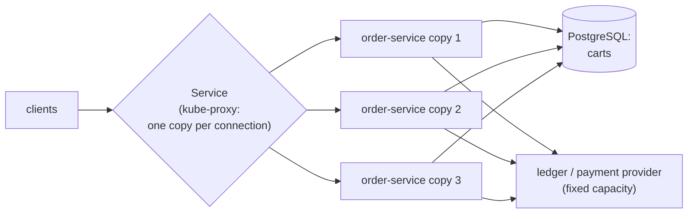

# 68. Horizontal Scaling & Partitioning

<div class="badges" markdown><span class="badge badge-l2">L2 · Practitioner</span><span class="badge badge-l3">L3 · Senior/Lead</span><span class="badge badge-l4">L4 · Architect</span><span class="badge badge-meta">stateless services · session state · sticky sessions · ClientIP affinity · kube-proxy · connection-level balancing · scale-out · shared bottlenecks · partitioning · consistent hashing · virtual nodes · rendezvous hashing · jump hash · hot keys</span></div>

<div class="grid two" markdown>

!!! info "Prerequisites"
    - [Chapter 54](../deployment/ch54-kubernetes-for-spring.md): Deployments, Services and readiness
    - [Chapter 56](../deployment/ch56-autoscaling.md): adding copies automatically
    - [Chapter 57](../deployment/ch57-service-mesh.md): request-level load balancing in a mesh
    - [Chapter 66](ch66-latency-virtual-threads-reactive.md): Little's law and capacity

!!! abstract "What you'll learn"
    - **State in a copy's memory breaks scaling.** With 3 copies and carts in memory, **0–2 of 200** carts were complete when every request could land anywhere.
        - **ClientIP affinity** kept all 200, by sending **100%** of the load to one copy, since every request came from one address.
        - **Replacing that copy lost all 200.**
        - **Carts in PostgreSQL** survived both: 200 of 200, spread 31–36% per copy.
    - **Kubernetes Services balance connections, not requests.** A keep-alive client spread over 4 copies left **one or two copies with nothing**. After scaling from 2 to 4, the **new copies got 0%**. A new connection per request spread load at 23–27% per copy.
    - **Copies add capacity until something shared doesn't.** 1, 2 and 4 copies served 35, 62–66 and 121–132 requests a second; behind a shared dependency of 50 a second, 4 copies served **50**, with each doing **12–13**.
    - **Partitioning decides what moves and what's hot.**
        - Going from 4 to 5 nodes, hash mod n moved **80%** of keys. Consistent hashing with 256 points per node, rendezvous and jump hashing moved **20%**, the minimum.
        - One point per node left the busiest node with **2.26×** the average.
        - Keying 12 partitions by restaurant put **19–28%** of orders on one partition, where 8.3% would be even.

</div>

---

## 1 · Introduction & Context

### The scale-out that didn't help

Before a cricket final, FoodFleet scaled order-service from 3 copies to 12. Three things went wrong.

- **Carts emptied.** Carts lived in each copy's memory, so the ingress had sticky sessions. Users whose copy was replaced during the rollout lost their carts.
- **The new copies sat idle.** The mobile backend-for-frontend talked to order-service through a Kubernetes Service over long-lived connections, so the 9 new copies got almost no traffic while the original 3 ran hot.
- **Throughput stayed flat.** Where the new copies did get traffic, throughput didn't grow: every order called the payment provider, whose contract allowed 50 concurrent calls.

The kitchen-ticket topic had a different problem. It was keyed by restaurant, so one partition carried a quarter of all tickets, and the consumer reading it fell further behind every minute.

This chapter measures each of these:

- **Session state** in memory, with affinity, and in a shared store.
- **How a Service spreads connections.**
- **Where scale-out stops.**
- **How partitioning schemes behave** when nodes change and when keys are skewed.

### Where it comes from

<ul class="mh-timeline">
<li><span class="when">1997 · Consistent hashing</span><span class="what">Karger et al.: caches on a ring, so adding one moves only its share of keys. Rendezvous hashing (Thaler and Ravishankar) the same year.</span></li>
<li><span class="when">2000s · Sticky sessions and session replication</span><span class="what">Load balancers pin users to servers; application servers replicate HTTP sessions. Both fight horizontal scaling.</span></li>
<li><span class="when">2007–2011 · Dynamo, Cassandra, Kafka</span><span class="what">Virtual nodes on the ring; partitioned logs keyed by hash. The twelve-factor app (2011) makes processes stateless and share-nothing.</span></li>
<li><span class="when">2014 · Jump consistent hash</span><span class="what">Lamping and Veach: no state, perfectly even, minimal moves, for numbered shards.</span></li>
<li><span class="when">2015–2026 · Kubernetes Services and meshes</span><span class="what">kube-proxy balances per connection (iptables, then nftables); meshes and gRPC clients balance per request. Kubernetes 1.37.1, Kafka 4.2.2, Cassandra 5.0.9 and Spring Session 4.1.1 are checked here.</span></li>
</ul>

---

## 2 · Core Concepts & Terminology



Stateless service
:   A copy that keeps nothing between requests that another copy would need. Any copy can serve any request, so copies can be added, removed and replaced freely.

Session state
:   Data that lives across a user's requests: a cart, a login, a wizard's progress. It belongs in a shared store (Spring Session with Redis or JDBC, a database, a signed token) for the service to stay stateless.

Sticky sessions (affinity)
:   Routing a user's requests to the same copy: by cookie at an ingress, or by client address (`sessionAffinity: ClientIP`, three hours by default) at a Service. It keeps in-memory state reachable, until the copy goes away.

Connection-level and request-level balancing
:   kube-proxy picks a copy when a connection opens; every request on that connection goes to the same copy. An L7 proxy, a mesh sidecar or a client-side balancer picks a copy per request.

Scale-out limit
:   The point where more copies stop adding throughput because something they share is saturated: a database, a payment provider, a lock, a partition. The Universal Scalability Law describes the curve.

Partitioning (sharding)
:   Splitting data or work by key so each node owns a part. Hash partitioning spreads keys evenly; range partitioning keeps neighbours together and is prone to a hot range.

Consistent hashing
:   Nodes and keys hashed onto a ring; a key belongs to the next node clockwise. Adding a node moves only the keys it takes over. **Virtual nodes** (several points per node) even out the arcs.

Rendezvous and jump hashing
:   Rendezvous: every node scores the key, and the highest score wins (O(n) per lookup). Jump: a formula that maps a key to one of n numbered buckets with no state, but buckets can only be added or removed at the end.

Hot key
:   A key that carries far more traffic than average: a popular restaurant, a celebrity account. Hashing can't spread a single key, so the hot key's partition stays hot.

---

## 3 · How It Works Internally

### order-service and the ledger

One image runs both services. order-service keeps carts in memory or in PostgreSQL, and `GET /work` uses about 5 ms of CPU and then optionally calls the ledger. The ledger stands in for a payment provider: 2 calls at a time, each held 40 ms, so at most 50 a second however many callers there are. Every response names the copy that served it (`X-Pod`).

A cart in PostgreSQL is one row per user, updated atomically, so any copy can add to it:

```java title="app/Carts.java"
--8<-- "code/chapters/ch68-horizontal-scaling/src/main/java/dev/foodfleet/ch68/app/Carts.java:57:70"
```

Spring Session JDBC does the same for HTTP sessions with its `SPRING_SESSION` tables, and Spring Session Data Redis with a hash per session.

### Consistent hashing

The ring is a sorted array of points: each node hashes `node-<i>#<v>` for v = 0…vnodes − 1. A key belongs to the first point at or after its hash:

```java title="partition/Placement.java: the ring"
--8<-- "code/chapters/ch68-horizontal-scaling/src/main/java/dev/foodfleet/ch68/partition/Placement.java:69:97"
```

Jump consistent hash needs no ring at all. It jumps forward through bucket numbers with a pseudo-random sequence seeded by the key, and the last bucket below n is the answer:

```java title="partition/Placement.java: jump consistent hash"
--8<-- "code/chapters/ch68-horizontal-scaling/src/main/java/dev/foodfleet/ch68/partition/Placement.java:133:143"
```

Kafka's default partitioner is neither: a keyed record goes to `murmur2(key) mod partitions`. Adding partitions to a topic therefore moves most keys to different partitions, and their per-key order isn't kept across the change.

---

## 4 · Design Considerations & Trade-offs

### Test setup

All runs used:

- k3s 1.37.1 on one 2-vCPU VM, with kube-proxy in iptables mode.
- order-service copies limited to 0.25 CPU each, PostgreSQL 16 for shared carts, and the ledger.
- Load from the VM itself to the Service's cluster IP, with the JDK 25 HTTP client.
- Partitioning measured in-process over 100,000 order IDs.

There were two runs. Where they differed, both values are shown. `check_apis.sh` checks **8 behaviours** in Kubernetes', the JDK's, Kafka's, Cassandra's and Spring Session's sources, and all were found.

### Measured: where the cart lives

3 copies; 200 users each add 5 items to their cart, then read it. Every request uses a new connection, so the Service picks a copy for each one, as an ingress or a mesh would:

| Carts kept | Affinity | Event | Carts intact | Requests per copy |
|---|---|---|---|---|
| In memory | none | | **0–2 of 200** | 31–37% each |
| In memory | ClientIP | | 200 of 200 | **100% / 0% / 0%** |
| In memory | ClientIP | the busiest copy replaced | **0 of 200** | 100% / 0% / 0% |
| PostgreSQL | none | | 200 of 200 | 31–35% each |
| PostgreSQL | none | the busiest copy replaced | **200 of 200** | 32–36% each |

What the table shows:

- **Without affinity, in-memory state is a lottery.** Each of six requests went to a random copy of three, so a cart was complete only if all landed on the same one: (1/3)⁵ ≈ 0.4%, or about 1 in 250. That matched the 0–2 measured.
- **ClientIP affinity "worked" by turning off scaling.** All 200 users came through one address (the load generator, as users do behind a NAT, a corporate proxy, or an ingress that forwards from its own IP), so one copy served 100% of the requests and two served none.
- **Affinity doesn't survive a copy going away.** Replacing the busy copy, as a rollout, an eviction or a scale-in does, lost every cart. Cookie affinity at an ingress spreads users better but loses the same carts when their copy goes.
- **A shared store made copies interchangeable.** With carts in PostgreSQL, load spread evenly and replacing a copy lost nothing. The price is a round trip to the store per request, and the store becomes the thing to scale.

### Measured: connections, not requests

4 copies behind a Service; 8 requests at a time, 4,000 per row:

| Client | Copies | Requests per copy | Busiest / quietest |
|---|---|---|---|
| One HTTP client, keep-alive | 4 | run 1: 0% / 33% / 40% / 27%; run 2: 51% / 0% / 0% / 49% | **1 or 2 copies got nothing** |
| A new connection per request | 4 | 24–26% each | 1.1× |
| Keep-alive, after scaling 2 → 4 (old copies first) | 2 → 4 | run 1: 100% / 0% / **0% / 0%**; run 2: 45% / 55% / **0% / 0%** | **new copies got nothing** |
| New connection per request, after scaling 2 → 4 | 2 → 4 | 23–27% each | 1.1–1.2× |

What the table shows:

- **kube-proxy chooses once per connection.** Its iptables rules pick an endpoint at random (`statistic --mode random --probability`) when a connection opens, and conntrack keeps it there. A client with a few busy keep-alive connections lands them on a few copies, and the rest are idle.
- **A scale-out doesn't help existing connections.** The JDK client keeps an idle connection for 30 s, and busy connections are never idle. After going from 2 copies to 4, every request kept going to the old copies. New copies only get traffic when connections are reopened.
- **Per-request balancing fixes both.** A new connection per request spread load within 1.1–1.2×. In production the better fix is a balancer that works per request: a mesh sidecar (chapter 57), an L7 ingress, or client-side balancing over the endpoints (gRPC's `round_robin`, Spring Cloud LoadBalancer), with connections recycled every few minutes.

### Measured: adding copies

`GET /work` (about 7 ms of CPU with the HTTP handling); each copy limited to 0.25 CPU; 32 requests at a time for 20 s:

| Dependency | Copies | Requests/s | p50 | p99 | Per copy |
|---|---|---|---|---|---|
| none (CPU only) | 1 | 35 | 889–900 ms | 1.8–7.0 s | 35 |
| none | 2 | 62–66 | 389–504 ms | 1.1–4.2 s | 31–33 |
| none | 4 | **121–132** | 169–198 ms | 1.0–1.2 s | 30–33 |
| the ledger (≤ 50/s) | 1 | 26 | 1,210–1,251 ms | 2.0–2.1 s | 26 |
| the ledger | 2 | 43–45 | 690 ms | 1.5–1.8 s | 21–22 |
| the ledger | 4 | **50** | 649–650 ms | 0.9–1.1 s | **12–13** |

What the table shows:

- **Stateless copies scaled almost linearly.** Each 0.25-CPU copy served 30–35 requests a second, and 4 served 121–132. Latency fell as copies were added because the same 32 requests in flight queued in fewer places (Little's law: 32 ÷ 132/s ≈ 0.24 s).
- **The shared dependency set the ceiling.** With every request calling a ledger that allows 50 a second, 4 copies served exactly 50 a second, and each copy did a third of what it could. Adding copies past a shared limit only moves the queue: here, into the ledger's waiting line.
- **Scale the bottleneck, or reduce its use.** Raise the dependency's limit, partition it, cache its answers, or call it less often (batch, or call asynchronously). Autoscaling on CPU (chapter 56) would have added copies here without adding throughput.

The p99s varied widely between runs (1.8 s and 7.0 s for one copy): a 0.25-CPU JVM spends its first seconds compiling, and CFS throttling makes its pauses long. The throughputs and medians were stable.

### Measured: partitioning schemes

100,000 order IDs. Share of keys that change owner when nodes change (the minimum is 1/new count when adding), and the busiest node's load over the average with 10 nodes. The key movements and spreads were identical in both runs:

| Placement | 4 → 5 | 10 → 11 | 10 → 9 | Busiest / mean | Lookup |
|---|---|---|---|---|---|
| hash mod n | **79.8%** | **90.7%** | **89.9%** | 1.01 | 58–73 ns |
| consistent hashing, 1 point per node | 1.9% | 7.5% | 17.9% | **2.26** | 129–139 ns |
| consistent hashing, 16 points per node | 17.5% | 9.6% | 7.2% | 1.40 | 95–118 ns |
| consistent hashing, 256 points per node | 20.0% | 8.0% | 9.4% | 1.10 | 136–144 ns |
| rendezvous hashing | 20.1% | 9.1% | 9.9% | 1.01 | 71–80 ns |
| jump consistent hash | 20.0% | 9.1% | 9.9% | 1.02 | 87–91 ns |

The minimum is 20.0% for 4 → 5, 9.1% for 10 → 11 and 10.0% for 10 → 9. Jump hashing can only remove the last node.

What the table shows:

- **mod n moves nearly everything.** Going from 4 to 5 nodes moved 80% of keys; from 10 to 11, 91%. For a cache that's a cold start; for stored data, a migration of almost all of it. Kafka's partitioner is mod n, which is why adding partitions to a keyed topic remaps keys.
- **Consistent hashing needs enough virtual nodes.** With one point per node, the arcs were uneven: the busiest node had 2.26× the average, and a new node took whatever arc it landed on (1.9% instead of 20%). With 256 points per node, moves were near the minimum and the spread within 10%. Cassandra's default is 16 tokens per node, which here meant 1.40×.
- **Rendezvous and jump hashing were the most even**, with exactly minimal moves. Rendezvous costs O(n) per lookup (71–80 ns at 10 nodes); jump is O(log n) but only grows and shrinks at the end, which suits numbered shards rather than named servers.

### Measured: hot keys

1,000,000 orders from 2,000 restaurants whose popularity follows Zipf's law (s is how steep it is), into 12 partitions. Even would be 8.3% each. Identical in both runs:

| Partition key | s = 0.8 | s = 1.0 | s = 1.2 |
|---|---|---|---|
| restaurant ID (keeps each restaurant's orders in order) | 12.9% (1.55×) | **19.0% (2.28×)** | **27.6% (3.31×)** |
| order ID (no order per restaurant) | 8.4% (1.00×) | 8.4% (1.00×) | 8.4% (1.00×) |
| restaurant ID, top 10 restaurants salted over 4 sub-keys | 10.0% (1.20×) | 12.2% (1.46×) | 15.7% (1.88×) |
| (the most popular restaurant alone) | 5.4% | 12.2% | 22.2% |

What the table shows:

- **A popular key makes a hot partition, whatever the hash.** At s = 1.0 the busiest partition had 19% of orders, 2.3× its share; at s = 1.2, 28%. The consumer of that partition, and the broker leading it, do two or three times the work of the others.
- **Keying by order ID was perfectly even**, at the cost of ordering per restaurant: orders of one restaurant land on different partitions, and consumers see them in any order.
- **Salting the hottest keys helps part of the way.** Splitting the top 10 restaurants over 4 sub-keys each cut the busiest share from 19.0% to 12.2% at s = 1.0. The cost: a restaurant's orders are only in order within a sub-key, and a consumer that needs all of them must read 4 partitions.

### Choosing

| Question | Do | Why (measured) |
|---|---|---|
| Session state | A shared store (Spring Session JDBC or Redis, or the database itself) | Memory: 0–2 of 200 carts; PostgreSQL: 200 of 200, even after a copy was replaced |
| Sticky sessions | Avoid; if needed, cookie-based at the ingress, never ClientIP behind a NAT or proxy | ClientIP sent 100% to one copy, and lost everything when it went |
| Balancing between services | Per request: mesh, L7 proxy or client-side; recycle long-lived connections | Keep-alive left copies with 0%; new copies got 0% after a scale-out |
| Scaling out | Find the shared bottleneck first; scale or partition it | 4 copies served 50/s behind a 50/s dependency |
| Autoscaling signal | Queue length or latency, not just CPU, when a dependency limits | Copies idle at a third of their capacity |
| Distributing keys over nodes that change | Consistent hashing with 100+ virtual nodes, or rendezvous | mod n moved 80–91% of keys; 1 vnode gave 2.26× imbalance |
| Numbered shards that only grow | Jump consistent hash | Minimal moves, 1.02× spread, no state |
| Partitioning skewed keys | The finest key that keeps the ordering you need; salt the hottest | Restaurant key: busiest partition 19–28% of 12 |

---

## 5 · Hands-on Implementation

```text
ch68-horizontal-scaling/
├── src/main/java/dev/foodfleet/ch68/
│   ├── app/         Main (order-service and the ledger), Carts (in memory, in PostgreSQL)
│   └── partition/   Placement (mod n, ring, rendezvous, jump), Analysis (moves, spread, Zipf)
├── src/main/resources/k8s/scaling.yaml   PostgreSQL, the ledger, order-service with its Service
├── src/test/java/…   UnitTest (5, tag unit)
└── verify/   build-libs.sh, run.sh, check_apis.sh, tools/ (Lab, RunSuites)
```

### 🔵 Level 2: stateless services

<div class="badges" markdown><span class="badge badge-l2">L2 · Practitioner</span></div>

- No `HttpSession` state in memory: Spring Session with JDBC or Redis (the Spring Session module on the classpath decides the store), or state in the database or a signed token.
- No local files, caches that must agree, or scheduled jobs that assume one copy; use ShedLock or a leader for the latter ([distributed scheduling](../components-tools/distributed-scheduling.md)).
- `sessionAffinity: None` on Services.

### 🟣 Level 3: balance and scale deliberately

<div class="badges" markdown><span class="badge badge-l3">L3 · Senior/Lead</span></div>

- Service-to-service calls balanced per request: the mesh's sidecar (chapter 57) or client-side balancing; HTTP clients recycle connections (a maximum connection age of a few minutes).
- Before scaling a service, find what it shares: database connections, a provider's rate limit, a lock. Set bulkheads on it (chapter 18), and autoscale on queue length or latency where it limits.

### 🔴 Level 4: partitioning as design

<div class="badges" markdown><span class="badge badge-l4">L4 · Architect</span></div>

- Partition keys chosen per topic and table from the ordering they must keep and the skew of the data: order ID for order events, restaurant ID only where a restaurant's order matters, salted for the top restaurants.
- Partition counts sized for growth up front (adding partitions to a keyed Kafka topic remaps keys).
- Caches and shard maps on consistent hashing with enough virtual nodes, or rendezvous.

```bash
JAVA_HOME=/path/to/jdk-25 verify/run.sh   # about 15 minutes; needs docker and a cluster
```

### Run and verify

```text
$ verify/run.sh sessions
== sessions
3 copies of order-service; 200 users each add 5 items to their cart, then read it; every request on a new connection
carts kept                                 event                                            carts intact      requests per copy
in memory, no affinity                     -                                                   2 of 200        34% / 34% / 32%
in memory, ClientIP affinity               -                                                 200 of 200         0% / 100% / 0%
in memory, ClientIP affinity               the copy that served most requests replaced         0 of 200         100% / 0% / 0%
in PostgreSQL, no affinity                 -                                                 200 of 200        31% / 34% / 35%
in PostgreSQL, no affinity                 the copy that served most requests replaced       200 of 200        36% / 32% / 32%
```

!!! question "Try it"
    1. Set `sessionAffinityConfig.clientIP.timeoutSeconds: 10` and rerun the affinity rows with a 15 s pause between adding and reading. What happens to the carts?
    2. Give the JDK client `-Djdk.httpclient.keepalive.timeout=2` and rerun the scale-out row with a 3 s pause after scaling. Do the new copies get traffic?
    3. Raise the ledger to 4 permits. At how many copies does throughput stop growing now?
    4. Partition by restaurant into 48 partitions instead of 12. Is the hottest partition's share smaller, and why not by 4×?

---

## 6 · Production Readiness

- [x] **No in-memory session state**; sessions in a shared store, checked by replacing a copy under load
- [x] **`sessionAffinity: None`**, and no ClientIP affinity behind NATs or proxies
- [x] **Per-request balancing** between services; long-lived connections recycled
- [x] **Shared bottlenecks known** for each service, with limits and alerts on them
- [x] **Autoscaling on the signal that limits**: CPU, queue length or latency
- [x] **Partition keys reviewed** for skew; partition counts sized for growth
- [x] **Consistent hashing with 100+ virtual nodes** (or rendezvous) for caches and shard maps

---

## 7 · Anti-patterns & Pitfalls

!!! pitfall "Incident 1: the carts that left with the pod"
    **Context.** order-service kept carts in the HTTP session in memory, with sticky sessions to keep users on one copy.

    **Symptoms.** During every rollout, a slice of users found their carts empty; support tickets spiked after deployments.

    **Root cause.** Affinity keeps in-memory state reachable only while the copy lives. Measured: replacing the sticky copy lost 200 of 200 carts; without affinity, 0–2 of 200 survived even without a rollout.

    **Fix.** Carts in PostgreSQL: 200 of 200 kept through a replacement.

!!! pitfall "Incident 2: twelve copies, three busy"
    **Context.** order-service was scaled from 3 to 12 copies before a cricket final; its main caller used keep-alive connections through a Kubernetes Service.

    **Symptoms.** The 3 old copies ran at full CPU; the 9 new ones were nearly idle.

    **Root cause.** kube-proxy balances connections. Measured: after scaling 2 → 4 with keep-alive, the new copies got 0% of requests; with a keep-alive client on 4 copies, 1 or 2 got nothing.

    **Fix.** The mesh's per-request balancing (chapter 57), and a maximum connection age in the callers' HTTP clients.

!!! pitfall "Incident 3: more pods, same orders per second"
    **Context.** The payment step was slow during a sale, so order-service was autoscaled on CPU.

    **Symptoms.** Copies went from 4 to 16; orders per second didn't change; payment latency rose.

    **Root cause.** The payment provider's concurrency limit was the bottleneck. Measured: behind a 50-per-second dependency, 4 copies served 50 a second, each at a third of its capacity.

    **Fix.** A bulkhead on the provider (chapter 18), autoscaling on the payment queue, and a higher limit negotiated with the provider.

| Anti-pattern | Symptom | Fix |
|---|---|---|
| Session state in memory | Lost carts and logins | Shared session store |
| ClientIP affinity | One copy takes all traffic | None, or cookie affinity at L7 |
| Keep-alive through an L4 Service | Idle copies, uneven load | Per-request balancing, connection max age |
| Scaling past a shared limit | Same throughput, more queueing | Scale or partition the bottleneck |
| CPU-only autoscaling | Copies added that can't help | Scale on the limiting signal |
| hash mod n for shards or caches | Most keys move on resize | Consistent, rendezvous or jump hashing |
| Partitioning by a skewed key | One hot partition, one lagging consumer | Finer key, salting |

---

## 8 · Enterprise Case Study

### FoodFleet: copies that are truly interchangeable

!!! decision "ADR-068: services keep no session state in memory (Spring Session JDBC or the database); Services use no affinity; calls between services are balanced per request by the mesh and HTTP clients recycle connections; every service documents its shared bottlenecks and autoscales on the signal that limits it; partition keys are chosen for ordering and skew, with consistent hashing (256 virtual nodes) or rendezvous for caches"
    **Status:** Accepted · **Date:** 2026-02-09

    **Context.** A scale-out before a cricket final lost carts, left new copies idle and didn't add throughput; a topic keyed by restaurant had one partition carrying a quarter of the traffic. Measured:

    - Carts in memory: 0–2 of 200 intact without affinity; with ClientIP affinity, 100% of requests on one copy and 0 of 200 after it was replaced. In PostgreSQL: 200 of 200.
    - Keep-alive connections through a Service left 1–2 of 4 copies idle, and new copies at 0% after scaling.
    - 4 copies served 121–132 requests a second alone, and 50 behind a 50-per-second dependency.
    - mod n moved 80–91% of keys on resize; consistent hashing with 256 points per node, rendezvous and jump moved the minimum.
    - Keying by restaurant put 19–28% of orders on one of 12 partitions.

    **Decision.**

    - **State:** Spring Session JDBC for web sessions; carts and other user state in the owning service's database.
    - **Balancing:** mesh per-request balancing for all service-to-service traffic; HTTP clients with a 5-minute maximum connection age.
    - **Scaling:** each service's README names its shared limits; KEDA scales on queue length where a dependency limits (chapter 56).
    - **Partitioning:** `orders` keyed by order ID; `kitchen-tickets` by restaurant with the top 20 restaurants salted over 4 sub-keys; 48 partitions from the start.

    **Consequences:**

    - ✅ Rollouts, evictions and scale-in lose nothing; any copy can serve any request.
    - ✅ New copies take traffic as soon as they're ready.
    - ⚠️ Every request that needs session data pays a round trip to the store.
    - ⚠️ Salted keys spread a restaurant's tickets over 4 partitions, so the kitchen display merges them.

### Fintech analogue: partitioning accounts

Ledgers partition by account so each account's postings stay in order on one partition, and they face the same hot-key problem with large merchants: a payment aggregator's settlement account receives a large share of postings. Banks split such accounts into sub-ledgers (salting by another name) and consolidate the balances periodically, accepting that the consolidated balance lags slightly.

### E-commerce analogue: carts at sale time

Large retailers keep carts in a distributed store (Redis clusters, DynamoDB) partitioned by cart or user ID, never in application memory, so that the web tier can scale from tens to hundreds of copies for a sale and back. The cart store itself is sized and partitioned for the sale's peak, because it's the shared dependency every copy leans on.

---

## 9 · Interview Q&A + Summary

#### Q1. What makes a service stateless? · <span class="badge badge-l2">L2</span> · TCS · Infosys

**Short answer:** No copy holds data between requests that another copy would need: sessions, carts and caches that must agree live in shared stores. Measured: with carts in memory, 0–2 of 200 survived requests spread over 3 copies; in PostgreSQL, all 200, even after a copy was replaced.

#### Q2. Are sticky sessions a good idea? · <span class="badge badge-l2">L2</span> · Wipro

**Short answer:** Rarely. They keep in-memory state reachable only while that copy lives, and they spread load badly. Measured: ClientIP affinity behind one address sent 100% of requests to one of 3 copies, and replacing it lost all 200 carts. Move the state out instead.

#### Q3. How does a Kubernetes Service balance load? · <span class="badge badge-l3">L3</span> · Google · Red Hat

**Short answer:** kube-proxy picks an endpoint at random when a connection opens (iptables `statistic --mode random`, or nftables `numgen random`), so every request on a keep-alive connection goes to the same pod. Measured: a keep-alive client left 1–2 of 4 copies idle; a new connection per request spread 23–27% each.

#### Q4. You scaled a deployment and the new pods get no traffic. Why? · <span class="badge badge-l3">L3</span> · Swiggy

**Short answer:** Callers reuse connections opened before the new pods existed, and an L4 Service never moves them. Measured: after scaling 2 → 4 with keep-alive, the new copies got 0%. Use per-request balancing (mesh, gRPC client-side) and a maximum connection age.

#### Q5. Why didn't adding pods increase throughput? · <span class="badge badge-l3">L3</span> · Flipkart

**Short answer:** A shared dependency was saturated. Measured: alone, 1, 2 and 4 copies served 35, 62–66 and 121–132 requests a second; behind a dependency allowing 50 a second, 4 copies served 50, each at a third of capacity. Find and scale the bottleneck, and autoscale on the signal it produces.

#### Q6. What is consistent hashing, and why virtual nodes? · <span class="badge badge-l3">L3</span> · Amazon · Uber

**Short answer:** Nodes and keys on a hash ring; a key belongs to the next node. Adding a node moves only the keys it takes over (measured: 20% going 4 → 5, against mod n's 80%). With one point per node the arcs are uneven (busiest node 2.26× the average); 256 points per node brought that to 1.10×.

#### Q7. Rendezvous or jump hashing, and when? · <span class="badge badge-l4">L4</span> · Google

**Short answer:** Both move the minimum and spread almost perfectly (1.01× and 1.02× measured). Rendezvous works with named nodes that come and go but costs O(n) per lookup; jump needs no state and is fast but only adds or removes the last bucket, so it suits numbered shards.

#### Q8. How does Kafka assign a keyed record to a partition, and what happens when you add partitions? · <span class="badge badge-l3">L3</span> · Confluent · PhonePe

**Short answer:** `murmur2(key) mod partitions`. Adding partitions changes the modulus, so most keys move (measured for mod n: 80–91%), and per-key ordering isn't kept across the change. Size partition counts for growth from the start.

#### Q9. How do you handle a hot key? · <span class="badge badge-l3">L3</span> · Zomato

**Short answer:** Hashing can't split one key. Use a finer key if ordering allows (order ID: perfectly even), or salt the hottest keys over sub-keys. Measured at Zipf s = 1.0 over 12 partitions: by restaurant 19.0% on one partition; with the top 10 salted over 4, 12.2%; by order ID, 8.4%.

#### Q10. Range or hash partitioning? · <span class="badge badge-l3">L3</span> · Atlassian

**Short answer:** Hash spreads evenly but scatters ranges; range keeps neighbours together for scans but puts sequential keys (time, IDs) on the newest range. Use hash for writes keyed by IDs, range for time-ordered data you scan, often both: partition by time, then hash within.

#### Q11. What's the Universal Scalability Law? · <span class="badge badge-l4">L4</span> · architecture rounds

**Short answer:** Gunther's model of throughput with N copies: contention (serialisation on something shared) bends the curve toward a ceiling, and coherency (copies coordinating with each other) makes it fall. The ledger here is pure contention: throughput rose to 50 a second and stayed there.

#### Q12. Design order-service to scale 10× for a sale. · <span class="badge badge-l4">L4</span> · architecture rounds

**Short answer:**

- **State out:** carts and sessions in the service's database; no affinity.
- **Balancing:** mesh per-request balancing; connection max age; readiness gates.
- **Bottlenecks:** payment provider limit raised and bulkheaded; database read replicas and connection pools sized by Little's law.
- **Scaling:** HPA on latency or queue length, minimum replicas set before the sale.
- **Events:** keyed by order ID; partitions sized for the peak.

### Key takeaways

- **Copies scale only if they're interchangeable**: state in a shared store, no affinity.
- **Kubernetes Services balance connections**: use per-request balancing and recycle connections.
- **Throughput stops at the first shared limit**: find it before adding copies.
- **Choose partitioning for moves and skew**: consistent hashing with enough virtual nodes; keys fine enough to avoid hot partitions.

### Further reading

- David Karger et al., *Consistent Hashing and Random Trees* (STOC 1997); John Lamping, Eric Veach, [A Fast, Minimal Memory, Consistent Hash Algorithm](https://arxiv.org/abs/1406.2294) (2014)
- Kubernetes, [Virtual IPs and Service Proxies](https://kubernetes.io/docs/reference/networking/virtual-ips/)
- Spring Session, [Reference](https://docs.spring.io/spring-session/reference/)
- Martin Kleppmann, *Designing Data-Intensive Applications* (2017), chapter 6: Partitioning
- Neil Gunther, *Guerrilla Capacity Planning* (2007), on the Universal Scalability Law

---

**Previous:** [← 67. JVM Tuning in Containers](ch67-jvm-tuning-containers.md) · **Next:** [69. High-Throughput Kafka Tuning →](ch69-kafka-throughput-tuning.md)
