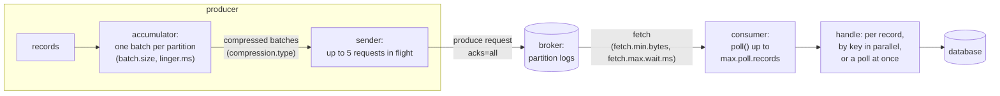

# 69. High-Throughput Kafka Tuning

<div class="badges" markdown><span class="badge badge-l3">L3 · Senior/Lead</span><span class="badge badge-l4">L4 · Architect</span><span class="badge badge-meta">linger.ms · batch.size · compression.type · acks · idempotence · max.in.flight · partitions · consumer groups · max.poll.records · key-ordered concurrency · batch writes · JDBC batching · COPY · batch vs stream</span></div>

<div class="grid two" markdown>

!!! info "Prerequisites"
    - [Chapter 25](../communication/ch25-asynchronous-messaging.md): Kafka topics, partitions and consumer groups in Spring
    - [Chapter 28](../communication/ch28-idempotency-correlation.md): idempotent consumers
    - [Chapter 68](ch68-horizontal-scaling.md): partition keys and hot partitions

!!! abstract "What you'll learn"
    - **linger.ms is a trade between broker work and latency.** At a steady 10,000 order events a second:
        - **linger.ms=0** sent **66,000–69,000** produce requests and cost the broker **5.8–6.0 s** of CPU, at a p50 of 0.4 ms.
        - **Kafka 4's default, 5 ms**, sent 3,300 requests.
        - **20 ms with 128 KB batches** sent **920–953** requests for **0.24–0.27 s** of broker CPU, at a p50 of **11.5 ms**.
    - **A backlogged producer batches anyway.** Sending as fast as it could, even linger.ms=0 filled 600 records per request. Bigger batches cut requests from about 500 to 65–75.
    - **Compression:** on JSON order events, snappy and lz4 shrank batches **4.4–4.5×**, zstd **6.75×** and gzip **7.31×**. gzip ran at **121,000–127,000** records a second, against 339,000–480,000 for zstd and 577,000–936,000 for lz4 and snappy.
    - **In-flight requests matter once there's a round trip.** Over a 1 ms round trip, one request at a time cut throughput to **268,000–269,000** a second from 641,000–674,000.
    - **Consumers scale to the partition count.** On 6 partitions, consumers handling a record per 1 ms gave 850, 2,500 and 4,900 records a second with 1, 3 and 6 consumers; 12 consumers still gave 4,900, with **6 idle**.
        - Handling records **in parallel by key** inside one consumer reached **16,600–16,800** a second.
        - Writing **a whole poll at once** reached **62,000–63,000**.
    - **The sink decides throughput.** Writing to PostgreSQL one record per commit gave **1,384–1,554** rows a second. A poll per transaction gave **29,000–46,000**, and COPY in polls of 5,000 gave **55,000–59,000**. Replayed events were ignored by the key in every case.

</div>

---

## 1 · Introduction & Context

### The topic that fell behind every dinner

FoodFleet's `orders` topic carries every order event to fifteen consumers: kitchen tickets, rider dispatch, invoicing, analytics, and more. Every dinner peak, the analytics consumer's lag grew to an hour and the brokers' CPU went to 80%, while the topic carried only 10,000 events a second.

Three settings turned out to be responsible:

- **The producers sent every record as soon as it was produced**, `linger.ms=0` from an old template, so the brokers handled tens of thousands of tiny requests a second.
- **The analytics consumer wrote each event to PostgreSQL in its own transaction**, so a database commit per event set its pace.
- **The topic had 6 partitions**, so scaling the consumer to 12 copies left half of them idle.

This chapter measures the settings that decide Kafka throughput, on the producer, on the consumer, and in the code that handles each record.

### Where it comes from

<ul class="mh-timeline">
<li><span class="when">2011–2013 · Kafka</span><span class="what">LinkedIn's log-centric broker; the producer batches by partition, and consumers pull.</span></li>
<li><span class="when">2017 · Kafka 0.11</span><span class="what">Idempotent producers and transactions; record batches with headers. Compression per batch with gzip, snappy and lz4; zstd follows in 2.1 (2018).</span></li>
<li><span class="when">2021 · Kafka 3.0</span><span class="what"><code>acks=all</code> and <code>enable.idempotence=true</code> become the defaults.</span></li>
<li><span class="when">2025 · Kafka 4.0</span><span class="what">KRaft only; <code>linger.ms</code> default goes from 0 to 5 (KIP-1030) because batching is nearly free and saves brokers' CPU.</span></li>
<li><span class="when">2026 · Kafka 4.2.2</span><span class="what">The Java client's defaults are checked here, with franz-go 1.20.6 (the client measured) and pgjdbc 42.7.14.</span></li>
</ul>

---

## 2 · Core Concepts & Terminology



Batch and request
:   The producer groups records per partition into batches (up to `batch.size` bytes) and sends the batches for one broker together in a produce request. The broker's cost is mostly per request; its throughput is mostly per byte.

linger.ms
:   How long a partition's batch waits for more records before it may be sent. 0 sends at once, but records still batch while earlier requests are in flight; Kafka 4's default is 5 ms.

Compression
:   Applied per batch by the producer and stored compressed. Bigger batches compress better. The broker doesn't decompress them unless formats or codecs differ.

acks, idempotence and in-flight requests
:   `acks=all` waits for all in-sync replicas. Idempotence lets the broker drop duplicates from retries, and keeps order with up to 5 requests in flight per connection.

Partitions and consumer groups
:   A partition is consumed by one member of a group at a time, so a group's parallelism is at most the partition count. Extra members sit idle.

Poll and processing
:   `poll()` returns up to `max.poll.records` (500). What the consumer does with them decides throughput: one at a time, concurrently by key (keeping per-key order), or all at once (one database write per poll).

At-least-once
:   Offsets are committed after processing, so after a crash some records are delivered again. The sink must ignore duplicates, for example with a primary key (chapter 28).

Batch and stream
:   Stream processing handles each event as it arrives, so results are seconds old. Batch processing handles accumulated data on a schedule, so results are hours old but the work is cheaper and simpler. Micro-batching (a poll at a time) sits between them.

---

## 3 · How It Works Internally

### The measuring set-up

The Kafka Java client couldn't be fetched on the test machine, so the producer and consumer experiments use **franz-go**, a production Kafka client for Go. They run against **kfake**, franz-go's in-memory broker, which speaks the Kafka protocol, in a separate process. Every setting is set explicitly to the value of the Java property named in the tables (franz-go's own defaults differ: 10 ms linger, snappy). The broker can delay every response to simulate a network round trip:

```go title="verify/kafkalab/main.go: a round trip without slowing the broker"
--8<-- "code/chapters/ch69-kafka-throughput-tuning/verify/kafkalab/main.go:110:124"
```

What this set-up measures faithfully: requests per record, bytes on the wire, compression ratios and codec CPU, in-flight limits over a round trip, and consumer parallelism. What it doesn't: disk, replication and a real broker's per-request cost. Broker CPU here is kfake's, so read it as relative.

The producer settings, one client per row:

```go title="verify/kafkalab/main.go: producer settings"
--8<-- "code/chapters/ch69-kafka-throughput-tuning/verify/kafkalab/main.go:246:254"
```

### Processing by key inside one consumer

Records with the same key go to the same lane, in order; different lanes run at the same time. This is the idea behind Confluent's Parallel Consumer, and Spring Kafka users can do the same with a keyed executor:

```go title="verify/kafkalab/main.go: key-ordered concurrency"
--8<-- "code/chapters/ch69-kafka-throughput-tuning/verify/kafkalab/main.go:460:481"
```

### Writing a poll at once

The sink side is Java against PostgreSQL. A poll's records go into one transaction with JDBC batching, and duplicates from redelivery are ignored by the primary key:

```java title="sink/OrderSink.java"
--8<-- "code/chapters/ch69-kafka-throughput-tuning/src/main/java/dev/foodfleet/ch69/sink/OrderSink.java:70:82"
```

COPY is PostgreSQL's bulk-load path, but it can't skip duplicates, so the sink copies into a temporary table and inserts from there with `on conflict do nothing`.

---

## 4 · Design Considerations & Trade-offs

### Test setup

All runs used:

- One 2-vCPU VM. The broker and the client ran as separate processes.
- 300,000 OrderPlaced events of JSON (295 bytes on average), keyed by order ID, to 12 partitions; acks=all.
- The sink: PostgreSQL 16 in Docker with synchronous commits, the JDK 25 client and pgjdbc 42.7.14.

There were two runs. Where they differed, both values are shown. `check_apis.sh` checks **16 behaviours** in the sources of the Kafka 4.2.2 Java client, franz-go 1.20.6 and pgjdbc, and all were found.

### Measured: linger at a steady rate

10,000 records a second for 10 s; latency from when each record was due until the broker acknowledged it:

| Settings | Round trip | p50 | p99 | Records per request | Produce requests | Broker CPU |
|---|---|---|---|---|---|---|
| linger.ms=0, batch.size=16384 (Kafka 3.x defaults) | loopback | **0.4 ms** | 2.8–3.2 ms | 1.4–1.5 | **66,433–69,432** | **5.75–6.02 s** |
| linger.ms=5, batch.size=16384 (Kafka 4.x defaults) | loopback | 3.7–3.8 ms | 7.4–7.8 ms | 30 | 3,259–3,343 | 0.69–0.75 s |
| linger.ms=20, batch.size=131072 | loopback | **11.5 ms** | 22.1–22.2 ms | 105–109 | **920–953** | **0.24–0.27 s** |
| linger.ms=0 | 1 ms | 2.3 ms | 4.4–5.4 ms | 5.1 | 19,551–19,918 | 3.08–3.15 s |
| linger.ms=5 | 1 ms | 5.0 ms | 9.0–9.3 ms | 31 | 3,216–3,237 | 0.92–0.97 s |
| linger.ms=20, batch.size=131072 | 1 ms | 12.8–12.9 ms | 23.5–23.8 ms | 105 | 949–957 | 0.31–0.34 s |

What the table shows:

- **At a steady rate, linger.ms=0 means a request per record or two.** 10,000 records became 66,000–69,000 requests in 10 s (some records waited for a free in-flight slot and shared a request). The broker spent 5.8–6.0 s of CPU on 10 s of traffic: the overloaded brokers of FoodFleet's dinner peak.
- **Kafka 4's 5 ms default cut requests 20×** for 3.4 ms more median latency. 20 ms with bigger batches cut them 70× and broker CPU 22–24×, for 11 ms more.
- **A round trip makes linger.ms=0 batch a little by itself.** With 1 ms of network, records waited for in-flight requests, and requests carried 5 records each. Latency rose by the round trip for every setting.
- **The latency cost is the linger, roughly.** A record waits for the rest of its batch's linger, so the p50 rose by about half the linger time and the p99 by about all of it (20 ms: p50 11.5 ms, p99 22 ms). For events nobody waits on synchronously (order events, tracking, audit), 20 ms is free; for a command whose reply a user waits for, it isn't.

### Measured: as fast as the producer can go

300,000 records produced at once (up to 100,000 buffered):

| Settings | Round trip | Records/s | Records per request | Requests | Compression ratio | Client CPU |
|---|---|---|---|---|---|---|
| linger.ms=0, batch.size=16384 | loopback | 759,000–852,000 | 596–602 | 498–503 | 1.00× | 0.41–0.46 s |
| linger.ms=5, batch.size=16384 | loopback | 778,000–870,000 | 592–602 | 498–507 | 1.00× | 0.39–0.45 s |
| linger.ms=20, batch.size=131072 | loopback | 927,000–969,000 | 4,000–4,615 | 65–75 | 1.00× | 0.41 s |
| + lz4 | loopback | 577,000–718,000 | 4,762 | 63 | **4.53×** | 0.60–0.69 s |
| + zstd | loopback | 339,000–445,000 | 4,762 | 63 | **6.75×** | 0.83–0.99 s |
| + snappy | loopback | 852,000–860,000 | 4,110–4,769 | 63–73 | **4.38–4.39×** | 0.50–0.57 s |
| + gzip | loopback | **121,000–124,000** | 4,756–4,762 | 63 | **7.31×** | **2.59–2.61 s** |
| linger.ms=0, max.in.flight=1, idempotence off | loopback | 584,000–661,000 | 601–602 | 498–499 | 1.00× | 0.46–0.51 s |
| linger.ms=0, batch.size=16384 | 1 ms | 641,000–674,000 | 599–603 | 498–501 | 1.00× | 0.46–0.51 s |
| linger.ms=20, batch.size=131072 | 1 ms | 849,000–931,000 | 4,038–4,590 | 65–74 | 1.00× | 0.41–0.46 s |
| + lz4 | 1 ms | 783,000–827,000 | 4,762–4,846 | 62–63 | 4.53× | 0.50–0.57 s |
| + zstd | 1 ms | 460,000–480,000 | 4,762 | 63 | 6.75× | 0.75–0.81 s |
| + snappy | 1 ms | 800,000–936,000 | 4,762 | 63 | 4.39× | 0.48–0.54 s |
| + gzip | 1 ms | 121,000–127,000 | 4,762 | 63 | 7.31× | 2.46–2.63 s |
| linger.ms=0, max.in.flight=1, idempotence off | 1 ms | **268,000–269,000** | 601–603 | 498–499 | 1.00× | 0.61–0.64 s |

What the table shows:

- **A backlogged producer fills its batches.** With records waiting, even linger.ms=0 sent 600 records per request, because each batch filled to batch.size while earlier requests were in flight. linger.ms matters at steady, moderate rates (the previous table), and batch.size matters at high ones: 128 KB batches cut requests from about 500 to 65–75.
- **Compression ratios were stable; speeds were not.** Every run gave the same ratios: about 4.4–4.5× for snappy and lz4, 6.75× for zstd, 7.31× for gzip. The JSON events repeat field names and values, which compress well. gzip cost 2.5–2.6 s of client CPU and ran at about an eighth of the speed of uncompressed 128 KB batches. zstd paid about 1.5× lz4's CPU for a third less data.
- **Compression moves CPU from the broker to the clients.** The broker handled 4.5–7× fewer bytes (its CPU fell from 0.11–0.12 s to 0.03–0.06 s). Network and disk are usually what a Kafka cluster runs out of, so lz4 or zstd is usually right.
- **In-flight requests hide the round trip.** On loopback, one request at a time cost 22–23% of throughput; over 1 ms it cost 58–60% (268,000 against 641,000–674,000). With idempotence, the Java client keeps 5 in flight and preserves order, so there's no reason to drop to 1.

These codecs are franz-go's Go implementations. The Java client uses lz4-java, snappy-java and zstd-jni, whose speeds differ; the ratios on the same data should be close.

### Measured: consumers and partitions

12,000 events produced at once to 6 partitions, into a group already consuming. Handling a record means a 1 ms write; "a whole poll" means one 5 ms write per poll of up to 500:

| Handling | Consumers | Records/s | Idle consumers |
|---|---|---|---|
| one record at a time | 1 | 852–860 | 0 |
| one record at a time | 3 | 2,468–2,518 | 0 |
| one record at a time | 6 | 4,888–4,897 | 0 |
| one record at a time | **12** | **4,825–4,923** | **6** |
| in parallel by key, 32 lanes, one consumer | 1 | **16,616–16,774** | 0 |
| a whole poll in one write | 1 | **61,931–63,239** | 0 |
| a whole poll in one write | 6 | 149,683–152,454 | 0 |

What the table shows:

- **Consumers scale with partitions and stop there.** 1, 3 and 6 consumers scaled linearly; with 12, six had no partition and did nothing. Partition counts must be set for the parallelism the busiest consumer will ever need.
- **Per-key parallelism beats adding consumers.** One consumer with 32 key-ordered lanes handled 16,600–16,800 records a second, more than 6 consumers handling one record at a time. Records of the same order still ran in order.
- **Handling a poll at once beats both.** One 5 ms write per 500 records gave 62,000–63,000 a second from one consumer: 73× the one-at-a-time rate. Most per-record work (database writes, HTTP calls to a bulk API) has a batch form.

### Measured: the consumer's writes to PostgreSQL

OrderPlaced events into a table keyed by order ID with `on conflict do nothing`; then the last fifth delivered again, as after a consumer restart:

| Write | Poll size | Commits | Rows/s | Rows after the replay |
|---|---|---|---|---|
| one insert, one commit per record | | 10,000 | **1,384–1,554** | 10,000 of 10,000 |
| a poll per transaction, JDBC batch | 50 | 2,000 | 15,554–17,252 | 100,000 of 100,000 |
| a poll per transaction, JDBC batch | 500 | 200 | 29,449–33,861 | 100,000 |
| a poll per transaction, JDBC batch | 5,000 | 20 | 34,511–35,727 | 100,000 |
| a poll per transaction, JDBC batch, `reWriteBatchedInserts=true` | 500 | 200 | **45,496–46,395** | 100,000 |
| a poll per transaction, one multi-row insert | 500 | 200 | 43,222–43,774 | 100,000 |
| a poll per transaction, COPY to a temp table + insert | 500 | 200 | 32,801–33,064 | 100,000 |
| a poll per transaction, COPY to a temp table + insert | 5,000 | 20 | **55,025–58,548** | 100,000 |

What the table shows:

- **A commit per record set the pace at about 1,400–1,550 rows a second.** Each commit waits for PostgreSQL to flush its log. That was the analytics consumer's ceiling, whatever Kafka did.
- **A transaction per poll was 19–24× faster.** At 500 records per poll, JDBC batching gave 29,000–34,000 rows a second. pgjdbc's `reWriteBatchedInserts=true` (off by default) rewrites the batch into multi-row inserts and reached 45,000–46,000, the same as writing the multi-row insert by hand.
- **COPY wins only with big polls.** At 500 records, the temporary table's overhead ate COPY's advantage. At 5,000 it reached 55,000–59,000 rows a second. Raise `max.poll.records` for such sinks, and keep processing within `max.poll.interval.ms` (5 minutes by default).
- **Idempotent writes made the replay harmless.** Every strategy ended with 100,000 rows after a fifth of the events arrived twice. Committing offsets after the write (at-least-once) is safe only with such a sink.

### Choosing

| Question | Do | Why (measured) |
|---|---|---|
| Events nobody waits on | `linger.ms=20`, `batch.size=131072`, `compression.type=lz4` (or zstd for storage) | 920–953 requests instead of 66,000–69,000; broker CPU 22–24× lower; +11 ms p50 |
| Requests someone waits on | `linger.ms=0` (or Kafka 4's 5), small batches | p50 0.4 ms against 11.5 |
| Compression | lz4 or snappy for speed, zstd for size; never gzip at volume | 4.4–4.5×, 6.75×; gzip at an eighth of the speed |
| Durability and order | `acks=all`, idempotence on, 5 in flight (the defaults) | One in flight lost 58–60% over a 1 ms round trip |
| Partition count | The most parallelism any consumer will need, plus growth | 12 consumers on 6 partitions: 6 idle |
| Slow per-record work | Key-ordered lanes inside the consumer | 16,600–16,800/s from one consumer |
| Writes to a database | A poll per transaction; batched inserts (`reWriteBatchedInserts`) or COPY | 1,384–1,554 rows/s per record; 45,000–59,000 batched |
| Delivery | Commit after processing; idempotent sink | Replays left the row count unchanged |

---

## 5 · Hands-on Implementation

```text
ch69-kafka-throughput-tuning/
├── src/main/java/dev/foodfleet/ch69/
│   ├── settings/  KafkaProfiles: producer and consumer settings by purpose, as Java client properties
│   └── sink/      OrderSink (per record, JDBC batch, multi-row, COPY), Events
├── src/test/java/…   UnitTest (3, tag unit)
└── verify/   kafkalab/ (Go: franz-go client, kfake broker), build-libs.sh, run.sh, check_apis.sh, tools/ (Lab: the sink)
```

### 🟣 Level 3: producers and consumers by purpose

<div class="badges" markdown><span class="badge badge-l3">L3 · Senior/Lead</span></div>

FoodFleet's event producers use `KafkaProfiles.producerThroughput()`, as Spring Boot properties:

```properties
spring.kafka.producer.properties.acks=all
spring.kafka.producer.properties.enable.idempotence=true
spring.kafka.producer.properties.linger.ms=20
spring.kafka.producer.properties.batch.size=131072
spring.kafka.producer.properties.compression.type=lz4
spring.kafka.producer.properties.max.in.flight.requests.per.connection=5
```

- Consumers that write to a database use batch listeners (`spring.kafka.listener.type=batch`) and write each poll in one transaction, with `enable.auto.commit=false` and the listener container committing after the batch.
- JDBC URLs for sinks carry `reWriteBatchedInserts=true`.
- Consumer lag per partition is alerted on (chapter 51), not just per group.

### 🔴 Level 4: throughput as a design property

<div class="badges" markdown><span class="badge badge-l4">L4 · Architect</span></div>

- Partition counts chosen from the slowest consumer's per-partition rate and the peak event rate, with room to grow (adding partitions remaps keys, chapter 68).
- Slow consumers redesigned around batches or key-ordered concurrency before more partitions are added.
- Analytics moved from per-event writes to micro-batches, and to a scheduled batch where results an hour old are fine.

```bash
JAVA_HOME=/path/to/jdk-25 verify/run.sh   # about 10 minutes; needs Go 1.24+ and Docker
```

### Run and verify

```text
$ verify/run.sh consumer
== consumer
12,000 OrderPlaced events produced at once into a topic the group already consumes; each consumer is a member of one group; handling a record means a 1 ms write
(a database round trip); 'batch' writes a whole poll (max.poll.records=500) in one 5 ms write instead
set-up                                                         partitions  consumers    records/s idle consumers
one record at a time                                                    6          1          852              0
one record at a time                                                    6         12         4923              6
in parallel by key, 32 at a time, inside one consumer                   6          1        16616              0
a whole poll in one write                                               6          1        61931              0
```

!!! question "Try it"
    1. Run the steady-rate table at 1,000 records a second. Does linger.ms=5 still batch, and what does it cost in latency?
    2. Add `lz4` to the linger.ms=5 row. Does compression help when batches hold only 30 records?
    3. Give the keyed consumer 128 lanes instead of 32. How far does throughput go, and what limits it?
    4. Run the sink with `synchronous_commit=off`. What happens to the per-record row, and what would you lose in a crash?

---

## 6 · Production Readiness

- [x] **Producer settings by purpose**: batching and lz4/zstd for events, low linger for request/response
- [x] **`acks=all`, idempotence, 5 in flight** (the defaults) kept
- [x] **Partition counts** sized for the slowest consumer's needs and growth
- [x] **Consumers batch their writes**, with an idempotent sink and offsets committed after processing
- [x] **Per-key concurrency** where per-record work is slow
- [x] **Lag alerts per partition**, and broker request rates watched (a jump in requests means a producer lost its batching)
- [x] **Batch vs stream decided per use**: freshness needed versus cost

---

## 7 · Anti-patterns & Pitfalls

!!! pitfall "Incident 1: tens of thousands of tiny requests"
    **Context.** Order producers ran with `linger.ms=0` from an old template.

    **Symptoms.** Broker CPU at 80% for 10,000 events a second; produce request rates in the tens of thousands.

    **Root cause.** At a steady rate, no linger meant about one record per request. Measured: 66,000–69,000 requests and 5.8–6.0 s of broker CPU for 10 s of traffic, against 920–953 requests and 0.24–0.27 s with 20 ms.

    **Fix.** The throughput profile for event producers; Kafka 4's default of 5 ms for the rest.

!!! pitfall "Incident 2: a commit per event"
    **Context.** The analytics consumer wrote each order event to PostgreSQL in its own transaction.

    **Symptoms.** Lag grew every dinner peak and took hours to clear; adding consumers didn't help past the partition count.

    **Root cause.** The database commit per record set the pace. Measured: 1,384–1,554 rows a second per record; 29,000–59,000 batched by poll.

    **Fix.** A batch listener, one transaction per poll, `reWriteBatchedInserts=true`; at-least-once with an idempotent insert.

!!! pitfall "Incident 3: twelve consumers, six partitions"
    **Context.** To catch up on lag, the dispatch consumer was scaled from 6 to 12 copies.

    **Symptoms.** Lag didn't move; six copies reported no assigned partitions.

    **Root cause.** A group's parallelism is the partition count. Measured: 12 consumers on 6 partitions gave the same 4,800–4,900 records a second as 6, with 6 idle.

    **Fix.** Key-ordered concurrency inside each consumer (measured 16,600–16,800 a second from one), and 24 partitions for the next topic.

| Anti-pattern | Symptom | Fix |
|---|---|---|
| `linger.ms=0` for event streams | Broker CPU spent on requests | `linger.ms=5`–`20`, larger batches |
| gzip at volume | Producers CPU-bound | lz4 or zstd |
| `max.in.flight=1` "for ordering" | Throughput collapses with latency | Idempotence keeps order with 5 |
| More consumers than partitions | Idle consumers, same lag | More partitions, or concurrency inside |
| A transaction per record | Database commit rate is the ceiling | A transaction per poll, batched inserts |
| Auto-commit before processing | Lost events on crash | Commit after processing; idempotent sink |
| Streaming what could be batch | Cost without a need for freshness | Micro-batches or a scheduled job |

---

## 8 · Enterprise Case Study

### FoodFleet: batching at every hop

!!! decision "ADR-069: event producers use linger.ms=20, batch.size=131072, lz4, acks=all and idempotence; request/response producers keep low linger; topics get partitions for the slowest consumer's parallelism plus growth; consumers that write to databases use batch listeners with one transaction per poll, reWriteBatchedInserts and idempotent inserts, committing offsets after the write; slow per-record work uses key-ordered concurrency inside the consumer"
    **Status:** Accepted · **Date:** 2026-02-16

    **Context.** Brokers ran hot at 10,000 events a second, the analytics consumer lagged by an hour every dinner, and scaling a consumer past its partitions did nothing. Measured:

    - At 10,000 records a second, linger.ms=0 sent 66,000–69,000 requests (5.8–6.0 s of broker CPU); 20 ms with 128 KB batches sent 920–953 (0.24–0.27 s), for 11 ms more p50.
    - lz4 and snappy compressed order events 4.4–4.5×, zstd 6.75×; gzip ran at an eighth of the speed.
    - One request in flight lost 58–60% of throughput over a 1 ms round trip.
    - 12 consumers on 6 partitions: 6 idle. Key-ordered lanes: 16,600–16,800 records a second from one consumer.
    - PostgreSQL: 1,384–1,554 rows a second with a commit per record; 45,000–59,000 batched.

    **Decision.**

    - **Producers:** `KafkaProfiles.producerThroughput()` for events, `producerLatency()` for commands awaiting replies; both in the platform's Spring Boot starter.
    - **Topics:** partition counts reviewed in design (24 for `orders`), never changed for keyed topics without a migration plan.
    - **Consumers:** batch listeners for sinks; Confluent Parallel Consumer (or a keyed executor) for slow per-record work; lag per partition alerted.
    - **Analytics:** micro-batches into PostgreSQL every poll; heavy aggregates by a scheduled batch job, since an hour's freshness is enough.

    **Consequences:**

    - ✅ Brokers handle requests in the hundreds, not tens of thousands; the same cluster carries several times the traffic.
    - ✅ Consumers catch up after peaks in minutes.
    - ⚠️ Event latency rises by about the linger (11 ms at the median).
    - ⚠️ Batch sinks must handle partial failures in a poll (retry the poll, dead-letter the bad record).

### Fintech analogue: settlement files and real-time ledgers

Payment processors run both models side by side: real-time ledger postings stream per event with small lingers, because balances must be current, while settlement and reconciliation run as batches over the day's events, because they need completeness more than freshness. Their Kafka producers for card events batch and compress heavily, since the volume is large and nothing waits on each event.

### E-commerce analogue: clickstream at sale time

Retailers' clickstream topics carry tens of thousands of events per second at a sale. Their producers batch for tens of milliseconds and compress with zstd, consumers write micro-batches to the warehouse, and the topic's partition count is set for the sale's peak weeks ahead, since keys can't be remapped mid-sale.

---

## 9 · Interview Q&A + Summary

#### Q1. What do linger.ms and batch.size do? · <span class="badge badge-l2">L2</span> · TCS · Infosys

**Short answer:** The producer keeps a batch per partition; `batch.size` caps its bytes, and `linger.ms` is how long it waits for more records before sending. Measured at 10,000 records a second: linger 0 made 66,000–69,000 requests, Kafka 4's 5 ms made about 3,300, and 20 ms with 128 KB batches about 950, for an 11 ms higher median latency.

#### Q2. Why did Kafka 4 change linger.ms's default to 5? · <span class="badge badge-l3">L3</span> · Confluent

**Short answer:** Because a few milliseconds of waiting batches records much better at moderate rates, saving broker CPU, at a latency cost most applications don't notice (KIP-1030). Measured: 20× fewer requests than linger 0 for 3.4 ms more median latency.

#### Q3. Which compression codec? · <span class="badge badge-l3">L3</span> · Flipkart

**Short answer:** lz4 or snappy for speed, zstd when storage and network matter more, never gzip at volume. Measured on JSON order events: lz4 and snappy 4.4–4.5×, zstd 6.75× at about 1.5× lz4's CPU, gzip 7.31× at an eighth of the throughput. Compression also cuts broker work, since the broker stores batches as they are.

#### Q4. Is max.in.flight.requests.per.connection=1 needed for ordering? · <span class="badge badge-l3">L3</span> · PhonePe

**Short answer:** No, not with idempotence (the default since 3.0), which keeps order with up to 5. One in flight costs throughput whenever there's latency: measured over a 1 ms round trip, 268,000–269,000 records a second against 641,000–674,000.

#### Q5. Why does adding consumers sometimes not reduce lag? · <span class="badge badge-l2">L2</span> · Swiggy

**Short answer:** A partition goes to one member of a group, so a group's parallelism is capped by the partition count. Measured: 12 consumers on 6 partitions gave the same 4,800–4,900 records a second as 6, with 6 idle.

#### Q6. How do you process faster without more partitions? · <span class="badge badge-l3">L3</span> · Zomato

**Short answer:** Concurrency inside the consumer, keyed so each key stays in order (Confluent Parallel Consumer, or a keyed executor), or batching the work per poll. Measured: 32 key-ordered lanes gave 16,600–16,800 records a second from one consumer; one write per poll gave 62,000–63,000.

#### Q7. How should a consumer write to a database? · <span class="badge badge-l3">L3</span> · Razorpay

**Short answer:** A poll per transaction with batched inserts, an idempotent key, and offsets committed afterwards. Measured on PostgreSQL: 1,384–1,554 rows a second with a commit per record, 29,000–34,000 with JDBC batching, 45,000–46,000 with `reWriteBatchedInserts=true`, and 55,000–59,000 with COPY in polls of 5,000.

#### Q8. At-least-once, at-most-once or exactly-once? · <span class="badge badge-l3">L3</span> · Paytm

**Short answer:** At-least-once (commit after processing) with an idempotent sink is the usual choice; at-most-once loses events on crashes; exactly-once needs Kafka transactions end to end, or a sink that stores offsets with the data. Measured: replaying a fifth of the events left every sink's row count unchanged.

#### Q9. What does acks=all cost? · <span class="badge badge-l3">L3</span> · Uber

**Short answer:** Waiting for every in-sync replica, so latency rises by the slowest follower's fetch, typically a few milliseconds within a region. It isn't measured here (the test broker had no replicas). With `min.insync.replicas=2` it's what makes an acknowledged record survive a broker loss, so FoodFleet keeps it.

#### Q10. Batch or stream processing? · <span class="badge badge-l3">L3</span> · Atlassian

**Short answer:** Stream when results must be seconds fresh (dispatch, fraud, live dashboards); batch when hours are fine (settlement, reports), since it's cheaper and simpler. Micro-batching sits between: per-poll writes here ran 10–42× faster than per-record writes, at the cost of a poll's latency.

#### Q11. How many partitions should a topic have? · <span class="badge badge-l3">L3</span> · LinkedIn

**Short answer:** Enough for the most parallel consumer at peak, plus growth: the peak rate divided by what one consumer instance handles per partition. Add margin up front, since adding partitions to a keyed topic remaps keys (chapter 68). Too many costs broker memory, file handles and longer rebalances.

#### Q12. FoodFleet's `orders` topic must carry 10× today's traffic. What do you change? · <span class="badge badge-l4">L4</span> · architecture rounds

**Short answer:**

- **Producers:** linger 20 ms, 128 KB batches, lz4; idempotence and acks=all kept.
- **Topic:** partitions for the slowest consumer at 10×, decided now (24 → 96 with a migration of key-ordered consumers).
- **Consumers:** batch listeners for sinks, key-ordered concurrency for slow work, lag alerts per partition.
- **Analytics:** micro-batches and scheduled aggregates instead of per-event writes.
- **Verify:** a load test at 10× with an open model (chapter 65).

### Key takeaways

- **Batch on the producer**: linger and batch size decide the broker's request rate; Kafka 4's 5 ms default is a good floor.
- **Compress with lz4 or zstd**: 4.5–6.75× less data; gzip is too slow.
- **A group can't outgrow its partitions**: plan partition counts, and add concurrency inside consumers.
- **The sink sets the ceiling**: a transaction per poll, batched inserts, idempotent writes.

### Further reading

- Apache Kafka, [Producer Configs](https://kafka.apache.org/documentation/#producerconfigs) and [Consumer Configs](https://kafka.apache.org/documentation/#consumerconfigs)
- [KIP-1030: Change constraints and default values for various configurations](https://cwiki.apache.org/confluence/display/KAFKA/KIP-1030%3A+Change+constraints+and+default+values+for+various+configurations)
- Confluent, [Parallel Consumer](https://github.com/confluentinc/parallel-consumer)
- Spring for Apache Kafka, [Batch listeners](https://docs.spring.io/spring-kafka/reference/kafka/receiving-messages/listener-annotation.html)
- PostgreSQL, [Populating a Database](https://www.postgresql.org/docs/16/populate.html)

---

**Previous:** [← 68. Horizontal Scaling & Partitioning](ch68-horizontal-scaling.md) · **Next:** [70. FinOps →](ch70-finops.md)
