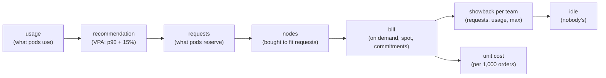

# 70. Cost Optimization (FinOps)

<div class="badges" markdown><span class="badge badge-l3">L3 · Senior/Lead</span><span class="badge badge-l4">L4 · Architect</span><span class="badge badge-meta">unit economics · requests vs usage · right-sizing · Vertical Pod Autoscaler · CPU limits and throttling · bin packing · showback · cost allocation · idle cost · spot capacity · OpenCost</span></div>

<div class="grid two" markdown>

!!! info "Prerequisites"
    - [Chapter 54](../deployment/ch54-kubernetes-for-spring.md): requests, limits and how the scheduler uses them
    - [Chapter 56](../deployment/ch56-autoscaling.md): the HPA, VPA and node autoscaling
    - [Chapter 67](ch67-jvm-tuning-containers.md): what a JVM uses inside a container
    - [Chapter 68](ch68-horizontal-scaling.md): copies, shared limits and capacity

!!! abstract "What you'll learn"
    - **Requests are guesses, and they set the bill.** Three workloads, sized as FoodFleet declared them, went through a compressed day of traffic:
        - **api** (1 CPU, 2 GiB): used **9–10%** of its CPU and **5%** of its memory.
        - **cache** (1 CPU, 4 GiB): used **3–4%** of its CPU and 21% of its memory.
        - **batch** (2 CPUs, 4 GiB): averaged **18%** of its CPU, and its bursts needed all of it.
    - **VPA's rules shrank the fleet by about three quarters.** Applied to FoodFleet's 24 services, they cut requests from **97 to 30 CPUs** and from **240 to 44–45 GiB**, and the nodes from **32 to 8–9**. At OpenCost's default prices that's **$4,537 to $1,134–1,276** a month.
    - **Right-size requests, not CPU limits.**
        - With a CPU *limit* at the recommendation (0.2 CPU), the api's p99 went from **5 ms to 78–204 ms**, because its peaks used up to 0.58 CPU.
        - With the same *request* and no CPU limit, p99 stayed at **4.6–5.3 ms**.
    - **Showback by usage leaves most of the bill unowned.** Divided by requests, 34% of the cluster was idle. Divided by usage, **93%** was.
    - **Spot needs an on-demand base sized for the minute it's gone.** When the spot copies were reclaimed for a minute under load:
        - **All spot** served **0–1%** of requests, at 21% of the on-demand cost.
        - **2 on-demand + 4 spot** served **42–49%**.
        - **3 + 3** served **55–61%**. Overloaded copies served less than their capacity.

</div>

---

## 1 · Introduction & Context

### The bill nobody owned

FoodFleet's Kubernetes bill had doubled in a year while orders grew by a third. Every team believed its own services were modest. Each had copied the platform template's `requests: 1 CPU, 2 GiB` and added more "to be safe". The cluster autoscaler bought nodes to fit the requests, not the load. Finance asked what an order cost, and nobody could say.

FinOps is the practice that answers that question and keeps answering it:

- **Measure** what each service uses against what it asks for.
- **Right-size** the requests.
- **Pay less per unit** of what remains: spot, commitments, denser nodes.
- **Show each team its share**, so the people who decide the requests see their cost.

This chapter measures each step with FoodFleet's workloads.

### Where it comes from

<ul class="mh-timeline">
<li><span class="when">2009–2017 · Cloud billing and spot</span><span class="what">EC2 spot instances (2009), reserved instances, then per-second billing (2017): price depends on how you buy, not only on what.</span></li>
<li><span class="when">2018 · Vertical Pod Autoscaler</span><span class="what">Kubernetes' VPA recommends requests from usage histograms; Google's Autopilot paper (2020) describes the same idea at Borg's scale.</span></li>
<li><span class="when">2019–2021 · FinOps</span><span class="what">The FinOps Foundation (2019, Linux Foundation 2020) defines inform, optimize, operate; Kubecost, then OpenCost (CNCF, 2022), allocate Kubernetes costs to workloads.</span></li>
<li><span class="when">2021–2024 · Smarter capacity</span><span class="what">Karpenter chooses instance types per pending pod and consolidates nodes; spot interruption handling becomes standard.</span></li>
<li><span class="when">2025–2026 · In-place resize</span><span class="what">Pods can change requests without restarting, and VPA can use it. VPA 1.8.0 and OpenCost 2.5.3 are checked here.</span></li>
</ul>

---

## 2 · Core Concepts & Terminology



Requests and limits
:   A request is what the scheduler reserves for a pod, and it's what nodes are bought for. A limit is a ceiling: CPU above it is throttled, and memory above it gets the container OOMKilled. A pod can use more CPU than it requests when the node has spare CPU and no limit stops it.

Utilization and idle cost
:   Utilization is usage over capacity. Idle cost is what the cluster costs beyond what workloads use: unrequested capacity on nodes, plus requested capacity nobody uses.

Right-sizing
:   Setting requests from measured usage. VPA's recommender takes the 90th percentile of CPU usage and of memory peaks, adds a 15% safety margin, and gives lower and upper bounds (the 50th and 95th percentiles).

Bin packing
:   Fitting pods' requests onto as few nodes as possible. The node count, and so the bill, follows the sum of requests and how well their shapes fit the node.

Showback and chargeback
:   Showing each team its share of the bill (showback), or billing it (chargeback). Allocation can follow requests, usage, or (OpenCost's rule) the larger of the two per container. The rest is idle and has to be shared out somehow.

Spot capacity
:   Spare capacity sold at a deep discount that the provider can reclaim with short notice (two minutes on AWS). It suits work that can lose copies: stateless services above an on-demand base, batch jobs, CI.

Unit economics
:   Cost per unit of business: per 1,000 orders, per active restaurant, per delivery. It's the number that shows whether costs grow faster than the business.

---

## 3 · How It Works Internally

### Measuring a workload

Each workload runs in a Docker container sized as declared, with the JDK mounted read-only. A load generator drives a compressed day: 24 "hours" of 5 seconds each, quiet at night, with peaks at lunch and dinner. Once a second the lab reads the container's process from `/proc`: CPU time (user + system) and resident memory. These are close to what the kubelet reports as usage and working set.

### VPA's recommendation

The recommender, with VPA 1.8.0's defaults:

```java title="rightsize/Recommender.java"
--8<-- "code/chapters/ch70-finops/src/main/java/dev/foodfleet/ch70/rightsize/Recommender.java:34:43"
```

Memory samples are the peak of each aggregation interval (24 hours by default), so with one day of history the memory target is that day's peak plus 15%. The real recommender keeps decaying histograms (half-life 24 hours) and weights CPU samples by the request; over a uniform day this simple version gives the same answer.

### From requests to nodes and a bill

The fleet is FoodFleet's 24 services with their declared requests and replica counts: 80 pods. They're packed first-fit-decreasing onto 4-vCPU, 16 GiB nodes (3.8 CPUs and 14.5 GiB allocatable), as the scheduler and a node autoscaler roughly would. Prices are OpenCost's default list ("based on GCP us-central1"): $0.031611 per vCPU-hour and $0.004237 per GiB-hour, and $0.006655 and $0.000892 on spot. Real prices vary by provider, region, discount and instance family; the comparisons hold, the totals are illustrative.

Showback charges each pod three ways; OpenCost charges a container its request when it uses less:

```java title="cost/Fleet.java"
--8<-- "code/chapters/ch70-finops/src/main/java/dev/foodfleet/ch70/cost/Fleet.java:111:113"
```

### Spot, reclaimed

On the cluster, menu-service runs as two Deployments behind one Service: `menu-on-demand` and `menu-spot`. In a real cluster these are pinned to node pools by a nodeSelector or a Karpenter NodePool. Each copy has 0.25 CPU. A reclaim scales `menu-spot` to zero. Each pod gets SIGTERM, fails its readiness check, waits for endpoints to drop it, and finishes its requests in progress:

```java title="app/MenuApi.java"
--8<-- "code/chapters/ch70-finops/src/main/java/dev/foodfleet/ch70/app/MenuApi.java:52:56"
```

A minute later the spot copies come back, as replacement capacity would. Requests use a new connection each, so the Service balances each one (chapter 68).

---

## 4 · Design Considerations & Trade-offs

### Test setup

All runs used:

- JDK 25.0.4 with G1 and `MaxRAMPercentage=70` (chapter 67's settings).
- Docker for the usage experiment, and k3s 1.37.1 for the spot experiment, on one 2-vCPU VM.

There were two runs. Where they differed, both values are shown. `check_apis.sh` checks **14 rules and defaults** in VPA 1.8.0's and OpenCost 2.5.3's sources, and all were found.

### Measured: usage against requests

The compressed day: 24 "hours" of 5 s, at 20–480 requests a second for the api and a quarter of that for the cache. The batch worker runs every core for 6 s in every 30 s:

| Workload | Declared | CPU mean | CPU p90 | CPU max | Memory peak | VPA CPU target | VPA memory target | CPU used | Memory used |
|---|---|---|---|---|---|---|---|---|---|
| api | 1 CPU, 2 GiB | 0.09–0.10 | 0.16–0.17 | 0.43–0.58 | 106–109 MiB | **0.18–0.20** | **250 MiB** (the minimum) | **9–10%** | **5%** |
| cache (600 MB of data) | 1 CPU, 4 GiB | 0.03–0.04 | 0.06–0.07 | 0.27–0.31 | 892–910 MiB | 0.07–0.08 | 1,025–1,046 MiB | 3–4% | 21% |
| batch | 2 CPUs, 4 GiB | 0.37 | **1.84–1.85** | 1.89–1.90 | 838–871 MiB | **2.12–2.13** | 963–1,002 MiB | 18% | 20–21% |

What the table shows:

- **Steady services asked for 10–20× what they used.** The api requested 10 times the CPU it used on average and about 19 times the memory: its busiest second used 0.43–0.58 CPU of its 1, and its memory never passed 109 MiB of 2 GiB. A JVM with little live data grows its heap only as far as it needs to (chapter 67), so the memory request, not the JVM, was the waste.
- **The cache needed its memory, not its CPU.** Its memory request was 4.5× its use, its CPU request 25–33×. Requests have two dimensions, and templates get both wrong at once.
- **A bursty workload's p90 is its burst.** The batch worker averaged 0.37 CPU, but 6 s in every 30 s it used both cores, so its p90 was 1.84 and VPA recommended more than it had (2.12–2.13). Averages say it's 80% idle; the recommendation says it's right. For such work the saving is in scheduling (run it on spot, or when the cluster is quiet), not in its request.

### Measured: the api at the recommended size

The same day; latency from when each request was due:

| Size | p50 | p99 | Max | p99 in the 4 busiest "hours" | Memory peak |
|---|---|---|---|---|---|
| declared: limits 1 CPU, 2 GiB | 1.1–1.2 ms | **5.1 ms** | 32–47 ms | 5.0–5.4 ms | 106–108 MiB |
| VPA target as **limits**: 0.2 CPU, 256 MiB | 1.2 ms | **78–204 ms** | 159–388 ms | **82–84 ms** | 121–156 MiB |
| VPA target memory as the limit, **no CPU limit** (0.2 CPU requested) | 1.2 ms | **4.6–5.3 ms** | 30–52 ms | 4.6–6.1 ms | 97–104 MiB |
| half the VPA memory (128 MiB) as the limit, no CPU limit | 1.2 ms | 5.8–7.0 ms | 18–72 ms | 4.8–6.5 ms | 93–97 MiB |

What the table shows:

- **A CPU limit at the p90 throttles the peaks.** The recommendation covers 90% of seconds by design; in the rest the api needed up to 0.58 CPU, and a 0.2 CPU limit made it wait for the next CFS period. p99 rose 15–40×, mostly in the busiest hours.
- **A request at the p90 with no CPU limit cost nothing in latency.** The scheduler reserved 0.2 CPU; at peaks the container borrowed idle CPU from the node. This is why FoodFleet sets CPU requests from recommendations and doesn't set CPU limits on latency-sensitive services (chapter 54 measured the same throttling at startup).
- **Memory had room to spare even at half the recommendation.** VPA's 250 MiB minimum was already more than twice the peak; 128 MiB still worked. Memory limits stay, at the request, because exceeding memory kills the container rather than slowing it.

### Calculated: the fleet, right-sized

FoodFleet's 24 services, 80 pods. Each kind's declared requests are scaled by its measured VPA target over its declaration (above):

| Requests | CPU | Memory | Nodes | CPU allocated | Memory allocated | On demand / month | All spot / month |
|---|---|---|---|---|---|---|---|
| as declared | 97.0 | 240 GiB | **32** | 80% | 52% | **$4,537** | $955 |
| right-sized (VPA targets by kind) | 29.6–30.5 | 44.3–45.0 GiB | **8–9** | 89–97% | 35–38% | **$1,134–1,276** | $239–269 |

What the table shows:

- **Right-sizing removed 72–75% of the nodes.** The fleet's requests fell to under a third for CPU and a fifth for memory, and the packing tightened (CPU 89–97% allocated). This is the largest saving in the chapter, and it needs no new technology: measurements and a change to Helm values.
- **After right-sizing, the bottleneck switches to CPU.** CPU was 89–97% allocated and memory 35–38%, so the cheaper next step is CPU-heavier nodes (a compute-optimised family) rather than more of the same.
- **Spot multiplies whatever is left.** At OpenCost's default prices spot is 79% cheaper; applied to the whole fleet it's $239–269 a month. The spot experiment below shows why not all of it can be spot.

### Calculated: who pays

The declared fleet's month ($4,537 on demand), divided among teams:

| Team | By requests | By usage | By max(request, usage), OpenCost's rule |
|---|---|---|---|
| delivery | $769 | $93–95 | $769 |
| menu | $664 | $66–67 | $664 |
| ordering | $516 | $45–46 | $516 |
| growth | $505 | $58 | $505 |
| payments | $322 | $33–34 | $322 |
| platform | $205 | $17–18 | $205 |
| **idle** (nobody's) | **$1,557 (34%)** | **$4,219–4,225 (93%)** | $1,557 (34%) |

What the table shows:

- **Usage-based showback hides the decision that costs money.** By usage, teams owned 7% of the bill and 93% was idle, owned by nobody. Teams decide their requests, and requests buy nodes, so charging by usage tells them their over-sizing is free.
- **Charging the larger of request and usage puts the cost where the decision is.** Every service used less than it requested, so OpenCost's rule charged requests: teams carried 66% of the bill, and the idle 34% was the part they didn't request (packing slack and headroom), which the platform team owns.
- **Showback changes behaviour only if it's seen.** FoodFleet sends each team its monthly cost, cost per 1,000 orders, and its requested-versus-used ratio.

### Measured: spot copies reclaimed under load

Six copies of menu-service at 0.25 CPU each; one copy served 54–58 requests a second, and the load was 60% of six copies' capacity (194–209 requests a second). At 30 s the spot copies were reclaimed, and at 90 s they came back; 120 s per row:

| On demand | Spot | Cost per hour | Served (whole 120 s) | Served while reclaimed (30–90 s) | p99 (whole) |
|---|---|---|---|---|---|
| 6 | 0 | $0.0538 | 99.6% | 100% (no interruption) | 1.3–2.1 s |
| 0 | 6 | **$0.0113** | 44–49% | **0–1%** | 4.5–4.8 s |
| 2 | 4 | $0.0255 | 71–72% | **42–49%** | 7.5–9.2 s |
| 3 | 3 | $0.0325 | 76–78% | **55–61%** | 8.3–9.8 s |

What the table shows:

- **All-spot was an outage.** With every copy reclaimed at once, nothing was served for the minute, and under half of the two minutes' requests succeeded; the copies that came back served most requests within the last 30 s. Real reclaims hit a whole instance pool at once, which is why spot is spread across instance types and zones.
- **An on-demand base kept serving, but overloaded copies served less than their capacity.** 2 copies could serve 108–116 a second and 3 copies 162–174, so 52–90% of the 194–209 a second offered. They served 42–61%, because requests queued past the client's 2 s timeout and the copies spent time on requests nobody waited for. A concurrency limit with fast rejection (chapter 66) keeps goodput near capacity.
- **Size the on-demand base for the reclaim, not for the average.** To ride out a reclaim without shedding, the on-demand copies must carry the load alone. At 60% load that's 4 of 6; at 30% load, 2 of 6, which is why FoodFleet runs services that use spot at lower utilization and lets the HPA add spot copies on top.

The p99s over the whole run were seconds wherever copies were lost, since timed-out requests count at 2 s.

### Choosing

| Question | Do | Why (measured) |
|---|---|---|
| Setting requests | VPA in recommendation mode; requests from its target, reviewed monthly | Services used 3–10% of requested CPU |
| CPU limits | None on latency-sensitive services; requests only | A limit at the p90: p99 5 → 78–204 ms |
| Memory limits | Equal to the request | Exceeding memory kills; 128 MiB still worked here |
| Bursty jobs | Schedule them (spot, off-peak), don't shrink them | VPA recommended 2.12–2.13 CPUs for a 2-CPU job |
| Node shapes | Follow the fleet's CPU:memory ratio after right-sizing | 89–97% CPU against 35–38% memory allocated |
| Showback | max(request, usage) per team; idle owned by the platform | By usage, 93% of the bill was nobody's |
| Spot | Above an on-demand base that carries the load alone; diversified pools; load shedding | All spot: 0–1% served for a minute |
| Unit economics | Cost per 1,000 orders per team, monthly | The number finance asked for |

---

## 5 · Hands-on Implementation

```text
ch70-finops/
├── src/main/java/dev/foodfleet/ch70/
│   ├── app/         MenuApi: api, cache and batch workloads, graceful shutdown
│   ├── rightsize/   Recommender: VPA's recommendation rules
│   └── cost/        Fleet: packing, prices, showback
├── src/main/resources/k8s/menu.yaml   on-demand and spot Deployments behind one Service
├── src/test/java/…   UnitTest (4, tag unit)
└── verify/   build-libs.sh, run.sh, check_apis.sh, fleet.tsv (24 services), tools/ (Lab, RunSuites)
```

### 🟣 Level 3: measure, then size

<div class="badges" markdown><span class="badge badge-l3">L3 · Senior/Lead</span></div>

- VPA in `updateMode: "Off"` (recommendation only) for every Deployment; a monthly report compares each request with its target, and teams update Helm values.
- No CPU limits on services; memory limit = memory request; JVMs sized from the container (chapter 67).
- OpenCost in the cluster, with namespace and `team` labels; each team's dashboard shows cost, cost per 1,000 orders and requested/used.

```yaml
apiVersion: autoscaling.k8s.io/v1
kind: VerticalPodAutoscaler
metadata: {name: menu-service}
spec:
  targetRef: {apiVersion: apps/v1, kind: Deployment, name: menu-service}
  updatePolicy: {updateMode: "Off"}
```

### 🔴 Level 4: buying capacity

<div class="badges" markdown><span class="badge badge-l4">L4 · Architect</span></div>

- Karpenter NodePools: on-demand for the base, spot across many instance types and zones for the rest, consolidation on.
- Each spot-tolerant service has an on-demand Deployment sized to carry its load at the expected peak, a spot Deployment on top, a PodDisruptionBudget, graceful shutdown and a concurrency limit.
- Commitments (savings plans, committed use) for the steady base after right-sizing, never before.
- Unit cost per 1,000 orders tracked per quarter alongside latency SLOs.

```bash
JAVA_HOME=/path/to/jdk-25 verify/run.sh   # about 30 minutes; needs Docker and a cluster
```

### Run and verify

```text
$ verify/run.sh usage fleet
== fleet
requests                                  CPU       memory   nodes    CPU alloc.    mem alloc.  on demand/month     spot/month
as declared                              97.0    240.0 GiB      32           80%           52%            4537$           955$
right-sized (VPA targets by kind)        29.6     44.3 GiB       8           97%           38%            1134$           239$
```

!!! question "Try it"
    1. Run the api with a CPU limit of 0.6 (its measured maximum) instead of 0.2. Does the p99 come back to 5 ms?
    2. Give the batch worker `PERIOD_S=300` (6 s of work every 5 minutes). What does VPA recommend now, and is it right?
    3. Change the node shape to 8 vCPU and 16 GiB. How many nodes does the right-sized fleet need?
    4. Add a concurrency limit to menu-service and rerun the 3 + 3 spot row. How much of the load is served while the spot copies are gone?

---

## 6 · Production Readiness

- [x] **VPA recommendations for every workload**, compared with requests monthly
- [x] **No CPU limits on latency-sensitive services**; memory limits equal to requests
- [x] **Cost allocation by team** (labels, OpenCost), charging max(request, usage), idle owned by the platform
- [x] **Unit cost per 1,000 orders**, reported with SLOs
- [x] **Spot only above an on-demand base** that carries the peak alone; diversified instance pools; graceful shutdown; load shedding
- [x] **Node shapes** matched to the fleet's CPU:memory ratio; consolidation on
- [x] **Commitments bought after right-sizing**, for the steady base

---

## 7 · Anti-patterns & Pitfalls

!!! pitfall "Incident 1: the template that bought a cluster"
    **Context.** Every service started from a template requesting 1 CPU and 2 GiB, and teams raised them "to be safe".

    **Symptoms.** The cluster grew to 32 nodes running at a few percent utilisation; costs grew faster than orders.

    **Root cause.** Requests were never compared with usage. Measured: services used 3–10% of their CPU and 5–21% of their memory requests; right-sized, the fleet fitted on 8–9 nodes instead of 32.

    **Fix.** VPA in recommendation mode, a monthly report per team, requests in Helm values reviewed like code.

!!! pitfall "Incident 2: right-sized into a latency incident"
    **Context.** A cost initiative set CPU requests and limits to VPA's target on menu-service.

    **Symptoms.** Dinner-peak p99 went from 5 ms to around 100 ms; no errors, no saturation on the nodes.

    **Root cause.** CFS throttling at the limit. Measured: a 0.2 CPU limit (the p90 plus 15%) gave a p99 of 78–204 ms; the same request without a limit, 4.6–5.3 ms.

    **Fix.** Requests from the recommendation, no CPU limit.

!!! pitfall "Incident 3: the cheapest minute of the year"
    **Context.** To cut costs before a sale, rider-tracking moved entirely to spot.

    **Symptoms.** During the sale, the spot pool was reclaimed; tracking was down for over a minute and slow for another.

    **Root cause.** No on-demand base. Measured: all-spot served 0–1% of requests while reclaimed; 3 on-demand + 3 spot served 55–61%, overloaded.

    **Fix.** An on-demand base sized to carry the peak alone, spot spread across instance types, and a concurrency limit to shed load cleanly.

| Anti-pattern | Symptom | Fix |
|---|---|---|
| Requests from templates | A big, idle cluster | Requests from measured usage |
| CPU limits at the recommendation | Throttled peaks | Requests only |
| Shrinking bursty jobs | Slow jobs, same cost | Schedule them on spot or off-peak |
| Showback by usage | 93% "idle", nobody responsible | max(request, usage) per team |
| All spot | Outages at reclaim | On-demand base for the peak |
| Commitments before right-sizing | Paying for waste for years | Right-size, then commit |
| No unit cost | Costs grow unnoticed | Cost per 1,000 orders |

---

## 8 · Enterprise Case Study

### FoodFleet: cost as an engineering metric

!!! decision "ADR-070: requests are set from VPA recommendations (recommendation mode) and reviewed monthly; latency-sensitive services have no CPU limits and memory limits equal to requests; costs are allocated by team with OpenCost, charging max(request, usage), with idle capacity owned by the platform team; spot-tolerant services run an on-demand base sized to carry their peak alone with spot copies on top, across diversified instance pools; commitments cover the right-sized base; cost per 1,000 orders is reported with SLOs"
    **Status:** Accepted · **Date:** 2026-02-23

    **Context.** The bill doubled in a year with orders up a third; teams couldn't see their costs; a cost cut caused a latency incident and a spot move an outage. Measured:

    - Workloads used 3–10% of their requested CPU and 5–21% of their memory; a bursty job needed its full request.
    - VPA's rules took the fleet from 97 to 30 CPUs and 32 to 8–9 nodes: $4,537 to $1,134–1,276 a month at OpenCost's default prices.
    - A CPU limit at the recommendation raised p99 from 5 ms to 78–204 ms; a request alone didn't.
    - By usage, 93% of the bill was idle; by max(request, usage), 34%.
    - Spot reclaimed under load: all-spot served 0–1% for a minute; a 3 + 3 split served 55–61%.

    **Decision.**

    - **Sizing:** VPA recommendations for all workloads; Helm values updated monthly; no CPU limits for services; memory limit = request.
    - **Allocation:** OpenCost with `team` labels; showback per team monthly, with cost per 1,000 orders and requested/used.
    - **Capacity:** Karpenter; on-demand base per service for its peak; spot above it across instance types and zones; batch and CI on spot; commitments for the base after right-sizing.
    - **Resilience on spot:** graceful shutdown, PodDisruptionBudgets, concurrency limits (chapter 66).

    **Consequences:**

    - ✅ The cluster shrank to a third, and teams see their own numbers.
    - ✅ Cost per order is a tracked metric beside latency.
    - ⚠️ Recommendations lag behind growth; a service's request must be raised before a known peak (a sale), not after.
    - ⚠️ Without CPU limits, a noisy neighbour can take spare CPU; requests still guarantee each pod its share.

### Fintech analogue: compute for batch windows

Banks run end-of-day processing, risk calculations and reconciliation as large batch jobs with fixed deadlines. They put them on spot or preemptible capacity with checkpointing, so a reclaim costs minutes of recomputation, and keep the customer-facing services on reserved capacity. The FinOps reports separate the two, because their cost drivers differ.

### E-commerce analogue: the sale and the rest of the year

Retailers size for a few days of peak and pay for it all year unless they don't. They right-size continuously, scale on demand signals ahead of sales, buy commitments only for the year-round base, and use spot for everything that can lose a copy. Cost per order during the sale and outside it are tracked separately.

---

## 9 · Interview Q&A + Summary

#### Q1. What is FinOps? · <span class="badge badge-l2">L2</span> · TCS · Infosys

**Short answer:** The practice of managing cloud cost as engineering and finance together: inform (allocate costs to teams and units), optimise (right-size, buy capacity well) and operate (keep doing it). Its question is "what does a unit of business cost, and is that changing?".

#### Q2. Why are Kubernetes clusters usually over-provisioned? · <span class="badge badge-l3">L3</span> · Swiggy · Flipkart

**Short answer:** Nodes are bought for requests, and requests are guesses padded "to be safe" and copied from templates. Measured: workloads used 3–10% of their requested CPU and 5–21% of their memory; right-sized, the fleet needed 8–9 nodes instead of 32.

#### Q3. How does VPA recommend requests? · <span class="badge badge-l3">L3</span> · Google

**Short answer:** From usage histograms: the CPU target is the 90th percentile of usage and the memory target the 90th percentile of per-interval peaks (24-hour intervals by default), each plus a 15% margin, at least 25 millicores and 250 MiB, with bounds at the 50th and 95th percentiles. Use it in recommendation mode alongside the HPA (chapter 56).

#### Q4. Should you set CPU limits? · <span class="badge badge-l3">L3</span> · Atlassian · Razorpay

**Short answer:** Not on latency-sensitive services. A limit throttles bursts even when the node is idle. Measured: a limit at VPA's target (0.2 CPU) raised p99 from 5 ms to 78–204 ms; the same request without a limit kept 4.6–5.3 ms. Set requests well and keep memory limits.

#### Q5. Why can't a bursty job be right-sized like a service? · <span class="badge badge-l3">L3</span> · Uber

**Short answer:** Its p90 is its burst. Measured: a job averaging 0.37 CPU used both cores 20% of the time; VPA recommended 2.12–2.13 CPUs. Save by scheduling it (spot, off-peak, a shared batch pool), not by shrinking it.

#### Q6. How should cluster costs be allocated to teams? · <span class="badge badge-l3">L3</span> · Atlassian

**Short answer:** By the larger of request and usage per container (OpenCost's rule), so teams pay for what they reserve and for bursts above it; the rest is idle and belongs to whoever owns the cluster. Measured: by usage, 93% of the bill was idle; by requests or max, 34%.

#### Q7. When is spot capacity safe? · <span class="badge badge-l3">L3</span> · Zomato · PhonePe

**Short answer:** For work that can lose copies without losing users: stateless services above an on-demand base that carries the load alone, batch jobs with checkpoints, CI. Measured: all-spot served 0–1% of requests during a reclaim; 3 on-demand + 3 spot served 55–61% because the remaining copies were overloaded.

#### Q8. What are unit economics, and which unit? · <span class="badge badge-l3">L3</span> · Swiggy

**Short answer:** Cost per unit of business value: per 1,000 orders, per delivery, per active restaurant. It shows whether costs grow faster than the business and lets teams compare designs. Track it per team beside SLOs.

#### Q9. Commitments or right-sizing first? · <span class="badge badge-l3">L3</span> · Amazon

**Short answer:** Right-size first. A commitment pays for capacity for one to three years; committing before right-sizing locks in the waste (here, about three quarters of the nodes).

#### Q10. How do you pick node shapes? · <span class="badge badge-l3">L3</span> · Red Hat

**Short answer:** From the fleet's CPU:memory ratio after right-sizing, and let a provisioner such as Karpenter choose among several. Measured: after right-sizing, 89–97% of CPU and 35–38% of memory was allocated, so CPU-heavier nodes would pack better.

#### Q11. How does right-sizing interact with the HPA? · <span class="badge badge-l3">L3</span> · Google

**Short answer:** The HPA scales on utilization of requests, so smaller requests make the same load look busier and the HPA adds copies sooner. Re-tune targets after right-sizing, and don't let VPA and HPA act on the same metric (chapter 56).

#### Q12. Halve FoodFleet's compute bill without hurting SLOs. · <span class="badge badge-l4">L4</span> · architecture rounds

**Short answer:**

- **Measure:** OpenCost by team; VPA recommendations; cost per 1,000 orders.
- **Right-size:** requests from recommendations (the big win: about three quarters of the nodes); no CPU limits; memory limits = requests.
- **Buy well:** Karpenter, CPU-heavier shapes, spot above on-demand bases, batch on spot, commitments for the base.
- **Protect SLOs:** concurrency limits, graceful shutdown, PDBs; load tests before sales.
- **Keep it:** monthly showback and reviews.

### Key takeaways

- **Requests, not usage, buy nodes**: measure usage and set requests from it.
- **Right-size requests, not CPU limits**: limits at the p90 throttle the peaks.
- **Allocate by max(request, usage)** so the people who choose requests see their cost.
- **Spot is safe only above a base that can carry the load alone.**

### Further reading

- FinOps Foundation, [FinOps Framework](https://www.finops.org/framework/)
- Kubernetes autoscaler, [Vertical Pod Autoscaler](https://github.com/kubernetes/autoscaler/tree/master/vertical-pod-autoscaler)
- OpenCost, [Specification](https://opencost.io/docs/specification)
- Krzysztof Rzadca et al., *Autopilot: Workload Autoscaling at Google Scale* (EuroSys 2020)
- J.R. Storment, Mike Fuller, *Cloud FinOps* (2nd ed., 2023)

---

**Previous:** [← 69. High-Throughput Kafka Tuning](ch69-kafka-throughput-tuning.md) · **Next:** [71. API Governance & Developer Portals →](../governance-org/ch71-api-governance.md)
