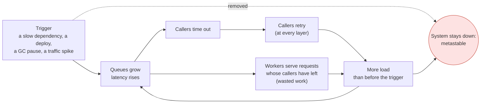

# 42. Failure Modes & Cascading Failures

<div class="badges" markdown><span class="badge badge-l2">L2 · Practitioner</span><span class="badge badge-l3">L3 · Senior/Lead</span><span class="badge badge-l4">L4 · Architect</span><span class="badge badge-meta">queueing · retry storms · metastable failure · thundering herd · gray failure · deadlines</span></div>

<div class="grid two" markdown>

!!! info "Prerequisites"
    - [Chapter 18](../architecture-patterns/ch18-resilience-patterns.md): timeouts, retries, bulkheads, circuit breakers
    - [Chapter 22](../communication/ch22-http-clients.md): HTTP clients, connection pools, timeouts
    - Some comfort with percentiles (p50, p99)

!!! abstract "What you'll learn"
    - **Why systems tip over near capacity**: one service's p99 went from **4.5× its service time at 52% load to 12× at 97%**, as queueing theory predicts
    - **Retries multiply**: three attempts at each of three layers sent **27 calls** to a dead service per user request; a 10% retry budget sent **1.4**
    - **Metastable failure**: after a 5-second slowdown, a service with ordinary retries served **0% of users for the remaining 30 s**, with the trigger long gone; jitter didn't help; shedding work older than **150 ms** (not 300) recovered at once
    - **Herds**: 600 clients reconnecting with exponential backoff and no jitter needed **42 s**; with full jitter, **under 6 s** with about 40% fewer attempts
    - **Gray failure at fan-out**: one instance slow on 20% of requests (and healthy by its health check) delayed **5–7% of users at fan-out 1, 41–42% at fan-out 10**; power-of-two-choices balancing roughly halved it

</div>

---

## 1 · Introduction & Context

### The Saturday the system didn't come back

At 19:58 on a Saturday, the payment provider's API slowed down for five minutes. Payment-service's calls took longer, its threads filled, order-service's calls to it timed out and were retried, and the edge retried order-service. At 20:03 the provider recovered. FoodFleet didn't. Order placement stayed at almost zero for forty minutes, until someone scaled the fleet to three times its size and the queues finally drained.

Nothing was broken after 20:03. Every service was up, every health check green, every dependency fast. The system was stuck in a state that its own retries kept alive: a **metastable failure**. This chapter reproduces it, and the other ways a microservice system fails without anything being down, with real HTTP services on a laptop-sized machine, and measures which defences break the loop.

### Where it comes from

<ul class="mh-timeline">
<li><span class="when">1909–1961 · Queueing theory</span><span class="what">Erlang's formulas for telephone exchanges; Little's law (L = λW): latency, load and queue length are bound together.</span></li>
<li><span class="when">2013 · The Tail at Scale</span><span class="what">Dean and Barroso show how fan-out turns rare slow responses into common slow requests, and how hedging helps.</span></li>
<li><span class="when">2015 · Backoff and jitter</span><span class="what">AWS's Marc Brooker shows that exponential backoff without jitter keeps retrying clients synchronized.</span></li>
<li><span class="when">2016 · Cascading failures</span><span class="what">Google's SRE book describes overload, retries and load shedding as the anatomy of cascading failures.</span></li>
<li><span class="when">2017 · Gray failure</span><span class="what">Microsoft researchers name failures that some observers see and health checks don't.</span></li>
<li><span class="when">2021–2022 · Metastable failures</span><span class="what">Bronson et al. (HotOS 2021) define failures sustained by their own recovery mechanisms; a study of real incidents follows (OSDI 2022).</span></li>
<li><span class="when">2025 · Spring Framework 7</span><span class="what"><code>@Retryable</code> and <code>@ConcurrencyLimit</code> move into the core framework; their defaults matter here.</span></li>
</ul>

---

## 2 · Core Concepts & Terminology



Partial failure
:   Some calls fail, slow down or lose responses while the rest work. The normal state of a distributed system, and the one that monolith habits handle worst.

Cascading failure
:   A failure that spreads through dependencies: a slow service fills its callers' threads and queues, their callers time out, and the slowness moves outward.

Retry amplification
:   Retries at several layers multiply: *k* attempts at each of *n* layers can send *kⁿ* requests to the bottom service.

Metastable failure
:   A state of persistent overload kept alive by the system's own reactions (retries, timeouts, cache misses, reconnects) after the trigger is gone. The system has two stable states at the same load, and a trigger pushes it from the good one to the bad one.

Goodput
:   Requests completed in time to be useful, as opposed to throughput (requests completed). Under overload a server can be 100% busy with 0% goodput.

Thundering herd
:   Many clients acting at the same moment: reconnecting after a restart, retrying with the same backoff, refreshing the same cache entry, running a job at :00.

Gray failure
:   A component that is degraded for some requests but passes its health checks: a disk with slow sectors, a noisy neighbour, a bad NIC queue.

Tail latency at fan-out
:   If a request fans out to *k* calls and waits for all of them, it is slow whenever any of them is slow; the probability grows with *k*.

Deadline
:   The absolute time by which the original caller stops waiting, propagated on every hop, so no service keeps working for a caller who has left.

---

## 3 · How It Works Internally

All experiments use the same small system on loopback (`verify/tools/Lab.java`): HTTP services built on the JDK's HTTP server with a fixed number of worker threads behind a FIFO queue, the way a servlet container works, and open-loop load generators whose users arrive as a Poisson process whatever the system is doing. Users keep arriving during an incident, which is what makes overload dangerous. Work is a sleep (the shape of I/O-bound work); everything else is real: connections, timeouts, retries, queues.

### Queueing: latency explodes before capacity

With *c* workers and utilisation ρ, a request's wait grows like 1/(1−ρ): at 90% busy, a new request finds a queue most of the time. That's why a dependency that slows down by 20% can take a service from comfortable to overloaded: the slowdown raises ρ, and the queue does the rest.

### Retries: where the multiplication comes from

Each layer that retries multiplies the load below it. Retries are right for transient failures and wrong for overload, and a client can't tell which one it is facing. A **retry budget** answers by looking at the rate: retries may be at most a fraction of the requests:

```java
--8<-- "code/chapters/ch42-failure-modes/src/main/java/dev/foodfleet/ch42/resilience/RetryBudget.java:9:42"
```

When retries are allowed, they wait for a growing, random time, so clients that failed together don't come back together:

```java
--8<-- "code/chapters/ch42-failure-modes/src/main/java/dev/foodfleet/ch42/resilience/Backoff.java:25:32"
```

### Overload: serve the requests that can still succeed

A FIFO queue under overload serves its oldest requests first, and those are the ones whose callers have already timed out. The server stays 100% busy and delivers nothing. The fix is to look at each request's age (or its propagated deadline) when a worker picks it up, and refuse stale work cheaply:

```java
--8<-- "code/chapters/ch42-failure-modes/src/main/java/dev/foodfleet/ch42/resilience/QueueAgeShedder.java:19:27"
```

In order-service the same idea is a servlet filter: a deadline arrives with the request (or the service assigns its own), is never extended, and is checked before any work:

```java
--8<-- "code/chapters/ch42-failure-modes/src/main/java/dev/foodfleet/ch42/web/DeadlineFilter.java:28:41"
```

Outgoing calls carry the deadline on, and retry within a budget shared by all callers of that dependency:

```java
--8<-- "code/chapters/ch42-failure-modes/src/main/java/dev/foodfleet/ch42/web/BudgetedRetry.java:40:77"
```

### Spring's defaults, and where they hurt

Spring Framework 7.0.9's `@Retryable` defaults to **3 retries, 1 s apart, no jitter, no multiplier, no timeout**: synchronized retries that multiply at every layer that uses them. `@ConcurrencyLimit` **blocks** callers over the limit by default, which is an unbounded queue under another name; `REJECT` makes overload a fast failure. Spring Boot 4.1.1 bounds Tomcat at 200 threads and 100 queued connections, but with `spring.threads.virtual.enabled` Tomcat runs every request on a new virtual thread and **the 200-thread bound disappears**; and `spring.http.clients.read-timeout` has **no default**. Chapter 43 covers both annotations in depth:

```java
--8<-- "code/chapters/ch42-failure-modes/src/main/java/dev/foodfleet/ch42/web/MenuService.java:23:27"
```

```yaml
--8<-- "code/chapters/ch42-failure-modes/src/main/resources/order-service.yml"
```

### Gray failure: balance by what instances are doing

A health check asks "are you alive?", and a gray-failing instance answers yes. Load balancing by **power of two choices** looks at something more honest: requests in flight. A slow instance accumulates them and is chosen less, without any health signal:

```java
--8<-- "code/chapters/ch42-failure-modes/src/main/java/dev/foodfleet/ch42/resilience/P2cBalancer.java:22:30"
```

---

## 4 · Design Considerations & Trade-offs

All runs: JDK 21.0.10, one 2-vCPU container, every service and client on loopback. Two runs; timings and percentages show both where they differed. `check_apis.sh` checks **17 defaults and APIs** against Spring Framework 7.0.9 and Spring Boot 4.1.1 (all found).

### Measured: latency against utilisation

One service, 8 workers, exponential service time with a 25 ms mean (measured inside the server), Poisson arrivals, 25 s per row:

| Utilisation | Rate | Mean, M/M/c prediction | Mean, measured | p50 | p99 | p99 ÷ service time |
|---:|---:|---:|---:|---:|---:|---:|
| 52% | 160/s | 27 ms | 28 ms | 20 ms | 117 ms | 4.5× |
| 72% | 224/s | 29 ms | 32 ms | 23 ms | 134 ms | 5.2× |
| 80% | 255/s | 32 ms | 32 ms | 24 ms | 128 ms | 5.1× |
| 93% | 289/s | 64 ms | 54 ms | 47 ms | 169 ms | 6.5× |
| 94% | 292/s | 70 ms | 57 ms | 44 ms | 250 ms | 9.7× |
| 97% | 307/s | 123 ms | 115 ms | 98 ms | 311 ms | 12.3× |

- **The textbook holds**: measured means track the M/M/c prediction to within a few milliseconds up to 80%. Above 90% they fall short of it, and vary between runs (the second run's 99% row measured 98–223 ms against a prediction of 288–391 ms): at that load the queue never settles within 25 seconds.
- **The last 20% of capacity costs most of the latency**: from 80% to 97% busy, mean latency more than tripled. Plan capacity so that a dependency slowing down, a zone failing over or a deploy draining instances doesn't push a service past 80%.

### Measured: retries through three layers

edge → order → restaurant; 50 user requests a second for 10 s; 2 s deadline, 500 ms per attempt, jittered backoff between attempts.

| Retry policy | restaurant-service down: calls to restaurant per user | 30% of calls failing: users served | calls to restaurant per user |
|---|---:|---:|---:|
| No retries | 1.00 | 67.5–69.2% | 1.00 |
| 3 attempts at every layer | **27.00** | **100%** | 1.43–1.49 |
| 3 attempts at the edge only | 3.00 | 96.0–97.2% | 1.40–1.42 |
| 3 attempts at every layer, **10% budget** | **1.39** | 94.0–96.7% | 1.35–1.37 |

- **Retries at every layer are great for random failures and catastrophic for real ones**: they turned 30% failures into 100% success, and a dead service into 27 times the traffic aimed at it, which is how a recovering service is kept down.
- **A budget keeps most of the benefit**: 94–97% of users served with 30% failures, yet only 1.39 calls per user against a dead dependency.
- **Retry at one layer** (the one closest to the user, or the one that knows the operation is idempotent) when you can't budget.

### Measured: a metastable failure

One service at 69% load (capacity 320/s, users at 220/s); each attempt times out at 300 ms, each user gives up after 1 s. From 10 s to 15 s the service runs 3× slower, then recovers fully. Share of users served per 5-second window:

| Client / server | 0–5 s | 5–10 | **10–15 (trigger)** | 15–20 | 20–25 | 25–30 | 30–35 | 35–40 | 40–45 | Served after the caller gave up |
|---|---:|---:|---:|---:|---:|---:|---:|---:|---:|---:|
| No retries | 100% | 100% | 3% | 0% | 73–93% | 100% | 100% | 100% | 100% | 17–18% |
| 3 attempts, no backoff | 100% | 100% | 8–10% | 0% | **0%** | **0%** | **0%** | **0%** | **0%** | **79–80%** |
| 3 attempts, jittered backoff | 100% | 100% | 4–6% | 0% | **0%** | **0%** | **0%** | **0%** | **0%** | 80–81% |
| 3 attempts, 10% retry budget | 100% | 100% | 4–8% | 0% | 22–52% | 100% | 100% | 100% | 100% | 23–24% |
| 3 attempts; server sheds work queued > 300 ms | 100% | 100% | 7–8% | 7–11% | 8–14% | 9–11% | 8–11% | 8–12% | 15–23% | 0.7–1.0% |
| 3 attempts; server sheds work queued > **150 ms** | 100% | 100% | **45–52%** | **100%** | 100% | 100% | 100% | 100% | 100% | 0% |
| 3 attempts, 10% budget; server sheds > 150 ms | 100% | 100% | 43–45% | 99–100% | 100% | 100% | 100% | 100% | 100% | 0% |

- **The failure outlived its trigger by the whole run.** With ordinary retries the service was busy all the time, and 79–81% of what it served went to callers who had already given up. The retries tripled the arrivals, the queue never drained, and every request waited longer than its timeout.
- **Jitter is not a fix for overload**: it spreads retries in time, but they still arrive.
- **Shedding has to be stricter than the client's timeout**: shedding work older than 300 ms (the client's timeout) still served requests the client abandoned moments later. At 150 ms, the service served 45–52% of its users *during* the trigger and all of them from the moment it ended, with or without a budget.
- **A budget or no retries lets the system drain**, more slowly.

### Measured: a reconnect herd

600 clients lose their connections at the same moment (a gateway restart). A reconnect costs a worker 20 ms (TLS, authentication, resync), 4 workers: 200 reconnects a second. The gateway sheds reconnects that waited over 250 ms; each attempt times out at 1 s.

| Reconnect policy | Attempts | Peak per 100 ms (after the first second) | 50% reconnected | 99% | All |
|---|---:|---:|---:|---:|---:|
| Immediately | 3,631–3,645 (6.1 each) | 245–249 | 2.6–2.7 s | 4.2–4.3 s | 4.3–4.4 s |
| After a fixed 1 s | 2,784–2,995 (4.6–5.0 each) | 275–410 | 5.3–5.4 s | 10.5–10.6 s | 10.6 s |
| Exponential 0.5 s … 8 s, **no jitter** | 2,955–3,061 (4.9–5.1 each) | 330–434 | 8.8–8.9 s | **42.0–42.1 s** | **42.1 s** |
| Exponential, **full jitter** | **1,723–1,777** (2.9–3.0 each) | **49** | **1.6–1.8 s** | 3.8–4.4 s | 5.4–5.8 s |

- **Backoff without jitter preserves the herd**: every client waited 0.5, 1, 2, 4 and 8 s together, and each wave hit the gateway at once. The slowest clients took ten times longer than with no backoff at all.
- **Full jitter** reconnected half the clients fastest, all of them within 6 s, with about 40% fewer attempts than the same backoff without jitter and a peak a fifth of the others'.
- Immediate retries looked fast here because the gateway shed cheaply; without shedding they are the storm.

### Measured: a gray failure at fan-out

Four instances of menu-service; instance 4 adds 300 ms to 20% of its requests; all four health checks return 200. Each user request fans out to *k* calls and waits for all of them; 30 user requests a second.

| *k* | Balancing | p50 | p99 | Users waiting > 250 ms | Calls sent to instance 4 |
|---:|---|---:|---:|---:|---:|
| 1 | Round robin | 10–12 ms | 323–332 ms | 5.1–7.2% | 25% |
| 1 | Power of two choices | 9–10 ms | 312–313 ms | 3.0–3.3% | 16–18% |
| 5 | Round robin | 30 ms | 332–341 ms | 23.5–24.7% | 25% |
| 5 | Power of two choices | 26–27 ms | 323–345 ms | 14.1–14.2% | 15% |
| 10 | Round robin | 52–53 ms | 348–355 ms | **40.5–42.2%** | 25% |
| 10 | Power of two choices | 36–41 ms | 329–337 ms | **23.9–24.1%** | 14% |

- **Fan-out turns a rare problem into a common one**: 5% of calls slow became 41–42% of users slow at fan-out 10 (the arithmetic: 1 − 0.95¹⁰ ≈ 40%).
- **Health checks said everything was fine.** Balancing by requests in flight sent the slow instance about half its share and roughly halved the slow users, with no configuration. Hedged requests and outlier ejection go further (chapter 44).

### Choosing

| Failure mode | Primary defence | Secondary |
|---|---|---|
| Saturation | Capacity headroom (≤ 80% at peak after losing a zone), autoscaling on queue time | Load shedding |
| Retry amplification | Retry at one layer, or a retry budget per dependency | Idempotency keys so retries are safe ([chapter 28](../communication/ch28-idempotency-correlation.md)) |
| Metastable failure | Shed by queue age or deadline, below the caller's timeout; deadlines propagated | Budgets, circuit breakers, the ability to drop traffic at the edge |
| Herds | Full jitter on every reconnect and retry; random start times for scheduled jobs | Admission control on reconnects |
| Gray failure | Least-outstanding or P2C balancing; outlier detection on latency | Hedging for idempotent reads; health checks that test the real path |
| Hidden bounds removed | Explicit concurrency limits (`@ConcurrencyLimit(REJECT)`) with virtual threads; client read timeouts | Deadline filter |

---

## 5 · Hands-on Implementation

```text
ch42-failure-modes/
├── src/main/java/dev/foodfleet/ch42/
│   ├── resilience/  Backoff, RetryBudget, RetryPolicy, Deadline, QueueAgeShedder, P2cBalancer
│   └── web/         DeadlineFilter, DeadlinePropagation, BudgetedRetry, ClientsConfig, MenuService, OrderServiceApplication
├── src/main/resources/   order-service.yml
├── src/test/java/…       13 tests
└── verify/               run.sh, check_apis.sh, tools/Lab.java (services, load), tools/Measure.java
```

### 🟢 Level 1: timeouts everywhere

<div class="badges" markdown><span class="badge badge-l1">L1 · Foundation</span></div>

- Set `spring.http.clients.connect-timeout` and `read-timeout`; there is no default read timeout.
- Retry only idempotent operations, and only at one layer.

### 🔵 Level 2: budgets and jitter

<div class="badges" markdown><span class="badge badge-l2">L2 · Practitioner</span></div>

- Replace `@Retryable` defaults: a multiplier, jitter and a max delay; a budget per dependency (`BudgetedRetry`).
- Jitter every reconnect loop and every scheduled job's start time.

### 🟣 Level 3: deadlines and shedding

<div class="badges" markdown><span class="badge badge-l3">L3 · Senior/Lead</span></div>

- Propagate deadlines on every hop (`DeadlineFilter` + `DeadlinePropagation`); refuse expired work.
- Bound concurrency explicitly, especially with virtual threads, and shed by queue age below the callers' timeouts.

```bash
verify/run.sh metastable      # about 5 minutes: six client/server combinations, one trigger
```

### 🔴 Level 4: design for recovery, not just for failure

<div class="badges" markdown><span class="badge badge-l4">L4 · Architect</span></div>

- **Test the way back**: load tests that inject a 5-minute slowdown and check that goodput returns *after* it, not just that the system survives it.
- **Recovery levers**: per-route traffic shedding at the edge, a switch to turn off retries fleet-wide, and the ability to scale without the overloaded system's help.
- **Metrics that see it**: queue time, goodput (completed within deadline) and retry rates per dependency, not only CPU and error rate.

### Run and verify

```text
$ verify/run.sh metastable
== metastable
one service, capacity 320 requests/s; users arrive at 220/s (69%) for 45 s; each attempt times out at 300 ms, each user gives up after 1 s
trigger: from 10 s to 15 s the service runs 3x slower (capacity 107/s), then recovers fully
share of users served, per 5-second window (the trigger is in the third window)
client / server                                            0-5    5-10   10-15  15-20  20-25  25-30  30-35  35-40  40-45   wasted work
no retries                                                 100%   100%   3%     0%     73%    100%   100%   100%   100%    1811 of 9947 served too late
3 attempts, no backoff                                     100%   100%   8%     0%     0%     0%     0%     0%     0%      9688 of 12147 served too late
3 attempts, jittered backoff                               100%   100%   4%     0%     0%     0%     0%     0%     0%      9698 of 12162 served too late
3 attempts, 10% retry budget                               100%   100%   8%     0%     22%    100%   100%   100%   100%    2446 of 10279 served too late
3 attempts, no backoff; server sheds work queued > 300 ms  100%   100%   7%     11%    8%     9%     8%     8%     15%     115 of 12006 served too late
3 attempts, no backoff; server sheds work queued > 150 ms  100%   100%   45%    100%   100%   100%   100%   100%   100%    0 of 9504 served too late
3 attempts, 10% budget; server sheds > 150 ms              100%   100%   45%    99%    100%   100%   100%   100%   100%    0 of 9217 served too late
```

!!! question "Try it"
    1. In `Measure.metastable`, shorten the trigger to 2 s. Does "3 attempts, no backoff" still fail to recover? What about 1 s?
    2. Lower the users' rate to 150/s (47%). Is the system still metastable with retries? Find the load where it flips.
    3. In `Measure.herd`, cap the exponential backoff at 2 s instead of 8 s, without jitter. What changes, and what doesn't?
    4. Add a third balancing mode to `Measure.tail` that skips any instance whose last response took over 200 ms for the next second (outlier ejection). How does it compare with power of two choices?

---

## 6 · Production Readiness

- [x] **Timeouts on every call** (connect and read), shorter than the caller's
- [x] **Deadlines propagated** and checked before work; no hop extends one
- [x] **Retries at one layer or within a budget**, idempotent only, with exponential backoff and full jitter
- [x] **Concurrency bounded explicitly** (especially with virtual threads); overload rejected fast
- [x] **Load shedding by queue age or deadline**, set below the callers' timeouts
- [x] **Capacity headroom**: ≤ 80% at peak with a zone lost
- [x] **Jitter on reconnects and scheduled jobs**
- [x] **Balancing by load** (least outstanding / P2C) and outlier detection
- [x] **Goodput, queue time and retry rate** on every service's dashboard; recovery tested, not just failure

---

## 7 · Anti-patterns & Pitfalls

!!! pitfall "Incident 1: the forty-minute recovery"
    **Context.** The payment provider slowed for five minutes on a Saturday evening.
    **Symptoms.** Order placement collapsed and stayed collapsed for forty minutes after the provider recovered; every service was healthy.
    **Root cause.** Three layers of retries kept the arrival rate above capacity; FIFO queues served requests whose callers had left. Measured: with retries, 0% of users served for 30 s after a 5 s trigger.
    **Fix.** A retry budget per dependency, deadlines on every hop, and shedding of queued work older than half the caller's timeout: full recovery the moment the trigger ended.

!!! pitfall "Incident 2: the restart that took an hour to finish"
    **Context.** The rider app's live-tracking gateway was restarted during a deploy; 80,000 riders' apps reconnected.
    **Symptoms.** Reconnects came in waves every few seconds, growing apart; some riders were offline for minutes.
    **Root cause.** Exponential backoff without jitter: every app had failed at the same moment, so every app retried at the same moments. Measured: 42 s to reconnect 600 clients, against 6 s with full jitter.
    **Fix.** Full jitter in the app's reconnect loop; the gateway sheds reconnects it can't serve within 250 ms.

!!! pitfall "Incident 3: green dashboards, slow checkout"
    **Context.** One of eight menu-service pods landed on a node with a failing disk.
    **Symptoms.** Checkout p99 doubled; every health check and every pod's average latency looked normal.
    **Root cause.** A gray failure (slow on some requests) amplified by fan-out: checkout calls menu-service for every item. Measured: 5% slow calls became 41–42% slow requests at fan-out 10.
    **Fix.** Least-outstanding-request balancing and latency-based outlier ejection; the node was found by comparing per-pod p99, not averages.

| Anti-pattern | Symptom | Fix |
|---|---|---|
| Retries at every layer | Load multiplied at the bottom during outages | One layer, or a budget |
| `@Retryable` with defaults | Synchronized fixed 1 s retries | Multiplier, jitter, max delay, budget |
| No read timeout | Threads held forever by a hung dependency | `spring.http.clients.read-timeout` |
| Unbounded queues (`BLOCK`, virtual threads without limits) | Latency grows without bound under overload | Bounded concurrency, `REJECT`, shedding |
| Shedding at the caller's timeout | Still serving abandoned work | Shed below it; use deadlines |
| Backoff without jitter | Herds in waves | Full jitter |
| Health checks as the only signal | Gray failures invisible | Load-aware balancing, per-instance tail metrics |
| Running at 90%+ "to save cost" | Any trigger becomes an incident | Headroom; autoscale on queue time |

---

## 8 · Enterprise Case Study

### FoodFleet: overload as a designed-for state

!!! decision "ADR-042: Deadlines on every hop; retries at one layer or within a 10% budget, always with full jitter; explicit concurrency limits that reject; queue-age shedding below callers' timeouts; P2C balancing"
    **Status:** Accepted · **Date:** 2025-08-11

    **Context.** A five-minute provider slowdown became a forty-minute outage; a gateway restart took minutes to settle; a gray-failing pod doubled checkout p99. Measured on the lab: three-layer retries sent 27 calls per request to a dead dependency, a budget 1.4; ordinary retries kept a service at 0% goodput for 30 s after its trigger ended, shedding at 150 ms recovered it at once; jitter cut a reconnect herd from 42 s to 6 s; P2C halved the users hit by a gray failure at fan-out 10.

    **Decision.** Every incoming request gets a deadline (the caller's, capped by the service's own budget) and every outgoing call carries it. Only the edge retries user-facing calls; services retry dependencies only through `BudgetedRetry` (10%, 3 attempts, full jitter). Every service bounds concurrency explicitly and rejects beyond it (virtual threads included) and sheds work that has waited longer than half its callers' timeout. Client-side balancing is least-outstanding / P2C, with latency outlier ejection in the mesh. Capacity is planned for ≤ 80% at peak with one zone lost.

    **Consequences.** ✅ Overload degrades into fast, partial failure and recovers when the trigger ends. ✅ Retry storms are bounded by design. ⚠️ Shedding produces 503s that must be visible and alerting; users see "try again" during overload instead of spinners. ⚠️ Deadline propagation needs every service and library to cooperate, so it is part of the platform's HTTP client.

### Fintech analogue: payment switches and stand-in 🔴

Card networks and payment switches meet strict response-time limits: an authorisation that can't be answered in time is answered by **stand-in processing** (the network approves or declines on the issuer's behalf by rules) rather than queued. Retries are controlled by message type and counted; timeouts flow end to end; and overload is shed at the edge by declining with a specific code rather than letting queues grow, because a late approval is worse than a fast decline.

### E-commerce analogue: flash sales and queues in front

Large retailers expect metastable risk at sale start: millions of users arrive in a minute, and retries and refreshes can multiply that. They put an admission queue (a waiting room) in front of checkout, set strict retry budgets in their clients, shed by queue age in every service, and pre-scale with headroom, so that the system's good state is the one it stays in.

---

## 9 · Interview Q&A + Summary

#### Q1. What is a cascading failure? · <span class="badge badge-l2">L2</span> · TCS · Cognizant

**Short answer:** A failure that spreads through dependencies: a slow service ties up its callers' threads and queues, their latency rises, their callers time out and retry, and the slowness moves outward until unrelated features fail. Timeouts, bounded concurrency and shedding stop it from spreading.

#### Q2. Why does latency jump near capacity? · <span class="badge badge-l2">L2</span><span class="badge badge-l3">L3</span> · Amazon · Flipkart

**Short answer:** Queueing: waiting time grows like 1/(1−ρ). Measured: p99 was 4.5× the service time at 52% utilisation and 12× at 97%; mean latency tripled between 80% and 97%. Keep headroom so that losing a zone or a slow dependency doesn't push you past ~80%.

#### Q3. Why are retries dangerous? · <span class="badge badge-l3">L3</span> · Amazon · Goldman Sachs

**Short answer:** They multiply load exactly when a dependency is struggling, and they multiply across layers: three attempts at three layers sent 27 calls per user request to a dead service (measured). Retry at one layer or within a budget (10% sent 1.39), only idempotent operations, with jittered backoff.

#### Q4. What is a metastable failure? · <span class="badge badge-l3">L3</span><span class="badge badge-l4">L4</span> · Google-/Amazon-style rounds · Flipkart

**Short answer:** A failure kept alive by the system's own reactions after the trigger is gone. A brief slowdown grows queues; requests time out and are retried; the extra load keeps queues long, so every request times out. Measured: 0% of users served for 30 s after a 5-second trigger. Breaking the loop takes shedding stale work, budgets and deadlines.

#### Q5. Does jitter fix retry storms? · <span class="badge badge-l3">L3</span> · Amazon · SAP

**Short answer:** It fixes synchronization, not volume. It turned a reconnect herd that took 42 s into one that took 6 s, but in the metastable experiment jittered retries still stayed at 0% goodput: the retries still arrived. Volume needs a budget or shedding.

#### Q6. How should a server shed load? · <span class="badge badge-l3">L3</span> · Flipkart · Swiggy

**Short answer:** Cheaply and early, by what predicts failure: queue time and the caller's deadline. Bounded concurrency with fast rejection, then drop queued work that has waited longer than the callers can wait. Measured: shedding at the client's timeout (300 ms) didn't recover; at 150 ms the service recovered the moment the trigger ended.

#### Q7. What is deadline propagation? · <span class="badge badge-l3">L3</span> · Google-style rounds · JP Morgan

**Short answer:** Sending the absolute time the original caller stops waiting on every hop (gRPC does it natively), so each service refuses or abandons work that can't finish in time and never extends the budget. It removes wasted work deep in call chains.

#### Q8. What is a thundering herd, and how do you avoid one? · <span class="badge badge-l2">L2</span> · Accenture · Infosys

**Short answer:** Many clients acting at once: reconnects after a restart, cache entries expiring together, jobs at :00. Full jitter on retries and reconnects, randomised schedules, request coalescing for caches. Measured: exponential backoff without jitter took 42 s to reconnect 600 clients, full jitter under 6 s with about 40% fewer attempts.

#### Q9. What is a gray failure? · <span class="badge badge-l3">L3</span> · Microsoft-/Amazon-style rounds · SAP

**Short answer:** A degradation some requests see and health checks don't: a slow disk, a noisy neighbour. Detect it from the callers' side (per-instance latency, outstanding requests) and route around it: P2C sent the slow instance half its share and halved slow users at fan-out 10 (measured).

#### Q10. Why does fan-out hurt tail latency? · <span class="badge badge-l3">L3</span> · Google-style rounds · Flipkart

**Short answer:** A request that waits for *k* calls is slow if any is slow: 1 − (1 − p)ᵏ. With 5% slow calls, fan-out 10 made 41–42% of requests slow (measured). Reduce fan-out, balance by load, hedge idempotent reads, and set per-call deadlines.

#### Q11. What changes with virtual threads? · <span class="badge badge-l3">L3</span> · SAP · JP Morgan

**Short answer:** The thread pool used to be an accidental bulkhead: 200 Tomcat threads capped concurrent work. With `spring.threads.virtual.enabled`, each request gets a virtual thread and that cap disappears, so a slow dependency can accumulate unbounded concurrent requests. Add explicit limits (`@ConcurrencyLimit(REJECT)`, connection pool sizes, semaphores) and deadlines.

#### Q12. Design FoodFleet to recover from a five-minute dependency slowdown. · <span class="badge badge-l4">L4</span> · Swiggy-/Zomato-style system design rounds

**Short answer:** Deadlines on every hop; retries only at the edge or within per-dependency budgets with full jitter; explicit concurrency limits that reject; queue-age shedding below callers' timeouts; circuit breakers on the slow dependency with a degraded path; P2C balancing; ≥ 20% headroom; dashboards for goodput and queue time; and a load test that injects the slowdown and checks goodput returns when it ends.

### Key takeaways

- **Most outages are overload, not breakage**, and overload is shaped by queues.
- **Retries multiply**: one layer or a budget, jitter always, idempotent only.
- **Systems can stay down after the trigger ends**: shed stale work, propagate deadlines, test recovery.
- **Herds come from synchronization**: full jitter everywhere.
- **Health checks miss gray failures**: balance by load, watch per-instance tails.

### Further reading

- N. Bronson et al., [Metastable Failures in Distributed Systems](https://sigops.org/s/conferences/hotos/2021/papers/hotos21-s11-bronson.pdf) (HotOS 2021), and L. Huang et al., [Metastable Failures in the Wild](https://www.usenix.org/conference/osdi22/presentation/huang-lexiang) (OSDI 2022)
- Google SRE book, [Addressing Cascading Failures](https://sre.google/sre-book/addressing-cascading-failures/) and [Handling Overload](https://sre.google/sre-book/handling-overload/)
- AWS Builders' Library, [Timeouts, retries, and backoff with jitter](https://aws.amazon.com/builders-library/timeouts-retries-and-backoff-with-jitter/) and [Using load shedding to avoid overload](https://aws.amazon.com/builders-library/using-load-shedding-to-avoid-overload/)
- J. Dean and L. A. Barroso, [The Tail at Scale](https://research.google/pubs/the-tail-at-scale/) (CACM 2013)
- P. Huang et al., [Gray Failure: The Achilles' Heel of Cloud-Scale Systems](https://www.microsoft.com/en-us/research/publication/gray-failure-achilles-heel-cloud-scale-systems/) (HotOS 2017)

---

**Previous:** [← 41. Supply-Chain Security & Compliance](../security/ch41-supply-chain-compliance.md) · **Next:** [43. Resilience4j & Spring Framework 7 Resilience →](ch43-resilience4j-deep-dive.md)
