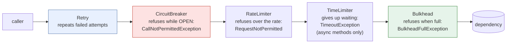

# 43. Resilience4j & Spring Framework 7 Resilience

<div class="badges" markdown><span class="badge badge-l2">L2 · Practitioner</span><span class="badge badge-l3">L3 · Senior/Lead</span><span class="badge badge-meta">circuit breaker · retry · bulkhead · rate limiter · time limiter · @Retryable · @ConcurrencyLimit</span></div>

<div class="grid two" markdown>

!!! info "Prerequisites"
    - [Chapter 18](../architecture-patterns/ch18-resilience-patterns.md): what each pattern is for
    - [Chapter 42](ch42-failure-modes.md): how overload, retries and slow dependencies take systems down
    - Spring Boot configuration and AOP basics

!!! abstract "What you'll learn"
    - **The library defaults are for nothing in particular**: a breaker that opened in **0.5 s** at 100 calls/s took **7.5–10 s** at 5/s, then refused **every** user for the rest of the run after the dependency recovered (60 s open state)
    - **Slow is not failed**: a dependency answering in 3 s instead of 20 ms **never** opened a default breaker; a 1 s slow-call threshold opened it within 4 s
    - **Cancel doesn't stop work**: after a TimeLimiter timeout, **40 of 40** `CompletableFuture` tasks kept running; interrupting stopped sleeps and JDK `HttpClient` calls, not `HttpURLConnection` reads
    - **Composition order matters**: in Spring Boot's order, a default Retry made users wait **1 s** for an open breaker's fail-fast answer; a fallback on the wrong annotation cut fresh menus from **97–98% to 68–70%**
    - **Spring Framework 7's `@ConcurrencyLimit` blocks by default**: at 2× overload it served everyone at a **p99 of 10 s**, with about **4,000** callers queued

</div>

---

## 1 · Introduction & Context

### The evening the menus came back and nobody saw them

At 20:10 on a festival evening, restaurant-service's database failed over and the service returned errors for about forty seconds. order-service's circuit breaker on menus opened, as designed. Restaurant-service was healthy again forty seconds later. order-service kept showing "menu unavailable" for twenty seconds more: its breaker used Resilience4j's defaults, and once open, the default breaker refuses every call for **sixty seconds**. The quieter restaurant-admin endpoints, called a few times a second, sent users into errors for about ten seconds before their breakers opened: the default judges **the last hundred calls**, and at five calls a second that is twenty seconds of history. And the retries that should have smoothed over the first blips never ran, because the cached-menu fallback had been put on the `@CircuitBreaker` annotation, which runs *inside* the retry.

None of this was a bug in Resilience4j. Every behaviour was documented, and each default is reasonable for some system. This chapter reads the defaults from the source, measures what each one does to FoodFleet's traffic, and settles the configuration every FoodFleet service now starts from.

### Where it comes from

<ul class="mh-timeline">
<li><span class="when">2012 · Hystrix</span><span class="what">Netflix open-sources Hystrix: circuit breakers, thread-pool isolation and fallbacks for the JVM; Spring Cloud Netflix wraps it.</span></li>
<li><span class="when">2016 · Resilience4j</span><span class="what">A lightweight alternative built on Java 8 functional interfaces: decorators around any call, no thread pools required.</span></li>
<li><span class="when">2018 · Hystrix in maintenance</span><span class="what">Netflix stops active development and points users to Resilience4j.</span></li>
<li><span class="when">2019 · Spring Cloud CircuitBreaker</span><span class="what">A vendor-neutral circuit breaker API for Spring, with Resilience4j as the main implementation.</span></li>
<li><span class="when">2022 · Resilience4j 2.0</span><span class="what">Java 17 baseline; the Vavr dependency leaves the core modules.</span></li>
<li><span class="when">2025 · Spring Framework 7</span><span class="what"><code>RetryTemplate</code>, <code>@Retryable</code> and <code>@ConcurrencyLimit</code> move into the core framework: retries and concurrency limits without another library.</span></li>
<li><span class="when">2026 · Resilience4j 2.4.0</span><span class="what">A <code>resilience4j-spring-boot4</code> module for Spring Boot 4.</span></li>
</ul>

---

## 2 · Core Concepts & Terminology

Every Resilience4j module is a **decorator**: it wraps a call (a `Supplier`, `Callable`, `CompletionStage`, or a Spring bean method through an aspect) and decides before and after it. In Spring Boot the annotations nest in a fixed order, whatever order you write them in:



Circuit breaker
:   A state machine per dependency. **CLOSED**: calls pass and outcomes are recorded in a sliding window. **OPEN**: calls are refused at once. **HALF_OPEN**: a few trial calls decide between the two. Also DISABLED, FORCED_OPEN and METRICS_ONLY for operations.

Sliding window
:   What the breaker judges: the last *N* calls (**COUNT_BASED**, the default, *N* = 100) or the calls in the last *N* seconds (**TIME_BASED**). Nothing is judged until `minimumNumberOfCalls` have been seen.

Slow call
:   A call that succeeded but took longer than `slowCallDurationThreshold` (default **60 s**). When the share of slow calls passes `slowCallRateThreshold` (default **100%**), the breaker opens, without a single error.

Retry and interval function
:   How many attempts (`maxAttempts`, including the first: default 3), which failures qualify, and how long to wait between them (`IntervalFunction`: fixed, exponential, randomized).

Rate limiter
:   Permits per refresh period. `AtomicRateLimiter` (the default) hands out `limitForPeriod` permits per `limitRefreshPeriod` in fixed periods; callers may wait up to `timeoutDuration` for one.

Bulkhead
:   A limit on concurrent calls: a semaphore (`Bulkhead`) or a dedicated thread pool with a queue (`ThreadPoolBulkhead`).

Time limiter
:   A timeout on a `Future` or `CompletionStage`. It stops *waiting*; whether the work stops is a separate question (§3).

Hedge
:   Resilience4j's newest module: start a second attempt if the first is slow and take whichever answers first (chapter 44).

Spring Framework 7 resilience
:   `RetryTemplate`/`RetryPolicy` in `spring-core`; `@Retryable` and `@ConcurrencyLimit` in `spring-context`, switched on by `@EnableResilientMethods`. No circuit breaker, no rate limiter.

Spring Cloud CircuitBreaker
:   An API (`CircuitBreakerFactory.create("x").run(supplier, fallback)`) with Resilience4j behind it; useful when a library must not depend on Resilience4j directly.

---

## 3 · How It Works Internally

The experiments run against **Resilience4j 2.4.0** and **Spring Framework 7.0.9**, built from their release tags by `verify/build-libs.sh`. Every default quoted here is checked in their source by `verify/check_apis.sh`.

### The defaults

| Module | Setting | Default | What it means in practice |
|---|---|---|---|
| CircuitBreaker | `slidingWindowType` / `slidingWindowSize` | COUNT_BASED / 100 | judges the last 100 calls, however old |
| | `minimumNumberOfCalls` | 100 | nothing is judged until 100 calls have been seen |
| | `failureRateThreshold` | 50% | |
| | `slowCallDurationThreshold` / `slowCallRateThreshold` | 60 s / 100% | a slow dependency practically never opens it |
| | `waitDurationInOpenState` | 60 s | a minute of refusals after any opening |
| | `permittedNumberOfCallsInHalfOpenState` | 10 | |
| | `automaticTransitionFromOpenToHalfOpenEnabled` | false | HALF_OPEN happens on the next call after the wait |
| | recorded exceptions | all | a 404 counts against the dependency |
| Retry | `maxAttempts` / `waitDuration` | 3 / 500 ms, fixed | no backoff, no jitter |
| | retried exceptions | all | including an open breaker's `CallNotPermittedException` |
| RateLimiter | `limitForPeriod` / `limitRefreshPeriod` | 50 / **500 ns** | 100 million a second: not a limit |
| | `timeoutDuration` | 5 s | callers queue for up to 5 s |
| Bulkhead | `maxConcurrentCalls` / `maxWaitDuration` | 25 / 0 | fails fast when full |
| ThreadPoolBulkhead | `queueCapacity` | 100 | |
| TimeLimiter | `timeoutDuration` / `cancelRunningFuture` | 1 s / true | |
| Spring `@Retryable` | `maxRetries` / `delay` / `jitter` / `multiplier` | 3 / 1 s / 0 / 1.0 | 3 *retries* (4 calls), synchronized |
| Spring `@ConcurrencyLimit` | `policy` | BLOCK | waits without a timeout |

### The circuit breaker: windows, slow calls and the open state

A count window of 100 calls means different things at different traffic: at 100 calls a second it covers one second, at 5 a second twenty. A **time window** judges the same span of time whatever the traffic, so a quiet endpoint reacts as fast as a busy one; `minimumNumberOfCalls` keeps a handful of unlucky calls from opening it. FoodFleet's breaker:

```java
--8<-- "code/chapters/ch43-resilience4j/src/main/java/dev/foodfleet/ch43/policy/ResiliencePolicies.java:24:39"
```

Internally the time window is an array of one-second buckets, each a partial aggregation (calls, failures, slow calls, total duration), plus a running total; a call's outcome lands in the current bucket and old buckets are subtracted as time moves on. Both window types take a `ReentrantLock` per record (the default `SYNCHRONIZED` strategy; there is also `LOCK_FREE`), so they are safe with virtual threads.

The open state is the part teams forget to tune. While OPEN the breaker refuses everything for `waitDurationInOpenState`; then the next call moves it to HALF_OPEN, and `permittedNumberOfCallsInHalfOpenState` trial calls decide. A long wait protects a dependency that is still down but refuses users after it has recovered. Probing with five calls every five seconds costs the dependency almost nothing.

### Retry: what counts as a failure

Resilience4j's `retryExceptions(IOException.class)` matches the thrown exception's **own class**. Spring's `RestClient` throws `ResourceAccessException`, a `RuntimeException` with the `IOException` as its cause, so that configuration **never retries a RestClient call**. (Spring Framework 7's `@Retryable(includes = IOException.class)` looks through the cause chain, so the same intent works there.) FoodFleet retries on a predicate that walks the causes:

```java
--8<-- "code/chapters/ch43-resilience4j/src/main/java/dev/foodfleet/ch43/policy/Transient.java:17:24"
```

```java
--8<-- "code/chapters/ch43-resilience4j/src/main/java/dev/foodfleet/ch43/policy/ResiliencePolicies.java:41:51"
```

Two details in it came from reading the source. An open breaker's `CallNotPermittedException` is an answer, not a failure, and the library default retries it. And each `ignoreExceptions(...)` call on the builder **replaces** the previous list (a test pins this down), so the list is given once.

The randomized interval is `interval ± factor × interval`: Resilience4j's default factor 0.5 gives 50–150% of the delay; 1.0 gives 0–200%, which is "full jitter" around the mean.

### Composition: Spring Boot's aspect order

The Spring integration applies the annotations as aspects with fixed orders: Retry (`LOWEST_PRECEDENCE − 5`, outermost), CircuitBreaker (−4), RateLimiter (−3), TimeLimiter (−2), Bulkhead (−1, innermost). Written out in code, for places where annotations don't fit:

```java
--8<-- "code/chapters/ch43-resilience4j/src/main/java/dev/foodfleet/ch43/policy/Resilient.java:38:43"
```

With Retry outermost, every attempt is counted by the breaker (a dependency failing 30% of the time is seen as failing 30%, not 3%), and every attempt needs a bulkhead permit. The cost: the retry sees the breaker's refusals, which is why `CallNotPermittedException` must not be retried.

**Fallbacks** belong to one annotation each, and they run at that annotation's layer. A fallback on `@CircuitBreaker` turns every failure into a cached answer *before* the retry sees it, so the retry never runs. FoodFleet puts it on the outermost one:

```java
--8<-- "code/chapters/ch43-resilience4j/src/main/java/dev/foodfleet/ch43/web/MenuClient.java:26:38"
```

The 4xx/5xx distinction is made where the HTTP status is known, in the client:

```java
--8<-- "code/chapters/ch43-resilience4j/src/main/java/dev/foodfleet/ch43/web/ResilienceConfig.java:22:33"
```

### TimeLimiter: cancelled is not stopped

`TimeLimiter` waits on a `Future` for `timeoutDuration`, then throws `TimeoutException` and, with `cancelRunningFuture` (the default), calls `future.cancel(true)`. What that does depends on the future. A `CompletableFuture` **ignores the interrupt flag**: cancelling completes the future exceptionally and the task runs on. A `FutureTask` from `ExecutorService.submit` interrupts its thread, which stops a `Thread.sleep` or a JDK `HttpClient.send`, but not a blocking socket read in `HttpURLConnection` or a CPU loop. In the Spring integration, `@TimeLimiter` applies only to methods returning `CompletionStage` or reactive types; for blocking calls the timeout that stops work is the HTTP client's own read timeout (`spring.http.clients.read-timeout`).

### RateLimiter and Bulkhead

`AtomicRateLimiter` keeps one atomic state: the current cycle number, permits left in it, and nanoseconds to wait. Cycles are **fixed periods**, so a burst at the end of one period and another at the start of the next both pass: up to twice the limit within one period's length. The default `timeoutDuration` of 5 s lets callers queue for a permit, so a rate limiter in front of a slow caller becomes a queue of up to five seconds' worth of requests.

The semaphore `Bulkhead` is a fair `Semaphore` with `tryAcquire(maxWaitDuration)`. With the default wait of 0 a full bulkhead refuses at once; `ThreadPoolBulkhead` runs calls on its own pool with a bounded queue, which only makes sense for asynchronous methods.

### Spring Framework 7: @Retryable and @ConcurrencyLimit

For a single retry and a concurrency limit, Spring Framework 7 needs no extra library. payment-service's client:

```java
--8<-- "code/chapters/ch43-resilience4j/src/main/java/dev/foodfleet/ch43/web/PaymentClient.java:23:32"
```

`@Retryable` builds a `RetryPolicy` (an `ExponentialBackOff`) and runs the method through `RetryTemplate`, which sleeps between attempts. `maxRetries` counts retries, not attempts. Its jitter is ± `jitter` around each delay, scaled by the multiplier, but **never below the initial delay**: with `delay = 200, jitter = 100`, the first retry waits 200–300 ms, not 100–300 ms. `@ConcurrencyLimit` is a `ConcurrencyThrottleSupport`: a lock, a counter and a condition. Its default policy, BLOCK, waits on the condition **with no timeout**; REJECT throws `InvocationRejectedException`.

### The same policy in YAML

The annotations read their configuration from `resilience4j.*` properties (the `resilience4j-spring-boot4` module, which needs `spring-boot-starter-aspectj`):

```yaml
--8<-- "code/chapters/ch43-resilience4j/src/main/resources/order-service.yml"
```

`register-health-indicator: false` keeps an open breaker from turning order-service's readiness probe red: the dependency is broken, not order-service, and taking order-service out of the load balancer would turn a degraded feature into an outage.

---

## 4 · Design Considerations & Trade-offs

All runs: JDK 21.0.10, one 2-vCPU container. The libraries are real; the dependency is a function that sleeps and throws on a script, so each run is repeatable. Users arrive as a Poisson process on virtual threads. Two runs; where they differed, both values are shown. `check_apis.sh` checks **44 defaults and behaviours** in the sources of Resilience4j 2.4.0, Spring Framework 7.0.9 and Spring Cloud CircuitBreaker 5.0.2 (all found).

### Measured: circuit breaker windows

Each breaker guards its own dependency. 1% errors throughout; from 20 to 25 s a blip of 40% errors; from 30 to 45 s every call fails; from 45 s healthy again. 75 s per run.

| Breaker | Users/s | Opened before the outage | Opened after outage start | Calls to the dead dependency (of ~1,500 / ~75) | Closed after recovery | Users refused after recovery |
|---|---:|---:|---:|---:|---:|---:|
| Library defaults (last 100 calls, open 60 s) | 100 | 0 | 0.5–0.6 s | 50–51 | **never** | **100%** |
| | 5 | 0 | **7.5–10.1 s** | 39–40 | **never** | **100%** |
| Last 10 calls, open 5 s | 100 | **1** | 0.0–0.1 s | 15–16 | 0.2 s | 0.4–0.7% |
| | 5 | **1** | 1.2–1.5 s | 15 | 4.7–5.6 s | 11.5–11.6% |
| Last 10 s, min 20 calls, open 5 s doubling | 100 | 0 | 4.4–4.9 s | 473–477 | 4.5–5.0 s | 14.3–16.6% |
| | 5 | 0 | 4.6–5.5 s | 22–32 | 6.7–6.8 s | 19.0–23.8% |
| **FoodFleet: last 5 s, min 20, open 5 s** | 100 | 0 | **1.9–2.3 s** | 209–250 | **2.1–2.4 s** | 6.8–8.0% |
| | 5 | 0 | **2.3–3.8 s** | 17–22 | **1.7–4.7 s** | 0–12.3% |

- **A count window's speed depends on traffic**: the default opened in about half a second at 100 calls/s and took 7.5–10 s at 5/s, while users kept getting errors.
- **The 60-second open state outlasted the outage**: the dependency was healthy for the last 30 s of the run, and the default breaker refused every one of those users.
- **Small count windows trip on noise**: "last 10 calls" opened during the 40% blip at both rates.
- **A time window behaves the same at any rate**: 5 s at 50% opened in 2–4 s at 100/s and at 5/s, didn't trip on the blip, and closed within one 5-second open period of recovery. Doubling the open period (the "10 s, doubling" row) protects a dead dependency a little more and delays recovery.

### Measured: a slow dependency

50 users/s for 45 s; the dependency answers in 20 ms, but from 10 to 30 s in 3 s, without errors.

| Configuration | Opened after the slowdown | Most calls in progress at the dependency | p50 / p99, 10–30 s | Users answered within 1.1 s |
|---|---:|---:|---:|---:|
| Library defaults, no timeout | **never** | 172 | 3,000 / 3,001 ms | **0%** |
| FoodFleet breaker (slow call = 1 s), no timeout | 3.6–3.9 s | 146–166 | 0 / 3,000 ms | 78.5–83.1% |
| FoodFleet breaker + bulkhead of 32 | 2.6–3.0 s | **32** | 0 / 3,000 ms | 95.6–96.0% |
| Breaker + TimeLimiter 1 s on a `CompletableFuture` | 2.6–3.0 s | **118–160** | 0 / 1,000 ms | 100% |
| Breaker + TimeLimiter 1 s on an `ExecutorService` future | 2.6–3.0 s | 55–56 | 0 / 1,000–1,001 ms | 100% |

- **A slow dependency is invisible to the default breaker**: twenty seconds of 3-second answers, zero openings, every user waiting 3 s.
- **The slow-call threshold is the setting that matters here**: at 1 s the breaker opened within 4 s and most users got a fast fallback.
- **A bulkhead bounds the damage before the breaker decides**: 32 calls in progress instead of 146–166.
- **The `CompletableFuture` time limiter answered users on time and left the work running**: 118–160 calls still in progress at the dependency, close to the 146–166 with no timeout at all.

### Measured: what a TimeLimiter timeout stops

40 calls per row, each of which would take 3 s; timeout 500 ms; `cancelRunningFuture = true`.

| Work | Future | Callers waited (max) | Work still running 1 s after the timeout |
|---|---|---:|---:|
| `Thread.sleep(3 s)` | `CompletableFuture` | 503–506 ms | **40 of 40** |
| | `ExecutorService.submit` | 501 ms | 0 of 40 |
| JDK `HttpClient.send` (Spring's `JdkClientHttpRequestFactory`) | `CompletableFuture` | 512–521 ms | **40 of 40** |
| | `ExecutorService.submit` | 513–516 ms | 0 of 40 |
| `HttpURLConnection` read (`SimpleClientHttpRequestFactory`) | `CompletableFuture` | 511–514 ms | **40 of 40** |
| | `ExecutorService.submit` | 510–534 ms | **40 of 40** |
| CPU loop that never checks interruption | `ExecutorService.submit` | 834–1,040 ms | **40 of 40** |

- **A TimeLimiter protects the caller's latency, not the dependency's load.** Abandoned work keeps threads, connections and the dependency busy.
- **To stop the work, time out where the work is**: the HTTP client's connect and read timeouts, the database driver's query timeout. (The CPU row's callers waited longer because 40 busy threads saturated both cores.)

### Measured: decorator order and fallback placement

50 users/s for 12 s. Library-default Retry (3 attempts, 500 ms apart); breaker over the last 20 calls, open 30 s.

| A) Dependency down | Calls to the dead dependency | Calls per user | User wait while the breaker is open (p50 / p99) |
|---|---:|---:|---:|
| Retry ( CircuitBreaker ( call ) ): Spring Boot's order | 10 | 0.02 | **1,000 / 1,003 ms** |
| Same, Retry ignores `CallNotPermittedException` | 11 | 0.02 | **0 / 0 ms** |
| CircuitBreaker ( Retry ( call ) ) | **150–198** | 0.25–0.32 | 0 / 0 ms |

| B) 30% of calls fail at random | Users given a fresh menu | Users given the cached menu | Calls per user |
|---|---:|---:|---:|
| Fallback outside the retry (on `@Retry`) | **97.4–98.0%** | 2.0–2.6% | 1.39–1.40 |
| Fallback on `@CircuitBreaker`, inside the retry | **67.5–70.4%** | 29.6–32.5% | 1.00 |

- **Spring Boot's order is right, its default Retry isn't**: retrying the breaker's refusal turned a 0 ms answer into a 1-second wait for every user while the breaker was open.
- **Breaker outside retry** sees one outcome per user, after all retries: it opened later and let 15–20 times as many calls reach the dead dependency.
- **The fallback's position decides whether retries happen at all**: on the inner annotation, every first failure became a stale menu.

### Measured: rate limiting

| Limit (1,000 calls/s offered, no waiting) | Permitted in 10 s | Most in any 1 s | Most in any 100 ms | Intended per second |
|---|---:|---:|---:|---:|
| Library defaults (50 per 500 ns), 4 threads, 1 s | **10.9–11.4 million** | | | |
| 100 per 1 s | 1,094–1,100 | **200** | 100 | 100 |
| 10 per 100 ms | 1,000 | 108 | 18–19 | 100 |

| Wait for a permit (200/s offered against 100/s, 10 s) | Permitted | Refused | Most callers waiting | p99 wait of permitted |
|---|---:|---:|---:|---:|
| 5 s (the default) | 1,519–1,520 | 424–451 | **924–951** | **4,982–4,987 ms** |
| 100 ms | 1,028–1,051 | 887–914 | 35–36 | 90–93 ms |
| 0 | 1,011–1,022 | 973–978 | 1–2 | 0 ms |

- **The default RateLimiter is not a limit**: always set `limitForPeriod` and `limitRefreshPeriod`.
- **Fixed periods allow double bursts**: 100 per second let 200 through in one second across a period boundary. Shorter periods (10 per 100 ms) keep any second within 8% of the rate.
- **The default 5 s wait builds a queue**: over 900 callers waiting, each almost 5 s, and the backlog was still being served after the arrivals stopped (about 1,520 permitted in a 10-second run). In front of user traffic, wait 0 or close to it.

### Measured: retry schedules

1,000 clients fail at the same moment and retry per their policy. Peak = most retries arriving at the dependency in any 10 ms; spread = 5th to 95th percentile of retry times.

| Policy | Retry 1: peak / spread | Retry 2 | Retry 3 |
|---|---:|---:|---:|
| Spring `@Retryable` defaults (1 s, no jitter) | **396–537** / 34–38 ms | 397–539 / 35–39 ms | 256–374 / 48–52 ms |
| Spring 200 ms, ×2, jitter 100 ms | 152–225 / 89–90 ms | 38–42 / 371–373 ms | 27–38 / 840–857 ms |
| Spring 200 ms, ×2, jitter 200 ms | 79–86 / 179–182 ms | 31–34 / 578–580 ms | 16–17 / 1,417–1,468 ms |
| Resilience4j defaults (500 ms, no jitter) | **426–594** / 17–23 ms | 448–593 / 15–23 ms | – |
| Resilience4j 200 ms, ×2, randomization 0.5 (default factor) | 63–73 / 180–182 ms | 41–46 / 409–423 ms | 20–25 / 836–882 ms |
| Resilience4j 200 ms, ×2, randomization 1.0 | **41–42** / 357–367 ms | 24–40 / 844–849 ms | 13–16 / 1,723–1,749 ms |

- **Both libraries' defaults retry in lockstep**: 40–60% of all clients hit the dependency within the same 10 ms, retry after retry.
- **Spring's jitter is half as wide as it looks on the first retry**, because it never goes below the initial delay: `jitter = 100` spread the first retry over about 90 ms, not 200. Set jitter equal to the delay for a useful spread.
- **Resilience4j's factor 1.0** spreads retries over the whole 0–2× range, the closest either library comes to full jitter.

### Measured: overload behind a concurrency limit

Each call takes 50 ms; at most 20 at a time (400/s capacity); users arrive at 800/s for 10 s.

| Limit | Served | Served p50 | Served p99 | Refused: p99 wait | Callers waiting when arrivals stopped |
|---|---:|---:|---:|---:|---:|
| Resilience4j `Bulkhead`, `maxWaitDuration` 0 (default) | 46.8–47.4% | 50 ms | 51 ms | 0 ms | 16–19 |
| Resilience4j `Bulkhead`, `maxWaitDuration` 200 ms | 50.0–50.7% | 243–244 ms | 250 ms | 201 ms | 173–180 |
| Spring `@ConcurrencyLimit(20)`, BLOCK (default) | **100%** | **5,017–5,062 ms** | **9,951–9,976 ms** | – | **3,975–3,989** |
| Spring `@ConcurrencyLimit(20)`, REJECT | 47.8–48.3% | 50 ms | 50–51 ms | 0 ms | 19 |

- **BLOCK is an unbounded queue**: it "served everyone", at a median of 5 s, and ended with nearly 4,000 callers still waiting. With virtual threads nothing else bounds that queue.
- **REJECT and the Resilience4j bulkhead behaved identically**: half the users served at the dependency's own latency, the rest refused in microseconds.

### Measured: what the decorators cost

Each decorator around a call that does nothing; median of five 2-second rounds.

| Decorator | 1 thread | 2 threads (contended) |
|---|---:|---:|
| CircuitBreaker, count window (default `SYNCHRONIZED`) | 80–87 ns | 469–512 ns |
| CircuitBreaker, count window, `LOCK_FREE` | 137–570 ns | 755–1,478 ns |
| CircuitBreaker, FoodFleet (5 s time window) | 127–138 ns | 586–724 ns |
| Retry (success on the first attempt) | 18 ns | 36 ns |
| Bulkhead (semaphore) | 25–26 ns | 152–160 ns |
| RateLimiter (`AtomicRateLimiter`) | 59–65 ns | 119–134 ns |
| Retry + CircuitBreaker + Bulkhead (FoodFleet pipeline) | 175–178 ns | 672–792 ns |
| Spring `RetryTemplate` (success on the first attempt) | 32–34 ns | 33–34 ns |
| Spring concurrency throttle (`@ConcurrencyLimit`) | 51–52 ns | 282–310 ns |

- **Overhead is not a reason to skip any of them**: under a microsecond for the whole pipeline, against milliseconds for the network call it protects.
- `LOCK_FREE` was slower than the default lock on this machine in both runs, and varied most between them; measure before switching.

### Choosing

| You need | Use | Why |
|---|---|---|
| A retry or a concurrency limit on one method | Spring Framework 7 `@Retryable` + `@ConcurrencyLimit(REJECT)` | No extra dependency; set multiplier, jitter, `timeout` and `REJECT` |
| A circuit breaker, slow-call detection, rate limits, metrics and actuator endpoints | Resilience4j (`resilience4j-spring-boot4`) | The only one of the three with a breaker; per-instance YAML; Micrometer metrics |
| A breaker inside a shared library | Spring Cloud CircuitBreaker | The library depends on an API, the application picks the implementation |
| Policies applied without code changes, across languages | A service mesh (Istio/Envoy outlier detection, retries, timeouts) | Platform-level; coarser (no fallbacks, no knowledge of idempotency) |

---

## 5 · Hands-on Implementation

```text
ch43-resilience4j/
├── src/main/java/dev/foodfleet/ch43/
│   ├── policy/  ResiliencePolicies, Resilient, Transient, TransientPredicate, ClientErrorException
│   └── web/     MenuClient, MenuCache, PaymentClient, ResilienceConfig, OrderServiceApplication
├── src/main/resources/   order-service.yml
├── src/test/java/…       20 tests, against the real libraries
└── verify/               build-libs.sh, run.sh, check_apis.sh, tools/Lab.java, tools/Measure.java
```

### 🟢 Level 1: one breaker, configured

<div class="badges" markdown><span class="badge badge-l1">L1 · Foundation</span></div>

- Add `resilience4j-spring-boot4` (with an explicit version: the 2.4.0 BOM doesn't list it) and `spring-boot-starter-aspectj`.
- Never ship the library defaults: set the window, minimum calls, slow-call threshold and open duration (`order-service.yml`).

### 🔵 Level 2: the right failures, the right order

<div class="badges" markdown><span class="badge badge-l2">L2 · Practitioner</span></div>

- Retry on a cause-chain predicate (`Transient`), never on `CallNotPermittedException`, `BulkheadFullException` or 4xx.
- Put the fallback on the outermost annotation; map 4xx to an ignored exception in the HTTP client.
- For simple cases use Spring's `@Retryable` with a multiplier and jitter, and `@ConcurrencyLimit(policy = REJECT)`.

### 🟣 Level 3: timeouts that stop work, limits that reject

<div class="badges" markdown><span class="badge badge-l3">L3 · Senior/Lead</span></div>

- Read timeouts on every HTTP client; a TimeLimiter only for async calls, and only with interruptible futures.
- A bulkhead per dependency, sized from its latency and the throughput it must carry (Little's law: 400/s × 50 ms = 20).
- Breaker transitions logged and alerted; Micrometer metrics per instance (`resilience4j_circuitbreaker_state`, `..._calls_seconds`).

```bash
verify/run.sh breaker slow order     # about 3 minutes
```

### 🔴 Level 4: one policy for the fleet

<div class="badges" markdown><span class="badge badge-l4">L4 · Architect</span></div>

- **Policy as a platform library**: `ResiliencePolicies` and its YAML twin in a shared starter, so every service starts from measured values, and exceptions to them are visible in review.
- **Classify dependencies**, not services: a synchronous user-facing call, a background call and a payment each get their own retry and timeout budget (chapter 44).
- **Test the policy**: the experiments here run in CI on each library upgrade; `check_apis.sh` fails when a default changes.

### Run and verify

```text
$ verify/run.sh breaker
== breaker
each breaker guards its own dependency; users arrive at 100/s or 5/s for 75 s
dependency: 1% errors; 20-25 s a blip of 40% errors; 30-45 s down (every call fails); 45 s on healthy again
breaker                                          rate opened <30 s   opened after  calls to dead dep     closed after    users refused after
                                                      (1% or blip)   outage start (of all in outage)         recovery               recovery
library defaults (last 100 calls, open 60 s)     100/s            0          0.5 s         50 (~1500)            never           2923 of 2923
library defaults (last 100 calls, open 60 s)       5/s            0          7.5 s           39 (~75)            never             158 of 158
last 10 calls, open 5 s                          100/s            1          0.0 s         16 (~1500)            0.2 s             13 of 3053
last 10 calls, open 5 s                            5/s            1          1.5 s           15 (~75)            5.6 s              15 of 129
last 10 s, min 20 calls, open 5 s doubling       100/s            0          4.4 s        473 (~1500)            4.5 s            436 of 3058
last 10 s, min 20 calls, open 5 s doubling         5/s            0          4.6 s           22 (~75)            6.7 s              27 of 142
FoodFleet: last 5 s, min 20 calls, open 5 s      100/s            0          2.3 s        250 (~1500)            2.4 s            250 of 3109
FoodFleet: last 5 s, min 20 calls, open 5 s        5/s            0          2.3 s           22 (~75)            4.7 s              19 of 154
```

!!! question "Try it"
    1. In `Measure.breaker`, set FoodFleet's `minimumNumberOfCalls` to 5. Does the 5/s breaker start tripping on the blip?
    2. Turn on `automaticTransitionFromOpenToHalfOpenEnabled`. What changes when no calls arrive while the breaker is open?
    3. In `Measure.order`, add a fourth variant: `Retry ( Bulkhead ( call ) )` with a bulkhead of 5 and `maxWaitDuration` 0. How many retries are spent on `BulkheadFullException`?
    4. Rerun `timelimiter` with the JDK `HttpClient` on `sendAsync` and cancel the returned future. Does the request stop?

---

## 6 · Production Readiness

- [x] **No library defaults in production**: window, minimum calls, slow-call threshold and open duration set per dependency class
- [x] **Time-based windows** (or count windows sized to the lowest traffic) so quiet endpoints are protected too
- [x] **Slow-call threshold** below the callers' timeout; HTTP read timeouts on every client
- [x] **Retries only for transient failures**, matched through the cause chain; refusals and 4xx never retried
- [x] **Jitter on every retry** (Resilience4j factor 1.0, or Spring jitter equal to the delay)
- [x] **Fallbacks on the outermost annotation**, and fallbacks that are honest (stale data marked stale)
- [x] **Concurrency limits that reject** (`maxWaitDuration` 0, `@ConcurrencyLimit(REJECT)`)
- [x] **Rate limiters with explicit limits** and short waits
- [x] **Breaker state and transitions** in metrics, logs and alerts; breakers not wired into readiness
- [x] **`check_apis.sh` in CI**: a library upgrade that changes a default fails the build

---

## 7 · Anti-patterns & Pitfalls

!!! pitfall "Incident 1: menus back, breaker still open"
    **Context.** restaurant-service failed for about forty seconds during a database failover.
    **Symptoms.** "Menu unavailable" for twenty seconds after restaurant-service was healthy again; quiet admin endpoints showed raw errors for about ten seconds before their breakers opened.
    **Root cause.** Library defaults: a 60 s open state, and a 100-call window that a 5-calls-a-second endpoint takes 20 s to fill. Measured: the default breaker refused 100% of users for the rest of the run after recovery, and took 7.5–10 s to open at 5 calls/s.
    **Fix.** A 5-second time window with a 20-call minimum, open for 5 s: opened in 2–4 s at both rates, closed within 5 s of recovery.

!!! pitfall "Incident 2: the retries that never ran"
    **Context.** Menu calls were annotated `@Retry @CircuitBreaker(fallbackMethod = "cached")`.
    **Symptoms.** Customers saw stale menus during routine network blips; retry metrics showed zero retries.
    **Root cause.** The fallback ran at the breaker's layer, inside the retry: every first failure was already a successful (cached) answer. Measured: 68–70% fresh menus against 97–98% with the fallback on `@Retry`.
    **Fix.** Fallback on the outermost annotation; a test that a transient failure produces a fresh result.

!!! pitfall "Incident 3: the payment queue nobody configured"
    **Context.** payment-service's client used `@ConcurrencyLimit(16)` to protect the provider; order-service ran on virtual threads.
    **Symptoms.** During a provider slowdown, checkout requests hung for tens of seconds and memory climbed; no errors were logged.
    **Root cause.** `@ConcurrencyLimit` blocks by default, without a timeout; with virtual threads nothing else bounded the waiting callers. Measured at 2× overload: a p99 of 10 s and about 4,000 callers queued.
    **Fix.** `policy = REJECT`, a 503 with `Retry-After` at the edge, and the provider timeout below the checkout deadline.

| Anti-pattern | Symptom | Fix |
|---|---|---|
| Library defaults | Slow to open on quiet endpoints, a minute of refusals after recovery | Time window, slow-call threshold, short open state |
| `retryExceptions(IOException.class)` with RestClient | No retries ever | Cause-chain predicate |
| Retrying `CallNotPermittedException` | Fail-fast becomes wait-then-fail | Ignore refusals in the retry |
| Fallback on an inner annotation | Retries silently disabled | Fallback on `@Retry` |
| `ignoreExceptions(...)` called twice | The first list is lost | One call with every class |
| TimeLimiter on `CompletableFuture` as the timeout | Work and load continue after the caller gave up | Client read timeouts; interruptible futures |
| Default RateLimiter, or its 5 s wait | No limit, or a hidden queue | Explicit limit, wait 0 |
| `@ConcurrencyLimit` with BLOCK | Unbounded waiting, seconds of latency | `REJECT` |
| Breaker health in readiness | A broken dependency takes the caller out of service | `register-health-indicator: false` |

---

## 8 · Enterprise Case Study

### FoodFleet: one measured policy, two libraries

!!! decision "ADR-043: Resilience4j for breakers, bulkheads and rate limits with FoodFleet's measured defaults; Spring Framework 7 annotations for simple retries and limits; no library defaults in production"
    **Status:** Accepted · **Date:** 2025-08-18

    **Context.** A forty-second restaurant-service failure became a minute of "menu unavailable" (60 s open state); quiet endpoints took about ten seconds to open (100-call window); a misplaced fallback disabled retries; a blocking `@ConcurrencyLimit` queued checkout requests. Measured: default breakers opened in 0.5–10 s depending on traffic and refused every user after recovery; a 5-second time window opened in 2–4 s at both 100/s and 5/s and closed within 5 s; a default breaker never noticed a 3-second dependency; `CompletableFuture` timeouts left all work running; BLOCK queued about 4,000 callers.

    **Decision.** Every synchronous dependency gets a Resilience4j breaker from `ResiliencePolicies` (5 s time window, 20-call minimum, 50% failures or 50% calls over 1 s, open 5 s, 5 trial calls, 4xx ignored) and a bulkhead sized by Little's law with no wait; retries (3 attempts, exponential 100 ms ×2, factor 1.0, cause-chain predicate, refusals ignored) in Spring Boot's aspect order with the fallback on `@Retry`. HTTP read timeouts are the timeout that stops work; `TimeLimiter` only on async calls. Spring Framework 7's `@Retryable` (with multiplier, jitter ≥ delay, timeout) and `@ConcurrencyLimit(REJECT)` are allowed where no breaker is needed. `check_apis.sh` and the experiments run on every library upgrade.

    **Consequences.** ✅ Quiet and busy dependencies are protected the same way, and recover within seconds. ✅ The policy is code with tests, not copied YAML. ⚠️ Two libraries to know; the rule for which one is in the platform guide. ⚠️ A 5-second window reacts to short incidents too: per-dependency overrides need an ADR.

### Fintech analogue: issuer timeouts and stand-in 🔴

A card switch calling issuer banks protects each issuer with its own breaker and concurrency limit, sized from the issuer's contracted latency and volume. Slow answers matter more than errors: an authorisation that arrives after the scheme's deadline is useless, so the slow-call threshold sits below that deadline. When the breaker opens, stand-in rules answer on the issuer's behalf, and retries are limited to message types the issuer deduplicates.

### E-commerce analogue: recommendations as a degradable feature

On a product page, recommendations, reviews and "frequently bought together" each call a separate service behind its own breaker with a short open state and an empty fallback: a page without recommendations is a good page. Price and stock have no fallback (a stale price is a legal problem), so they get bulkheads and fast failure instead, and the page fails honestly.

---

## 9 · Interview Q&A + Summary

#### Q1. Explain a circuit breaker's states. · <span class="badge badge-l2">L2</span> · TCS · Infosys · Cognizant

**Short answer:** CLOSED: calls pass, outcomes recorded in a sliding window; when the failure or slow-call rate passes its threshold (after a minimum number of calls) it opens. OPEN: calls are refused at once for the wait duration. HALF_OPEN: a few trial calls decide whether to close or open again. Resilience4j adds DISABLED, FORCED_OPEN and METRICS_ONLY.

#### Q2. Count-based or time-based window? · <span class="badge badge-l3">L3</span> · Flipkart · Swiggy

**Short answer:** A count window reacts in "N calls", which is fast for busy endpoints and slow for quiet ones: measured, the 100-call default opened in 0.5–0.6 s at 100/s and 7.5–10 s at 5/s. A time window judges the same span at any rate (5 s opened in 2–4 s at both); add a minimum number of calls so a few failures on a quiet endpoint don't open it.

#### Q3. Why doesn't my circuit breaker open when the dependency is slow? · <span class="badge badge-l3">L3</span> · Amazon · Walmart

**Short answer:** Slow successes are only counted as slow above `slowCallDurationThreshold`, which defaults to 60 s, and the slow-call rate threshold defaults to 100%. Measured: 20 seconds of 3-second answers never opened a default breaker. Set the slow-call threshold below your callers' timeout (FoodFleet: 1 s at 50%).

#### Q4. In what order do Resilience4j's annotations apply? · <span class="badge badge-l3">L3</span> · SAP · JP Morgan

**Short answer:** Retry outermost, then CircuitBreaker, RateLimiter, TimeLimiter, Bulkhead innermost, regardless of the order written (configurable with `*-aspect-order`). So each attempt is counted by the breaker and needs a bulkhead permit, and the retry must ignore the breaker's `CallNotPermittedException`, or an open breaker costs every user the retry delays (1 s, measured).

#### Q5. Where should the fallback go? · <span class="badge badge-l3">L3</span> · Flipkart · Myntra

**Short answer:** On the outermost annotation (`@Retry`), so it runs only when everything else has given up. On `@CircuitBreaker` it catches the first failure inside the retry, and the retry never runs: measured 68–70% fresh results against 97–98%.

#### Q6. Does a TimeLimiter stop the slow call? · <span class="badge badge-l3">L3</span> · Goldman Sachs · Atlassian

**Short answer:** It stops waiting. `cancel(true)` on a `CompletableFuture` doesn't interrupt anything: 40 of 40 tasks ran on (measured). An `ExecutorService` future is interrupted, which stops sleeps and the JDK `HttpClient`, not `HttpURLConnection` reads or CPU loops. The timeout that stops work belongs in the client: read timeouts, query timeouts.

#### Q7. Why doesn't my Resilience4j retry retry RestClient failures? · <span class="badge badge-l2">L2</span><span class="badge badge-l3">L3</span> · Infosys · Wipro

**Short answer:** `retryExceptions` matches the exception's own class, and RestClient throws `ResourceAccessException` wrapping the `IOException`. Use `retryOnException` with a predicate that walks the cause chain (or Spring's `@Retryable(includes = ...)`, which does).

#### Q8. Resilience4j or Spring Framework 7's `@Retryable`? · <span class="badge badge-l2">L2</span><span class="badge badge-l3">L3</span> · SAP · Cognizant

**Short answer:** Spring 7 covers retries and concurrency limits with no extra dependency; set a multiplier, jitter (at least the delay: it never goes below the initial delay) and a timeout. For circuit breakers, slow-call detection, rate limits, metrics and per-instance configuration, use Resilience4j. They coexist.

#### Q9. What does `@ConcurrencyLimit` do when the limit is reached? · <span class="badge badge-l3">L3</span> · any Spring 7 shop

**Short answer:** By default it blocks, with no timeout. At 2× overload that served everyone at a 10 s p99 with about 4,000 callers queued (measured). `policy = REJECT` throws `InvocationRejectedException` at once, which a controller turns into 503: half the users served at normal latency instead of all of them late.

#### Q10. What's wrong with the default RateLimiter? · <span class="badge badge-l3">L3</span> · Razorpay · PhonePe

**Short answer:** 50 permits every 500 ns is 100 million a second: it allowed about 11 million calls a second on two cores. Its 5 s wait turns over-limit traffic into a queue (over 900 callers waiting, measured). And fixed periods allow twice the limit across a period boundary: use short periods or a token bucket where bursts matter.

#### Q11. How do you size a bulkhead? · <span class="badge badge-l3">L3</span><span class="badge badge-l4">L4</span> · Amazon · Flipkart

**Short answer:** Little's law: concurrent calls = throughput × latency. 400 calls/s at 50 ms needs 20; add headroom for the latency you accept, not the latency of a broken dependency. Reject when full (wait 0). Measured: a bulkhead of 32 held a slow dependency to 32 calls in progress where an unbounded caller reached 146–166.

#### Q12. Design resilience for FoodFleet's order-service calls. · <span class="badge badge-l4">L4</span> · Swiggy-/Zomato-style system design rounds

**Short answer:** Classify dependencies: menus (fallback to a stale cache), payments (no fallback, idempotent retries only), recommendations (empty fallback). Per dependency: HTTP connect/read timeouts; a time-window breaker with a slow-call threshold and a short open state; a Little's-law bulkhead that rejects; retries at one layer on transient failures with full jitter, ignoring refusals; fallback on the outermost layer; metrics and alerts on transitions; the policy as a shared library tested against the real library on each upgrade.

### Key takeaways

- **Never ship the defaults**: they assume a traffic level and a tolerance for slowness that aren't yours.
- **Judge time, not calls; judge slowness, not just errors.**
- **Know the composition order**, ignore refusals in retries, and put fallbacks outermost.
- **Timeouts that stop work live in clients**, not in TimeLimiter.
- **Limits must reject**: BLOCK and long waits are queues.

### Further reading

- [Resilience4j documentation](https://resilience4j.readme.io/docs) and [source](https://github.com/resilience4j/resilience4j) (CircuitBreakerStateMachine, AtomicRateLimiter)
- Spring Framework reference, [Resilience Features](https://docs.spring.io/spring-framework/reference/core/resilience.html)
- [Spring Cloud CircuitBreaker](https://docs.spring.io/spring-cloud-circuitbreaker/reference/)
- M. Nygard, *Release It!*, 2nd ed. (Pragmatic Bookshelf, 2018): stability patterns
- AWS Builders' Library, [Timeouts, retries, and backoff with jitter](https://aws.amazon.com/builders-library/timeouts-retries-and-backoff-with-jitter/)

---

**Previous:** [← 42. Failure Modes & Cascading Failures](ch42-failure-modes.md) · **Next:** [44. Timeouts, Retries, Backpressure & Load Shedding →](ch44-timeouts-retries-backpressure.md)
