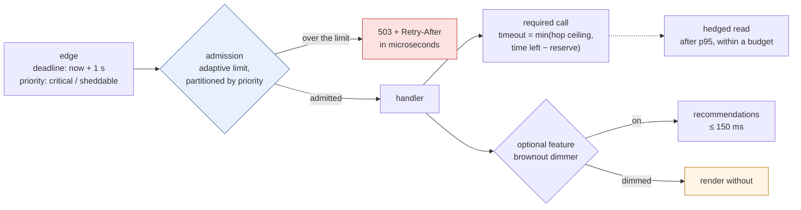

# 44. Timeouts, Retries, Backpressure & Load Shedding

<div class="badges" markdown><span class="badge badge-l3">L3 · Senior/Lead</span><span class="badge badge-l4">L4 · Architect</span><span class="badge badge-meta">deadline budgets · hedging · adaptive concurrency · priority shedding · brownout · backpressure</span></div>

<div class="grid two" markdown>

!!! info "Prerequisites"
    - [Chapter 42](ch42-failure-modes.md): queueing, retry amplification, metastable failure, deadlines
    - [Chapter 43](ch43-resilience4j-deep-dive.md): timeouts that stop work, bulkheads, retry configuration
    - Little's law (concurrency = throughput × latency)

!!! abstract "What you'll learn"
    - **Tail-cutting is load-dependent**: with spare capacity, hedging after 50 ms cut p99 from the full 1 s budget to **88 ms** for 10% more calls; at 85% load the same hedge **collapsed** the dependency (**18–43%** of users served)
    - **A hedge budget makes it safe**: hedges limited to 5% of reads kept **99.2–99.5%** of users served at 85% load
    - **Any concurrency limit beats a queue**: through a 2.5× slowdown, no limit served **4%** of users in time and didn't recover; an adaptive limit served **53–54%** (57% was possible)
    - **Adaptive limits need the right signal**: Vegas's defaults rejected **52–53%** of a healthy service's traffic; AIMD with "slow" set to half the deadline rejected none and still held the slowdown
    - **Priority, brownouts and backpressure**: partitions kept **79–81%** of checkouts flowing at 2× overload against 49–50% without; turning recommendations down let them recover after a spike; an unbounded queue aged events to **10 s**, a bounded `Flow` buffer kept them under **0.3 s**

</div>

---

## 1 · Introduction & Context

### The lunch hour that browsing ate

At 12:40 on a weekday, FoodFleet's menu traffic doubled in ten minutes. The menu page asks recommendation-service for "people also ordered" on every view, and recommendation-service slowed down under the load. Pages waited for it; order-service, on virtual threads, had no thread-pool limit to stop it accepting more pages, so they queued; and checkout requests queued behind them, in the same service, in the same line. Checkout success fell to a third while the browsing traffic that caused it got slower too. When the spike passed, recommendations stayed slow for another quarter of an hour, working through requests whose pages had long since rendered without them.

Chapter 42 showed how such failures arise and chapter 43 configured the libraries. This chapter is about the controls that decide *how much* work a service takes on and *which* work it drops: per-hop timeouts derived from a deadline budget, retries and hedges that help only while capacity lasts, admission control that adapts to what the service can finish, shedding by priority, brownouts for optional features, and backpressure for streams.

### Where it comes from

<ul class="mh-timeline">
<li><span class="when">1988 · Congestion avoidance</span><span class="what">Jacobson's TCP congestion control: additive increase, multiplicative decrease (AIMD), the algorithm FoodFleet's admission limit now uses.</span></li>
<li><span class="when">1994 · TCP Vegas</span><span class="what">Brakmo and Peterson infer queueing from rising round-trip times instead of waiting for loss.</span></li>
<li><span class="when">2012 · CoDel</span><span class="what">Nichols and Jacobson control queues by how long packets wait, not how many there are.</span></li>
<li><span class="when">2013 · The Tail at Scale</span><span class="what">Dean and Barroso: hedged and tied requests cut tail latency at fan-out.</span></li>
<li><span class="when">2015 · Reactive Streams</span><span class="what">A standard for asynchronous streams with non-blocking backpressure; in the JDK as <code>java.util.concurrent.Flow</code> since Java 9.</span></li>
<li><span class="when">2016 · Criticality</span><span class="what">Google's SRE book describes per-request criticality and shedding the least critical work first.</span></li>
<li><span class="when">2018 · Adaptive concurrency limits</span><span class="what">Netflix open-sources concurrency-limits: TCP's ideas applied to services.</span></li>
</ul>

---

## 2 · Core Concepts & Terminology



Deadline budget
:   The time the original caller will wait, carried with the request (chapter 42). Each hop's timeout is taken from what is left of it, minus a reserve for the hop's own remaining work, and capped by a per-hop ceiling.

Hedged request
:   A second, identical request sent when the first hasn't answered after a delay (typically the dependency's p95); the first answer wins. For idempotent reads only.

Admission control
:   Deciding at the door whether a request can be finished in time, and refusing it cheaply if not. The alternative is a queue, which refuses nothing and delays everything.

Adaptive concurrency limit
:   A limit on requests in progress that moves with observed latency: grow while answers are fast, shrink when they slow down. Little's law ties it to throughput: limit ≈ throughput × latency.

AIMD, Vegas, Gradient
:   Three ways to move the limit. **AIMD**: +1 while healthy, ×0.9 on a drop or a too-slow answer. **Vegas**: estimate queueing from latency above the minimum seen. **Gradient2**: compare short-term latency with a long-term average.

Load shedding
:   Refusing some work so the rest succeeds. **By priority** (checkout before browsing), **by age** (chapter 42), **LIFO** (serve the newest, whose callers are still waiting).

Brownout
:   Graceful degradation driven by a controller: optional features (recommendations, reviews, images at full size) are turned down when they are slow and up again when they recover.

Backpressure
:   A consumer telling a producer how much it can take. In `Flow`, the subscriber requests *n* items; the publisher may block, drop or buffer when it can't deliver.

---

## 3 · How It Works Internally

The experiments run on **JDK 25.0.4** against **Netflix concurrency-limits 0.5.4**, **Resilience4j 2.4.0**'s Hedge and the JDK's `Flow` API, built from their release tags by `verify/build-libs.sh`; `verify/check_apis.sh` checks the defaults quoted here in their sources.

### Timeouts from a budget

A fixed per-hop timeout is wrong twice: too long when the caller has almost run out of time (the work continues for nobody), too short to be useful when it was set from an average. FoodFleet gives each hop a ceiling a little above its dependency's p99.9 and takes the smaller of that and what is left of the deadline:

```java
--8<-- "code/chapters/ch44-timeouts-retries-backpressure/src/main/java/dev/foodfleet/ch44/budget/TimeoutBudget.java:28:33"
```

The rules that follow from it:

- **Inner timeouts are shorter than outer ones**, always: a hop never waits longer than its caller.
- **No time left means no call**: failing immediately is better than starting work that can't finish.
- **Retries come out of the same budget**: a retry after a 300 ms timeout with 400 ms left gets 380 ms (minus the reserve), not another full timeout.

### Retries and hedges cut the tail, while capacity lasts

A request that hits the slow 1% can be rescued by a second attempt that probably lands on the fast 94%. A *timeout and retry* abandons the first attempt; a *hedge* keeps it running and takes whichever answers first. Both add calls, and both leave the slow first call running at the dependency (chapter 43). With spare capacity the extra calls are free. Near capacity they make calls slower, which triggers more retries and hedges: the loop from chapter 42.

Resilience4j's `Hedge` hedges every call that is slower than its delay, and has no limit on how many. FoodFleet wraps it with a **hedge budget**, the same token-bucket idea as chapter 42's retry budget: each read earns 0.05 of a hedge, a hedge costs one.

```java
--8<-- "code/chapters/ch44-timeouts-retries-backpressure/src/main/java/dev/foodfleet/ch44/hedge/HedgedReads.java:40:51"
```

Two details from Resilience4j's source: each `Hedge` instance starts its own scheduler of 10 **non-daemon** threads, with no way to shut it down, so hedges are created once per dependency, never per request; and the adaptive delay option (`averagePlus…`) uses the **mean** latency, which a long tail drags far above the p95 you want.

### Admission control: adaptive limits

A limiter counts requests in progress and refuses new ones over the limit; the algorithm moves the limit. From concurrency-limits' source:

- **AIMD**: on each completed request, if it was dropped or slower than `timeout` (default **5 s**), limit × 0.9; otherwise, if at least half the limit is in use, limit + 1. Simple, and its only signal is the one you give it.
- **Vegas** (the library's default limit): estimates the queue from latency above the minimum latency it has seen. With a service whose normal latency varies a lot, it sees "queueing" everywhere.
- **Gradient2**: limit × (long-term latency ÷ short-term latency), plus a small queue allowance (default 4), never below `minLimit` (default 20).

FoodFleet uses AIMD with "too slow" set to **half the callers' deadline**, so the limit shrinks well before callers start giving up:

```java
--8<-- "code/chapters/ch44-timeouts-retries-backpressure/src/main/java/dev/foodfleet/ch44/limit/AdaptiveLimits.java:20:43"
```

### Shedding by priority, at the door

Partitions in concurrency-limits are guarantees, not caps: below the global limit any request is admitted; **at** the limit, each partition can use only its share. So browsing can use idle capacity, but can't take checkout's 90% when it matters. The edge marks each request (`X-FoodFleet-Priority`), and the filter runs before anything that costs work:

```java
--8<-- "code/chapters/ch44-timeouts-retries-backpressure/src/main/java/dev/foodfleet/ch44/web/AdmissionFilter.java:28:50"
```

A 5xx or an exception tells the limiter the request was dropped; a 4xx is ignored (it says nothing about capacity). The 503 carries `Retry-After`, and the edge's retry budget decides whether to use it.

**Waiting for a permit** is possible (`BlockingLimiter`, FIFO; `LifoBlockingLimiter`, newest first), but `BlockingLimiter` waits in `synchronized` with `Object.wait()`. On JDK 21 a virtual thread doing that **pins its carrier thread**; JDK 24 removed that limitation (JEP 491). Measured below.

### Brownout: turning optional work down

A timeout on recommendations protects the page's latency, not recommendation-service: every page still sends a request, and abandoned requests still run. A **dimmer** decides how many pages ask at all, from the share of slow-or-failed calls in the last second: halve when over 10%, add 10 points when not, never below 5% so it keeps measuring:

```java
--8<-- "code/chapters/ch44-timeouts-retries-backpressure/src/main/java/dev/foodfleet/ch44/degrade/Brownout.java:41:50"
```

```java
--8<-- "code/chapters/ch44-timeouts-retries-backpressure/src/main/java/dev/foodfleet/ch44/web/MenuPageService.java:38:56"
```

### Backpressure in streams

In `Flow`, a subscriber asks for items with `request(n)`, and `SubmissionPublisher` buffers what has been published but not requested (default **256** per subscriber). When the buffer is full the publisher must choose: `submit` **blocks** the producer (backpressure reaches the source), `offer` **drops** (with an optional wait and a callback), or the code around it buffers without bound. Kafka consumers get the same choice through `max.poll.records` and `pause()`/`resume()`: never hand records to an unbounded executor queue.

### Configuration

```yaml
--8<-- "code/chapters/ch44-timeouts-retries-backpressure/src/main/resources/order-service.yml"
```

---

## 4 · Design Considerations & Trade-offs

All runs: JDK 25.0.4, one 2-vCPU container. The control code is the real libraries; the dependency is a server with a fixed number of workers behind a FIFO queue (a fair semaphore) whose work is a sleep, and users arrive as a Poisson process on virtual threads. Two runs; where they differed, both values are shown. `check_apis.sh` checks **24 defaults and behaviours** in the sources of concurrency-limits 0.5.4, Resilience4j 2.4.0 and JDK 25.0.4 (all found).

### Measured: timeouts, retries and hedges against a long tail

Each user has a 1 s budget. The dependency's service time: 94% fast (p50 about 15 ms), 5% 100–300 ms, 1% 1–2 s. 15 s per row; abandoned calls keep running.

| A) 500 users/s, spare capacity | Within 1 s | p50 | p99 | p99.9 | Calls per user |
|---|---:|---:|---:|---:|---:|
| One call, wait up to 1 s | 98.8% | 16 ms | 1,000 ms | 1,000 ms | 1.00 |
| Timeout 300 ms, retry within the budget | 100% | 16 ms | 305–306 ms | 340–348 ms | 1.01 |
| Timeout 100 ms, retry within the budget | 100% | 16 ms | 134–143 ms | 227–228 ms | 1.07 |
| Hedge after 100 ms (~p95) | 100% | 16 ms | 133–135 ms | 248–251 ms | 1.06 |
| Hedge after 50 ms (~p90) | 100% | 16 ms | **88 ms** | 169–233 ms | 1.10–1.11 |
| Hedge after 50 ms, budget 5% of reads | 99.4% | 16–17 ms | 264–275 ms | 1,000 ms | 1.05 |

| B) 620 users/s, the dependency ~85% busy (four trials each, two per run) | Within 1 s | p50 | p99 | Calls per user |
|---|---:|---:|---:|---:|
| One call, wait up to 1 s | 98.9–99.2% | 16–20 ms | 293–1,000 ms | 1.00 |
| Timeout 300 ms, retry within the budget | 100% | 18–24 ms | 295–319 ms | 1.01 |
| Timeout 100 ms, retry within the budget | **20–49%** | 1,000 ms | 1,000 ms | **5.6–8.2** |
| Hedge after 100 ms (~p95) | **32–68%** | 44–1,000 ms | 1,000 ms | 1.40–1.71 |
| Hedge after 50 ms (~p90) | **18–43%** | 1,000 ms | 1,000 ms | 1.67–1.84 |
| **Hedge after 50 ms, budget 5% of reads** | **99.2–99.5%** | 22–33 ms | 304–402 ms | 1.05 |

- **With spare capacity, tail-cutting works and is cheap**: hedging after 50 ms took p99 from the full budget (1.2% of users ran out of time) to 88 ms and rescued every 1-second stall, for 10–11% more calls.
- **Near capacity, the same policies destroyed the dependency.** Each extra call pushed it closer to saturation, which made more calls slow, which triggered more hedges and retries: up to eight calls per user, and in most trials more than half the users failed. How badly varied from trial to trial (the system tips when a burst of stalls arrives), but every unbudgeted trial tipped. One call per user kept 99%.
- **A budget turns hedging from a risk into a tool**: capped at 5% extra reads, it kept 99.2–99.5% of users within the budget at 85% load, in all four trials. The cost shows in scenario A: the budget can't rescue every stall.
- **A 300 ms timeout was the safe retry**: it fired only on the 1–2 s stalls, about 1% of calls.

### Measured: admission control through a slowdown

20 workers at 20 ms per request (1,000/s); users at 700/s for 45 s, each waiting up to 500 ms. From 15 to 30 s every request takes 2.5× longer (400/s), then the service recovers. At most 57% of users can be served in the slow phase.

| Limiter | Users in 500 ms: before / slow / after | Rejected: before / slow / after | p99 served, slow phase | Mean limit, slow phase |
|---|---:|---:|---:|---:|
| No limit (queue in front of the workers) | 100% / **4.1–4.3%** / **1.8–6.8%** | 0 / 0 / 0 | 6,285–6,503 ms | – |
| Fixed 20 (the worker count) | 96.5–96.8% / 53.4–54.3% / 93.9–96.2% | 3.2–3.5% / 45.7–46.6% / 3.8–6.1% | 225–233 ms | 20 |
| Fixed 100 | 100% / 57.5–57.8% / 100% | 0 / 42.1–42.3% / 0 | 427–436 ms | 100 |
| Vegas (library defaults) | **47.2–48.3%** / 20.5–22.0% / 45.7–46.2% | **51.7–52.8%** / 78.0–79.5% / 53.8–54.3% | 220–240 ms | 8–9 |
| Gradient2 (library defaults: minimum 20) | 96.9–97.2% / 53.9–54.7% / 96.8–97.8% | 2.8–3.1% / 45.3–46.1% / 2.2–3.2% | 228–237 ms | 21 |
| Gradient2, minimum 5 | 81.6–83.2% / 38.5–38.7% / 83.7% | 16.8–18.4% / 61.3–61.5% / 16.3% | 230–238 ms | 14 |
| AIMD, slow above 500 ms (the deadline) | 100% / 46.8–47.4% / 99.9–100% | 0 / 44.9–45.0% / 0–0.1% | 637–641 ms | 112–113 |
| **AIMD, slow above 250 ms (FoodFleet)** | **100% / 53.4–54.3% / 99.7–100%** | 0 / 45.5–46.3% / 0–0.3% | 448–474 ms | 62–63 |

- **No limit is the worst limit**: the queue grew for the whole slow phase, users waited 6 s and gave up, and the service **didn't recover** when the slowdown ended: it was serving the backlog.
- **Fixed limits work if you know the number**: 20 matched this server's workers exactly. In production the right number moves with instance size, deploys and dependencies, which is the case for adapting.
- **Vegas's defaults misread a healthy service**: with normal latency varying between 1 and 100 ms, it took that spread for queueing, settled at 8–9, and rejected over half the traffic of a service at 70% load.
- **Gradient2 looked good only by coincidence**: its default floor (20) is this server's worker count; with a floor of 5 it settled at 14–15 and rejected 16–18% of healthy traffic.
- **AIMD with the right signal** admitted everything while healthy and served 53–54% in the slow phase (of 57% possible). Calling "slow" anything over the full deadline let the limit grow to 112–113 and the p99 to about 640 ms.

### Measured: who gets served at 2× overload

The same service; 2,000 requests/s for 15 s, half critical (checkout) and half sheddable (browsing); callers wait up to 500 ms. Capacity is 1,000/s, so 50% is the most anyone can serve.

| Admission (AIMD, slow above 250 ms) | Critical in 500 ms | Sheddable in 500 ms | All in 500 ms | p99 served |
|---|---:|---:|---:|---:|
| No limit (FIFO queue) | 3.3% | 3.4–3.5% | 3.3–3.4% | **15,244–15,320 ms** |
| One limit for all | 49.4–49.8% | 49.2–49.9% | 49.3–49.9% | 272–311 ms |
| **Partitioned 90% critical / 10% sheddable** | **78.5–80.6%** | 21.9–22.2% | 50.1–51.3% | 272–273 ms |
| One limit + FIFO wait up to 250 ms | 50.6–51.0% | 50.6–51.4% | 50.6–51.2% | 461–466 ms |
| One limit + LIFO wait up to 250 ms (backlog 200) | 49.6–50.2% | 49.3–50.5% | 49.5–50.4% | 278–289 ms |
| *On JDK 21.0.10:* one limit + FIFO wait up to 250 ms | **1.6–1.7%** | 1.4–1.8% | **1.5–1.8%** | **28,745–28,864 ms** |

- **Partitions move capacity to what matters**: checkout went from about 50% to 79–81% served, at the expense of browsing, with the same total.
- **Waiting for a permit didn't add goodput**; LIFO kept the p99 of what it served close to no waiting (278–289 ms), FIFO didn't (461–466 ms). The newest requests are the ones whose callers are still there.
- **On JDK 21 the FIFO wait collapsed**: `BlockingLimiter` waits in `synchronized`/`Object.wait()`, which pinned both carrier threads under thousands of waiting virtual threads: 1.5–1.8% served, a p99 of 29 s. The same code on JDK 25 behaved like the other limiters. (Partitions and LIFO, which don't use `synchronized` waits, behaved the same on both JDKs.)

### Measured: a brownout during a lunch spike

Menu page: 10 ms of its own work plus recommendations if they arrive within 150 ms. recommendation-service: 8 workers, 20 ms per request (400/s). Pages at 250/s, then 600/s from 10 to 30 s, then 250/s.

| Strategy | Pages with recommendations: before / spike / after | Page p99 in the spike | Recommendation calls per page: spike / after |
|---|---:|---:|---:|
| Timeout only | 99.9–100% / **1.1–1.8%** / **0%** | 161 ms | 1.00 / 1.00 |
| recommendation-service limits itself (AIMD) | 99.9–100% / **65.0–66.2%** / 99.5–99.9% | 150–154 ms | 1.00 / 1.00 |
| Brownout dimmer + timeout | 99.8–100% / 32.1–33.5% / 77.2–81.2% | 160 ms | **0.45–0.49** / 0.77–0.81 |

- **A timeout alone protects the page and abandons the dependency**: recommendation-service drowned in requests whose pages had already rendered, and showed nothing for the 15 s after the spike either.
- **The best fix is in the dependency**: limiting its own concurrency, it served almost all it could (67% was the ceiling) and was back to normal the moment the spike ended.
- **The dimmer is for dependencies you can't change**: a third-party API, a shared service, a call that costs money. It halved the calls during the spike and recovered gradually; it doesn't find the optimum as precisely as admission control at the source.

### Measured: backpressure in a stream

A producer emits 2,000 events/s for 10 s; the consumer handles 1,000/s.

| Strategy | Accepted | Dropped | Most waiting | p99 event age | Producer's rate |
|---|---:|---:|---:|---:|---:|
| Unbounded queue (executor with a `LinkedBlockingQueue`) | 19,816–19,868 | 0 | **9,909–9,957** | **9,882–9,984 ms** | 1,982–1,987/s |
| `Flow`: `submit()` blocks, buffer 256 | 10,009–10,024 | 0 | 258 | 268–270 ms | **1,001–1,002/s** |
| `Flow`: `offer()` drops when full | 10,167–10,204 | 9,671–9,693 | 257 | 262–265 ms | 1,984–1,990/s |
| `Flow`: `offer()` waits up to 5 ms | 10,010–10,013 | 0–2 | 258 | 272–292 ms | 1,001/s |

- **An unbounded queue hides overload until it is a 10-second-old backlog** (and, in production, an out-of-memory error).
- **Blocking slows the producer to the consumer's pace**: right when the producer can wait (a batch job, a Kafka consumer that can pause).
- **Dropping keeps the producer at full speed**: right for data that loses its value (location pings, metrics); count what you drop.

### Choosing

| Problem | Control | FoodFleet setting |
|---|---|---|
| A call might take longer than the caller can wait | Timeout from the deadline budget | min(hop ceiling, time left − reserve); no call below 20 ms |
| A long tail on idempotent reads | Hedge after p95 | Within a 5% hedge budget; one `Hedge` per dependency |
| Transient failures | Retry (chapters 42–43) | One layer, budget, jitter; timeout that fires only on stalls |
| More requests than the service can finish | Adaptive admission limit | AIMD, "slow" = half the callers' deadline, 503 + `Retry-After` |
| Some requests matter more | Partitions by priority | Critical 90% / sheddable 10% at the limit |
| An optional feature's dependency is struggling | Brownout dimmer | Halve above 10% slow, +10 points per second, floor 5% |
| A producer faster than its consumer | Bounded buffer: block or drop | `Flow` buffer 256; block for orders, drop for location pings |

---

## 5 · Hands-on Implementation

```text
ch44-timeouts-retries-backpressure/
├── src/main/java/dev/foodfleet/ch44/
│   ├── budget/   TimeoutBudget
│   ├── limit/    AdaptiveLimits, PartitionedLimiter, Priority
│   ├── hedge/    HedgedReads (Resilience4j Hedge + a hedge budget)
│   ├── degrade/  Brownout
│   └── web/      AdmissionFilter, MenuPageService, OverloadConfig, OrderServiceApplication
├── src/main/resources/   order-service.yml
├── src/test/java/…       14 tests
└── verify/               build-libs.sh, run.sh, check_apis.sh, tools/Lab.java, tools/Measure.java
```

### 🟢 Level 1: every call has a timeout shorter than its caller's

<div class="badges" markdown><span class="badge badge-l1">L1 · Foundation</span></div>

- Connect and read timeouts on every client, below the caller's own timeout.
- Never an unbounded queue in front of work: executors, consumers and buffers all have sizes.

### 🔵 Level 2: budgets, not constants

<div class="badges" markdown><span class="badge badge-l2">L2 · Practitioner</span></div>

- Derive each hop's timeout from the remaining deadline (`TimeoutBudget`); skip calls that can't finish.
- Retries and hedges within budgets; hedges only for idempotent reads.

### 🟣 Level 3: admission control and priorities

<div class="badges" markdown><span class="badge badge-l3">L3 · Senior/Lead</span></div>

- `AdmissionFilter` first in the chain: an AIMD limit with "slow" at half the deadline, partitioned by priority, 503 with `Retry-After`.
- Mark priority at the edge from the route; treat unmarked requests as sheddable.
- A brownout dimmer on every optional feature whose dependency you don't control.

```bash
verify/run.sh limits priority     # about 7 minutes
```

### 🔴 Level 4: overload as a designed, tested state

<div class="badges" markdown><span class="badge badge-l4">L4 · Architect</span></div>

- **A criticality model for the whole platform**: which routes are critical, which features are optional, and what each degrades to; owned by product and engineering together.
- **Load tests at 2× capacity** that pass when critical goodput stays up and the system recovers when the load drops, not when nothing fails.
- **Limits learn, budgets don't**: adaptive admission inside services; fixed budgets (retry, hedge, deadline) as platform defaults, changed by review.

### Run and verify

```text
$ verify/run.sh priority
openjdk version "25.0.4" 2026-07-21 LTS
== priority
a service with 20 workers, 20 ms per request (1,000/s); 2,000 requests/s for 15 s, half critical (checkout), half sheddable (browse)
each caller waits up to 500 ms
admission                                               critical in 500ms sheddable in 500ms    all in 500 ms       p99 served
no limit (FIFO queue)                                                3.3%               3.4%             3.3%         15244 ms
adaptive limit, one for all                                         49.8%              49.9%            49.9%           311 ms
adaptive limit, partitioned 90% critical / 10% sheddable              80.6%              22.2%            51.3%           273 ms
adaptive limit + FIFO wait up to 250 ms                             50.6%              50.6%            50.6%           461 ms
adaptive limit + LIFO wait up to 250 ms (backlog 200)               49.6%              49.3%            49.5%           278 ms
```

!!! question "Try it"
    1. In `Measure.tail`, lower scenario B to 560 users/s (about 77% busy). Do the unbudgeted hedges still collapse the dependency?
    2. Give the partitioned limiter 100% / 0%. What happens to browsing when there is spare capacity, and when there isn't?
    3. Make the brownout dimmer brighten by 0.3 per second instead of 0.1. Does recovery after the spike speed up, and does the spike phase get worse?
    4. In `Measure.streams`, add a fifth strategy: `offer()` that drops the **oldest** buffered event instead of the new one. Which data would want that?

---

## 6 · Production Readiness

- [x] **Deadline on every request**, propagated; per-hop timeouts from the remaining budget, ceilings above each dependency's p99.9
- [x] **Retries and hedges inside budgets**; hedges only for idempotent reads; one `Hedge` instance per dependency
- [x] **Admission control first in the chain**: adaptive limit, 503 + `Retry-After`, outcomes fed back (5xx dropped, 4xx ignored)
- [x] **Priority marked at the edge**, partitions per priority, unmarked requests sheddable
- [x] **Optional features behind dimmers**, with a defined degraded rendering
- [x] **No unbounded queues**: executors, `Flow` buffers, consumer prefetch all bounded; drops counted
- [x] **No blocking limiters on JDK 21 virtual threads** (or JDK 24+)
- [x] **Load tests at 2× capacity and through a slowdown**, judged on critical goodput and recovery
- [x] **Dashboards**: limit, in-flight, rejections by priority, dimmer level, hedge and retry rates

---

## 7 · Anti-patterns & Pitfalls

!!! pitfall "Incident 1: the hedge that took down search"
    **Context.** Menu search hedged reads to its index after 50 ms to cut p99, tested at normal load.
    **Symptoms.** During the dinner peak, search latency jumped to the timeout for most users; the index cluster was saturated with twice its usual query rate.
    **Root cause.** Unbudgeted hedging near capacity: more load, more slow calls, more hedges. Measured at 85% load: 18–43% of users served, up to 1.84 calls per user.
    **Fix.** A 5% hedge budget (99.2–99.5% served at the same load); hedging disabled automatically when the index's own queue time rises.

!!! pitfall "Incident 2: checkout behind the menus"
    **Context.** order-service served menus and checkout on virtual threads with no admission control.
    **Symptoms.** A browsing spike made checkout time out; after the spike, latency stayed high for minutes.
    **Root cause.** One FIFO queue for all requests, no limit: measured at 2× overload, 3.3% of checkouts served in time and a p99 of 15 s; through a slowdown, no recovery while the backlog drained.
    **Fix.** `AdmissionFilter` with an AIMD limit partitioned 90/10 for critical requests: 79–81% of checkouts served at 2× overload.

!!! pitfall "Incident 3: the limiter that rejected a healthy service"
    **Context.** A team added concurrency-limits with its default (Vegas) limit to restaurant-service.
    **Symptoms.** Steady 503s at ordinary load; partners saw failed menu updates on a quiet afternoon.
    **Root cause.** Vegas read the normal spread of the service's latency as queueing and held the limit at 8–9: measured, 52–53% of healthy traffic rejected.
    **Fix.** AIMD with "slow" at half the callers' deadline: 0% rejected at normal load, and the same protection in a slowdown.

| Anti-pattern | Symptom | Fix |
|---|---|---|
| Fixed per-hop timeouts that add up past the caller's | Work for callers who have gone | Timeouts from the remaining budget |
| Hedging or aggressive retries without a budget | Collapse near capacity | Budgets; hedge only reads |
| A `Hedge` per request | Threads that never exit | One per dependency |
| No admission control ("virtual threads scale") | Queues, timeouts, no recovery | Adaptive limit, 503 early |
| A limiter's default algorithm | Rejecting a healthy service | AIMD with an explicit "slow" |
| One queue for all priorities | Browsing starves checkout | Partitions at the limit |
| Blocking limiters on JDK 21 virtual threads | Carrier threads pinned | Reject instead, or JDK 24+ |
| Timeouts as the only protection for optional features | The dependency never recovers | Brownout dimmer, or the dependency limits itself |
| Unbounded buffers in streams | Seconds of lag, then out of memory | Bounded buffer; block or drop deliberately |

---

## 8 · Enterprise Case Study

### FoodFleet: admitting only what can be finished

!!! decision "ADR-044: Deadline budgets per hop; hedges and retries within budgets; AIMD admission control partitioned by priority at every service; brownouts for optional features; bounded buffers everywhere"
    **Status:** Accepted · **Date:** 2025-08-25

    **Context.** A lunch spike in browsing starved checkout and left recommendations slow long after it passed; an unbudgeted hedge saturated the search index at dinner; a default Vegas limiter rejected healthy traffic. Measured: at 85% load, unbudgeted hedges and 100 ms retries served 18–68% of users, a 5% hedge budget 99%; through a 2.5× slowdown, no limit served 4% and didn't recover, AIMD with "slow" at half the deadline served 53–54% of a possible 57% and 100% when healthy; partitions served 79–81% of checkouts at 2× overload against 49–50%; a self-limiting dependency showed recommendations on 65–66% of pages in a spike, timeouts alone on 1–2%.

    **Decision.** Each hop's timeout is min(ceiling, remaining deadline − reserve). Idempotent reads may hedge after the dependency's p95 within a 5% budget. Every service puts `AdmissionFilter` first: AIMD (initial 20, min 10, max 200, ×0.9, "slow" at half the callers' deadline), partitioned 90% critical / 10% sheddable, 503 + `Retry-After: 1`. The edge marks priority by route. Optional features sit behind a brownout dimmer; services that others depend on for optional features limit themselves. Stream consumers use bounded buffers and choose blocking or dropping per topic.

    **Consequences.** ✅ Overload costs browsing first and recovers when load drops. ✅ Tail-cutting is safe at any load. ⚠️ Shed requests are visible 503s: dashboards and alerts by priority are part of the change. ⚠️ Priority marking is a product decision; the default for new routes is sheddable until classified.

### Fintech analogue: authorisations first 🔴

A payment gateway partitions admission by message type: authorisations and reversals (customers waiting, money moving) get guaranteed capacity; reporting, statement downloads and settlement-file uploads are sheddable and retried later. Timeouts follow the card scheme's response deadline, with the gateway's budget split across fraud scoring, issuer routing and logging, and fraud scoring degrades to a simpler rule set under load rather than delaying the authorisation.

### E-commerce analogue: the sale-day product page

On sale days, product pages turn off personalised recommendations, review summaries and "recently viewed" by dimmer before anything else slows; search results come from a smaller, cached index; and the checkout path has admission control that queues users in a waiting room rather than letting the order service time out. Each degradation is planned, tested on the day before, and visible on a dashboard during the sale.

---

## 9 · Interview Q&A + Summary

#### Q1. How do you choose a timeout? · <span class="badge badge-l2">L2</span><span class="badge badge-l3">L3</span> · Amazon · Flipkart

**Short answer:** From two numbers: the dependency's latency distribution (a ceiling a little above its p99.9, so healthy calls aren't cut off) and the caller's remaining deadline (never wait longer than the caller will). Use the smaller, minus a reserve for your own work, and skip the call if what's left is too small to succeed.

#### Q2. What is a timeout budget? · <span class="badge badge-l3">L3</span> · Google-style rounds · Swiggy

**Short answer:** The original caller's deadline, shared out along the call chain: each hop gets what is left, so inner timeouts are always shorter than outer ones and retries come out of the same pot. It stops services working for callers who have already given up.

#### Q3. What is a hedged request, and when is it dangerous? · <span class="badge badge-l3">L3</span><span class="badge badge-l4">L4</span> · Google · Amazon

**Short answer:** A duplicate request sent when the first hasn't answered by about the p95; the first answer wins. It cut p99 from the full 1 s budget to 88 ms for 10% more calls with spare capacity (measured). Near capacity, hedges make calls slower, which triggers more hedges: at 85% load only 18–43% of users were served. Budget them (5% kept 99%) and use them only for idempotent reads.

#### Q4. Why not just retry with a short timeout? · <span class="badge badge-l3">L3</span> · Flipkart · Goldman Sachs

**Short answer:** The abandoned attempt keeps running, so a short timeout multiplies load exactly when the dependency is slow. At 85% load, 100 ms timeouts with retries sent 5.6–8.2 calls per user and served 20–49% (measured); a 300 ms timeout that only fired on real stalls served 100%.

#### Q5. What is adaptive concurrency limiting? · <span class="badge badge-l3">L3</span><span class="badge badge-l4">L4</span> · Netflix-style rounds · Uber

**Short answer:** A limit on in-flight requests that moves with latency, like TCP congestion control: AIMD adds one while healthy and cuts 10% when a request is dropped or too slow; Vegas and Gradient infer queueing from latency trends. Requests over the limit get an immediate 503 instead of joining a queue.

#### Q6. Which algorithm would you choose? · <span class="badge badge-l4">L4</span> · Netflix-style rounds · SAP

**Short answer:** The one whose signal you can define. In measurements, Vegas's defaults rejected half the traffic of a healthy service with variable latency, and Gradient2 depended on its floor; AIMD with "slow" set to half the callers' deadline rejected nothing when healthy and served 53–54% of a possible 57% in a slowdown. Test any of them on your own latency distribution.

#### Q7. Why is "no limit" worse than any limit? · <span class="badge badge-l3">L3</span> · Amazon · Zomato

**Short answer:** Without a limit the excess waits in a queue: everyone gets slow, callers time out, and the service keeps working for them after they leave. Measured: 4% of users served in a slowdown, and only 2–7% after it ended, because the backlog had to drain. With any limit, half were served and recovery was immediate.

#### Q8. How do you shed load by priority? · <span class="badge badge-l3">L3</span> · Swiggy · Flipkart

**Short answer:** Mark requests at the edge (checkout critical, browsing sheddable), and give each class a guaranteed share of the admission limit that applies only when the limit is reached, so spare capacity is still shared. Measured at 2× overload: 79–81% of checkouts served instead of about 50%.

#### Q9. LIFO or FIFO for a waiting queue? · <span class="badge badge-l3">L3</span> · Facebook-style rounds · Atlassian

**Short answer:** Under overload, LIFO: the newest requests are the ones whose callers are still waiting. In measurements LIFO and FIFO served the same share, but LIFO's p99 stayed at 278–289 ms against FIFO's 461–466 ms. Better still, reject early and let the caller retry within its budget.

#### Q10. What is a brownout? · <span class="badge badge-l2">L2</span><span class="badge badge-l3">L3</span> · Myntra · Amazon

**Short answer:** Turning optional features down automatically when their dependencies struggle: a controller sets the share of requests that use the feature from how many recent calls were slow. It removes load, which a timeout alone doesn't: timeouts left recommendations at 0% for 15 s after a spike; the dimmer was back to 77–81%.

#### Q11. What is backpressure? · <span class="badge badge-l2">L2</span><span class="badge badge-l3">L3</span> · Confluent-style rounds · Walmart

**Short answer:** The consumer controlling how fast it receives: in `Flow`, by requesting *n* items; in Kafka, by polling. When the buffer is full the producer blocks or drops; buffering without bound only delays the failure. Measured: an unbounded queue aged events to 10 s; a 256-item buffer kept them under 0.3 s.

#### Q12. Design FoodFleet's order-service for a 2× lunch spike. · <span class="badge badge-l4">L4</span> · Swiggy-/Zomato-style system design rounds

**Short answer:** Deadlines from the edge; per-hop timeouts from the remaining budget; admission control first in the chain (AIMD, partitioned by priority, 503 + `Retry-After`); recommendations behind a dimmer and limiting themselves; hedged menu reads within a 5% budget; retries at one layer within budgets; bounded buffers on event consumers; dashboards by priority; and a load test at 2× that passes on checkout goodput and recovery.

### Key takeaways

- **Budgets, not constants**: timeouts, retries and hedges all spend from the caller's deadline and a capacity budget.
- **Tail-cutting is a fair-weather tool** unless it is budgeted.
- **Admit what you can finish**: an adaptive limit with a meaningful "too slow", rejecting early.
- **Decide who loses**: priorities at the door, brownouts for optional features.
- **Every buffer has a size and a policy**: block or drop, never grow.

### Further reading

- J. Dean and L. A. Barroso, [The Tail at Scale](https://research.google/pubs/the-tail-at-scale/) (CACM 2013)
- Netflix, [concurrency-limits](https://github.com/Netflix/concurrency-limits): the library and the README describing its algorithms
- Google SRE book, [Handling Overload](https://sre.google/sre-book/handling-overload/)
- K. Nichols and V. Jacobson, [Controlling Queue Delay](https://queue.acm.org/detail.cfm?id=2209336) (ACM Queue, 2012)
- [Reactive Streams](https://www.reactive-streams.org/) and the `java.util.concurrent.Flow` Javadoc

---

**Previous:** [← 43. Resilience4j & Spring Framework 7 Resilience](ch43-resilience4j-deep-dive.md) · **Next:** [45. Chaos Engineering →](ch45-chaos-engineering.md)
