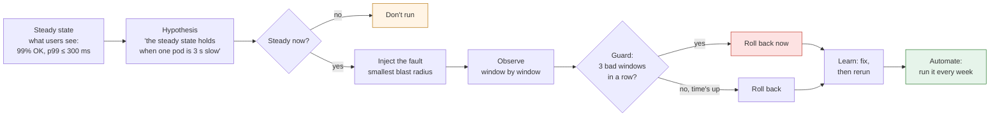

# 45. Chaos Engineering

<div class="badges" markdown><span class="badge badge-l2">L2 · Practitioner</span><span class="badge badge-l3">L3 · Senior/Lead</span><span class="badge badge-l4">L4 · Architect</span><span class="badge badge-meta">steady state · hypothesis · blast radius · abort guard · game days · Toxiproxy · Chaos Mesh · LitmusChaos</span></div>

<div class="grid two" markdown>

!!! info "Prerequisites"
    - [Chapter 42](ch42-failure-modes.md): how distributed systems fail
    - [Chapters 43](ch43-resilience4j-deep-dive.md) and [44](ch44-timeouts-retries-backpressure.md): the defences an experiment tests
    - SLOs in outline (chapter 51 covers them in depth)

!!! abstract "What you'll learn"
    - **Faults find configuration, not code**: of four common HTTP client setups, **three hung** on a slow trickle of bytes, two of them *with* a "1 s timeout" configured; only Spring's JDK request factory gave up at 1 s
    - **A black hole is the dangerous fault**: with no read timeout, a Resilience4j breaker **never opened** during 20 s of it while about **2,000** calls piled up; with a 250 ms read timeout the same experiment **held** its SLO throughout
    - **The guard is what makes chaos safe**: the same fault hurt about **1,500** users without a guard and **150–180** with one that stopped after 3 bad seconds
    - **Fault fidelity matters**: swallowing responses instead of requests let the server's connection closes through, and the breaker looked like it worked when it didn't
    - **Manifests fail silently**: a misspelled `duration` in a Chaos Mesh experiment passes schema validation and the fault never ends

</div>

---

## 1 · Introduction & Context

### The outage that happened on a Tuesday morning instead

During a routine refactoring, order-service's client for restaurant-service lost its read timeout: a configuration class was split in two, and the property that set it moved to a bean nobody used. Every test passed. Restaurant-service answered quickly in every environment, so nothing could notice that order-service would now wait for ever.

FoodFleet's weekly chaos experiment found it. On Tuesday at 11:00 in staging, it swallowed the requests to one restaurant-service pod for thirty seconds and watched the menu SLO. The SLO failed within three seconds, the guard stopped the experiment, and the report showed menu calls stuck open by the thousand and a circuit breaker that had never opened. The fix was one line. In production, the same fault would have arrived on a Friday evening as a network partition, and order-service would have run out of memory in minutes.

That is the case for chaos engineering: some weaknesses only show under a fault, and the cheapest time to meet the fault is a time you choose.

### Where it comes from

<ul class="mh-timeline">
<li><span class="when">2011 · Chaos Monkey</span><span class="what">Netflix kills production instances at random during business hours so that engineers build services that survive it; open-sourced in 2012.</span></li>
<li><span class="when">2014 · Toxiproxy</span><span class="what">Shopify releases a TCP proxy for simulating network conditions in tests and development.</span></li>
<li><span class="when">2015 · Principles of Chaos Engineering</span><span class="what">Steady state, hypotheses, real-world events, production, automation, minimal blast radius.</span></li>
<li><span class="when">2018–2019 · Kubernetes-native chaos</span><span class="what">LitmusChaos (2018) and Chaos Mesh (2019): experiments as custom resources.</span></li>
<li><span class="when">2021 · Managed fault injection</span><span class="what">AWS Fault Injection Simulator becomes generally available; cloud providers offer chaos as a service.</span></li>
<li><span class="when">2022 · CNCF incubation</span><span class="what">LitmusChaos and Chaos Mesh move to CNCF incubation.</span></li>
<li><span class="when">2025 · Regulation</span><span class="what">The EU's DORA applies from January 2025 and requires financial entities to test their digital operational resilience.</span></li>
</ul>

---

## 2 · Core Concepts & Terminology



Chaos engineering
:   Experimenting on a system to build confidence in its ability to withstand turbulent conditions. An experiment, not a test: it asks a question whose answer you don't know.

Steady state
:   The system's normal behaviour, measured in what users see (success rate, latency, orders per minute), not in internals (CPU, pod count). FoodFleet's: 99% of menu requests succeed and p99 stays at or under 300 ms.

Hypothesis
:   A prediction that the steady state will hold under a specific fault. If it holds, confidence grows; if it breaks, you have found a weakness before your users did.

Blast radius
:   How much of the system and of its traffic an experiment can affect: one pod or all, 5% of connections or 100%, staging or production.

Abort guard
:   A condition, evaluated continuously, that stops the experiment and rolls the fault back: an experiment hurting users has already answered its question.

Fault fidelity
:   How closely the injected fault behaves like the real one. A fault that is easier to handle than the real one gives false confidence.

Game day
:   A planned session in which a team runs experiments together, with observers, a runbook and a stop button, to practise both the system's response and the people's.

Continuous verification
:   Experiments that run on a schedule, like tests, so a regression (a lost timeout) is found within a week instead of during an incident.

---

## 3 · How It Works Internally

### An experiment as code

FoodFleet's runner follows the principles step by step: check the steady state first (never inject into a system that is already unhealthy), inject, judge each one-second window against the hypothesis, abort after three bad windows in a row, roll back **in a `finally`** whatever happens, then check that the system comes back:

```java
--8<-- "code/chapters/ch45-chaos-engineering/src/main/java/dev/foodfleet/ch45/chaos/Experiment.java:58:101"
```

The hypothesis is stated in what users see, and refuses to judge a window with too little traffic:

```java
--8<-- "code/chapters/ch45-chaos-engineering/src/main/java/dev/foodfleet/ch45/chaos/Hypothesis.java:8:16"
```

### Faults at the network layer: Toxiproxy

Toxiproxy is a TCP proxy with an HTTP API. The service under test connects to the proxy instead of its dependency, and **toxics** on the proxy shape the traffic: `latency`, `bandwidth`, `timeout` (stop all data; close after *n* ms, or never with 0), `reset_peer`, `limit_data`, `slicer`, `slow_close`. Each toxic has a direction (`upstream`: requests, `downstream`: responses) and a `toxicity`, the share of connections it affects.

Which direction matters. A black hole on **responses** still lets the server's own connection closes reach the client, which turns some hangs into fast errors; a real partition swallows everything. FoodFleet's black hole swallows requests, so the server never answers:

```java
--8<-- "code/chapters/ch45-chaos-engineering/src/main/java/dev/foodfleet/ch45/chaos/Toxic.java:22:30"
```

### What "timeout" means to each client

The fault matrix below is easier to read with each client's definition of a timeout in mind:

| Client | Setting | What it bounds |
|---|---|---|
| JDK `HttpClient` | `HttpRequest.timeout` | Until the response **headers** arrive; the body can take for ever (JDK-8208693) |
| JDK `HttpClient` | (none) | Retries idempotent requests once on a lost connection, so a "3 s" failure takes 6 s |
| Spring `JdkClientHttpRequestFactory` (Spring Boot's default when no other client library is present) | `setReadTimeout` / `spring.http.clients.read-timeout` | The **whole** exchange, body included: Spring wraps the JDK client to work around JDK-8208693 |
| Spring `SimpleClientHttpRequestFactory` (`HttpURLConnection`) | `setReadTimeout` | **Each read**: a response that trickles a byte a second never times out |

### Faults on Kubernetes: Chaos Mesh and LitmusChaos

Both run experiments as custom resources. Chaos Mesh's controller selects target pods by namespace and labels, and a daemon on each node applies the fault inside the pod's network namespace (traffic control rules for `NetworkChaos`), or kills the pod (`PodChaos`). The same latency experiment as a resource, with `mode: one` as the blast radius:

```yaml
--8<-- "code/chapters/ch45-chaos-engineering/src/main/resources/chaos-mesh/restaurant-latency.yaml"
```

The guard is a `StatusCheck` running in parallel with the fault in a `Workflow`; with `abortWithStatusCheck`, three failed checks abort the workflow and end its running chaos. The `slo-probe` service it calls answers 200 while the last second met the SLO:

```yaml
--8<-- "code/chapters/ch45-chaos-engineering/src/main/resources/chaos-mesh/menu-gameday-workflow.yaml:15:47"
```

LitmusChaos attaches **probes** to an experiment: an HTTP probe in `Continuous` mode with `stopOnFailure` is the guard, a Prometheus probe at the end (`EOT`) checks the error rate:

```yaml
--8<-- "code/chapters/ch45-chaos-engineering/src/main/resources/litmus/restaurant-pod-delete.yaml:29:52"
```

One property of Kubernetes matters for all of them: fields a CRD's schema doesn't know are **pruned**. `kubectl` asks for strict validation and rejects them; a client that doesn't ask (a deploy pipeline using a client library, an operator) gets the field dropped. A misspelled `duration` disappears, and a Chaos Mesh fault without a duration never expires.

### Application-level faults

Below the network, faults can be injected into the application itself: Chaos Monkey for Spring Boot adds latency, exceptions or memory pressure to Spring beans selected by stereotype (`@Service`, `@Repository`, `@RestController`), switched on through Actuator. It tests the application's own error handling; it doesn't test what a network or a pod failure does, so FoodFleet uses it for fallback paths and network-level tools for the rest.

---

## 4 · Design Considerations & Trade-offs

All runs: JDK 25.0.4, one 2-vCPU container, Toxiproxy 2.12.0 (the release binary) in front of real restaurant-service instances (the JDK's HTTP server) on loopback; clients are the JDK's `HttpClient` and Spring Framework 7.0.9's request factories, the breaker is Resilience4j 2.4.0, all built from their release tags. Two runs; where they differed, both values are shown. `check_apis.sh` checks **22 behaviours** in the sources of Toxiproxy, Spring Framework, Chaos Mesh, LitmusChaos and JDK 25.0.4 (all found).

### Measured: what each fault does to each client

restaurant-service returns a 20 KiB menu in about 5 ms. Each cell: three calls, watched for up to 12 s.

| Fault (Toxiproxy) | JDK `HttpClient`, no timeouts (its default) | JDK `HttpClient`, request timeout 1 s | Spring `JdkClientHttpRequestFactory`, read timeout 1 s | Spring `SimpleClientHttpRequestFactory`, read timeout 1 s |
|---|---|---|---|---|
| None | OK, 0.0–0.1 s | OK, 0.0 s | OK, 0.0 s | OK, 0.0 s |
| Latency +2 s | OK, 2.0 s | `HttpTimeoutException`, 1.0 s | `HttpTimeoutException`, 1.0 s | `SocketTimeoutException`, 1.0 s |
| Bandwidth 1 KB/s (a trickle) | **hung** | **hung** | `IOException`, 1.0 s | **hung** |
| Black hole (requests swallowed, connection held) | **hung** | `HttpTimeoutException`, 1.0 s | `HttpTimeoutException`, 1.0 s | `SocketTimeoutException`, 1.0 s |
| No data, connection closed after 3 s | `IOException`, **6.0 s** | `HttpTimeoutException`, 1.0 s | `HttpTimeoutException`, 1.0 s | `SocketTimeoutException`, 1.0 s |
| TCP reset | `IOException`, 0.0 s | `IOException`, 0.0 s | `IOException`, 0.0 s | `SocketException`, 0.0 s |
| Connection closed after 10 of 20 KiB | `IOException`, 0.0 s | `IOException`, 0.0 s | `IOException`, 0.0 s | `IOException`, 0.0 s |
| Connection refused | `ConnectException`, 0.0 s | `ConnectException`, 0.0 s | `ConnectException`, 0.0 s | `ConnectException`, 0.0 s |

"Hung" means no answer within the 12 s the lab waited. Both runs gave identical outcomes.

- **Three of four clients hung on a slow trickle**, and two of them had a "1 s timeout": the JDK's request timeout stops at the headers, and `HttpURLConnection`'s read timeout applies to each read. Only Spring's JDK request factory (Spring Boot's default) bounded the whole response.
- **The default JDK client waits for ever on a black hole**, and when a connection is dropped it silently tries again: the "closed after 3 s" fault took 6 s.
- **Fast failures are the easy ones**: resets, refused connections and truncated responses failed in milliseconds for every client (with a `Content-Length`, no client accepted a truncated body).

### Measured: blast radius and the abort guard

Two restaurant-service instances behind Toxiproxy; order-service alternates between them; 100 users/s, each giving up after 1 s. Fault: +3 s latency for 30 s. Hypothesis: 99% of requests succeed and p99 ≤ 300 ms, judged in 1 s windows.

| Experiment | Verdict | Stopped after | Users hurt (> 300 ms or failed) during the fault | Steady again after the rollback |
|---|---|---:|---:|---:|
| No read timeout; fault on 1 of 2 instances; **no guard** | BROKEN | 30.0–30.1 s | **1,471–1,500** of 2,979–3,028 (49–50%) | within 2 s |
| No read timeout; fault on 1 of 2 instances; **guard: 3 bad windows** | ABORTED | **3.0–4.0 s** | **147–180** of 330–393 | within 2 s |
| No read timeout; fault on **both** instances; guard | ABORTED | 4.0 s | 342–367 of 368–389 (93–94%) | within 2 s |
| **Read timeout 150 ms + retry on the other instance**; fault on 1 of 2; guard | **HELD** | 30.0 s (full run) | **0** of 3,000–3,042 | within 1 s |

- **Without a guard, the experiment did the damage of a real incident**: half of all users for 30 s.
- **The guard cut the cost by an order of magnitude** and still answered the question: the hypothesis is false, order-service can't absorb a slow instance. It needed 3–4 s: three bad windows, and failures only show once users give up.
- **A wider blast radius hurt nearly every user in the same few seconds**: start with one instance.
- **After the fix**, a 150 ms read timeout and a retry on the other instance, the same experiment **held**: zero users hurt in 30 s of fault. That's the experiment turning into a regression test.

### Measured: does the circuit breaker save us?

Menu requests at 100/s through chapter 43's Resilience4j breaker with a cached-menu fallback; users give up after 1 s. Fault for 20 s. Hypothesis: 99% of users get a menu (fresh or cached) within 300 ms.

| Experiment | Verdict | Failing windows (of 20) | Steady again during the fault | Calls stuck open at rollback | Breaker opened after |
|---|---|---:|---:|---:|---:|
| Black hole **on responses only**; no read timeout | BROKEN | 2–3 | after 3–4 s | 200 | 3.1–3.2 s |
| Black hole (requests swallowed); **no read timeout** | **BROKEN** | **19** | never | **1,986–2,027** | **20.6–20.7 s** (after the rollback) |
| Black hole; **read timeout 250 ms** | **HELD** | 0 | throughout | 0 | 2.3–2.4 s |
| Connection refused; no read timeout | HELD | 0 | throughout | 0 | 2.3–2.6 s |
| Connection refused; read timeout 250 ms | HELD | 0 | throughout | 0 | 2.3–2.5 s |

- **A breaker can't see calls that never end.** It counts outcomes, and a black-holed call without a read timeout has none: the breaker stayed closed for the whole fault (it opened only when the rollback released the stuck calls), users failed in 19 of 20 windows, and about 2,000 calls were open at the end.
- **With a 250 ms read timeout the same fault was invisible to users**: the timeouts opened the breaker in about 2 s and the fallback answered from then on.
- **Refused connections are easy**: fast failures opened the breaker with or without a timeout.
- **Fault fidelity**: swallowing *responses* instead of requests let the test server's connection closes through Toxiproxy; some calls failed fast instead of hanging, the breaker opened in about 3 s and the experiment nearly passed (2–3 bad windows of 20). The weak configuration would have looked fine.

### Measured: experiments as manifests

`validate_manifests.py` checks each manifest against the CRD schemas of Chaos Mesh 2.8.4 and LitmusChaos 3.31.0, once against the schema as written and once strictly (unknown fields are errors), then tries a copy of the latency experiment with `durations: 30s`:

| Manifest | Kind | Schema | Strict |
|---|---|---|---|
| `restaurant-latency.yaml` | NetworkChaos | valid | valid |
| `restaurant-pod-kill.yaml` | PodChaos | valid | valid |
| `menu-gameday-workflow.yaml` | Workflow (fault + StatusCheck guard, twice) | valid | valid |
| `weekly-pod-kill-schedule.yaml` | Schedule | valid | valid |
| `restaurant-pod-delete.yaml` | ChaosEngine (HTTP and Prometheus probes) | valid | valid |
| the latency experiment with `durations: 30s` | NetworkChaos | **valid** (the field is pruned) | rejected: `'durations' was unexpected` |

Without a duration, Chaos Mesh's `DurationExceeded` never returns true: the fault stays until someone deletes the resource.

### Choosing

| Tool | Injects | Where it fits | Guard |
|---|---|---|---|
| Toxiproxy | TCP faults between two processes | Tests, CI, staging, local development; any language | Your runner (`Experiment`) |
| Chaos Monkey for Spring Boot | Latency, exceptions, memory, app kill inside Spring beans | Testing fallback and error paths in the application | Actuator switch, your runner |
| Chaos Mesh | Network, pod, I/O, time, kernel, JVM, stress, HTTP faults on Kubernetes | Staging and production clusters; workflows and schedules | `StatusCheck` with `abortWithStatusCheck` |
| LitmusChaos | A hub of Kubernetes and cloud experiments | Clusters; teams that want a catalogue and a UI | Probes with `stopOnFailure` |
| AWS FIS / Azure Chaos Studio | Cloud-level faults: instances, zones, managed services | Infrastructure failures a cluster tool can't produce | Stop conditions on alarms |

---

## 5 · Hands-on Implementation

```text
ch45-chaos-engineering/
├── src/main/java/dev/foodfleet/ch45/chaos/   Experiment, Hypothesis, Window, Toxic, Toxiproxy
├── src/main/resources/chaos-mesh/            restaurant-latency, restaurant-pod-kill, menu-gameday-workflow, weekly schedule
├── src/main/resources/litmus/                restaurant-pod-delete (ChaosEngine with probes)
├── src/test/java/…                           10 tests
└── verify/                                   build-libs.sh, run.sh, validate_manifests.py, check_apis.sh, tools/
```

### 🟢 Level 1: one fault, locally

<div class="badges" markdown><span class="badge badge-l1">L1 · Foundation</span></div>

- Run Toxiproxy next to your service and point the client at it; add `latency`, then a `timeout` toxic with 0 (a black hole). Does your service answer within its SLO?
- Read the fault matrix for the client you use; check which "timeout" it has.

### 🔵 Level 2: experiments with hypotheses

<div class="badges" markdown><span class="badge badge-l2">L2 · Practitioner</span></div>

- Write the steady state in SLO terms, then the hypothesis, before injecting anything.
- Use `Experiment` with a guard (3 bad windows) and a rollback in `finally`; start with `mode: one` / one instance.

### 🟣 Level 3: experiments on the platform

<div class="badges" markdown><span class="badge badge-l3">L3 · Senior/Lead</span></div>

- Chaos Mesh workflows with a `StatusCheck` guard against a probe of the real SLO; LitmusChaos probes with `stopOnFailure`.
- Validate manifests strictly in CI (`validate_manifests.py`); always set a `duration`.
- A weekly `Schedule` in staging for each experiment that once found something.

```bash
verify/run.sh breaker manifests     # about 2 minutes
```

### 🔴 Level 4: chaos as a practice

<div class="badges" markdown><span class="badge badge-l4">L4 · Architect</span></div>

- **A catalogue of experiments** per critical journey (browse, order, pay, deliver), each with an owner, a hypothesis and a last-run date.
- **Game days every quarter**: an experiment the team hasn't run before, observers, a runbook, and a written review.
- **Production, carefully**: only experiments that have held in staging, small blast radius, business hours, the on-call engineer present, a freeze calendar respected.

### Run and verify

```text
$ verify/run.sh breaker
openjdk version "25.0.4" 2026-07-21 LTS
== breaker
menu requests at 100/s through a Resilience4j 2.4.0 circuit breaker (chapter 43's policy) with a cached-menu fallback
each user gives up after 1 s; fault for 20 s; hypothesis: 99% of users get a menu (fresh or cached), p99 <= 300 ms
experiment                                       verdict   failing windows       steady again after       calls stuck open   breaker opened
                                                                   (of 20)                injection            at rollback            after
black hole on responses only; no read timeout    BROKEN                  2                      3 s                    200            3.2 s
black hole; no read timeout                      BROKEN                 19          not within 20 s                   2027           20.7 s
black hole; read timeout 250 ms                  HELD                    0                      0 s                      0            2.4 s
connection refused; no read timeout              HELD                    0                      0 s                      0            2.3 s
connection refused; read timeout 250 ms          HELD                    0                      0 s                      0            2.3 s
```

!!! question "Try it"
    1. In `Measure.blast`, set the latency to 600 ms instead of 3 s. Does the fixed configuration still hold, and does the guard still trigger without the fix?
    2. Add a fault to `Measure.faults` with `Toxic.latency(2000, 0).withToxicity(0.1)`: only one connection in ten is slow. What do the outcomes look like now?
    3. Change `abortAfter(3)` to `abortAfter(1)` in `Measure.blast`. How many users does that save, and how often would a single noisy window stop a healthy experiment?
    4. In `menu-gameday-workflow.yaml`, change `mode: one` to `mode: all`. Which measured row does that correspond to?

---

## 6 · Production Readiness

- [x] **Steady state defined in user terms** (SLO per journey), measurable per second
- [x] **Hypothesis written down before the experiment**, with the expected outcome
- [x] **Abort guard on every experiment**, independent of the fault injector; rollback tested
- [x] **Smallest useful blast radius** first: one instance, a share of connections, staging before production
- [x] **High-fidelity faults**: black holes that swallow requests, not just slow responses
- [x] **Every manifest validated strictly in CI**; every fault has a `duration`
- [x] **On-call informed**, experiments visible on dashboards and in the incident channel
- [x] **Experiments that found something run weekly**; game days quarterly with a written review
- [x] **No chaos during incidents, freezes or known degradation** (the steady-state check enforces part of it)

---

## 7 · Anti-patterns & Pitfalls

!!! pitfall "Incident 1: the experiment that became the outage"
    **Context.** A team ran its first latency experiment against all restaurant-service pods in production, watching dashboards by eye.
    **Symptoms.** Menu errors for every user; it took the engineers two minutes to notice and another to find the command to stop it.
    **Root cause.** No automatic guard and no blast-radius limit. Measured on the lab: with no guard, about 1,500 users hurt in 30 s; with a 3-window guard 150–180; with the fault on every instance, 93–94% of users during the experiment.
    **Fix.** `Experiment` with `abortAfter(3)`, `mode: one`, staging first, and the guard's probe on the real SLO.

!!! pitfall "Incident 2: the breaker that passed a test it should have failed"
    **Context.** A team tested its circuit breaker with a black hole on responses in Toxiproxy; the experiment passed.
    **Symptoms.** In a real network partition, menu calls hung, threads and memory climbed, and the breaker never opened.
    **Root cause.** Low-fidelity fault: the test server's connection closes reached the client through the response-side black hole and failed calls fast. The client had no read timeout. Measured: the response-side black hole nearly passed (2–3 bad windows of 20), the request-side one failed 19 of 20 with about 2,000 calls stuck.
    **Fix.** Black holes swallow requests; a read timeout below the breaker's slow-call threshold; the experiment rerun weekly.

!!! pitfall "Incident 3: the delay that ran all weekend"
    **Context.** A NetworkChaos manifest applied by the deploy pipeline on a Friday; `durations: 30s` was a typo.
    **Symptoms.** One restaurant-service pod was 3 s slow until Monday; retries hid it, costs rose.
    **Root cause.** The pipeline's client didn't request strict field validation, the unknown field was pruned, and Chaos Mesh treats a missing duration as "until deleted". Measured: the typo passes schema validation and fails strict validation.
    **Fix.** Strict validation of every manifest in CI; experiments only through the workflow with a deadline.

| Anti-pattern | Symptom | Fix |
|---|---|---|
| Chaos without a hypothesis | Breaking things, learning nothing | Steady state and hypothesis first |
| Guard by eye | Minutes of damage | Automatic abort on the SLO |
| Whole fleet first | Every user affected | One instance, a share of connections |
| Injecting into an unhealthy system | Two incidents at once | Steady-state check before injecting |
| Low-fidelity faults | False confidence | Swallow requests; reproduce the real failure |
| Faults without a duration | Experiments that never end | `duration`/`deadline` on everything, strict validation |
| One-off game days only | Regressions return unseen | Weekly scheduled experiments |
| Testing only the fast failures | Hangs found in production | Black holes and trickles in the catalogue |

---

## 8 · Enterprise Case Study

### FoodFleet: experiments as a weekly habit

!!! decision "ADR-045: A catalogue of chaos experiments per critical journey, each with an SLO hypothesis, an automatic guard and the smallest blast radius; weekly in staging, quarterly game days, production only for experiments that hold"
    **Status:** Accepted · **Date:** 2025-09-01

    **Context.** A lost read timeout reached staging unnoticed; a first, unguarded experiment in production became an incident; a typo kept a fault running for a weekend. Measured on the lab: three of four common client configurations hung on a trickle; without a read timeout a breaker never saw a black hole (about 2,000 calls stuck, 19 of 20 windows failing); a guard of three windows cut the users hurt from about 1,500 to 150–180; a misspelled `duration` passes schema validation.

    **Decision.** Each critical journey (browse, order, pay, track) owns experiments in a catalogue, run by `Experiment` (Toxiproxy) in CI and as Chaos Mesh workflows in staging: steady state checked first, a `StatusCheck`/guard on the journey's SLO aborting after three bad seconds, `mode: one` until the hypothesis has held three times. Faults include black holes on requests and slow trickles, not only latency and errors. Every manifest is validated strictly in CI and has a duration or deadline. Experiments that once found a weakness run weekly. Game days each quarter; production experiments only for hypotheses that held in staging, in business hours, with on-call present.

    **Consequences.** ✅ Regressions in resilience configuration are found within a week. ✅ Experiments cost seconds of degraded service, not minutes. ⚠️ The SLO probe and the catalogue need owners and upkeep. ⚠️ Staging must carry representative traffic, or the steady state means nothing; a synthetic load generator runs there continuously.

### Fintech analogue: resilience testing as a duty 🔴

Banks and payment institutions in the EU fall under DORA, which since January 2025 requires a digital operational resilience testing programme; UK firms work to impact tolerances for important business services. In practice that means a catalogue of scenarios (a data-centre loss, a card-scheme outage, a core-banking slowdown), tested regularly with evidence: the hypothesis, the measured impact against the tolerance, and the remediation. The tooling is the same; the record-keeping is stricter.

### E-commerce analogue: rehearsing the sale

Retailers run game days in the weeks before a big sale: the payment provider slowed, a cache cluster lost, a zone failed, each at sale-level synthetic traffic. Each rehearsal checks the degradation plan of chapter 44 (which features dim first, which pages go static) and the people: who notices, who decides, how fast the stop button is pressed.

---

## 9 · Interview Q&A + Summary

#### Q1. What is chaos engineering? · <span class="badge badge-l2">L2</span> · TCS · Infosys

**Short answer:** Running controlled experiments that inject real-world faults (latency, crashes, partitions) into a system to check a hypothesis about its steady state, so weaknesses are found at a time you choose rather than during an incident. It is an experiment, not random breakage: steady state, hypothesis, small blast radius, automatic stop.

#### Q2. How is it different from testing? · <span class="badge badge-l2">L2</span><span class="badge badge-l3">L3</span> · Accenture · SAP

**Short answer:** A test checks a known expected behaviour of a component; an experiment asks an open question about the whole system under conditions tests don't create (a black-holed dependency, a slow trickle, a dead pod at peak). Once an experiment's hypothesis holds, it often becomes a scheduled regression check, much like a test.

#### Q3. What is a steady-state hypothesis? · <span class="badge badge-l3">L3</span> · Netflix-style rounds · Flipkart

**Short answer:** A measurable statement of normal behaviour in user terms (99% of menu requests succeed within 300 ms) and a prediction that it holds under a fault. Using user-facing metrics keeps the experiment honest: internal metrics can look fine while users suffer.

#### Q4. How do you limit the blast radius? · <span class="badge badge-l3">L3</span> · Amazon · Swiggy

**Short answer:** Start small and widen: one instance (`mode: one`), a share of connections (`toxicity`), staging before production, short durations, business hours. Measured: the same fault on both instances instead of one hurt 93–94% of users during the experiment.

#### Q5. What is an abort condition, and why automate it? · <span class="badge badge-l3">L3</span> · Netflix-style rounds · Gremlin-style rounds

**Short answer:** A continuously checked condition (the SLO failing for N windows) that stops the experiment and rolls the fault back. Humans watching dashboards take minutes; measured, an automatic guard after three bad seconds cut the users hurt from about 1,500 to 150–180.

#### Q6. Which faults would you inject first? · <span class="badge badge-l3">L3</span> · Uber · Zomato

**Short answer:** The ones that produce hangs rather than errors: black holes (requests swallowed, connections held) and slow trickles, then latency, then pod kills and refused connections. Measured: fast failures were handled by every client; three of four client setups hung on a trickle.

#### Q7. Why did a circuit breaker fail a chaos experiment? · <span class="badge badge-l3">L3</span><span class="badge badge-l4">L4</span> · Goldman Sachs · Walmart

**Short answer:** A breaker counts outcomes, and a call with no read timeout into a black hole never has one. Measured: no opening in 20 s, about 2,000 calls stuck, users failing in 19 of 20 windows; with a 250 ms read timeout the same experiment held. Timeouts are what feed a breaker.

#### Q8. What is fault fidelity? · <span class="badge badge-l4">L4</span> · Netflix-style rounds · Atlassian

**Short answer:** How faithfully the injected fault reproduces the real failure. A black hole on responses let the server's connection closes through and made a broken configuration nearly pass; one on requests, like a real partition, exposed it. Check that the fault behaves like the incident you fear.

#### Q9. Chaos Mesh or LitmusChaos? · <span class="badge badge-l3">L3</span> · any Kubernetes shop

**Short answer:** Both run experiments as custom resources on Kubernetes. Chaos Mesh has a broad set of fault types, workflows with status checks that abort, and schedules; LitmusChaos has a hub of ready-made experiments and probes (HTTP, Prometheus, command, Kubernetes) with `stopOnFailure`. Choose by the experiments you need and the guard model; validate manifests strictly either way.

#### Q10. Should you run chaos in production? · <span class="badge badge-l4">L4</span> · Amazon · Netflix-style rounds

**Short answer:** Eventually, for experiments that have held in staging, because only production has real traffic, data and dependencies, but with a small blast radius, an automatic guard, business hours, on-call present and a freeze calendar. Production chaos without those is just an outage you scheduled.

#### Q11. What is a game day? · <span class="badge badge-l2">L2</span><span class="badge badge-l3">L3</span> · Flipkart · PayPal

**Short answer:** A planned session where a team runs one or more experiments together, with observers, a runbook and a stop button, practising the system's behaviour and the team's response (detection, decisions, communication), followed by a written review with actions.

#### Q12. Design a chaos programme for FoodFleet. · <span class="badge badge-l4">L4</span> · Swiggy-/Zomato-style system design rounds

**Short answer:** Define each critical journey's SLO and a per-second probe; build a catalogue of hypotheses per journey (slow and black-holed dependencies, pod and zone loss, a slow database); run them in CI with Toxiproxy and in staging as Chaos Mesh workflows with SLO guards, one instance at a time; validate manifests strictly; schedule the experiments that found something weekly; quarterly game days; graduate held experiments to production with on-call present.

### Key takeaways

- **An experiment needs a steady state, a hypothesis, a guard and a rollback**, in that order.
- **Hangs are the faults that matter**: black holes and trickles find missing timeouts that errors never will.
- **Guards and small blast radii make chaos cheap**: seconds of degradation, not minutes.
- **Check the fault's fidelity** before trusting a passed experiment.
- **Experiments that found something become weekly checks.**

### Further reading

- [Principles of Chaos Engineering](https://principlesofchaos.org/)
- C. Rosenthal and N. Jones, *Chaos Engineering: System Resiliency in Practice* (O'Reilly, 2020)
- [Toxiproxy](https://github.com/Shopify/toxiproxy), [Chaos Mesh documentation](https://chaos-mesh.org/docs/), [LitmusChaos documentation](https://docs.litmuschaos.io/)
- [Chaos Monkey for Spring Boot](https://codecentric.github.io/chaos-monkey-spring-boot/)
- OpenJDK bug [JDK-8208693](https://bugs.openjdk.org/browse/JDK-8208693): HttpClient's request timeout and the response body

---

**Previous:** [← 44. Timeouts, Retries, Backpressure & Load Shedding](ch44-timeouts-retries-backpressure.md) · **Next:** [46. Disaster Recovery & Multi-Region →](ch46-disaster-recovery.md)
