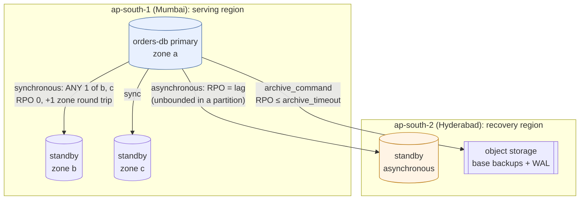

# 46. Disaster Recovery & Multi-Region

<div class="badges" markdown><span class="badge badge-l3">L3 · Senior/Lead</span><span class="badge badge-l4">L4 · Architect</span><span class="badge badge-meta">RPO · RTO · synchronous replication · failover · fencing · PITR · active-active · cells · shuffle sharding</span></div>

<div class="grid two" markdown>

!!! info "Prerequisites"
    - [Chapter 31](../data/ch31-data-consistency.md): consistency models and replication lag
    - [Chapter 33](../data/ch33-database-scaling.md): replicas and read scaling
    - [Chapter 45](ch45-chaos-engineering.md): experiments with guards (DR rehearsals are experiments)

!!! abstract "What you'll learn"
    - **What replication mode buys**: in-zone synchronous commits cost **1.3–1.7 ms instead of 0.9–1.0 ms** and lost nothing; across a 60 ms round trip, commits per second fell from about 7,000 to **112–126**
    - **What a lost region costs**: asynchronous replication lost **85–278 commits** when the link and primary died together, and **17,000–22,700** when the link failed 2 s first
    - **Where failover time goes**: promotion took **0.1 s**; detection 3 to 30 s by probe interval; clients following a 30 s DNS TTL resumed **24–33 s** after the crash
    - **Backups that don't lose the last minute**: `archive_timeout = 60 s` lost **298–317** orders, streamed WAL **0**
    - **Cells and shuffle sharding**: one poison tenant took down **100%** of a shared pool, **12.7%** with 8 cells, **1.7–3.6%** with shuffle shards

</div>

---

## 1 · Introduction & Context

### The afternoon Mumbai was cut off

At 14:05 on a weekday, the network between FoodFleet's two regions failed. The orders database in Mumbai kept running and kept accepting orders; its standby in Hyderabad, replicating asynchronously, stopped receiving anything. Ten minutes later Mumbai's load balancers went dark too, and the on-call engineer did what the runbook said: promote Hyderabad, point traffic there. FoodFleet was taking orders again by 14:20.

At 16:00 the Mumbai region came back, with its database, and with **four minutes of orders that Hyderabad had never seen**: paid, accepted by restaurants, some already delivered. Hyderabad had meanwhile issued new orders with some of the same IDs. Reconciling the two histories took two engineers most of a week, and a few hundred customers were charged twice or not at all.

Nothing in that story was a bug. Asynchronous replication loses what hasn't arrived yet, by design; a partition stretches "what hasn't arrived yet" to however long the old primary keeps writing; and promoting a standby without first making sure the old primary stopped (**fencing**) creates two histories. This chapter measures each of those mechanisms on real PostgreSQL clusters and turns them into numbers FoodFleet can design to: how much data each replication mode loses, how long each failover takes, how long a restore takes, and how far a failure spreads.

### Where it comes from

<ul class="mh-timeline">
<li><span class="when">2010 · Streaming replication</span><span class="what">PostgreSQL 9.0 ships streaming replication and hot standbys.</span></li>
<li><span class="when">2011 · Synchronous replication</span><span class="what">PostgreSQL 9.1: a commit can wait for a standby. The same year, an AWS us-east-1 storage outage teaches many companies what "single region" means.</span></li>
<li><span class="when">2016–2017 · remote_apply and quorums</span><span class="what">PostgreSQL 9.6 adds <code>remote_apply</code> and several synchronous standbys; 10 adds quorum commit (<code>ANY n (...)</code>).</span></li>
<li><span class="when">2018 · Cells</span><span class="what">AWS describes cell-based architecture: many independent copies of a service, each serving a slice of customers, to limit the blast radius.</span></li>
<li><span class="when">2019 · Shuffle sharding</span><span class="what">The AWS Builders' Library explains shuffle sharding: give each customer its own small random subset of capacity.</span></li>
</ul>

---

## 2 · Core Concepts & Terminology



RPO (recovery point objective)
:   How much acknowledged data may be lost in a disaster, as time or transactions. "Zero" means no commit a client was told about may disappear.

RTO (recovery time objective)
:   How long until the service works again: detection, decision, promotion, clients finding the new primary, caches warming.

Synchronous / asynchronous replication
:   Synchronous: a commit returns only after a standby has the change (in PostgreSQL: written, flushed or applied, per `synchronous_commit`). Asynchronous: the commit returns at once and the standby catches up; whatever it hasn't received is lost if the primary is.

Quorum commit
:   `synchronous_standby_names = 'ANY 1 (b, c)'`: a commit waits for any one of several standbys, so losing one standby doesn't stop writes.

Failover, fencing and split brain
:   Failover promotes a standby. Fencing first makes sure the old primary can't accept writes (power it off, cut its network, revoke its storage or credentials). Without fencing, both accept writes: split brain, two histories.

Backup and point-in-time recovery (PITR)
:   A base backup plus every WAL segment since lets you rebuild the database as of any moment: the defence against a deleted table, a bad migration or ransomware, which replication copies faithfully.

DR strategies
:   **Backup and restore** (hours), **pilot light** (data replicated, compute off), **warm standby** (a smaller copy running), **active-active** (every region serves; conflicts must be designed away).

Cell
:   A complete, independent copy of the stack serving a slice of tenants. A failure (or a bad deploy) in one cell reaches only its tenants.

Shuffle sharding
:   Each tenant gets its own small, pseudo-random subset of instances; two tenants rarely share the whole subset, so one poison tenant takes down very few others completely.

---

## 3 · How It Works Internally

All measurements run real PostgreSQL 16.13 clusters: primaries and streaming standbys built with `pg_basebackup`, powered off with `pg_ctl stop -m immediate`, promoted with `pg_promote()`, restored from base backups and archived WAL. Distance between regions is Toxiproxy latency on the replication connection; losing a region is cutting that connection and powering the primary off.

### Recovery tiers

Not every service needs zero loss, and zero loss across regions costs a round trip on every commit. FoodFleet assigns each service a tier, and the tier decides replication, failover and rehearsal:

```java
--8<-- "code/chapters/ch46-disaster-recovery/src/main/java/dev/foodfleet/ch46/objectives/Tier.java:10:28"
```

### What each replication mode waits for

With a synchronous standby, a commit on the primary waits until the standby has: received and written the WAL to its operating system (`remote_write`), flushed it to disk (`on`), or applied it so queries on the standby see it (`remote_apply`). Each waits a little longer; all of them wait **at least one network round trip**, which is why FoodFleet keeps synchronous standbys in the same region (other zones, about a millisecond apart) and the cross-region standby asynchronous:

```text
--8<-- "code/chapters/ch46-disaster-recovery/src/main/resources/postgres/orders-primary.conf"
```

An asynchronous standby's data loss is whatever it hadn't received when the primary died. In a clean crash that is milliseconds. In a **partition**, the primary keeps accepting commits it can't replicate, and the loss grows for as long as the partition lasts.

### Failover: detect, fence, promote, reconnect

The controller declares the primary dead after a number of failed health checks in a row (so detection takes about *interval × threshold*), fences it, then promotes the standby:

```java
--8<-- "code/chapters/ch46-disaster-recovery/src/main/java/dev/foodfleet/ch46/failover/FailoverController.java:65:85"
```

Clients then have to find the new primary. Asking every host "are you the primary?" (`pg_is_in_recovery()`) finds it as soon as it is promoted; waiting for a DNS name to change adds up to the record's TTL, per client:

```java
--8<-- "code/chapters/ch46-disaster-recovery/src/main/java/dev/foodfleet/ch46/failover/PrimaryLocator.java:38:52"
```

pgJDBC does the same when the URL lists every host with `targetServerType=primary`. Its defaults are generous in the wrong places: `socketTimeout` 0 (a read on a dead primary waits for ever), `connectTimeout` 10 s, `hostRecheckSeconds` 10:

```yaml
--8<-- "code/chapters/ch46-disaster-recovery/src/main/resources/application-dr.yml"
```

Across regions, FoodFleet doesn't fail over automatically: a health check from one region can't tell a dead region from a broken link, and promoting during a partition is exactly the split brain of the introduction. The regional failover is a runbook step: fence the old region (stop its writers, withdraw its DNS), then promote:

```text
--8<-- "code/chapters/ch46-disaster-recovery/src/main/resources/postgres/orders-dr-standby.conf"
```

### Backups and point-in-time recovery

Replication protects against losing a machine; it copies a `DROP TABLE` or a corrupting bug to every standby within milliseconds. Backups protect against that: a base backup plus continuous WAL archiving. `archive_command` ships a WAL segment when it fills (16 MB) or when `archive_timeout` forces a switch, so with little traffic the archive can trail by up to `archive_timeout` (default 0: no forced switch at all). `pg_receivewal` streams WAL as it is written instead; its current file ends in `.partial` and must be renamed before a restore uses it. A restore copies the base backup and replays every archived segment; with no recovery target it promotes at the end of the archive (with a target, the default `recovery_target_action` is `pause`).

### Cells and shuffle sharding

A region is a big blast radius; so is a single shared pool of instances. Cells split the system into independent copies; FoodFleet routes each tenant (a city, a large restaurant chain) to a cell by rendezvous hashing, so adding a cell moves only the tenants it wins, and a broken cell can be drained:

```java
--8<-- "code/chapters/ch46-disaster-recovery/src/main/java/dev/foodfleet/ch46/cell/CellRouter.java:31:49"
```

Shuffle sharding goes further inside a cell: each tenant gets its own two (or three) instances out of eight, so the chance that another tenant shares exactly the poison tenant's instances is 1 in 28 (or 1 in 56).

---

## 4 · Design Considerations & Trade-offs

All runs: JDK 25.0.4 (the clients and controller), PostgreSQL 16.13, Toxiproxy 2.12.0, one 2-vCPU container; every database runs on loopback, so "zones" and "regions" differ only by the latency added to the replication link. Two runs; where they differed, both values are shown. `check_apis.sh` checks **14 settings and defaults** in the sources of PostgreSQL 16.13, pgJDBC 42.7.13 (Spring Boot 4.1.1's version) and Toxiproxy (all found).

### Measured: data lost and commit latency, by replication mode and distance

8 clients insert orders (one commit each) for 8 s. Then the primary's region is lost: the replication link is cut and the primary powered off; the standby is promoted, and every order a client was told is committed is looked for.

| Standby | Replication | Commits/s | Commit p50 | Commit p99 | Lost of acknowledged | Lost commits span |
|---|---|---|---|---|---|---|
| **Another zone** (no added latency) | async; primary crashes, link stays up | 6,902–7,469 | 0.9–1.0 ms | 3.5–3.7 ms | 0–7 | 0 ms |
| | async; region lost (link and primary) | 7,299–7,899 | 0.9–1.0 ms | 3.4–3.5 ms | **85–97** | 17–31 ms |
| | async; link lost 2 s before the primary | 7,482–8,008 | 0.9 ms | 3.1–3.9 ms | **20,648–21,469** | 2.0 s |
| | sync, `remote_write` | 5,365–5,487 | 1.3 ms | 3.8–4.1 ms | 0 | — |
| | sync, `on` (flushed on the standby) | 4,798–5,081 | 1.5 ms | 3.8–3.9 ms | 0 | — |
| | sync, `remote_apply` | 4,399–4,449 | 1.7 ms | 4.1–4.4 ms | 0 | — |
| **Nearby region** (20 ms round trip) | async; primary crashes, link stays up | 7,175–7,755 | 0.9–1.0 ms | 3.2–3.3 ms | 0–2 | 0 ms |
| | async; region lost | 7,008–7,134 | 1.0 ms | 3.4–3.6 ms | **151–179** | 44–182 ms |
| | async; link lost 2 s first | 7,995–8,269 | 0.9 ms | 2.8–3.1 ms | **20,196–22,669** | 2.0 s |
| | sync, `remote_write` | 344–351 | 22.6–22.8 ms | 26.7–43.4 ms | 0 | — |
| | sync, `on` | 340–344 | 22.9–23.1 ms | 30.6–35.9 ms | 0 | — |
| | sync, `remote_apply` | 338–339 | 23.1–23.3 ms | 30.2–39.4 ms | 0 | — |
| **Far region** (60 ms round trip) | async; primary crashes, link stays up | 6,901–7,299 | 1.0 ms | 3.4–4.0 ms | 0–2 | 0 ms |
| | async; region lost | 7,202–7,756 | 0.9–1.0 ms | 3.0–3.5 ms | **130–278** | 29–49 ms |
| | async; link lost 2 s first | 7,638–8,070 | 0.9 ms | 3.1–3.3 ms | **17,236–19,538** | 2.1 s |
| | sync, `remote_write` | 124–126 | 62.9–63.0 ms | 82.4–124.1 ms | 0 | — |
| | sync, `on` | 122–124 | 63.4 ms | 81.2–125.1 ms | 0 | — |
| | sync, `remote_apply` | 112–121 | 63.5–63.7 ms | 125.2–292.0 ms | 0 | — |

- **Synchronous replication lost nothing** in every row; in another zone it cost 0.4–0.8 ms per commit and about a third of the throughput of 8 clients. Across regions each commit waits the full round trip: **~23 ms at 20 ms RTT, ~63 ms at 60 ms**, and 8 clients managed 112–351 commits a second instead of about 7,000. More clients would raise throughput, never lower the per-commit wait.
- **Asynchronous replication loses the in-flight tail even in a clean crash**: 0–7 acknowledged commits were missing when only the primary died. When the region went (link and primary together), **85–278** were lost, roughly the last 20–50 ms of commits, more with distance.
- **A partition is the real danger**: when the link failed 2 s before the primary, every commit in those 2 s was lost, **17,000–22,700**. The loss grows with the partition's length, and the primary's clients see nothing wrong; this is the introduction's incident.
- `remote_write`, `on` and `remote_apply` differed by fractions of a millisecond in a zone and hardly at all across regions (the round trip dominates); all three lost nothing when only the primary died. Choose by what you need on the standby: `remote_apply` for read-your-writes on replicas.

### Measured: how long a failover takes

4 clients write continuously; the primary is powered off; a controller probes it (connect and `SELECT 1`, 1 s timeout) and promotes the standby after 3 failed probes. Clients find the new primary by asking each host for its role, or through a DNS name the controller updates and each client caches for up to 30 s.

| Failover | Detection | Promotion | Writes resumed (median) | Writes resumed (slowest client) |
|---|---|---|---|---|
| Probe every 1 s, 3 failures | 3.1 s | 0.10 s | **3.5 s** | 3.5–3.6 s |
| Probe every 5 s, 3 failures | 15.1 s | 0.10 s | 15.4 s | 15.4 s |
| Probe every 10 s, 3 failures | 30.1 s | 0.10 s | 30.5 s | 30.5 s |
| Probe every 1 s; clients follow DNS (TTL 30 s) | 3.1 s | 0.11 s | **23.7–33.3 s** | 23.9–33.3 s |

- **Promotion is the cheap part**: `pg_promote()` took about 0.1 s every time. Detection was almost exactly *interval × threshold*, so the probe settings are the RTO.
- **Clients that ask each host for its role** resumed writing 0.3 s after promotion. **Clients following DNS** waited out whatever was left of their cached TTL: 24–33 s, ten times the database's failover. Real resolvers, JVM DNS caches (`networkaddress.cache.ttl`) and pooled connections add to that.
- Not measured here, and on top of these numbers: fencing (seconds to minutes, depending on the mechanism) and, for a regional failover, the human decision.

### Measured: backups, restores and what they lose

**A. Losing the primary and its disk, with no standby.** One client inserts 20 orders a second for 75 s after a base backup; then the primary is powered off and its data deleted, and the database is restored from the base backup plus archived WAL.

| WAL shipping | Lost of ~1,450 acknowledged | Oldest lost order | Restore took |
|---|---|---|---|
| `archive_command`, `archive_timeout = 60 s` | **298–317** | 15.4–16.4 s before the loss | 0.4–0.5 s |
| `archive_command`, `archive_timeout = 10 s` | **99–119** | 5.0–6.1 s before | 0.6 s |
| `pg_receivewal --synchronous` to the archive | **0** | — | 0.4–0.5 s |

**B. Restore time against size.** A base backup, 30 s of pgbench writes (4 clients), then the primary is lost; restore copies the backup and replays every archived segment, on local disk.

| pgbench scale | Database | Base backup took | WAL written after the backup | Restore took |
|---|---|---|---|---|
| 10 | 157 MB | 1.9–2.2 s | 185–186 MB | 1.8–2.2 s |
| 50 | 755 MB | 3.3–3.5 s | 500–510 MB | 4.6–4.9 s |

- **The archive's lag is the backup's RPO**: with `archive_timeout = 60 s`, the unshipped segment held the last 15–16 s of orders (the timeout had last fired that long before); 10 s cut it to 5–6 s. Streaming WAL with `pg_receivewal --synchronous` lost nothing, after renaming its `.partial` file.
- **Restore time grows with the database and with the WAL since the backup**: 5 s for 0.75 GB plus 0.5 GB of WAL on local disk. Production restores also download from object storage and replay hours of WAL: take base backups often enough that replay stays within the RTO, and time a real restore rather than extrapolating from this one.

### Measured: how far one bad tenant reaches

10,000 tenants; one tenant's requests crash whatever instance serves them (a poison request, a bad configuration, a hot key). 8 instances in every layout; clients retry on the other instances of their tenant's cell or shard. Computed with `CellRouter` and `ShuffleSharder` (no timing involved).

| Layout | Tenants fully down | Tenants on a damaged shard (degraded) |
|---|---|---|
| One shared pool of 8 | **10,000 (100%)** | — |
| 4 cells of 2 instances | 2,481 (24.8%) | — |
| 8 cells of 1 instance | 1,270 (12.7%) | — |
| Shuffle sharding, 2 of 8 per tenant | **358 (3.6%)** | 4,323 (43.2%) |
| Shuffle sharding, 3 of 8 per tenant | **168 (1.7%)** | 8,073 (80.7%) |

- **A shared pool fails as one**: a poison tenant that crashes whatever serves it, retried on every instance, took all eight down.
- **Cells cap the damage at one cell's share** (1/4, 1/8). **Shuffle sharding** did better with the same 8 instances: only tenants whose whole shard equals the poison tenant's went down, 3.6% with 2 of 8 (close to the 1/28 expected) and 1.7% with 3 of 8 (1/56). The price is more tenants on a *damaged* shard, served by their remaining instances: fine when each instance has headroom.
- Both runs gave identical counts: the placement is deterministic (rendezvous hashing with SHA-256).

### Choosing

| Strategy | RPO | RTO | Cost | FoodFleet uses it for |
|---|---|---|---|---|
| Backup and restore (base backup + WAL in another region) | ≤ `archive_timeout`, or ~0 with streamed WAL | Copy + replay, growing with size and WAL since the backup; plus provisioning | Lowest | Tier 2; and under every other tier, against bad writes |
| Pilot light (data replicated, compute scaled to zero) | Replication lag | Minutes to scale up | Low | — |
| Warm standby (asynchronous standby region, small fleet running) | Lag in a crash; unbounded in a partition unless fenced | Detection + fencing + promotion + scale-up | Medium | Tier 0 and 1, regional disasters |
| Synchronous standby in other zones | 0 | Seconds (automatic) | One zone round trip per commit | Tier 0, zone failures |
| Active-active (every region writes) | Depends on conflict handling | ~0 for regional loss | Highest: conflicts designed away | Only for data partitioned by home region (a city's orders) |

---

## 5 · Hands-on Implementation

```text
ch46-disaster-recovery/
├── src/main/java/dev/foodfleet/ch46/
│   ├── objectives/  Tier
│   ├── cell/        CellRouter, ShuffleSharder
│   └── failover/    FailoverController, PrimaryLocator
├── src/main/resources/   application-dr.yml, postgres/orders-primary.conf, postgres/orders-dr-standby.conf
├── src/test/java/…       11 tests
└── verify/               build-libs.sh, run.sh, check_apis.sh, tools/Lab.java (clusters), Pg.java, Measure.java
```

### 🟢 Level 1: know your numbers

<div class="badges" markdown><span class="badge badge-l1">L1 · Foundation</span></div>

- Write down each service's RPO and RTO, and how they're met today. "We have replicas" is not an RPO.
- Restore last night's backup somewhere, and time it.

### 🔵 Level 2: replication and failover that match the tier

<div class="badges" markdown><span class="badge badge-l2">L2 · Practitioner</span></div>

- Tier 0: a quorum of synchronous standbys in other zones (`ANY 1 (...)`); asynchronous cross-region standby; WAL to object storage.
- Clients list every host, `targetServerType=primary`, bounded `socketTimeout`, `hostRecheckSeconds` of a few seconds.

### 🟣 Level 3: automatic in a region, deliberate across regions

<div class="badges" markdown><span class="badge badge-l3">L3 · Senior/Lead</span></div>

- Automatic zone failover with fencing (a tool like Patroni or a Kubernetes operator); probe interval × threshold within the RTO.
- Regional failover as a rehearsed runbook: fence, promote, move traffic, verify, communicate.
- Monitor replication lag and WAL archive age as SLOs: they are your live RPO.

```bash
verify/run.sh rpo rto     # about 6 minutes
```

### 🔴 Level 4: limit what any failure can reach

<div class="badges" markdown><span class="badge badge-l4">L4 · Architect</span></div>

- **Cells** for tenants (cities, chains), with a thin routing layer and the ability to drain a cell.
- **Shuffle sharding** inside shared fleets for noisy or poison tenants.
- **Rehearse**: each tier's failover or restore on its interval, measured against its RPO/RTO, with the gap tracked like any other defect.

### Run and verify

```text
$ verify/run.sh rto
== rto
4 clients write continuously; at 5 s the primary is powered off; a controller probes it (connect + SELECT 1, 1 s timeout)
and, after 3 failed probes in a row, promotes the standby; clients find the new primary by asking each host for its role,
or (last row) through a DNS name the controller updates, cached by each client for up to 30 s
failover                                              detection    promotion  writes resumed (median) writes resumed (slowest)
probe every 1 s                                           3.1 s       0.10 s                  3.5 s                    3.6 s
probe every 5 s                                          15.1 s       0.10 s                 15.4 s                   15.4 s
probe every 10 s                                         30.1 s       0.10 s                 30.5 s                   30.5 s
probe every 1 s; clients follow DNS (TTL 30 s)            3.1 s       0.11 s                 23.7 s                   23.9 s
```

!!! question "Try it"
    1. In `Measure.rpo`, run the partition row for 10 s instead of 2. How does the loss grow, and what does fencing at 2 s save?
    2. Add 32 clients instead of 8 to the "far region, synchronous" rows. What happens to commits per second, and to the per-commit latency?
    3. In `Measure.rto`, make the primary unreachable instead of powered off (cut it with Toxiproxy, so probes time out after 1 s). How does detection change?
    4. Change `ShuffleSharder` to 4 of 8. What share of tenants is fully down now, and what share is degraded?

---

## 6 · Production Readiness

- [x] **RPO and RTO per service tier**, written down and owned
- [x] **Tier 0 commits wait for a standby in another zone** (quorum of two); cross-region replication asynchronous
- [x] **Fencing before every promotion**; no automatic promotion across regions
- [x] **Clients list every host** with `targetServerType=primary`, bounded connect and socket timeouts
- [x] **WAL archived to another region** with a bounded `archive_timeout` or streamed; base backups verified (`pg_verifybackup`)
- [x] **Restores rehearsed** on a schedule, timed, and compared with the RTO
- [x] **Replication lag and archive age alerted** as the live RPO
- [x] **Cells or shuffle shards** so one tenant or one deploy can't reach everyone
- [x] **Failback planned**: rebuilding the old primary from the new one (`pg_rewind` or a fresh base backup), never resuming it as is

---

## 7 · Anti-patterns & Pitfalls

!!! pitfall "Incident 1: two histories"
    **Context.** The cross-region link failed; the Mumbai primary kept accepting orders; ten minutes later Hyderabad was promoted.
    **Symptoms.** When Mumbai returned, four minutes of paid orders existed only there, and some IDs had been reused in Hyderabad.
    **Root cause.** Asynchronous replication during a partition, and promotion without fencing. Measured: with the link lost 2 s before the primary, every commit in those 2 s was lost (17,000–22,700 here), against 85–278 when both went together.
    **Fix.** Fence the old region before promoting (stop its writers, withdraw its DNS); IDs from per-region ranges; regional failover only by runbook.

!!! pitfall "Incident 2: the failover that took a minute longer than the database"
    **Context.** A zone failure; the standby was promoted in under 15 seconds.
    **Symptoms.** order-service kept failing for another 30 to 60 seconds.
    **Root cause.** Clients found the primary through a DNS name with a 60 s TTL, and pgJDBC's `socketTimeout` of 0 kept some connections waiting on the dead primary. Measured: promotion took about 0.1 s; clients following DNS with a 30 s TTL resumed 24–33 s after the crash, those asking the hosts directly 0.3 s after promotion.
    **Fix.** Every host in the JDBC URL with `targetServerType=primary`, `socketTimeout` set, `hostRecheckSeconds=2`.

!!! pitfall "Incident 3: the backup nobody had restored"
    **Context.** A migration deleted a column's data on every replica within a second.
    **Symptoms.** The nightly backup restored, but WAL archiving had been failing silently for a week; the restore stopped at last week.
    **Root cause.** No monitoring of archive age, no restore rehearsal. Archiving with the default `archive_timeout` of 0 also leaves quiet databases' last segment unshipped indefinitely.
    **Fix.** Archive age as an alert; `archive_timeout` bounded (or `pg_receivewal`); a monthly timed restore to a point in time.

| Anti-pattern | Symptom | Fix |
|---|---|---|
| "We have replicas" as the DR plan | Bad writes replicated everywhere | Backups with PITR, restored regularly |
| Synchronous replication across regions for everything | Every commit pays a cross-region round trip | Sync in-region, async across, per tier |
| Automatic cross-region promotion | Split brain on a partition | Fence, then promote, by runbook |
| DNS as the only failover path | Minutes of TTL after a seconds-long promotion | Multi-host clients, role checks |
| Driver defaults (`socketTimeout=0`) | Connections hung on a dead primary | Bounded timeouts |
| `archive_timeout = 0` | Quiet databases' WAL never shipped | Bounded timeout or streamed WAL |
| One shared fleet for all tenants | One poison tenant takes down everyone | Cells, shuffle sharding |
| Failing back by restarting the old primary | Diverged timelines | `pg_rewind` or rebuild from the new primary |

---

## 8 · Enterprise Case Study

### FoodFleet: tiers, measured

!!! decision "ADR-046: Recovery tiers; zero-loss quorum replication inside the region, asynchronous across regions with fencing before any regional promotion; multi-host clients; WAL streamed to the other region; cells by city"
    **Status:** Accepted · **Date:** 2025-09-08

    **Context.** A partition between regions followed by an unfenced promotion produced two order histories; clients that followed DNS outlived a fast promotion by a minute; a silently failing WAL archive left a week-old restore point. Measured on the lab: in-zone synchronous commits cost 1.3–1.7 ms instead of 0.9–1.0 ms and lost nothing; a lost region cost 85–278 commits with asynchronous replication, a 2-second partition before it 17,000–22,700; promotion took 0.1 s, clients on a 30 s DNS TTL resumed after 24–33 s; a 60 s archive timeout lost 298–317 orders, streamed WAL none; 8 cells limited a poison tenant to 12.7% of tenants, shuffle shards to 1.7–3.6%.

    **Decision.** Every service declares a tier (`Tier`). Tier 0 (orders, payments): `synchronous_standby_names = 'ANY 1 (zone_b, zone_c)'`, `synchronous_commit = on`; an asynchronous standby in ap-south-2; WAL streamed to object storage there; automatic zone failover (detection 3 × 1 s) with fencing; regional failover only by runbook, fence first. Tier 1: asynchronous cross-region standby. Tier 2: backups only. All clients list every host with `targetServerType=primary` and bounded timeouts. Archive age and replication lag are alerted. Tenants are placed in cells by city; shared fleets use shuffle sharding of 2 of 8. Rehearsals: Tier 0 monthly, Tier 1 quarterly, Tier 2 twice a year, each timed against the tier's RPO/RTO.

    **Consequences.** ✅ Zone failures lose nothing and recover in seconds. ✅ A regional disaster loses at most the cross-region lag, and never forks history. ⚠️ Tier 0 commits pay a zone round trip; losing two zones stops Tier 0 writes until an operator intervenes. ⚠️ Regional failover needs a human decision, so its RTO is minutes, not seconds.

### Fintech analogue: payments with zero loss across sites 🔴

Payment systems usually need zero data loss across data centres, and pay for it: synchronous replication between sites within a metro distance (a few milliseconds), asynchronous to a far site, and a documented decision procedure for a site loss. Regulators expect the recovery to be tested, with evidence of the achieved recovery times against the declared ones; card authorisations fall back to stand-in processing while the core switches sites.

### E-commerce analogue: carts active-active, orders not

Large retailers often run shopping carts active-active in several regions (a lost cart update is an inconvenience, and carts merge easily), while orders and payments have one home region per customer, replicated asynchronously to a recovery region. The split follows the data: conflict-tolerant data can live everywhere; money moves through one place at a time.

---

## 9 · Interview Q&A + Summary

#### Q1. What are RPO and RTO? · <span class="badge badge-l2">L2</span> · TCS · Infosys

**Short answer:** RPO is how much acknowledged data you may lose in a disaster (time or transactions); RTO is how long until the service works again. Both should be measured in rehearsals, not just declared: a synchronous standby gives an RPO of zero; an asynchronous one, its replication lag.

#### Q2. Synchronous or asynchronous replication? · <span class="badge badge-l3">L3</span> · Flipkart · Razorpay

**Short answer:** Synchronous loses nothing but every commit waits a round trip to the standby; asynchronous is free but loses what the standby hasn't received. Measured: in another zone, sync cost 1.3–1.7 ms per commit against 0.9–1.0 ms and lost nothing; across a 60 ms round trip each commit took ~63 ms; async lost 85–278 commits when the region was lost. Hence sync to nearby zones, async to far regions.

#### Q3. What do remote_write, on and remote_apply mean? · <span class="badge badge-l3">L3</span> · PostgreSQL-heavy shops

**Short answer:** What a synchronous commit waits for on the standby: the WAL handed to its OS (`remote_write`), flushed to its disk (`on`), or applied so standby queries see it (`remote_apply`, for read-your-writes on replicas). All three lost nothing when only the primary died in the measurements; the difference is in latency and in surviving the standby's own crash.

#### Q4. Why is asynchronous replication dangerous during a partition? · <span class="badge badge-l4">L4</span> · Amazon · Goldman Sachs

**Short answer:** The primary keeps accepting commits it can't replicate, so the loss grows with the partition's length instead of being milliseconds. Measured: 2 s of partition lost every commit in those 2 s. Promoting the standby without fencing the old primary then creates two histories.

#### Q5. What is fencing? · <span class="badge badge-l3">L3</span><span class="badge badge-l4">L4</span> · Atlassian · Microsoft-style rounds

**Short answer:** Making sure the old primary can no longer accept writes before promoting a new one: power it off, cut its network, revoke its storage or credentials, withdraw it from DNS and load balancers. It turns "two primaries" into "one primary and one stopped server".

#### Q6. How long does a failover take, and where does the time go? · <span class="badge badge-l3">L3</span> · Swiggy · PhonePe

**Short answer:** Detection (probe interval × threshold), fencing, promotion, and clients finding the new primary. Measured: promotion took 0.1 s; detection 3.1 s with 1 s probes and 30.1 s with 10 s probes; clients asking each host for its role resumed 0.3 s after promotion, clients following a 30 s DNS TTL after 24–33 s. Tune probes and clients before the database.

#### Q7. How should an application connect to a replicated PostgreSQL? · <span class="badge badge-l3">L3</span> · any Spring shop

**Short answer:** List every host in the JDBC URL with `targetServerType=primary`, so the driver connects to whichever accepts writes, with a short `hostRecheckSeconds`, a bounded `connectTimeout` and a non-zero `socketTimeout` (the default 0 waits for ever on a dead primary), and a pool that recycles connections.

#### Q8. Replicas or backups? · <span class="badge badge-l2">L2</span><span class="badge badge-l3">L3</span> · Accenture · SAP

**Short answer:** Both: replicas protect against losing a machine or a zone, and copy bad writes everywhere at once; backups with WAL archiving protect against bad writes, deleted data and ransomware through point-in-time recovery. A backup is only as good as its last timed restore.

#### Q9. What limits a restore's RPO and RTO? · <span class="badge badge-l3">L3</span> · Walmart · Flipkart

**Short answer:** RPO: how far the WAL archive trails the database (`archive_timeout`, or near zero with streamed WAL). RTO: copying the base backup and replaying the WAL since, which grows with size and write volume. Measured: `archive_timeout = 60 s` lost 298–317 orders (the last 15–16 s), 10 s lost 99–119, `pg_receivewal --synchronous` none; restoring 0.75 GB plus 0.5 GB of WAL took about 5 s on local disk.

#### Q10. Active-active or active-passive? · <span class="badge badge-l4">L4</span> · Uber · Zomato

**Short answer:** Active-passive is simpler and loses at most the replication lag; active-active removes regional failover time but needs every write's conflicts designed away: home regions per tenant, conflict-free data types, or idempotent merges. Most systems mix them: carts or presence active-active, orders and payments with one home region.

#### Q11. What is a cell-based architecture? · <span class="badge badge-l4">L4</span> · Amazon · Atlassian

**Short answer:** Many complete, independent copies of a service, each serving a slice of tenants, with a thin router in front. A failure, a bad deploy or a poison tenant reaches one cell. Measured with 8 instances and 10,000 tenants: a poison tenant took down 100% in a shared pool, 12.7% with 8 cells, and 1.7–3.6% with shuffle sharding (each tenant on 3 or 2 of the 8).

#### Q12. Design disaster recovery for FoodFleet. · <span class="badge badge-l4">L4</span> · Swiggy-/Zomato-style system design rounds

**Short answer:** Tier the services; Tier 0 with quorum-synchronous standbys in other zones and automatic, fenced zone failover; an asynchronous standby and streamed WAL in a second region, promoted by runbook after fencing; multi-host clients with bounded timeouts; per-region ID ranges; cells by city; monitored lag and archive age; monthly timed rehearsals of failover and point-in-time restore.

### Key takeaways

- **RPO and RTO are measurements**: rehearse and time them.
- **Synchronous nearby, asynchronous far**: zero loss costs a round trip per commit.
- **A partition makes asynchronous loss unbounded**: fence before you promote.
- **Clients are part of the RTO**: multi-host connections and bounded timeouts, not DNS alone.
- **Replicas aren't backups**, and cells keep any failure small.

### Further reading

- PostgreSQL documentation, [High Availability, Load Balancing, and Replication](https://www.postgresql.org/docs/16/high-availability.html) and [Continuous Archiving and Point-in-Time Recovery](https://www.postgresql.org/docs/16/continuous-archiving.html)
- pgJDBC, [connection properties](https://jdbc.postgresql.org/documentation/use/) (`targetServerType`, `hostRecheckSeconds`, timeouts)
- AWS Builders' Library, [Workload isolation using shuffle-sharding](https://aws.amazon.com/builders-library/workload-isolation-using-shuffle-sharding/)
- AWS Well-Architected, [Reducing the scope of impact with cell-based architecture](https://docs.aws.amazon.com/wellarchitected/latest/reducing-scope-of-impact-with-cell-based-architecture/reducing-scope-of-impact-with-cell-based-architecture.html)
- Google SRE book, [Data Integrity: What You Read Is What You Wrote](https://sre.google/sre-book/data-integrity/)

---

**Previous:** [← 45. Chaos Engineering](ch45-chaos-engineering.md) · **Next:** [47. Observability Fundamentals →](../observability/ch47-observability-fundamentals.md)
