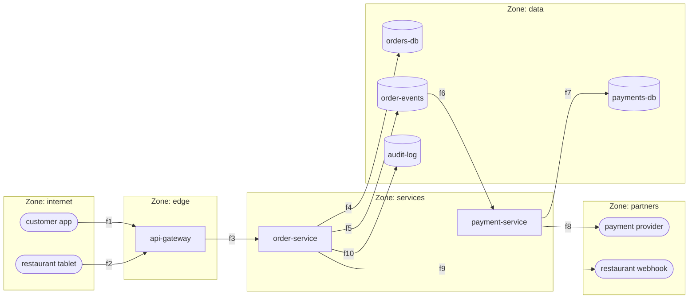

# 35. Security Fundamentals & Threat Modeling

<div class="badges" markdown><span class="badge badge-l2">L2 · Practitioner</span><span class="badge badge-l3">L3 · Senior/Lead</span><span class="badge badge-l4">L4 · Architect</span><span class="badge badge-meta">STRIDE · OWASP API Top 10 · authorization · password storage · threat model as code</span></div>

<div class="grid two" markdown>

!!! info "Prerequisites"
    - [Chapter 10](../architecture-patterns/ch10-api-gateway-bff.md): the gateway as the system's edge
    - [Chapter 21](../communication/ch21-rest-api-design.md): REST resources and status codes
    - [Chapter 28](../communication/ch28-idempotency-correlation.md): correlation ids for audit trails

!!! abstract "What you'll learn"
    - **Threat modeling with STRIDE**, kept as code next to the system: FoodFleet's checkout has **21 elements and 69 threats**; **67 mitigated, 2 accepted** with an owner and a review date, **0 open**, and the build fails if a new flow arrives without its mitigations
    - **The OWASP API Security Top 10 (2023)** mapped to concrete controls in a Spring Boot service
    - **Authorization where most API breaches happen** (object, property and function level): the policy agreed with an independently written rule table on **all 18,600** caller × action × order decisions, with **0** cross-customer access
    - **Password storage and login**: PBKDF2 at 600,000 iterations made each guess against a stolen hash **1.7–1.9 million times** more expensive than unsalted SHA-256; a login throttle cut checks against one account from **~26,700 an hour to 18**, from one address or a thousand
    - Two framework defaults worth knowing: **Jackson 3 ignores unknown JSON properties** by default (and Spring Boot 4 keeps that), and a 403 for someone else's object tells the caller it exists

</div>

---

## 1 · Introduction & Context

### The order that anyone could read

FoodFleet's support team got an odd ticket: a customer wrote that the app showed her a stranger's order, with his address and phone number, after she had typed a different number into a link. The investigation found three separate problems, none of them exotic:

- **The order endpoint checked that the caller was logged in, not that the order was theirs.** Order ids were sequential, so every order was one increment away.
- **The response was the stored entity serialised as it was**, including the payment provider's token and an internal fraud score the app never displayed.
- **The "change delivery note" endpoint bound the request body onto that same entity**, so a client could have sent a new status or amount and the service would have saved it.

Authentication worked perfectly throughout. What failed was **authorization** at three levels (object, property, function) and the habit of letting framework conveniences decide what goes in and out. These are the top of the OWASP API Security Top 10 because they are the most common, and they are invisible to a scanner that doesn't know who owns what.

This chapter starts Part 5 by building the habits and tools the rest of the part relies on: **threat modeling** to find what can go wrong before it does, kept as code so it stays current; and the **OWASP API risks** turned into specific, tested controls. Chapters 36–41 then go deep on tokens, Spring Security, service-to-service trust, secrets, edge protection and the supply chain.

### Where it comes from

<ul class="mh-timeline">
<li><span class="when">1975 · Saltzer and Schroeder</span><span class="what">"The Protection of Information in Computer Systems": least privilege, fail-safe defaults, complete mediation, economy of mechanism. Still the checklist.</span></li>
<li><span class="when">1999 · STRIDE</span><span class="what">Loren Kohnfelder and Praerit Garg at Microsoft: six categories of threat, each the violation of one security property.</span></li>
<li><span class="when">2000 · PBKDF2</span><span class="what">RFC 2898: deliberately slow, salted password-based key derivation.</span></li>
<li><span class="when">2003–2004 · OWASP Top 10 and the SDL</span><span class="what">A shared vocabulary for web risks; Microsoft's Security Development Lifecycle makes threat modeling a release requirement.</span></li>
<li><span class="when">2019, 2023 · OWASP API Security Top 10</span><span class="what">APIs get their own list; broken object-level authorization is first in both editions.</span></li>
<li><span class="when">2020 · Threat Modeling Manifesto, NIST SP 800-207</span><span class="what">Threat modeling as a continuous team practice; zero trust: no implicit trust from network location.</span></li>
</ul>

---

## 2 · Core Concepts & Terminology



Threat model
:   A structured answer to four questions (the Threat Modeling Manifesto's): what are we working on, what can go wrong, what are we going to do about it, did we do a good enough job.

Data-flow diagram (DFD)
:   The system drawn as external entities, processes, data stores and data flows, with **trust boundaries** where the level of trust changes (internet → edge, services → partners). Threats concentrate where flows cross boundaries.

STRIDE
:   Spoofing (authenticity), Tampering (integrity), Repudiation (non-repudiation), Information disclosure (confidentiality), Denial of service (availability), Elevation of privilege (authorization). **STRIDE per element** applies only the categories that make sense for each element type.

Authentication and authorization
:   Authentication establishes who the caller is; authorization decides what that caller may do to which object. Most API breaches are authorization failures behind working authentication.

Object, property and function level authorization
:   May this caller act on **this order** (BOLA, API1)? Read or change **this field** (BOPLA, API3)? Call **this operation at all** (BFLA, API5)?

Defence in depth
:   Several independent controls, so one failing doesn't expose the asset: the gateway authenticates, the service authorizes, the database only accepts the service's credentials.

Least privilege, deny by default
:   Every identity gets only what it needs; anything not explicitly allowed is refused (a new endpoint is protected until someone deliberately makes it public).

---

## 3 · How It Works Internally

### STRIDE per element

Each element type is exposed to a subset of STRIDE. An external entity can be impersonated (S) or deny what it did (R), but its internals are out of scope. A data flow can be altered, read or blocked in transit (T, I, D). A data store can be altered, read or made unavailable (T, I, D), and an audit log can also be disputed (R). A process is exposed to all six.

```java
--8<-- "code/chapters/ch35-security-fundamentals/src/main/java/dev/foodfleet/ch35/threatmodel/ElementType.java:11:24"
```

Applying that table to every element of the checkout DFD produces the threat list mechanically; the team's work is the part that needs judgment: for each threat, **a control and where it is implemented or tested**, or **an explicit acceptance** with a reason, an owner and a review date.

### A threat model kept as code

A threat model drawn once in a workshop is out of date by the next sprint. Kept as code next to the services, it changes in the same pull request as the system, gets reviewed like code, and is checked by the build:

```java
--8<-- "code/chapters/ch35-security-fundamentals/src/main/java/dev/foodfleet/ch35/threatmodel/CheckoutThreatModel.java:24:59"
```

`ThreatModel` refuses nonsense (a flow that doesn't cross a trust boundary, a mitigation for a category that doesn't apply to the element), and the build fails while any threat is open:

```java
--8<-- "code/chapters/ch35-security-fundamentals/src/test/java/dev/foodfleet/ch35/threatmodel/ThreatModelTest.java:10:23"
```

Adding a "rider-app → gateway" flow to the model without deciding how it is protected now breaks the build, which is the point: the conversation happens before the code ships.

### The OWASP API Security Top 10 (2023), mapped

| Risk | What goes wrong | FoodFleet's control | Where |
|---|---|---|---|
| **API1** Broken Object Level Authorization | A caller acts on an object that isn't theirs by changing an id | `OrderAccessPolicy` decides with the authenticated caller and the stored order; others' orders answer 404 | this chapter |
| **API2** Broken Authentication | Weak credential handling, guessable or unexpiring tokens | Signed, expiring tokens; PBKDF2 password storage; login throttling; same answer for unknown users | this chapter, 36, 37 |
| **API3** Broken Object Property Level Authorization | Reading fields one shouldn't (excessive exposure) or setting them (mass assignment) | `OrderView` per audience; `OrderPatch` with only the changeable fields, unknown fields rejected | this chapter |
| **API4** Unrestricted Resource Consumption | Unbounded page sizes, uploads, expensive queries | `PageLimits`; rate limits at the edge | this chapter, 40 |
| **API5** Broken Function Level Authorization | Calling admin or staff functions as a regular user | Role checks in the service for refunds and exports, not only hidden UI | this chapter, 37 |
| **API6** Unrestricted Access to Sensitive Business Flows | Automating a legitimate flow at harmful scale (bulk sign-ups, coupon abuse) | Per-account limits on promotions; bot detection at the edge | 40 |
| **API7** Server Side Request Forgery | The server fetches a URL the caller chose, reaching internal systems | `OutboundUrlPolicy` checks resolved addresses; no redirects | this chapter |
| **API8** Security Misconfiguration | Verbose errors, open actuator endpoints, permissive CORS, missing TLS | Problem details without internals; actuator locked down; TLS everywhere | this chapter, 40 |
| **API9** Improper Inventory Management | Forgotten old versions and test endpoints still live | API catalogue from OpenAPI specs; retirement dates per version | 27, 40 |
| **API10** Unsafe Consumption of APIs | Trusting partner APIs' responses blindly | Partner responses validated and bounded; timeouts; no redirects | this chapter, 18 |

### Object-level authorization in one place

Every operation on an order asks one policy, with the **authenticated** caller and the **stored** order. The request's ids say which order is meant, never who may touch it:

```java
--8<-- "code/chapters/ch35-security-fundamentals/src/main/java/dev/foodfleet/ch35/orders/OrderAccessPolicy.java:19:28"
```

The checks live in the service, not the controller, so a message listener or batch job calling the same service gets them too. An order the caller may not read answers **404, not 403**: a 403 would confirm that the id exists, which turns sequential ids into a map of the business.

```java
--8<-- "code/chapters/ch35-security-fundamentals/src/main/java/dev/foodfleet/ch35/orders/OrderService.java:26:38"
```

```java
--8<-- "code/chapters/ch35-security-fundamentals/src/main/java/dev/foodfleet/ch35/orders/OrderService.java:73:76"
```

### Property-level authorization: separate types in and out

The stored `Order` carries fields no client may see (risk score, payment token) or change (status, amount, owner). It is never serialised to a client or bound from a request. Clients receive an `OrderView` shaped for their role:

```java
--8<-- "code/chapters/ch35-security-fundamentals/src/main/java/dev/foodfleet/ch35/orders/OrderView.java:14:22"
```

and send an `OrderPatch` that **cannot express** a status or amount, whatever the JSON contains:

```java
--8<-- "code/chapters/ch35-security-fundamentals/src/main/java/dev/foodfleet/ch35/orders/OrderPatch.java:12:26"
```

!!! warning "Jackson 3 ignores unknown properties by default"
    Jackson 3 turned `FAIL_ON_UNKNOWN_PROPERTIES` **off** by default, and Spring Boot 4 leaves it off (it disables it explicitly only with `spring.jackson.use-jackson2-defaults=true`). A client that sends `{"deliveryNote": "...", "status": "REFUNDED"}` to an endpoint bound to `OrderPatch` gets a 200 and no change, which hides both honest client bugs and probing. This service turns it on: `spring.jackson.deserialization.fail-on-unknown-properties: true`.

### Passwords and logins

A stolen password table must be expensive to use. **PBKDF2-HMAC-SHA256 at 600,000 iterations** (OWASP's minimum for PBKDF2; Argon2id, scrypt or bcrypt are the alternatives) with a random salt per password makes each guess cost about as much as a login does. The parameters are stored with the hash, so the work factor can be raised and old hashes upgraded at the next successful login.

Online guessing is handled separately: a **throttle** that makes each further attempt for an account wait twice as long as the last after a few free failures, plus a looser one per source address. It waits rather than locks: a hard lockout lets anyone lock any customer out by failing on purpose. And an unknown username gets the same answer, after similar work, as a wrong password, so the login form doesn't reveal which accounts exist.

```java
--8<-- "code/chapters/ch35-security-fundamentals/src/main/java/dev/foodfleet/ch35/auth/LoginService.java:39:56"
```

### Outbound requests the caller chose

Restaurants register webhook URLs, and the service calls them. Without a check, a URL pointing at the cloud metadata address or an internal admin port makes the service fetch internal data for the caller (API7). The check must look at **the addresses the host name resolves to, all of them**, not the URL's text, because there are many ways to write an internal address and DNS names can point anywhere. The client then refuses redirects, so an approved first URL can't hand the request on to an internal one.

```java
--8<-- "code/chapters/ch35-security-fundamentals/src/main/java/dev/foodfleet/ch35/outbound/OutboundUrlPolicy.java:53:84"
```

The residual risk is a DNS answer that changes between the check and the connection; production deployments also send outbound calls through an egress proxy applying the same rules (chapter 38).

---

## 4 · Design Considerations & Trade-offs

JDK 21 in a 2-vCPU container. `verify/run.sh` needs only a JDK: the security code has no framework dependencies. Two runs; `authz`, `throttle` and `threatmodel` are deterministic; `hashrate` is quoted as the range of both.

### Measured: is the authorization policy right?

Unit tests check chosen cases; the risk with authorization is the combination nobody thought of. `Measure authz` checks **every** decision: 31 callers (20 customers, 4 restaurant owners, 4 riders, support, admin, and a customer who also owns a restaurant) × 120 orders (each customer has an order in every status) × 5 actions, against a rule table written separately from `OrderAccessPolicy`, in the business's words.

| Decisions | Allowed | Denied | Disagreements with the rule table | A customer allowed anything on another customer's order |
|---:|---:|---:|---:|---:|
| 18,600 | 855 | 17,745 | **0** | **0** |

- Writing the rules twice, differently, catches the mistakes a single implementation can't: a forgotten status check, a role that silently implies another, an owner who is also a customer.
- **95% of decisions are denials.** Deny by default is not a slogan here: it is the overwhelming majority of the matrix.

### Measured: what a stolen password table costs an attacker

| Stored as | Hash computations per second, one CPU core | Time per login |
|---|---:|---:|
| SHA-256, unsalted | 11.7–13.0 million | — |
| **PBKDF2-HMAC-SHA256, 600,000 iterations, salted** | **7.0** | **143–144 ms** |

- Each guess against the PBKDF2 table costs **1.7–1.9 million times** more work. Salting also means each password must be attacked separately; an unsalted table falls to one precomputed dictionary.
- The cost is real for the service too: ~0.14 s of CPU per login. That is why logins are throttled, and why the work factor is a capacity-planning number (chapter 46).

### Measured: guessing against one account

A client retries the moment it is allowed, for one simulated hour, always with a wrong password; each check costs 135 ms of PBKDF2 (the measured 143–144 ms, rounded down in the attacker's favour).

| Protection | Password checks against one account in an hour |
|---|---:|
| None (one core verifying PBKDF2 hashes) | 26,666 |
| `LoginThrottle`, one source address | **18** |
| `LoginThrottle`, 1,000 source addresses | **18** |

- The account-level throttle doesn't care how many addresses the guesses come from; the per-address limit additionally stops one address spraying many accounts.
- 18 guesses an hour defeats online guessing of anything but the very weakest passwords; checking new passwords against breached-password lists closes that gap.

### Measured: the threat model

| STRIDE category | Mitigated | Accepted | Open |
|---|---:|---:|---:|
| Spoofing | 7 | 0 | 0 |
| Tampering | 17 | 0 | 0 |
| Repudiation | 7 | 1 | 0 |
| Information disclosure | 17 | 0 | 0 |
| Denial of service | 16 | 1 | 0 |
| Elevation of privilege | 3 | 0 | 0 |
| **Total (21 elements)** | **67** | **2** | **0** |

- **Tampering and information disclosure dominate** because every one of the ten boundary-crossing flows carries both; TLS and mTLS mitigate twenty threats at once.
- **The two acceptances are business decisions**, written down with an owner and a review date: a webhook's 2xx is the only proof of delivery (tablets also poll), and tablets on poor connections may miss updates (restaurants can call support).

### Choosing where each control lives

| Control | Gateway | Service | Database / platform |
|---|---|---|---|
| Authentication (is the token valid?) | ✅ first check | ✅ again (zero trust) | — |
| Object and function authorization | ❌ doesn't know who owns what | ✅ the only place it can be right | Row-level security as defence in depth |
| Property filtering (views, patches) | ❌ | ✅ | — |
| Rate limits, request size limits | ✅ coarse | ✅ per operation | Connection and statement limits |
| Input validation | Schema checks | ✅ business rules | Constraints |
| Outbound request policy | — | ✅ | Egress proxy, network policy |

---

## 5 · Hands-on Implementation

```text
ch35-security-fundamentals/
├── src/main/java/dev/foodfleet/ch35/
│   ├── identity/    Caller, Role, TokenService (HMAC-signed, expiring; replaced in chapters 36–37)
│   ├── orders/      OrderAccessPolicy, OrderService, OrderView, OrderPatch, PageLimits, OrderStore
│   ├── auth/        PasswordHasher (PBKDF2, 600k), LoginThrottle, LoginService, UserDirectory
│   ├── outbound/    OutboundUrlPolicy, WebhookClient
│   ├── threatmodel/ Stride, ElementType, ThreatModel, CheckoutThreatModel, ThreatReport
│   └── web/         TokenAuthenticationFilter (deny by default), controllers, ApiExceptionHandler
├── src/test/java/…  29 unit tests
└── verify/          run.sh, tools/Measure.java (authz, throttle, hashrate, threatmodel)
```

### 🟢 Level 1: think like the system's adversary, for an hour

<div class="badges" markdown><span class="badge badge-l1">L1 · Foundation</span></div>

Draw the feature you're building as a DFD on a whiteboard: who calls it, which services and stores it touches, which partners it talks to, and where trust changes. For each element, ask the STRIDE questions that apply. Write down every threat with what you'll do about it. One hour at design time is cheaper than one incident. The four questions are enough to start: what are we building, what can go wrong, what will we do about it, did we do enough?

### 🔵 Level 2: authorization in the service, separate types in and out

<div class="badges" markdown><span class="badge badge-l2">L2 · Practitioner</span></div>

The controller stays thin: the caller comes from authentication, checks live in `OrderService`, requests bind to `OrderPatch`, responses are `OrderView`s.

```java
--8<-- "code/chapters/ch35-security-fundamentals/src/main/java/dev/foodfleet/ch35/web/OrderController.java:21:57"
```

```yaml
--8<-- "code/chapters/ch35-security-fundamentals/src/main/resources/application.yml"
```

The tests state the rules in the business's terms:

```java
--8<-- "code/chapters/ch35-security-fundamentals/src/test/java/dev/foodfleet/ch35/orders/OrderServiceTest.java:32:68"
```

### 🟣 Level 3: credentials and outbound calls

<div class="badges" markdown><span class="badge badge-l3">L3 · Senior/Lead</span></div>

- Store passwords with a slow, salted, upgradable hash (`PasswordHasher`), or better, don't store them at all: delegate login to an identity provider (chapter 37).
- Throttle by account and by source; never hard-lock accounts; give unknown users the same answer as wrong passwords.
- Treat every URL a caller supplies as hostile; check resolved addresses; refuse redirects; send outbound traffic through an egress proxy.

```java
--8<-- "code/chapters/ch35-security-fundamentals/src/test/java/dev/foodfleet/ch35/outbound/OutboundUrlPolicyTest.java:44:56"
```

### 🔴 Level 4: threat modeling as an engineering practice

<div class="badges" markdown><span class="badge badge-l4">L4 · Architect</span></div>

- **A threat model per system or bounded context**, as code or as structured data next to the architecture docs, updated in the pull requests that change the architecture; reviewed by a security champion in each team.
- **The build checks it**: no open threats, no mitigations pointing at deleted elements, acceptances with owners and expiry dates that fail when stale.
- **Mitigations link to evidence**: a test, a configuration, a platform control. "We use TLS" is a claim; "f3 is covered by the mesh's mTLS policy, verified by the policy test in chapter 38" is evidence.
- **Authorization is a product, not a pattern**: one policy component per domain, exhaustively tested against independently written rules; for many services, a policy engine (OPA, Cedar) with policies reviewed like code.
- **Feed incidents and penetration test findings back** into the model: each finding becomes a threat with a mitigation, so the same class can't recur unnoticed.

### Run and verify

```text
$ verify/run.sh
== authz
31 callers x 120 orders x 5 actions = 18,600 decisions
  allowed 855, denied 17,745
  disagreements with the rule table: 0
  a customer allowed anything on another customer's order: 0

== throttle
password checks against one account in one hour:
  no throttle (one core verifying PBKDF2)       26,666
  LoginThrottle, one source address                 18
  LoginThrottle, 1,000 source addresses             18

== hashrate
hash computations per second on one CPU core:
  SHA-256, unsalted                     13,016,000
  PBKDF2-HMAC-SHA256, 600,000 its.             7.0   (144 ms per login)
  ratio                                  1,871,372x

== threatmodel
FoodFleet checkout: 21 elements, 69 threats

STRIDE category           mitigated  accepted   open
SPOOFING                          7         0      0
TAMPERING                        17         0      0
REPUDIATION                       7         1      0
INFORMATION_DISCLOSURE           17         0      0
DENIAL_OF_SERVICE                16         1      0
ELEVATION_OF_PRIVILEGE            3         0      0
```

!!! question "Try it"
    1. Add a rider app to `CheckoutThreatModel` (an external entity and a flow to the gateway). How many threats open up, and what are the mitigations?
    2. Introduce a bug in `OrderAccessPolicy` (let restaurant owners refund their own orders) and run `Measure authz`. How many disagreements does the rule table find?
    3. Raise `PasswordHasher` to 1,200,000 iterations. What happens to the time per login, and how many logins per second can one core serve at peak?
    4. Change `LoginThrottle.standard` to 3 free failures and a 2 s base delay. How many checks per hour remain?

---

## 6 · Production Readiness

- [x] **A threat model exists for each system**, is updated with architecture changes, and is checked in the build (no open threats; acceptances have owners and review dates)
- [x] **Every operation is authorized in the service** with the authenticated caller and the stored object, not only at the gateway
- [x] **Objects the caller may not see answer 404**; ids are not treated as secrets
- [x] **Entities are never bound from requests or serialised to responses**; request and response types per use case
- [x] **Unknown request fields are rejected** (`fail-on-unknown-properties: true` with Jackson 3)
- [x] **Pages, request bodies and uploads are bounded**; rate limits at the edge and per operation
- [x] **Passwords use a slow, salted, upgradable hash**, or login is delegated to an identity provider
- [x] **Logins are throttled per account and per source**, without hard lockouts; unknown users get the same answer
- [x] **Outbound URLs from users are checked by resolved address**, redirects refused, traffic through an egress proxy
- [x] **Errors carry no stack traces, SQL or class names**; actuator endpoints are not public
- [x] **Authorization tests cover the full role × action × state matrix**, against independently written rules

---

## 7 · Anti-patterns & Pitfalls

!!! pitfall "Incident 1: one increment away from every order"
    **Context.** `GET /orders/{id}` checked authentication only; order ids were sequential.
    **Symptoms.** A customer reported seeing a stranger's order, address and phone number after editing a link.
    **Root cause.** No object-level authorization (API1). The returned entity also included internal fields (API3).
    **Fix.** `OrderAccessPolicy` on every operation, 404 for others' orders, `OrderView` per audience. Verified: 18,600 decisions, 0 disagreements with the rule table, 0 cross-customer access.

!!! pitfall "Incident 2: the patch that could change the price"
    **Context.** The "update delivery note" endpoint bound the request body to the JPA entity for convenience.
    **Symptoms.** A security review found that the same endpoint accepted `status` and `amountPaise`; nothing in the logs showed abuse, which was the worrying part.
    **Root cause.** Mass assignment (API3): the entity's setters were the API. With Jackson 3's defaults, unknown fields would also have been silently ignored after a partial fix, hiding probing.
    **Fix.** `OrderPatch` with only the changeable fields, validated; unknown fields rejected; tests asserting each protected field is refused.

!!! pitfall "Incident 3: the credential table that leaked"
    **Context.** A legacy partner portal stored passwords as unsalted SHA-256; a backup was exposed.
    **Symptoms.** Accounts were taken over within days, mostly those with common passwords.
    **Root cause.** A fast, unsalted hash: measured here at 11.7–13.0 million guesses a second on one core, with one precomputed dictionary covering every account at once.
    **Fix.** PBKDF2 at 600,000 iterations with per-password salts (7 guesses a second), forced resets, throttled logins, and migration of the portal to the company identity provider.

| Anti-pattern | Symptom | Fix |
|---|---|---|
| Authorization only at the gateway | Any authenticated user reaches any object | Object and function checks in the service |
| Trusting ids from the request for ownership | Change a number, see someone else's data | Ownership from the authenticated caller and the stored object |
| 403 for others' objects | Id enumeration confirms what exists | 404 |
| Serialising entities | Internal fields leak | Response types per audience |
| Binding requests to entities | Mass assignment | Request types with only changeable fields |
| Silently ignoring unknown fields | Hidden client bugs and probing | Reject unknown properties |
| Unbounded page sizes | One request reads everything | Page limits, cursors |
| Fast or unsalted password hashes | Stolen tables cracked quickly | PBKDF2/Argon2/bcrypt with salts, upgradable |
| Hard account lockout | Attackers lock out customers | Growing delays, no lockout |
| Fetching user-supplied URLs blindly | Internal services reachable through yours | Check resolved addresses, no redirects, egress proxy |
| A threat model drawn once | Out of date by the next release | Threat model as code, checked in the build |

---

## 8 · Enterprise Case Study

### FoodFleet: security as part of the definition of done

!!! decision "ADR-035: Threat models as code per system; authorization in services with per-use-case request and response types; OWASP API Top 10 controls as tested defaults"
    **Status:** Accepted · **Date:** 2025-05-05

    **Context.** An order-visibility incident traced to missing object-level authorization, entity serialisation and entity binding. Threat models existed as workshop diagrams, last updated a year earlier. Measured on the redesigned order service: the policy agreed with an independently written rule table on all 18,600 decisions; PBKDF2 at 600,000 iterations made each password guess 1.7–1.9 million times costlier than SHA-256; login throttling cut checks against one account from ~26,700 an hour to 18.

    **Decision.** Every system keeps a STRIDE-per-element threat model as code; the build fails on open threats and on expired acceptances; architecture changes update it in the same pull request. Every service authorizes every operation with the authenticated caller and the stored object, in one policy component per aggregate, tested exhaustively against independently written rules; objects the caller may not read answer 404. Request and response types are per use case; entities are never bound or serialised; unknown fields are rejected. Pages and payloads are bounded. User-supplied URLs are checked by resolved address with redirects refused. Passwords live only in the identity provider (chapter 37).

    **Consequences.** ✅ The most common API vulnerability classes are designed out and tested. ✅ Threat models stay current because the build depends on them. ✅ Security reviews start from the model and its evidence. ⚠️ More types (views, patches) per endpoint. ⚠️ The exhaustive authorization tests need maintaining as roles and states grow. ⚠️ Acceptances need owners who actually review them.

### Fintech analogue: authorization as a regulated control 🔴

In banking, broken object-level authorization isn't an embarrassment, it is a reportable breach: one customer seeing another's account. Banks therefore treat entitlements as a regulated control: a central entitlement service or policy engine, every access decision logged with the policy version that made it, segregation of duties enforced in policy (the person who creates a payee can't approve the payment), and periodic access recertification. Threat models are mandatory artefacts for change approval, and penetration tests target authorization specifically, because scanners can't know who owns what.

### E-commerce analogue: accounts, coupons and bots

Large retailers' biggest API risks are account takeover (credential stuffing against login), business-flow abuse (bots buying limited stock, coupon farming: API6) and scraping of prices and inventory. Their controls are layered: breached-password checks and step-up authentication, per-account and per-device throttling, bot management at the edge, and per-account limits on sensitive flows like coupon redemption, combined with the same object-level authorization discipline on order and address APIs.

---

## 9 · Interview Q&A + Summary

#### Q1. What is STRIDE, and how do you apply it? · <span class="badge badge-l2">L2</span><span class="badge badge-l3">L3</span> · Cognizant · SAP

**Short answer:** Six threat categories, each the violation of a security property: Spoofing (authenticity), Tampering (integrity), Repudiation, Information disclosure (confidentiality), Denial of service (availability), Elevation of privilege (authorization). Draw the system as a data-flow diagram with trust boundaries, apply the categories that fit each element type, and record a mitigation or acceptance for each. FoodFleet's checkout: 21 elements, 69 threats.

#### Q2. What is the most common API vulnerability, and how do you prevent it? · <span class="badge badge-l2">L2</span><span class="badge badge-l3">L3</span> · Flipkart · Amazon

**Short answer:** Broken object-level authorization (OWASP API1): authenticated callers acting on objects that aren't theirs by changing an id. Check ownership on every operation in the service, using the authenticated caller and the stored object, never ids from the request; answer 404 for objects the caller can't see; test the full role × action × state matrix.

#### Q3. Why return 404 instead of 403 for someone else's order? · <span class="badge badge-l3">L3</span> · Amazon · Goldman Sachs

**Short answer:** A 403 confirms the object exists, so sequential or guessable ids become a map of the business (order volumes, customer counts). 404 reveals nothing. Use 403 when the caller may see the object but not perform the action, like a customer refunding their own order.

#### Q4. What is mass assignment, and how does it happen in Spring? · <span class="badge badge-l3">L3</span> · SAP · Cognizant

**Short answer:** Binding a request body onto an entity so a client can set fields it shouldn't (status, price, owner): OWASP API3. It happens when controllers accept entities as `@RequestBody`. Use request types with only the changeable fields, and reject unknown fields: Jackson 3, and so Spring Boot 4, ignores them by default; set `spring.jackson.deserialization.fail-on-unknown-properties: true`.

#### Q5. How should passwords be stored? · <span class="badge badge-l2">L2</span> · any

**Short answer:** With a slow, salted, adaptive hash: Argon2id, scrypt, bcrypt, or PBKDF2-HMAC-SHA256 at 600,000+ iterations (OWASP's minimum), with parameters stored so they can be raised. Measured: 11.7–13.0 million SHA-256 guesses a second against 7 PBKDF2 guesses on one core. Better still, let an identity provider hold them.

#### Q6. How do you protect a login endpoint against guessing without locking customers out? · <span class="badge badge-l3">L3</span> · Amazon · JP Morgan

**Short answer:** Growing delays per account after a few failures, plus limits per source address; no hard lockout, which attackers can trigger on purpose. Same answer for unknown users as for wrong passwords. Measured: ~26,700 checks an hour against one account without a throttle, 18 with it, whatever the number of source addresses. Add breached-password checks and MFA.

#### Q7. What is SSRF, and how do you defend against it? · <span class="badge badge-l3">L3</span> · Goldman Sachs · Amazon

**Short answer:** Server-side request forgery (API7): the server fetches a URL the attacker chose, reaching internal systems or cloud metadata. Allow only the schemes and ports you need, resolve the host and refuse internal, loopback, link-local and private addresses (all of the resolved ones, not the URL's text), refuse redirects, and route outbound traffic through an egress proxy with the same rules.

#### Q8. Where should authorization happen in a microservice system? · <span class="badge badge-l3">L3</span><span class="badge badge-l4">L4</span> · Flipkart · SAP

**Short answer:** The gateway authenticates and applies coarse rules; the service that owns the data makes object, property and function decisions, because only it knows who owns what. Services re-verify tokens (zero trust); the database restricts by credentials and, optionally, row-level security as defence in depth.

#### Q9. How do you keep a threat model up to date? · <span class="badge badge-l4">L4</span> · JP Morgan · Goldman Sachs

**Short answer:** Keep it as code or structured data next to the system, change it in the same pull requests as the architecture, and check it in the build: no open threats, acceptances with owners and expiry dates, mitigations linked to tests or configuration. Feed incidents and pen-test findings back into it.

#### Q10. Walk through the OWASP API Security Top 10. · <span class="badge badge-l2">L2</span><span class="badge badge-l3">L3</span> · Cognizant · Amazon

**Short answer:** 2023 edition: API1 broken object-level authorization, API2 broken authentication, API3 broken object property level authorization, API4 unrestricted resource consumption, API5 broken function-level authorization, API6 unrestricted access to sensitive business flows, API7 SSRF, API8 security misconfiguration, API9 improper inventory management, API10 unsafe consumption of APIs. Three of the first five are authorization.

#### Q11. How do you test authorization thoroughly? · <span class="badge badge-l3">L3</span><span class="badge badge-l4">L4</span> · Goldman Sachs · SAP

**Short answer:** Beyond example tests, generate the full matrix of roles × actions × object states and compare the policy against rules written separately, in the business's words. Measured here: 18,600 decisions, 0 disagreements. Include awkward identities (one person with two roles) and every state.

#### Q12. Threat-model a food-delivery checkout. · <span class="badge badge-l4">L4</span> · Swiggy-/Zomato-style system design rounds

**Short answer:** DFD with customer app, restaurant tablet, gateway, order and payment services, their stores, the event topic, the payment provider and restaurant webhooks, across internet, edge, services, data and partner zones. Key threats: BOLA on orders, tampering with amounts (never trust client prices), payment callback spoofing (verify signatures), SSRF through webhooks, card data exposure (provider tokens only), denial of service on the gateway and provider (rate limits, circuit breakers, outbox retries), repudiation of refunds (audit log with caller). Record mitigations and acceptances; check them in the build.

### Key takeaways

- **Threat-model before you build, and keep the model as code**: STRIDE per element turns "what can go wrong" into a checklist the build can enforce.
- **Most API breaches are authorization failures behind working authentication**: check object, property and function access in the service, with the authenticated caller.
- **Separate types for what comes in and what goes out**: never bind or serialise entities; reject unknown fields.
- **Make stolen credentials expensive and guessing slow**: slow salted hashes, throttles without lockouts, or an identity provider.
- **Treat URLs, partner responses and every other input as hostile**: check what they resolve to, bound what you read.

### Further reading

- OWASP, [API Security Top 10 – 2023](https://api-security.owasp.org/editions/2023/en/0x11-t10/)
- OWASP Cheat Sheet Series, [Password Storage](https://cheatsheetseries.owasp.org/cheatsheets/Password_Storage_Cheat_Sheet.html), [Authorization](https://cheatsheetseries.owasp.org/cheatsheets/Authorization_Cheat_Sheet.html) and [Server-Side Request Forgery Prevention](https://cheatsheetseries.owasp.org/cheatsheets/Server_Side_Request_Forgery_Prevention_Cheat_Sheet.html)
- Adam Shostack, *Threat Modeling: Designing for Security* (2014)
- [Threat Modeling Manifesto](https://www.threatmodelingmanifesto.org/) (2020)
- Jerome Saltzer and Michael Schroeder, *The Protection of Information in Computer Systems* (1975)
- NIST, [SP 800-207: Zero Trust Architecture](https://csrc.nist.gov/pubs/sp/800/207/final) (2020)

---

**Previous:** [← 34. Reporting & Analytics Across Services](../data/ch34-reporting-analytics.md) · **Next:** [36. OAuth 2.1, OIDC & JWT →](ch36-oauth2-oidc-jwt.md)
