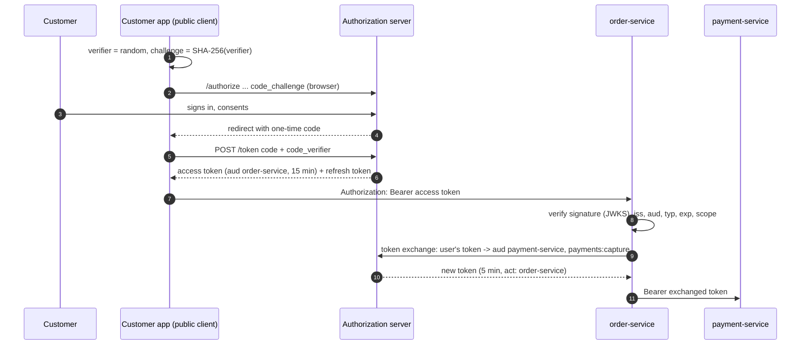

# 36. OAuth 2.1, OIDC & JWT

<div class="badges" markdown><span class="badge badge-l2">L2 · Practitioner</span><span class="badge badge-l3">L3 · Senior/Lead</span><span class="badge badge-l4">L4 · Architect</span><span class="badge badge-meta">authorization code + PKCE · JWT access tokens · JWKS rotation · introspection · token exchange</span></div>

<div class="grid two" markdown>

!!! info "Prerequisites"
    - [Chapter 35](ch35-security-fundamentals.md): authentication vs authorization, the OWASP API Top 10
    - [Chapter 10](../architecture-patterns/ch10-api-gateway-bff.md): the gateway and backends for frontends
    - [Chapter 32](../data/ch32-caching-strategies.md): caches and their staleness

!!! abstract "What you'll learn"
    - **The flows that remain in OAuth 2.1**: authorization code with **PKCE** for users, client credentials for services, refresh tokens; no implicit flow, no password grant
    - **Verifying JWT access tokens properly**: the algorithm from an allowlist, the key by kid, then issuer, **audience**, token type and time. The chapter's verifier rejects each of 14 failure reasons in tests
    - **JWT or introspection**: local ES256 verification took **0.55–0.65 ms** (RS256 ~45 µs), introspection over loopback **1.4 ms** per request; but a revoked JWT kept working for **half its lifetime on average** (450 s for 15-minute tokens), introspection with a 30 s cache **15 s**
    - **Key rotation without errors**: a sudden rotation rejected **29** requests while caches caught up; publishing the key 6 minutes before signing with it rejected **0**. A refresh limit kept 1,000 made-up kids from causing **1,000** JWKS fetches
    - **Token exchange instead of token relay**: order-service traded a user token for 4 scopes and 15 minutes for one with **1 scope, one audience, 5 minutes** and an `act` claim naming itself, in 3–4 ms once per user

</div>

---

## 1 · Introduction & Context

### The token that worked everywhere

FoodFleet's first OAuth setup was quick: the identity provider issued JWTs, every service accepted any token the provider had signed, and services passed the customer's token along to each other ("token relay"). Within a year:

- **A support tool's token reached the payments API.** It was a valid token from the right issuer, minted for a different application; nothing checked its audience.
- **A key rotation caused a minute of 401s.** The provider started signing with a new key; services had cached the old key set and rejected every new token until their caches expired.
- **A customer's token leaked from a partner integration's logs**, and because it was the original token with every scope the app had, it worked against every FoodFleet API for the next hour. Revoking it at the provider changed nothing: the services validated JWTs locally.

Each is a protocol detail that is easy to skip and expensive to learn in production. This chapter builds the pieces with the JDK alone (a token verifier, a key-set cache, PKCE, token exchange and a small authorization server) so every check is visible, measures the trade-offs, and leaves the framework configuration to chapter 37.

### Where it comes from

<ul class="mh-timeline">
<li><span class="when">2007–2012 · OAuth 1.0 to OAuth 2.0</span><span class="what">Delegated access without sharing passwords; RFC 6749 and RFC 6750 (bearer tokens) in 2012 trade signatures for TLS and flexibility.</span></li>
<li><span class="when">2014–2015 · OpenID Connect, JWT, PKCE</span><span class="what">OIDC adds identity (ID tokens, discovery) on top of OAuth; RFC 7519 defines JWTs; RFC 7636 (PKCE) protects the code flow for mobile apps.</span></li>
<li><span class="when">2020 · Token exchange and JWT best practices</span><span class="what">RFC 8693 for one service acting on a user's behalf at another; RFC 8725 on algorithm confusion and other JWT pitfalls.</span></li>
<li><span class="when">2021–2023 · JWT access tokens, DPoP</span><span class="what">RFC 9068 profiles JWT access tokens (<code>typ: at+jwt</code>); RFC 9449 binds tokens to a client key.</span></li>
<li><span class="when">2025 · RFC 9700</span><span class="what">The OAuth 2.0 Security Best Current Practice: PKCE everywhere, no implicit or password grants, exact redirect matching.</span></li>
<li><span class="when">2026 · OAuth 2.1</span><span class="what">The consolidated specification is still an Internet-Draft (draft-ietf-oauth-v2-1-16, September 2026); its rules are what RFC 9700 already recommends.</span></li>
</ul>

---

## 2 · Core Concepts & Terminology



Resource owner, client, authorization server, resource server
:   The user; the application acting for them; the server that authenticates users and issues tokens (Keycloak, Spring Authorization Server, Okta, Entra ID); the APIs that accept tokens (FoodFleet's services).

Public and confidential clients
:   A mobile or single-page app can't keep a secret (public); a server-side application or service can (confidential) and authenticates to the token endpoint.

Authorization code flow with PKCE
:   The user signs in at the authorization server, which redirects back with a short-lived one-time code; the client redeems the code, proving with the PKCE verifier that it started the flow. The only user flow in OAuth 2.1.

Client credentials
:   A service obtains a token for itself, with no user involved: batch jobs, service-to-service calls not on a user's behalf.

Access token, refresh token, ID token
:   An access token is for APIs; a refresh token obtains new access tokens without the user; an ID token (OIDC) tells the **client** who signed in and is never sent to APIs.

JWT and opaque tokens
:   A JWT carries signed claims that resource servers verify locally with the issuer's public keys; an opaque token is a reference that resource servers must **introspect** at the authorization server (RFC 7662).

Scopes and audience
:   Scopes are what the client may do for the user (`orders:read`); the audience is which API the token is for (`order-service`). A token without a checked audience is accepted by every API that trusts the issuer.

Token relay and token exchange
:   Relay forwards the user's token unchanged to the next service. Exchange (RFC 8693) trades it for a new token with one audience, fewer scopes, a shorter life and an `act` claim naming the service acting.

---

## 3 · How It Works Internally

### Verifying a JWT access token

A JWT is `base64url(header).base64url(claims).base64url(signature)`. The header names the algorithm and the key (`kid`); the claims are only trustworthy **after** the signature checks out with a key from the issuer's JWKS. The order of checks matters:

```java
--8<-- "code/chapters/ch36-oauth2-oidc-jwt/src/main/java/dev/foodfleet/ch36/jwt/JwtVerifier.java:63:95"
```

- **The algorithm comes from the verifier's allowlist**, and the key must be meant for it. A verifier that lets the token's header pick the algorithm can be fooled into "none", or into checking an HMAC made with the public key as the secret (RFC 8725's algorithm confusion). This verifier can't even be configured with a symmetric algorithm.
- **`typ` must be `at+jwt`** (RFC 9068), so an ID token, which the same issuer signs with the same keys, isn't accepted as an access token.
- Unknown critical headers are refused rather than ignored.

Then the claims:

```java
--8<-- "code/chapters/ch36-oauth2-oidc-jwt/src/main/java/dev/foodfleet/ch36/jwt/JwtVerifier.java:96:117"
```

The audience check is the one most often missing: without it, every token the issuer ever signed for any application works against this API.

### Keys, discovery and rotation

Resource servers find the issuer's keys through OpenID Connect discovery (`/.well-known/openid-configuration` → `jwks_uri`) and cache them. When the issuer rotates keys, tokens arrive with a kid the cache hasn't seen; refreshing on an unknown kid picks the new key up, but must be rate-limited, or tokens with made-up kids turn every request into a JWKS fetch:

```java
--8<-- "code/chapters/ch36-oauth2-oidc-jwt/src/main/java/dev/foodfleet/ch36/discovery/JwksClient.java:52:69"
```

The rate limit means a key used the moment it is published is rejected for up to 30 s. The issuer avoids that by **staging** rotation: publish the next key, wait longer than resource servers cache key sets, then start signing with it; keep the previous key published until its tokens have expired.

### PKCE: why the code alone isn't enough

The redirect carrying the authorization code passes through the browser or the mobile OS, where another app registered for the same URL scheme, a referrer header or a log can capture it. With PKCE the client sends `SHA-256(verifier)` with the authorization request and the verifier with the code; a stolen code is worthless without the verifier, which never left the client. The authorization server also binds the code to the client and the exact redirect URI, lets it be used once, and **revokes what it produced if it is used twice** (a reused code means someone else has it):

```java
--8<-- "code/chapters/ch36-oauth2-oidc-jwt/src/main/java/dev/foodfleet/ch36/authserver/MiniAuthorizationServer.java:210:228"
```

### JWTs or opaque tokens

A JWT is checked without a network call, so resource servers keep working when the authorization server is slow or down, but **it stays valid until it expires**: logging out, disabling an account or revoking the token at the issuer doesn't reach services that validate locally. An opaque token is introspected, so revocation is immediate, but every request (or every cache miss) costs a call to the authorization server, which becomes a critical dependency. The common answers are short-lived JWTs (5–15 minutes) with refresh tokens that *can* be revoked, and introspection for the few APIs where immediate revocation matters (payments, admin).

### Token exchange instead of relay

A relayed user token is a bearer credential for everything the user's app may do, valid wherever its audience is accepted. Exchange limits what a downstream leak can do:

```java
--8<-- "code/chapters/ch36-oauth2-oidc-jwt/src/main/java/dev/foodfleet/ch36/exchange/TokenExchangePolicy.java:55:92"
```

- **Audience**: one target service, chosen from what the calling service is allowed to reach.
- **Scopes**: the intersection of what was requested, what the user's token had and what the target allows; the calling service can't gain scopes the user never granted.
- **Lifetime**: capped (5 minutes here) and never beyond the user's token.
- **`act`**: the token says *which service* is acting for *which user*, so payment-service can authorize on both and audit logs show the chain.

---

## 4 · Design Considerations & Trade-offs

JDK 21 in a 2-vCPU container; the chapter's authorization server on a loopback port. `verify/run.sh` needs only a JDK. Two runs; ranges show both.

### Measured: algorithms

One thread, 3 s per figure; the token carries 8 typical claims.

| Algorithm | Signs/s | Verifies/s | Token size |
|---|---:|---:|---:|
| ES256 (P-256) | 4,614–4,848 | 1,506–1,656 | 394 bytes |
| RS256 (2048-bit) | 924–1,040 | 22,228–24,215 | 650 bytes |

- **RSA is cheap to verify and expensive to sign; ECDSA the reverse** (in the JDK's implementations). In a microservice system tokens are verified far more often than they are signed (every service, every request), so RS256 costs resource servers ~15× less CPU; ES256 tokens are 40% smaller, which matters in headers and cookies.
- Either is a small cost per request compared with a network call, but at thousands of requests per second per pod, the difference is a measurable share of a core.

### Measured: validating every request

3,000 requests, after warm-up.

| Method | p50 | p99 | Calls to the authorization server |
|---|---:|---:|---|
| JWT verified locally (ES256, cached JWKS) | 552–652 µs | 9.5–11.2 ms | 2 in total (discovery, JWKS) |
| Opaque token introspected per request | 1,403–1,426 µs | 6.2–6.3 ms | one per request |

- **Locally verified JWTs make no calls**: the authorization server can be down and APIs keep working until tokens expire. The local p99 here is garbage-collection and scheduling noise on two shared CPUs; RS256 would bring the median to ~45 µs.
- **Introspection costs a network round trip per request** even on loopback (more across a network), and the authorization server must scale with total API traffic. Caching introspection results trades that back for staleness.

### Measured: how long a revoked token keeps working

100,000 tokens revoked at a random moment of their life (logout, a disabled account, a leaked token).

| Token lifetime | Resource servers check by | Mean | Worst |
|---|---|---:|---:|
| 5 min | Local JWT verification | 150 s | 300 s |
| 15 min | Local JWT verification | 450 s | 900 s |
| 60 min | Local JWT verification | 1,802 s | 3,600 s |
| any | Introspection, cached 30 s | 15 s | 30 s |
| any | Introspection, no cache | 0 s | 0 s |

- **A JWT's lifetime is its revocation delay**: on average half of it, at worst all of it. One-hour access tokens mean a leaked token works for up to an hour after it is "revoked".
- Short lifetimes are cheap with refresh tokens (rotated on each use, revocable, kept only by the client) and exchanged downstream tokens of minutes.

### Measured: key rotation and unknown kids

A resource server's JWKS cache, refreshed every 5 minutes and on an unknown kid at most every 30 s.

| Situation | Result |
|---|---|
| 1,000 tokens with made-up kids, refresh limit 30 s | all rejected, **0** JWKS fetches |
| 1,000 tokens with made-up kids, no refresh limit | all rejected, **1,000** JWKS fetches |
| Sudden rotation (the new key signs at once), one request a second for 10 min | **29** requests rejected |
| Staged rotation (published 6 minutes before it signs) | **0** requests rejected |

- Without a refresh limit, anyone can make every pod fetch the key set on every request, an outage multiplier for the identity provider.
- With the limit, an unannounced new key is rejected until the next allowed refresh. **Staged rotation removes the trade-off**: Keycloak, Spring Authorization Server and cloud identity providers publish keys ahead of use for this reason.

### Measured: token exchange

| Token | Audience | Scopes | `act` | Lifetime |
|---|---|---|---|---:|
| The user's, as issued to the app | order-service | orders:read orders:write payments:capture profile:read | — | 900 s |
| Exchanged by order-service | payment-service | payments:capture | `{"sub":"order-service"}` | 300 s |

The exchange is an HTTP call to the authorization server: **3.2–3.6 ms** at the median for the first call per user (11.8–11.9 ms p99), **26–28 µs** afterwards from a cache keyed by the user token's hash.

### Choosing

| Situation | Choice |
|---|---|
| Users in browsers and mobile apps | Authorization code + PKCE; tokens kept by a backend-for-frontend for browsers when possible |
| A service acting for itself | Client credentials (or workload identity, chapter 38) |
| A service acting for a user at another service | Token exchange to a narrow, short-lived token |
| High-volume APIs | Short-lived JWT access tokens, verified locally, audience-checked |
| Immediate revocation required (payments, admin) | Introspection (opaque tokens or JWT + introspection), short cache |
| Token theft is a real threat (mobile, public networks) | Sender-constrained tokens: DPoP or mTLS-bound |

---

## 5 · Hands-on Implementation

```text
ch36-oauth2-oidc-jwt/
├── src/main/java/dev/foodfleet/ch36/
│   ├── json/        Json (strict)
│   ├── jwt/         Jwk, JwtSigner, JwtVerifier, VerifiedJwt, JwtRejected
│   ├── discovery/   JwksClient (discovery, cache, rate-limited refresh)
│   ├── pkce/        Pkce
│   ├── exchange/    TokenExchangePolicy, TokenExchangeClient
│   ├── authserver/  MiniAuthorizationServer (tests and measurements only)
│   └── web/         BearerTokenFilter, OrderController, OAuthBeans
├── src/test/java/…  22 unit tests, including every flow over loopback HTTP
└── verify/          run.sh, tools/Measure.java (crypto, validation, revocation, rotation, exchange)
```

### 🟢 Level 1: pick the flow

<div class="badges" markdown><span class="badge badge-l1">L1 · Foundation</span></div>

Is a user present? Authorization code with PKCE. Is it a service acting for itself? Client credentials. Is it a service acting for a user at another service? Token exchange. If an integration asks for a user's password (the password grant) or puts tokens in URL fragments (the implicit flow), it is using what OAuth 2.1 removed.

### 🔵 Level 2: a resource server that checks everything

<div class="badges" markdown><span class="badge badge-l2">L2 · Practitioner</span></div>

```java
--8<-- "code/chapters/ch36-oauth2-oidc-jwt/src/main/java/dev/foodfleet/ch36/web/BearerTokenFilter.java:33:55"
```

```yaml
--8<-- "code/chapters/ch36-oauth2-oidc-jwt/src/main/resources/application.yml"
```

Rejection reasons go to logs and metrics, never to the client: a 401 with `WWW-Authenticate: Bearer error="invalid_token"` is all a caller needs. A token without the needed scope gets 403 with `error="insufficient_scope"` (RFC 6750).

The tests cover each refusal:

```java
--8<-- "code/chapters/ch36-oauth2-oidc-jwt/src/test/java/dev/foodfleet/ch36/jwt/JwtVerifierTest.java:82:107"
```

### 🟣 Level 3: calling the next service for the user

<div class="badges" markdown><span class="badge badge-l3">L3 · Senior/Lead</span></div>

```java
--8<-- "code/chapters/ch36-oauth2-oidc-jwt/src/main/java/dev/foodfleet/ch36/web/OrderController.java:36:47"
```

The client side caches by a hash of the user's token and refreshes 30 s before expiry; the authorization server enforces the rules, so a compromised order-service still can't obtain tokens for services or scopes outside its allowance.

```java
--8<-- "code/chapters/ch36-oauth2-oidc-jwt/src/test/java/dev/foodfleet/ch36/exchange/TokenExchangePolicyTest.java:27:44"
```

### 🔴 Level 4: an identity platform

<div class="badges" markdown><span class="badge badge-l4">L4 · Architect</span></div>

- **One issuer per trust domain**, run as a product: Keycloak or a managed provider, highly available, with staged key rotation and published rotation policy.
- **Audience per API**, scopes per capability, token lifetimes set by risk (minutes for access tokens, hours to days for rotating refresh tokens).
- **Token exchange policy as configuration**: which service may obtain tokens for which audience and scopes, reviewed like firewall rules.
- **Browser apps behind a BFF**: tokens stay on the server side; the browser holds an HttpOnly session cookie (chapter 10).
- **Sender-constrained tokens** (DPoP, mTLS) for high-value APIs, so a stolen token is useless without the client's key.
- **Monitoring**: token rejections by reason, JWKS fetch rate, introspection latency and error rate, exchange denials.

### Run and verify

```text
$ verify/run.sh
== crypto
one thread, 3 s per figure
alg            signs/s      verifies/s       token bytes
ES256            4,614           1,656               394
RS256              924          24,215               650

== validation
per request, 3000 requests, the authorization server on the same machine (loopback)
method                                            p50 us      p99 us     calls to the issuer
JWT verified locally (ES256, cached JWKS)            652        11172 (discovery + JWKS, once)
opaque token, introspected per request              1403        6171         one per request

== revocation
100,000 tokens revoked (logout, compromised account) at a random moment of their life;
how long each kept working afterwards
lifetime      resource servers check by                         mean         worst
5 min         local JWT verification                           150 s         300 s
5 min         introspection, cached 30 s                        15 s          30 s
5 min         introspection, no cache                            0 s           0 s
15 min        local JWT verification                           450 s         900 s
15 min        introspection, cached 30 s                        15 s          30 s
15 min        introspection, no cache                            0 s           0 s
60 min        local JWT verification                          1802 s        3600 s
60 min        introspection, cached 30 s                        15 s          30 s
60 min        introspection, no cache                            0 s           0 s

== rotation
a resource server's JWKS cache: refreshed every 5 min, and on an unknown kid at most every 30 s

1,000 tokens with unknown kids, refresh limit 30 s: rejected 1,000, JWKS fetched 0 times
1,000 tokens with unknown kids, refresh limit  0 s: rejected 1,000, JWKS fetched 1,000 times

key rotation, one request a second for 10 minutes after the switch:
  sudden (new key signs at once)                        29 requests rejected
  staged (published 6 minutes before it signs)           0 requests rejected

== exchange
token       aud               scope                                                   act                         lifetime
user's      order-service     payments:capture profile:read orders:read orders:write  -                              900 s
exchanged   payment-service   payments:capture                                        {"sub":"order-service"}        300 s

exchange cost: first call per user p50 3191 us, p99 11889 us (an HTTP call to the issuer); later calls from the cache 27.6 us
```

!!! question "Try it"
    1. Change `TokenExchangePolicy`'s maximum lifetime to 30 minutes. Which measured number in the revocation table now applies to downstream tokens?
    2. In `Measure rotation`, publish the next key only 2 minutes before activating it. How many requests are rejected, and why?
    3. Switch the authorization server to RS256 and rerun `validation`. What happens to the local p50?
    4. Add a check to `JwtVerifier` that rejects tokens older than 1 hour by `iat` even if `exp` is later. Which threat does that address?

---

## 6 · Production Readiness

- [x] **Only authorization code + PKCE for users** and client credentials (or workload identity) for services; no implicit or password grants
- [x] **Redirect URIs matched exactly**; codes single-use, short-lived, bound to client and redirect
- [x] **Resource servers check signature, algorithm allowlist, issuer, audience, `typ`, expiry** and required scopes; reasons logged, not returned
- [x] **JWKS cached with rate-limited refresh**; the issuer rotates keys in stages and keeps old keys until their tokens expire
- [x] **Access tokens live minutes**; refresh tokens rotate on use and are revocable
- [x] **Introspection where immediate revocation matters**, with a short cache and the authorization server scaled for it
- [x] **Token exchange, not relay**, for calls on a user's behalf; exchange policy reviewed
- [x] **Tokens never logged**, never in URLs; cache keys are hashes
- [x] **Browser apps use a BFF** or, at least, no tokens in local storage
- [x] **Monitoring** of rejections by reason, JWKS fetches, introspection and exchange latency and errors

---

## 7 · Anti-patterns & Pitfalls

!!! pitfall "Incident 1: any token from the right issuer"
    **Context.** All services trusted the company identity provider and checked signature, issuer and expiry.
    **Symptoms.** An audit found that a support tool's tokens, minted for that tool, were accepted by the payments API.
    **Root cause.** No audience check: every token the issuer signed was valid everywhere. The same gap would have accepted ID tokens as access tokens.
    **Fix.** Audience per API, `typ: at+jwt` required. Tested: tokens for another audience, another issuer or of another type are rejected.

!!! pitfall "Incident 2: a minute of 401s at every key rotation"
    **Context.** The identity provider rotated its signing key monthly and started using the new key immediately.
    **Symptoms.** For up to a minute after each rotation, a share of API calls failed with 401; retries made it worse.
    **Root cause.** Resource servers' JWKS caches hadn't seen the new key; their refresh limit delayed picking it up. Measured: a sudden rotation rejected 29 requests at one request a second.
    **Fix.** Staged rotation: publish the next key well before it signs. Measured: 0 rejected. Refresh on unknown kid stays rate-limited (1,000 made-up kids caused 0 fetches instead of 1,000).

!!! pitfall "Incident 3: the relayed token in a partner's logs"
    **Context.** order-service relayed customers' tokens to downstream services and to a partner's delivery API.
    **Symptoms.** A token from the partner's leaked logs was used against FoodFleet's profile API. Revoking it at the provider had no effect.
    **Root cause.** The relayed token carried every scope the app had, was valid for an hour, and was verified locally everywhere. Measured: a revoked 60-minute JWT keeps working 30 minutes on average.
    **Fix.** Token exchange for downstream calls (one audience, one scope, 5 minutes, `act` claim); partners get their own client credentials; access tokens shortened to 15 minutes; introspection for the profile and payment APIs.

| Anti-pattern | Symptom | Fix |
|---|---|---|
| No audience check | Any token from the issuer works everywhere | `aud` per API |
| Algorithm taken from the token | `none` or HMAC-with-public-key forgeries | Allowlist, key bound to its algorithm |
| ID tokens sent to APIs | Identity confused with authorization | Access tokens (`at+jwt`) only |
| Implicit flow or password grant | Tokens in URLs; apps handling passwords | Authorization code + PKCE |
| Long-lived access tokens | Revocation doesn't take effect | Minutes, plus refresh tokens |
| Relaying user tokens downstream | One leak, every API | Token exchange |
| Unlimited JWKS refresh | Fetch storms on made-up kids | Rate-limited refresh |
| Signing with a key before publishing it | 401s at rotation | Staged rotation |
| Tokens in logs, URLs or local storage | Theft | Redaction, headers only, BFF |
| Introspection without caching or capacity | Identity provider becomes the bottleneck | Short cache, scaling, or JWTs |

---

## 8 · Enterprise Case Study

### FoodFleet: one issuer, narrow tokens

!!! decision "ADR-036: OAuth 2.1 flows only; audience-checked short-lived JWT access tokens; staged key rotation; token exchange for calls on a user's behalf"
    **Status:** Accepted · **Date:** 2025-05-19

    **Context.** Tokens from one application were accepted by every API; key rotations caused bursts of 401s; relayed customer tokens leaked from a partner's logs and couldn't be revoked. Measured with the JDK: local ES256 verification ~0.6 ms (RS256 ~45 µs) against ~1.4 ms for introspection on loopback; a revoked 15-minute JWT keeps working 450 s on average; sudden rotation rejected 29 requests, staged 0; token exchange narrowed a 4-scope, 15-minute token to 1 scope and 5 minutes.

    **Decision.** Users sign in with authorization code + PKCE; services use client credentials. Access tokens are JWTs (`at+jwt`) with an audience per API and 15-minute lifetimes; refresh tokens rotate and are revocable. Resource servers allow RS256 and ES256 only, check issuer, audience, type, time and scopes, and cache JWKS with rate-limited refresh. The identity provider rotates keys in stages. Calls on a user's behalf use token exchange (one audience, minimum scopes, 5 minutes, `act`). Payment and admin APIs also introspect, with a 30-second cache. Browser apps use a BFF. Chapter 37 implements this with Spring Security and Keycloak.

    **Consequences.** ✅ A token is good for one API, for minutes. ✅ Rotations are invisible. ✅ Downstream leaks are contained. ⚠️ Token exchange adds a call per user per downstream service (cached). ⚠️ Introspection makes the identity provider a dependency of payments. ⚠️ Revocation for most APIs still waits up to 15 minutes.

### Fintech analogue: financial-grade APIs 🔴

Open banking regimes (UK Open Banking, Brazil, Australia's CDR) build on the OpenID Foundation's **FAPI** profiles, which tighten OAuth for money movement: pushed authorization requests (PAR) so authorization parameters can't be tampered with in the browser, sender-constrained tokens (mTLS or DPoP) so stolen tokens are useless, signed request objects, short lifetimes, and private-key client authentication instead of shared secrets. Consent is a first-class object with its own lifecycle, and every API call is tied to a consent id for audit.

### E-commerce analogue: shoppers, partners and bots

Retail platforms issue tokens to shoppers' apps, marketplace sellers' integrations and internal services from one identity platform, with audiences per API family and scopes per capability. Seller integrations get client credentials with narrow scopes and rate limits per client; browser storefronts keep tokens in a BFF; refresh tokens rotate so a stolen one is detected on reuse. During sales, JWT access tokens let the order and catalogue APIs keep authenticating even if the identity platform is under strain.

---

## 9 · Interview Q&A + Summary

#### Q1. Walk through the authorization code flow with PKCE. · <span class="badge badge-l2">L2</span><span class="badge badge-l3">L3</span> · Flipkart · Cognizant

**Short answer:** The client creates a random verifier and sends its SHA-256 hash with the authorization request; the user signs in; the authorization server redirects back with a one-time code; the client redeems the code with the verifier at the token endpoint and gets tokens. A code captured on the way back is useless without the verifier.

#### Q2. What changes in OAuth 2.1? · <span class="badge badge-l2">L2</span><span class="badge badge-l3">L3</span> · SAP · Amazon

**Short answer:** It consolidates the security best practices: PKCE for all authorization code flows, no implicit flow, no password grant, exact redirect URI matching, no bearer tokens in query strings, refresh tokens sender-constrained or rotated. As of September 2026 it is still an Internet-Draft; RFC 9700 already recommends the same.

#### Q3. Access token vs ID token? · <span class="badge badge-l2">L2</span> · Cognizant · any

**Short answer:** The ID token (OIDC) tells the client who signed in; it is for the client and must not be sent to APIs. The access token is for APIs and carries audience and scopes. RFC 9068 marks JWT access tokens with `typ: at+jwt` so resource servers can tell them apart.

#### Q4. What must a resource server check in a JWT? · <span class="badge badge-l3">L3</span> · Amazon · Goldman Sachs

**Short answer:** Signature with a key from the issuer's JWKS, chosen by kid; the algorithm from its own allowlist and matching the key; issuer; audience; type; expiry and not-before with small skew; then scopes for the operation. Missing audience checks and token-chosen algorithms are the classic failures.

#### Q5. JWT or opaque tokens? · <span class="badge badge-l3">L3</span><span class="badge badge-l4">L4</span> · Flipkart · JP Morgan

**Short answer:** JWTs verify locally (measured ~0.05–0.6 ms, no network) and keep working when the issuer is down, but can't be revoked before expiry (a revoked 15-minute token works 450 s on average). Opaque tokens are introspected (a network call per request or cache miss) and revocable immediately. Use short JWTs broadly and introspection where revocation must be immediate.

#### Q6. How do you revoke a JWT? · <span class="badge badge-l3">L3</span> · Goldman Sachs · SAP

**Short answer:** You mostly can't; you limit its life. Keep access tokens short, revoke the refresh token so no new ones are issued, and for sensitive APIs introspect or check a deny-list of token ids. Sender-constrained tokens make stolen ones unusable.

#### Q7. How should signing keys be rotated? · <span class="badge badge-l3">L3</span> · Amazon · JP Morgan

**Short answer:** In stages: publish the new key in the JWKS, wait longer than resource servers cache key sets, start signing with it, and keep the old key published until its tokens expire. Resource servers refresh on unknown kids with a rate limit. Measured: sudden rotation rejected 29 requests, staged 0.

#### Q8. Token relay or token exchange? · <span class="badge badge-l3">L3</span><span class="badge badge-l4">L4</span> · Goldman Sachs · Flipkart

**Short answer:** Relay passes the user's token on, so every downstream service and log holds a credential for everything the user's app may do. Exchange (RFC 8693) gets a new token for one audience, minimum scopes, minutes, with an `act` claim recording the acting service. Relay is acceptable only within one trust boundary with audience-restricted tokens.

#### Q9. RS256 or ES256? · <span class="badge badge-l3">L3</span> · SAP · Amazon

**Short answer:** Both are fine; never HS256 between parties. Measured in the JDK: RS256 verifies ~15× faster (verification dominates in microservices), ES256 signs ~5× faster and tokens are 40% smaller. Choose by what your issuer supports and where the CPU goes.

#### Q10. Where should a browser app keep tokens? · <span class="badge badge-l3">L3</span> · Flipkart · any

**Short answer:** Preferably not in the browser: a backend-for-frontend runs the code flow, keeps tokens server-side, and gives the browser an HttpOnly, Secure, SameSite session cookie. If tokens must be in the browser, keep them in memory, short-lived, with refresh token rotation, never in local storage.

#### Q11. How does a service call another service with no user involved? · <span class="badge badge-l2">L2</span><span class="badge badge-l3">L3</span> · Cognizant · SAP

**Short answer:** Client credentials: the service authenticates to the token endpoint (private key JWT or mTLS better than a shared secret) and gets a token for the target audience with its own scopes. In a mesh, workload identity (SPIFFE, chapter 38) can replace or complement it.

#### Q12. Design authentication and authorization for a food-delivery platform. · <span class="badge badge-l4">L4</span> · Swiggy-/Zomato-style system design rounds

**Short answer:** One identity provider (Keycloak) for customers, restaurant staff, riders and staff tools; authorization code + PKCE in apps, BFF for web; JWT access tokens with audience per API, 15 minutes, rotating refresh tokens; client credentials for batch jobs; token exchange for service calls on a user's behalf; introspection for payments and admin; staged key rotation; object-level authorization in each service (chapter 35).

### Key takeaways

- **OAuth 2.1 leaves two main flows**: authorization code with PKCE for users, client credentials for services; token exchange for acting on a user's behalf.
- **Check everything in a JWT, especially the audience**, and never let the token choose its algorithm.
- **A JWT's lifetime is its revocation delay**: keep access tokens short; introspect where revocation must be immediate.
- **Rotate keys in stages and rate-limit JWKS refresh**.
- **Narrow tokens as they travel**: exchange, don't relay.

### Further reading

- IETF, [The OAuth 2.1 Authorization Framework (draft-ietf-oauth-v2-1)](https://datatracker.ietf.org/doc/draft-ietf-oauth-v2-1/)
- [RFC 9700: Best Current Practice for OAuth 2.0 Security](https://www.rfc-editor.org/rfc/rfc9700) (2025)
- [RFC 8725: JSON Web Token Best Current Practices](https://www.rfc-editor.org/rfc/rfc8725) and [RFC 9068: JWT Profile for OAuth 2.0 Access Tokens](https://www.rfc-editor.org/rfc/rfc9068)
- [RFC 7636: PKCE](https://www.rfc-editor.org/rfc/rfc7636), [RFC 8693: Token Exchange](https://www.rfc-editor.org/rfc/rfc8693), [RFC 7662: Token Introspection](https://www.rfc-editor.org/rfc/rfc7662)
- OpenID Foundation, [OpenID Connect Core 1.0](https://openid.net/specs/openid-connect-core-1_0.html) and [FAPI 2.0 Security Profile](https://openid.net/specs/fapi-security-profile-2_0-final.html)
- Aaron Parecki, [OAuth 2.0 Simplified](https://www.oauth.com/)

---

**Previous:** [← 35. Security Fundamentals & Threat Modeling](ch35-security-fundamentals.md) · **Next:** [37. Spring Security 7 →](ch37-spring-security-7.md)
