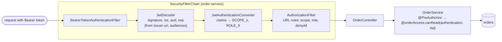

# 37. Spring Security 7

<div class="badges" markdown><span class="badge badge-l2">L2 · Practitioner</span><span class="badge badge-l3">L3 · Senior/Lead</span><span class="badge badge-l4">L4 · Architect</span><span class="badge badge-meta">resource server · method security · Authorization Server · Keycloak · password encoders</span></div>

<div class="grid two" markdown>

!!! info "Prerequisites"
    - [Chapter 35](ch35-security-fundamentals.md): object-level authorization, deny by default
    - [Chapter 36](ch36-oauth2-oidc-jwt.md): what a resource server must check in a JWT
    - [Chapter 8](../foundations/ch08-spring-boot-4-essentials.md): Spring Boot 4 auto-configuration

!!! abstract "What you'll learn"
    - **order-service as a resource server** in one `SecurityFilterChain`: scopes and roles per URL, **deny by default**, stateless; issuer, audience and algorithms from three properties
    - **Mapping Keycloak and Spring Authorization Server tokens** to authorities, keeping only FoodFleet's roles
    - **Method security with object-level checks** (`@PreAuthorize("@orderAccess.canRead(authentication, #id)")`) and a 404 for denied reads
    - **The built-in OAuth 2.1 Authorization Server** (part of Spring Security since 7.0) and three defaults read from its source that FoodFleet changes: **access tokens are addressed to the client** (`aud: customer-app`), **refresh tokens are reused**, **token exchange checks scopes against the requesting client, not the user's token**
    - **Password encoders measured from Spring Security's own code**: bcrypt 10 (the default) **72 ms** per check, bcrypt 12 **289–291 ms**; the PBKDF2 "v5.8" default is **310,000** iterations, about half OWASP's current minimum

</div>

---

## 1 · Introduction & Context

### Three lines of configuration, and what they didn't say

FoodFleet's order-service added `spring-boot-starter-security-oauth2-resource-server`, set `issuer-uri`, and every endpoint required a valid token. It felt finished. Then:

- **A restaurant tablet's token could refund orders.** The token was valid; the refund endpoint only required authentication. Scopes and roles were in the token, but no rule looked at them.
- **The new authorization server broke every API.** The team replaced a homegrown token service with Spring's authorization server; resource servers checking `audiences: order-service` rejected all its tokens, which were addressed to the client applications.
- **Debug endpoints went live with the next release**: `anyRequest().authenticated()` meant any customer could call `/internal/debug`.

Spring Security makes the mechanics easy and leaves the decisions to you. This chapter configures order-service as a resource server with explicit rules, adds method security for per-order decisions, sets up an authorization server and Keycloak with tokens shaped for the resource servers, and measures the password encoders. Every Spring API and property used is checked against the Spring Security 7.1.1 and Spring Boot 4.1.1 sources.

### Where it comes from

<ul class="mh-timeline">
<li><span class="when">2003–2008 · Acegi to Spring Security 2</span><span class="what">Filter chains, the security context and pluggable authentication for Spring applications.</span></li>
<li><span class="when">2017–2018 · Spring Security 5</span><span class="what">Reactive support, OAuth 2.0 login, client and resource server built in (replacing the Spring Security OAuth project).</span></li>
<li><span class="when">2020 · Spring Authorization Server</span><span class="what">A community-driven project to replace the deprecated authorization server support; 1.0 in 2022.</span></li>
<li><span class="when">2022 · Spring Security 6</span><span class="what"><code>AuthorizationManager</code>, <code>authorizeHttpRequests</code>, <code>@EnableMethodSecurity</code>; the lambda DSL becomes the norm.</span></li>
<li><span class="when">2025 · Spring Security 7</span><span class="what">With Spring Boot 4: the authorization server merged into Spring Security (<code>http.oauth2AuthorizationServer(...)</code>), the lambda DSL only, RFC 9068 token validation available.</span></li>
<li><span class="when">2026 · Spring Security 7.1</span><span class="what">The version Spring Boot 4.1.1 manages, used throughout this chapter.</span></li>
</ul>

---

## 2 · Core Concepts & Terminology



SecurityFilterChain
:   An ordered list of servlet filters applied to requests matching the chain. An application can have several (the authorization server has one for its endpoints and one for login).

Authentication and SecurityContext
:   The authenticated principal and its authorities for the current request. A resource server builds a `JwtAuthenticationToken` from a validated JWT.

GrantedAuthority
:   A string the rules test: by convention `SCOPE_orders:read` for scopes, `ROLE_SUPPORT` for roles (`hasRole("SUPPORT")` checks `ROLE_SUPPORT`).

JwtDecoder and validators
:   Decode and verify a JWT. Spring Boot builds one from `issuer-uri` (discovery, JWKS, issuer check), `audiences` and `jws-algorithms`.

AuthorizationManager
:   The decision behind `authorizeHttpRequests` rules and method security annotations.

Method security
:   `@PreAuthorize` and friends on service methods, enabled by `@EnableMethodSecurity`. Expressions can call beans (`@orderAccess...`) and see method arguments (`#id`).

Authorization Server
:   Spring Security's OAuth 2.1 / OpenID Connect provider: registered clients, authorization code + PKCE, client credentials, refresh, token exchange, introspection, revocation, JWKS and discovery.

---

## 3 · How It Works Internally

### The resource server, explicitly

Spring Boot does the token mechanics from three properties:

```yaml
--8<-- "code/chapters/ch37-spring-security-7/src/main/resources/application.yml"
```

The rules are the application's job:

```java
--8<-- "code/chapters/ch37-spring-security-7/src/main/java/dev/foodfleet/ch37/ordersvc/security/SecurityConfig.java:21:44"
```

- **Scopes on URLs** say what the *client application* may do for the user; **roles** say what the *user* is. Both appear: reading orders needs the app to hold `orders:read`; refunds need a support agent.
- **`anyRequest().denyAll()`** instead of `.authenticated()`: an endpoint without a rule is closed, so a forgotten debug endpoint stays closed.
- **Stateless, no CSRF, no form or basic login**: the API receives bearer tokens in a header, which browsers don't attach automatically, so cross-site request forgery doesn't apply; nothing creates a session.

### From token claims to authorities

Keycloak puts realm roles in `realm_access.roles` and scopes in a space-separated `scope` string; Spring's authorization server sends `scope` as a JSON array and, with the customizer below, roles in `roles`. One converter handles both and keeps only roles FoodFleet defines: Keycloak adds `offline_access` and `default-roles-<realm>` to every user, which should never become authorities by accident.

```java
--8<-- "code/chapters/ch37-spring-security-7/src/main/java/dev/foodfleet/ch37/ordersvc/security/TokenClaims.java:23:41"
```

### Method security for per-object decisions

URL rules can't know who owns order 1. The service method can:

```java
--8<-- "code/chapters/ch37-spring-security-7/src/main/java/dev/foodfleet/ch37/ordersvc/orders/OrderService.java:20:31"
```

`@orderAccess` is a bean that loads the order and applies plain-Java rules (testable without Spring). A denied `@PreAuthorize` throws `AuthorizationDeniedException`, which Spring turns into 403; for reads the controller answers 404 instead, so callers can't probe which order ids exist (chapter 35).

### The authorization server, and its defaults

Since Spring Security 7.0 the authorization server is part of Spring Security (`http.oauth2AuthorizationServer(...)`), and Spring Boot configures it from `spring.security.oauth2.authorizationserver.*`. Reading the 7.1.1 sources shows four defaults that matter for microservices:

| Default (source) | Effect | FoodFleet's setting |
|---|---|---|
| Access token `aud` = the client id (`JwtGenerator`) | Resource servers checking their own audience reject every token | Customizer sets `aud` to the APIs the scopes belong to |
| No `typ` header, no `client_id` claim | Not RFC 9068 `at+jwt`; Spring's default validator accepts `typ: JWT` or none | Customizer sets `typ: at+jwt` and `client_id` |
| `reuse-refresh-tokens: true` | A stolen refresh token keeps working alongside the real one | `false` for public clients: rotate on use |
| Token exchange validates requested scopes against the *requesting client's* registration | A service registered with broad scopes can obtain them for any user it has a token for | Register services only with the downstream scopes they need |

```java
--8<-- "code/chapters/ch37-spring-security-7/src/main/java/dev/foodfleet/ch37/authserver/AccessTokenClaims.java:28:58"
```

The rest is configuration:

```yaml
--8<-- "code/chapters/ch37-spring-security-7/src/main/resources/authserver.yml"
```

### Keycloak

In production FoodFleet runs Keycloak. The same decisions appear as realm configuration: realm roles, a public client with PKCE (`pkce.code.challenge.method: S256`) and no direct-access (password) grant, a confidential service client with standard token exchange enabled, and an **audience mapper per scope** so `orders:read` puts `order-service` in `aud`:

```json
--8<-- "code/chapters/ch37-spring-security-7/src/main/resources/keycloak/foodfleet-realm.json:61:89"
```

### Passwords

Where Spring stores passwords (the authorization server's users, legacy logins), `DelegatingPasswordEncoder` prefixes each hash with its algorithm (`{bcrypt}`, `{pbkdf2@SpringSecurity_v5_8}`), so the work factor can rise without breaking old hashes, and `upgradeEncoding` says when to re-hash after a successful login:

```java
--8<-- "code/chapters/ch37-spring-security-7/src/main/java/dev/foodfleet/ch37/authserver/Users.java:24:30"
```

---

## 4 · Design Considerations & Trade-offs

This environment has no Maven repository access, so the Spring applications were not started here. `verify/run.sh` (a JDK, git and access to github.com) does two things: it compiles **spring-security-crypto from the 7.1.1 sources** and measures it, and it checks **every Spring API and property this module uses** against the Spring Security 7.1.1 and Spring Boot 4.1.1 sources (40 checks, all found). The MockMvc security test runs in a normal Maven build. Two runs; ranges show both.

### Measured: Spring Security's password encoders

One thread; median of several runs after a warm-up.

| Encoder | Check (matches) | Logins/s per core |
|---|---:|---:|
| `BCryptPasswordEncoder()`: strength 10, the default | 72.2–72.4 ms | 13.8–13.9 |
| `BCryptPasswordEncoder(12)` | 289.1–290.5 ms | 3.4–3.5 |
| `BCryptPasswordEncoder(14)` | 1,108.5–1,129.1 ms | 0.9 |
| `Pbkdf2PasswordEncoder.defaultsForSpringSecurity_v5_8()`: 310,000 iterations | 70.7–70.9 ms | 14.1–14.2 |
| PBKDF2-HMAC-SHA256, 600,000 iterations (OWASP's minimum) | 135.0–135.5 ms | 7.4 |

- **Each bcrypt strength step doubles the cost**: 10 → 12 is 4×, 12 → 14 another 4×.
- **Framework defaults lag current guidance**: Spring's PBKDF2 "v5.8" defaults are 310,000 iterations; OWASP now asks for 600,000. bcrypt 10 meets OWASP's bcrypt minimum.
- **The work factor is a capacity number**: at bcrypt 12, one core verifies ~3.5 logins a second. A login spike is a CPU spike; throttle logins (chapter 35) and size the identity service for it, or keep passwords in the identity provider.

### Measured: which stored hashes still work

A `DelegatingPasswordEncoder` that encodes `{bcrypt}` at strength 12 and also maps `{pbkdf2@SpringSecurity_v5_8}`.

| Stored hash | Matches the right password | Flagged for upgrade |
|---|---|---:|
| `{bcrypt}` strength 12 (current) | yes | no |
| `{bcrypt}` strength 10 | yes | **yes** |
| `{pbkdf2@SpringSecurity_v5_8}` | yes | **yes** |
| `{noop}` plain text, not mapped | exception: no encoder mapped for the id | — |
| No `{id}` prefix (a legacy column) | exception: no default encoder | — |

- Old hashes keep working and are flagged, so they can be re-hashed at the next successful login, with no password reset.
- Unmapped ids fail loudly instead of silently matching; for a legacy column without prefixes, `setDefaultPasswordEncoderForMatches` names the old algorithm while hashes are migrated.

### Checked: the APIs and defaults this chapter relies on

`verify/check_apis.sh` greps the 7.1.1 and 4.1.1 sources for each declaration; all 40 are found. Among them, the facts behind the table in section 3: `JwtGenerator` sets `audience(Collections.singletonList(registeredClient.getClientId()))`; `OAuth2TokenExchangeAuthenticationProvider` calls `validateRequestedScopes(registeredClient, ...)`; `JwtTypeValidator.jwt()` allows an empty `typ`; Boot's `reuseRefreshTokens = true`, `requireProofKey = true` and `accessTokenTimeToLive = 5 minutes`.

### Choosing

| Need | Spring Security 7 feature |
|---|---|
| API accepting OAuth tokens | `oauth2ResourceServer(jwt)` + `issuer-uri`, `audiences`, `jws-algorithms` |
| Strict RFC 9068 validation | `JwtValidators.createAtJwtValidator().issuer(...).audience(...)` (needs `at+jwt` tokens; Keycloak's are `typ: JWT`) |
| Per-URL coarse rules | `authorizeHttpRequests` with scopes and roles, `denyAll()` last |
| Per-object rules | `@EnableMethodSecurity`, `@PreAuthorize` calling a bean |
| Immediate revocation | `oauth2ResourceServer(opaqueToken)` with introspection |
| Development or embedded identity provider | The built-in Authorization Server, configured by properties |
| Production identity for many apps and users | Keycloak or a managed provider; Spring apps as clients and resource servers |
| Browser apps | `oauth2Login` in a BFF; tokens never reach the browser |

---

## 5 · Hands-on Implementation

```text
ch37-spring-security-7/
├── src/main/java/dev/foodfleet/ch37/
│   ├── ordersvc/security/  SecurityConfig, TokenClaims, TokenAuthoritiesConverter
│   ├── ordersvc/orders/    OrderService (@PreAuthorize), OrderAccess, OrderRules, OrderController, OrderStore
│   └── authserver/         AuthServerApplication, AccessTokenClaims, ScopeAudiences, Users
├── src/main/resources/     application.yml (order-service), authserver.yml, keycloak/ (realm, compose)
├── src/test/java/…         unit tests, PasswordUpgradeTest (real encoders), OrderServiceSecurityTest (MockMvc)
└── verify/                 run.sh, tools/Measure.java, check_apis.sh, stubs/ (4 tiny stand-ins for compiling crypto)
```

### 🟢 Level 1: a protected API in three properties

<div class="badges" markdown><span class="badge badge-l1">L1 · Foundation</span></div>

Add `spring-boot-starter-security-oauth2-resource-server`; set `issuer-uri`, `audiences` and `jws-algorithms`. Every endpoint now needs a valid token for this API. Then write the rules: what each URL needs, and `denyAll()` for everything else.

### 🔵 Level 2: rules you can test

<div class="badges" markdown><span class="badge badge-l2">L2 · Practitioner</span></div>

spring-security-test replaces the decoded JWT, so the filter chain and method security are tested with Keycloak-shaped claims and no identity provider:

```java
--8<-- "code/chapters/ch37-spring-security-7/src/test/java/dev/foodfleet/ch37/ordersvc/OrderServiceSecurityTest.java:38:70"
```

### 🟣 Level 3: an authorization server that issues the right tokens

<div class="badges" markdown><span class="badge badge-l3">L3 · Senior/Lead</span></div>

- Set the audience to the APIs, not the client; add `typ: at+jwt` and `client_id`.
- Rotate refresh tokens for public clients (`reuse-refresh-tokens: false`).
- Register each service only with the scopes it may obtain downstream; Spring checks exchanges against that registration.
- Store client secrets as `{bcrypt}` hashes from the secret store (chapter 39); prefer `private_key_jwt` or mTLS client authentication for services.

```bash
# run the development authorization server, then order-service
ORDER_SERVICE_CLIENT_SECRET='{bcrypt}…' DEV_USER_PASSWORD=… mvn -pl chapters/ch37-spring-security-7 spring-boot:run \
  -Dspring-boot.run.main-class=dev.foodfleet.ch37.authserver.AuthServerApplication
mvn -pl chapters/ch37-spring-security-7 spring-boot:run \
  -Dspring-boot.run.main-class=dev.foodfleet.ch37.ordersvc.OrderServiceApplication
```

### 🔴 Level 4: one security model across services

<div class="badges" markdown><span class="badge badge-l4">L4 · Architect</span></div>

- **A shared, thin security library** (chapter 72's platform): the claims converter, the audience convention, deny-by-default as the base chain, problem-detail error responses. No business rules in it.
- **Identity in Keycloak, decisions in services**: Keycloak says who the user is and what the app may do; each service decides per object.
- **Security tests in every service's build**: the MockMvc matrix of roles, scopes and endpoints; a fitness test that fails when an endpoint has no explicit rule.
- **Version and review the realm**: Keycloak configuration exported as code, applied by the pipeline, reviewed like the services' code.
- **Upgrade discipline**: Spring Security's defaults change between majors; read the release notes and re-run `check_apis.sh`-style checks against the new sources.

### Run and verify

```text
$ verify/run.sh
== encoders
one thread; median of several runs after one warm-up
encoder                                                  encode ms    matches ms     logins/s per core
BCryptPasswordEncoder() (strength 10, the default)            73.1          72.2                  13.9
BCryptPasswordEncoder(12)                                    259.2         290.5                   3.4
BCryptPasswordEncoder(14)                                   1094.0        1129.1                   0.9
Pbkdf2 defaultsForSpringSecurity_v5_8 (310,000)               72.0          70.7                  14.2
Pbkdf2, 600,000 iterations (OWASP minimum)                   139.8         135.5                   7.4

== upgrade
DelegatingPasswordEncoder: encodes {bcrypt} at 12, also maps {pbkdf2@SpringSecurity_v5_8}
stored hash                         matches the right password                  upgrade?
{bcrypt} strength 12 (current)      true                                           false
{bcrypt} strength 10                true                                            true
{pbkdf2@SpringSecurity_v5_8}        true                                            true
{noop} (plain text, not mapped)     exception: There is no password encoder m...             -
no {id} prefix (legacy column)      exception: Given that there is no default...             -

== apis
-- 40 declarations checked in Spring Security 7.1.1 and Spring Boot 4.1.1 (full list in the module README)
all APIs found
```

!!! question "Try it"
    1. Change `anyRequest().denyAll()` to `anyRequest().authenticated()` and run `OrderServiceSecurityTest`. Which test fails, and what would have shipped?
    2. Remove the audience customizer from `AccessTokenClaims` and decode a token from the development authorization server. Which `aud` does order-service see, and what does it answer?
    3. Add `ROLE_SUPPORT` to a Keycloak user's `default-roles-foodfleet` composite. Does `TokenClaims` map it, and should it?
    4. Raise `BCryptPasswordEncoder` to 13 and estimate the cores needed for 200 logins a second at peak.

---

## 6 · Production Readiness

- [x] **Issuer, audience and algorithms configured** for every resource server; tokens for other APIs rejected
- [x] **Explicit URL rules with scopes and roles; `denyAll()` last**
- [x] **Method security for object-level decisions**, in services, with plain-Java rules tested exhaustively
- [x] **Only known roles mapped to authorities**; identity provider housekeeping roles ignored
- [x] **Stateless APIs**: no sessions, no CSRF for bearer-token APIs; CSRF on for cookie-based BFFs
- [x] **Authorization server**: audiences per API, `at+jwt`, rotating refresh tokens, PKCE required, services registered with minimal scopes
- [x] **Client secrets hashed and from the secret store**, or replaced by private-key / mTLS authentication
- [x] **Passwords** with `DelegatingPasswordEncoder` at a measured work factor; old hashes upgraded on login
- [x] **Security tests in the build** (MockMvc matrix) and a check that every endpoint has a rule
- [x] **Keycloak realm as code**, reviewed and applied by the pipeline

---

## 7 · Anti-patterns & Pitfalls

!!! pitfall "Incident 1: authenticated is not authorized"
    **Context.** The resource server was configured with `anyRequest().authenticated()`.
    **Symptoms.** A restaurant tablet's token could call the refund endpoint; a debug endpoint added in a hurry was reachable by any customer.
    **Root cause.** No rule looked at scopes or roles, and new endpoints were open by default.
    **Fix.** Scope and role rules per URL, `denyAll()` last, `@PreAuthorize` with object checks in the service. Tested: refunds need `ROLE_SUPPORT`; an endpoint without a rule answers 403.

!!! pitfall "Incident 2: the authorization server that broke every API"
    **Context.** Resource servers checked `audiences: order-service`; the team moved to Spring's authorization server.
    **Symptoms.** Every request failed with 401 `invalid_token` after the switch.
    **Root cause.** The authorization server's default audience is the requesting client's id (read from `JwtGenerator` in 7.1.1). The tokens were valid, just not for these APIs.
    **Fix.** An `OAuth2TokenCustomizer` setting `aud` from the granted scopes (and from the request for token exchange), plus `typ: at+jwt` and `client_id`.

!!! pitfall "Incident 3: the service that could get any scope"
    **Context.** order-service was registered with every payments scope "to be safe" and used token exchange for refunds.
    **Symptoms.** A security review found order-service could obtain `payments:refund` tokens for any customer whose token it held, although customers' apps never had that scope.
    **Root cause.** Spring's token exchange validates the requested scopes against the requesting client's registration, not against the user's token (`validateRequestedScopes(registeredClient, ...)` in 7.1.1).
    **Fix.** Register services only with the downstream scopes they need; payment-service checks the user's own entitlements as well; chapter 36's stricter exchange policy where the provider allows it.

| Anti-pattern | Symptom | Fix |
|---|---|---|
| `anyRequest().authenticated()` | New endpoints open to every user | `denyAll()` last |
| Only URL rules | Any user reaches any object | `@PreAuthorize` with object checks |
| Mapping every role claim | Identity provider roles become authorities | Map only known roles |
| No audience configured | Tokens for other APIs accepted | `audiences` property |
| Authorization server defaults in production | Client-addressed tokens, reused refresh tokens | Customizer, rotation |
| Services registered with broad scopes | Exchange yields more than the user granted | Minimal registrations |
| CSRF disabled on cookie-based apps | Cross-site requests act as the user | CSRF on for sessions and BFFs |
| Default work factors unexamined | Below current guidance, or CPU spikes | Measure, set, upgrade on login |
| Security tests only by hand | Rules regress silently | MockMvc matrix in the build |

---

## 8 · Enterprise Case Study

### FoodFleet: Keycloak for identity, Spring Security in every service

!!! decision "ADR-037: Keycloak as the identity provider; every service a Spring Security resource server with deny-by-default rules and method security; Spring's authorization server for local development only"
    **Status:** Accepted · **Date:** 2025-06-02

    **Context.** Services accepted any authenticated token for any operation; a migration to Spring's authorization server failed on audiences; a review found token exchange could widen scopes. Verified against the Spring Security 7.1.1 sources: the authorization server addresses access tokens to the client, reuses refresh tokens by default and checks exchanged scopes against the requesting client. Measured with Spring's own encoders: bcrypt 12 costs ~290 ms per login per core; the PBKDF2 v5.8 default is 310,000 iterations.

    **Decision.** Keycloak is the identity provider for customers, restaurants, riders and staff; the realm is versioned and applied by the pipeline, with audience mappers per scope, PKCE for public clients, no password grant, rotating refresh tokens and token exchange for services. Every service is a Spring Security resource server configured by `issuer-uri`, `audiences` and `jws-algorithms`, with a shared claims converter mapping only FoodFleet roles, explicit URL rules ending in `denyAll()`, and method security for object-level decisions. The built-in authorization server runs only in local development, with tokens shaped like Keycloak's. Passwords exist only in Keycloak.

    **Consequences.** ✅ One identity model, one way to configure services. ✅ New endpoints are closed until a rule opens them. ✅ Object-level checks are testable without Spring. ⚠️ Keycloak is a critical dependency (highly available, monitored). ⚠️ Realm changes need the same review as code. ⚠️ Two identity setups (Keycloak, local) must stay aligned; the MockMvc tests use Keycloak-shaped claims to keep them honest.

### Fintech analogue: entitlements beyond roles 🔴

Banks rarely stop at roles: a relationship manager may see *these* clients' accounts, up to *this* amount, during *these* hours, with four-eyes approval above a threshold. Spring Security provides the hooks (custom `AuthorizationManager`s, method security calling an entitlement service), but the decisions come from a central entitlement system or a policy engine whose rules are versioned, audited and recertified. Every decision is logged with the policy version, and step-up authentication (a fresh MFA) is required for sensitive operations, carried as an `acr` or `amr` claim the resource server checks.

### E-commerce analogue: many apps, one identity

A retailer's shopper apps, seller portal, warehouse tools and internal admin all use one identity platform with separate clients, scopes and audiences per API. Sellers' integrations use client credentials scoped to their own catalogue; internal tools sign in through a BFF with `oauth2Login`; each microservice is a resource server with the same converter and deny-by-default base chain from a shared library, and security tests run in every service's pipeline.

---

## 9 · Interview Q&A + Summary

#### Q1. How do you configure a Spring Boot 4 service as an OAuth 2 resource server? · <span class="badge badge-l2">L2</span> · Cognizant · SAP

**Short answer:** Add `spring-boot-starter-security-oauth2-resource-server`; set `spring.security.oauth2.resourceserver.jwt.issuer-uri`, `audiences` and `jws-algorithms`; define a `SecurityFilterChain` with `oauth2ResourceServer(jwt)` and explicit `authorizeHttpRequests` rules ending in `denyAll()`; make it stateless.

#### Q2. hasRole vs hasAuthority? · <span class="badge badge-l2">L2</span> · Cognizant · any

**Short answer:** `hasAuthority("X")` checks the exact string; `hasRole("X")` checks `ROLE_X`. By convention scopes map to `SCOPE_` authorities and roles to `ROLE_`; a converter decides which claims become which.

#### Q3. How do you map Keycloak roles to Spring Security authorities? · <span class="badge badge-l3">L3</span> · SAP · Flipkart

**Short answer:** A `Converter<Jwt, Collection<GrantedAuthority>>` on the `JwtAuthenticationConverter` that reads `realm_access.roles` (and client roles if used) and the `scope` claim, keeping only roles the application defines. Spring Boot 4.1 also offers `authorities-claim-expressions` for simple cases.

#### Q4. Where do object-level checks go in Spring? · <span class="badge badge-l3">L3</span> · Amazon · Goldman Sachs

**Short answer:** In the service, with `@EnableMethodSecurity` and `@PreAuthorize("@orderAccess.canRead(authentication, #id)")`, the bean loading the object and applying plain-Java rules. URL rules can't know who owns an object. Answer 404 for denied reads.

#### Q5. Why is CSRF disabled in this API but not in a BFF? · <span class="badge badge-l3">L3</span> · Amazon · any

**Short answer:** CSRF exploits credentials the browser attaches automatically (cookies). Bearer tokens in an `Authorization` header aren't attached automatically, so a stateless token API doesn't need CSRF protection. A BFF that uses a session cookie does.

#### Q6. What changed in Spring Security 7? · <span class="badge badge-l3">L3</span> · SAP · Cognizant

**Short answer:** It ships with Spring Boot 4: the authorization server is part of Spring Security (`http.oauth2AuthorizationServer`), only the lambda DSL remains, and RFC 9068 validation is available (`JwtValidators.createAtJwtValidator()`). Check the migration guide and re-test security after upgrading.

#### Q7. What defaults of Spring's authorization server would you change? · <span class="badge badge-l3">L3</span><span class="badge badge-l4">L4</span> · Goldman Sachs · JP Morgan

**Short answer:** Access tokens addressed to the client (set audiences per API), refresh tokens reused (rotate them for public clients), no `typ: at+jwt` (add it), and token exchange scopes checked only against the client's registration (register minimal scopes). Read from the 7.1.1 sources in this chapter.

#### Q8. How do you test security rules? · <span class="badge badge-l2">L2</span><span class="badge badge-l3">L3</span> · Flipkart · SAP

**Short answer:** MockMvc with spring-security-test's `jwt()` post-processor and realistic claims: no token → 401, wrong scope → 403, other users' objects → 404, missing role → 403, unknown endpoint → 403. Plain-Java rule classes get exhaustive unit tests.

#### Q9. Which password encoder? · <span class="badge badge-l2">L2</span> · any

**Short answer:** `DelegatingPasswordEncoder` with bcrypt (strength from measurement; 12 cost ~290 ms here) or Argon2; old hashes upgraded on login via `upgradeEncoding`. Spring's PBKDF2 "v5.8" defaults are 310,000 iterations, below OWASP's current 600,000. Better: keep passwords in the identity provider.

#### Q10. Spring Authorization Server or Keycloak? · <span class="badge badge-l3">L3</span><span class="badge badge-l4">L4</span> · Amazon · SAP

**Short answer:** Keycloak (or a managed provider) when you need user management, federation, MFA, admin UI and many applications. Spring's authorization server when you need an embedded, code-configured provider with custom behaviour, or for local development and tests.

#### Q11. How do you handle the "authorization server is down" case? · <span class="badge badge-l3">L3</span> · JP Morgan · Flipkart

**Short answer:** JWT resource servers keep working with cached JWKS until tokens expire; new logins and refreshes fail. Make the identity provider highly available, keep JWKS caching sensible, use short tokens, and alert on token errors.

#### Q12. Design security for FoodFleet's services with Spring. · <span class="badge badge-l4">L4</span> · Swiggy-/Zomato-style system design rounds

**Short answer:** Keycloak realm as code (roles, PKCE clients, audience mappers, token exchange); every service a resource server with a shared converter, scope and role URL rules, `denyAll()` last, method security per object, stateless; BFFs with `oauth2Login` and CSRF for web; security MockMvc tests in every pipeline; passwords only in Keycloak.

### Key takeaways

- **Spring does the token mechanics; you write the rules**: scopes and roles per URL, `denyAll()` last, method security per object.
- **Map claims deliberately**: known roles only, both Keycloak and Spring token shapes.
- **Read the defaults**: Spring's authorization server addresses tokens to the client, reuses refresh tokens and checks exchange scopes against the client's registration.
- **Measure password work factors** and upgrade old hashes on login.
- **Test security in the build** with realistic tokens, and verify framework APIs against the version you run.

### Further reading

- Spring Security reference, [OAuth 2.0 Resource Server](https://docs.spring.io/spring-security/reference/servlet/oauth2/resource-server/index.html), [Method Security](https://docs.spring.io/spring-security/reference/servlet/authorization/method-security.html) and [Authorization Server](https://docs.spring.io/spring-security/reference/servlet/oauth2/authorization-server/index.html)
- Spring Security source, [7.1.1 on GitHub](https://github.com/spring-projects/spring-security/tree/7.1.1)
- Spring Boot reference, [Security](https://docs.spring.io/spring-boot/reference/web/spring-security.html)
- Keycloak documentation, [Server Administration Guide](https://www.keycloak.org/docs/latest/server_admin/) and [Token exchange](https://www.keycloak.org/securing-apps/token-exchange)
- OWASP Cheat Sheet Series, [Password Storage](https://cheatsheetseries.owasp.org/cheatsheets/Password_Storage_Cheat_Sheet.html)

---

**Previous:** [← 36. OAuth 2.1, OIDC & JWT](ch36-oauth2-oidc-jwt.md) · **Next:** [38. Service-to-Service Security →](ch38-service-to-service-security.md)
