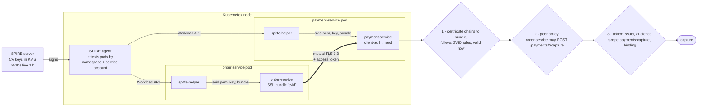

# 38. Service-to-Service Security

<div class="badges" markdown><span class="badge badge-l3">L3 · Senior/Lead</span><span class="badge badge-l4">L4 · Architect</span><span class="badge badge-meta">mTLS · SPIFFE/SPIRE · zero trust · client credentials · Istio</span></div>

<div class="grid two" markdown>

!!! info "Prerequisites"
    - [Chapter 35](ch35-security-fundamentals.md): zero trust, deny by default
    - [Chapter 36](ch36-oauth2-oidc-jwt.md): access tokens, client credentials, token exchange
    - [Chapter 37](ch37-spring-security-7.md): Spring Security resource servers

!!! abstract "What you'll learn"
    - **Workload identity with SPIFFE**: every pod gets `spiffe://foodfleet.internal/ns/<ns>/sa/<sa>` in a short-lived X.509 certificate from SPIRE, by attestation, with no secrets to distribute
    - **Two checks on every call**: *which workload* is calling (mutual TLS + a per-route peer policy, deny by default) and *what it may do for whom* (the access token)
    - **What a standard trust manager misses**: it accepted a certificate with two identities and an ordinary DNS certificate; the SVID rules caught both
    - **Short-lived certificates are your revocation, so watch what extends them**: on JDK 21 a client whose certificate had **expired kept getting new connections accepted** through TLS session resumption (19 of 19); a per-request validity check stopped every one
    - **Rotation and its traps**: without rotation, connections failed from 3.3 s into a 4 s certificate lifetime; with rotation at half-life, **0 of 482 failed**. Spring Boot reloads server certificates but **`RestClientSsl` does not**
    - **Tokens between services**: a stolen bearer token works from any workload; a certificate-bound one did not. Spring's client-credentials interceptor **keyed tokens by user** inside a user's request (20,000 token requests instead of 4)

</div>

---

## 1 · Introduction & Context

### "It's inside the cluster"

FoodFleet's services trusted the network: anything that reached payment-service on port 8080 was assumed to be another FoodFleet service. Then:

- **A debugging pod captured payments.** An engineer's pod in the `riders` namespace called `POST /payments/{id}/capture` while testing; nothing checked who was calling.
- **A token in a log became a key.** order-service's access token for payment-service was logged at DEBUG level; anyone with log access could replay it from anywhere in the cluster for its lifetime.
- **The certificate rotation that took down checkout.** A hand-made internal CA issued one-year certificates; when it expired, every service failed at once, on a Sunday.

Zero trust between services means each call proves *which workload* sends it, each service decides *whether that workload may make this call*, and none of it depends on network location or long-lived secrets. This chapter builds that for FoodFleet: SPIFFE identities from SPIRE, mutual TLS in Spring Boot, a per-route peer policy, tokens that are bound or scoped correctly, and the same intent in Istio. Every claim about TLS behaviour was measured with real TLS 1.3 connections, and every Spring API checked against the source.

### Where it comes from

<ul class="mh-timeline">
<li><span class="when">1999–2008 · TLS client certificates</span><span class="what">Mutual authentication is in TLS from the start; enterprises use it with long-lived certificates and manual rotation.</span></li>
<li><span class="when">2014 · BeyondCorp</span><span class="what">Google describes access decisions based on device and user identity rather than network location: the start of "zero trust" in practice.</span></li>
<li><span class="when">2017 · Istio 0.1, SPIFFE</span><span class="what">Service meshes issue workload certificates automatically; SPIFFE standardises workload identity (SPIFFE IDs, SVIDs, the Workload API).</span></li>
<li><span class="when">2018 · SPIRE</span><span class="what">The SPIFFE reference implementation: node and workload attestation, short-lived SVIDs, automatic rotation.</span></li>
<li><span class="when">2020 · RFC 8705, NIST SP 800-207</span><span class="what">Certificate-bound access tokens and mutual-TLS client authentication for OAuth; NIST's zero trust architecture.</span></li>
<li><span class="when">2022–2024 · CNCF graduation, ambient mesh</span><span class="what">SPIFFE and SPIRE graduate; Istio adds a sidecar-less mode. Spring Boot 3.1 adds SSL bundles, 3.2 hot reload.</span></li>
<li><span class="when">2026 · SPIRE 1.15, Istio 1.31, Spring Boot 4.1</span><span class="what">The versions used and checked in this chapter.</span></li>
</ul>

---

## 2 · Core Concepts & Terminology



Workload identity
:   The identity of a running piece of software (this pod of order-service), as opposed to a user's identity. Proven with a key the workload holds, not with a network address.

SPIFFE ID
:   A URI naming a workload: `spiffe://<trust-domain>/<path>`, for example `spiffe://foodfleet.internal/ns/orders/sa/order-service`. Strict syntax (lowercase trust domain, no query, no `..`), so there is one spelling per identity.

Trust domain and trust bundle
:   The authority that issues identities (`foodfleet.internal`), and the set of CA certificates that validate them. Federation adds other domains' bundles, each trusted only for its own domain.

X.509-SVID
:   A certificate carrying exactly one SPIFFE ID in a URI SAN, `cA=false`, `digitalSignature`, valid for minutes to hours.

SPIRE
:   Issues SVIDs after *attestation*: the agent proves which node it runs on (here, a Kubernetes projected service-account token), then identifies each workload by kernel and kubelet facts (namespace, service account). The workload needs no secret to get its identity.

Mutual TLS (mTLS)
:   TLS where both sides present certificates. It authenticates the workload at the other end of the connection; it does not say what that workload may do.

Peer policy
:   The service's rule for which workload identities may call which routes. Deny by default.

Certificate-bound access token
:   An access token carrying the SHA-256 thumbprint of the client's certificate (`cnf.x5t#S256`, RFC 8705); valid only over a connection authenticated with that certificate.

---

## 3 · How It Works Internally

### What makes a certificate an SVID

A normal TLS trust manager checks that the chain reaches a trusted CA and that the dates are valid. The X509-SVID standard requires more of a certificate that *authenticates*: exactly one URI SAN, holding a SPIFFE ID with a path; not a CA; key usage `digitalSignature` without `keyCertSign` or `cRLSign`. And because certificates are short-lived, "valid now" has to be checked again on each request on a long-lived connection:

```java
--8<-- "code/chapters/ch38-service-to-service-security/src/main/java/dev/foodfleet/ch38/spiffe/X509Svid.java:23:70"
```

### Trust per trust domain

FoodFleet federates with a courier partner. A single trust store holding both CAs would let the partner's CA sign a certificate that says `spiffe://foodfleet.internal/...`. `SpiffeTrustManager` validates each SVID only against the bundle of the trust domain *in its own ID*, then asks an authorizer: servers accept any member and decide per route; clients accept only the one service they meant to call, which replaces hostname verification:

```java
--8<-- "code/chapters/ch38-service-to-service-security/src/main/java/dev/foodfleet/ch38/spiffe/SpiffeTrustManager.java:52:89"
```

### Rotation under a running SSLContext

SPIRE issues one-hour SVIDs and rotates them at half their lifetime. An `SSLContext` built once keeps whatever key material it was given, so the key manager has to change underneath it. The JDK asks the key manager for an alias, then for the chain and the key in separate calls; giving each SVID its own alias means a rotation between those calls cannot pair a new certificate with an old key:

```java
--8<-- "code/chapters/ch38-service-to-service-security/src/main/java/dev/foodfleet/ch38/spiffe/RotatingKeyManager.java:33:42"
```

### payment-service in Spring Boot

Spring Boot does the TLS: a PEM SSL bundle reads the three files spiffe-helper writes from the SPIRE agent, `client-auth: need` refuses connections without a certificate, and `reload-on-update` makes Tomcat pick up rotated files (Spring Boot 4.1.1 registers a bundle update handler for Tomcat and Netty):

```yaml
--8<-- "code/chapters/ch38-service-to-service-security/src/main/resources/payment-service.yml"
```

Tomcat's trust manager is a standard one: it checks the chain and dates, nothing SPIFFE-specific. Spring Security's `x509()` support doesn't fit either: it derives one principal from the certificate's subject **CN** (`SubjectX500PrincipalExtractor`, the default in 7.1.1), while a request between services has two principals, the calling workload and the user or client in the token. So the workload check is a filter that runs before the bearer-token filter:

```java
--8<-- "code/chapters/ch38-service-to-service-security/src/main/java/dev/foodfleet/ch38/web/payments/PeerPolicyFilter.java:39:61"
```

```java
--8<-- "code/chapters/ch38-service-to-service-security/src/main/java/dev/foodfleet/ch38/web/payments/PaymentSecurityConfig.java:27:50"
```

The peer policy matches the raw request URI segment by segment and denies any path with percent-encoding, `;`, `..` or empty segments, so a path that the servlet container, a proxy or Spring would read differently never reaches a rule.

### order-service's client: two Spring defaults replaced

The client side has two traps, both read from the source:

- **`RestClientSsl.fromBundle` builds the request factory once** (`AutoConfiguredRestClientSsl`), and only the embedded servers listen for bundle updates. A `RestClient` built at start-up would present an expired SVID one SVID lifetime later. `PaymentsClient` rebuilds it on every bundle update.
- **`OAuth2ClientHttpRequestInterceptor` resolves the principal from the security context by default** (`SecurityContextHolderPrincipalResolver`), and authorized clients are stored per (registration, principal name). Inside a user's request, a client-credentials token is fetched and stored *per user*. A resolver that finds no principal makes the interceptor use one anonymous principal for every call.

```java
--8<-- "code/chapters/ch38-service-to-service-security/src/main/java/dev/foodfleet/ch38/web/orders/PaymentsClientConfig.java:27:46"
```

```java
--8<-- "code/chapters/ch38-service-to-service-security/src/main/java/dev/foodfleet/ch38/web/orders/PaymentsClient.java:18:31"
```

Ordinary HTTPS clients verify the server's hostname. SPIRE SVIDs carry only the SPIFFE ID unless the registration entry adds DNS names, so FoodFleet's entries add the Kubernetes service name with `-dns`:

```bash
--8<-- "code/chapters/ch38-service-to-service-security/src/main/resources/spire/entries.sh"
```

### One token per service, renewed once

Spring Security's authorized-client manager loads the stored token, renews it when it is within 60 seconds of expiry (`clockSkew`), and saves it, with no lock around those steps: every thread that sees the expiring token fetches its own. `ServiceTokens` is the alternative when the token endpoint feels that: one renewal at 80% of the lifetime while everyone else keeps using the still-valid token:

```java
--8<-- "code/chapters/ch38-service-to-service-security/src/main/java/dev/foodfleet/ch38/token/ServiceTokens.java:48:74"
```

### The same intent in Istio

With a mesh, the sidecars hold the SVIDs (`spiffe://cluster.local/ns/<ns>/sa/<sa>`) and do the mutual TLS. Two defaults from the Istio 1.31 API need changing: a workload with no `PeerAuthentication` is **PERMISSIVE** (plaintext accepted), and a workload with **no ALLOW policy allows every request**:

```yaml
--8<-- "code/chapters/ch38-service-to-service-security/src/main/resources/istio/authorization-policy.yaml"
```

---

## 4 · Design Considerations & Trade-offs

This environment has no Maven repository access and no Kubernetes, so the Spring applications, SPIRE and Istio were not run here. `verify/run.sh` needs only a JDK for the experiments: the SPIFFE, TLS, policy and token code is plain JDK code, certificates come from a JDK-only development CA, and every connection is real TLS 1.3 on loopback. It then checks **42 Spring APIs, properties and defaults** against the Spring Security 7.1.1, Spring Boot 4.1.1 and Spring Framework 7.0.9 sources (all found). JDK 21.0.10, 2 vCPUs, client and server on the same machine; two runs, ranges show both.

### Measured: what mutual TLS costs

One client thread; each connection opens, handshakes, sends one 512-byte request, reads the response and closes. Median of five rounds of 200.

| Connection | ms per connection | Connections/s (one thread) |
|---|---:|---:|
| Plain TCP | 0.25–0.33 | 3,056–4,057 |
| TLS 1.3, server certificate only (EC P-256) | 3.6–4.2 | 237–279 |
| **Mutual TLS 1.3, EC P-256 SVIDs** | **3.9–4.0** | **250–255** |
| Mutual TLS 1.3, RSA-2048 SVIDs | 4.1–4.3 | 234–246 |
| Mutual TLS 1.3, session resumed | 1.7–1.8 | 546–581 |

On one kept-alive connection, a 512-byte round trip took 56–57 µs over mutual TLS (10–42 µs over plain TCP; the plain-TCP runs were noisy).

- **The handshake is the cost; the client certificate adds little to it.** One-way and mutual TLS were within run-to-run noise of each other.
- **Connection reuse matters more than the algorithm**: a pooled connection pays the handshake once. Size connection pools and keep-alive so services do not handshake per request.
- **Resumption halves the handshake**, and is exactly what extends a certificate past its expiry (below).

### Measured: which certificates payment-service refuses, and where

Column A uses `SpiffeTrustManager`; column B a standard PKIX trust manager with FoodFleet's CA in the trust store (what `server.ssl.client-auth=need` with a trust store does). Both then apply the SVID rules and the peer policy per request.

| Client presents | Request | A: SPIFFE trust manager | B: standard trust manager |
|---|---|---|---|
| order-service SVID | capture | 200 | 200 |
| settlement-job SVID | run settlements | 200 | 200 |
| rider-service SVID (valid) | capture | **403** by peer policy | **403** by peer policy |
| order-service SVID | run settlements | 403 by peer policy | 403 by peer policy |
| order-service SVID | `/payments/42/%63apture` | 403 ambiguous path | 403 ambiguous path |
| No certificate | capture | refused in handshake | refused in handshake |
| SVID from `partner.example` (not federated) | capture | refused: no bundle for that domain | refused: path validation |
| order-service ID signed by another CA | capture | refused: signature | refused: path validation |
| Expired SVID | capture | refused: validity | refused: path validation |
| **Two URI SANs** | capture | refused in handshake | **handshake accepted**; 403 per request |
| CA certificate as client certificate | capture | refused: `cA=true` | refused: key usage |
| **Ordinary TLS certificate (DNS SAN only)** | capture | refused in handshake | **handshake accepted**; 403 per request |

- **A valid identity is not permission**: rider-service's genuine SVID was refused by the peer policy, not by TLS.
- **A standard trust manager authenticates certificates that are not SVIDs**: with Tomcat doing the TLS, the per-request SVID check in `PeerPolicyFilter` is what refuses them.

### Measured: an expired certificate that kept working

order-service's SVID expires 3 s after its first connection. It keeps making a new connection every 250 ms, and keeps one connection open, until 6 s after expiry.

| payment-service setup | New connections after expiry | Kept connection after expiry |
|---|---|---|
| JDK defaults (session tickets on) | **19 of 19 accepted** as order-service | accepted |
| Server session timeout 2 s | 19–20 accepted | accepted |
| Server session tickets off, server session timeout 2 s | 19–20 accepted | accepted |
| Client session timeout 2 s | 4 accepted, then 16–17 refused | accepted |
| **JDK defaults + validity checked per request** | **0 accepted, 20 × 403** | **403** |

- **Resumed TLS sessions carry the original certificate.** The trust manager is not called on resumption, and each resumed connection receives a new session ticket, so a client that keeps calling keeps resuming. Neither server-side setting we tried stopped it on JDK 21.0.10; the JDK's default session timeout is 86,400 s.
- **A kept connection was never re-checked**: certificates are checked at the handshake only.
- **The fix belongs on the server**: the client-side timeout helped, but a compromised client won't apply it. Checking the certificate's validity on each request (`spiffeIdValidAt` in `PeerPolicyFilter`) refused every call. Also cap connection age, so connections re-handshake.
- This depends on the TLS implementation: run `verify/run.sh resumption` on the JDK (or proxy) you deploy.

### Measured: rotation

Certificate lifetime scaled down to 4 s (SPIRE's default is 1 h) with rotation at half-life (SPIRE's default); 12 s of new connections every 20 ms, with full handshakes.

| Scenario | OK | Failed | First failure |
|---|---:|---:|---:|
| SVIDs loaded once (an `SSLContext` never updated, like a `RestClient` built at start-up) | 105–115 | 366–377 | 3.3–3.6 s |
| **SVIDs rotated at half-life** (key manager updated) | **477–482** | **0** | — |
| CA rollover at 3.5 s, bundles switched to the new CA | 417–420 | 77–78 | 3.5 s |
| **CA rollover at 3.5 s, bundles hold old + new CA** | **494** | **0** | — |

- Rotation must reach the *client* side too; that is why `PaymentsClient` rebuilds on bundle updates.
- **A CA rollover needs an overlap**: trust both CAs until every SVID signed by the old one has expired (one SVID lifetime). SPIRE works this way: a new X.509 authority is *prepared* (its certificate injected into the bundle) before it is *activated* for signing (`spire-server localauthority x509 prepare` / `activate`).

### Measured: a stolen access token

| Token | Presented over | payment-service |
|---|---|---|
| Bearer | order-service's connection | accepted |
| Bearer | **rider-service's connection** (token copied from a log) | **accepted** |
| Bearer | TLS ended at a proxy; the application sees no certificate | accepted |
| Certificate-bound | order-service's connection | accepted |
| Certificate-bound | **rider-service's connection** | **401**: bound to a different certificate |
| Certificate-bound | TLS ended at a proxy | **401**: no client certificate on the request |

Spring Security 7.1.1 applies this check by default: `JwtValidators.createDefault()` includes the `x5t#S256` validator, which reads the request's client certificate, and Spring Boot's `JwtDecoder` uses those defaults. The last row is the catch: **if a sidecar or ingress terminates TLS, the application never sees the client certificate**, so bound tokens fail there. Use them where the application terminates mutual TLS itself.

### Measured: client-credentials tokens

64 request threads for 9 s, each getting a token and then doing 2 ms of downstream work; token lifetime scaled to 3 s, renewal skew at 20% of it (Spring's 60 s on a five-minute token).

| Strategy | Token requests | Max in flight | p99 to get a token |
|---|---:|---:|---:|
| Fetch a token for every call | 44,304–44,816 | 64 | 37.6–44.1 ms |
| Spring-style store, one principal | 256 | **64** | 1 µs |
| **Spring-style store keyed by the user** (5,000 users) | **20,000** | 64 | 6.5–7.8 ms |
| `ServiceTokens`, single-flight renewal at 80% | **4** | **1** | 1 µs |

- **Cache the token**; it is the difference between 44,000 token requests and 4.
- **Key it by the service, not the user**: with Spring's default principal resolver inside user requests, the service fetched and stored a token per user (5,000 stored).
- **Spring's store renews without a lock**: at each expiry all 64 threads fetched at once. Usually tolerable; single-flight renewal when the identity provider feels it.

### Choosing

| Need | Choose |
|---|---|
| Identity for every workload, no secrets to distribute | SPIRE (or the mesh CA), short-lived SVIDs, rotation at half-life |
| mTLS without changing applications | Istio (STRICT PeerAuthentication + AuthorizationPolicies with an allow-nothing base) |
| Application-level control and audit of the caller | Application-terminated mTLS: Spring Boot SSL bundles + a peer-policy filter |
| Service calls on behalf of a user | Token exchange (chapter 36), plus mutual TLS for the workload |
| Service calls with no user (sagas, jobs) | Client credentials, cached per service; mutual TLS for the workload |
| Tokens that are useless if stolen | Certificate-bound tokens (RFC 8705), where the application sees the client certificate |
| Partners' workloads | SPIFFE federation: their bundle, trusted only for their trust domain |

---

## 5 · Hands-on Implementation

```text
ch38-service-to-service-security/
├── src/main/java/dev/foodfleet/ch38/
│   ├── spiffe/   SpiffeId, X509Svid, SpiffeTrustManager, RotatingKeyManager, TrustBundles, SpiffeTls
│   ├── authz/    PeerPolicy
│   ├── token/    CertificateBinding, ServiceTokens
│   ├── pki/      DevCa (development CA for tests and measurements)
│   └── web/      payments/ (PeerPolicyFilter, PaymentSecurityConfig, …), orders/ (PaymentsClient, PaymentsClientConfig)
├── src/main/resources/   payment-service.yml, order-service.yml, spire/, istio/
├── src/test/java/…       31 JDK tests (several over real TLS 1.3) + PeerPolicyFilterTest (Spring mocks)
└── verify/               run.sh, tools/Measure.java, check_apis.sh
```

### 🟢 Level 1: know who is calling

<div class="badges" markdown><span class="badge badge-l1">L1 · Foundation</span></div>

Turn on mutual TLS between two services with a Spring Boot SSL bundle and `server.ssl.client-auth: need`. Log the caller's certificate on each request. Nothing else changes yet, but every call now arrives from an authenticated workload.

### 🔵 Level 2: decide per route

<div class="badges" markdown><span class="badge badge-l2">L2 · Practitioner</span></div>

Add the peer policy: which SPIFFE IDs may call which routes, deny by default, validity checked per request. Test it like any security rule:

```java
--8<-- "code/chapters/ch38-service-to-service-security/src/test/java/dev/foodfleet/ch38/authz/PeerPolicyTest.java:13:40"
```

### 🟣 Level 3: identity without secrets, rotation without outages

<div class="badges" markdown><span class="badge badge-l3">L3 · Senior/Lead</span></div>

- Deploy SPIRE (server with KMS-held keys, agent per node), register workloads by namespace and service account, run spiffe-helper beside each service.
- SSL bundles with `reload-on-update`; rebuild `RestClient`s on bundle updates.
- One client-credentials token per service; certificate-bound tokens where the application terminates TLS.
- Cap connection age (for example, at half the SVID lifetime) so long-lived connections re-handshake.

```bash
spire-server entry show -spiffeID spiffe://foodfleet.internal/ns/payments/sa/payment-service
openssl x509 -in /run/spiffe/svid.pem -noout -ext subjectAltName -dates   # inside the pod
```

### 🔴 Level 4: zero trust across the platform

<div class="badges" markdown><span class="badge badge-l4">L4 · Architect</span></div>

- **One identity plane**: SPIRE for every workload (Kubernetes, VMs, batch), federated with the mesh and with partners; the identity provider for users.
- **Policies as code**: peer policies and Istio AuthorizationPolicies in the service's repository, reviewed with the code, tested in the pipeline; an "allow-nothing" base in every namespace.
- **Defence in depth that doesn't double the work**: the mesh enforces coarse service-to-service rules; services enforce per-route and per-object rules and audit the caller.
- **Observability**: log the peer SPIFFE ID with every security decision; alert on peer-policy denials and SVID expiry within 10 minutes.
- **Drills**: CA rollover rehearsed in staging every quarter; SPIRE server outage tested (agents keep serving cached SVIDs until they expire).

### Run and verify

```text
$ verify/run.sh rejections
== rejections
A: SpiffeTrustManager at the handshake (any foodfleet.internal SVID), then PeerPolicy per request
B: standard PKIX trust manager with FoodFleet's CA in the trust store, then the same per-request checks
client presents                            request                          A: SpiffeTrustManager                                      B: PKIX trust manager
order-service SVID, capture                POST /payments/42/capture        200, rule capture                                          200, rule capture
settlement-job SVID, run settlements       POST /internal/settlements/run   200, rule settle                                           200, rule settle
rider-service SVID (valid), capture        POST /payments/42/capture        403 by policy                                              403 by policy
order-service SVID, run settlements        POST /internal/settlements/run   403 by policy                                              403 by policy
order-service SVID, encoded path           POST /payments/42/%63apture      403 ambiguous path                                         403 ambiguous path
no client certificate                      POST /payments/42/capture        refused: Empty client certificate chain                    refused: Empty client certificate chain
partner.example SVID (not federated)       POST /payments/42/capture        refused: no trust bundle for trust domain partner.example  refused: PKIX path failed
order-service ID signed by another CA      POST /payments/42/capture        refused: path validation failed: signature check failed    refused: PKIX path failed
order-service SVID, expired                POST /payments/42/capture        refused: path validation failed: validity check failed     refused: PKIX path failed
two URI SANs                               POST /payments/42/capture        refused: more than one URI SAN                             403 more than one URI SAN
CA certificate as client certificate       POST /payments/42/capture        refused: certificate is a CA (cA=true)                     refused: KeyUsage does not allow digital signatures
ordinary TLS certificate (DNS SAN only)    POST /payments/42/capture        refused: no URI SAN                                        403 no URI SAN
```

!!! question "Try it"
    1. In `Measure.rejections`, remove the per-request check from `PaymentService` (`new PaymentService(false)`). Which rows of column B change, and what would they be allowed to do?
    2. Run `verify/run.sh resumption` on JDK 25. Does a resumed session still carry the expired certificate?
    3. Change the CA rollover in `Measure.rotation` to switch bundles 2 s *after* the new CA starts signing. How many connections fail, and why?
    4. Set the token lifetime in `Measure.tokens` to 300 s and the skew to 60 s, and run with 200 threads for 10 minutes. How many concurrent token requests does Spring's store make at expiry?

---

## 6 · Production Readiness

- [x] **Every workload has a SPIFFE identity** from attestation; no shared certificates, no secrets in images
- [x] **Mutual TLS required** (`client-auth: need`, or Istio STRICT); no plaintext path into a service
- [x] **Peer policy per route, deny by default**, matching raw paths; Istio namespaces start from allow-nothing
- [x] **SVID rules and validity checked per request**, not only at the handshake; connection age capped
- [x] **SVIDs short-lived and rotated at half-life**, on servers *and* clients; alert before expiry
- [x] **CA rollover with an overlap** in every trust bundle, rehearsed
- [x] **Federated domains trusted only for their own IDs**
- [x] **Tokens**: one client-credentials token per service; token exchange for user context; bound to certificates where the application sees them
- [x] **No tokens or keys in logs**; DEBUG logging reviewed for headers
- [x] **Peer SPIFFE ID in audit logs** for every decision

---

## 7 · Anti-patterns & Pitfalls

!!! pitfall "Incident 1: the debugging pod that captured payments"
    **Context.** Services trusted anything that reached them inside the cluster.
    **Symptoms.** Payments captured by an engineer's test pod in another namespace; found in reconciliation two days later.
    **Root cause.** No workload authentication: network location was the only control.
    **Fix.** Mutual TLS with SPIFFE IDs, peer policy per route: rider-service's valid SVID now gets 403 on capture. Istio namespaces start from allow-nothing.

!!! pitfall "Incident 2: the revoked workload that kept calling"
    **Context.** A compromised batch job was removed from SPIRE's registrations; its one-hour SVID would expire within the hour.
    **Symptoms.** The job's calls kept succeeding hours after its SVID expired.
    **Root cause.** It kept resuming TLS sessions; the resumed sessions carried the original certificate and the trust manager was never called. Measured: 19 of 19 new connections accepted after expiry on JDK 21 defaults.
    **Fix.** Validity checked on every request in `PeerPolicyFilter` (0 accepted afterwards), connection age capped, and a deny rule for the job's SPIFFE ID while it is investigated.

!!! pitfall "Incident 3: the client that expired an hour after deploy"
    **Context.** order-service built its payment-service `RestClient` with `RestClientSsl.fromBundle("svid")` at start-up; the SSL bundle had `reload-on-update: true`.
    **Symptoms.** Every capture failed with `certificate_unknown` about an hour after each deployment; restarting "fixed" it.
    **Root cause.** Spring Boot reloads the bundle and the embedded server follows; the request factory built for the client kept the original key material (`AutoConfiguredRestClientSsl` builds it once). Measured with a 4 s lifetime: failures from 3.3 s on.
    **Fix.** Rebuild the client on bundle updates (`PaymentsClient`): 0 failures with rotation.

| Anti-pattern | Symptom | Fix |
|---|---|---|
| Trusting the network | Any pod can call anything | mTLS + peer policy |
| mTLS as authorization | Every valid workload can call every route | Peer policy per route, deny by default |
| Istio without STRICT and allow-nothing | Plaintext accepted; no ALLOW policy means allow all | STRICT mesh-wide, allow-nothing base |
| Checking certificates only at the handshake | Expired or revoked identities keep working | Validity per request, connection age cap |
| Long-lived certificates | Annual outages, slow revocation | Short-lived SVIDs, rotation at half-life |
| Rotating servers only | Clients fail one lifetime after start | Rebuild clients on bundle updates |
| Switching CAs without overlap | Failures until every SVID rotates | Old + new CA in bundles |
| One trust store for all domains | A partner CA can sign your IDs | Bundles per trust domain |
| Client-credentials token keyed by user | Token endpoint load × users | Fixed principal for service tokens |
| Bearer tokens in logs | Replayable from anywhere | Bound tokens; never log tokens |

---

## 8 · Enterprise Case Study

### FoodFleet: SPIFFE identities, two checks on every call

!!! decision "ADR-038: SPIRE-issued SPIFFE identities for every workload; mutual TLS with a per-route peer policy in every service; client-credentials or exchanged tokens for what the call may do"
    **Status:** Accepted · **Date:** 2025-06-16

    **Context.** A test pod captured payments; a logged token was replayable; an expired internal CA caused an outage. Measured with real TLS 1.3: mutual TLS costs a 3.9–4.0 ms handshake and 56–57 µs per request on a kept connection; a standard trust manager accepted certificates that are not SVIDs; resumed TLS sessions kept an expired certificate working (19 of 19) until validity was checked per request; rotation at half-life gave 0 failures, a CA switch without overlap 77–78; Spring's client-credentials interceptor keyed tokens per user inside user requests.

    **Decision.** SPIRE issues one-hour X.509-SVIDs to every workload (Kubernetes PSAT node attestation, namespace and service-account workload attestation, CA keys in KMS, DNS SANs for service names), delivered by spiffe-helper to Spring Boot SSL bundles with reload-on-update. Every service requires mutual TLS and runs `PeerPolicyFilter` before token authentication: SVID rules and validity per request, a deny-by-default peer policy per route. Clients are rebuilt on bundle updates; connection age is capped at 30 minutes. Service-only calls use one client-credentials token per service; calls for a user use token exchange (chapter 36). Payment and refund calls use certificate-bound tokens. Namespaces running Istio use STRICT mTLS and allow-nothing AuthorizationPolicies as well.

    **Consequences.** ✅ Every call names its workload; a stolen token or a pod in the wrong namespace gets 403. ✅ No certificates to distribute or renew by hand. ✅ Revocation by expiry actually expires. ⚠️ SPIRE is critical infrastructure (HA servers, monitored agents, rehearsed CA rollover). ⚠️ Peer policies must be maintained with the call graph (generated from the service catalogue, chapter 72). ⚠️ About 4 ms per new connection: connection pools sized and kept warm.

### Fintech analogue: regulated mTLS everywhere 🔴

Banks and payment networks are often *required* to use mutual TLS between systems, and audits ask who called what. The differences from FoodFleet: certificates come from an internal PKI with HSM-held keys and documented ceremonies; client authentication to the authorization server uses `tls_client_auth` (in Spring's authorization server it matches the certificate's subject DN only; SAN-based matching needs a custom `setCertificateVerifier`), and access tokens are certificate-bound by policy (FAPI-style profiles). Revocation can't wait an hour for high-value systems, so lifetimes are shorter still and connections are re-authenticated on a timer; every decision is logged with the peer identity for years.

### E-commerce analogue: a mesh first, applications later

A large retailer with thousands of services starts with the mesh: STRICT mTLS and namespace-level AuthorizationPolicies give workload identity everywhere without touching code. Services that move money or personal data then add application-level checks: the peer identity from the forwarded client certificate header or from application-terminated TLS, per-route policies, and audit. Partner integrations (marketplace sellers, logistics) federate through SPIFFE bundles or mutual TLS at a dedicated gateway, never directly into the mesh.

---

## 9 · Interview Q&A + Summary

#### Q1. What is mutual TLS, and what does it not give you? · <span class="badge badge-l2">L2</span> · Cognizant · SAP

**Short answer:** Both sides present certificates, so each knows which workload is at the other end. It doesn't say what that workload may do (you still need a per-route policy and tokens), it is checked at the handshake only, and it ends wherever TLS is terminated.

#### Q2. What is SPIFFE, and what is SPIRE? · <span class="badge badge-l3">L3</span> · Amazon · SAP

**Short answer:** SPIFFE standardises workload identity: SPIFFE IDs (`spiffe://trust-domain/path`), SVIDs (X.509 or JWT documents carrying them), trust bundles and the Workload API. SPIRE implements it: it attests nodes and workloads (for example by Kubernetes namespace and service account) and issues short-lived SVIDs that rotate automatically, so workloads get identity without secrets.

#### Q3. Why isn't a valid client certificate enough to allow a call? · <span class="badge badge-l3">L3</span> · Goldman Sachs · Flipkart

**Short answer:** It proves identity, not permission. Every workload in the trust domain has a valid certificate; the service must decide which of them may call which route (peer policy, deny by default), and the token decides what may be done for which user.

#### Q4. How do you rotate certificates without downtime? · <span class="badge badge-l3">L3</span> · Amazon · JP Morgan

**Short answer:** Short lifetimes, rotation at about half-life, on both servers and clients (an `SSLContext` built once won't rotate), and CA rollovers with an overlap where bundles trust old and new CAs until every old SVID has expired. Measured: 0 failures with rotation, 77–78 failures on a CA switch without overlap.

#### Q5. A workload's certificate expired. Can it still call you? · <span class="badge badge-l4">L4</span> · Goldman Sachs · JP Morgan

**Short answer:** Possibly. Certificates are checked at the handshake; a kept connection carries on, and a resumed TLS session carries the original certificate without calling the trust manager. On JDK 21 a client kept resuming past expiry (19 of 19 accepted). Check validity per request and cap connection age.

#### Q6. How does Spring Boot do mutual TLS? · <span class="badge badge-l2">L2</span><span class="badge badge-l3">L3</span> · SAP · Cognizant

**Short answer:** SSL bundles: `spring.ssl.bundle.pem.<name>` with keystore and truststore, `server.ssl.bundle` and `server.ssl.client-auth: need`, `reload-on-update: true` for rotated files. Clients use `RestClientSsl.fromBundle`, which builds the request factory once, so rebuild clients on bundle updates.

#### Q7. Service mesh or application-level mTLS? · <span class="badge badge-l3">L3</span><span class="badge badge-l4">L4</span> · Flipkart · Amazon

**Short answer:** A mesh gives mTLS and coarse policies everywhere without code changes, but the application sees no client certificate (certificate-bound tokens and per-request certificate checks don't work there) and Istio's defaults are permissive. Application-terminated mTLS gives the service the peer identity for fine-grained decisions and audit. Many platforms use the mesh broadly and application checks for sensitive services.

#### Q8. Client credentials vs token exchange between services? · <span class="badge badge-l3">L3</span> · Amazon · Goldman Sachs

**Short answer:** Client credentials when the service acts for itself (sagas, jobs): one cached token per service. Token exchange when it acts for a user: a narrower token for the downstream audience carrying the user (chapter 36). Mutual TLS identifies the workload in both cases.

#### Q9. What goes wrong with Spring's client-credentials interceptor? · <span class="badge badge-l3">L3</span> · SAP · Flipkart

**Short answer:** By default it uses the current user as the principal and stores authorized clients per principal, so inside user requests it fetches a token per user (measured: 20,000 token requests and 5,000 stored tokens instead of 4). Use the service-oriented manager and a principal resolver that yields one fixed principal. Renewal has no lock, so many threads renew at once at expiry.

#### Q10. What is a certificate-bound access token? · <span class="badge badge-l3">L3</span> · JP Morgan · Goldman Sachs

**Short answer:** RFC 8705: the token carries the SHA-256 thumbprint of the client's certificate (`cnf.x5t#S256`), and the resource server accepts it only over a connection authenticated with that certificate. A stolen token is useless without the key. Spring Security validates it by default when the claim is present, but only where the application sees the client certificate.

#### Q11. What does "zero trust" mean between microservices? · <span class="badge badge-l2">L2</span> · Cognizant · any

**Short answer:** No trust from network location: every call is authenticated (workload identity), authorized (per route and per object), encrypted, and logged; credentials are short-lived and scoped. NIST SP 800-207 describes the architecture.

#### Q12. Design service-to-service security for FoodFleet. · <span class="badge badge-l4">L4</span> · Swiggy-/Zomato-style system design rounds

**Short answer:** SPIRE issues one-hour SVIDs by attestation; Spring Boot SSL bundles with reload, mutual TLS required; a peer-policy filter (SVID rules and validity per request, deny by default per route) before token checks; client credentials per service for sagas, token exchange for user calls, certificate-bound tokens for payments; Istio STRICT with allow-nothing where the mesh runs; rotation on both sides, CA rollover with overlap, connection age capped; peer identity in every audit log.

### Key takeaways

- **Two checks on every call**: which workload (mTLS + peer policy) and what it may do for whom (the token).
- **SVIDs, not just certificates**: check the SPIFFE rules a standard trust manager ignores, per trust domain.
- **Short-lived means checked often**: resumed sessions and kept connections outlive certificates; check validity per request.
- **Rotate everywhere**: servers and clients, with an overlap for CA rollovers.
- **Defaults to change**: Istio is permissive and allow-all without policies; Spring's client interceptor keys tokens by user and `RestClientSsl` does not reload.

### Further reading

- SPIFFE standards, [SPIFFE ID](https://github.com/spiffe/spiffe/blob/main/standards/SPIFFE-ID.md) and [X509-SVID](https://github.com/spiffe/spiffe/blob/main/standards/X509-SVID.md)
- SPIRE documentation, [server](https://github.com/spiffe/spire/blob/v1.15.3/doc/spire_server.md) and [agent](https://github.com/spiffe/spire/blob/v1.15.3/doc/spire_agent.md) configuration reference
- Istio, [Authorization Policy](https://istio.io/latest/docs/reference/config/security/authorization-policy/) and [Peer Authentication](https://istio.io/latest/docs/reference/config/security/peer_authentication/)
- Spring Boot reference, [SSL](https://docs.spring.io/spring-boot/reference/features/ssl.html)
- IETF, [RFC 8705: OAuth 2.0 Mutual-TLS Client Authentication and Certificate-Bound Access Tokens](https://www.rfc-editor.org/rfc/rfc8705)
- NIST, [SP 800-207: Zero Trust Architecture](https://csrc.nist.gov/pubs/sp/800/207/final)

---

**Previous:** [← 37. Spring Security 7](ch37-spring-security-7.md) · **Next:** [39. Secrets Management →](ch39-secrets-management.md)
